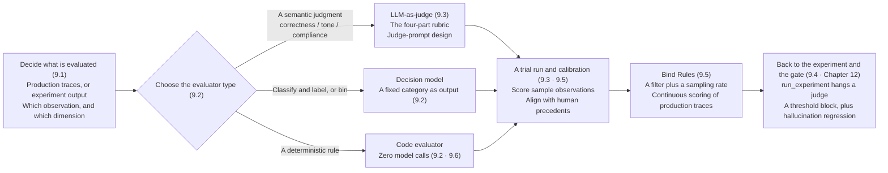
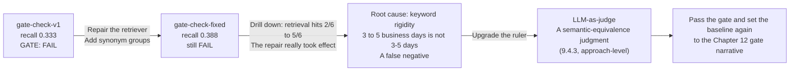
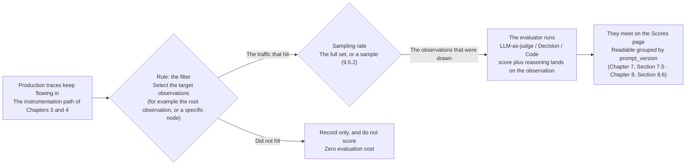
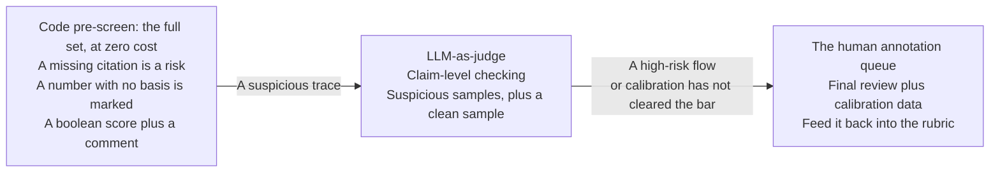

# Chapter 9 Automated evaluation

> Chapter guide: the end of Chapter 8 left two open threads. The false negative of the heuristic recall evaluator interfered twice ("3 到 5 个工作日" ("3 to 5 business days") does not match "3-5 日" ("3-5 days")), and there is a re-check rule that "after the evaluator is upgraded, the baseline has to be set again." This chapter faces that directly. It upgrades the ruler that assigns scores from "keyword groups" to "a model judge" (LLM-as-judge). This chapter follows the full flow of assembling an evaluator. First, on the Evaluators page, confirm in testing the three kinds of evaluator (LLM-as-a-judge / Decision model / Code) and the recommended templates. Then develop the method of designing a judge prompt, which is the core of this chapter: the four-part rubric, reference comparison and absolute scoring, and judge drift and calibration. Then use the three beats of the gate in our running example, confirmed in testing (0.333 FAIL, then after the retriever is repaired 0.388 still FAIL), as a live lesson, and take apart the mechanism of the heuristic false negative and the upgrade path. Then cover the Rules trigger and the sampling strategy of continuous evaluation in production. Then close with an introduction to hallucination detection, preparing material for the hallucination regression of Chapter 12. When you finish this chapter, you can: choose the right evaluator type for your application; write a judge rubric whose structure is complete and that can be calibrated; explain to the team why a heuristic evaluator stops a repair that really worked; and give a sampling plan for continuous evaluation of production traces.



*Operations flowchart for this chapter*

## When you need this

Three typical situations, and three ways to use this chapter.

**The heuristic evaluator of Chapters 7 and 8 has started to hit you by mistake. The repair clearly took effect, and the score did not move.** Go straight to Section 9.4. That section uses the three beats of the gate in our running example, confirmed in testing (gate-check-v1 at 0.333 FAIL, then after the retriever is repaired gate-check-fixed at 0.388 still FAIL), to take the false-negative mechanism apart down to the code, and it gives the path of upgrading to an LLM-as-judge. This is the point this chapter turns on, and it is the setup for the gate narrative of Chapter 12.

**You want to fit the evaluation system with a ruler that is actually automated. Beyond correctness, you also want to judge tone, compliance, and hallucination.** Walk in the order Section 9.2, then Section 9.3. The Evaluators page, confirmed in testing, shows the three evaluator types and the template entry. Then develop the rubric-design method of a judge prompt (the four-part structure, reference comparison versus absolute scoring, the score type, and drift and calibration). The judge-prompt skeleton that Chapter 7, Section 7.7.3, left behind is connected to the platform configuration in this section.

**The application is live, and you want every production trace to be scored automatically, instead of waiting for a user complaint.** Read the Rules mechanism and the sampling strategy in Section 9.5: the division of labor between the evaluator (how to score) and the rule (which traces to score), the tradeoff between the full set and a sample, and a cost estimate. Hallucination detection (Section 9.6) is the first high-value landing of continuous evaluation. For an application in the RAG form of "售后助手" ("After-sales Assistant"), the thing most worth watching automatically is invention without a basis.

Prerequisites: the Chapter 7 dataset `after-sales-qa` and the three experiments of Chapter 8 are in place (the heuristic recall scores are the comparison object of this chapter). The LLM Connections concept of Chapter 6 is already established (the judge model is also called through it). The UI facts of this chapter are based on server v4.76.0 (legacy UI), confirmed in testing, and the check date is 2026-11-08. **An evaluator was not configured end to end on a local machine. The UI entry was confirmed in testing. The configuration steps are given at entry level and labeled as they are.** Wherever something was not confirmed in testing, the body says so at that spot.

## 9.1 Overview: an evaluator is the ruler that turns a rubric into a score

**Chapter 7 made clear "what to evaluate" (the rubric and the score name). Chapter 8 made clear "where to evaluate" (the dataset and the experiment). This chapter supplies the last link: "what to evaluate with," the evaluator.** An evaluator is a piece of executable scoring logic. The input is the application's output (together with reference material such as the input, the expected output, and the retrieved context). The output is one score that carries a comment. It can be one of three things: a piece of keyword-matching code (the recall evaluator confirmed in testing in Chapter 8), a model call that scores against a rubric (LLM-as-judge), or a discriminative model that outputs a fixed category (Decision model). How to choose the ruler, how to build it, and how to calibrate it, is the whole content of this chapter.

First put the situation of our running example on the table. Up through Chapter 8, the evaluation system of the After-sales Assistant looks like this: the dataset `after-sales-qa` with six items, a heuristic recall evaluator (coverage of 7 groups of keyword points), the scores of three experiments confirmed in testing (0.45 / 0.39 / 0.33), and a re-check rule already written into the Section 8.7 decision record. "After the evaluator is upgraded (Chapter 9, LLM-as-judge), set the baseline again and rerun the full set." That rule is not a courtesy. The readings of Chapter 8 have already been polluted twice by the rigidity of the heuristic ruler (the 0.33 of v2 is suspected of being a false negative; inside the three beats of the gate in Chapter 12 it will interfere a third time). **The precision of the evaluator itself is already the shortest plank of this evaluation system.**

Before you start, pass once through the smallest set of concepts in this chapter:

| Concept | Definition in one sentence | Use in this chapter | Where it is developed |
|------|-----------|---------|------|
| evaluator | Executable scoring logic that turns a rubric into a score | Choosing among the three types, plus judge-prompt design | Sections 9.2 and 9.3 |
| LLM-as-judge | Use one LLM to score an output against a rubric | The core of this chapter. It picks up the hook Chapter 7 left | Sections 9.3 and 9.4 |
| rubric | The text of the scoring standard that defines "what counts as good" | One of the four parts of the judge prompt | Section 9.3 |
| rule | The trigger configuration that decides "which traces to score": a filter plus sampling | Continuous evaluation in production | Section 9.5 |
| hallucination | Content in the answer that has no basis, or that contradicts the basis | The first landing of a groundedness judge | Section 9.6 |
| false negative | Quality that cleared the bar, judged as not clearing it. The evidence of our running example in this chapter | The root cause of the three beats of the gate, confirmed in testing | Section 9.4 |

When this chapter ends, you will have four deliverables you can verify:

| Deliverable | How to verify it | Section |
|--------|---------|------|
| A choice among the three evaluator types | Looking at one of your own evaluation dimensions, you can say "which type, and why" | 9.2 |
| A judge rubric whose structure is complete | All four parts are present, and the criterion can be traced to expected_output or to the wording standard | 9.3 |
| The mechanism of the false negative, and the upgrade path | You can use the data of the three gate beats to explain to the team "why 0.388 still FAILs" | 9.4 |
| A plan for continuous evaluation and hallucination detection | The sampling strategy has numbers. The rubric of a groundedness judge is drafted | Sections 9.5 and 9.6 |

### Sources of fact and what was confirmed in testing

- From the official docs (this chapter's `source` points at the LLM-as-judge page under evaluation-methods; checked on 2026-11-08): the three evaluator types, the four-part structure of a judge prompt and the message roles, the three score types, the variable-mapping rules, the filter-plus-sampling model of Rules, the calibration method (Cohen's Kappa), and the taxonomy and rubric-design suggestions for hallucination detection.
- From what this book confirmed in testing (2026-11-08, SDK 5.2.0 + server v4.76.0, Docker on a local machine): the empty state of the Evaluators page and the UI form of the three kinds of template (the screenshot in Section 9.2), the sidebar entry, the real data of the three beats of the `eval_gate.py` gate (0.333 / 0.388, the retrieval-hit sequences, the threshold 0.4), and the unconfigured state of LLM Connections on a local machine.
- **Items not confirmed in testing (labeled at each spot in the body):** the end-to-end configuration and trial run of an evaluator (the form fields after the New evaluator dialog), the creation of Rules and the production trigger, and the hands-on tuning of the judge prompt. LLM Connections on a local machine is in the unconfigured state with no key (the ai-gateway form at deploy time in Chapter 2), so a judge-style evaluator cannot actually be run. The related content is described from the official docs and labeled "approach-level / entry-level."
- Our recommendation: "calibrate first, then trust the judge," "upgrading the evaluator means setting the baseline again," and "assemble hallucination detection in layers, pre-screen then judge then human," are engineering judgments of this book. They are not conclusions of the docs.

The items this chapter did not confirm in testing are gathered into one list. When you sit down to confirm them in testing, check them off against this list, item by item (the requirement of Section 7 of the writing specification):

| Item not confirmed in testing | Where it is stuck | The premise of confirming it in testing |
|---------|---------|---------|
| End-to-end evaluator configuration (the six steps of Section 9.2.4) | The form after the New evaluator dialog was not walked through | Configure LLM Connections (the judge model can be called) |
| A trial run and iteration of the judge prompt (Section 9.3) | There is no judge model that can be called | The same as above. Also one observation set with enough samples |
| Creating a Rule and the production trigger (Section 9.5) | It depends on the evaluator configuration being finished | The same as above. Also production traffic, or replay data |
| Batch evaluation to score existing traces after the fact (Section 9.5.2) | The entry and the quota were not verified | The same as above |
| A real-run tuning of the two rubrics (correctness / groundedness) | Approach-level code, not verified by executing a model | The same as above. After precedents are fed back, one more round of calibration is still needed |

## 9.2 The Evaluators page, confirmed in testing: three evaluator types and recommended templates

### 9.2.1 The empty state is the product statement: Turn traces into quality signals

In the Evaluation group of the sidebar, click Evaluators (it sits in a row with Scores / Human annotation / Datasets / Experiments; it was passed for the first time in Chapter 7, Section 7.3.1). No evaluator is configured on a local machine, and the page renders as a guided empty state. It is the same design language as the dataset empty state and the annotation-queue empty state in Chapter 7. **The empty state itself is a product manual.** This screenshot was taken on 2026-11-08 on Langfuse server v4.76.0, Docker on a local machine, legacy UI:

![Evaluators page empty state of the project, confirmed in testing (legacy UI): a You are viewing legacy UI banner at the top; the title Evaluators with a help icon, and a + New evaluator button at the upper right; Evaluators / Rules tabs (Evaluators selected); a large centered title, Turn traces into quality signals, and the subtitle Score production traces and dataset runs with an LLM-as-a-judge, decision model, or code., with a How evaluators work documentation link under it; three template cards under Recommended starting points — Assign Input Topic (an illustration of topic: billing, labeled Decision model), Check Correctness (an illustration of correctness: True, labeled LLM-as-a-judge), and Rate Customer Frustration (an illustration of customer_frustration: 1.12, labeled Decision model); a Browse all templates or start from scratch link at the bottom](../assets/images/lf-evals.png)

Read the figure block by block. Each block is the content anchor of one section of this chapter:

| UI element | What you see | The concept behind it |
|---------|-----------|-----------|
| The large title | Turn traces into quality signals | The place of an evaluator: turn a trace from "an observation record" into "a quality signal." The point where the benefit of the white box in Chapter 1 is borne out |
| The subtitle, in the page's own words | Score production traces and dataset runs with… | The two consumption scenarios of an evaluator: production traces (the Rules of Section 9.5) and dataset experiments (the `evaluators` parameter of Chapter 8). **One evaluator configuration, reused in two places** |
| The three type names | LLM-as-a-judge / decision model / code | The three implementation roads of an evaluator (Section 9.2.2) |
| Template cards, times 3 | Assign Input Topic / Check Correctness / Rate Customer Frustration | The recommended starting templates (Section 9.2.3). The lower right of each card labels its own type |
| + New evaluator | The button at the upper right | The configuration entry. **The button existing is the fact of the entry.** The form after the dialog was not confirmed in testing on a local machine (Section 9.2.4) |
| The Rules tab | In a row with Evaluators | The entry for the trigger configuration (developed at concept level in Section 9.5) |

That sentence of the subtitle is worth stating on its own. **Score production traces and dataset runs.** It declares the two-scenario nature of an evaluator. An LLM-as-judge you configure on the Evaluators page can be bound to Rules and triggered continuously on production traces (Section 9.5), and it can also be consumed inside the SDK's `run_experiment(evaluators=…)` (Chapter 8). The latter is a Python callback on the SDK side. The former is a configuration asset on the platform side. The products of both land in the same Scores page (the meeting point of the three sources in Chapter 7, Section 7.5.2). Chapter 7, Section 7.5.3, said "a rubric is three implementations of one draft." A platform evaluator is the landing of the "platform configuration" road among them.

### 9.2.2 Three evaluator types: choose by the nature of the judgment

The division of labor of the three evaluator types is chosen by "the nature of the judgment":

| Type | Scoring logic | Shape of the output | Cost | Dimensions it fits (our running example) |
|------|---------|---------|------|-------------------|
| LLM-as-a-judge | A judge model judges item by item against the rubric text | Numeric / categorical / boolean, plus reasoning | High (one model call per evaluation) | Correctness (semantic equivalence), tone, compliance, "whether it invented an answer" ("是否编造"). Judgments that need semantic understanding |
| Decision model | A discriminative model outputs a fixed category or bin | A predefined label, or a score | Medium | Labeling the input (the question is classed as returns / logistics / exchange), and binning user emotion. A fast judgment whose category system is fixed |
| Code | Deterministic code logic | A custom numeric value or boolean | Zero (no model call) | Keyword coverage (the recall of Chapter 8), length and format checks, and a pre-screen for missing citations (Section 9.6) |

The first question of the choice is not "which one is more advanced." It is **"does this judgment need semantic understanding?"** If it does, use an LLM-as-judge ("3 到 5 个工作日" ("3 to 5 business days") and "3-5 日" ("3-5 days") mean the same thing or they do not; keyword code cannot judge it, and a model can). If it does not, use Code (how many keyword groups were hit is a pure string operation, and calling a model is pure waste). If it sits between the two, and the category system is fixed, use a Decision model (make "which business domain does the input belong to?" into a labeler; that is steadier and cheaper than making the judge model reread the rubric every time). Our recommendation: **the three types are three steps on a gradient of capability. Code is the default starting point. An LLM-as-judge is the semantic upgrade. A Decision model is the compromise between the two. Choose by the dimension. Do not choose by the fashion.**

The recall evaluator of Chapter 8 is, on the SDK side, one version of a Code evaluator (a Python callback that matches keywords). Section 9.4 of this chapter will use it as the negative lesson. Section 9.6 will ask Code back on stage to pre-screen hallucinations. The zero cost is what gives it a permanent seat in a layered assembly.

### 9.2.3 Recommended templates: the job of the three starting templates

Recommended starting points on the empty state gives three templates. They are not displayed at random. Each one happens to occupy one type and one evaluation scenario:

| Template | The output the card illustrates | Type | The official note (the sense of the page's own words) | The concept in this chapter it maps to |
|------|-------------|------|------------------------|-------------|
| Assign Input Topic | `topic: billing` | Decision model | Class the input into one of the predefined topics, and output by a calibrated probability | Categorical evaluation. An input-side dimension such as "the business domain of the question" in the Section 7.7 rubric |
| Check Correctness | `correctness: True` | LLM-as-a-judge | Check whether the actual output matches the expected output in **material meaning** ("实质含义") | A reference-comparison judge. Exactly the upgraded form of the recall evaluator of our running example (Section 9.4.3) |
| Rate Customer Frustration | `customer_frustration: 1.12` | Decision model | Score the user's degree of frustration against the levels you describe, from calm to ready to walk out | Binned evaluation. Monitoring user emotion, a high-value dimension of continuous evaluation in production (Section 9.5) |

What the three templates share is that **each one comes with a ready-made rubric.** The "material meaning" ("实质含义") of Check Correctness is especially worth noticing. It is the official wording of the "semantic-equivalence judgment" that Section 9.4 will cover, and it is the platform-level answer to the keyword-rigidity problem. Beyond the templates, the link at the bottom, "Browse all templates or start from scratch," enters the full template library or a blank configuration. This was not clicked further on a local machine, confirmed in testing. The template-library list follows the UI of your instance.

### 9.2.4 Configuration steps, given at entry level: what happens after New evaluator (labeled honestly)

> A statement of what this section is: **the New evaluator button existing is the fact of the entry (the screenshot was confirmed in testing). The configuration flow after the dialog was not confirmed end to end in testing on a local machine.** The steps below give an entry-level description from the official docs. The testing status of each step is labeled as it is. The reason, stated as it is: the configuration page of a judge-style evaluator requires the project to have LLM Connections configured first (Section 9.3.1), and the ai-gateway of the local instance is in the unconfigured state with no key (the deploy form of Chapter 2), so the path that actually runs does not go through. The UI entry and the documented flow are given to the point where you can take over yourself.

According to the official docs, configuring one LLM-as-judge evaluator is six steps:

| Step | What it does | Testing status |
|------|--------|---------|
| 1 Prerequisite | Configure LLM Connections (project Settings, then LLM Connections, the same dependency as the Playground in Chapter 6) | The dependency is the wording of the docs. Not configured on a local machine (the yellow-bar form is in the Playground screenshot of Chapter 6) |
| 2 Start the configuration | On the Evaluators page, + New evaluator, then pick LLM-as-a-Judge from the template library, or pick a template | **The button entry was confirmed in testing.** The form inside the dialog was not confirmed in testing |
| 3 Define | Choose the judge model. Write the Prompt (use `{{variables}}` placeholders such as `{{input}}` / `{{output}}` / `{{ground_truth}}`). Choose the score type | The wording of the docs. The prompt-design method is developed in Section 9.3 |
| 4 Map | Map the Prompt variables onto observation data (input / output / metadata / tool calls). An experiment scenario can also map Expected Output and the item metadata | The wording of the docs |
| 5 Trial run | Filter and select representative sample observations, run one evaluation, check the score and the reasoning, and iterate the model, the Prompt, the score definition, and the mapping | The wording of the docs. Not actually run on a local machine |
| 6 Save | On save, use the trial run's filter to create a Rule, hang it on an existing Rule, or bind no Rule for now (for batch evaluation or for an experiment) | The wording of the docs. The Rules mechanism is developed in Section 9.5 |

Two boundaries, labeled as they are. First, **the functional boundary of self-host.** The Evaluators and Rules entries are visible on the local OSS v4.76.0 (the screenshot is the evidence). Whether the form and the trigger path match Cloud item by item was not verified. Follow what is actually visible and usable on the UI. That is the standing wording of FACTS. Second, **the structured-output check on save.** The official docs record that, when a judge evaluator is saved, the platform sends one test request, and a model that does not support structured output makes the save fail (the error is "Model configuration not valid for evaluation"). When you choose a judge model, treat that as a hard filter (Section 9.3.4).

## 9.3 How to design an LLM-as-judge (the core of this chapter)

### 9.3.1 LLM Connections comes first: the judge also needs a model it can call

The essence of an LLM-as-judge is that **the platform starts one model call for you.** The key and the endpoint of the judge model go through the same configuration surface that the Chapter 6 Playground already used: project Settings, then LLM Connections. Chapter 6 confirmed in testing the yellow bar before Playground runs, "No LLM Connection Configured," which guides you to configure it. **The evaluator's dependency on it has the same origin.** Without a Connection, the judge has no model it can call, and the configuration path stops at the first step (that is exactly why Section 9.2.4 stops at entry level on a local machine).

| Configuration item | Note | Relation to Chapter 6 |
|---------|------|----------------|
| Where it is configured | Project Settings, then LLM Connections | The same dependency as the Playground. One configuration benefits two places |
| How to choose the judge model | Supporting structured output is a hard condition. Strong reasoning and instruction-following are preferable | The wording of the docs. Differences model by model were not confirmed in testing on a local machine |
| Where the model comes from | The project's default model, or a dedicated model specified per evaluator | The wording of the docs: changing the default model automatically applies to the evaluators that use it |

The relation between the judge model and the model under evaluation is worth one recommendation. **The judge can use the same model as the application under evaluation, but stay alert to a "blind spot shared by the family."** Models of the same model family may share the same gaps in knowledge and the same biases (the wording of the official docs). An error the judge cannot see, the model under evaluation most likely cannot see either. When conditions allow, a judge and a model under evaluation from different families is the steadier assembly (our recommendation; no comparison data was confirmed in testing).

### 9.3.2 The four-part rubric of a judge prompt

A judge prompt is not the one sentence "help me assign a score." It is a structured scoring document. According to the official docs, a complete judge prompt is made of four parts:

| Component | Contents | The value in our running example |
|------|------|--------------|
| The evaluation standard (the rubric) | The scoring scale that defines "what counts as good": the conditions of the bins, and the standard for judging semantic equivalence | The correctness criterion of the three-dimension rubric in Section 7.7: score by key-point coverage, a branch for the negative expectation, and zero for a contradiction or an invention |
| Input context | The original user input | `{{input}}`. The item's question, or the user message of a production trace |
| The output under evaluation | The application answer being evaluated | `{{output}}`. The return value of task, or the output of the observation |
| An optional reference | The expected output, or ground truth | `{{ground_truth}}`. The dataset's expected_output ("3-5 日送达" ("arrives in 3-5 days")) |

On message roles, the official docs give a three-part assembly convention. **The System message holds the stable evaluator instructions, the rubric and the constraints. They are the same on every evaluation, and it must be the first message. The User message holds this task and the variables that were mapped in** (for example, "对照 {{ground_truth}} 评估 {{output}}" ("evaluate {{output}} against {{ground_truth}}")). **The Assistant message holds the few-shot examples,** a few demonstrations of "input plus output plus the score that should have been given." The three parts do not all have to be present. A simple evaluator is enough with one User message. But the layering principle does not change: a stable rubric goes in System, and the sample that changes goes in User. **Store what changes and what does not change separately, and an iteration of the rubric does not have to touch the whole Prompt every time.**

Chapter 7, Section 7.7.3, left a skeleton of a judge prompt (a text block, labeled approach-level and not confirmed in testing). Upgrade it now to a version with all four parts present. **It is still approach-level code, labeled as not confirmed in testing.** The criteria all come from the rubric already written in Chapter 7:

```text
# 裁判 Prompt(思路级,未实测)——四件套装配示范
[System]
你是跨境电商售后回答的裁判,按以下 rubric 打分,不使用你自己的政策知识:

[维度 correctness](数值 0-1)
- 逐条对照判据,判定回答是否在语义上覆盖该要点:
  语义等价即命中,不要求字面匹配("3 到 5 个工作日"与"3-5 日"同为命中);
- 覆盖全部判据 -> 1.0;部分覆盖 -> 按比例;与判据矛盾或编造资料之外的政策 -> 0;
- 期望为"引导转人工"时:回答未编造且明确建议转人工 -> 1.0。

[维度 compliance](分类:合规/风险)
- 出现资料之外的承诺(赔付/时效/比例) -> 风险;仅转述资料或建议转人工 -> 合规。

输出:每个维度一行,格式 name=value;comment=判分理由(必须引用回答原文)。

[User]
用户问题:{{input}}
回答:{{output}}
期望判据:{{ground_truth}}
```

The prompt above is kept in Chinese because the corpus is Chinese. The source wraps a few phrases in corner quotes; those marks are written here as ASCII quotes so the rest of the prompt can stay. English gloss: "Judge prompt (approach-level, not confirmed in testing): a demonstration of assembling the four parts. [System] You are the judge of cross-border e-commerce after-sales answers. Score against the following rubric, and do not use your own policy knowledge. [Dimension correctness] (numeric, 0–1). Compare the criterion point by point, and decide whether the answer covers that point semantically. Semantic equivalence counts as a hit. A literal match is not required ('3 to 5 business days' ('3 到 5 个工作日') and '3-5 days' ('3-5 日') are both hits). Covering every criterion is 1.0. Partial coverage is scored in proportion. A contradiction of the criterion, or a policy invented outside the material, is 0. When the expectation is 'guide the user to a human' ('引导转人工'), and the answer invented nothing and explicitly suggests a human, 1.0. [Dimension compliance] (categorical: compliant / risk). A promise outside the material (compensation / timing / a ratio) is risk. Merely restating the material, or suggesting a human, is compliant. Output one line per dimension, in the form name=value; comment=the reason for the score (it must quote the answer). [User] User question: {{input}}. Answer: {{output}}. Expected criterion: {{ground_truth}}."

Compared with the skeleton of Section 7.7.3, the key addition of this version is the first line of the correctness dimension. **"Semantic equivalence counts as a hit, and a literal match is not required" is written into the rubric as plain text.** That is exactly the direct resolution of the false negative that Section 9.4 will take apart. The three design disciplines of the rubric are inherited from Chapter 7, and they are gathered here into the writing rules of a judge prompt:

- **The criterion comes from a business fact, not from the judge model's common sense.** The sentence in System, "do not use your own policy knowledge," is not decoration. Letting the judge use its own knowledge to judge policy hands the scoring baseline to something you cannot version. Anchor the criterion on expected_output and on the wording standard (the versioned asset of Chapter 6), and the score can be traced.
- **One dimension, one score (Section 7.7.1).** correctness and compliance are output separately. A composite score hides the problem.
- **A comment is required (Section 7.5.3).** "The reason must quote the original answer." Re-checking a low-score item, and calibrating the judge (Section 9.3.5), both depend on it entirely.

The few-shot examples (the Assistant role) deserve to be said on their own, because they are the first lever for calibrating the judge's standard. Showing the judge a few groups of "cases that were judged well" is more effective than writing three more lines of description into the rubric. **A precedent is the sample sheet that makes an abstract scale concrete.** For the correctness dimension of our running example, three examples happen to cover three typical precedents (an illustration at the level of an approach):

| Role of the example | The point of the input and the answer | The score that should be given | What it teaches the judge |
|---------|--------------|---------|-------------|
| A positive example of semantic equivalence | Asked about bonded-warehouse timing, and answered "一般来说 3 到 5 个工作日就能到" ("in general it can arrive in 3 to 5 business days") | That point is a hit | The wording differs and the meaning is the same. Judge it a hit (the remedy for the false negative) |
| A negative example of a real error | Asked about a direct-mail overdue case, and answered "7 天内未到可退款" ("if it has not arrived within 7 days, a refund is available") | That point is judged 0 (the correct condition is beyond 30 days) | A wrong condition word is still wrong. Stop the judge from being fooled by "it answered, but it answered wrong" |
| A positive example of a behavioral agreement | Asked about the refund cycle, and answered "资料未覆盖，建议联系人工客服" ("the material does not cover this; we suggest contacting a human agent") | 1.0 (the negative expectation is met) | "Admitting that it does not know" is also correct. How to judge a negative expectation (Section 7.3.4) |

Where do the precedents come from? Pick them from the annotation queue of Chapter 7 (Section 7.6.3 said this: once enough annotation reasons have accumulated, they are the few-shot material of the judge). Pick them from the low-score items of historical experiments. Pick them from the parallel alignment round of Section 9.4.3. **Human precedents feed the judge, and the judge's precedents feed the next round of annotation review, and the calibration loop starts turning.** Three to five groups of examples is enough to start. What is valuable is covering the typical disagreements, not having many of them.

### 9.3.3 Reference comparison vs absolute scoring: two paradigms, and the boundary of each

The fourth of the four parts (the optional reference) leads to the first methodological fork in judge design: **reference-based, and absolute (rubric-based).**

| Paradigm | What it judges | The basis | The scenario it fits | The key constraint |
|------|--------|------|---------|---------|
| Reference comparison | Whether the output is substantially the same as the expectation | `{{ground_truth}}` (the dataset expected_output) | Offline evaluation: dataset experiments, and the regression gate (Chapters 8 and 12) | **Expected Output can be mapped only in the prompt experiments scenario** (the wording of the official docs). A production trace has no expectation to compare against |
| Absolute scoring | Whether the output itself is good or bad | The scoring scale internalized in the rubric (for example, "a factual error = 1 point, accurate and supported = 5 points") | Continuous evaluation in production: tone, compliance, hallucination (there is no expectation to rely on) | The rubric must carry a complete scale. The scoring standard depends entirely on the quality of the Prompt |

The root of the fork is **whether a reference is available.** Offline evaluation has the dataset as a backstop. Each item carries expected_output, and what the judge does is "check against the answer." A production trace has no standard answer, and the judge can only score absolutely against the rubric. This constraint directly decides the assembly strategy. **A "check against the answer" dimension such as correctness goes offline (the experiment and the gate). Dimensions that "are themselves the standard," such as tone, compliance, and hallucination, are the ones that fit production.** The continuous-evaluation plan of Section 9.5 is laid out along this boundary.

The mapping of our running example unfolds the same way. All six items of `after-sales-qa` carry expected_output, and correctness evaluation takes the reference-comparison type. And the negative expectation of "退款多久到账" ("How long until the refund arrives in the account?"), which is "资料未覆盖，引导转人工" ("the material does not cover this; guide the user to a human"), is still judgeable under the reference-comparison paradigm. The expectation itself is a behavioral agreement (the second way of writing in Section 7.2.2). What the judge judges is "whether the behavior was achieved," not "whether the answer matches." **The gap that Section 7.3.4 left, "a heuristic cannot judge a negative expectation," is caught exactly by a reference-comparison judge.**

### 9.3.4 Score types and structured output: how a score lands

The judge's conclusion becomes a score and lands on the platform through the score-type definition and structured output. The three types take their seats against the wording of Chapter 7, Section 7.5.3:

| score type | Values | An example in the wording of the official docs | What it maps to in the Chapter 7 rubric |
|-----------|------|------------------|---------------------|
| Numeric | A continuous or discrete number. Upper and lower bounds can be set | helpfulness, 0–1 | correctness, 0–1; tone, 1–5 |
| Categorical | An enumeration of predefined labels. Multiple selection can be allowed | correct / partially_correct / incorrect | compliance, 合规 / 风险 ("compliant" / "risk") |
| Boolean | A true / false binary | "Is the user objecting?" "Did it violate the policy?" | Hallucination or not, for the hallucination check (Section 9.6) |

Two engineering details are worth writing down. First, **a category label resists ambiguity better than a numeric level.** Having the judge output `partially_correct` is much clearer in meaning than outputting 0.6. A category enumeration kills, at definition time, a boundary dispute such as "does 0.5 count as partly right, or as barely passing?" Leave the numeric type for judgments of degree that are truly continuous. Second, **structured output is a hard filter on the judge model** (already mentioned in Section 9.2.4). For the judge's conclusion to be parsed reliably by the platform, the model must support structured output. When you choose, verify that first, and then compare reasoning quality.

### 9.3.5 Judge drift, temperature, and calibration: calibrate first, then trust

An LLM-as-judge resolves the rigidity of a heuristic, and it pays with the same thing Chapter 8 kept emphasizing. **The evaluator itself becomes a nondeterministic system.** Three risks that have to be managed:

**First, sampling noise.** When the judge model's temperature is greater than 0, the same answer paper may be scored differently twice. In the three-source fluctuation table of Chapter 8, Section 8.3, the place of "evaluator rigidity" will be replaced by "evaluator sampling noise." Our recommendation: **use a low temperature for the judge prompt (a setting near 0),** and press the randomness of scoring down to the minimum. Note that this is not a guarantee of determinism (the provider side can still perturb). It has the same origin as the reminder Chapter 8 gave about the model under evaluation.

**Second, judge drift.** It is more hidden than sampling noise. The judge model itself will be updated by the provider, or you will change its version, and the scoring standard moves quietly with it. An answer that was 0.8 last month is judged 0.75 this month. You think the application regressed. In fact the ruler changed. **The model is the ruler, and the ruler drifts with the model.** That is the structural price an LLM-as-judge pays relative to a Code evaluator. The way to ease it is to write "a change of evaluator means a change of standard" into the process. Any one of the three, changing the judge model, changing the rubric, or tuning the Prompt, means the baseline is set again, and historical scores cannot be compared directly (the discipline of Chapter 8, Section 8.5, extended to the evaluator dimension).

**Third, a bias in the standard.** The judge's scoring standard and a person's standard are not necessarily the same. Its "correct" is not necessarily your "correct." The resolution is calibration. The method the official docs give:

| Calibration action | What to do | What it produces |
|---------|------|------|
| Compare against annotated precedents | Compare the judge's scores, item by item, with the human scores of the Chapter 7 annotation queue (Section 7.6) | Disputed items are fed back into the rubric, and few-shot examples are added |
| Read consistency in Score Analytics | In the score analysis, look at the consistency metric of the judge and the human (the official docs mention Cohen's Kappa and a confusion matrix) | A consistency number. The quantitative basis of whether calibration cleared the bar |
| The bar | The wording of the official docs: a strong judge can reach 80–90% agreement with a human on many dimensions | A dimension that has not cleared the bar should not be connected to automation yet. Leave it on the human layer |

Calibration is not a one-time acceptance. It is a loop with a fixed pace. Schedule it into the team process, and the judge's standard can keep up with changes in the business:

| Link | When | Action |
|------|------|------|
| Initial calibration | Before the judge goes live the first time | Run one comparison against the stock of human annotations from Chapter 7, and feed disputed items back into the rubric |
| A routine sample check | Every week (or every iteration) | Draw 20–50 items from the judge's scores into the annotation queue (the starting ratio of Section 7.6) and re-check them |
| A triggered recalibration | Changing the judge model, changing the rubric, or a large change to the business wording | Any one of the three triggers means rerunning the initial calibration, and setting the baseline again |

The calibration loop locks together with the sampling plan of Section 9.5. The samples of the routine check reuse the scores that continuous evaluation produced. **The judge scores on the front line, a human spot-checks in the rear, and the conclusion of the spot check is fed back into the rubric.** This loop is the same line as the return arrow in the three-layer filter figure of Chapter 7, Section 7.5.1, "feed precedents back into the rubric, and upgrade the ruler."

The official docs also give one sobering line, worth remembering at the level of the original wording. **A judge is reliable enough to trend on and to route with. It is not reliable enough to treat every verdict as truth.** Landed on our running example: the score of an LLM-as-judge can be connected to the gate of Chapter 12 for a trend reading and for a blocking route, but the re-check action after a block (a person looks at the per-item rows and the trace) cannot be skipped. **What the judge upgrades is the ability of "every run is looked at" (the first layer of the filter). It is not the illusion of "always correct."**

## 9.4 Why a heuristic goes false-negative: a live lesson from our running example

### 9.4.1 Three beats of the gate, confirmed in testing: 0.333 FAIL, then 0.388 still FAIL

Now enter the point this chapter turns on. Chapter 12 will formally assemble the regression gate. `eval_gate.py` runs an experiment, and if the average score is below the threshold it exits nonzero (CI blocks the merge). During assembly, so the gate could run first, what was used was the ready-made heuristic recall evaluator, with a threshold of 0.4. The three beats confirmed in testing on 2026-11-08 (the full data is in `shot/gate-result.txt` and `gate-result-fixed.txt`; Chapter 12 cites the same copies):

| Round | run name | recall average | Gate judgment | Retrieval-hit sequence | Intent |
|------|--------|------------|---------|-------------|------|
| Round 1 | `gate-check-v1` | **0.333** | FAIL (below 0.4, merge forbidden) | 0, 0, 1, 0, 0, 1 (2 hits out of 6) | Set up the gate, and test the baseline first |
| The repair | (synonym groups added to the retriever) | — | — | — | Repair the retriever against the loss board of 0.333 |
| Round 2 | `gate-check-fixed` | **0.388** | **Still FAIL** | 0, 1, 1, 1, 1, 1 (5 hits out of 6) | Verify the effect of the repair |



*Three beats of the gate, confirmed in testing: the repair really took effect, and the ruler could not see it. What a false negative looks like in full*

First understand the most important comparison in this set of data. **The retrieval-hit sequence rose from 2/6 to 5/6.** For five of the six items, retrieval changed from "falling back to the return material" to "hitting the right corpus" (0, 0, 1, 0, 0, 1 became 0, 1, 1, 1, 1, 1). The repair really took effect, and the amplitude is not small. But recall only rose from 0.333 to 0.388 (5.5 points). It is still below the threshold of 0.4, and the gate blocked a second time. **The retriever got better, the score barely moved, and the gate kept a successful repair outside the door. That is what a false negative looks like in full.**

### 9.4.2 The mechanism: how keyword rigidity eats a real fix

Split the number 0.388 open, and the mechanism of the false negative shows itself. Take item #2, "保税仓发货多久能到？" ("How long does a bonded-warehouse shipment take to arrive?"), as the example (expected output "3-5 日送达" ("arrives in 3-5 days"), corresponding to the "保税仓时效" ("bonded-warehouse timing") group of KEY_POINTS, with the criterion pattern the literal `3-5 日` ("3-5 days")):

- Before the repair: retrieval fell back to the return material. The model read material that did not match, and it could not answer the timing. The criterion was not hit, and that group is scored 0. **What was stopped this time is a real error. The gate's block is true.**
- After the repair: retrieval hit the logistics corpus. The model received the correct material, "保税仓发货订单 3-5 日送达" ("a bonded-warehouse shipment order arrives in 3-5 days"). The answer is completely correct semantically. But the wording is a natural phrasing of the kind "3 到 5 个工作日" ("3 to 5 business days"). The literal `3-5 日` ("3-5 days") does not match, and that group is still scored 0. **What was stopped this time is a false error. The gate's block is false.**

The same ruler blocks both rounds. Half of it is true and half of it is false. **That is the structural defect of a heuristic evaluator: what it judges is "a wording match," not "semantic correctness."** Inside the scoring function of the recall evaluator (the code confirmed in testing in Chapter 8, Section 8.2), `p in text` is a pure string-contains judgment. As long as the model's phrasing differs from the criterion literal, an extra "个" ("measure word"), saying "日" ("day") as "个工作日" ("business days"), or writing the number another way, a meaning that is right again is still a zero. And the LLM's temperature of 0.3 is exactly what guarantees that it **changes the wording every time** (the nondeterminism of Chapter 8). So an answer that is "semantically correct but drifted in wording" becomes a systematic source of false negatives under a heuristic ruler. It is not occasional noise.

The three-beat data also contributes one important comparison conclusion. **Inside the two blocks of the gate, the value of "stopping a real error" is solid.** In the low score of 0.333 in round 1, the four items whose retrieval missed contributed the main loss, and the repair priority was read out of the per-item data (the three-step method of Chapter 8, Section 8.4). So this book's characterization of the heuristic evaluator is consistent with Chapter 7, and more precise. **It is not a useless ruler. It is a coarse ruler that would rather over-block.** Stopping a real error is within its ability. Certifying a real success is beyond it. It fits as the first coarse screen at the door. It does not fit as the final review.

Lay the true-or-false judgment of the two blocks out as a table. This "block audit" action is itself a habit worth forming:

| Block | The surface reading | The audit action | The audit conclusion |
|------|---------|---------|---------|
| Round 1 (0.333) | Below the threshold of 0.4 | Per-item drill-down, plus the retrieval-hit sequence (0, 0, 1, 0, 0, 1), plus a trace replay | **A true block.** Four items fell back in retrieval. The model was given the wrong material and could not answer the points. The loss is consistent with the quality |
| Round 2 (0.388) | Still below 0.4 | The same (0, 1, 1, 1, 1, 1), plus checking the meaning of the answer item by item | **A false block.** Retrieval hit 5/6, and the points are already covered semantically. The loss comes from wording drift colliding with a literal match |

One of the two blocks is true and one is false, and the surface reading (the word FAIL) is completely the same. **The gate's output will not make the true-or-false judgment for you. The audit action is the source of how far the gate can be trusted.** This habit is written, in Chapter 12, as a fixed link of the gate process. Every FAIL must be attached to one human reading (a real error / a false negative / still to be checked). A FAIL in the CI log is not allowed to be taken as a conclusion before it has been audited.

### 9.4.3 The path up to an LLM-as-judge (approach-level, not confirmed in testing)

The resolution was already prepared in Section 9.3. Assemble it here for the gate scenario. **What follows is an approach-level plan, not confirmed in testing on a local machine.** End-to-end configuration of a judge evaluator depends on LLM Connections (the reason Section 9.2.4 labeled honestly). After the plan is given, the real run and the tuning are left to your instance.

**Step 1, change the ruler.** The correctness dimension changes from keyword coverage to a reference-comparison judge (Section 9.3.3). The rubric uses the four-part version of Section 9.3.2. The core clause is that one, "semantic equivalence counts as a hit, and a literal match is not required." The score type is Numeric, 0–1, keeping the same 0–1 dimension as recall, so the intuition of a historical comparison can be carried across (but the standard has already changed; see step 3).

**Step 2, run one parallel round to align them.** Changing the ruler does not mean trusting it immediately. The old ruler and the new ruler each run one round on `after-sales-qa`, and the scores are compared item by item. An item the heuristic judged 0 and the judge judged 1 (expected to concentrate on wording-drift items of the "3-5 日" ("3-5 days") kind) is the direct evidence that a false negative was corrected. An item the judge judged 0 and the heuristic judged 1 has to be watched (check whether the judge misjudged). The alignment data of this round is at the same time the starting precedent of the calibration in Section 9.3.5.

**Step 3, set the baseline again, and rewrite the gate configuration.** A change of evaluator means a change of score standard (the discipline of Chapter 8, Section 8.5). The old recall of 0.45 / 0.39 cannot be compared directly with the new judge scores. The baseline is set again. The gate threshold takes the tolerance again from the baseline fluctuation of the new ruler (the method of Chapter 8, Section 8.3, applies as it is). **At the same time, count the judge's own sampling noise into the tolerance.** After the evaluator changes from deterministic code into a model call, the three-source fluctuation table has to add a new row, "judge sampling noise," and the way the tolerance is taken is loosened by one step accordingly (our recommendation).

The cost and the benefit of the three paths, gathered into one table (the correctness dimension of our running example):

| Ruler | Tolerance of meaning | Scoring noise | Cost | How it fits the gate scenario |
|------|---------|---------|------|--------------|
| Heuristic keywords (the current state) | None. Wording drift is a false negative | Zero (deterministic code) | Zero | Effective at stopping a real error, and unable to certify a real success (the conclusion of the three beats, confirmed in testing) |
| LLM-as-judge (the upgrade plan) | Yes. The rubric states semantic equivalence in plain text | Yes. Sampling noise plus drift, and it needs calibration | One model call per evaluation | An exchange between the ability to pass the gate and the risk of a mistaken block, managed by calibration and by the tolerance |
| Human annotation (the Chapter 7 queue) | The strongest | It differs from person to person, and the standard needs calibration (Section 7.6.2) | The highest | It only fits a sampled final review. It does not fit gate automation |

**An upgrade is not a replacement. It is a layering.** Our recommendation is to keep the heuristic as a zero-cost pre-screen (its ability to stop a real error stays on duty), and to let the LLM-as-judge do the semantic final review. The two scores coexist under separate names (for example `recall` and `correctness_judge`, the naming contract of Section 7.7.2). When the budget is tight, the gate looks only at the judge score. When you investigate, the comments of the two rulers are clues for each other.

### 9.4.4 The next step of the gate story: the setup for Chapter 12

Put the live lesson of this chapter back on the main line of the book. The full narrative of the three beats of the gate, confirmed in testing, is this. **0.333 FAIL is a true block (the retriever really was sick). Then the repair took effect. Then 0.388 still FAIL is a false block (the ruler is rigid). Then upgrade the evaluator and set the baseline again. Only then does the gate actually have the ability to "stop a real error, and let a real repair through."** That is the narrative skeleton of Chapter 12, Prompt regression and the quality gate. FACTS has already fixed this narrative line as the way Chapter 12 is written. What this chapter delivers is the two links "diagnose" and "upgrade" inside it: the mechanism (Section 9.4.2) and the plan (Section 9.4.3). What Chapter 12 takes over is the assembly (the threshold, CI, and the blocking action) and the hallucination regression (the landing of Section 9.6).

There is one direct implication for the reader. **If your gate also starts with a heuristic ruler, treat "the precision of the ruler" as the number-one object under evaluation of the gate system itself.** Every time the gate stops something, it is worth one minute to judge true or false (a per-item drill-down plus a trace replay, the basic skill of Chapter 8). Once false negatives accumulate, the team's trust in the gate is used up, and that line of defense is as good as absent. **The most expensive thing about a gate is not the cost of a false alarm. It is the cost of nobody looking anymore after the wolf has been cried.**

## 9.5 Continuous evaluation in production: Rules and sampling

### 9.5.1 The split between evaluator and rule: how to score, and whom to score

The evaluator answers "how to score." A production scenario has the other half of the question. **"Which traces to score, and when."** That is the job of Rules. According to the official docs, one Rule is made of three parts: **a filter** (select the target observations, for example by observation name or by a trace field; positioning conditions such as Is Root Observation are supported), plus **a sampling rate** (trigger a proportion of the traffic that hit), plus **an evaluator assignment** (hand whoever hit to which evaluator to score, and a mapping override can be carried). The relation of the three can be remembered this way. **The evaluator is the ruler. The rule is the duty roster that puts this ruler on shift.**



*How a Rule is assembled and how it triggers: the filter selects the target, sampling controls the cost, and the evaluator produces the score*

> A statement of testing status: **creating a Rule, and the production trigger, were not confirmed in testing on a local machine** (it depends on end-to-end evaluator configuration, which Section 9.2.4 already covered). The Rules tab existing in the Section 9.2.1 screenshot is the fact of the entry. The mechanism of this section is described from the official docs. UI details follow your instance.

There is one piece of design in the save flow of Section 9.2.4 worth coming back to. When you save an evaluator, you can generate a Rule in one click from "the filter used during the trial run." **The set of filters you used to pick the test samples is naturally the embryo of the Rule's filter.** Wherever the samples came from, that is where the rule scores. The trial run and the go-live use the same selection language, which avoids the misalignment of "one standard for testing, and another standard for go-live."

The division of labor between a Rule and an evaluator also has a data angle. **Variable mapping decides what the judge can see** (step 4 of Section 9.2.4). The platform maps the observation's input / output / metadata / tool calls into the `{{variables}}` of the judge prompt, and the mapping plan can also be overridden by scenario at the Rule layer. The same ruler is fed different data in different trigger scenarios. Two mapping plans of our running example, as an illustration (approach-level):

| Scenario | Mapping plan | What the judge sees |
|------|---------|-------------|
| An offline experiment (Chapter 8) | `{{ground_truth}}` comes from the dataset expected_output. `{{output}}` comes from the return value of task | Reference-comparison scoring (the offline paradigm of Section 9.3.3) |
| Production Rules | `{{output}}` comes from the observation output. There is no expectation that can be mapped | Absolute scoring. The rubric carries its own scale |

Production mapping lacking `{{ground_truth}}` is not a gap in the configuration. It is the direct expression of the boundary in Section 9.3.3 (Expected Output can be mapped only for prompt experiments). **The mapping plan and the scoring paradigm have to be chosen as a pair.** If you give a production judge a Prompt that cites the expected output, it receives an empty variable at runtime, and the scoring is distorted as a whole.

### 9.5.2 Sampling strategy: full coverage vs a sample

The sampling rate is the cost knob of continuous evaluation, and it is also the knob of judgment quality. The tradeoff of the two strategies:

| Strategy | What it does | Advantage | Price | Where it fits |
|------|------|------|------|------|
| The full set (sampling 100%) | Evaluate every trace that hit | No blind spot. A badcase is sure to be captured | Cost grows linearly with traffic. An LLM judge is billed per call | A zero-cost Code evaluator (the pre-screen of Section 9.6). A low-traffic, high-value path |
| A sample (sampling below 100%) | Trigger by proportion (for example 10%) | Cost is controllable. A trend reading still holds | A single badcase may slip through the net. A small sample means large noise | The production norm of an LLM-as-judge. A path with large traffic |

Three practical bases, from the wording of the official docs and from our recommendation:

- **Cost can be estimated.** When you attach a Rule to an LLM-as-a-judge, the platform gives an estimated cost from the hit volume of the past 7 days (the wording of the official docs). Read that number before you turn the sampling rate. Do not guess.
- **Sample high first, then lower it.** When a new evaluator first goes live, use a high sampling rate (even the full set) to accumulate calibration precedents (Section 9.3.5). After consistency clears the bar, lower the sampling to save money. **The calibration period is the only stage where it is worth running the judge on the full set.**
- **Score historical data after the fact.** Rules take effect only on new traces they reach. Existing traces are scored after the fact with batch evaluation (the wording of the official docs). This was not confirmed in testing on a local machine. The entry and the quota follow the UI.

A demonstration of the sampling plan of our running example (our recommendation, laid out along the three-layer filter of Chapter 7). The daily traffic of the After-sales Assistant is at teaching scale. **The Code pre-screen covers the full set. The LLM-as-judge samples 20%. Human annotation draws 20–50 items a week (the starting ratio of Section 7.6).** Each of the three layers covers one stretch, and the bulk of the total cost is pressed onto the zero-cost layer and the sampling layer. After traffic rises, first lower the judge's sampling, and only then talk about switching to a cheaper judge model.

### 9.5.3 Back to the three-layer filter: the evaluator is layer 1, on the platform

The three-layer filter that Chapter 7, Section 7.5, set is, after this chapter, finally complete in all three rings. Layer 1, "the automated evaluator looks every time," previously had only the experiment evaluator on the SDK side (Chapter 8). Now the continuous trigger of Rules on the platform side is added. **Production traces also enter the coverage of "looked at every time (or looked at by sample)."** The operating logic of the filter does not change. The low-score samples produced by the automation layer flow to the annotation queue (layer 2 looks closely), badcases feed back into the dataset (Section 7.4), and production feedback is the backstop (layer 3).

The A/B observation loop of Chapter 8, Section 8.6, also connects its last link here. During the release, the generations of the two Prompt versions each carry promptVersion (the three fields confirmed in testing in Chapter 6). **The quality scores that Rules produce, grouped by promptVersion, are the quality reading of the online A/B.** The "quality score" item in the observation-loop list of Section 8.6 previously had only two sources, human annotation and user feedback. Now it has a third: the continuous scoring of an automatic judge. At this point the experiment reading (offline), the A/B reading (online), and the gate reading (CI) share the same set of score assets. That is the full meaning of "turn traces into quality signals."

## 9.6 An introduction to hallucination detection

### 9.6.1 Grounded hallucination vs ungrounded hallucination: classify first, then choose the method

Hallucination is the number-one quality risk of an LLM application, but "hallucination" is not a single problem. Split it by the taxonomy of the official docs, and the detection methods are completely different:

| Axis of classification | Type | Definition | How it is detected |
|--------|------|------|---------|
| By the relation to the basis | Intrinsic contradiction | The answer **contradicts the basis.** The material says 3–5 days, and the answer says 7 days | There is a basis to check. Compare it with the retrieved context, item by item |
| | Extrinsic addition | The answer **adds content that is not in the basis.** An invented policy, a fabricated promise | There is a basis to check. Find, item by item, "a claim with no source" |
| By scenario | A grounded scenario | RAG, a tool result, given material. The answer should take the basis as the standard | **Comparison-style detection.** The basis is in the trace, and the judge does the comparison |
| | Open-domain | General question answering with no material to rely on | It can only rely on the judge's world knowledge, an offline reference answer, or a self-consistency check. Reliability is markedly weaker |

Two conclusions of the classification directly decide the assembly. First, **our running example is a grounded scenario.** The system message of the After-sales Assistant explicitly requires "answer only from the following material" ("仅依据以下资料回答") (Chapter 3, Section 3.8). Hallucination detection should be a **groundedness check (groundedness / faithfulness):** whether each claim of the answer is supported by the retrieved context. Second, **open-domain hallucination detection is not in the scope of this chapter.** In a scenario with no basis to compare, the judge can only use its own knowledge to judge true or false, and the judge's own knowledge may itself be wrong. This kind of scenario needs an offline reference answer or a human final review. Draw it out of the automated scope first (the wording of the official docs is the same).

Make the four kinds of hallucination concrete with our running example, and "what should be stopped" is obvious:

| Type | An instance in the After-sales Assistant scenario | Who stops it |
|------|------------------|--------|
| An intrinsic contradiction | The context writes "保税仓 3-5 日送达" ("a bonded-warehouse shipment arrives in 3-5 days"), and the answer says "保税仓 7-15 日" ("a bonded-warehouse shipment takes 7-15 days") | A groundedness judge (a contradicted claim) |
| An extrinsic addition | The context never mentions compensation, and the answer says "超时可申请全额赔付" ("if it is overdue, a full compensation can be requested") | A groundedness judge (an unsupported claim). This is exactly the behavior the negative expectation of item #5 guards against |
| A fuzzy boundary of a grounded scenario | The context says "节假日期间时效顺延" ("during holidays the timing is extended"), and the answer says "节假日可能慢一些" ("it may be slower on holidays"). A reasonable synonymous rewrite, and no unsupported number appeared | Do not stop it. The rubric must tolerate a faithful rewrite, or false alarms drown the real signal |
| An open-domain invention | The user chats and asks "你们公司在美国有仓吗" ("Does your company have a warehouse in the United States?"). There is no retrieved context, and the model answers from common sense | The pre-screen layer marks "an answer with zero context." The final review relies on a human. Automation does not cover it |

The third row is worth stressing. **The rubric's defense against false alarms matters as much as its defense against misses.** A judge that treats every rewrite as a hallucination manufactures alert fatigue, and in the end it uses up the team's trust the same way the false negative of Section 9.4 does. So the two constraints in the rubric of Section 9.6.2, "judge only whether there is a basis, and do not make a common-sense inference outside the context," are in essence drawing, for the judge, the boundary of "what not to judge."

Another distinction that has to be established: **a groundedness check (faithfulness) and answering the question (relevance) are two independent metrics.** An answer may be completely faithful to the material and still answer the wrong question (that is exactly what happens on a retrieval fallback: faithful to the return material, and irrelevant to the logistics question). It may also be on topic and still carry an invention. The two fail independently, and they need independent evaluators, each in charge of one (the wording of the official docs). That is "one dimension, one score" from Section 9.3.2, made concrete in the hallucination scenario.

### 9.6.2 Rubric design for a groundedness judge: claim-level checks, an answer-level verdict

The judge rubric for a groundedness check has one core design principle (the wording of the official docs). **Claim-level checking, and answer-level verdicts.** Have the judge first split the answer into factual claims, one by one, judge each one against the retrieved context as "supported / unsupported / contradicted," and then aggregate an answer-level verdict.

```text
# 依据核查裁判 Prompt(思路级,未实测)——主张级核查示范
[System]
你是依据核查裁判。对照检索上下文,核查回答中的每一条事实主张:
- 每条主张独立判定:supported(上下文支持)/unsupported(上下文无据)/contradicted(与上下文矛盾);
- 只判"是否有据",不判"是否好听";不作上下文之外的常识推断;
- 任一主张为 unsupported 或 contradicted,则整体判定 hallucinated=true。
[User]
用户问题:{{input}}
检索上下文:{{context}}
回答:{{output}}
输出 JSON:
{"claims":[{"claim":"…","verdict":"supported|unsupported|contradicted"}],
 "hallucinated": true|false,
 "comment":"列出无据或矛盾的主张原文"}
```

The prompt above is kept in Chinese because the corpus is Chinese. The source wraps two phrases in corner quotes; those marks are written here as ASCII quotes so the rest of the prompt can stay. English gloss: "Groundedness judge prompt (approach-level, not confirmed in testing): a demonstration of claim-level checking. [System] You are a groundedness judge. Against the retrieved context, check every factual claim in the answer. Judge each claim independently: supported (the context supports it) / unsupported (the context has no basis for it) / contradicted (it contradicts the context). Judge only 'whether there is a basis' ('是否有据'), and do not judge 'whether it sounds good' ('是否好听'). Do not make a common-sense inference outside the context. If any claim is unsupported or contradicted, the overall verdict is hallucinated=true. [User] User question: {{input}}. Retrieved context: {{context}}. Answer: {{output}}. Output JSON with a claims list, each claim and a verdict of supported, unsupported, or contradicted; hallucinated true or false; and a comment that lists the original text of the unsupported or contradicted claims."

Three design decisions are worth explaining one by one:

- **A boolean score, not a 1–5.** The wording of the official docs is hard. "One invented claim is a failure, however good the rest of the answer is." In an after-sales scenario, one privately promised compensation is worth the entire value of a whole paragraph of correct reply. A hallucination score can only be hallucination or not (the Boolean score type, Section 9.3.4).
- **The claim list goes into the comment.** List the original text of the unsupported claims in the comment, and a marked trace can be re-checked (the landing, in the hallucination scenario, of "the reason is worth more than the score" in Chapter 7, Section 7.5.3). A claim-level precedent is also the smallest unit of judge calibration (Section 9.3.5) and of human review.
- **The output must cite the retrieved passage.** In the rubric, "a supported judgment must point out which passage of the context the basis comes from." **A citation is the chain of evidence.** A supported judgment with no citation is as suspicious as an unsupported claim. This constraint also presses down, to the minimum, the risk of the judge hallucinating itself (a scoring reason invented from nothing).

There is one pitfall, specific to our running example, that has to be pointed out in advance on the assembly. **An observation-level evaluator can see only the data on the observation that was selected** (the wording of the official docs). The retrieved context of the After-sales Assistant is recorded in the output of the `retrieve-context` span (the instrumentation of Chapter 3), and the final answer is on the root trace. If you want the judge to see both at once, the Rule's filter has to point at **the root observation (Is Root Observation),** because the context also appears in the system message of the root trace. Or configure the check separately at the grain of the observation. **Data the judge cannot see, it cannot judge.** Before an evaluator goes live, first confirm that every piece of data you want it to compare against really landed on an observation it can see.

### 9.6.3 Layered assembly: the upgrade path of pre-screen, judge, and human

Hallucination detection does not have to go to an LLM judge in one step. The layered assembly pattern the official docs give has the same shape as "an upgrade is not a replacement, it is a layering" in Section 9.4.3:



*The layered assembly of hallucination detection: the zero-cost layer stops the bulk, the judge layer does claim-level checking, and the human layer does the final review and the calibration*

| Layer | Evaluator | Coverage | What it stops | The basis in the wording of the official docs |
|----|--------|------|--------|------------------|
| Pre-screen | Code (a check for missing citations) | The full set, at zero cost | **An answer that has a basis but zero citations.** However smooth it reads, it is a hallucination-risk signal. **A number that does not exist in the context** | Deterministic, and it can run on the full set. False alarms are expected (converted values, rewritten dates). Use it as a routing screen, not as the final review |
| The check | LLM-as-judge | What the pre-screen marked, plus a sample of clean traffic | Unsupported or contradicted claims, at claim level | A boolean score, plus the claim list in the comment (Section 9.6.2) |
| Final review | The human annotation queue | High-risk flows, plus the need to calibrate | A verdict item by item | A human judgment is at the same time the source of calibration data and of offline reference answers |

The value of the pre-screen layer in our running example can be made concrete at once. In that badcase of Chapter 3, when the material did not fit, the model **did not invent an answer.** It guided the user to a human. The pre-screen layer lets it through (a citation is missing, but there is also no unsupported claim, and the disputed mark is handed to the layer above). And if one day the model starts to "invent a refund cycle" (that is exactly what dataset item #5 guards against), the numeric claim related to "退款" ("refund") has no source in the context, and the pre-screen layer marks it directly. **The negative expectation of item #5 guards offline regression inside the dataset. The pre-screen layer guards it happening in production. The hallucination regression of Chapter 12 strings the two into a loop.**

One last engineering boundary, in the wording of the official docs, worth remembering at the level of the original wording. **An evaluator's score is produced asynchronously, after the reply has been sent. It can tell you which answer had a problem. It cannot stop that bad answer at the moment of the request.** Stopping at the moment of the request has to be implemented by a guardrail on the application side. Landed on the main line of this book: the hallucination regression of Chapter 12 is an **after-the-fact** offline gate (what it stops is "a sick version entering the trunk"). It is not a **before-the-fact** runtime protection (what it stops is "this answer being sent to the user"). Both things should be done. Do not mix them up.

### 9.6.4 Hallucination regression: how it wires into the Chapter 12 gate

The offline landing of hallucination detection is to hang a groundedness judge on the experiment path of Chapter 8. Add one hallucination evaluator inside `run_experiment(evaluators=[…])`. Each of the six items is answered once and judged once, and a boolean score named `hallucinated` is produced (the Boolean type of Section 9.3.4). A single boolean score is inconvenient to compare across runs. What the experiment level wants is an aggregate standard. **The hallucination rate is the number of items judged as a hallucination, divided by the total number of items.** That is the wording of the official docs. Only a single number aggregated at run level is suitable to enter a CI gate for comparison.

The hallucination regression of Chapter 12 will unfold along this wiring. This chapter first prepares the three components:

| Component | Contents | Where it is prepared |
|------|------|---------|
| The judge rubric | Claim-level checking, plus a boolean verdict, plus a citation as the chain of evidence (the approach-level Prompt of Section 9.6.2) | This chapter |
| Adversarial items | The negative-expectation items in the dataset that guard against invention. Item #5, "退款多久到账" ("How long until the refund arrives in the account?"), guards exactly against "inventing a refund cycle" | Chapter 7 (already in the set) |
| The gate threshold | The upper bound of tolerance for the hallucination rate. The gate standard of a boolean risk differs from a 0–1 score. **A nonzero hallucination rate is high risk** (the teaching rule; whether the threshold leaves a margin depends on the business) | Chapter 12 |

Read that next to the correctness gate of Section 9.4. One gate, two metrics. Correctness covers "whether the answer is good" (a continuous score plus a tolerance). Hallucination covers "whether anything was invented" (a boolean rate plus a nonzero alert). The two metrics fail independently (the conclusion of Section 9.6.1). The gate reads them independently. If either one does not pass, it is not released. When Chapter 12 assembles it, the evaluator changes from heuristic recall to the judge rubric of this chapter, and the narrative of `eval_gate.py` (0.333, then 0.388, then a change of ruler) has a complete resolution.

## Chapter summary

Back to the question in the guide. This chapter delivered four things:

1. **Choosing an evaluator.** The three evaluator types are chosen by the nature of the judgment. A dimension that needs semantic understanding takes an LLM-as-judge. A fast judgment with a fixed category takes a Decision model. A deterministic rule takes Code (zero cost, and it always has a post). The Evaluators page empty state was confirmed in testing ("Turn traces into quality signals," the three kinds of template, and the Evaluators / Rules tabs). The New evaluator entry was confirmed in testing. The six configuration steps are given at entry level and honestly labeled as not confirmed in testing (Section 9.2).
2. **Judge-prompt design.** LLM Connections comes first (the same dependency as Chapter 6). The four parts of the rubric are the evaluation standard, the input, the output, and an optional reference. System holds the standard that does not change, User holds the variables of this turn, and Assistant holds the few-shot examples. Reference comparison (checking against the answer offline; Expected Output can be mapped only in an experiment scenario) and absolute scoring (online, with no answer to check against) are divided by whether a reference is available. The three score types, and the hard condition of structured output. Judge drift and sampling noise are managed by a low temperature, by setting the baseline again, and by calibration (Cohen's Kappa; a strong judge agrees with a human 80–90%). **A judge is reliable enough to see a trend and to route. It is not reliable enough to be the truth** (Section 9.3).
3. **A live lesson on the false negative.** The three beats of the gate, confirmed in testing (0.333 FAIL, then the retriever is repaired, hits go from 2/6 to 5/6, then 0.388 still FAIL), prove that the repair really took effect and the heuristic ruler could not see it. Keyword rigidity judges wording and does not judge meaning. "3 到 5 个工作日" ("3 to 5 business days") is not "3-5 日" ("3-5 days"). The upgrade path is to change the ruler (a semantic-equivalence rubric), then align in parallel, then set the baseline again and count the judge's noise into the tolerance. **Of the two blocks of the gate, one is true and one is false. The precision of the ruler is the number-one object under evaluation of the gate system** (Section 9.4, the setup for the Chapter 12 narrative).
4. **Continuous evaluation and hallucination detection.** A Rule is a filter plus sampling plus an evaluator assignment (concept level, not confirmed in testing). Sampling is operated as a cost knob. Read the estimated cost first, run the full set during calibration, and sample in the normal state. Hallucination detection is divided by whether there is a basis. A groundedness check uses a rubric of claim-level checking, plus a boolean verdict, plus a citation as the chain of evidence. The assembly is layered as a Code pre-screen (the full set), then a judge (the suspicious cases plus a sample), then a human (the final review). An evaluator's score is produced asynchronously. It is an after-the-fact gate, not a before-the-fact guardrail (Sections 9.5 and 9.6).

On our running example, the evaluation system of the After-sales Assistant has filled in the last piece. The correctness dimension has a semantic-level upgrade plan (it lands after LLM Connections is configured). The rubric of the hallucination pre-screen is drafted. The Rules sampling plan is scheduled. The three rings of the three-layer filter of Chapter 7 are complete. The A/B observation loop of Chapter 8 has connected the last link of automatic scoring.

A suggestion for the next step. Take the diagnosis of Section 9.4 into Chapter 12. The full assembly of `eval_gate.py`, the threshold and the CI integration, and the hallucination regression are all there. The three beats of the gate, confirmed in testing, will unfold as the narrative skeleton. If your instance has not configured LLM Connections yet, configure it first by Chapter 6 (the judge model and the Playground share it), then come back to Section 9.2.4 and run the evaluator through end to end. **Every place this chapter labeled "approach-level" is a list of what you confirm in testing yourself.** The adversarial use of an evaluator (a red-team point of view, and a defensive rubric) is in Chapter 13.

## Acceptance checklist

- ☐ Open the Evaluators page, point out the three evaluator types and the three recommended templates, and for one evaluation dimension of your own application say "which type, and why"
- ☐ Write a judge prompt with all four parts present: the rubric is in System, the variable mapping is clear, the criterion can be traced to expected_output or to the wording standard, and it contains the clause "semantic equivalence counts as a hit"
- ☐ Calibrate one judge output against the human scores of the Chapter 7 annotation queue, and say what your bar is and what you do with a disagreement
- ☐ Use the data of the three gate beats (0.333 to 0.388, retrieval hits from 2/6 to 5/6) to explain the mechanism of the false negative to a colleague, and give the three actions of the upgrade path
- ☐ Design a continuous-evaluation plan for a production trace: choose the filter, set the sampling rate, and say where the cost estimate is read from
- ☐ Write a rubric for a groundedness judge: claim-level checking, a boolean verdict, the comment lists the original text of unsupported claims, and a supported judgment must cite the context
- ☐ When asked "can a judge score be a runtime block?", answer along the boundary "produced asynchronously, an after-the-fact gate, and before-the-fact relies on a guardrail"

## Quick reference

Understanding the main line does not depend on this section. This section is for looking things up while you design an evaluator and a continuous-evaluation plan.

### Three evaluator types, quick reference

| Type | The nature of the judgment | Output | Cost | The post in our running example |
|------|---------|------|------|-------------|
| LLM-as-a-judge | A semantic judgment (driven by the rubric) | Numeric / categorical / boolean, plus reasoning | One model call per evaluation | The upgraded ruler for correctness (Section 9.4.3), and the hallucination check (Section 9.6) |
| Decision model | A fixed category or bin | A predefined label, or a score | Medium | Labeling questions, and binning emotion (the templates Assign Input Topic / Rate Customer Frustration) |
| Code | Deterministic code logic | Custom | Zero | recall as it stands (Chapter 8), and the hallucination pre-screen (Section 9.6.3) |

### Rules for designing a judge prompt

| Decision | Our recommendation, or the wording of the docs | Where it comes from |
|--------|-----------------|------|
| Rubric structure | Four parts: the evaluation standard, the input, the output, and an optional reference. System (the standard), then User (the variables), then Assistant (few-shot). System must be the first message | The official docs |
| Where the criterion comes from | Anchored on expected_output and on the wording standard. The judge is forbidden to use its own policy knowledge | Our recommendation |
| The semantic-equivalence clause | The rubric states in plain text "semantic equivalence counts as a hit, and a literal match is not required." The direct resolution of the false negative | Our recommendation (the evidence of Section 9.4) |
| Reference comparison vs absolute scoring | Where there is an expectation, use a reference (offline). Where there is no expectation, use an absolute scale (online). Expected Output can be mapped only for prompt experiments | The official docs |
| score type | A category label resists ambiguity. A number is left for a continuous judgment. A boolean is left for a judgment where "one is a failure." The judge model must support structured output | The official docs |
| Temperature | The judge uses a low temperature (near 0). That is not a guarantee of determinism. The tolerance habit cannot be skipped | Our recommendation |
| Calibration | Compare against human precedents, plus consistency in Score Analytics (Cohen's Kappa / a confusion matrix). A strong judge agrees with a human 80–90%. Do not connect automation before it clears the bar | The official docs |
| Drift | Any one of changing the judge model, changing the rubric, or tuning the Prompt means a change of standard, which means the baseline is set again | Our recommendation (an extension of Section 8.5) |

### Rule assembly, quick reference (the wording of the official docs; not confirmed in testing on a local machine)

| Part | Contents | Note |
|------|------|------|
| Filter | Selects the target observations. Is Root Observation positioning is supported | The sample filter of the trial run can generate a Rule directly |
| Sampling rate | The trigger proportion of the traffic that hit | When an LLM judge is given a Rule, the platform gives an estimated cost from 7 days of hit volume |
| Evaluator assignment | Whoever hit is handed to which evaluator (a mapping override can be carried) | Several Rules can assign the same evaluator |
| Existing data | Rules take effect only on new traces. History is filled in with batch evaluation | The entry and the quota follow the UI. Not confirmed in testing on a local machine |

### Groundedness rubric, quick reference (9.6.2)

| Element | Value | Reason |
|------|------|------|
| score type | Boolean (hallucinated, true or false) | One invention is a failure. Do not score by degree |
| Grain of the check | Claim-level, aggregated at answer level | Re-checkable item by item, and calibratable item by item |
| comment | Lists the original text of unsupported or contradicted claims | The smallest unit of review and of calibration |
| Citation constraint | A supported judgment must point out the source of the basis | A citation is the chain of evidence, and it presses down the risk of the judge hallucinating itself |
| Data premise | The data the judge is to compare against must land on the selected observation | An observation-level evaluator sees only the selected observation. A context check points at the root observation |
| The timing boundary | The score is produced asynchronously. An after-the-fact gate, not a before-the-fact guardrail | Stopping at the moment of the request relies on an application-side guardrail |

### Version baseline and facts confirmed in testing (checked on 2026-11-08)

| Item | Value |
|----|-----|
| Langfuse server | v4.76.0 (self-hosted with Docker on a local machine; the screenshots are in the legacy UI form) |
| Python SDK | langfuse 5.2.0 |
| Evaluators page | The empty state, confirmed in testing: three kinds of template, plus the New evaluator button, plus the Evaluators / Rules tabs |
| End-to-end configuration | **Not confirmed in testing.** LLM Connections is in the unconfigured state. The configuration steps are an entry-level description in the wording of the docs |
| The three beats of the gate | gate-check-v1 at 0.333 FAIL, then gate-check-fixed at 0.388 still FAIL (threshold 0.4; retrieval hits 2/6 to 5/6). The data is in shot/gate-result*.txt |
| Judge prompts | Both rubrics in this chapter (correctness / groundedness) are **approach-level, and not confirmed in testing** |
| Rules | The mechanism is the wording of the docs (concept level). The Rules tab entry is visible, confirmed in testing |

## Further reading

- **Chapter 7, Datasets and scores.** The foundation of this chapter, and the source of its hooks. The three-dimension rubric of Section 7.7 is the draft of the judge prompt. The negative-expectation gap of Section 7.3.4 and the judge skeleton of Section 7.7.3 are both caught in this chapter. The three-layer filter (Section 7.5) is complete in all three rings in this chapter.
- **Chapter 8, Experiments and A/B tests.** The first consumption scenario of an evaluator: `run_experiment(evaluators=…)` and the fluctuation attribution of Section 8.3. The "set the baseline again" after the change of ruler in Section 9.4.3 is carrying out the discipline of Section 8.5.
- **Chapter 12, Prompt regression and the quality gate.** The closing chapter of the live lesson in Section 9.4: assembling the gate, the threshold and CI, and hallucination regression. The full narrative of the gate-check three beats unfolds from the mechanism analysis of this chapter.
- **Chapter 6, Prompt management.** The configuration entry of LLM Connections, and the yellow bar of the Playground confirmed in testing. The judge model's key has the same origin as Chapter 6. Without it configured, the "trial run" of this chapter stops at step 2.
- **Chapter 13, Red-team evaluation.** The adversarial use of an evaluator: a defensive rubric, and adversarial items of the jailbreak and injection kind. It uses the judge method of this chapter on the security dimension.
