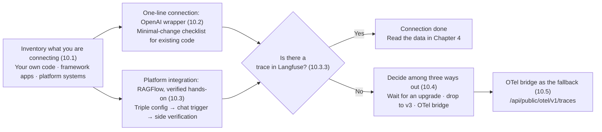
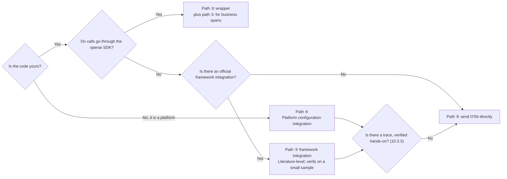
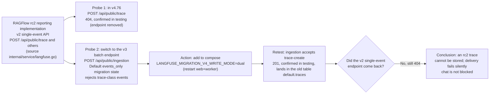
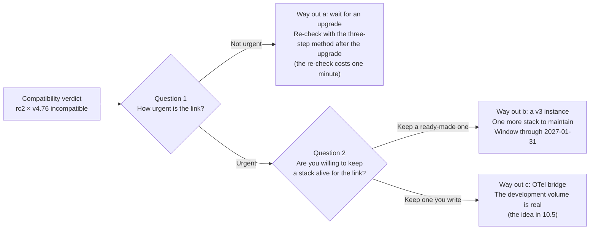
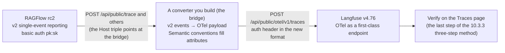

# Chapter 10 Connecting existing systems

> Chapter guide: Every hands-on check in the first nine chapters happened inside one application — the "售后助手" ("After-sales Assistant") we wrote ourselves, with instrumentation planned from the first line of code. The more common situation in the real world is the reverse: the system is already running (knowledge-base question answering on RAGFlow, an application orchestrated in Dify, a stretch of openai-call code that has been producing output all along), and Langfuse arrives later. Who adapts to whom is a practical problem. This chapter answers three questions about "connecting an existing system": how to choose among five connection paths (Section 10.1); for an existing project whose code you can change, what the smallest change is (Section 10.2); and how to connect a platform whose code you cannot change — answered with the only hands-on check in the whole book in which two platforms from the shelf meet head-on: RAGFlow v1.0.0-rc2 linked with Langfuse v4.76.0, verified hands-on from configuration through triggering to checking, with the conclusion written as found — incompatible (Section 10.3). After that it gives a decision table for three ways out (Section 10.4) and an OTel bridge as the fallback (Section 10.5), and it closes by stating the deployment discipline for running more than one stack side by side (Section 10.6). By the end of this chapter, you can: pick the right connection path for any existing system; finish a platform integration that includes a compatibility verdict; when an integration fails, locate the specific link along the root-cause chain; and make a grounded choice among the three ways out.



*Flowchart for this chapter*

## When you need it

Three typical situations, matching three ways to use this chapter.

**You have a stretch of code you wrote yourself that has been calling OpenAI, or any OpenAI-compatible endpoint** — the main path is the selection table in Section 10.1 plus the minimal-change checklist in Section 10.2. Projects of the kind "I can change the code, but I do not want a large change" are the wrapper's home ground: one line swaps the import, and the generation grows model and usage on its own. Chapter 3 explains "how to use" the wrapper. This chapter explains "how existing code swaps over to it at the smallest cost".

**What you have is a platform whose code you cannot change (or do not want to), such as RAGFlow, Dify, or n8n** — the main path is the hands-on RAGFlow link in Section 10.3. That is the main line of this chapter, and the only hands-on check in the whole book in which two platforms from the shelf meet head-on: how to fill in the configuration, how to trigger a chat, and whether the trace actually landed in the database. All three steps were verified on a local machine, and the compatibility conclusion is given as found. Even if the platform you link is not RAGFlow, the "side-verification method" in Section 10.3.3 and the way-out decision in Section 10.4 are a method you can reuse.

**Two self-hosted stacks have to coexist (or already do), and at deploy time a port errors or a container will not start** — go straight to Section 10.6. The record of three port conflicts when the Langfuse six-container stack and the RAGFlow stack were deployed on the same machine (including the lesson of an "invisible hold" by a Windows reserved range) is there. The discipline "whoever installs later yields" can save you a detour.

Prerequisites: on the Langfuse side, reuse the six-container instance from Chapter 2 (v4.76.0, project `after-sales`); on the RAGFlow side, the ragflow-local deployment from the shelf (RAGFlow v1.0.0-rc2, Web 80, API 9380, account `ragflow@local.test`). Its model channel, knowledge base, and chat assistant were rebuilt and ready on 2026-11-08. The verification date for every version fact in this chapter is 2026-11-08.

The standard for facts in this chapter follows the discipline of the whole book (the three rules in Section 1.3.3): UI and endpoint behavior is the hands-on fact layer (with a verification date and how the evidence was taken); judgment sentences marked "Our recommendation:" are the stance layer; literature-level entries (the framework-integration list, what the official ragflow integration page says) list only what the official docs acknowledge, and each one is marked, without this book endorsing them. Differences and incompatibilities are written into the body as found. The compatibility conclusion in Section 10.3.4 is the largest "as found" in this chapter.

## 10.1 Overview: the full map of connection paths, and how to choose

**"Connecting an existing system" is not one action. It is a selection problem: first classify the system by "what you can change", then pick one of five paths.** The basis of the classification is not a technical preference. It is how much control you have over that system — that sets the ceiling on how much you can change.

| Path | Typical target | Size of the change | Status on a local machine | Official doc path (langfuse.com) |
|------|---------|--------|-------------|------------------------------|
| ① SDK manual instrumentation | Any function in code you own | Medium: add `@observe` function by function | Verified hands-on in Chapter 3 | `/docs/observability/sdk` (Chapter 3 `source`) |
| ② OpenAI wrapper | Calls in code you own that go through the openai SDK | Tiny: one line swaps the import | Verified hands-on in Chapter 3 | `/integrations/model-providers/openai-py` |
| ③ Framework integration | Applications on frameworks such as LangChain/LlamaIndex/OpenAI Agents SDK/CrewAI/AutoGen/Pydantic AI | Small: install a callback package and initialize | **Literature-level; not verified one by one on a local machine** | `/integrations/frameworks/<framework name>` |
| ④ Langfuse integration built into the platform | Platforms such as RAGFlow/Dify/n8n/Flowise/Langflow/OpenWebUI | Tiny: fill in configuration in the UI, zero code | RAGFlow verified hands-on on a local machine (Section 10.3, conclusion: incompatible) | `/integrations/no-code/<platform name>` |
| ⑤ Send OTel directly | Any system that can produce an OTel payload | Medium: build your own conversion and send pipeline | That the SDK uses this endpoint is a hands-on fact from Chapter 3; a bridge you build yourself was not verified hands-on | `/integrations/native/opentelemetry` |

Two notes on the standard. **First**, the lists for ③ and ④ come from the official integration index (langfuse.com/integrations; the machine-readable full text is in llms-integrations.txt; verification date 2026-11-08) — the framework category lists forty-plus entries, and the no-code category lists ten-plus entries including dify, n8n, flowise, langflow, openwebui, and ragflow. This book's discipline for literature-level entries is the same as the whole book: **list only paths the official docs acknowledge exist, and do not guarantee them for you**. After you pick one, the standard is that page's docs plus a small-sample check of your own. **Second**, the relationship between ⑤ and the SDK is worth stating outright: the ingestion endpoint of Python SDK 5.2.0 is the OTel endpoint `/api/public/otel/v1/traces` (a baseline fact from Chapter 3) — which means paths ① and ② in essence "ride on ⑤", and the SDK assembles the OTel payload for you. ⑤ is listed on its own to mean the route "do not use the SDK; produce an OTel payload yourself and send it directly".

**Our recommendation: for a system you own and can change, prefer ② (the part that goes through the openai SDK) plus ① (the business spans). That is the shared base of the code examples in this book. A platform whose code you cannot change takes ④, but you must make a compatibility verdict the way Section 10.3 does. You cannot fill in the configuration and then assume it is connected. When ④ does not connect, or the semantics are not enough, ⑤ is the last fallback.** The three situations that "cannot be finished in one step" (a homegrown HTTP client that does not go through the openai SDK, a platform integration that is incompatible, a framework with no official integration) all converge on ⑤. That is the OTel bridge this chapter expands at the end.

This chapter and the shelf handoff previewed in Section 1.4 of Chapter 1 stand in a one-to-one relationship of making good on what was promised: the arrow in that figure, "the RAGFlow book → the hands-on connection check in Chapter 10 of this book", is drawn in for real by a whole section of hands-on work here — the conclusions that were previewed (incompatible; Section 12.3 of the RAGFlow book needs a revision note) are each borne out. The arrow "see also the trace shape in the MCP book" is the setup for Section 10.5. Under OTel semantics, the way a tool-call chain is expressed shares its origin with the data model in Chapter 4. The sentence in Chapter 1, "the knowledge base and the orchestration platform are responsible for producing the answer, and Langfuse is responsible for proving how well this particular production went", is answered here by the action that sentence left in the ellipsis: how the answer flows from the system that produces it into the system that proves it — and, when it will not flow, which engineering roads exist.

### 10.1.1 Three questions that settle the choice

Turn the stance above into three questions. Ask them before you start, and the path is settled:



*Three questions for the five paths. The full method for the question "is there a trace, verified hands-on?" is in Section 10.3.3*

### 10.1.2 The five paths, one by one: where each fits, and the pitfalls

The three questions give the skeleton. Fill in where each of the five paths fits, and the common pitfalls, and you can check them one by one while you choose:

**Path ①, SDK manual instrumentation.** Fits: code you own, and projects where you want to decide the instrumentation grain yourself — name and type the retrieval span, the business span, and the data-processing span with `@observe`, so the observation tree matches the business structure one to one (`retrieve-context` / `llm-call` in Chapter 3 are the product of this path). Pitfall: using it alone on an LLM call leaves the fields incomplete (no model/usage, verified hands-on in Chapter 3). An LLM call must be paired with the wrapper, or the fields must be filled in by hand. Decorating function by function is the largest change among the five paths. For existing code, estimate how widely it spreads.

**Path ②, OpenAI wrapper.** Fits: code you own that goes through the openai SDK, especially an existing system where "I can change one line, and I do not dare change a lot" (all of Section 10.2 is about it). Pitfall: it hooks only one point, the openai SDK — a request assembled by hand with httpx, and the other official SDKs, are not hooked (the boundary table in Section 10.2.3). Also, it is responsible only for the generation node. Attributes such as session, user, and Prompt version association still need the SDK's attribute mechanism alongside (the standard in Chapters 3 and 6).

**Path ③, framework integration.** Fits: an application built as a whole on some framework (LangChain, LlamaIndex, the OpenAI Agents SDK, and so on). The framework's own callback or tracing hook can hand over the whole execution tree, which is less work than instrumenting function by function yourself. Two pitfalls: **integration quality varies by framework** (how fine the callback can record depends on how much the framework exposes, and what the docs promise often differs from the actual fields); **this entry was not verified one by one on a local machine** (literature-level). After you pick one, run a small sample first and confirm with the verification method in Section 10.3.3 before you spread it.

**Path ④, integration built into the platform.** Fits: a platform whose code you cannot change — the configuration surface is in the platform settings, and filling in the triple is the connection. The size of the change is on the same level as path ②, or even smaller. Pitfall: **the integration is implemented inside the platform's code. You can neither change it nor necessarily read it through**, and nobody guarantees compatibility between the platform version and the Langfuse server version — official integration docs often write only the platform-side requirement (the official ragflow page in Section 10.3 does not even mark a version requirement on the Langfuse side). The pitfall of a version mismatch can be cleared only by a hands-on check. All of Section 10.3 is the hands-on record of this path.

**Path ⑤, send OTel directly.** Fits: the fallback when the first three paths do not connect — a homegrown HTTP client, an old platform that does not emit OTel, and a team that wants to bypass the SDK and build its own pipeline. OTel is an open standard, and the connecting side is not bound to any Langfuse SDK. Pitfall: the engineering volume is the largest of the five paths (payload assembly, semantic conventions, authentication, and failure retry are all on you), and the mapping between a generic OTel span and LLM semantics has to be filled in by a convention such as OpenInference or OpenLLMetry. If you do not fill attributes by the convention, the observation in the UI will not grow into the shape Chapter 4 teaches. Section 10.5 expands the idea.

The five paths share one implicit constraint worth stating outright: **whichever path you take, the data ends up in "the project the Key points at".** The three variables of paths ① and ②, the triple of path ④, and the auth header of path ⑤ are all, in essence, a pair of project-level API Keys (Chapter 2) — take the Key of the wrong project and all five paths still connect. The data has merely landed in the wrong place. When more than one system connects, the governance question "which system uses which project's Key" is developed in Chapter 11.

## 10.2 One-line connection: the OpenAI wrapper and changing existing code

### 10.2.1 Recap: why the wrapper is the best fit for an existing project

Chapter 3 already explained the wrapper's mechanism through: after `from langfuse.openai import OpenAI` replaces the import source, the wrapper intercepts `chat.completions.create` on the openai SDK and, under the call, automatically hangs a generation node named `OpenAI-generation`. Model, prompt and completion token usage, and latency are all taken automatically from the response object, and after you set prices the cost is booked automatically (Chapter 5). It is not picky about the endpoint — any call that goes through the openai client can be intercepted. The Zhipu-compatible endpoint in this book (`https://open.bigmodel.cn/api/paas/v4`) was confirmed usable in testing.

From the point of view of "connecting an existing system", these mechanisms hit exactly three constraints of an existing project: **you do not dare change a lot** (swap one import and you can roll it back), **you do not have people to re-instrument** (observation code does not enter business functions), and **troubleshooting has to be fast** (a small change means a small surface for new problems). For production code that has been running all along, these three constraints matter much more than "the observation grain is adjustable" — that is why the wrapper ranks first for code you own in this chapter's selection table. Put another way, Chapter 3 presents the wrapper as "one of two instrumentation styles". This chapter presents it as "an engineering decision for changing existing code". Same mechanism, different decision context, and the weight ordering is entirely different.

### 10.2.2 Minimal-change checklist for existing code

Split the change into eight steps. The first three change no code. The only code change is step 4:

| Step | Action | Notes |
|------|------|------|
| 1 Inventory the imports | Confirm whether the LLM calls in the existing code are `from openai import OpenAI` | Decides whether the wrapper applies; a request assembled by hand with httpx, or another SDK, is not intercepted by the wrapper (Section 10.2.3) |
| 2 Install the dependency | `pip install "langfuse>=5.2"` | The openai dependency is already in the existing code; do not touch it |
| 3 Inject the three environment variables | `LANGFUSE_HOST` / `LANGFUSE_PUBLIC_KEY` / `LANGFUSE_SECRET_KEY` | The Key from Chapter 2; for debugging on a local machine add `NO_PROXY=localhost,127.0.0.1` (a pitfall confirmed in testing in Chapter 3) |
| 4 Swap the import | `from openai import OpenAI` → `from langfuse.openai import OpenAI` | **The only code change**; constructor arguments stay |
| 5 Flush a short process | `lf.flush()` before the process exits | Required for a script that exits when it finishes; a long-running service does not need it (Chapter 3, Section 3.6) |
| 6 Thread a session (optional) | `propagate_attributes(session_id=…, user_id=…)` | If the existing code has a session key, pass it; if not, you can add it later. It does not block the first step of going live |
| 7 Set prices (optional) | Project Settings → Model Definitions, create a unit price for the model | Only then does the cost field compute money; pricing applies only to new ingestion (Chapter 5) |
| 8 Verify in the UI | On the Traces page, confirm the `OpenAI-generation` node has model and usage complete | Verification takes the UI as the standard (the standard in Chapter 3) |

A before-and-after comparison, so the "minimal change" is visible:

```python
# Before the change: existing code
from openai import OpenAI

client = OpenAI(
    base_url="https://open.bigmodel.cn/api/paas/v4",
    api_key=os.environ["ZHIPU_API_KEY"],
)
```

```python
# After the change: the only code change is the import source; every other line stays
from langfuse.openai import OpenAI

client = OpenAI(
    base_url="https://open.bigmodel.cn/api/paas/v4",
    api_key=os.environ["ZHIPU_API_KEY"],
)
```

Run it once, and the trace tree of this call in the UI gains an `OpenAI-generation` node — the change is declared complete. **For the pace of going live, our recommendation is to go gray:** first swap the import in a non-production environment and verify one round (the SDK version, the proxy, and the Key can each produce an environment difference), then push to production. The wrapper is an in-process intercept. In theory the behavior difference is zero, but "zero risk in theory" and "zero risk after verification" are two different things on an existing system — this is our recommendation, and it is not a documentation requirement.

The change is small, and the delivery verification still cannot be skipped. Land the definition of "change complete" as a table you can check off:

| Check | Where | Expected |
|--------|------|------|
| Call behavior unchanged | Business side | Answer content and latency match the state before the change — the wrapper only records on the side, and does not change the request |
| The generation appears | Left tree of the trace detail | An `OpenAI-generation` node hangs under the call site |
| Fields complete | Preview of the generation node | model=`<your model name>`, usage includes prompt and completion tokens |
| Cost booked (if you did step 7) | The node and the trace header | An amount converted from the Model Definitions unit price |
| Flush misses nothing (if it is a short process) | Traces page | After the script exits the trace appears steadily, and is no longer sometimes there and sometimes not |

A common follow-up question: **once the wrapper is on, do you still need the manual instrumentation of path ①?** Yes — the two are a division of labor, not a substitute. The wrapper fills in only the "model call" class of node. Retrieval, tool execution, and business branches are spans the wrapper does not cover. The "售后助手" in Section 3.8 of Chapter 3 is the combination: `retrieve-context` and `llm-call` are manual spans, and `OpenAI-generation` is the generation the wrapper fills in automatically. When you change an existing system, advance by the same idea: first swap the import and get the generation (one day), then gradually add `@observe` to key business spans (scheduled by iteration). Observation coverage moves from "only model calls" toward "the whole business tree".

Gather "what it looks like after the eight-step checklist is done" into one complete runnable script — a typical existing LLM-call script (it calls the openai client directly and exits when it finishes). The full picture after the change is below. You can read it against the "售后助手" in Section 3.8 of Chapter 3 (the structure matches the demo; the business logic is simply taken out):

```python
# legacy_after.py —— full picture of the existing script after the change (runnable, isomorphic with the Chapter 3 demo)
import os

from langfuse.openai import OpenAI            # Step 4: the only code change
from langfuse import get_client, propagate_attributes

lf = get_client()                             # Steps 2/3: read the three environment variables
client = OpenAI(                              # Constructor arguments identical to before the change
    base_url="https://open.bigmodel.cn/api/paas/v4",
    api_key=os.environ["ZHIPU_API_KEY"],
)

def answer(query: str, session_id: str | None = None) -> str:
    # Step 6 (optional): pass a session key if you have one; if not, leave this whole block out for now. It does not block going live
    with propagate_attributes(session_id=session_id, user_id="legacy-user"):
        resp = client.chat.completions.create(
            model="glm-5.3-flash",
            messages=[{"role": "user", "content": query}],
            temperature=0.3,
        )                                     # the wrapper hangs OpenAI-generation here automatically
        return resp.choices[0].message.content

if __name__ == "__main__":
    print(answer("退货政策是什么？", session_id="legacy-session-001"))
    lf.flush()                                # Step 5: required for a process that exits when it finishes
```

The prompt above is kept in Chinese because the corpus is Chinese. English gloss: "退货政策是什么？" ("What is the return policy?").

Read this code against the eight-step checklist: step 1 (the inventory) is finished before you start writing, step 7 (pricing) is finished on the platform side, and the other six steps are all in the code and occupy only four places — **that is the real meaning of "one-line connection": one line of code changes, and the discipline is distributed across configuration and process.**

### 10.2.3 Boundary: three kinds of call the wrapper cannot intercept

The wrapper's capability boundary is decided by its "intercept point". It hangs only on the openai SDK. Three kinds of call are beyond it:

| Call shape | Why it cannot be intercepted | Where it goes |
|---------|-------------|------|
| HTTP assembled by hand with httpx/requests | It does not go through the openai SDK, so the wrapper has no hook | SDK manual instrumentation (path ①), and fill in model/usage fields by hand |
| Other official SDKs (anthropic and others) | The wrapper adapts only the openai client | The official docs have a matching wrapper (`/integrations/model-providers/anthropic` and others, literature-level) |
| Calls inside a platform (those issued by RAGFlow/Dify) | You cannot change the platform code | Platform integration (path ④, Section 10.3) or send OTel directly (path ⑤, Section 10.5) |

To decide which kind the existing code in front of you belongs to, spend five minutes inventorying the call sites: search the whole repo for `from openai import` and for places that construct `OpenAI(`, and mark each one "can swap the import (goes through the openai SDK)" or "cannot swap (assembled request / another SDK)". The former goes to ②. The latter, by volume, goes to ① (small volume) or ⑤ (large volume and a uniform shape). That inventory is the construction drawing for changing existing code. The eight-step checklist in Section 10.2.2 is executed point by point from the drawing.

The third kind is the lead of the next section: the platform code stays untouched, and if you want observation data to come in, you can only count on the platform "opening its own mouth".

## 10.3 Platform integration, verified hands-on: the RAGFlow link (the main line of this chapter)

### 10.3.1 The hands-on environment, and configuration on the RAGFlow side

From this section on, the only place in the whole book where two platforms from the shelf meet head-on comes on stage for real. The background of the two sides:

| Item | Langfuse side | RAGFlow side |
|----|-------------|------------|
| Version | v4.76.0 (self-hosted, six containers, Web 3000) | v1.0.0-rc2 (shelf ragflow-local, Web 80, API 9380) |
| Project / account | Project `after-sales` (`yubing-org`) | `ragflow@local.test` |
| Assets already ready | One API Key pair (Chapter 2) | Model channel zhipu-gateway (glm-5.3-flash + embedding-3), knowledge base after-sales-kb (3 samples finished parsing), chat assistant "售后助手" |

The official integration doc (langfuse.com/integrations/no-code/ragflow, verification date 2026-11-08) writes this integration as follows: it requires RAGFlow ≥ 0.3.0, the configuration entry is at the bottom of RAGFlow's API settings page, and the premise is that an LLM is already configured in the RAGFlow settings — **about a version requirement on the Langfuse server side, the official doc does not say a word**. Remember this "does not say". The conclusion in Section 10.3.3 will make it weigh more.

Step one, confirm the premise on the RAGFlow side is ready: the model channel is configured and saved. The channel uses the same Zhipu OpenAI-compatible endpoint as the Chapter 3 demo:


*This screenshot was taken on 2026-11-08. On the channel page, glm-5.3-flash and embedding-3 are both in the list — that is the model base the chat trigger in Section 10.3.2 will use*

Step two, find the configuration entry. In the left column of the settings page click API (URL `/user-setting/api`), scroll the page to the bottom, and after the HTTP API and the error-code docs there is a Langfuse block — the official self-introduction (Chapter 1, Section 1.2 quoted the same text) is printed here, with two buttons on the right, View and Configuration:


*This screenshot was taken on 2026-11-08. The configuration entry is at the bottom of the API settings page — the official doc's "scroll to bottom" is literal*

Step three, open the Configuration dialog and fill in the triple. **The field order is SECRET KEY on top, Public key in the middle, and Host at the bottom** — the reverse of the Langfuse-side habit of "public key first", so the first attempt is easy to fill in backwards. The Host field is filled with `http://host.docker.internal:3000`, because the RAGFlow container has to reach Langfuse on the host, and `localhost` inside the container means the container itself. Every value in the triple comes from the API Key of project `after-sales` in Chapter 2:


*This screenshot was taken on 2026-11-08. The triple dialog: field order SECRET KEY / Public key / Host. Host means Langfuse on the host, from the RAGFlow container's point of view*

After Save, the configuration lands in RAGFlow's MySQL — the table it lands in, confirmed in testing, is `tenant_langfuse` (tenant-level configuration, one triple per tenant). At this point every action on the RAGFlow side is done, with zero code changes the whole way, matching the "tiny" mark for path ④ in the Section 10.1 selection table.

Preparation on the Langfuse side is really only one item, and it was ready back in Chapter 2: a pair of project-level API Keys (pk- and sk- as a pair). Worth stating outright is the double identity of this Key pair in the link — to RAGFlow it is "two members of the triple", and to Langfuse it is "the criterion of where the data belongs": no matter which path the data comes from (SDK, wrapper, platform report, OTel), Langfuse always lands the data in the matching project by Key. This hands-on check used the Key of project `after-sales`, which means that if the integration succeeded, RAGFlow's traces would coexist in the same project as the observations of the application you own — **whether to open a separate project for data from a platform link is a decision worth thinking through before you connect** (the isolation plan is developed in Chapter 11; this hands-on check, so that it would match the connection shape previewed in Section 1.4 of Chapter 1, reused `after-sales`).

### 10.3.2 Chat trigger: UI chat and the OpenAI-compatible entry

The configuration is saved. Trigger two chains to verify "whether reporting happens". First be clear what each entry is: **UI chat** is the platform's own conversation screen. A person asks a question on the page, and the chain (retrieve → generate → answer) finishes inside RAGFlow. **The OpenAI-compatible entry** is the programmatic call surface the platform exposes outward — an external application calls RAGFlow knowledge-base question answering as a "model in OpenAI format", and the request format is fully isomorphic with the messages structure of the Chapter 3 demo. Both entries are tested because their trigger paths differ (the UI goes through the platform's internal session, the API goes through an external call). If the integration implementation hooks only one of the chains, testing only one would miss the verdict. The entries on the RAGFlow side that can trigger a trace are these two, and this section verified both hands-on:

**Entry one: UI chat.** On the Chat page, select the "售后助手" conversation and ask "退货政策是什么？" ("What is the return policy?") — the answer returns normally, with knowledge-base citation marks ([2][4][5] and others) and citation-document thumbnails. Retrieval and generation, the whole chain, work normally on the RAGFlow side:

![RAGFlow Chat page, verified hands-on: the question "退货政策是什么？" ("What is the return policy?"), an answer containing a return-window table ("普通商品 7 天" ("ordinary goods, 7 days"), "大件家电 15 天" ("large appliances, 15 days"), "食品生鲜签收 24 小时内" ("food and fresh goods, within 24 hours of receipt")) and four other important notes, each sentence carrying knowledge-base citation marks such as [2][4][5], and two after-sal… citation-document thumbnails below; the Conversations list on the left has two sessions asking the same question](../assets/images/lf-ragflow-chat-answer.png)

*This screenshot was taken on 2026-11-08. UI chat, verified hands-on, can answer, and the citations are complete — business function on the RAGFlow side is entirely normal. The problem can only be in observation reporting*

**Entry two: the OpenAI-compatible API.** The endpoint for programmatic calls is `POST /api/v1/openai/{chat_id}/chat/completions`. Note that the model parameter must be filled with the **full name** (the three-part form model@channel@type). The value confirmed in testing on a local machine is `glm-5.3-flash@zhipu-gateway@OpenAI-API-Compatible`:

```bash
curl --noproxy '*' -X POST http://localhost:9380/api/v1/openai/<chat_id>/chat/completions \
  -H "Authorization: Bearer <RAGFLOW_API_KEY>" \
  -H "Content-Type: application/json" \
  --data-binary @chat.json
```

The request body `chat.json` is standard OpenAI messages format (a sketch; note that model takes the full name):

```json
{
  "model": "glm-5.3-flash@zhipu-gateway@OpenAI-API-Compatible",
  "messages": [
    {"role": "user", "content": "退货政策是什么？"}
  ],
  "stream": false
}
```

The prompt above is kept in Chinese because the corpus is Chinese. English gloss: "退货政策是什么？" ("What is the return policy?").

There is a hands-on detail under Windows: **Chinese JSON inlined on the command line is corrupted in encoding when bash passes the arguments, and you must bypass it with `--data-binary @file.json` (the file saved as UTF-8)** — the same experience appeared in the troubleshooting record in Chapter 2. Whenever curl sends Chinese, do it this way. This entry, confirmed in testing, can also answer, and the answer cites the knowledge base normally.

Two entries, triggered several times, and the behavior on the RAGFlow side did not differ by a hair: chat works. Next is the most critical step in this chapter — go to the Langfuse side and check whether the traces of these calls landed at all.

### 10.3.3 Checking on the Langfuse side: where the trace went (the root-cause chain)

**The verification method itself comes first. It is more reusable than the conclusion.** The only thing that counts for judging "whether a platform integration really connected" is to go to the Traces page of the Langfuse UI, filter by time, and see whether there is a new trace — not to look at "saved" on the RAGFlow configuration page, and not to look at whether an error dialog appeared. Failure of an observation chain is silent by default (the baseline in Section 1.1.2 of Chapter 1: a collection failure does not block the business). RAGFlow not crying out in pain does not mean the data arrived. The hands-on result: **after several triggers, the Traces page showed no new trace at all**.

Which link did the trace disappear in? Check segment by segment along the reporting chain (RAGFlow is open source, so you can read its reporting implementation directly; on the Langfuse side, probe the endpoints one by one). Four steps found a complete root-cause chain:



*The root-cause chain: two endpoint probes plus one migration-mode action locate "where the trace went" at a mismatch of endpoint generations*

Take the chain apart segment by segment. Every segment has hands-on evidence:

1. **rc2's reporting implementation uses the v2 single-event API.** Read the RAGFlow rc2 source `internal/service/langfuse.go`: reporting is not batched. It is one-by-one `POST {host}/api/public/trace`, `/api/public/span`, and `/api/public/generation`, with basic auth using a pk:sk Key pair. This is the public endpoint protocol of the Langfuse v2 era.
2. **That endpoint is 404 in Langfuse v4.76.** Probe the deployed instance directly with `POST /api/public/trace`, and it returns 404 — v4 has removed the v2 single-event endpoints (v4 ingestion goes through the OTel endpoint and the v3 batch endpoint; see Section 10.5 and segment 3 of this section).
3. **Try the v3 batch endpoint instead. The default migration state rejects trace-class events.** v4 keeps the v3 batch endpoint `POST /api/public/ingestion`, but v4.76.0 is in the `events_only` migration write mode by default (registered in Section 1.3.3 of Chapter 1: during the v4 migration the write mode events_only/dual/legacy is configurable by an administrator) — in that mode it accepts only events in OTel semantics, and v3-style trace-class events are rejected.
4. **After switching to dual mode, the batch endpoint comes back, and the single-event endpoint does not.** After adding the environment variable `LANGFUSE_MIGRATION_V4_WRITE_MODE=dual` to compose (both the web and the worker services must get it) and restarting, the retest showed: `ingestion` accepts a `trace-create` event, returns 201, and the data lands in the old table `default.traces` (ClickHouse) — **but this only revived the v3 batch API. The v2 single-event endpoint that rc2 uses is still 404, and it cannot be revived.** The mismatch of endpoint generations is the root. The write mode is only a state switch at the batch-endpoint layer.

Arrange the verification process as an evidence chain. The "hands-on result" of every row is a reproducible operation (the curl form of the probes and the retest follows the `--noproxy` and `--data-binary` discipline of Section 10.3.2):

| # | Verification action | Where the evidence was taken | Hands-on result |
|---|---------|---------|---------|
| 1 | Read the rc2 reporting implementation | RAGFlow source `internal/service/langfuse.go` | v2 single-event API (POST /api/public/trace and others, basic auth pk:sk) |
| 2 | Probe the v2 single-event endpoint | `POST {langfuse}/api/public/trace` | **404** (removed in v4) |
| 3 | Probe the v3 batch endpoint | `POST {langfuse}/api/public/ingestion` | The default events_only mode rejects trace-class events |
| 4 | Add `LANGFUSE_MIGRATION_V4_WRITE_MODE=dual` (web+worker) and restart | compose configuration | ingestion accepts trace-create, **201, landing in the old table default.traces** |
| 5 | Trigger again on the RAGFlow side (UI chat + API entry), then check the Langfuse Traces page | Langfuse UI | **Still zero traces** — the v2 single-event endpoint did not come back, and rc2 reporting has no fix |
| 6 | Watch the chat business side | RAGFlow UI / API | Answerable and normal the whole way, no error and no slowdown — delivery fails silently |

Read rows 5 and 6 together, and that is the lesson from this hands-on check most worth taking with you: **the business side is entirely normal, the observation side collects nothing, and when both sides "have nothing wrong", the fault can only be in the protocol join in the middle.** At a time like that, do not keep retrying on both sides (a retry will never turn a 404 into a 200). Take evidence segment by segment along the chain, the way this section does — the four words "mismatch of endpoint generations" were taken out by the evidence. They were not guessed.

There is also a hands-on observation that corroborates the baseline in Chapter 1: through the whole process RAGFlow chat never errored and never slowed down — the construction conditions of LangfuseClientFromTenant were satisfied, a failed report delivery is silent, and chat is not blocked in any way. Section 12.3 of the RAGFlow book wrote that "a delivery failure does not block chat". This hands-on check verified that sentence head-on, at a cost: **silence also means that if you do not check on purpose, you will never discover that the integration did not connect.**

In passing, the management place of dual mode in the UI: the write mode during the v4 migration is not only a compose environment variable — the project Settings sidebar has a V4 migration external-link entry (registered in Section 1.3.3 of Chapter 1), and the migration state and the UI switch strategy are visible and manageable on that page. What was used in the hands-on check on a local machine was the environment-variable way (a compose override; the change can be versioned and copied with the stack). The relationship and the tradeoff of the two configuration surfaces are developed together in the administration topics of Chapter 11.

### 10.3.4 Compatibility conclusion, and the revision note

Converge the four verification steps into one sentence, and write it into the book as found:

> **RAGFlow v1.0.0-rc2 × Langfuse v4.76.0 is incompatible.** rc2's trace reporting goes through the v2 single-event endpoint, and that endpoint has been removed in v4 (404). The v3 batch endpoint, via dual write mode, can be restored to accept trace events, and that does nothing for rc2's single-event protocol. Calls through UI chat and the OpenAI-compatible entry all answer normally, and zero traces land on the Langfuse side.

This conclusion sets off the weight of that "does not say" in the official docs: the official integration page requires only RAGFlow ≥ 0.3.0, and does not say a word about the Langfuse server version — rc2 on a local machine is far past 0.3.0, and it is still incompatible with v4.76. Section 1.3.3 of Chapter 1 said "report the endpoint and the server version as a pair; compatibility problems mostly come from a version mismatch on the two sides". Here is a living example: **meeting the version requirement the official docs write down ≠ the integration is usable. The field they did not write is often the pitfall.** The verdict discipline for a platform integration is therefore worth freezing into three steps: configure (Section 10.3.1) → trigger (Section 10.3.2) → verify on the side (Section 10.3.3). None of the three can be missing, and verification always takes the Langfuse UI as the standard.

Beyond the three steps, converge "why this integration did not connect" into five self-check questions — when you link **any** platform and meet "the configuration is saved, chat is normal, and there is simply no trace", walk these five questions. Most of the time you hit it directly:

1. **Which endpoint does the platform report to?** — If you can read the source, read the source (step 1 of Section 10.3.3 saves the most). If you cannot, capture the platform's outbound requests. The generation in the endpoint path (v2 single-event / v3 batch / OTel) is the first clue.
2. **Is the endpoint alive on the server?** — Probe it directly. A 404 is the answer. Do not trust the docs. Trust the status code.
3. **What mode is the living endpoint in now?** — v4's batch endpoint has a migration write mode. The default events_only rejects old-semantic events (confirmed in testing in this section). The mode is configurable, and once configured it can pass. See the quick-reference table.
4. **Which generation of client does the mode's switch save?** — dual saves the v3 batch, and it does not save the v2 single-event. After the action you must go back to the platform side, trigger once more, and do an end-to-end retest (row 5 of the evidence in this section).
5. **Is the platform silent about a reporting failure?** — Most platforms are silent (the design baseline that observation does not block the business), so "the platform reported no error" is never evidence that "reporting succeeded". The UI is.

Two related notes. **First**, the trace-reporting structure table in Section 12.3 of the RAGFlow book describes behavior from the v2/v3 endpoint era. It does not hold for a v4 server, and it needs a revision note — Chapter 1 already previewed this revision, and the hands-on conclusion is borne out here. **Second**, the write-mode action (dual), although it cannot revive this integration, was not done for nothing: dual is the official migration mechanism, and it is effective for other clients that still report with the v3 protocol. This book's instance keeps the dual configuration, and the bridge plan in Section 10.5 will also use what is known about the migration state. A quick reference for the three values of the write mode is in the quick-reference table at the end of this chapter.

## 10.4 Deciding among three ways out

The compatibility conclusion has landed. Next is the decision: the need for the link is still there. Which way does the road go? The hands-on information yields three ways out. Draw the cost and the fit of each as a decision table — **this table and the selection table in Section 10.1 are the two load-bearing columns of this chapter**:

| Way out | What you do | Cost | Fits |
|------|------|------|------|
| a Wait for a RAGFlow upgrade | Follow new RAGFlow versions (the main branch has already rewritten the observability implementation), and after the upgrade re-run the hands-on check by the three steps of Section 10.3 | Zero extra facilities and development volume; but the timetable is not yours to set, and a new version still has to walk the compatibility verdict again | A team whose link is not urgent, and that has no capacity to build its own — **the default answer for most people** |
| b For the link scenario, drop to a Langfuse v3 instance | Stand up another v3 self-hosted instance (ports staggered from the existing v4; the discipline of Section 10.6 applies directly), and point the RAGFlow triple at v3 | One more stack to maintain; the security-maintenance window for self-hosted v3 runs to 2027-01-31 (Chapter 1), and the window is limited; data is split across two instances | A team whose link need is clear and urgent, and that accepts an old version and the maintenance cost |
| c Build an OTel bridge converter yourself | Build a small service: turn RAGFlow's reports (or its internal events) into an OTel payload and send it straight to v4's OTel endpoint (expanded in Section 10.5) | There is real development volume: understanding both sides' behavior, field mapping, credential conversion, and failure troubleshooting are all on you; **not verified hands-on on a local machine** | A long-term plan; a team with strong engineering capacity, for whom the link is a hard requirement, and that does not want to be held hostage by a version window |

Read the decision as two questions. Drawn as a figure, it is one binary decision path:



*Deciding the ways out: two questions settle the way out. "Do nothing" is equivalent to giving up the link*

**Question 1: how urgent is the link?** If it is not urgent, choose a, and write the compatibility re-check into the acceptance list for the RAGFlow upgrade (after the upgrade, trigger one chat and check the Traces page; the cost is one minute). If it is urgent, go to question 2. **Question 2: are you willing to keep a stack alive for the link?** Keep a ready-made one that will expire (b, a v3 instance), or keep one you write that follows you (c, a bridge service). There is no fourth road — "do nothing" is equivalent to giving up this link, and the evaluation connection reserved in Section 12.3 of the RAGFlow book then cannot land.

**Our recommendation: take a as the main line (zero cost, the direction is right), b as a transition when there is a clear deadline, and c for readers who treat it as a practice project** — the bridge idea in the next section is general for any scenario in which "the platform does not emit OTel". Once you have learned it, it serves more than the single RAGFlow case.

### 10.4.1 Landing points for way out a: the upgrade re-check list

The three ways out are not a mutually exclusive choice of one. They can be combined: **a+c in parallel** (while you wait for the upgrade, treat the bridge as a practice project; if the bridge is finished you are connected early, and if the platform is upgraded you retire the bridge), and **b→a as a transition** (before the deadline, hold the line with v3; after the platform upgrade, move back to v4, and take the v3 instance down on schedule). The only anti-pattern is b+c in parallel — keeping two stacks alive for the same link scenario doubles the maintenance cost and the benefit is zero.

Choosing a is not "do nothing". It is "turn the wait into a wait that has an acceptance check". The day RAGFlow upgrades to a version that includes the observability rewrite, re-check against this list (the whole set of actions takes no more than ten minutes):

| Re-check item | Action | Pass standard |
|--------|------|---------|
| Reporting protocol | Read the new reporting implementation (or the official changelog) | Confirm it no longer goes through the v2 single-event endpoint — the ideal case is OTel or the v3 batch |
| Endpoint probe | After triggering one chat, probe the endpoint the platform uses | Not 404 |
| End-to-end verification | Filter the Langfuse Traces page by time | A RAGFlow trace appears |
| Field quality | Open the trace and look at the hierarchy and the fields | Retrieval and generation nodes are readable, and the generation carries model/usage |
| Revise both books | Check Section 12.3 of the RAGFlow book and the conclusion of this chapter | The standard in both places is updated together |

### 10.4.2 Landing points for way out b: temporary deployment discipline for a v3 instance

Choosing b means standing up another Langfuse v3 beside the existing v4 (dedicated to the RAGFlow link scenario). Three points: **first, stagger the ports across the board** — the v4 stack occupies ports such as 3000/3030/3031, and the v3 instance's web port and its three storage ports all have to be taken from somewhere else (the "whoever installs later yields" rule and the avoid-reserved-ranges discipline of Section 10.6 apply directly); **second, lock the version** — take a known stable tag for v3 and lock it (self-hosted v3 is security-maintained through 2027-01-31; by then the link scenario must move back to v4, or wait until way out a lands. Write this deadline into the operations calendar); **third, think the data isolation through** — RAGFlow's traces land on the v3 instance, and they are naturally separate from the observations of the application you own on the v4 instance. If evaluation for the link scenario (datasets and experiments, Chapters 7–9) is to be done on this instance, the account, the project, and the Key all have to be rebuilt inside this v3. The heaviest of the three costs is the time window — it is the only plan among the three ways out that comes with an "expiry date", and that is why this book positions it as a transition and not a final state. One more deployment reminder: the images, volume names, and network names of v3 and v4 must be completely separate (two independent compose projects). Do not share a volume or a network — different versions have different schemas for the data directory, and sharing a volume is burying a mine for the migration.

## 10.5 The OTel bridge as the fallback

### 10.5.1 v4's OTel endpoint: the shared exit of every fallback route

Observation ingestion in Langfuse v4 has two public channels: the v3-compatible batch endpoint `POST /api/public/ingestion` (Section 10.3 already established its migration-state behavior), and the OTel standard endpoint `POST /api/public/otel/v1/traces`. The latter is a first-class citizen of v4 — Python SDK 5.2.0 goes through it internally (a baseline fact from Chapter 3), and the official docs list it on its own as the OpenTelemetry Endpoint (`/integrations/native/opentelemetry`, usable from any language). **Read that sentence the other way and it is the basis of the fallback: any system that can produce an OTel payload and POST it to this endpoint can enter Langfuse v4 — without going through the SDK, and without going through any "platform integration".**

Why the v4 architecture sets OTel up as a first-class citizen is worth one sentence: v4's observation data model is itself event-shaped (Section 1.3.3 of Chapter 1 mentioned the events model and the old and new tables coexisting). An OTel span/event payload lines up with it naturally — reports from the SDK and from platform integrations eventually enter the ingestion queue in OTel form. Sending OTel directly is walking "the last stretch of road that everyone walks", and the protocol does not discriminate by client generation. The compatibility stalemate at the start of this section (the v2/v3 generation mismatch) does not exist on the OTel endpoint: it has no "old version" to speak of. The standard is the protocol.

Before you start, three practical premises, all reusing a standard this book has already established: **authentication** uses the project API Key pair (basic auth or a request header, the same origin as the SDK's three variables, Chapter 2); **the payload** is assembled by the OTel specification (resource, span, timestamps, and the parent-trace-id hierarchy are your responsibility — the packing work the SDK usually does for you comes back into your hands here); **verification** still takes the Langfuse UI as the standard. The semantic convention of the first stretch decides whether the data looks like LLM observation. That is the real technical center of this section.

The OTel side also has a semantic ecosystem ready: a generic OTel span is only a stretch of time and some attributes. For Langfuse to recognize it as LLM semantics such as a trace or a generation, you rely on community semantic conventions — the Other category of the official integration index lists two convention libraries, OpenInference and OpenLLMetry (literature-level). They define "what span attributes correspond to one model call". When you build a payload yourself, fill attributes by a convention of this kind, and the hierarchy and fields in the UI grow into the shape Chapter 4 teaches.

### 10.5.2 The idea of a converter you build for the RAGFlow scenario (not verified hands-on)

Land the fallback on this chapter's case: what the bridge service of way out c has to do. First draw the topology of the four links — the bridge sits between RAGFlow and Langfuse, and each side speaks its own protocol:



*Bridge topology for way out c: the bridge translates the v2 single-event protocol into OTel. One line of Host-triple configuration redirects the traffic*

**The idea (marked explicitly: not verified hands-on; this is a design walk-through, not a hands-on record)**:

1. **Intercept**: put a small service between RAGFlow and Langfuse, and point the v2 single-event requests that rc2 sends to `{host}/api/public/trace|span|generation` at the bridge (change the Host of the RAGFlow triple; the configuration surface was already seen in Section 10.3.1);
2. **Convert**: the bridge translates the v2 event body into an OTel payload — a trace event maps to a root span, a generation event maps to a child span with model-semantic attributes, and basic auth (pk:sk) is swapped for the auth header of the OTel endpoint;
3. **Send directly**: fill attributes by the OpenInference/OpenLLMetry semantic conventions, and POST to `/api/public/otel/v1/traces`;
4. **Verify**: trigger one RAGFlow chat, and verify on the Traces page (the last step of the three-step method in Section 10.3.3, which never changes).

Of the four links, 1 and 4 are "wiring". The real engineering volume is the field mapping in 2 and 3. What the skeleton of the conversion link looks like, given as a design sketch (**pseudocode, not verified hands-on, only to show where the engineering volume sits**):

```python
# bridge.py (a design sketch, not verified hands-on) —— skeleton that converts a v2 single event into an OTel payload
# From the Section 10.3.3 hands-on check: rc2 POSTs /api/public/trace|span|generation one by one, basic auth pk:sk
# Goal: translate into an OTel payload and POST /api/public/otel/v1/traces

@app.post("/api/public/trace")          # Link 1: reproduce the v2 route and catch the rc2 report
def on_trace(event: dict):
    span = to_otel_span(                # Link 2: map a trace event to a root span
        name=event.get("name", "ragflow-trace"),
        trace_id=event["id"],
        attributes={                    # Link 3: fill attributes by the semantic convention
            "session.id": event.get("sessionId", ""),
            "user.id": event.get("userId", ""),
        },
    )
    otel_client.export([span])          # Link 3: send straight to the v4 OTel endpoint
    return {"status": "accepted"}       # The semantics echo row 6 of the Section 10.3.3 evidence chain:
                                        # a reporting failure does not block RAGFlow's business
```

The field correspondence has to be checked one by one (attribute names in the v2 event body and in the OTel semantic conventions do not correspond one to one), error handling and retry have to be written by you, and if the protocol changes after an rc2 upgrade you have to follow it — that is exactly why Section 10.4 marks c as reserved for "strong engineering capacity". **If you decide to build this converter, our recommendation is to make it a general piece**: "old platforms that do not emit OTel" on the market are not only RAGFlow. Swap the event parser on the bridge pipeline and it can serve the next platform — that is the long-term value hidden in the fallback route, and it is why this book calls it a "fallback" and also calls it something other than a "detour".

In passing, a version note: under the OTel category the official docs also hang a page "Migration to v4" (`/integrations/native/opentelemetry/migration-to-v4`). It is migration guidance for clients during the v3→v4 migration — if your existing client happens to be on the v2/v3 protocol band, this page of literature is worth reading first (literature-level; this book does not expand it).

Close with a reverse verdict, so the fallback is not abused: **the OTel bridge is a fallback, not the default.** A bridge you build is worth it when three signals appear — the platform will not upgrade in the short term (way out a has no date), the link is a hard requirement (the business is waiting for evaluation data to land), and the scope of the field mapping is controllable (you need only the two levels trace/generation, and you do not need to reproduce the platform's entire observation tree). The other way around, if the platform's next version changes the protocol, the bridge's lifetime is shorter than the integration it serves — in that situation the "wait" of way out a is the right answer. The point of a fallback existing is so the decision is not sealed shut: from selection (Section 10.1) to the compatibility verdict (Section 10.3) to the ways out (Section 10.4) to the fallback (Section 10.5), every link of the whole chain has a next exit. That is the engineering attitude the practical problem "connecting an existing system" deserves.

## 10.6 Deployment discipline for stacks side by side: whoever installs later yields

The RAGFlow link check has a prequel that has not been told — getting two self-hosted stacks to live on the same Windows machine. The Langfuse six containers (Chapter 2) arrived first, the RAGFlow stack was installed later, and the result was a three-day port-conflict troubleshooting record (DEPLOY record #7). Each case is worth copying into your deployment manual:

| Conflict | What you see | Action |
|------|------|------|
| NATS 4222 | The RAGFlow stack's NATS will not start; 4222 looks unoccupied — it was swallowed by the Windows reserved port range 4202-4301, and `netstat` cannot find an occupant | A compose override changes the NATS port to 14222 |
| Kvrocks 6379 | Collides with Langfuse's redis (6379) | Change it to 16379 |
| MinIO 9000 | Collides with Langfuse's clickhouse (9000, the native-protocol port) | In the RAGFlow `.env`, `MINIO_PORT=19000` |

Of the three conflicts, the first two are the ordinary play of "the port is already taken". The third should have been an ordinary play too — until the NATS case taught us: **a port conflict is not always "who took it". There is also the form "an invisible hold by a reserved range", where you cannot find an occupant.** Windows reserves a range of ports (4202-4301 on a local machine) for the system. A port that falls inside the range shows as free in `netstat`, and binding it still fails — this kind of problem is three hours of hunting the occupant, and three minutes of reading the docs. So the full version of the deployment discipline is five rules:

The background of the conflicts is worth one sentence: the RAGFlow stack is not a single container. It brings its own set of infrastructure components — the message queue NATS, storage kvrocks and MinIO, and others — and each component brings its own default port. Stacked on the port surface of the seven containers of the Langfuse stack (web/worker/gateway/clickhouse/minio/redis/postgres, Chapter 2), the conflict surface of coexisting on the same machine is naturally not small. List both stacks' port tables in full first (item 1 of the checklist), and a conflict item has nowhere to hide:

1. **Whoever installs later yields.** The stack that arrived first stays put (it may already be running in production, and the risk of changing it is asymmetric). The side that installs later changes ports across the board — the actions for all three conflicts landed on the RAGFlow side, which is this discipline being carried out.
2. **Inventory first.** Before you start, list the port inventories of both stacks in full (`docker ps` for the mappings, plus a pass over each compose file). Change a known collision directly in the override. Do not wait for the container to error.
3. **Change the override, not the original compose.** Yielding a port always goes through `docker-compose.override.yml` (or the platform's own `.env`). The original compose file stays as the official original — when you upgrade the image you will not want to merge an official file that has been changed beyond recognition.
4. **The ranges you avoid must include reserved ranges.** When you change ports, do not only avoid ports already occupied. Also avoid system reserved ranges (on Windows, `netsh interface ipv4 show excludedportrange protocol=tcp` can list them). The values 14222, 16379, and 19000 are all chosen to avoid "common default ranges".
5. **After the change, verify through to healthy.** After yielding ports, confirm one by one that the containers are healthy and that the health-check endpoint answers (`GET /api/public/health`, the probe from Chapter 2). Only then is the job done.

Coexistence of stacks has another layer that fastens to the main line of this chapter: the RAGFlow container has to reach Langfuse on the host, and Host is filled with `http://host.docker.internal:3000` (Section 10.3.1) — **coexistence is not only staggered ports. There is also addressing across stacks.** The two stacks reach each other always through `host.docker.internal` plus the other side's published port, and they do not share a docker network (keep the isolation; the conflict surface is smaller). The day RAGFlow is upgraded and really sends traces in (way out a), this coexistence base is reused directly.

### 10.6.1 Checklist for a side-by-side deployment

Converge this section's discipline into a checklist you walk once before you start — every row can be finished before deployment, and you do not have to wait for a container to error and then turn back:

| # | Check | Action | Pass standard |
|---|--------|------|---------|
| 1 | Port inventory | List the published ports of both stacks in full (`docker ps` plus a pass over each compose) | No known collision |
| 2 | Reserved ranges | `netsh interface ipv4 show excludedportrange protocol=tcp` to list excluded ranges | Newly chosen ports are not in an excluded range (for example 4222 falling inside 4202-4301 is sure to fail) |
| 3 | Which side yields | Confirm which stack was installed later / is not production | The later side changes ports across the board; the side that arrived first stays put |
| 4 | Where the change lands | Port changes all go into an override or `.env` | The original compose file matches the official one |
| 5 | Addressing across stacks | The address the platform side uses to reach the other stack | Always `host.docker.internal` plus the other side's published port; do not share a network |
| 6 | Closing verification | Look at healthy container by container, plus the health-check endpoint (for example `GET /api/public/health`) | All pass, and the business function is exercised once |

This checklist and the three-step compatibility method of this chapter (Section 10.3) are a pair: the checklist covers "the two stacks stay alive first", and the three-step method covers "it really connected after the integration" — the full life cycle of a side-by-side deployment, and the two tables are enough. The end state of stacks side by side, and the acceptance standard confirmed in testing on a local machine, is: all seven Langfuse containers healthy, and `/api/public/health` answering normally; the RAGFlow stack's containers all normal, the Web login works, and the API answers; the two stacks can reach each other (the Host triple of Section 10.3.1); and one screen of `docker ps` can show which stack every port belongs to — all four pass, and coexistence counts as done. Only then can the integration check of Section 10.3 start on this stable base.

## Chapter summary

1. **Connecting is a selection problem**: classify the system by "what you can change", and the five paths each take their place — SDK manual instrumentation (①), the OpenAI wrapper (②), framework integration (③, literature-level), integration built into the platform (④), and sending OTel directly (⑤). A system you own and can change uses the ②+① combination. A platform whose code you cannot change takes ④ and makes a compatibility verdict. If it does not connect, ⑤ is the fallback (Section 10.1).
2. **The minimal change for existing code is one line**: the import source changes from `openai` to `langfuse.openai`. The other seven steps (dependency, the three variables, flush, session, pricing, verification) are all outside the code (Section 10.2).
3. **A platform integration must be judged in three steps**: configure → trigger → verify on the Langfuse side, and verification takes the Traces page as the standard — an observation failure is silent by default, and "saved" on the configuration page does not count (Sections 10.3.1–10.3.3).
4. **Compatibility conclusion (verified hands-on)**: RAGFlow v1.0.0-rc2 × Langfuse v4.76.0 is incompatible — rc2 goes through the v2 single-event endpoint (removed in v4, 404). Dual write mode only revives the v3 batch endpoint and does not revive v2. Chat works the whole way, and zero traces land. The reporting-structure table in Section 12.3 of the RAGFlow book needs a revision note (Sections 10.3.3–10.3.4).
5. **Three ways out**: wait for an upgrade (the default answer; re-check hands-on after the upgrade), drop to a v3 instance (a transition that has a window), or build an OTel bridge yourself (a long-term plan, not verified hands-on) — decide by the two questions "how urgent is the link" and "are you willing to keep a stack alive" (Section 10.4).
6. **The OTel endpoint is the shared exit of every fallback**: `/api/public/otel/v1/traces` is open to any system that can produce an OTel payload. Semantic conventions (OpenInference/OpenLLMetry) decide whether what grows in the UI looks like LLM observation (Section 10.5).
7. **Discipline for stacks side by side**: whoever installs later yields; inventory first; change the override and not the original compose; avoid an invisible hold such as a Windows reserved range; verify through to healthy — access across stacks goes through `host.docker.internal` (Section 10.6).
8. **One method runs through this chapter**: the three-step compatibility method (configure → trigger → verify on the side) plus taking evidence as a chain (every step has an operation, an expectation, and a hands-on result) — a problem of the kind "the integration did not connect" is never solved by retrying on both sides. Take evidence segment by segment along the chain. A 404 is a 404. A conclusion taken out by the evidence is the one that can be reproduced.

Suggested next step: after the connection is done (or a way out is chosen), how to read the data goes back to Chapter 4 — trace hierarchy, the session view, and filter syntax. If connecting more than one project and more than one team is on your route, the organization/project isolation and API Key governance in Chapter 11 are the governance sequel to the connection path. Upgrade news on the RAGFlow side is worth putting on your watch list. After an upgrade, re-check once with the three-step method of Section 10.3, and this chapter's hands-on table can be updated to "compatible". If you chose way out b, datasets and experiments for the link scenario (Chapters 7–8) can be done directly on that v3 instance — the evaluation method does not pick a server version, and that is exactly its portability.

## Acceptance checklist

By the time you have read this far, you should be able to:

- ☐ Name the target, the size of the change, and the hands-on status of each of the five connection paths, and use the "three questions" to pick a path for some real system in front of you;
- ☐ Change an existing script that goes through the openai SDK into wrapper instrumentation by the eight-step checklist, and verify the model and usage fields of the `OpenAI-generation` node in the UI;
- ☐ Finish the Langfuse triple configuration on the RAGFlow settings page, and explain the field-order pitfall and why Host is filled with `host.docker.internal:3000`;
- ☐ Retell the root-cause chain of the rc2 × v4.76.0 incompatibility (v2 single-event endpoint 404 → the v3 batch rejects by default → dual revives the batch and does not revive v2), and explain to a colleague why "chat is normal" is not the same as "the integration connected";
- ☐ Use the two questions "how urgent is the link, and are you willing to keep a stack alive" to pick one of the three ways out for your own link need, and give a cost analysis;
- ☐ State the five deployment disciplines for stacks side by side, and actually inventory the port occupation and reserved ranges of the two Docker stacks on your own machine;
- ☐ For any platform integration that "the docs say is feasible", design your own verification plan as configure → trigger → verify on the side;
- ☐ Read a stretch of a platform's reporting source and say whether it goes through the v2 single-event endpoint, the v3 batch, or the OTel endpoint, and foresee its compatibility prospect with Langfuse v4;
- ☐ Write a port-yielding plan for two self-hosted stacks on the same machine: list the colliding ports, the yielded values, and the reserved-range check result.

## Quick reference

Understanding the main line does not depend on this section. This section is for looking things up while connecting and troubleshooting.

### Ingestion endpoints and the v4 migration write mode (verification date 2026-11-08, v4.76.0 confirmed in testing)

| Endpoint | Generation | Behavior in v4.76 |
|------|------|-----------|
| `POST /api/public/trace` (and the span/generation single events) | v2 | Removed; 404 confirmed in testing |
| `POST /api/public/ingestion` (batch) | v3 | Kept; events_only by default rejects the trace class; after `LANGFUSE_MIGRATION_V4_WRITE_MODE=dual` it accepts trace-create (201, landing in the old table `default.traces`) |
| `POST /api/public/otel/v1/traces` | v4 | A first-class citizen; the front door for SDK 5.2.0 and every OTel client |

### Quick reference for the RAGFlow link configuration (values confirmed in testing on a local machine)

| Item | Value | Note |
|----|-----|------|
| Configuration entry | The Langfuse area at the bottom of the API tab of the RAGFlow settings page (`/user-setting/api`) | Configuration button |
| Field order | SECRET KEY / Public key / Host | The reverse of the Langfuse-side habit; do not fill it in backwards |
| Host | `http://host.docker.internal:3000` | The RAGFlow container reaches Langfuse on the host |
| Where the configuration lands | The RAGFlow MySQL table `tenant_langfuse` | Tenant level |
| OpenAI-compatible entry | `POST /api/v1/openai/{chat_id}/chat/completions` | Fill model with the full name, for example `glm-5.3-flash@zhipu-gateway@OpenAI-API-Compatible` |
| curl with Chinese | `--data-binary @file.json` (UTF-8) | Chinese inlined on the command line is corrupted in encoding by bash |
| dual write-mode variable | `LANGFUSE_MIGRATION_V4_WRITE_MODE=dual` | Both the web and the worker services must get it; the migration state is visible on the UI's V4 migration page |
| Hands-on conclusion | rc2 × v4.76 incompatible, zero traces land | Both UI chat and the OpenAI-compatible entry were verified hands-on; the three ways out are in Section 10.4 |

### Quick reference for official integration doc paths (literature-level, langfuse.com, verification date 2026-11-08)

| Category | Path | Representative entries |
|------|------|---------|
| Full index | `/integrations` (machine-readable: llms-integrations.txt) | The full list of the five categories |
| Frameworks | `/integrations/frameworks/<framework name>` | langchain, llamaindex, openai-agents, crewai, autogen, pydantic-ai, vercel-ai-sdk, and others |
| No-code platforms | `/integrations/no-code/<platform name>` | ragflow, dify, n8n, flowise, langflow, openwebui, and others |
| OTel | `/integrations/native/opentelemetry` (migration guidance: `…/migration-to-v4`) | The entry for the OTel Endpoint and the semantic conventions |

### Probes and commands used in this chapter (hands-on standard, Windows bash on a local machine)

| Command | Use | Hands-on result |
|------|------|---------|
| `curl --noproxy '*' -X POST http://localhost:3000/api/public/trace -u pk-lf-***:sk-lf-***` | Probe the v2 single-event endpoint | 404 (endpoint removed) |
| `curl --noproxy '*' -X POST http://localhost:3000/api/public/ingestion -u pk-lf-***:sk-lf-*** -H "Content-Type: application/json" --data-binary @event.json` | Probe the v3 batch endpoint | Under events_only, the trace class is rejected; after dual, trace-create returns 201 |
| `curl --noproxy '*' http://localhost:3000/api/public/health` | Probe that the server is alive | `{"status":"OK","version":"4.76.0"}` |
| `netsh interface ipv4 show excludedportrange protocol=tcp` | List Windows reserved port ranges | On a local machine this includes 4202-4301 (it swallows 4222) |
| `docker compose -f docker-compose.yml -f docker-compose.override.yml up -d` | Restart after a port yield or a write-mode change | Containers return to healthy one by one |

(Keys in probe commands are always the placeholder `pk-lf-***:sk-lf-***`. At run time, swap in the real value of your own project — consistent with the whole book, real credentials do not enter the manuscript. The first self-check when a probe fails is whether the Key was copied in full, an old pitfall from Chapter 2. Local debugging still needs `--noproxy '*'` or `NO_PROXY=localhost` to stop a system proxy from hijacking the request, the same discipline as Chapter 3.)

## Further reading

- **Chapter 3 (Quick start)** — the full-mechanism version of path ②: the wrapper's intercept principle, injecting the three variables, the flush boundary, and choosing between the two instrumentation styles. Section 10.2 of this chapter is the sequel from the point of view of changing existing code.
- **Chapter 4 (The trace model and tracing)** — how to read the data after a connection succeeds: the trace → observation hierarchy, the session view, and filter syntax. A payload produced by an OTel bridge also lands as the same model in the end.
- **Chapter 11 (Multi-project and team administration)** — the governance surface of connecting more than one system: whether each system should get its own project and its own Key, and the isolation design of organizations and projects. The selection table in Section 10.1 gains the dimension "which project the data belongs to" here.
- **(→ the RAGFlow book) Section 12.3** — the original from the other side's point of view: the Langfuse configuration reserved on the RAGFlow side, and the reporting-structure table (it needs a revision note according to this chapter's conclusion). Read the two books against each other, and the gap between "the docs say it is feasible" and "a hands-on check can reproduce it" is plain at a glance.
- **Official docs, langfuse.com/integrations and /integrations/no-code/ragflow** — the integration index and the original RAGFlow integration page that this chapter's `source` points at. Framework and platform lists take the official index as the standard. Every real connection of yours is still self-checked by the three-step method of Section 10.3.
- **Official docs, langfuse.com/docs/compatibility** — the original source of the v3/v4 compatibility matrix and the maintenance window (already cited in Chapter 1). The 2027-01-31 deadline of way out b, and the SDK pairing requirements, take this page as the standard.
- **Official docs, langfuse.com/integrations/native/opentelemetry** — the documentary origin of path ⑤ and way out c: how to use the OTel Endpoint, links to the semantic conventions, and v3→v4 migration guidance. Read it through before you start building a bridge. Section 10.5 of this chapter only drew the skeleton.
