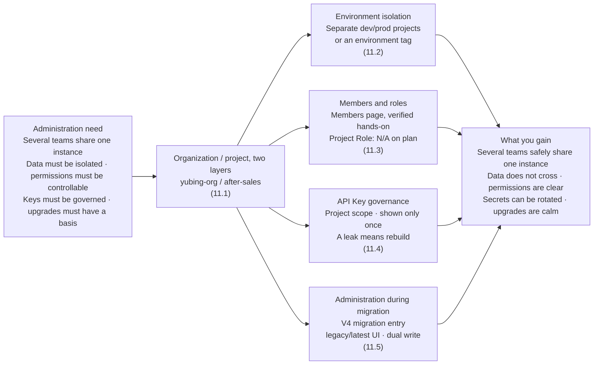
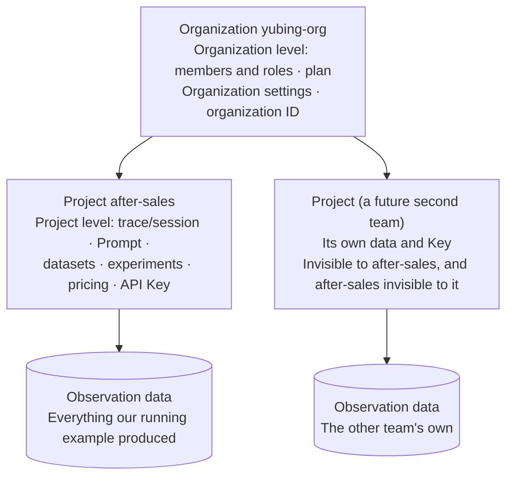
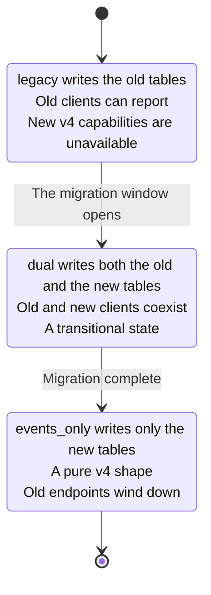

# Chapter 11 Multi-project and team administration

> Chapter guide: When Chapter 2 created the organization `yubing-org` and the project `after-sales`, we clicked two buttons and did not explain "why there are two layers". When "售后助手" ("After-sales Assistant") grows from one person's demo into a business line — testing has to run experiments, operations has to look at cost, product operations has to change the Prompt, and even another team wants to connect their application too — these two layers stop being a formality. They are the load-bearing structure of isolation, permissions, secrets, and upgrade pace. This chapter is a thin chapter from the administrator's point of view: walk through the organization/project two-layer model and the isolation boundary; compare two plans for isolating dev/prod environments; check the project Members page hands-on — you will see the Project Role column display "N/A on plan", which is the formal making-good of the self-check method from Section 1.3 of Chapter 1, "let the UI prove the EE boundary by itself"; give the governance discipline for API Keys; and finally cover the administrator's duties during the v3→v4 version overlap: the V4 migration entry, the legacy/latest dual UI, and dual write mode (the RAGFlow link check in Chapter 10 got through only because of it). By the end of this chapter, you can: draw, for your team, a map of which resources belong where on the two-layer model, choose an environment-isolation plan, say clearly which administration actions the OSS edition cannot do, and hold the administrator's checklist for the migration period.



*Guide map for this chapter*

## When you need it

Three typical situations, matching three ways to use this chapter.

**A second team is coming onto the same instance** — read Section 11.1 first and establish the two-layer model and the isolation boundary: whose data belongs to whom, how far a Key reaches, and which layer a member hangs on. The answers are all at the "project" layer. Section 11.1 gives them all in one table.

**You need to tell test-environment traces apart from production traces** — two roads: separate projects, or distinguish by tag. Section 11.2 gives a comparison table and a stance on the choice. The session naming in our running example already buried a seed of environment awareness. This section makes it an explicit plan.

**You are the administrator of this instance** — Sections 11.3 through 11.5 are your everyday work: add members, manage Keys, and watch the migration period. In particular, for an instance that is in the v3→v4 overlap (the baseline of this book is exactly that), the migration write mode in Section 11.5 directly decides whether an old client of the kind in Chapter 10 can land its reports in the database.

Prerequisites: Chapter 2's deployment and initialization are done (there is an organization, a project, and a Key pair). Every operation in this chapter is finished in the UI. You do not need to write code. At the concept level you only need the impression of the two-layer model from Chapter 1, and the EE-boundary discipline of Section 1.3.

By the reader roadmap in Chapter 1, this chapter is one of the home chapters for the operations engineer (the original wording in Section 1.5 of Chapter 1: "the organization, project, and environment isolation in Chapter 11 are your handle for landing this with more than one team"). Testing and product-operations readers can read Section 11.2 closely (environment isolation affects the standard of your experiments) and Section 11.3.3 (the EE boundary affects what you expect of permissions), and leave Sections 11.4 and 11.5 to the administrator — but the acceptance checklist is worth doing once per role, without splitting by role. An incident on the administration surface has never sorted itself by role.

## 11.1 Overview: the organization and project two-layer model

### 11.1.1 The home page is the organization list

The first page you see after login is not a trace. It is the organization list — the design itself is declaring Langfuse's resource model: **every resource hangs under an organization, and under the organization it is split into projects**.

![Home page after login, the Organizations list, verified hands-on: the version mark v4.76.0 OSS at the upper left, the Organizations item selected in the sidebar, the Get Started card in the main area reading "Create an organization to get started. Alternatively, ask your organization admin to invite you.", a black New Organization button inside the card side by side with Docs and Ask AI, a Search projects box and a + New Organization button at the upper right, a banner at the top of the page prompting AI coding agents integration, and the current user yubing@local.dev at the lower left](../assets/images/lf-home-orgs.png)

This screenshot was taken on 2026-11-08, at the moment the list was empty (the create-organization action in Section 2.4.2 of Chapter 2 happened on this page). Even in the empty state, two sentences already state half of the administration model: "Create an organization to get started" inside the card, and the sentence more worth noticing, "Alternatively, ask your organization admin to invite you" — **an organization has the role of administrator**. Not everyone can create an organization and pull members in. Who has the right to do what is the main line of this chapter, and the empty-state page has already said hello.

Landed on our running example: this book has only one organization, `yubing-org`, and under it one project, `after-sales`. The project ID is `cmw7qtne20005or4o5fhknr8z` — you have seen it in the URL of every chapter after Chapter 2 (`http://localhost:3000/project/cmw7qtne20005or4o5fhknr8z/...`). Every trace, Prompt, dataset, and experiment lands in this project.

Why must the first layer be an organization, rather than a single flat layer of projects? Two real demands make it plain. **Demand one: isolation of the isolation** — two teams need their data separated (the project layer solves that), and they also need "who has the right to pull a person into which project" separated (the project layer cannot solve that; a higher layer is needed to own members and the plan). **Demand two: the settlement unit for cost and plan** — billing on the cloud edition, and "which department this instance belongs to" in a self-hosted scenario, both need a place of account larger than a project. The organization layer exists for these two things: it is **the container for members, roles, and the plan**, and the project layer is **the container for data and secrets** — each layer handles its own share, and neither repeats the other.

### 11.1.2 The isolation boundary: what is at organization level, what is at project level

The two layers are not nested folders. They are **two isolation boundaries**. To judge which layer a question belongs to, use this table:

| Dimension | Organization level | Project level | Hands-on basis |
|------|--------|--------|---------|
| Members and roles | Members hang on the organization; the organization role (Organization Role) is granted at the organization layer | The project role (Project Role) is granted per project — the OSS edition displays N/A on plan, an EE feature (Section 11.3) | The two role columns on the Members page |
| API Key | An organization-level Key belongs to EE; it was not verified on a local machine, so it is not written here | The scope of `pk-lf-` / `sk-lf-` is the project | Verified hands-on in Section 2.4.3 of Chapter 2 |
| Observation data | Not stored or read directly at the organization layer | trace / session / Prompt / dataset / experiment all belong to the project | All data in our running example is in after-sales |
| Configuration | Organization settings (the Organization Settings external-link entry) | Pricing (Model Definitions), LLM Connections, notifications, and exports are each independent | The project Settings sidebar |
| Billing and plan | The plan hangs on the organization (the "plan" in "N/A on plan" means this) | — | Hard evidence from the UI in Section 11.3 |

The one-sentence version: **members are administered at organization level, and data and secrets are isolated at project level**. That explains the setup left by Chapter 2 — a Key's scope is the project, and the Key of `after-sales` cannot read traces of another project (the original wording in Section 2.4.3 of Chapter 2). It also explains why the correct posture for several teams sharing an instance is "each opens a project under the same organization" or "each builds an organization", and not sharing one Key.

Draw the boundary, and each of the two layers has its own resource pool:



*The organization/project two layers and the isolation boundary: members run downward, and data and Keys are isolated by project*

This figure also previews a key property of landing with more than one team: after the second project is created, its data, Prompts, and Keys are completely invisible to `after-sales` — **isolation is not configured. It comes with the model.** All you have to do is decide, in Section 11.2, "how the second team's project is created", and decide, in Section 11.3, "who can enter which project".

### 11.1.3 Project settings at a glance: the administrator's one-screen map

The General page of project Settings is the screen an administrator lands on most often. Along the way, learn the whole settings sidebar:

![Settings → General of project after-sales, verified hands-on: the Host Name card in the main area shows "When connecting to Langfuse, use this hostname / baseurl." and an input with http://localhost:3000; the Project Name card shows "Your Project is currently named "after-sales"." with a name input and a Save button; the Metadata JSON of the Debug Information card is expanded, the project node shows name: "after-sales" and id: "cmw7qtne20005or4o5fhknr8z", and the org node shows name: "yubing-org" and an id; the Transfer ownership area of the Danger Zone at the bottom shows a red Transfer Project button; the Settings sidebar on the left is, in order, General, API Keys, MCP & CLI, LLM Connections, Model Definitions, Scores Configs, Members, Integrations, Exports, Batch Actions, Audit Logs, Notifications, plus two external-link items, Organization Settings and V4 migration](../assets/images/lf-project-settings.png)

This screenshot was taken on 2026-11-08. Three blocks on this screen are worth the administrator looking at one by one:

**Host Name** — "use this address when connecting to Langfuse", which is the authoritative source of the `LANGFUSE_BASE_URL` injected by the Chapter 3 demo. When the port has been changed (the 3001 contingency in Section 2.3.3 of Chapter 2), come here first and check whether the address the UI knows about itself is in sync.

**Project Name and Debug Information** — the rename entry, and a lump of metadata JSON: the names and IDs of project and org are both in it. The project ID this book cites, `cmw7qtne20005or4o5fhknr8z`, was copied from here (verification date of the hands-on check: 2026-11-08). When you troubleshoot "the SDK cannot connect, is the Key right", this lump of JSON is the anchor for confirming "the project you are operating is the one you think it is".

**Danger Zone** — the red area, Transfer ownership, which moves the project to another organization. This book did not carry out a transfer. The button's behavior is not expanded. Record, as found, that the entry exists.

The left sidebar, strung together, is a map of the whole book: API Keys (Section 11.4), Members (Section 11.3), Model Definitions (pricing in Chapter 5), LLM Connections (the prerequisite for the Playground in Chapter 6), Notifications (alerts in Chapter 5). Organization Settings and **V4 migration** are the two items with an external-link arrow. The latter is the lead of Section 11.5. The sidebar also has a Scores Configs item visible in the hands-on check on a local machine (the entry for score configuration in Chapter 7). There is another boundary, stated as found: the Audit Logs page entry is visible, but fine-grained audit enhancement belongs to the EE category (the list in Section 1.3 of Chapter 1). It was not gone into deeply on a local machine, and it is not expanded.

### 11.1.4 Quick reference: administration action → UI entry

Where each everyday administrator action lands in the UI, given first as one table (the "hands-on status" column is marked as found: an action this book clicked is marked "verified hands-on", and an entry that was only seen and not clicked is marked "entry visible"):

| Administration action | UI entry | Where it is expanded | Hands-on status |
|---------|---------|---------|---------|
| Create an organization | Home → New Organization | Chapter 2, Section 2.4.2 | Verified hands-on |
| Create a project | New Project inside the organization (the same page flow as creating an organization) | Chapter 2, Section 2.4.2 | Verified hands-on |
| Rename a project | Project Settings → General → Project Name | Section 11.1.3 | Entry visible (not renamed) |
| Look up the project / organization ID | Project Settings → General → Debug Information | Section 11.1.3 | Verified hands-on |
| Pull a member into a project | Project Settings → Members → Add new member | Section 11.3.4 | Entry visible (a single-member instance did not walk the flow) |
| Switch a member's organization role | Project Settings → Members → Organization Role dropdown | Section 11.3.2 | Verified hands-on (visible and operable) |
| Create / rotate an API Key | Project Settings → API Keys → Create new API keys | Section 11.4 | Verified hands-on (Chapter 2, Section 2.4.3) |
| Price a project | Project Settings → Model Definitions | Chapter 5 | Verified hands-on (glm-5.3-flash priced by hand) |
| Transfer project ownership | Project Settings → General → Danger Zone | Section 11.1.3 | Entry visible (not carried out) |
| Manage the migration write mode | Project Settings → V4 migration external link | Section 11.5 | The entry was verified hands-on; the write mode was confirmed in testing through a compose variable (Chapter 10) |
| Switch legacy/latest UI | The banner at the top of the page, Switch to latest UI | Section 11.5.1 | Verified hands-on (the banner is visible; screenshots in this book are all legacy) |

This table doubles as the "review index" of this chapter: every row can point back to a hands-on subsection already expanded. A review, and a reader's re-check, both start from it.

## 11.2 Environment isolation: separate projects, and the environment tag

### 11.2.1 Why environment isolation has to be thought through first

When Chapter 4 talks about collection conventions there is a naming discipline. The experiments in Chapter 8 keep changing the Prompt, and Chapter 12 will take this data as a regression baseline — if debug traces from the test environment and production traces are mixed in one list, the regression baseline is polluted by debug data, and the cost dashboard counts tokens from test calls into the production bill. Environment isolation is not fussiness. It is **the shelf life of the data's standard**.

Langfuse has two mainstream practices. Both are paths confirmed feasible in testing. The difference is the tradeoff between isolation strength and maintenance cost.

First reckon the cost of "not isolating", and only then is a plan persuasive. Chapter 5 gave the premise of a polluted cost standard: the trace header sums cost converted from tokens, and the dashboard aggregates over the data — debug data that got mixed in rewrites those readings directly, and the rewrite is silent. Nobody annotates next to the dashboard "this week includes 200 test calls". The example of a polluted regression baseline is heavier: the gate in Chapter 12 takes dataset and experiment scores as the criterion for going live. If data from a different configuration in the debug environment got mixed in during the experiment, the verdict "the score does not meet the bar" is itself not trustworthy. Neither cost raises an alarm. By the time you notice, the standard is already untrustworthy — that is the "shelf life of the data's standard" that Section 11.2.1 talks about.

### 11.2.2 Plan A: one project each for dev and prod

Create another project under the same organization (Home → New Project; the action is exactly the same as creating a project in Section 2.4.2 of Chapter 2). The dev application and the prod application each use their own project Key. Each project naturally owns independent trace data, an independent Prompt production slot, and independent pricing and experiments — **the isolation strength is native to the two-layer model, and it does not need any discipline to maintain it**.

The cost is here too: dev and prod are two projects, which means the Prompt has to have a version set built on each side (or built only on prod and synced through the API), pricing has to be set twice, and dashboards have to be read each on its own. For a team with several environments, the number of projects grows linearly with the number of environments.

The hands-on path is fully isomorphic with Section 2.4.2 of Chapter 2, in three steps: New Project inside the organization and name it (for example `after-sales-dev`) → land in the new project's Settings → API Keys and create the Key pair for this environment → the dev application injects the new Key pair. The new project is empty from the first second — debug traces from dev come in, and prod's standard stays clean. The only discipline to remember is **do not hand out the two Key pairs mixed up**: Key naming (Section 11.4.3) and keeping `.env` in separate files on the application side (the code block at the end of Section 11.4.3) are prepared for this step.

### 11.2.3 Plan B: one project, plus an environment tag

Build only one project on the production standard. At collection time, mark each trace with an environment tag by the tags/metadata field from Chapter 4 (for example `tags: ["env:dev"]`), and afterwards partition the view with the filter syntax and saved views (My Views) from Chapter 4. Our running example already implies this awareness — the session name `demo-session-001` is itself a declaration that "this is demonstration-environment data of my own". It simply has not been turned into a structured mark.

The advantage of plan B is zero extra maintenance: one project, one set of Prompts, one pricing setup, one dashboard. The disadvantage is that isolation is maintained by discipline — miss one mark, and debug data mixes into the production standard. And every environment shares the same project Key. A leak on the dev side is a loss of the prod side.

The collection action of plan B lands on the tags field that Chapter 4 already covered — hang an environment mark on the trace. A sketch of the idea (it follows the attribute-passing style of our running example; the concrete SDK parameter names take the code confirmed in testing in Chapters 3 and 4 as the standard):

```python
# Collection discipline for plan B: tag every trace with the environment it is in
# Calls in our running example happen in a learning environment on a local machine, hence env:dev
with lf.propagate_attributes(
    session_id="demo-session-001",
    user_id="demo-user",
    tags=["env:dev"],          # environment mark: dev / prod
):
    answer = support_bot.answer(query)
```

After the mark is on, the filter syntax and saved views (My Views) from Chapter 4 are your "virtual environment partition": save common conditions as views, and dev and prod data can each be looked at on its own inside one project. **Remember the soft spot of this plan — the mark is the instrumentation side's responsibility, and the platform cannot fill it in for you.** Miss once on the collection side, and the production standard mixes in one debug datum, and after it is mixed in it can only be cleaned by hand.

### 11.2.4 Comparison for the choice, and our recommendation

| Dimension | Plan A: separate projects | Plan B: one project plus tags |
|------|----------------|---------------------|
| Isolation strength | Native isolation: data / Key / Prompt / pricing all independent | Relies on collection discipline; a missed tag means mixing |
| Key governance | One independent Key pair per environment; a leak has a small blast radius | Every environment shares one Key; a leak is a loss across the board |
| Prompt and pricing | Two sets; a change has to be synced | One set; dev verifies the label first, then moves it to production (the same mechanism as A/B in Chapter 8) |
| Dashboards and the cost standard | Naturally separate | Split by filtered views |
| Fits | Several environments, several teams, going to production | Personal learning, one environment, small traffic |

**Our recommendation: plan B is enough for learning and demonstration (our running example is exactly that). The moment you are going to take real user traffic, switch to plan A — production data deserves a project of its own.** The two plans are not mutually exclusive: a common landing is an independent project for prod (plan A) plus, inside the project, tags to distinguish a finer standard (a smaller plan B), adding a level as the isolation need grows.

### 11.2.5 Environment awareness in our running example: from naming to structure

Look back at our running example. Environment awareness has been there the whole way. It has only moved step by step from "a naming habit" toward "structured isolation": the session is called `demo-session-001` — the number `001` itself hints that this is a demonstration batch and not the full production stream; experiment names `glm-v1-baseline` / `glm-v2-prompt` — the version prefix writes "which configuration is being tested" into the name; the Prompt's label (production / staging / experimental, Chapter 6) is itself a "release-environment slot" built into the platform — the action of landing v2 on experimental first and then moving it to production is the same idea as "dev verifies first, then prod" in Section 11.2.4.

The shared limit of these habits is: they are **naming conventions**, kept by a human head. The two paths Section 11.2 gives — separate projects, and tags — upgrade a naming convention into a structured mechanism. When your data volume grows from "flip the list to find something" into "a filtered view saves me" (the filter syntax in Chapter 4), it is time to make this upgrade. The signal for judging it is plain: **when you start typing the same environment condition into the filter box over and over, it is time to make it structured.**

## 11.3 Members and roles: the Members page, and hard evidence of the EE boundary

### 11.3.1 The Members page, verified hands-on

Member administration is at project Settings → Members:

![Settings → Members of project after-sales, verified hands-on: a banner at the top, "You are viewing legacy UI / Why do I need to switch?", and a Switch to latest UI button at the upper right; the main-area title Project Members, a search box "Search name or email" and an All roles filter dropdown, Columns 5/6 on the right and a + Add new member button; five table columns Name / Email / SSO Provider / Organization Role / Project Role, a single member row yubing (yubing@local.dev), SSO Provider is "—", Organization Role shows an Owner dropdown (switchable), Project Role shows "N/A on plan", and there is an action menu at the end of the row; pagination at the bottom, Rows per page 10, Page 1 of 1](../assets/images/lf-members.png)

This screenshot was taken on 2026-11-08. One member row and five columns of information put all three things this chapter has to say on the same table: the Organization Role column shows **Owner** (a dropdown, switchable) — that is organization-level role administration (Section 11.3.2); the Project Role column shows **"N/A on plan"** — that is hard evidence from the UI of the EE boundary (Section 11.3.3); the SSO Provider column shows "—" — the local account did not log in through SSO, and SSO itself is also a feature in the EE category (the same holds for SCIM in the Section 1.3 list of Chapter 1). The legacy UI banner at the top of the page is on-site evidence of the dual-UI experience during the v4 migration. Section 11.5 expands it.

### 11.3.2 Organization-level role administration: what Owner is, and what it can do

The Organization Role of the administrator in our running example, `yubing@local.dev`, is Owner — the first registered account is it by default (Chapter 2 registers and creates the organization at once, and the person who creates the organization holds Owner). Administration actions Owner can do in the UI, among those this chapter verified hands-on, include: pulling a member into a project (the Add new member button), switching a member's role (the role dropdown is visible and operable), organization settings (the Organization Settings external link in the sidebar), and the full set of Settings at the project layer.

The full set of organization-level role grades (such as the finer split into Admin, Member, and others) and the permission matrix have a finer table in the official docs. A single-member instance on a local machine cannot verify the differences between roles hands-on — **by this book's discipline, write only what was verified hands-on: Owner is visible and operable, and the role dropdown exists**. When you grant a role to the second member, take the grades that actually appear in the dropdown on the UI as the standard.

Say Owner's position more concretely: it is **the last person responsible for this organization inside Langfuse**. When the whole instance has only one organization and one member, Owner's three actions happen most often — adding a person (Add new member, Section 11.3.4), granting (the Organization Role dropdown), and managing Keys (the ledger and rotation in Section 11.4). After there are more organizations, Owner has one more duty that is easy to overlook: **name more than one Owner or administration role for each organization** — on an instance with a single-point administrator, when the administrator account has a problem (the password is lost, the person leaves), the recovery path is awkward. Giving at least two people administration permission is high availability cheaper than any technical configuration. This is a general engineering judgment of our recommendation. The account-recovery mechanism at the Langfuse platform level was not verified hands-on, and it is not expanded.

### 11.3.3 "N/A on plan": hard evidence that project-level RBAC is EE

The "N/A on plan" in the Project Role column deserves a section of its own, because it makes good on the self-check method set down in Section 1.3.2 of Chapter 1 — **the most reliable way to judge whether a feature is EE is not to flip through the docs. It is to open the corresponding page and see whether it exists and whether it can be operated.**

Read this line of text: the plan hangs on the organization. Under the open-source plan (OSS), project-level roles are unavailable, and the UI writes the reason directly in the cell. That means: **on an OSS self-hosted instance, you can control "who is or is not Owner", and you cannot control fine-grained permissions inside a project such as "who can read, who can write, who can only annotate"** — everyone gets project access by their organization role. Project-level RBAC (role-based access control) sits on the EE list together with SCIM, audit enhancement, and data-retention policy (the table in Section 1.3 of Chapter 1).

The practical meaning for most readers: a small team does not feel pain on the OSS edition (everyone is Owner, or everyone is trusted). Once the team is large enough to need fine-grained control of the kind "a contracted annotator can only enter the annotation queue, and cannot touch API Keys", that is the reason to pay for an EE license — the basis of the decision now has hard evidence at the UI level, and it is not a sales pitch.

When you explain this boundary to the team, our recommendation is a one-sentence version: "We can manage who enters the organization, and we cannot finely assign rights inside the organization by project — the former is OSS, the latter is EE." Section 11.3.5 gives substitute practices for the OSS edition by scenario. One more sentence here on the right attitude toward the boundary: **EE is two product positions, and the OSS screen is where the line between the two grades is drawn** — on the UI of this instance (v4.76.0 OSS, the version-mark anchor in Section 1.3.1 of Chapter 1), the line "N/A on plan" is the border between the two grades, written out clearly.

### 11.3.4 The shortest path to adding one member

The entry visible in the hands-on check is **Add new member** at the upper right of the Members page. The instance on a local machine has never added a second member. The dialog details of the invitation flow were not verified hands-on — they are not expanded. What can be established is: members hang on the organization and appear on the Members page by project (the boundary table in Section 11.1.2). After the second member comes in, you grant a role in the Organization Role column, and their Project Role will most likely also display N/A on plan (the plan has not changed).

### 11.3.5 Common scenarios for the OSS permission model, and substitute practices

"You cannot control fine-grained permissions inside a project" sounds abstract. Landed on a team's everyday work, it is a few concrete scenarios. When the OSS edition cannot do it, each has a practical substitute (all of them are our recommendation, and they are not platform features):

| Permission-need scenario | The reality on the OSS edition | Substitute practice (an administration action, not a feature) |
|-------------|-------------|---------------------------|
| A contracted annotator can only enter the annotation queue | Project-level RBAC is unavailable (N/A on plan) | Use a separate annotation environment: give the annotator a project of their own (plan A, separate projects), or export by hand and have a regular member enter the score afterwards (the three sources in Chapter 7) |
| An intern can see traces and cannot change the Prompt | Change permission cannot be split finely | Prompt changes go through the label flow (Chapters 6 and 8). The change leaves version history that can be audited — accountability after the fact stands in for blocking before the fact |
| A customer or an outside party sees only their own project | Data is naturally isolated by project (Section 11.1.2) | Open a single project for the outside party and issue only that project's Key. If you do not give them a login account, UI permissions are not involved at all |
| Who touched the production Prompt | Audit enhancement belongs to EE. The Audit Logs entry is visible in the UI, and the capability boundary was not verified hands-on | Rely on Prompt version history (each version records the creator) and the change discipline (the version mechanism in Chapter 6) |

The shared theme of this table: **the OSS edition holds most needs with "isolation + version history + process discipline", and real fine-grained blocking is left to EE**. A small team following the table can press the administration cost to the minimum. When the need grows until the substitutes in the table start to strain (for example contracted annotation becomes routine), that is the moment to reassess an EE license — the basis of the judgment is the same as Section 11.3.3, hard evidence from the UI plus the scale of the business, and it is not a promise in the docs.

## 11.4 API Key governance: scope, shown only once, and handling a leak

### 11.4.1 Scope, and the create action

The two-layer facts about Keys were established in Chapter 2. This chapter gathers them from the administrator's governance point of view: **the scope is the project** — `pk-lf-` / `sk-lf-` take effect only on the project that created them; **the create action is at project Settings → API Keys**, and the dialog has three items, Name (required) / Expiration (default No expiration) / Permissions (default Full access, with a "View 84 permissions" detail link); **the sk is shown in full only once, in the dialog after creation succeeds**, and once you close it, it is gone for good.

That the scope is the project is worth expanding one layer for its governance meaning: **the project boundary is the security boundary**. The reason the environment-isolation plans in Section 11.2 can stand is the premise that a Key recognizes a project — a Key leaked from the dev project is worth nothing in front of the prod project (plan A). The other way around, under the single project of plan B this layer of protection does not exist, and one Key goes everywhere. That also explains the weight of "API Key belongs at project level" in the isolation-boundary table of Section 11.1.2: it is not only a statement of ownership. It is the fulcrum of the whole multi-project security design. Permissions at creation default to Full access — fine-grained permissions (the world behind that View 84 permissions link) belong to the same EE context as project-level RBAC. On a local machine the default was what was confirmed in testing, and it is not expanded.

### 11.4.2 Handling a leak: rebuild, rather than search

The sk is equivalent to the password for all read and write permission inside that project. Once it has entered git, or appeared in a screenshot or a log, the handling action has only one path: **immediately Create new API keys on the API Keys page and build a new Key pair → switch the application side to the new Key → retire the old Key**. There is no "get it back", and there is no "revoke one particular leak" — the security of a Key is built on the reaction speed of "shown only once + a leak means rebuild".

That in turn explains the weight of two disciplines established in Chapter 2: the sk does not enter git, and it does not appear in screenshots or logs (demos in this book always read it from an environment variable); for Expiration, a production instance should set a validity period — it expires on its own, which gives a Key you forgot to rotate one last gate. A learning instance on a local machine may keep No expiration, and you have to understand that this is a tradeoff of convenience for security.

Write leak handling as an administrator's script. Execute the five steps in order, and do not skip:

1. **Confirm the scope of the leak**: where did the sk appear (git history, chat records, log aggregation)? Which environment is using this Key (check it against the ledger in Section 11.4.3)?
2. **Create a new Key**: API Keys → Create new API keys, name it with a `rotated-<date>` suffix so it can be told apart, and save it on the spot (the shown-only-once rule has no exemption);
3. **Switch the applications**: every application and CI that holds the old Key changes the environment variable and restarts — switch the most sensitive production side first;
4. **Retire the old Key**: after you confirm the new Key is fully in effect (traces are still being reported normally; the "collection fails silently" of Section 1.1.2 of Chapter 1 reminds you this step cannot be skipped), handle the old Key by the action item of the Keys list in the UI. This book has not verified the button details of the delete entry hands-on. Take the action the UI actually provides as the standard;
5. **Review the source of the leak**: clean git history, and patch the log redaction rules — if you do not fix the source, the next Key leaks the same way.

Step 4 marks, as found, a road this book has not walked: the running instance has never deleted a Key. The other four steps of the script, and the "shown only once" mechanism, are supported by hands-on checks. The UI details of the delete action are left for your instance to prove by itself.

### 11.4.3 Naming discipline for many environments and many Keys

That Name is required, this foolproof (record #4 in Chapter 2), is actually pointing at a serious matter: **a Key is an asset that has to be named, and the naming serves "half a year later you can still tell who is using which one".** Together with the environment plan in Section 11.2, this book's discipline:

| Environment / use | Key name | What goes with it |
|-----------|---------|------|
| Learning on a local machine | `local-dev` | No expiration (our running example is this) |
| Production application | `after-sales-prod-server` | Set Expiration, and record the expiry date |
| CI / experiment scripts | `after-sales-ci` | Set Expiration, and minimize how long it lives |

Three derived orders: one Key per environment, and do not reuse (a leak does not implicate the others); inside the team, keep a ledger of "Key name → holder → expiry date" (put it in your password manager, not on a wiki); rotate in the order "create the new → switch → retire the old", and in the middle do not delete the record of the new Key. These are not Langfuse features. They are the administrator's own craft — the scope and the shown-only-once mechanism that Langfuse provides are the foundation, and the discipline is the house.

After separate environments (plan A) have landed, environment variables on the application side are isolated in pairs by project, and they are not mixed (the variable names are the triple from Section 2.4.3 of Chapter 2, and the values are placeholders throughout):

```bash
# Production application .env (the production Key pair of project after-sales)
LANGFUSE_PUBLIC_KEY=pk-lf-<prod 项目 Key>
LANGFUSE_SECRET_KEY=sk-lf-<prod 项目 Key>
LANGFUSE_BASE_URL=http://localhost:3000

# Dev application .env (if you take plan B, one project, this is the same Key pair as above;
# if you take plan A, separate projects, this is the dev project's own Key pair)
LANGFUSE_PUBLIC_KEY=pk-lf-<dev 项目 Key>
LANGFUSE_SECRET_KEY=sk-lf-<dev 项目 Key>
```

The placeholders `<prod 项目 Key>` and `<dev 项目 Key>` are kept in Chinese because they are part of the configuration sketch. English gloss: "prod 项目 Key" ("the prod project's Key"), "dev 项目 Key" ("the dev project's Key").

Hidden in this set of placeholders is another split between plan A and plan B: **under plan B the Key pairs in the two blocks of configuration are exactly the same** (the same project), and isolation is only the tags layer left; **under plan A the two blocks differ**, and the blast radius of a leak is naturally smaller. When you read a code review, one glance at whether the `.env` Key pairs are separated tells you which grade the environment isolation landed on.

## 11.5 Administration during migration: V4 migration, and the legacy/latest UI

### 11.5.1 The version overlap, from the administrator's point of view

Section 1.3.3 of Chapter 1 said you are in the v3→v4 version overlap. The RAGFlow link check in Chapter 10 ran head-on into its compatibility cost. This section gathers the administrator's duties during the overlap — migration-period phenomena that appeared scattered through earlier chapters get one unified point of view here.

There are three on-site anchors of the migration period in the UI, all visible in the hands-on check:

1. **The V4 migration external link in the project Settings sidebar** (visible in the screenshot in Section 11.1.3) — the entry to the v4 migration administration page. Migration-period mechanisms such as the write mode are managed from here;
2. **The legacy UI banner** — "You are viewing legacy UI / Why do I need to switch?" plus a Switch to latest UI button at the upper right. During the v4 migration a user can switch between the old and the new UI (the top of the screenshot in Section 11.3.1 is exactly this);
3. **The write-mode environment variable** — `LANGFUSE_MIGRATION_V4_WRITE_MODE`, which decides whether old-protocol events land in the old tables, the new tables, or both.

The three anchors happen to match three surfaces of administrator action: **the migration mechanism is managed on the V4 migration page** (the mechanism surface), **the shape of the UI the team sees is decided by the switch button** (the experience surface), and **whether an old client can report is decided by the write mode** (the compatibility surface). The three are independent of each other and are often mixed up — for example "clicking Switch to latest UI" has nothing to do with "changing the write mode": the former only affects what the screen in front of you looks like, and the latter decides which set of tables the ingestion chain writes data to. Separate the three action surfaces, and administration decisions during the migration do not drag each other along.

Every screenshot in this book comes from the legacy UI — not a preference, stated as found: at the time of the hands-on check the top of the page was hanging this banner. If your instance has already switched to the latest UI, the layout will differ, and the concepts, the data, and the administration logic of this chapter stay the same.

### 11.5.2 Write mode: legacy / dual / events_only

The core mechanism of the v4 migration period is the ingestion write mode — which set of tables old-protocol events are written to:



*The migration path of v4 ingestion write modes (mode names and semantics from langfuse.com/docs/compatibility; dual confirmed in testing in Chapter 10)*

The hands-on check in Chapter 10 is worth retelling here, because it is a living case of "why an administrator has to care about the write mode": RAGFlow v1.0.0-rc2 reports through the v2 single-event endpoint of the v3 era, and under the events_only mode that Langfuse v4.76 uses by default, `POST /api/public/trace` is a straight 404. After compose adds `LANGFUSE_MIGRATION_V4_WRITE_MODE=dual` to web and worker, the v3 batch ingestion endpoint starts accepting `trace-create` events (201, landing in the old table `default.traces`) — **the write mode is the only switch in the administrator's hands that lets an old client "stay alive for the moment".**

The action of turning it on is the `.env` plus rebuild routine covered in Section 2.2 of Chapter 2 (the change must land on both the web and the worker sides, and neither can be missing — the ingestion entry is in web, and the write to the database is in worker):

```bash
# Append one line to .env (the same directory as docker-compose.yml)
LANGFUSE_MIGRATION_V4_WRITE_MODE=dual

# Rebuild to take effect: restart does not reread the env file; it must be up -d (the rule in Section 2.3.2 of Chapter 2)
docker compose up -d
```

Three rules from the admin point of view: the default state (events_only) is the cleanest and has a compatibility cost; dual is a transitional bridge left for existing clients, and it is not a permanent state; every upgrade (the change-the-tag flow in Section 2.5.3 of Chapter 2) has to check whether the semantics of the write-mode variable have changed.

### 11.5.3 The administrator's checklist for the overlap

Gathered into the last table of this chapter, and every row points at a chapter already expanded:

| Duty | Action | Source |
|------|------|------|
| Lock the version | In `.env`, `LANGFUSE_IMAGE_TAG` locks a concrete version, and does not follow a floating tag | Chapter 2, Section 2.2.3 |
| Back up before an upgrade | A volume snapshot or a logical backup. The only right answer for a downgrade is to roll back the backup | Chapter 2, Sections 2.5.2–2.5.3 |
| Choose the write mode | If existing old clients are still there, use dual as a transition; on upgrade, check that variable's semantics | Section 11.5.2 of this chapter, and the hands-on check in Chapter 10 |
| Explain the dual UI | Declare inside the team that screenshots may come from either the legacy or the latest UI, and the concepts are the same | Section 11.5.1 of this chapter |
| Inspect after an upgrade | Seven containers healthy → the version number on the health check → the version mark on the home page | Chapter 2, Section 2.5.3 |
| Self-check the EE boundary | "The docs say it exists, and the UI does not have it": suspect the version or the migration state first, then suspect yourself | Section 1.3.2 of Chapter 1, and Section 11.3.3 of this chapter |

This table is the whole secret of "an administrator stays calm during a version overlap" — every row is an action verified hands-on in an earlier chapter. This chapter only strings them along the administrator's timeline.

Unfold the timeline once. It is the right way to read this table. **Before the upgrade**: lock the version (do not follow a floating tag), take a backup, and check the inventory of existing clients — which of them are still reporting by the v3 protocol? RAGFlow rc2 in Chapter 10 is typical. Whether they live or die is decided by the write mode in Section 11.5.2. **During the upgrade**: change the tag, `docker compose pull && docker compose up -d`, and wait for the startup migration to finish (Section 2.5.3 of Chapter 2). **After the upgrade**: the three-step inspection (containers healthy → the version number on the health check → the version mark on the home page), then two things this chapter adds — glance at the legacy/latest banner to confirm the UI shape, and check that the write-mode variable's semantics have not changed. **Day to day**: watch member changes on the Members page, rotate Keys by the ledger, and use the self-check method of Section 11.3.3 to answer the team's question "is this feature EE".

The administrator's duty comes down to one sentence: **keep the instance's version, data, and permissions in a state you can account for** — the version can be accounted for (lock the tag + inspect), the data can be accounted for (isolation + backup), and the permissions can be accounted for (roles + the Key ledger). The five parts of this chapter are the itemized account of that sentence.

### 11.5.4 The dual UI, and the standard for screenshots in this book

Last, state a fact standard that runs through the whole book. Every screenshot in this book was taken on the legacy UI (the banner "You are viewing legacy UI" at the top of the page is the evidence, visible at the top of the screenshot in Section 11.3.1). This is a difference that will affect how a reader sees things: if you click Switch to latest UI, the layout, the colors, and the way a few pages are organized will differ visibly — for example the new v4 session view folds each trace into conversational message pairs (a new experience confirmed in testing in Chapter 4).

The difference that affects the administration surface most is **where the entry is**: sidebar items this chapter cites (Members, API Keys, V4 migration) may have changed group or name in the new UI. The advice for administrators matches the drift discipline of Chapter 1: **concepts and data are consistent across UIs, and where an entry is takes what is actually on your screen as the standard**. When you look for an entry, prefer the Go to... quick jump at the upper left (Ctrl+K, visible at the top of the sidebar in both Settings screenshots) — it resists a UI redesign better than remembering some menu level.

## Chapter summary

1. Langfuse's resource model is organization/project, two layers, and the home page is the organization list. The isolation boundary in one sentence: **members and roles are administered at organization level, and data and API Keys are isolated at project level** — traces, Prompts, datasets, and pricing all belong to the project, and the plan and the organization role hang on the organization.
2. Project Settings is the administrator's one-screen map: Host Name (the authoritative source of `LANGFUSE_BASE_URL`), Debug Information (the anchor for the org/project ID), Danger Zone (transfer ownership, not expanded because it was not verified hands-on). Every item in the sidebar, from API Keys to V4 migration, has its own story in an earlier chapter.
3. Two plans for environment isolation: separate projects (native isolation, maintain two copies) and one project plus an environment tag (zero maintenance, relies on discipline). **Our recommendation: use tags for learning, and switch to separate projects when you take real traffic.** The session naming in our running example already implies environment awareness.
4. Five columns on the Members page, verified hands-on: Organization Role = Owner, operable (organization-level role administration), and **Project Role = "N/A on plan" is hard evidence from the UI that project-level RBAC belongs to EE** — the formal making-good of the self-check method in Section 1.3 of Chapter 1. An empty SSO Provider, and SSO/SCIM belonging to EE, are the same kind of fact.
5. Three disciplines for API Key governance: the scope is the project, the sk is shown only once so "a leak means rebuild" (create the new → switch → retire the old), and many environments and many Keys are named and registered (naming of the form `local-dev` / `after-sales-prod-server` / `after-sales-ci`, plus a ledger).
6. Three anchors of the migration period, verified hands-on: the V4 migration external-link entry, the legacy/latest dual-UI banner (screenshots in this book are all legacy), and the write mode `LANGFUSE_MIGRATION_V4_WRITE_MODE` (the path legacy → dual → events_only; dual lets the old-client reports of Chapter 10 land in the database, and it is a transitional bridge, not a permanent state).
7. All of the administrator's actions during the overlap gather into one checklist: lock the version, back up before an upgrade, choose the write mode, explain the dual UI, inspect after the upgrade, and self-check the EE boundary — every row is a hands-on action from an earlier chapter, strung along the administrator's timeline.

Next step: the administration surface is gathered. Chapter 12 returns to the quality main line — assemble the datasets and experiments of Chapters 7–8 into a regression gate: a Prompt change with no score behind it is not allowed to go live. The hands-on triple of `eval_gate.py` (0.333 FAIL → after the fix, 0.388 still FAIL → the root cause is the rigidity of the heuristic) is expanded there.

## Acceptance checklist

By the time you have read this far, you should be able to:

- ☐ Draw the organization/project two-layer model, say the isolation boundary in one sentence (members at organization level, data and Keys at project level), and give one real object from our running example for each;
- ☐ Find the org/project name and ID in Debug Information of project Settings, and say the relationship between Host Name and `LANGFUSE_BASE_URL` in Chapter 3;
- ☐ Choose an environment-isolation plan for your team (separate projects, or an environment tag), and explain the reason with the two standards of leak blast radius and maintenance cost;
- ☐ Open the Members page, point at which column "N/A on plan" is in, and retell the logic by which it makes good on the EE self-check method of Chapter 1;
- ☐ State the three steps after an sk leak (create the new → switch → retire the old), and why "get it back" does not exist;
- ☐ Write a compliant Key name for each of your three environments, and say which one should set Expiration;
- ☐ Explain the migration path of the three write modes legacy/dual/events_only, and why dual is a transitional bridge and not a permanent state (cite the 201-lands-in-the-database hands-on check in Chapter 10);
- ☐ Use the quick-reference table in Section 11.1.4 to point a colleague at the UI entry for each of the three actions "switch a member's role", "transfer a project", and "change the write mode", and say which of them this book did not expand because they were not verified hands-on (check it against the review checklist).

## Quick reference

Understanding the main line does not depend on this section. Here the hands-on facts this chapter depends on are gathered onto one page, for re-checking and looking back (the verification date is 2026-11-08 throughout, instance v4.76.0 OSS):

| # | Hands-on fact | Screenshot / chapter |
|---|---------|-------------|
| 1 | The home page is the organization list; the empty-state card contains the wording "ask your organization admin to invite you" | lf-home-orgs.png (Section 11.1.1) |
| 2 | Project Settings sidebar items: General / API Keys / MCP & CLI / LLM Connections / Model Definitions / Scores Configs / Members / Integrations / Exports / Batch Actions / Audit Logs / Notifications + the Organization Settings external link + the V4 migration external link | lf-project-settings.png (Section 11.1.3) |
| 3 | Debug Information shows project name=after-sales, id=cmw7qtne20005or4o5fhknr8z, and org name=yubing-org and its ID | lf-project-settings.png (Section 11.1.3) |
| 4 | The General page contains Host Name (http://localhost:3000), a Project Name rename card, and Danger Zone → Transfer ownership (a red Transfer Project button) | lf-project-settings.png (Section 11.1.3) |
| 5 | Five columns on the Members page: Name / Email / SSO Provider / Organization Role / Project Role; the only member is yubing (yubing@local.dev), SSO Provider = "—", Organization Role = an operable Owner dropdown, **Project Role = "N/A on plan"**; Add new member at the upper right, and an All roles filter | lf-members.png (Section 11.3.1) |
| 6 | The legacy UI banner at the top of the Members page, and the Switch to latest UI button (dual UI during the v4 migration) | lf-members.png (Section 11.5.1) |
| 7 | The write-mode variable `LANGFUSE_MIGRATION_V4_WRITE_MODE=dual` (web+worker) makes the v3 batch ingestion endpoint accept a trace-create event (201, landing in default.traces); the v2 single-event endpoint is still 404 in v4 | Hands-on check in Chapter 10 (Section 11.5.2) |
| 8 | The API Key creation dialog has three items, Name (required) / Expiration (default No expiration) / Permissions (default Full access, View 84 permissions); pk- / sk- are shown only once | Chapter 2, Section 2.4.3 (Section 11.4.1) |
| 9 | The health check `GET /api/public/health` returns `{"status":"OK","version":"4.76.0"}`, consistent with the home-page version mark `v4.76.0 OSS` — two version anchors for an administrator's inspection | Chapter 2, Section 2.3.2, and Section 1.3.1 (Section 11.5.3) |

## Further reading

- **Chapter 2 (Local deployment)** — the base of every administration action in this chapter: the organization and the project are created in Section 2.4.2, the Key is created in Section 2.4.3, and the upgrade and backup flow is in Section 2.5. The administrator's checklist in Section 11.5 points back row by row.
- **Chapter 10 (Connecting existing systems)** — the full hands-on record of dual write mode: RAGFlow rc2 reports and gets 404 → add `LANGFUSE_MIGRATION_V4_WRITE_MODE=dual` → the trace-create event returns 201 and lands in the old table. Read it against Section 11.5.2 of this chapter.
- **Section 1.3 of Chapter 1** — the place of origin of the EE-boundary discipline and the big background of v3→v4. The "N/A on plan" in Section 11.3.3 of this chapter is the self-check method promised there, made good.
- **Chapter 5 (Cost and performance monitoring) and Chapter 7 (Datasets and scores)** — after landing with more than one project, each project has its own pricing, its own dashboard, and its own score configuration (the Model Definitions, Dashboards, and Scores Configs entries are all on the sidebar map in Section 11.1.3 of this chapter).
- **Official docs, docs/organisations/overview.mdx** — the organization and project administration docs that this chapter's `source` points at. The official standard for role grades and the permission matrix takes that as the authority. This book expands only the parts verified hands-on.

## Review checklist (before publication)

- [x] The three screenshots (lf-members / lf-project-settings / lf-home-orgs) were all taken on a local machine on the v4.76.0 instance (2026-11-08). "N/A on plan" on the Members page and the V4 migration entry in the sidebar are visible inside the screenshots;
- [x] The organization/project two-layer model, the five Members columns, Key scope and shown-only-once, and the hands-on conclusion for write mode dual were all checked against the administration subsection of FACTS.md §3 and the finished Chapters 2 and 10;
- [x] The Add new member invitation flow, the actual save behavior of switching a member's role, transferring a project in the Danger Zone, the old-Key delete entry, and the contents of the Audit Logs page — none of these were verified hands-on. The body has marked them as found as "entry visible", and has not expanded the operation;
- [ ] The tags-collection code of plan B is a sketch of the idea (our running example did not actually pass a tags parameter). At re-review it can be checked against the SDK v5 docs for the parameter name and then run once for real;
- [ ] The second project of separate environments (plan A) was not actually created on a local machine. The related wording is derived from the two-layer model in Section 11.1. At re-review, one hands-on project creation can be added.
