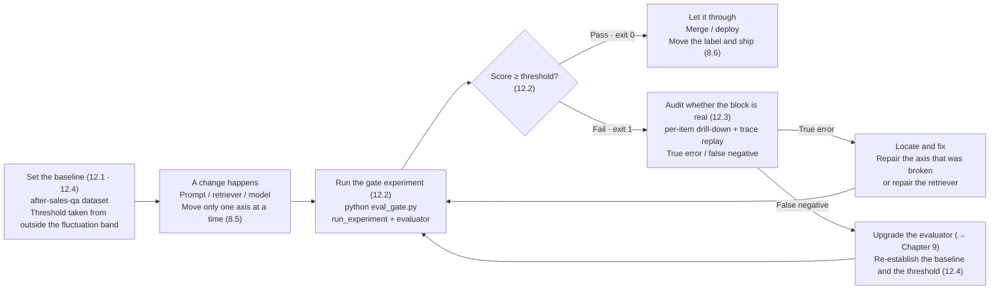
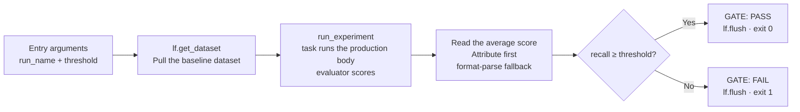
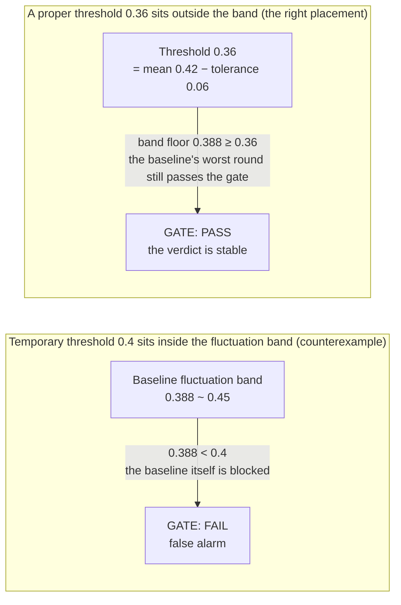

# Chapter 12 Prompt regression and quality gates

> Chapter guide: The end of Chapter 9 left a clear handoff — the full assembly of `eval_gate.py`, the threshold and the CI integration, and hallucination regression are all expanded in this chapter, and the hands-on triple of the gate will be the narrative spine. Now it plays out. By this point you already have the full set of evaluation parts: datasets (Chapter 7), the experiment mechanism (Chapter 8), and evaluators and false-negative diagnosis (Chapter 9) — but they are still only "able to be used for testing", and they are not yet "used to keep the gate". This chapter assembles them into one engineering rule: **a change that wants to enter the main line first passes a dataset experiment, and if the score does not meet the bar it is blocked** — that is a regression quality gate. The main line of this chapter is the hands-on triple of our running example: the gate's first block (0.333) stopped a sick retriever, and the gate worked; after the retriever was fixed, the second block (0.388, still FAIL) exposed a problem of the ruler, not of the application — both blocks are real blocks at the gate level, and the right way through the gate is not to change the threshold to accommodate, it is to upgrade the evaluator. Around this main line, this chapter delivers: a line-by-line full reading of the gate script, how to take the threshold from the historical distribution, the idea of CI integration, and how hallucination regression is wired in, and it closes by gathering the regression storyline of the whole book into one table. By the end of this chapter, you can: assemble "baseline dataset + experiment + threshold" into an executable gate script; say why the threshold cannot sit inside the fluctuation band, and give the way your project takes it; explain the true-or-false verdict of each of the gate's two blocks and the matching repair action; and draw the three places a quality gate sits in a CI pipeline.



*Flowchart for this chapter*

## When you need it

Three typical situations, matching three ways to use this chapter.

**You (or a colleague) changed the Prompt, the retriever, or the model, the change is going to be merged into the main line, and you want to know on what basis it is let through** — go straight to Sections 12.1 and 12.2: assemble the baseline dataset, the experiment mechanism, and the threshold into the gate script `eval_gate.py`, run it once, and only exit code 0 lets it through. This is the main way into this chapter, and it is also the final assembly of every part from Chapters 7–9.

**The gate FAILed, but the author of the change is convinced the change is good** — go straight to Section 12.3: the hands-on triple of our running example is the complete picture of this situation. The first FAIL stopped a retriever that was really sick. The second FAIL stopped a retriever whose fix had succeeded — the cause of the failure is not in the application, it is in the keyword rigidity of the evaluator. You will learn a fixed audit action: per-item drill-down plus trace replay. First judge whether the block is real, then decide whether to fix the code or upgrade the ruler.

**You want to move this flow into CI, so that "no score behind it, no going live" becomes an automatic rule in the pipeline** — see Section 12.5: an Example of the GitHub Actions workflow idea (marked as found: not verified end to end on a local machine), and the three places the gate sits in the pipeline — a PR check, a gate before deploy, and a scheduled regression.

There is another kind of situation, independent of correctness: **you worry that some change, or a quiet update from the model vendor, will make the model start inventing** — the hallucination regression in Section 12.6 wires the evidence-check judge from Chapter 9 into the gate, and it is read separately from the correctness metric.

Prerequisites: the dataset `after-sales-qa` from Chapter 7 (6 items), the experiment mechanism and the fluctuation data from Chapter 8 (0.45/0.39/0.33), and the false-negative diagnosis from Chapter 9 are all in place; the "售后助手" ("After-sales Assistant") `support_bot.py` from Chapter 3 can run. The code in this chapter is based on SDK 5.2.0 + server v4.76.0 (confirmed in testing on 2026-11-08).

## 12.1 Overview: the regression three-piece set — baseline, experiment, threshold

### Answer one question first: why "it feels better" is not enough

Every change to an LLM application — swapping one sentence of the Prompt, expanding a group of retrieval keywords, swapping one model — comes with the same question: **did it get better, or did it get worse?** Without a regression system, the usual way to answer is: the person who made the change tries a few questions themselves, it feels smooth, and they merge and ship. This "feel engineering" has three structural defects:

| Defect | Mechanism | Consequence |
|------|------|------|
| Not reproducible | Which sentences were tried, and what standard was used to judge, all sit in the head of the person who made the change | The same change, two people try it and get two conclusions; three weeks later nobody can say what was tested at the time |
| Not comparable | There is no leftover trace of "before the change", and "it got better" loses its frame of reference | "It feels better" may only be that the wording changed; a real regression is covered by the same sentence of feeling |
| Not guarded | After the change goes live, nobody looks back at the old scenarios | The original badcase in Chapter 3 (the direct-mail overtime question falls back on retrieval) is the direct product of "nobody looked back" |

The regression gate matches each of these three defects with a mechanism: **a leftover trace** relies on the dataset and the experiment (every run is a traceable record on the platform), **a comparison** relies on the baseline (before and after the change, run the same dataset and the same evaluator), and **a guard** relies on the threshold (if the score does not meet the bar, the exit code is non-zero, and the pipeline blocks the merge). The three together are the other half of this chapter's title — **the regression three-piece set**.

### The engineering meaning of the three-piece set

Chapters 7 and 8 have already built the first two pieces separately. This chapter adds the third and assembles the three into one whole. The engineering meaning each of the three carries is worth stating on its own — because they are **a division of labor, and if one is missing the whole system loses a corner**:

| Component | Engineering meaning | What happens if it is missing | Source |
|------|---------|-------------|------|
| Baseline dataset `after-sales-qa` | **The foundation under measurement** — a fixed batch of test items and expected outputs, so that each measurement covers the same batch of things | The "score" loses its meaning: each test is not the same set of questions, and there is nothing to say about up or down | Chapter 7 |
| Experiment mechanism `run_experiment` | **Standardizing the act of measurement** — batch execution + scoring item by item + landing a leftover trace, and every run can be reproduced and compared | There are questions and no paper: the behavior before and after the change has no record, and comparison becomes recollection | Chapter 8 |
| Threshold | **The rule for reading the measurement result** — a version below it is not allowed onto the main line, and the score turns from "reference information" into "a condition for letting it through" | There is a paper and no verdict: however low the score, it is merged anyway, and the evaluation system is reduced to material for a report | This chapter |

The three have an implicit fourth element — **the evaluator** (Chapter 9). It decides whether the "score" itself is trustworthy: the hands-on triple of our running example will prove that when the ruler is not up to standard, however well specified the threshold and the process are, what comes out can still be a false negative. So the full standard of this chapter is: **a regression gate = dataset × experiment mechanism × evaluator × threshold, and none of the four can be missing; the precision of the evaluator is the number-one object under evaluation in the whole system** (the conclusion of Section 9.4 of Chapter 9, verified once more by the hands-on check in this chapter).

### Where regression for an LLM application differs from traditional software regression

A reader who has written unit tests will map "regression testing" onto an LLM application — the intuition points the right way, but four differences have to be recognized first, or copying the traditional practice hits a wall everywhere:

| Axis of difference | Traditional software regression | LLM-application regression | How the gate responds |
|--------|-------------|-------------|-----------|
| What the object under test is made of | Code — it changes only when someone changes it | Code + Prompt text + retrieval corpus + **the model itself** — the three things outside the repository will move on their own | The gate's trigger surface covers non-code assets (the paths filter in Section 12.5); a scheduled regression catches drift on the vendor side |
| Determinism of the output | Determinate — the same input, the same output, and the assertion is an exact match | Not determinate — wording for the same input can drift, and an assertion can only judge "the semantics meet the bar" | The assertion is swapped for "score ≥ threshold"; tolerance absorbs the fluctuation (Section 12.4) |
| The standard for judging a pass | All assertions green means a pass | The score is one sample, and "pass" is a statistical verdict, not a boolean fact | The threshold is taken from the historical distribution, and it is not pinned to a single-round reading (Section 12.4) |
| The reliability of the test itself | Test code is determinate, and a failure is basically = a code error | **The evaluator may itself be a model call** — a failure may be the ruler's fault | A block-audit step: every FAIL judges true or false first (Section 12.3) |

The fourth row is unique to LLM regression, and it is the one the hands-on triple of our running example has to teach on site: in traditional software, "the test failed → fix the code" is almost always right; in an LLM application, "the gate FAILed → fix the code" may be fixing in exactly the wrong direction — what should be fixed is the ruler. **This difference decides the narrative structure of this chapter: assembling the script (Section 12.2) takes only half the length, and reading a block (Section 12.3) and the threshold standard (Section 12.4) take the other half.**

### Where our running example stands: the inventory before the gate is assembled

Before you start assembling, inventory the assets already on hand — this inventory is also the comparison table when you assemble a gate for a project of your own:

| Asset | Where it stands (confirmed in testing on 2026-11-08) | Its role in the gate |
|------|----------------------|---------------|
| Dataset `after-sales-qa` | 6 items, expected_output complete, including one negative-expectation test item (see Section 12.6) | The baseline test questions |
| The application body `support_bot.py` | Three layers of instrumentation, the production Prompt hosted, the retriever waiting to be fixed | The object the gate tests (the body of the production chain) |
| Experiment records | `glm-v1-baseline` ×2 (0.45/0.39), `glm-v2-prompt` (0.33) | The historical-distribution basis for taking the threshold (Section 12.4) |
| Evaluator | Heuristic recall (coverage of 7 groups of keyword points, Chapter 8, Section 8.2) | The gate's ruler (rigidity already known, confirmed in testing in Section 12.3) |
| Fluctuation data | Two rounds of the same configuration differ by 0.06 | The basis for taking the threshold's tolerance (Section 12.4) |

The most conspicuous row in this inventory: **the retriever is known to be sick** — the question sentences of four test items miss on retrieval and fall back to return-goods material (the source of the badcase fed back in Chapter 7; see the per-item stable 0-score rows in Section 8.4 of Chapter 8). This is not an obstacle to assembling the gate. It is exactly the gate's first quarry: **the first block after the gate is installed ought to stop it**.

## 12.2 The gate script eval_gate.py, in full

### The question the script has to answer

The duty of the gate script can be framed in one sentence: **run one experiment, compare the average score with the threshold, and output a process exit code**. It does nothing new — the dataset, the experiment, and the evaluator are all existing parts from Chapters 7–9 — and the only thing it does is one thing: **translate "a score" into "0 or non-zero"**. This one act of translation is the entire distance from an evaluation system as "a report a person looks at" to "a rule a machine executes".

The control flow inside the script walks six steps, with no extra branch:



The gate script `eval_gate.py` verified hands-on for this book (confirmed in testing on 2026-11-08; the whole thing is pasted to match the citation):

```python
"""回归门禁(第 12 章素材):对 after-sales-qa 跑实验,平均分低于阈值则非零退出。

用法:
  python eval_gate.py <run_name> [threshold]

退出码:0 = 通过(>= threshold);1 = 不通过;2 = 运行异常。
CI 集成思路:流水线里跑本脚本,非零退出即拦截合并(第 12 章详述)。
"""
import os
import re
import sys

from langfuse import get_client, Evaluation

sys.path.insert(0, os.path.dirname(os.path.abspath(__file__)))
from support_bot import answer, lf  # noqa: E402

RUN_NAME = sys.argv[1] if len(sys.argv) > 1 else "gate-check"
THRESHOLD = float(sys.argv[2]) if len(sys.argv) > 2 else 0.4

KEY_POINTS = {
    "7": ["7 天", "七天"],
    "无理由": ["无理由"],
    "质量换货": ["30 天内免费换货", "质量问题"],
    "保税仓时效": ["3-5 日"],
    "直邮时效": ["7-15 日"],
    "超期退款": ["30 日未送达", "全额退款"],
    "拆封除外": ["拆封"],
}


def recall_evaluator(*, input, output, expected_output, metadata, **kwargs) -> Evaluation:
    expected = expected_output or ""
    text = re.sub(r"\s", "", output)
    keys = [k for k, pats in KEY_POINTS.items() if any(p in expected for p in pats)]
    if not keys:
        return Evaluation(name="recall", value=0.0, comment="无可用要点")
    hit = [k for k in keys if any(p in text for p in KEY_POINTS[k])]
    return Evaluation(name="recall", value=round(len(hit) / len(keys), 2),
                      comment=f"命中 {len(hit)}/{len(keys)}")


def main() -> int:
    dataset = lf.get_dataset("after-sales-qa")
    result = dataset.run_experiment(
        name=RUN_NAME,
        description=f"回归门禁(阈值 {THRESHOLD})",
        task=lambda *, item, **kwargs: answer(item.input, session_id=f"gate-{RUN_NAME}"),
        evaluators=[recall_evaluator],
    )
    avg = result.format()  # print it for a person to read
    print(avg)
    # Take the average score from the result object; the SDK v5 result shape takes what was confirmed in testing as the standard
    scores = getattr(result, "average_scores", None) or {}
    recall = scores.get("recall") if isinstance(scores, dict) else None
    if recall is None:
        # Fallback: parse it out of the format text
        m = re.search(r"recall:\s*([\d.]+)", avg)
        recall = float(m.group(1)) if m else 0.0
    print(f"THRESHOLD={THRESHOLD} recall={recall}")
    if recall >= THRESHOLD:
        print("GATE: PASS")
        lf.flush()
        return 0
    print("GATE: FAIL (低于阈值,禁止合并)")
    lf.flush()
    return 1


if __name__ == "__main__":
    sys.exit(main())
```

The docstring and the Chinese strings inside the script above are kept in Chinese because the corpus, and the script that scores it, are Chinese. English gloss of the docstring: "Regression gate (material for Chapter 12): run an experiment on after-sales-qa; if the average score is below the threshold, exit non-zero. Usage: python eval_gate.py <run_name> [threshold]. Exit codes: 0 = pass (>= threshold); 1 = fail; 2 = the run itself failed. CI idea: run this script in the pipeline; a non-zero exit blocks the merge (details in Chapter 12)." Strings kept in Chinese include "7 天" / "七天" ("7 days"), "无理由" ("no reason required"), "30 天内免费换货" ("free exchange within 30 days"), "质量问题" ("a quality problem"), "3-5 日" ("3–5 days"), "7-15 日" ("7–15 days"), "30 日未送达" ("not delivered within 30 days"), "全额退款" ("a full refund"), "拆封" ("opened / unsealed"), "无可用要点" ("no usable key points"), "命中" ("hits"), "回归门禁(阈值 …)" ("regression gate (threshold …)"), and "GATE: FAIL (低于阈值,禁止合并)" ("GATE: FAIL (below the threshold, merge forbidden)").

### Taken apart block by block: five design decisions

**First, the object under test is the production application body, not a test edition written separately.** `from support_bot import answer` imports the application entry from Chapter 3 directly — the same origin as the experiment discipline in Section 8.2 of Chapter 8: **the gate tests the very chain that is going live**. Any difference between a test edition and the production edition (instrumentation, parameters, the Prompt resolution path) makes the gate's conclusion untrue, and there is no room to bargain on this one.

**Second, the evaluator shares the same ruler as Chapter 8.** `recall_evaluator` and the evaluator in `eval_runs.py` are the same piece of logic (coverage of 7 groups of keyword points) — this is not laziness, it is **discipline of the standard**: the baseline run and the gate run must use the same ruler, or the scores are not comparable ("the baseline and the experiment group share every other configuration", Section 8.5 of Chapter 8). The day the evaluator is upgraded, the baseline and the threshold are re-established together (Section 12.4).

**Third, the run name and the description are the gate announcing itself.** `name=RUN_NAME` (passed on the command line, for example `gate-check-v1`), `description=f"回归门禁(阈值 {THRESHOLD})"` ("regression gate (threshold {THRESHOLD})") — the naming convention of Chapter 8 lands here: half a year later, in the Experiments list, you have to be able to tell at a glance which run was which gate, and what threshold was used at the time. Experiment traces all hang on a `gate-<run name>` session, with the same intent as the `eval-` prefix in Chapter 8 (the aggregation entry for cost and debugging; the way of reading in Chapters 4 and 5 applies directly).

**Fourth, reading the average score takes a two-path defense.** First try to take an attribute from the result object (`average_scores`); if that cannot be taken, parse it with a regular expression from the text of `result.format()` — the structure of the SDK v5 result object evolves with the version, and the script author explicitly comments "the SDK v5 result shape takes what was confirmed in testing as the standard" and leaves a fallback path. The robustness bought by two lines of fallback is a good trade: **a gate script may parse clumsily, and it must not crash for no clear reason inside CI** — a gate that crashes is worse than a gate that is loose (in the name of "the run itself failed" it will block every change dead, or let them through into a void).

**Fifth, the exit code is the script's only contract with the outside.** This is the most important line of design in the whole script —

### The exit-code contract: 0/1/2, and "non-zero means block"

The exit-code contract the script's docstring declares:

| Exit code | Meaning | Who consumes it |
|--------|------|---------|
| `0` | PASS — the average score ≥ the threshold | CI lets it through, and the merge is allowed |
| `1` | FAIL — the average score is below the threshold | CI blocks the merge, and the audit flow of Section 12.3 begins |
| `2` | The run itself failed — the script did not get running (Key fetch failed, the dataset does not exist, and so on) | CI blocks it and marks it as an **infrastructure fault**, handled separately from a quality FAIL |

The consumption rule on the CI side is only one: **non-zero means block** (the workflow Example in Section 12.5 is written exactly this way). Then why still distinguish 1 and 2? Because the handling path after the block is completely different: exit 1 goes to "audit true or false → fix the code or fix the ruler" (Section 12.3); exit 2 goes to "check the environment → rerun" (an expired Key, a network that does not connect, and a dataset deleted by mistake are all this branch). Mixed into "non-zero", the first step of troubleshooting loses its direction.

An honest implementation note (taking the code confirmed in testing as the standard): the script's docstring agrees on exit code 2, but the version of `main()` confirmed in testing returns only 0/1 explicitly — the exception path is not wrapped in try/except, and an uncaught exception makes Python end with the default non-zero exit code. **For a CI rule of "non-zero means block", the effect is the same.** The value of distinguishing 1 and 2 explicitly is that a person can tell at a glance in the log whether "the score was not enough" or "it did not get running". Adding this one thing for your project only needs a wrap at the entry: catch the exception, print a clear `GATE: ERROR` line, and `sys.exit(2)` — an improvement at the level of an idea. The version confirmed in testing in this book does not do it, marked as found.

Two more echoes of the short-process discipline: `lf.flush()` is called explicitly before return — the old rule from Chapter 3, a trace of a short-lived process may not land in the database, and if the experiment record of the gate run is lost, this block has no evidence. The line `print(f"THRESHOLD=… recall=…")` is for the CI log: **when a person reviews the log, the first glance has to be able to see "the mark on the ruler" and "the score confirmed in testing" at the same time** — in the two rounds of hands-on output in Section 12.3, it is exactly this line that gives the reading of FAIL a direct basis.

## 12.3 The hands-on triple: two blocks, one fix, and one rigid ruler

### The full record of the triple

Now the main-line plot of this chapter. On 2026-11-08 the gate script ran two rounds on our running example (the threshold took the temporary assembly-time value 0.4), with one retriever fix in between. The complete hands-on record (the raw terminal output is stored in `shot/gate-result.txt` and `gate-result-fixed.txt`):

| Round | Run name (time stored, UTC) | Recall average | Threshold | Gate verdict | Retrieval-hit sequence | Intent |
|------|---------------------|------------|------|---------|-------------|------|
| Round 1 | `gate-check-v1` (14:27:19) | **0.333** | 0.4 | **FAIL** | 0,0,1,0,0,1 (hits 2/6) | Stand up the gate, and test the current configuration |
| The fix | —— | —— | —— | —— | —— | Retriever: single keyword → synonym groups |
| Round 2 | `gate-check-fixed` (14:31:20) | **0.388** | 0.4 | **still FAIL** | 0,1,1,1,1,1 (hits 5/6) | Verify the effect of the fix |

Put the core lines of the two rounds of gate output side by side in a comparison table (a text table, transcribed from the terminal record confirmed in testing; the experiment comparison figure is in Chapter 8):

| Output line | Round 1, gate-check-v1 | Round 2, gate-check-fixed |
|--------|----------------------|------------------------|
| `Average Scores` | recall: 0.333 | recall: 0.388 |
| `[retrieve] 命中` ("[retrieve] hits") sequence | 0,0,1,0,0,1 (2/6) | 0,1,1,1,1,1 (5/6) |
| `THRESHOLD=0.4 recall=…` | THRESHOLD=0.4 recall=0.333 | THRESHOLD=0.4 recall=0.388 |
| Gate conclusion | `GATE: FAIL (低于阈值,禁止合并)` ("GATE: FAIL (below the threshold, merge forbidden)") | `GATE: FAIL (低于阈值,禁止合并)` ("GATE: FAIL (below the threshold, merge forbidden)") |
| Process exit code | 1 | 1 |
| Results page | experiments/results?baseline=d522b471… | experiments/results?baseline=10d56dde… |

The surface readings of the two rounds are exactly the same: FAIL, exit code 1, merge forbidden. **But the content of the two FAILs is worlds apart** — that is exactly the core reading ability this chapter has to teach.

### Round 1's block: the gate stopped a sick retriever — the gate worked

Where the big board of lost points in round 1's 0.333 sits, Chapter 8 already gave the answer: four test items that missed on retrieval (the question sentences for direct-mail overtime / bonded warehouse / refund cycle / unsealed) contribute a stable 0 in both rounds of `glm-v1-baseline`, and the log sequence of `[retrieve] 命中 0 条` ("[retrieve] 0 hits") (0,0,1,0,0,1) is their fingerprint. The retriever falls the context of "海外直邮超时了怎么办？" ("What do I do if overseas direct mail is overdue?") back to return-goods material, and the model, holding material that does not match the question, cannot answer the timing points — **the lost points are consistent with the real quality, and this block is a solid real block**.

Worth staying on for one second is what this fact means: **on the gate's first day on duty, it stopped a structural defect that had already existed and that nobody had handled**. This retriever defect, from the badcase leftover trace in Chapter 3 (fed back into the dataset in Chapter 7) to being stopped by the gate, has nine whole chapters in between — it is not that nobody found it. It is that there was no **mechanism** forcing it to be handled. The value of a regression gate is here first: **it turns a "known problem" from an entry in a memo into a roadblock on the merge request.**

### Fixing the retriever: single keyword → synonym groups

Aimed at the big board of lost points in 0.333, the fix lands on the retriever's keyword table. A comparison of the two versions before and after the fix (the shape after the fix is the code of the current `support_bot.py` confirmed in testing; the shape before the fix is reconstructed from its comment "the original had only a single keyword"):

```python
# Before the fix (reconstructed): each corpus key hangs on only one keyword
# Real phrasings such as "保税仓发货多久能到" ("How long until a bonded-warehouse shipment arrives?") and "海外直邮超时" ("overseas direct mail is overdue") were all left unconfigured
KEYWORDS = {
    "物流": ["物流"],
    "退货": ["退货"],
    "换货": ["换货"],
}

# After the fix (code confirmed in testing): synonym groups; any one hit recalls that corpus entry
KEYWORDS = {
    "物流": ["物流", "保税仓", "直邮", "发货", "到货", "多久能到", "超时"],
    "退货": ["退货", "退款", "退回"],
    "换货": ["换货", "更换"],
}
```

The strings above are kept in Chinese because the corpus is Chinese. English gloss: "物流" ("logistics"), "退货" ("returns"), "换货" ("exchanges"); in the synonym groups, "保税仓" ("bonded warehouse"), "直邮" ("direct mail"), "发货" ("shipping"), "到货" ("arrival"), "多久能到" ("how long until it arrives"), "超时" ("overdue"), "退款" ("refund"), "退回" ("send back"), "更换" ("replace").

The fix logic is plain: add the words from the user's real phrasing ("保税仓" ("bonded warehouse"), "直邮" ("direct mail"), "超时" ("overdue"), "退款" ("refund")) into the synonym group of the matching corpus key, and any one word hitting recalls it. The retrieval effect is immediate — the hit sequence rises from 2/6 to 5/6 (the test items fed back from the badcase in Chapter 7 are exactly the ones saved by these synonym groups).

### Round 2's block: the fix really took effect, and the gate still says FAIL

Put the data of round 2 together, and the contradiction surfaces:

- **The retrieval layer**: hits 2/6 → 5/6, and the size of the fix is clear and real;
- **The score layer**: recall 0.333 → 0.388, up only 5.5 points, still below the threshold 0.4, and the gate blocks a second time.

The retriever got this much better. Why did the score barely move? Drilling down item by item (per-item expansion plus trace replay, the basic skill of Chapter 8) puts the answer on the evaluator: take the test item "保税仓发货多久能到？" ("How long until a bonded-warehouse shipment arrives?") as the example. After the fix, retrieval hits the logistics corpus, the model received the correct material "保税仓发货订单 3-5 日送达" ("a bonded-warehouse shipping order arrives in 3–5 days"), and the answer is completely correct in meaning — but the wording is a natural phrasing of the kind "**3 到 5 个工作日**" ("3 to 5 working days"), while the evaluator's criterion is the literal `3-5 日` ("3–5 days"). A pure string-contains judgment does not match, and that point group is still scored 0. **The bulk of the lost points is not the application answering wrong. It is the ruler not recognizing it — a false negative. Section 9.4 of Chapter 9 already dissected this mechanism down to the code, and it is not repeated here.**

### Layered verification of the fix: what each of the three layers' readings said

The reason round 2's reading is easy to find confusing is that it moved two layers at once — **the fix shows up at the retrieval layer, and the score is held down at the evaluation layer**. Split the two rounds of data by layer, and each layer's reading does not interfere with the others:

| Layer | Where the reading comes from | Round 1 | Round 2 | That layer's conclusion |
|----|---------|--------|--------|---------|
| Retrieval layer | The `[retrieve] 命中` ("[retrieve] hits") log sequence | 0,0,1,0,0,1 (2/6) | 0,1,1,1,1,1 (5/6) | The fix really took effect — the badcase test items fed back in Chapter 7 were saved by the synonym groups |
| Semantic layer | Expand per item, look at the original answer, and replay the trace | The answer holds the wrong material, and the points are missing | The answer holds the correct material, and the points are **already covered in meaning** | Application quality improved in substance — "3 到 5 个工作日" ("3 to 5 working days") is completely correct in meaning |
| Score layer | Recall average | 0.333 | 0.388 (still < 0.4) | The ruler cannot see the change at the semantic layer — the score-layer reading lags the real quality |

The reading rule for layered verification, in one sentence: **when the retrieval layer and the semantic layer improve in the same direction, and the score layer does not move, suspicion lands on the evaluator automatically** — this is the gate's reuse of the "exclude the three sources of fluctuation layer by layer" method in Section 8.3 of Chapter 8: read the layers through, and the attribution floats up by itself. The other way around, if the retrieval layer does not move and the score layer does, the fluctuation comes from model sampling (the attribution in Chapter 8); if the retrieval layer is itself unstable (the hit sequence differs every round), fix the retrieval layer first and only then talk about the score. **The layered way of reading gate data = the way of reading an experiment, with the question "who the block should be charged to" laid on top.**

### Judging whether the two blocks were real: both are real blocks

The lost points at the application layer are one real and one false (round 1 a true error, round 2 a false negative), but this book's characterization of these two blocks is: **at the gate level, both are real blocks**. This seemingly twisted way of putting it is worth expanding, because it defines the full meaning of the word "gate":

**What the gate measures is "whether the whole system (including the ruler) meets the bar", and not only "whether the application code meets the bar".** In round 1 the application is sick, the system does not meet the bar, and it blocks — real. In round 2 the application is fixed, but **this evaluation system (a rigid ruler + a temporary threshold) has no ability to prove that it was fixed** — a system that cannot produce a "certificate of passing" fails its duty if it lets the change through, so it blocks — also real. The duty boundary of the gate is clear from this: it is not a black-box judge that "decides whether a change is good or bad". It is a process checkpoint that "requires the change to produce proof it meets the bar". **Blocking when the proof cannot be produced is the checkpoint doing its job.**

Following this characterization, the right way through the gate is also the only one:

| Response | Verdict | Reason |
|---------|------|------|
| Lower the threshold from 0.4 to below 0.388, and let the fixed version through the gate | **Wrong — accommodating** | If the threshold follows the FAIL number, the gate degenerates into a rubber stamp of "always pass"; the next real regression cannot be stopped either |
| Ignore the FAIL, and a person decides the merge by fiat | **Wrong — going around the gate** | Go around it once, and the gate's authority goes to zero; the "after the boy who cried wolf, nobody looks again" of Chapter 9 starts from this moment |
| **Upgrade the evaluator (→ LLM-as-judge in Chapter 9), and re-establish the baseline and the threshold** | **Right — fix the ruler** | The root cause of the lost points is the ruler; once the ruler changes its standard, the baseline and the threshold are taken again on the new standard (Section 12.4) |

This is the conclusion FACTS set as the narrative spine of this chapter: **both of the gate's blocks are real blocks, and what getting through the gate needs is not changing the threshold to accommodate, it is upgrading the evaluator** — Section 9.4.3 of Chapter 9 gives the complete upgrade path (switch to a semantically equivalent rubric → align the old and new rulers in parallel → re-establish the baseline, and count the judge's noise into the tolerance). Section 12.4 of this chapter takes over the threshold part of that. Before the upgrade is finished, the fixed version stays in this state: **the code can stay, and the merge waits for the ruler** — this is not bureaucracy. It is the literal execution of "no score behind it, no going live".

### Block audit: a fixed step of the gate process

Freeze the audit action of the two rounds into a fixed step of the gate process (the standard of Section 9.4 of Chapter 9, taken into the process by this chapter): **every FAIL must be attached to one human reading — true error / false negative / still to be checked — and a FAIL in the CI log is not allowed to be treated as a conclusion without an audit**. The audit action itself has a fixed routine:

| Audit step | Action | Where the data comes from | Basis of the verdict |
|---------|------|---------|---------|
| 1. Look at the retrieval-hit sequence | Compare this round's `[retrieve] 命中` ("[retrieve] hits") log with the previous round | Gate output | Whether the retrieval layer changed — if the two rounds' sequences are the same, the lost points have nothing to do with retrieval |
| 2. Drill into low-score items | Expand per item and look at the evaluator comment and the original answer | The results page (see Chapter 8) | The answer's meaning is right and the criterion did not match = suspected false negative |
| 3. Replay the trace | On the tree, check the retrieval context and the LLM input and output | Trace detail (Chapter 4) | Which layer the lost points belong to: retrieval / Prompt / model / ruler |
| 4. Write the reading's conclusion | Leave one line of audit record on the merge request or in a team document | —— | True error → fix the code; false negative → upgrade the ruler; still to be checked → rerun and sample |

One sentence from Chapter 9 is worth repeating here at the level of the original wording: **the most expensive thing about a gate is not the cost of a false alarm. It is the cost of nobody looking again after the boy who cried wolf.** The audit step is the human gate that prevents "the boy who cried wolf" — it spends one minute per person per time, and what it saves is the credit of the whole line of defense.

### An aside: a number that shows up twice

Compare the triple's data with the experiment records in Chapter 8, and two coincidences show up: the 0.333 of `gate-check-v1` is exactly the same as the 0.333 of `glm-v2-prompt`; the 0.388 of `gate-check-fixed` is exactly the same as the 0.388 stored for round 2 of `glm-v1-baseline`. **Pure coincidence** — it is not strange for LLM sampling fluctuation to land a score on the same two decimal places — but it happens to demonstrate one practical discipline: **a run is recognized by the run name + the timestamp (appended automatically by the SDK), not by the score value**. Two 0.388s in the Experiments list are two completely different runs, two different configurations. Recognize a run by its score, and sooner or later you will recognize the wrong one.

## 12.4 How to set the threshold: take it from the historical distribution, and do not pin it inside the fluctuation band

### The lesson of the temporary value from assembly time: 0.4 sat inside the fluctuation band

The threshold 0.4 used in the hands-on triple is a temporary value from assembly time — set offhand so the gate could run first. Now judge it with its own data: **the baseline configuration's own two rounds of scores are 0.45 and 0.388 (confirmed in testing in Chapter 8), and 0.4 falls right in the middle of the baseline fluctuation band [0.388, 0.45]**. The inference holds at once:

> If you run this gate directly with the current configuration (the baseline configuration itself), baseline round 1 at 0.45 passes the gate, and baseline round 2 at 0.388 **is blocked** — the same code, with nothing changed, and two gates, one pass and one block.

This is the number-one error of setting a threshold: **the threshold sits inside the fluctuation band**. A threshold sitting inside the band turns the gate into a coin toss — a healthy version is blocked at random (a false alarm, which consumes the team's trust), and a sick version is let through at random (a missed alarm, and the line of defense fails). The score of an LLM application fluctuates by nature (the non-determinism in Chapter 8). **The meaning of the threshold is not "an absolute quality line". It is "outside the floor of the fluctuation band"**: a healthy configuration must still be able to pass the gate in its worst sampled round. The positional relationship of the two thresholds is clear in one figure:



*Two placements of the threshold, side by side: a threshold inside the band blocks even the baseline, and a threshold outside the band is what a regression gate is*

### The regular way to take it: baseline mean − tolerance

The engineering way to take a threshold, in one sentence: **first find out the fluctuation of this configuration of yours, then step back outward from the floor of the baseline distribution**. In three steps:

| Step | Action | Hands-on data from our running example in this book |
|------|------|----------------------|
| 1. Sample the baseline for several rounds | Run the current production configuration for 3–5 rounds of experiments (at least 2 rounds), and record the score distribution | 0.45 / 0.388 (two rounds, mean ≈ 0.42, range 0.062) |
| 2. Set the tolerance | Tolerance ≥ the largest fluctuation already observed; when there are only two rounds of sample, extrapolate conservatively by the standard of Chapter 8 | Tolerance taken as 0.06 (the fluctuation confirmed in testing); the sample is only two rounds, and a conservative margin is left |
| 3. Threshold = mean − tolerance | Compute it on the current evaluator's standard, and write it into the gate configuration | 0.42 − 0.06 ≈ **0.36** (the teaching standard) |

Recompute the triple and every run from Chapter 8 at 0.36:

| Run | Recall | Verdict against threshold 0.36 | Whether it is reasonable |
|-----|--------|------------------|--------|
| glm-v1-baseline, round 1 | 0.45 | PASS | The baseline passes the gate ✓ |
| glm-v1-baseline, round 2 | 0.388 | PASS | The baseline's worst round also passes the gate ✓ (the threshold is outside the band) |
| glm-v2-prompt | 0.333 | FAIL | Below the floor of the baseline fluctuation band; the block is reasonable ✓ |
| gate-check-v1 | 0.333 | FAIL | The retriever is sick; a real block ✓ |
| gate-check-fixed | 0.388 | **PASS** | Level with the baseline's worst round — the fixed version passes the gate, but the score's standard is still held down by the ruler (see below) |

Two things in this recomputation table have to be read out. **First, under threshold 0.36 every reading of the gate is consistent with the quality facts** — the baseline all passes, the sick one is blocked, and v2 (not judgeable as better than the baseline inside the tolerance, the conclusion of Chapter 8) is blocked — which verifies the way of taking it. **Second, gate-check-fixed passing the gate ≠ the case is closed**: 0.388 is a score on the rigid ruler's standard, and the ruler's blind spot ("3 到 5 个工作日" ("3 to 5 working days") is not recognized) means **the gate's measurement of "answered well" is incomplete** — what passes the gate today is the fixed version, and if tomorrow some real regression happens to fall inside the ruler's blind spot (for example the model starts giving a wrong timing number, but the wording happens to dodge every keyword), the gate lets it through all the same. **The threshold solves "how bad counts as bad", and the evaluator decides "whether good and bad can be seen"** — the two things hold independently, and that is why the conclusion of Section 12.3 (upgrade the evaluator) and the conclusion of Section 12.4 (take the threshold from the distribution) have to be carried out at the same time.

### Sampling more than once: the gate runs one round or several

After the threshold is derived from the tolerance, there is still a switch at the execution layer: **how many rounds of experiment the gate runs each time it triggers**. The tradeoff of three strategies:

| Strategy | What you do | Advantage | Cost | Fits |
|------|------|------|------|------|
| One round + a threshold outside the band | The gate runs 1 round, and the threshold is taken at the floor of the fluctuation band | Fastest and cheapest (the shape confirmed in testing in this book; about 2 minutes for 6 test items) | A single round's sample may be abnormally low, and an occasional false alarm | Few test items, the fluctuation already understood, CI time-sensitive |
| Several rounds, take the mean | Run 2–3 rounds in a row and compare the mean score with the threshold | Presses down single-round noise, and the verdict is steady | CI duration and LLM cost double | A critical chain, a configuration with larger fluctuation |
| Several rounds, take the worst | Run 2–3 rounds in a row and compare the lowest score with the threshold | The most conservative — the worst round also passes the gate before it is let through | The most expensive; zero tolerance for noise slows iteration | The gate before going live (the last one before deploy) |

What this book confirmed in testing is the first (one round + a parameterized threshold: `python eval_gate.py <run_name> [threshold]`, the threshold passed in with the call). The other two are orchestration at the call layer of the same script (loop the call and take the mean or the worst), at the level of an idea, and not verified hands-on. Note that whatever the strategy, **the tolerance way of thinking cannot be skipped** — the reminder from Chapter 8 applies in its original wording to the gate scenario: dropping temperature to 0 is not a guarantee of determinism either.

### A change of scale: the threshold follows the evaluator

The last discipline, half of it said in Section 8.5 of Chapter 8 and half in Chapter 9, closed up in this chapter: **a change of evaluator = a change of the score's standard = re-establish the baseline + take the threshold again**. The settled route of our running example (Section 9.4.3 of Chapter 9) is exactly the demonstration: after switching from heuristic recall to LLM-as-judge, the old ruler's 0.45/0.39 and the new ruler's scores cannot be compared directly. Rerun the baseline for several rounds with the new ruler, and take the threshold again from the new ruler's fluctuation (including the judge's own sampling noise, with the tolerance widened one notch). **The threshold is not a permanent constant. It is a property of the current evaluation standard** — if the standard has changed and you still use the old threshold, that is reading a Fahrenheit thermometer on a Celsius scale. Landed as an engineering habit: the threshold and the evaluator version are recorded together in the gate configuration (in the workflow of Section 12.5 the threshold is an explicit parameter, and that is for this traceability).

## 12.5 The idea of CI integration: the gate in a GitHub Actions pipeline

### Draw the boundary first: an Example of the idea, not verified end to end on a local machine

First answer a question that has to be thought through before assembly: **why does the Langfuse platform itself not build this gate in directly?** Because it cannot give it — the division of labor between what the platform can give and what the pipeline has to add is as follows:

| Capability | Belongs to | Mechanism |
|------|------|------|
| Storing and comparing datasets, experiments, and scores | Langfuse (Chapters 7–8) | run_experiment → the Experiments page |
| Score → the verdict "pass / not pass" | **Your gate script** | `eval_gate.py`: compare with the threshold + exit code |
| Exit code → blocking the merge | **The CI pipeline** | required check / deploy orchestration |
| Audit and handling after a FAIL | **Your team's process** | The reading step in Section 12.3 |

Langfuse is the platform for measurement and leftover traces. **The verdict and the block are engineering actions on the pipeline side** — the SDK takes the score out, and the rest is assembled with the CI tools you already know. This is also why the official docs write CI/CD integration as a "guide to the idea" and not as a platform feature: the threshold is deliberately left to the user's choice of technology stack.

The workflow Example in this section is **an Example of the idea, not verified end to end on a local machine** — two reasons, stated as found. First, the Langfuse deployment of our running example is Docker on a local machine (`localhost:3000`), and it is not reachable on the network of a GitHub-hosted runner. Running it through end to end requires exposing the instance to a network the runner can reach, or switching to a self-hosted runner, and the experiment environment of this book did not take this step. Second, the gate script's dependencies (the Langfuse Key and the Zhipu Key) have to be injected as repository Secrets, which involves real credential management, and the teaching environment demonstrates it with placeholders. **The script itself (eval_gate.py) has been confirmed in testing — what was not verified hands-on is only the orchestration layer of CI**: workflow syntax and the ordinary steps of checkout/pip are standard practice, and the risk is concentrated in the two places of network reachability and credential injection. When you land it, verify it against your own environment.

### workflow Example

```yaml
# .github/workflows/prompt-gate.yml —— an Example of the idea (not verified end to end on a local machine)
name: prompt-quality-gate

on:
  pull_request:
    paths:
      - "demo/support_bot.py"    # a change to the app, the Prompt, or the retriever triggers the gate
      - "demo/eval_gate.py"      # a change to the gate script itself also triggers it (a change of ruler must be re-checked)

jobs:
  gate:
    runs-on: ubuntu-latest       # Practical note: Langfuse must be reachable from the runner; see the boundary note above
    steps:
      - uses: actions/checkout@v4

      - uses: actions/setup-python@v5
        with:
          python-version: "3.12"

      - name: Install dependencies
        run: pip install -r demo/requirements.txt

      - name: Run quality gate
        env:
          LANGFUSE_HOST: ${{ secrets.LANGFUSE_HOST }}
          LANGFUSE_PUBLIC_KEY: ${{ secrets.LANGFUSE_PUBLIC_KEY }}
          LANGFUSE_SECRET_KEY: ${{ secrets.LANGFUSE_SECRET_KEY }}
          ZHIPU_API_KEY: ${{ secrets.ZHIPU_API_KEY }}
        run: |
          cd demo
          python eval_gate.py gate-pr-${{ github.event.pull_request.number }} 0.36
```

The supporting actions for consuming this workflow (configuration on the GitHub side, outside the scope of what this book confirmed in testing):

- A **branch protection rule** sets the `gate` job as a required check — a non-zero exit (FAIL or an exception) automatically blocks the merge, and **"no score behind it, no going live" is from then on a mechanical behavior of the pipeline, not a team convention**;
- The run name prefixes the PR number (`gate-pr-<n>`), and the SDK adds the timestamp and the description — every gate run in the Experiments list can be traced back to which merge request it was;
- The gate output (the `result.format()` summary + `THRESHOLD=… recall=…` + `GATE: PASS/FAIL`) goes into the job log as it is — the reading's conclusion of the audit step (Section 12.3) is written in the merge-request discussion that corresponds to this log.

### Three places the gate sits in the pipeline

The full picture of CI integration is not only the one position of a PR check. By when it triggers, a quality gate has three places in the pipeline, and each blocks its own thing:

| Place | When it triggers | What it blocks | How it corresponds to a mechanism in this book |
|------|---------|--------|----------------|
| **PR check** | Every time a change opens a merge | A regression the change introduces — every change of Prompt / retriever / model passes the dataset first | The main line of this chapter: `eval_gate.py` + required check |
| **Gate before deploy** | The last step of the release flow | An accident in the window between merge and deploy (an environment difference, configuration drift) | The several-rounds-take-the-worst strategy (Section 12.4); only after it passes is the deploy let through |
| **Scheduled regression** | Run on a schedule, weekly or nightly | **A change that happens with no code change at all** — behavior drift caused by an update on the model-vendor side | The same script triggered on a schedule, and the score compared with the historical band |

The third place is worth stressing on its own, because the problem it blocks is one the first two cannot block: **you did not change one line of code, and the vendor quietly updated the model** — the "judge drift" in Section 9.3 of Chapter 9 is about the ruler, and the object under evaluation itself drifts the same way. A scheduled regression is the only mechanism that can catch this kind of drift systematically: a score showing up with a shift that does not match the historical fluctuation band is the signal that "the environment changed", and it has nothing to do with a code change. "Regression" for an LLM application has this extra dimension over traditional software. **The object under test is outside the repository, and it moves on its own.**

### Governance: a gate failure is not the same thing as a code error

After the pipeline turns the gate into a mechanical behavior, one governance rule has to be written down at the same time (the organizational landing of the audit step in Section 12.3): **a gate FAIL does not automatically equal "the change has a problem"** — the hands-on triple has already proved that a FAIL may be the ruler's problem, the threshold's problem, or even the environment's problem (the exit 2 branch). The matching governance agreement:

- Every FAIL must have an audit reading (true error / false negative / still to be checked), the conclusion is written on the merge request, and a silent rerun to go green is not allowed;
- **Rerunning to "brush it green" is forbidden** — the occasional fluctuation that non-determinism brings is exactly what the tolerance and the threshold outside the band are there to absorb; if false alarms of a single-round gate are frequent, the right answer is to go back to Section 12.4 and adjust the sampling strategy or the threshold, not to let the team get used to clicking retry;
- Adjusting the threshold is a team decision, with a leftover trace (the value before and after the adjustment + the fluctuation data it is based on), and it is not a unilateral act of the change's author — Section 12.3 already said that adjusting the threshold to accommodate is the first step of a rubber stamp.

## 12.6 Hallucination regression and negative expectations: the gate's second metric

### One gate, two metrics

Up through Section 12.3, the gate looks at only one metric: correctness (recall / point coverage, a continuous score + a tolerance reading). But an application of the kind "售后助手" has another independent quality dimension — **whether it invented anything**. Section 9.6 of Chapter 9 has the components ready: an evidence-check judge (claim-level checking + a boolean verdict), the aggregation standard for the hallucination rate, and a clear wiring note — **the way hallucination regression is wired into the experiment chain is to add one hallucination evaluator in `run_experiment(evaluators=[…])`**. Each of the six test items answers once and is judged once, and the run-level aggregation produces a hallucination rate.

The gate standard of the two metrics is different, and the same reading rule cannot be put over both:

| Metric | Shape of the score | How the gate reads it | Whether tolerance applies |
|------|---------|---------|-----------|
| Correctness (recall / judge score) | Continuous, 0–1 | A score ≥ the threshold lets it through; threshold = baseline mean − tolerance | **Applies** — sampling fluctuation is absorbed inside the tolerance |
| Hallucination rate | Boolean at the item level → a ratio at the run level | A non-zero hallucination rate is high risk, and the default is to block | **Basically does not apply** — one invention is a failure, however good the rest is (the official standard in Chapter 9) |

The difference comes from the shape of the risk: being a bit short on correctness is "the answer is not good enough", and a hallucination is "the answer is wrong and it carries confidence" — in an after-sales scenario, one invented refund promise is worth the entire value of a whole stretch of correct reply. So the teaching standard of this book (already set in Section 9.6.4 of Chapter 9): **a non-zero hallucination rate means block**. Whether to leave the business some margin (for example tolerating a false alarm in which some kind of rewrite is judged a hallucination) is decided by you according to the cost structure of your own business, and an adjustment of the margin likewise has to leave a trace and go through a team decision — the same discipline as the threshold.

The gate's reading logic after it is wired in (at the level of an idea; the evaluator's end-to-end path depends on the LLM Connections configuration that Section 9.2.4 of Chapter 9 marked as found):

```text
Gate reading (two-metric version, at the level of an idea):
  correctness >= threshold_correctness   →  correctness PASS
  hallucination_rate == 0                →  hallucination PASS
  both pass                               →  exit 0
  either fails                            →  exit 1 (the log names which metric FAILed; the audit takes the matching branch)
```

The two metrics **fail independently and are read independently** (the conclusion of Section 9.6.1 of Chapter 9): a perfect correctness score cannot exempt one hallucination; a hallucination rate of zero cannot exempt correctness that does not meet the bar. Assembling the two metrics into `eval_gate.py` only needs the hallucination evaluator appended to the `evaluators` list, and one judgment each in the exit logic — the skeleton of the script does not change.

### Regression handling of a negative-expectation item

The dataset `after-sales-qa` has one special test item — item 5, "退款多久到账？" ("How long until the refund arrives?"), and the expected output is "**资料未覆盖，引导转人工（不编造）**" ("the material does not cover it; guide the user to a human (do not invent)"). What it guards against is not "answering some point". It is "**some behavior not happening**" — that is a negative expectation: content that is not in the expected answer counts as a win only if the model cannot invent it. Chapter 7 already pointed out that a negative expectation is **directly not judgeable** by a heuristic ruler (point coverage computes "how many groups of the expected keywords hit inside the output", and the keywords of a negative expectation are exactly the ones that **should not** appear). How a regression scenario handles it, split by the two sub-demands of a negative expectation:

| Sub-demand | How it is judged | How far it can be automated |
|--------|---------|-----------|
| **Guide to a human** — the output should contain a pointer to a human | A keyword **presence** check ("人工" ("a human agent"), "客服" ("customer service"), and similar, appear in the output) | **High — a determinate Code evaluator is enough.** "Something that should appear did not appear" uses a presence judgment, isomorphic with point coverage, zero cost and zero noise |
| **Do not invent** — the output must not contain a promise outside the material (such as inventing a refund cycle) | Claim-level checking: whether a factual claim in the output is supported by the retrieval context | **Needs an evidence-check judge** (the rubric in Section 9.6.2 of Chapter 9) or a human final review — "something that should not appear did appear" is a semantic judgment, and a rigid keyword ruler will false-negative here and will also false-positive |

This split sets one general rule for designing test items in a regression dataset: **mark each test item as one of three types, "positive points / negative presence / negative invention", and give each its own ruler** — positive points go to a heuristic or a judge, negative presence goes to a Code evaluator (determinate, zero cost, always allowed into the gate), and negative invention goes to an evidence-check judge (the source of test items for hallucination regression). The six test items of our running example happen to cover the three types: five positive-point items, and one negative-expectation item (carrying both sub-demands, "guide to a human" and "do not invent") — a small dataset can still fit all three types, and the confidence of Chapter 7 that "six test items carry the whole book" is proved once more here.

### Boundary: an offline gate is not a runtime guardrail

The engineering boundary in Section 9.6.3 of Chapter 9 is taken in here as a process standard: **what hallucination regression blocks is "a sick version entering the main line" (after the fact, offline, in a batch), and it is not "this invented answer being sent to the user" (before the fact, at runtime, one item)**. Evaluator scores are produced asynchronously. By the time the gate blocks, those invented answers in the local development environment exist only in experiment traces — a real user was not touched, and that is exactly the value of an offline gate. But if a version already deployed and live starts inventing, the gate is not in time. Protection at runtime is the duty of an application-side guardrail — both things should be done, and they should not be mixed up. The division line of the whole book: **the offline side is this chapter plus Chapter 9, and a runtime guardrail belongs to application engineering. This book stops at naming the boundary.**

## 12.7 Gathering the whole book: one table of the "售后助手" regression system

### From one badcase to one gate

Chapter 3 of this book left one original badcase: the user asks "海外直邮超时了怎么办？" ("What do I do if overseas direct mail is overdue?"), the keyword retriever does not hit, it falls back to return-goods material, and the model guides the user to a human. At the time it was one record on the trace detail page. By this chapter it has walked a complete life cycle — **leave a trace → feed it back → measure → attribute → block → fix → guard**. The whole storyline gathers into one table, and this is also one total gathering of the main line of the whole book:

| Stage | Chapter | Event | Hands-on data / product | The mechanism that settled |
|------|------|------|--------------|-----------|
| Leave a trace | Chapter 3 | The original badcase is recorded as found, and not covered up | Trace detail (`lf-trace-detail.png`) | Collection and instrumentation discipline |
| Feed it back | Chapter 7 | The badcase enters the dataset, and the expected output writes the criterion clearly | `after-sales-qa`, 6 items | Baseline dataset + the entry for feeding a badcase back |
| Measurement | Chapter 8 | Three experiments: baseline ×2 + v2 ×1 | 0.45 / 0.39 / 0.33; fluctuation 0.06 | Experiment mechanism + the tolerance method |
| Attribute | Chapter 9 | The false-negative mechanism is dissected, and the upgrade path is set | Retrieval hits 2/6 → 5/6 while recall barely moves | "The ruler is the number-one object under evaluation" |
| **Block** | **Sections 12.2–12.3 of this chapter** | **The gate triple: 0.333 FAIL → the fix → 0.388 still FAIL** | `gate-check-v1` / `gate-check-fixed`, exit 1 ×2 | **Regression gate + the audit process** |
| Fix | Section 12.3 of this chapter | Retriever: single keyword → synonym groups | Hits 2/6 → 5/6; recall 0.333 → 0.388 | Synonym-group retriever (the shape confirmed in testing) |
| Guard | Sections 12.4–12.6 of this chapter | How to take the threshold + CI orchestration + hallucination regression | Threshold 0.36 (the teaching standard) | A threshold outside the band + places in the pipeline |
| Adversarial | Chapter 13 | Defensive red team: regression on the security dimension | Not hardened 0.8/0.8 → the hardened version 0.6/0.8 (four rounds confirmed in testing) | The security boundary enters the dataset, the same gate idea |

### Three things this system taught us

Gathering is not listing. What the whole storyline settles into is three pieces of experience more durable than any single script:

**First, the value of a regression system is made good at the first round of blocking.** What the gate stopped on its first day on duty was not an imaginary enemy. It was a structural defect that had existed since Chapter 3, been discussed over and over, and still had no mechanism forcing it to be handled. Every link of the evaluation system (dataset, experiment, threshold), looked at alone, looks like "material for a report". **The moment they are assembled into a gate, they turn from "known" into "required".**

**Second, the reading after a block tests engineering judgment harder than the block itself.** The two FAILs look the same on the surface, and the content is one real and one false (at the application layer). The handling differs — a true error fixes the code, a false negative fixes the ruler, and **the action of fixing the ruler (upgrading the evaluator) itself has to trigger re-establishing the baseline and taking the threshold again**. A regression system is not a straight line. It is a loop with a self-check circuit — the diamond branch "audit whether it is real" in this chapter's flowchart is the place the whole system shows its craft most.

**Third, the gate's credit is worth more than the gate's strictness.** Adjusting the threshold to accommodate, merging by going around the gate, silently rerunning to brush it green — every time consumes the team's trust in this gate. When the trust is used up, the line of defense is as good as not there (the "boy who cried wolf" of Chapter 9). The other way around, a threshold outside the band lets a healthy version pass the gate steadily, the audit step gives every FAIL a true-or-false conclusion, and a leftover trace of a standard change makes a threshold adjustment traceable — **credit is earned a bit at a time, and one act of accommodating spends it all**.

On the side of our running example, "售后助手" now has a complete quality line of defense: a change passes the gate (this chapter), going live looks at A/B (Section 8.6 of Chapter 8), continuous evaluation online (Section 9.5 of Chapter 9), and a red-team regression on the security dimension (Chapter 13). The fixed version of the retriever stops in the state "the code can stay, and the merge waits for the ruler" — once you configure LLM Connections by Section 9.4.3 of Chapter 9, switch on a semantically equivalent judge, and re-establish the baseline, it can pass the gate carrying an honest score.

## Chapter summary

Back to the question in the guide, this chapter delivered four things:

1. **Assembly of the regression three-piece set**: the baseline dataset (the foundation under measurement) × the experiment mechanism (standardizing the act of measurement) × the threshold (the rule that reads a score into a condition for letting it through), plus the fourth element, the evaluator — `eval_gate.py` loads the four into one script: reuse the production application body and the existing evaluator, `run_experiment` lands a leftover trace, the average score is read on two paths, and the exit-code contract is 0/1/2. "Non-zero means block" is the only rule CI consumes (Sections 12.1 and 12.2);
2. **The hands-on triple and the block audit**: gate-check-v1 at 0.333 FAIL stopped the sick retriever (a real block; the gate worked) → fix the retriever (single keyword → synonym groups, hits 2/6 → 5/6) → gate-check-fixed at 0.388 still FAIL — the lost points at the application layer are one real and one false (a false negative: "3 到 5 个工作日" ("3 to 5 working days") does not match "3-5 日" ("3–5 days")), and at the gate level both times are real blocks. The only right way through the gate: upgrade the evaluator (→ Chapter 9), and do not change the threshold to accommodate. Attaching a human reading to every FAIL (true error / false negative / still to be checked) is a fixed step (Section 12.3);
3. **The threshold and CI**: the threshold is taken from the baseline's historical distribution (mean − tolerance), and it must land outside the fluctuation band — the temporary value 0.4 sitting inside the band is the negative example (the baseline itself gets blocked at random). The teaching standard of our running example is 0.36. If the evaluator changes, the baseline is re-established and the threshold is taken again. Three places CI sits — a PR check (required check), a gate before deploy (several rounds, take the worst), and a scheduled regression (catch drift on the model-vendor side). The workflow Example is at the level of an idea and was not verified end to end (network reachability and credential injection are two places to verify against the environment) (Sections 12.4 and 12.5);
4. **Hallucination regression, and gathering the whole book**: the gate's two metrics are read independently — correctness is a continuous score plus tolerance, and a non-zero hallucination rate means block. A negative expectation is given a ruler by the three types — positive points to a heuristic or a judge, negative presence (a pointer to a human) to a Code evaluator, and negative invention to an evidence-check judge. One table gathers the storyline of the whole book: a badcase leaves a trace → is fed back → goes through measurement → is attributed → is blocked → is fixed → is guarded → is taken to the adversarial side (Chapter 13) (Sections 12.6 and 12.7).

Suggested next step: finish the evaluator upgrade by Section 9.4.3 of Chapter 9 (configure LLM Connections → a semantically equivalent rubric → align the old and new rulers in parallel), then come back to Section 12.4 of this chapter, re-establish the baseline, and take the threshold again — the fixed retriever can then pass the gate carrying an honest score, and from then on the gate has the complete ability to "block a true error, and let a true fix through". Chapter 13 pushes the same gate idea onto the adversarial face: a red-team dataset, a defensive rubric, a safety score — the last layer of the quality line of defense.

## Acceptance checklist

- ☐ Tell a colleague the engineering meaning of each piece of the regression three-piece set, and point out what each of the three is missing in your project
- ☐ Run `python eval_gate.py <run_name> <threshold>` once on your own, and explain the meaning of exit codes 0/1/2 and the CI consumption rule
- ☐ Review the hands-on triple: for each of the two FAILs write an audit reading (true error / false negative) and the matching handling action, and explain why "lower the threshold to pass the gate" is the wrong reading
- ☐ Work the way of taking the threshold with the baseline data in this book (0.45/0.388), and explain why 0.4 is a bad threshold and what the basis of 0.36 is
- ☐ Draw the three places a quality gate sits in the pipeline, and name the kind of problem a scheduled regression can block and a PR check cannot
- ☐ For the negative-expectation test item in the dataset, point out which kind of evaluator each of the two sub-demands, "guide to a human" and "do not invent", should be given
- ☐ Point out why "rerun to brush it green" after a gate FAIL is forbidden, and what the right path is when false alarms are frequent

## Quick reference

Understanding the main line does not depend on this section. This section is for looking things up while assembling a gate.

### eval_gate.py quick reference (confirmed in testing on 2026-11-08)

| Item | Value | Notes |
|----|-----|------|
| Usage | `python eval_gate.py <run_name> [threshold]` | The threshold defaults to 0.4 (a temporary value from assembly time; the regular way of taking it is in Section 12.4) |
| Exit codes | 0 = PASS; 1 = FAIL; 2 = the run itself failed (the docstring's agreement) | The exception path of the version confirmed in testing is not wrapped explicitly; "non-zero means block" is the fallback |
| Object under test | `support_bot.answer` (the production body) | The session hangs on `gate-<run name>` |
| Evaluator | Heuristic recall (the same ruler as eval_runs.py) | Coverage of 7 groups of keyword points |
| Reading the average score | The `average_scores` attribute first, a regular expression on the format text as fallback | Two-path defense |
| Where it lands | run_experiment + visible on the Experiments page | The run name automatically appends a UTC timestamp |

### The full run record of our running example (confirmed in testing on 2026-11-08, the same evaluator standard)

| Run | Recall | Note |
|-----|--------|------|
| glm-v1-baseline (11:37:47) | 0.45 | Baseline, round 1 |
| glm-v1-baseline (11:40:23) | 0.388 | Baseline, round 2, the same configuration — the evidence of fluctuation |
| glm-v2-prompt (11:48:24) | 0.333 | A single-axis experiment of Prompt v2, frozen inside the tolerance |
| gate-check-v1 (14:27:19) | 0.333 | Gate round 1, blocking the sick retriever (a real block) |
| gate-check-fixed (14:31:20) | 0.388 | Gate round 2, still FAIL after the fix (a rigid ruler, a false negative) |

### The formula for taking the threshold (Section 12.4)

```text
threshold = baseline mean − tolerance        tolerance ≥ the largest fluctuation already observed (extrapolate conservatively when the sample is short)
constraint: threshold < the floor of the baseline fluctuation band    that is: the baseline's worst sampled round must still PASS
a change of standard (evaluator / judge model / rubric): re-establish the baseline → take the threshold again → old scores are not directly comparable
```

### The standard for reading the gate (two metrics)

| Metric | Shape | Reading | Tolerance |
|------|------|------|------|
| Correctness | Continuous, 0–1 | ≥ the threshold lets it through | Applies (mean − tolerance) |
| Hallucination rate | Item boolean → a run-level ratio | Non-zero is high risk (the teaching standard) | Basically does not apply |

### Version baseline (verification date 2026-11-08)

| Item | Value |
|----|-----|
| Langfuse server | v4.76.0 (Docker self-hosted on a local machine) |
| Python SDK | langfuse 5.2.0 (the run_experiment route) |
| Model | Zhipu OpenAI-compatible endpoint, `glm-5.3-flash`, temperature 0.3 |
| Evaluator | Heuristic recall (the upgrade plan is in Section 9.4.3 of Chapter 9, not verified hands-on) |
| CI workflow | **An Example of the idea, not verified end to end on a local machine** |
| Threshold 0.36 | The teaching standard (two rounds of baseline sample, extrapolated conservatively) |

## Further reading

- **Chapter 9, Evaluators and continuous evaluation** — the other half of this chapter's narrative: the false-negative mechanism and the upgrade path in Section 9.4 are the technical base of the conclusion in Section 12.3, and the hallucination rubric in Section 9.6 is the source of the components wired in Section 12.6.
- **Chapter 8, Experiments and A/B** — every mechanism part of the gate: the `run_experiment` signature, the per-item three-step method, and the fluctuation and tolerance method. The way Section 12.4 takes the threshold cites its hands-on data directly.
- **Chapter 7, Datasets and scores** — the foundation of regression: the flow for feeding a badcase back, the source of the negative-expectation test item, and the preview of the rigidity trap at design time for "criterion grain" (step 4 of Section 7.4, preventing a fallback, lands in this chapter).
- **Chapter 13, Red teaming and security evaluation** — the adversarial-face extension of the gate idea: a regression dataset and a defensive rubric on the security dimension, sharing the three-piece skeleton "dataset + experiment + threshold" with this chapter.
- **Chapter 6, Prompt management** — the release action after the gate passes: moving the label to go live, and a rollback in seconds (the first stop after "let it through" in the Section 12.5 pipeline).
