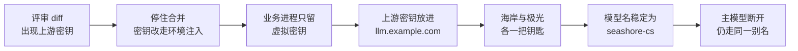
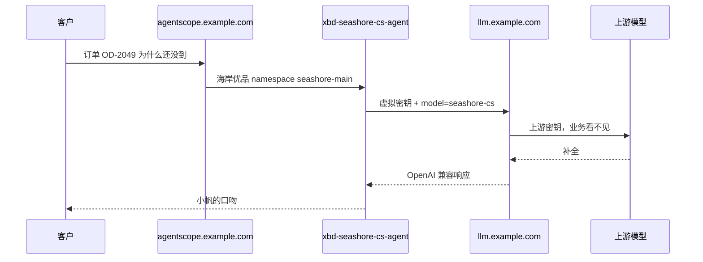

# 第 1 章 业务服务里不该直接握着模型密钥

> 林舟把海岸优品客服的一次改动推上去评审时，diff 里多了一行 `DASHSCOPE_API_KEY`。那一行能回答「订单 OD-2049 为什么还没到」，也能在密钥泄露后把星帆出海两家商家的模型账单一起打穿。这一章先把密钥从业务仓里拿出去，再决定网关要站在哪。



*本章导览图*

## 那一行是怎么进 diff 的

小帆在本地能答 OD-2049，是因为开发机的环境里有一把上游密钥。林舟把 `application-local.yml` 顺手加进了提交。文件里是占位写法还是真密钥，评审人在网页上无法分辨，历史记录却已经公开给仓库的每个读者。

星帆这条链路上，真正会调用模型的不止一个进程：

| 进程 | 它为什么要模型 | 密钥一旦写进它的仓库 |
| --- | --- | --- |
| 小帆的本地示例，`xingfan-support` | 开发时直接 `call` | 每个克隆仓库的人都有 |
| 托管客服 `xbd-seashore-cs-agent` | 海岸优品的会话 | 海岸的额度变成仓库的额度 |
| 物流专员 `xbd-seashore-logistics-agent` | 工单「核实订单 OD-2049 物流实际状态」 | 同一把钥匙被第二个服务复制 |
| 极光客服 `xbd-aurora-cs-agent` | 对照租户 | 极光的调用记在海岸的供应商账号上 |
| 平台公共助手 | 不碰商家私有数据 | 更不该持有任何商家的上游密钥 |

demo 的 Step 13 把网关地址写成 `https://llm.example.com`，密钥放在 `XBD_MODEL_API_KEY`，并写明「本地提供，不入库」。那是教学栈的边界：密钥仍进了 Dataplane 进程。进程被打穿、配置被打印、崩溃转储被上传，上游密钥就出去了。网关要做的第一件事，是让这个进程里的钥匙不再是上游的那一把。

## 账单不是在对话里长出来的

OD-2049 的客户已经第三次催单。客服要拟一句口径，物流要核对状态。两边都失败过一次就会各再试。没有网关时，重试发生在业务代码里，计数器在供应商控制台，星帆自己的日志只有超时。

用本书后面实验里的数量级做一道算术，不把它当成厂商报价。一次模拟补全是 18 个提示词 token 加 22 个完成 token。若生产里一轮客服回复是这个数字的一百倍，客服和物流各打一轮、各重试两次，就是 6 次调用、约 2.4 万 token。活动日再乘上并发会话，供应商侧的免费额度或月度上限会在业务还没告警时先拒绝。

AgentScope 书的验证记录里出现过 `AllocationQuota.FreeTierOnly`：额度耗尽和 namespace 权限无关，旧会话还会继续打已经没额度的模型。网关侧的预算解决不了供应商突然停服，但能在星帆自己的账本上先挡住「一个失控的重试循环把全平台打满」。那是第 4 章的事。这里只确定：账本不能放在每家商家的业务仓库里各记一份。

## 上游密钥、虚拟密钥、主密钥

三把钥匙的职责在后面两章会落到接口上。先把名字定死，避免配置文件里混用。

| 钥匙 | 谁持有 | 能做什么 | 星帆的放法 |
| --- | --- | --- | --- |
| 上游密钥 | 只有网关进程 | 向供应商或模拟上游鉴权 | 环境变量，不进 Git |
| 虚拟密钥 | 某一个调用方 | 调用被允许的模型别名，受预算和限流约束 | 海岸客服一把，极光客服另一把 |
| 主密钥 | 平台管理员 | 签发和吊销虚拟密钥，读取花费 | 只在林舟的管理通道，不进 Dataplane |

LiteLLM 的 Virtual Keys 页要求主密钥以 `sk-` 开头；Docker Quickstart 又说这个前缀是约定、不是硬性要求（两页均于 2026-11-11 阅读）。本书示例一律用 `sk-` 开头的占位符，避免踩到更严的那一页。占位符不是密钥。`.env.example` 里的 `replace-me` 不能拿去请求。

业务服务如果必须有一把钥匙，它只能是虚拟密钥。虚拟密钥泄露的爆炸半径是这一家商家、这一组模型、这一截预算。上游密钥泄露的爆炸半径是网关上所有还在用这把上游钥匙的部署。

## 网关放在哪一层

请求从客户进到模型，中间已经有好几站。再插一层之前，先看现有的站各自负责什么，免得网关去抢别人的工作。



*一次催单穿过平台和网关。平台域名与网关域名都来自既有书，不新造。*

| 层 | 已经负责 | 不要让它再负责 |
| --- | --- | --- |
| AgentScope namespace | alice 看不见 `aurora-main` | 供应商账单 |
| 工单与团队 | OD-2049 的客服、物流分工 | 模型路由 |
| `merchant-gateway` 别名 | Dataplane 知道「走公司网关」 | 上游密钥本身 |
| LiteLLM Proxy | 上游密钥、虚拟密钥、别名、预算、降级 | 订单是否真实存在 |

小帆答「系统里没有这笔物流」是业务事实的缺失，不是网关的失败。网关只保证：这次调用花的是海岸优品的额度，用的是 `seashore-cs` 这一个名字，主部署不可达时还有机会改走 `seashore-cs-fast`。

## 业务仓里留下什么

下面这份是反例。不要把它放进任何会被提交的文件，哪怕值是假的——评审习惯一旦允许「密钥样例」，真密钥就会沿同一路径进来。

```yaml
# 反例。不要提交。
dashscope:
  api-key: sk-live-do-not-commit
agentscope:
  openai:
    api-key: sk-live-do-not-commit
    base-url: https://dashscope.aliyuncs.com/compatible-mode/v1
    model-name: qwen-plus
```

收成网关之后，业务仓里可以出现的是别名和地址，密钥只留环境变量名：

```yaml
# 海岸优品客服进程。密钥由部署系统注入，文件里只有变量名。
agentscope:
  openai:
    api-key: ${SEASHORE_LITELLM_KEY}
    base-url: https://llm.example.com/v1
    model-name: seashore-cs
```

`base-url` 是否带 `/v1` 取决于客户端。AgentScope 书第 6 章的 `OpenAIChatModel.baseUrl` 示例带 `/v1`。Spring AI 的拼接不一样，第 8 章分开写。这里先记住主机名是 `llm.example.com`。

还要扫一遍这些位置。它们不算「配置文件」，一样会把密钥带出去：

| 位置 | 典型漏法 |
| --- | --- |
| CI 日志 | `echo $DASHSCOPE_API_KEY` 或调试打印整个环境 |
| 崩溃报告 | HTTP 客户端把请求头附在异常里 |
| 工单评论 | 排障时把 curl 贴进「售后升级：订单 OD-2049 …」 |
| 前端包 | 有人把钥匙打进浏览器，方便本地演示 |
| 镜像层 | `ENV DASHSCOPE_API_KEY=...` 写进 Dockerfile |

网关消不掉这种粗心，但能让泄露的那把钥匙单独作废，不必为了一次工单评论去供应商控制台轮换全部业务。上游密钥仍要轮换，只是不再绑在每一次业务发布上。

## 什么时候先不要上 Proxy

一个人在笔记本上跑小帆的最小示例，模型调用一天几次，没有第二家商家。这时加 Postgres、主密钥和虚拟密钥，排障成本高于泄露风险。仍旧不要把密钥提交。用环境变量，示例仓库只留 `.env.example`。

下面任一条件成立，就该把 Proxy 当作平台的一部分，而不是个人工具：

- 海岸优品和极光数码会同时调用，账单要能拆开。
- 客服、物流、选品三个 Agent 会打同一家供应商，你希望换模型时只改网关配置。
- 主模型会超时或返回 5xx，业务代码里已经出现了各写各的重试。
- 密钥出现在评审 diff、镜像或工单里过一次。有过一次就还会有第二次，除非路径被堵上。

星帆出海四条都占了。所以从第 2 章起，网关是必经之路，不是可选组件。

## 这一章还没做的决定

模型别名怎么映射到上游、失败后换哪一个部署、团队预算按天还是按月重置、Java 客户端的 URL 怎么拼、轨迹送到哪一个 Langfuse 项目。这些都还没有答案。本章只固定一件事：上游密钥的家在 `llm.example.com` 的进程环境里，不在 `xbd-seashore-cs-agent` 的仓库里。

New API 也能做中转和令牌。它的许可证不是 MIT。星帆要把网关嵌进对商家开放的控制台时，AGPL 的网络分发义务和第 7 条署名要求会先于功能对比成为问题。第 2 章只给一张对照表，第 10 章写许可边界。正文的命令、配置和失败案例全部来自 LiteLLM Proxy。

## 泄露之后的几个小时

密钥一旦进了 Git，删除下一笔提交没有用。历史里还在。林舟按这个顺序处理，不按「先写复盘」的顺序。

1. 在供应商控制台作废那把上游密钥，并签发一把新的，只交给网关的部署系统。旧钥匙作废前，假定它仍能产生费用。
2. 把网关的 `MOCK_UPSTREAM_KEY` 或生产里对应的环境变量换成新值，重启网关进程，用 `seashore-cs` 打一笔只含订单号的测试句，确认 `[primary]` 这类标记或真实上游的 200。本机没有真实供应商，这一步在实验里是换模拟器的环境变量，不证明供应商侧已经作废。
3. 业务进程不重启也行，只要它们手里没有旧的上游密钥。若它们有，先卸掉，再谈虚拟密钥。顺序反了会在卸上游密钥的窗口里把客服打挂。
4. 扫 CI 日志、镜像历史和工单评论。工单标题「售后升级：订单 OD-2049 客户投诉物流延迟」下面如果贴过 curl，评论也要删，不能只删 Git。
5. 通知海岸和极光的店主：模型账单可能在作废前有异常调用。给 alice 和 bob 的说明不附带密钥片段。
6. 给仓库加一个拒绝提交的检查，匹配 `sk-` 后面一长串、以及 `DASHSCOPE_API_KEY=` 后面不是变量引用的写法。检查会误伤文档里的占位符。占位符用 `replace-me`，不要用看起来像真钥匙的随机串。本书的 `.env.example` 遵守这一点。

强制推送来抹掉历史，只在仓库仍然私有、所有克隆都能配合重写时才有意义。公开过的历史当作已经复制走。星帆的教程仓库是公开的，所以实验密钥从一开始就不能是真的。

## 错误的「集中管理」

有人会把上游密钥放进集群里的一个 Secret，名字叫 `llm-upstream`，再挂到所有 Dataplane。密钥不在 Git 里了，爆炸半径还在：任何一个挂载了这个 Secret 的 Pod 被读走环境变量，两家商家的上游都暴露。网关要成为唯一挂载上游 Secret 的工作负载。其他工作负载只挂载自己的虚拟密钥。

| 工作负载 | 挂载 | 不挂载 |
| --- | --- | --- |
| `litellm` | 上游密钥、主密钥、盐、数据库 URL | 商家的业务数据库口令 |
| `xbd-seashore-cs-agent` | `SEASHORE_LITELLM_KEY` | 上游密钥、主密钥 |
| `xbd-aurora-cs-agent` | `AURORA_LITELLM_KEY` | 海岸的虚拟密钥 |
| 平台公共助手 | 无模型密钥，除非将来有不含商家数据的公共模型 | 任何商家钥匙 |
| 教学探针所在的笔记本 | 短期的虚拟密钥 | 不要为了方便把上游密钥写进 shell 配置文件 |

探针是 Step 13 里「终端直连网关」的那一步。它使用虚拟密钥即可证明路径。使用上游密钥会让笔记本成为第二台网关，而且没有预算。

## 日志里长什么样算泄露

下面几行都算。值用占位，不要把真实钥匙填进来「对照一下」。

```text
Authorization: Bearer sk-live-example
api-key=sk-live-example
DASHSCOPE_API_KEY=sk-live-example
```

下面几行不算密钥本身，但会帮助别人把末四位和系统对上，仍然只留在内部日志：

```text
key_alias=seashore-cs-agent
x-litellm-model-id: seashore-cs-primary
```

预算错误里的长十六进制是钥匙哈希。它不是 `sk-` 原文。仍不要贴到工单的公开评论。内部事故单可以留哈希，方便和 `/key/info` 的时间线对照。本机没有把哈希写进书稿。

## 两家商家同时在线时，一把上游密钥的账单长什么样

假定供应商控制台只能按钥匙汇总，不能按星帆的 namespace 汇总。海岸和极光共用上游密钥时，一张发票回答不了「这 40 美元是谁的重试」。网关的 `team_info.spend` 能回答，但用的是你配置的单价，不是发票。分离密钥用来止损和限流。对账仍然要保留供应商侧的月度上限，防止单价表写成 0 之后网关预算永不触发，钱却在供应商那里增长。

单价写成 0 的实验曾经在文档的「零价格模型」讨论里出现：零价格调用不做预算检查，降级到付费模型时如果没有第二次检查，就会在预算之外产生费用。1.109.0 的文档默认把第二次检查打开。星帆的模拟器单价不是 0。生产若把某个内部模型标成 0，要重读第 7 章的预检，而不是沿用「单价是 0 所以安全」。

## 评审 diff 时看的几行

| 看到 | 动作 |
| --- | --- |
| `api-key: sk-` 后面不是 `${` | 拒绝合并，按泄露处理 |
| `base-url` 指向供应商域名 | 问这是不是还在绕过 `llm.example.com` |
| `model-name: qwen-plus` 或任何不在三个别名里的名字 | 拒绝。网关会 400 |
| `model-name: seashore-cs` 但密钥变量叫 `DASHSCOPE_API_KEY` | 名字和钥匙不是一套，拒绝 |
| 只改了极光的模型名，密钥仍是海岸的变量 | 会得到 403。改动不完整 |
| `.env` 被加进版本库 | 拒绝，即使值是 `replace-me`。示例文件只能叫 `.env.example` |

## 这一章故意不决定的数字

日预算是 1 美元还是 100 美元，rpm 是 10 还是 300，本章都不定。第 4 章用极端小数只为了看到 422 和 429。真数字来自海岸的客服量和合同单价，由林舟和财务一起写进 `/team/new`，不写进这本书的正文当推荐值。写成推荐值会在下一次合同改价时变成错误文档。

## 离开这一章之前

- 在 `open-api-platform` 和 Agent 配置里搜上游密钥的变量名。搜到的值如果在 Git 历史里，按已经泄露处理，去供应商侧作废，而不是只在下一笔提交里删掉。
- 列出仍持有上游密钥的进程。星帆这边至少核对：本地小帆、Dataplane、任何还在用 `XBD_MODEL_API_KEY` 直连供应商的探针。
- 定两把虚拟密钥的未来主人：海岸优品客服对应 `seashore-main`，极光数码客服对应 `aurora-main`。先写在纸上，第 3 章再签发。
- 确认网关主机名继续用 `llm.example.com`，平台继续用 `agentscope.example.com`。不要为了「看起来像生产」新造一个域名。

## 接着读

- 第 2 章把 Proxy 在没有厂商密钥的机器上跑起来，并说明 New API 为什么只作对照。
- AgentScope Java 第 6 章写了 `baseUrl` 与模型扩展。密钥从环境变量读，是那一章已经有的纪律；本书把变量的值从上游钥匙换成虚拟钥匙。
- AgentScope Java 第 43 章和 demo Step 13 是这条业务链的上游。Step 13 注明 Dataplane 到网关的真实请求当时未测。本书补的是网关自己，不回头宣称那次 Dataplane 请求已经测过。
- demo 的 `.env.example` 把 `XBD_MODEL_API_KEY` 留空。空着是对的。填进去的应该是以后的虚拟密钥，而不是供应商密钥。
