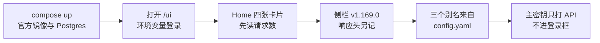
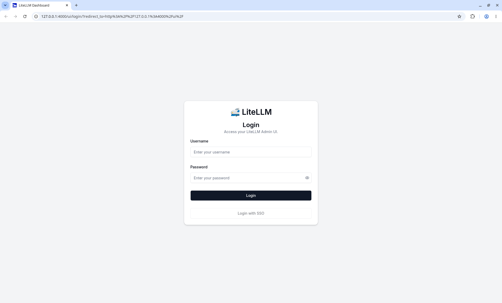
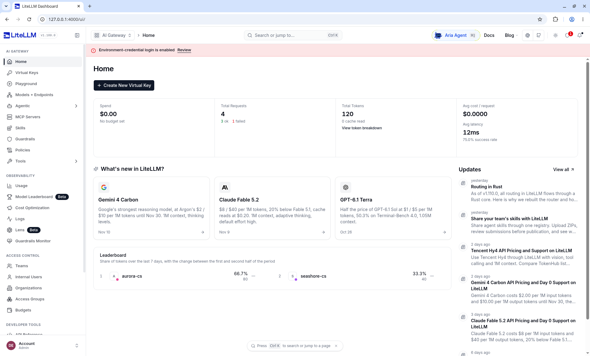
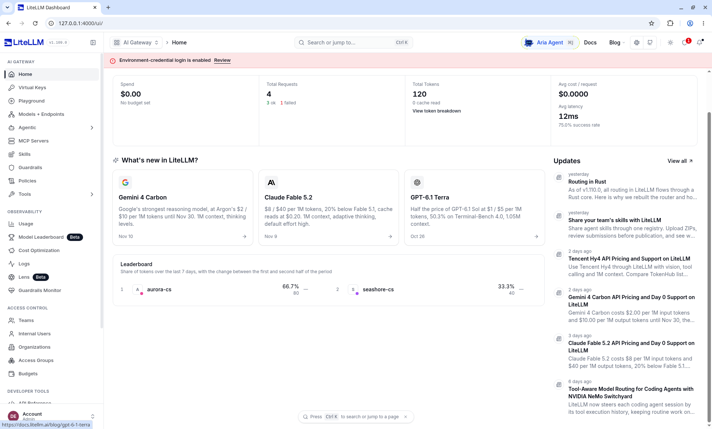
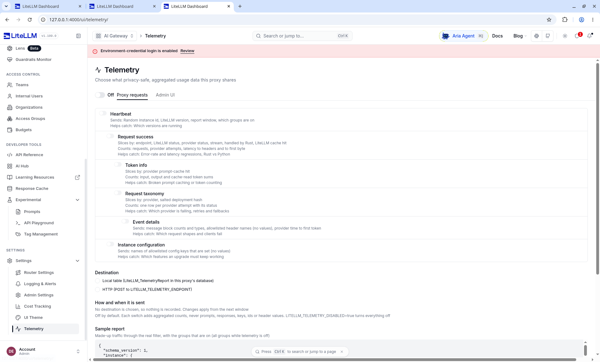

# 第 2 章 把 LiteLLM Proxy 跑起来

> 海岸优品的客服还在等 OD-2049 的一句答复。密钥已经决定不进仓库，下一步是有一个听得见请求的进程，并且林舟自己能登录进去看见它。这一章用 Docker Compose 拉起官方镜像、Postgres 16 和两个模拟上游，登录 Admin UI，看 Home 上当时的四张卡片。没有厂商密钥。侧栏版本和响应头版本不是同一个数，两个都留下。



*本章操作流程图*

## 这次界面是哪一次跑出来的

2026-11-12，镜像是 `ghcr.io/berriai/litellm:main-stable`，数据库是 Postgres 16，上游是两个本地的 OpenAI 兼容模拟进程。没有厂商密钥，没有设置 `LITELLM_LICENSE`。管理界面在 http://127.0.0.1:4000/ui/ 。

版本要分开读，不要捏成一个：

| 读到的位置 | 数字 | 哪一次 |
| --- | --- | --- |
| Admin UI 侧栏，Logo 旁边 | LiteLLM v1.169.0 | 2026-11-12 这次界面 |
| 成功的 Chat Completions 响应头 `x-litellm-version` | 1.109.0 | 同一次运行 |
| PyPI 与 `importlib.metadata.version("litellm")` | 1.109.0 | 2026-11-11 的 pip 安装，不是这次镜像 |

镜像标签 `main-stable` 会浮动。本书没有把 digest 钉死。发布说明里写侧栏上的字符串和响应头，两个都写。11 日那次 pip 的报错和状态码仍然来自 1.109.0，不外推到侧栏那个 1.169.0 上。

CLI Quick Start 写明：1.84.0 起要求 Python 3.10 以上。在更老的解释器上，`pip install 'litellm[proxy]'` 不会报错，只会静默解析到仍允许那个解释器的那一版。这只影响不用镜像的人。读者的默认路径是下一节的 Compose。

Quick Start 还写了一句负载测试数字：「1.5k+ requests/second」。本书没有复现这组压测，不把它当成星帆的容量承诺。

## 读者怎么把界面打开

在 `books/litellm/demo` 执行：

```bash
docker compose up
```

Compose 做四件事：Postgres 16，两个只跑标准库的模拟上游，以及官方镜像。`config.yaml` 和 `mock_upstream.py` 用只读卷挂进去。不要先写一个 Dockerfile 把这两个文件打进镜像。把文件烤进镜像，是宿主机绑定挂载坏掉时的权宜之计，不是这本书的启动步骤。

容器里的进程监听 `0.0.0.0`，否则宿主机的端口映射进不去。发布到宿主机的地址限定在 `127.0.0.1` 的 4000、5432、18001、18002。配置里的 `api_base` 写成 `http://mock-primary:18001/v1` 和 `http://mock-backup:18002/v1`。这是容器网络里的服务名。写成 `127.0.0.1` 时，网关会去连它自己，模拟上游收不到请求。模拟脚本也必须绑定 `0.0.0.0`，同一条理由。

浏览器打开 http://127.0.0.1:4000/ui/ 。



登录用环境变量，不是主密钥：

| 你要做的事 | 用哪一个 | 这次的值 |
| --- | --- | --- |
| 打开 Admin UI | `UI_USERNAME` / `UI_PASSWORD` | `admin` / `StarsailDemo#2026` |
| 调用 `/key/generate`、`/v1/chat/completions`、`smoke.sh` | `LITELLM_MASTER_KEY` | `sk-starsail-master` |
| 模拟上游的 `api_key` | `MOCK_UPSTREAM_KEY` | `sk-mock-upstream`。模拟器不校验 |

密码里有一个 `#`。写进 shell 时加引号，浏览器里按字面输入。主密钥不要填进登录框。登录框里的密码也不能拿去当 `Authorization: Bearer`。

登录之后，页面顶部有一条粉色条幅，原文是 Environment-credential login is enabled，旁边有 Review。这是「用环境变量登进来的管理员」，不是某个人的账号。条幅在后面每一张截图的顶上都在。Login with SSO 那颗按钮在登录页上，这次没有点，也不知道它会跳到哪。

官方文档把这种登录称为引导用的共享口令：它写在环境里，轮换不了到个人，也分不清是哪一个管理员点的。星帆的演示停在这条引导路径上。文档后半段要求建好个人账号后，在配置里打开 `disable_env_credential_login` 并重启。那一步本书没做。没做之前，条幅应该一直在。

## 登录之后先看 Home

Home 是登录后的第一页。四张卡片是当时库里的计数，不是配置文件能告诉你的。





读这四张卡时按卡片上的字，不要帮它四舍五入之前的数：

| 卡片 | 截图上的字 | 和后面章节的关系 |
| --- | --- | --- |
| Spend | $0.00，No budget set | 全局没有预算。团队页上的 $50 和 $30 是另一个桶，第 4、5 章再看 |
| Total Requests | 4，3 ok，1 failed | 成功率 75.0% 就是 3/4。后来的 Usage 变成了 6 个请求，不是这一张卡写错 |
| Total Tokens | 120，0 cache read | Leaderboard 的 80 和 40 加起来也是 120。aurora-cs 当时占 66.7%，seashore-cs 占 33.3% |
| Avg cost / request | $0.0000 | 单笔大约 $0.000062，卡片把小额收成了 0。对账去看 Playground 和成功的那条日志 |

What's new 里的 Gemini 4 Carbon、Claude Fable 5.2、GPT-6.1 Terra，以及右侧 Updates，是产品自己的新闻。星帆没有调用这些模型。实验单价也不在这些卡片上。

Leaderboard 的说明文字是过去 7 天、前后半段的变化。截图里两行都没有画出涨跌的数字，只有份额和 token。只读你能看见的 66.7% / 80 和 33.3% / 40。

## 侧栏的下半段，以及关着的 Telemetry

功能不在 Home 的卡片里，在左侧。往下滚到 Settings 展开的时候，画面是这样。



这一张是滚下去之后拍的，Logo 旁边的 v1.169.0 不在画面里。版本字符串以 Home、Models 那些还看得到 Logo 的截图为准。

Settings 这一组里，和第 7 章直接有关的是 Router Settings。Telemetry 这次保持关闭：没有把代理请求送到 LiteLLM 的远端，也没有填 `LITELLM_TELEMETRY_ENDPOINT`。页上的文字说明默认不记录，`LITELLM_TELEMETRY_DISABLED=true` 会把全部关掉。我们连第一项都没打开。Langfuse 也没接，那是第 9 章。

侧栏上半段的 Home、Virtual Keys、Playground、Models + Endpoints、Usage、Logs、Teams，分别在第 3 到第 7 章打开。Models 页里的 Auto-Routers、Model Group Alias 是空的。降级规则不在那两个标签上。

## 配置文件里每一块是干什么的

完整文件在 `books/litellm/demo/config.yaml`。下面按块说明，避免你把实验单价抄成生产报价。

`model_list` 的一条是一个部署，不是一个业务名字。`model_name` 相同的多条会在第 6、7 章变成负载均衡。本书这份配置里，每个 `model_name` 只有一条，降级靠的是另一个名字。

| 字段 | 实验值 | 作用 |
| --- | --- | --- |
| `model_name` | `seashore-cs` 等 | 客户端请求体里的 `model`。界面 Public Model Name 用它 |
| `litellm_params.model` | `openai/mock-qwen-plus` | 三个别名都是这一个字符串。协议前缀加实验用的上游模型 id |
| `api_base` | `http://mock-primary:18001/v1` 或 `mock-backup` | 容器内地址。海岸的 fast 走 backup，另外两个走 primary |
| `api_key` | `os.environ/MOCK_UPSTREAM_KEY` | 字面量 `os.environ/...` 是 LiteLLM 的读环境变量写法，不是 shell |
| `input_cost_per_token` | `seashore-cs` 与 `aurora-cs` 为 `0.000001`，fast 为 `0.0000004` | 实验单价。界面按每百万 token 显示成 $1.00 / $0.40 |
| `model_info.id` | `seashore-cs-primary` 等 | 响应头 `x-litellm-model-id` 用它区分部署 |

2026-11-11 的 pip 配置曾经让 `seashore-cs-fast` 使用 `openai/mock-qwen-turbo`，`api_base` 也是宿主机的 `127.0.0.1`。那是另一份文件。现在三个别名的上游模型字符串相同，主备靠 `api_base`、部署 id 和模拟器正文里的 `[primary]` / `[backup]` 区分。

`router_settings` 里 `routing_strategy: simple-shuffle`，`num_retries: 0`。2026-11-12 的 Loadbalancing 页上能看见这两项。`fallbacks` 把 `seashore-cs` 指到 `seashore-cs-fast`。界面在 Settings → Router Settings → Fallbacks，第 7 章有那一屏。`aurora-cs` 没有 fallback。极光数码的客服在这份实验配置里不借用海岸的降级。

`general_settings.master_key` 与 `database_url` 都从环境变量读。主密钥是管理接口和 API 的口令。它不是上一节的 UI 密码。

`litellm_settings.drop_params: true` 让上游不认识的参数被丢掉，而不是直接 400。模拟上游会忽略多余字段，这个开关在本实验里没有被单独验证成「去掉它就失败」。留着是因为 Java 客户端以后会带温度、工具选择等字段。

Compose 里还设置了 `STORE_MODEL_IN_DB=True`。Models 页上的三行仍然标着 Defined in config。这个环境变量没有把它们改成「在界面里新建的模型」。

## 数据库和盐

虚拟密钥、团队和花费都要 Postgres。Compose 把库和网关一起拉起，库名 `litellm`，用户 `llmproxy`，口令 `dbpassword9090`。这是写在演示 compose 里的本机口令，不是生产口令。

`LITELLM_SALT_KEY` 在 Docker Quickstart 里用于加密「从 UI 写入数据库的供应商密钥」。改了它，已经存进去的供应商密钥无法解密。这次 compose 没有设置盐：上游密钥来自配置里的环境变量，没有人在 UI 里粘贴供应商密钥。一旦要在 UI 里保存真钥匙，先设置盐再粘贴。本书没有做「先不设盐、再补盐」的对照。

## 健康检查和第一次补全

`/health/liveliness` 不带密钥，HTTP 200，正文是：

```text
"I'm alive!"
```

路径拼写是 liveliness，不是 liveness。写探针时抄官方路径。

带主密钥访问 `/health/readiness`：

```json
{"status":"healthy","db":"connected"}
```

`/v1/models` 返回三个 id：`seashore-cs`、`seashore-cs-fast`、`aurora-cs`。`owned_by` 字段是 `openai`。那是响应形状。Usage 页后面也会把 Provider 画成 openai。两处都来自配置里的 `openai/` 前缀，不表示请求去了 OpenAI。

2026-11-11 用主密钥打过的补全摘录：

```json
{
  "id": "chatcmpl-primary",
  "model": "seashore-cs",
  "choices": [
    {
      "finish_reason": "stop",
      "message": {
        "role": "assistant",
        "content": "[primary] 订单 OD-2049 仍在途。请核对运单后再答复客户。"
      }
    }
  ],
  "usage": {"completion_tokens": 22, "prompt_tokens": 18, "total_tokens": 40}
}
```

2026-11-12 用 alice 的虚拟密钥再打 `seashore-cs`，HTTP 200，正文同样以 `[primary] 订单 OD-2049 仍在途。` 开头，响应头 `x-litellm-model-id: seashore-cs-primary`，`x-litellm-attempted-fallbacks: 0`，费用约 $0.000062。成功响应带 `x-litellm-version: 1.109.0`。Playground 里那一轮对话是登录会话打的，不是 alice 这把钥匙，第 6 章把 Trace 摊开。

不带密钥访问 `/v1/models`，11 日的响应是：

```json
{"error":{"message":"Authentication Error, No api key passed in.","type":"auth_error","code":"401"}}
```

主密钥能直接做补全。这方便排障，不适合放进 `xbd-seashore-cs-agent`。业务进程用第 3 章的虚拟密钥。`seed.sh` 在空库上创建截图里的 alice、bob 和两个团队。新库的 `team_id`、密钥末四位和截图不同。

## 没有数据库时不要指望预算

Docker Quickstart 有一节「Running without a database」。2026-11-11 读到的要点是：

- 可以只用配置文件提供 OpenAI 兼容 API。
- 虚拟密钥会失败，消息是 `No connected db.`
- `litellm_settings.max_budget` 不是这条路径上的花费上限。没有数据库客户端时，累计花费保持未知，全局预算检查不会触发。
- 主密钥本身没有预算。

本机没有另起一个无库进程去复读这些句子。星帆要配额，所以 Compose 从第一天就带 Postgres。你若在笔记本上先用无库模式看通补全，不要把那个进程的地址写成 `llm.example.com`，也不要指望登录进和第 3 章一样的 Virtual Keys。

## 团队和钥匙不在配置文件里

三个模型别名随配置出现。海岸优品、极光数码的团队和 alice、bob 两把钥匙要靠管理接口写进库。`demo/seed.sh` 在 readiness 通过之后调用 `/team/new` 和 `/key/generate`：

| 对象 | 名字 | 预算 | 模型 |
| --- | --- | --- | --- |
| 团队 | `seashore-main` | 50 美元 | `seashore-cs`、`seashore-cs-fast` |
| 团队 | `aurora-main` | 30 美元 | `aurora-cs` |
| 钥匙 | `alice`，rpm 30 | 10 美元 | 两个 seashore 别名 |
| 钥匙 | `bob`，rpm 20 | 8 美元 | `aurora-cs` |

脚本不传 `budget_duration`。截图的密钥表把 Budget Reset 显示为 Never。密钥原文只在脚本那一次输出里出现。第 3 章和第 5 章的截图是种入之后再打过请求的库，花费已经不是 0。

## New API 放在对照栏

[QuantumNous/new-api](https://github.com/QuantumNous/new-api) 是面向中转和令牌的另一套网关，README 写明基于 One API（MIT）二次开发，项目本身是 AGPL-3.0，并按第 7 条附加了界面署名和原项目链接。星帆的中台要把它嵌进对商家开放的页面时，修改后的网络服务是否要提供对应源码、界面是否保留指定署名，是法务问题，不是功能清单能代答的。

| 问题 | LiteLLM Proxy（本书主线） | New API（只对照，不安装） |
| --- | --- | --- |
| 许可 | 核心 MIT；`enterprise/` 商业许可 | AGPL-3.0 + 第 7 条署名 |
| 这次怎么跑 | 官方镜像加本目录的 `config.yaml` | 不安装 |
| 与 Java 客户端的关系 | OpenAI 兼容的 `/v1/chat/completions` | 同样主打兼容。兼容范围以它自己的文档为准，本书未测 |
| 星帆为什么不拿它当底座 | 见第 10 章 | 许可义务先于功能 |

本章不提供 New API 的安装命令。对照表的目的是让评审时有人问「为什么不用 New API」时，答案是许可和配置进 Git，而不是「没听说过」。

## 端口和进程

| 端口 | 进程 | 死了会怎样 |
| --- | --- | --- |
| 18001 | 模拟上游 primary | `seashore-cs` 与 `aurora-cs` 的部署失败。海岸若允许 fast，可降级到 18002。极光没有备用 |
| 18002 | 模拟上游 backup | 只影响 `seashore-cs-fast`。主路径仍在 18001 |
| 4000 | LiteLLM，API 和管理界面都在这一个端口 | 全部商家的模型调用失败，`/ui` 也打不开 |
| 5432 | PostgreSQL | 代理启动失败，或就绪检查不再是 `db: connected` |

`llm.example.com` 的证书、DNS 和代理超时不在本机实验里。反向代理的超时如果短于网关的 `timeout: 8`，客户端会先看到 504，网关却还在等上游。本机没有反向代理，没有 504 样本。

## 实际打过的路径

11 日的 pip 进程和 12 日的镜像不是同一次。表里写明日期。

| 方法与路径 | 密钥 | 结果 |
| --- | --- | --- |
| `GET /health/liveliness` | 无 | 200，正文 `"I'm alive!"`（11 日） |
| `GET /health/readiness` | 主密钥 | 200，`db` 为 `connected`（11 日） |
| `GET /health` | 无 | 401，`auth_error`（11 日）。12 日的 Request Logs 里另有一条未认证的 `/health` 失败 |
| `GET /v1/models` | 主密钥 | 三个别名（11 日）。12 日的 Models 页同样是这三行 |
| `POST /v1/chat/completions` `seashore-cs` | alice | 200，正文以 `[primary] 订单 OD-2049 仍在途。` 开头，`x-litellm-model-id: seashore-cs-primary`，`x-litellm-attempted-fallbacks: 0`，费用约 $0.000062，响应头版本 1.109.0（12 日） |
| `POST /v1/chat/completions` `aurora-cs` | alice | 403，`key_model_access_denied`（12 日） |
| `POST /v1/chat/completions` `aurora-cs` | bob | 200（12 日） |
| Playground，模型 `seashore-cs`，非流式 | 当前 UI 会话 | 200。流式的第一下卡住，关掉 Stream response 后才有第 6 章那张图 |
| `GET /ui` 登录页 | 无 | 登录表单。用户名密码登录后进入 Home |

`/chat/completions` 与 `/v1/chat/completions` 在 11 日那版代理上都能进路由。业务客户端仍统一走 `/v1/...`。

## 不用镜像时留下的两段失败

官方镜像在设置了 `DATABASE_URL` 时自己做数据库初始化。2026-11-11 用 pip 起步时，第一段原文是：

```text
LiteLLM Proxy: a database URL is set but the prisma CLI is neither on PATH nor importable as a package, so the database cannot be set up. Install it with `pip install 'litellm[extra_proxy]'` or run a shipped LiteLLM image.
```

装了 `litellm[extra_proxy]` 之后，进程仍会停在 `Please run 'prisma generate' first.`。要在安装目录的 `litellm/proxy` 下对 `schema.prisma` 生成客户端。这就是读者默认走镜像的原因。运行手册如果只抄 `uv tool install 'litellm[proxy]'`，会停在第一段错误。

那次生成器打印过 Prisma Client Python，并警告 `binaryTargets`。警告没有阻止后续启动。schema 里 `provider = "postgresql"`，所以 SQLite 不是这条路径的选项。

成功启动时，11 日的日志把三个别名列了出来。随后每个自定义单价的模型有一条价格警告：不在内置价格表里时，缓存 token 的单价默认成 0。实验没有发送缓存字段。Home 上的 0 cache read 与此相符，不能单独证明警告消失。

同一段日志还警告过 `trusted_proxy_ranges` 未设置。本机没有反代，没有做登录失败的实验。放到 `llm.example.com` 前面若有反向代理，要按那句警告去设。

## `smoke.sh` 覆盖什么

脚本要求 `LITELLM_MASTER_KEY`，可选 `LITELLM_BASE`，默认 `http://127.0.0.1:4000`。它请求 liveliness、readiness、模型列表，再发一句关于 OD-2049 的补全。它用主密钥。所以它证明的是「网关和主上游活着」，不是「alice 的名单正确」。后者用第 3 章的虚拟密钥。主密钥不进 CI。

## 这一章的复核

2026-11-12 已在官方镜像上看到：登录页、环境变量登录、粉色条幅、Home 的四张卡片和 Leaderboard、侧栏下半段、Telemetry 关闭、Models 页三个 Defined in config 的别名（第 6 章）、alice / bob 的请求结果、Playground 在关掉流式之后的成功（第 6 章）、Fallbacks 页上的那一行（第 7 章）。侧栏 v1.169.0 与响应头 1.109.0 同时成立。

2026-11-11 的 pip 1.109.0 上看到：Prisma 的两段失败、liveliness 正文、readiness 的 `db: connected`、三个模型 id、带 `[primary]` 的补全、无密钥 401。那次没有登录 UI。

未做：点 Login with SSO、关掉环境变量登录、无库模式、`uv tool install`、任何真实供应商、New API 的运行、把镜像 digest 钉死、在 12 日的 compose 上再停一次主上游。流式 Playground 只确认了「开着会卡住」，没有等到它自己完成。

## 接着读

- 第 3 章看 Virtual Keys 上的 alice 和 bob，并解释管理员签发的钥匙为什么没有主人。
- 第 6 章用 Models 页和 Playground 的 Trace 看 `seashore-cs` 实际打到 `mock-primary:18001`。
- 第 7 章看 Router Settings 里已经载入的降级，以及 11 日那次真正发生过的切换。
- AgentScope Java demo Step 13 的探针是「终端直连网关」。本章的 curl 是同一类证据：证明网关自己活着，不证明 Dataplane 已经改道。
