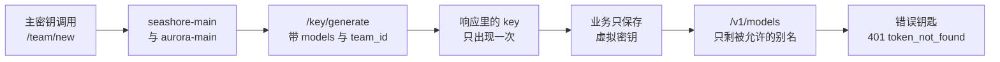
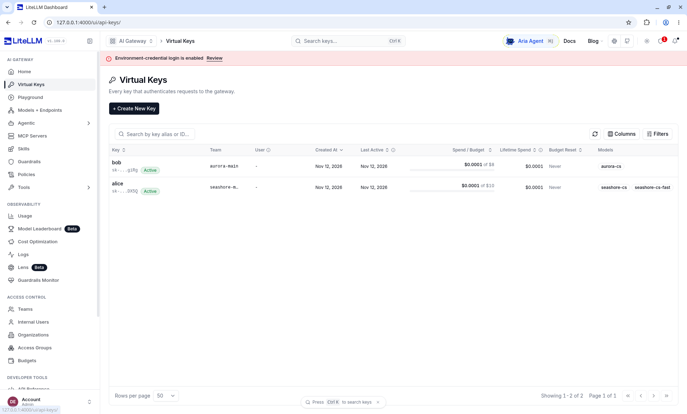

# 第 3 章 虚拟密钥

> 主密钥能让 curl 替 OD-2049 问出一句「仍在途」。把它写进 `xbd-seashore-cs-agent`，等于把签发权交给客服进程。这一章先看管理界面上已经种入的 alice 和 bob，再回到签发接口，看清返回体里哪些字段真有约束力，哪些只是回显。



*本章操作流程图*

## 界面上的 alice 和 bob

2026-11-12 的 Virtual Keys 页上有两行。钥匙原文被遮住，团队、预算和模型还在。



这张表能回答的和不能回答的，分开记：

| 你能从这张表读到的 | 表上没有、不要脑补的 |
| --- | --- |
| 两把钥匙都是 Active，用户列是 `-` | 末四位 `g1Rg`、`DX5Q` 只属于这次库。`seed.sh` 重跑会换掉 |
| bob 属于 `aurora-main`，预算 $8；alice 的预算是 $10，团队名被截成 `seashore-m...` | 截断不等于团队没建成。Teams 页上的全名是 `seashore-main` |
| 模型列写着别名：bob 只有 `aurora-cs`，alice 有 `seashore-cs` 和 `seashore-cs-fast` | 默认列没有 RPM。alice 的 rpm 30、bob 的 rpm 20 是签发时写上的，这张表看不出来 |
| Spend 都显示 $0.0001，Budget Reset 是 Never | $0.0001 比成功日志和 Playground 上的 $0.000062 粗。对账不要用这一列的四位小数 |
| Created At 与 Last Active 都是 Nov 12, 2026 | 表上没有 403。alice 调 `aurora-cs` 被拒绝，记在第 4 章的 Request Logs 里 |

同一天用这两把钥匙打过的请求：alice 调 `seashore-cs` 得到 HTTP 200，正文以 `[primary] 订单 OD-2049 仍在途。` 开头，响应头 `x-litellm-model-id: seashore-cs-primary`，`x-litellm-attempted-fallbacks: 0`，费用约 $0.000062；alice 调 `aurora-cs` 得到 HTTP 403，类型 `key_model_access_denied`；bob 调 `aurora-cs` 得到 HTTP 200。403 的整段 JSON 是 11 日记下来的，见后面一节。12 日确认的是状态码和类型，不把 11 日的消息原文说成 12 日又抄了一遍。

用户列的横线，和后面「管理员签发的钥匙没有主人」是同一件事。alice 不是海岸优品的店主账号，bob 也不是极光的店主。店主仍是 AgentScope 里的 alice 和 bob。网关钥匙只是借用了这两个名字，方便在截图里对上商家。

`demo/seed.sh` 用主密钥创建上表这四样：两个团队、两把钥匙。空库执行一次。密钥原文只在那次输出里出现，页面上从此只有掩码。丢失就作废重签，不要指望这张表把 `sk-` 还回来。

## 先有团队，再有钥匙

界面上的两行是种入之后的样子。签发顺序仍然是：先 `/team/new`，再 `/key/generate`。下面 11 日的调用把字段形状记全了，预算和别名与截图不同：那天海岸钥匙的 `key_alias` 是 `seashore-cs-agent`，`max_budget` 是 `0.01`。截图里的 alice 是 10 美元、rpm 30。读返回体时用 11 日的样本，读页面时用上一节。

Virtual Keys 页的顺序是：建团队，再给团队签发钥匙。星帆的两家商家对应两个 `team_alias`，用 namespace 的名字，避免第二套命名。

```bash
curl -sS -X POST http://127.0.0.1:4000/team/new \
  -H "Authorization: Bearer $LITELLM_MASTER_KEY" \
  -H 'Content-Type: application/json' \
  -d '{
    "team_alias": "seashore-main",
    "max_budget": 1.0,
    "budget_duration": "1d",
    "models": ["seashore-cs", "seashore-cs-fast"],
    "rpm_limit": 30,
    "tpm_limit": 20000,
    "metadata": {"namespace": "seashore-main", "merchant": "海岸优品"}
  }'
```

2026-11-11 返回的 `team_id` 是一段 UUID。`budget_reset_at` 是 `2026-11-12T00:00:00Z`，创建时间约在当天 15:48 UTC。`members_with_roles` 里出现 `default_user_id`，角色 `admin`。`organization_id` 是 `null`。本书没有创建 organization。官方企业页把组织列在许可证能力附近，开源的 `/team/new` 不要求组织 id，实验也没填。

极光数码同样建队：`team_alias` 为 `aurora-main`，`models` 只有 `aurora-cs`，`max_budget` 0.5，`rpm_limit` 20。两队的 id 不同。后面所有钥匙都带上对应的 `team_id`。丢掉 id、只在 metadata 里写商家名字，网关不会因此拒绝跨商家调用。metadata 的边界放在第 5 章，这里先把 id 存进平台的租户记录，不要存进 Git。

## 签发海岸优品客服的钥匙

```bash
curl -sS -X POST http://127.0.0.1:4000/key/generate \
  -H "Authorization: Bearer $LITELLM_MASTER_KEY" \
  -H 'Content-Type: application/json' \
  -d '{
    "key_alias": "seashore-cs-agent",
    "models": ["seashore-cs", "seashore-cs-fast"],
    "team_id": "<seashore-main 的 team_id>",
    "max_budget": 0.01,
    "budget_duration": "1d",
    "rpm_limit": 10,
    "tpm_limit": 4000,
    "duration": "30d",
    "metadata": {
      "namespace": "seashore-main",
      "agent": "xbd-seashore-cs-agent",
      "order_anchor": "OD-2049"
    }
  }'
```

`order_anchor` 只是实验时方便对人，不是网关的查询条件。生产不要把客户原文塞进 metadata。

返回体里和星帆有关的部分：

| 字段 | 这次的值 | 怎么用 |
| --- | --- | --- |
| `key` | `sk-` 开头，本书不贴出 | 只此一次完整出现。立刻放进部署系统 |
| `key_alias` | `seashore-cs-agent` | 给人看的名字，不能拿来鉴权 |
| `team_id` | 海岸团队的 UUID | 和团队预算连在一起 |
| `user_id` | `null` | 见下一节 |
| `models` | 两个 seashore 别名 | 访问控制就靠这个数组 |
| `max_budget` | `0.01` | 美元。实验数字，不是客服的真实月预算 |
| `rpm_limit` / `tpm_limit` | 10 / 4000 | 第 4 章用更小的 rpm 打出了 429 |
| `duration` | 响应里是 `null` | 请求里写了 `30d`，不要以这个回显为准 |
| `expires` | 在 `/key/info` 里是 `2026-12-11T15:49:12Z` | 与签发时刻相隔 30 天。以 info 为准 |
| `metadata` | 原样回来 | 网关存储，不执行 |
| `blocked` | `null` | 没有被禁用 |
| `aliases` | `{}` | 这次没设密钥级别名 |

`/key/info` 把钥匙显示成 `sk-...` 加末四位，并给出 `key_name` 同样的掩码。`created_by` 与 `updated_by` 是 `default_user_id`。`status` 是 `active`。`spend` 在调用刚结束时可能仍是 0，第 4 章记录了大约两秒后的入账。

`/key/list` 的形状是 `keys`、`total_count`、`current_page`、`total_pages`。本机这次 `keys` 数组里是哈希字符串，不是 `sk-` 原文。管理台如果只给哈希，不能靠列表把丢失的密钥找回来。丢失就作废重签。

## 管理员签发的钥匙没有主人

Virtual Keys 页写得很明确，2026-11-11 的表述是：钥匙的主人是 `user_id` 指向的用户，不一定是调用 `/key/generate` 的那个人。调用者不是代理管理员时，接口会把调用者的 `user_id` 盖上去；代理管理员必须自己传 `user_id`，否则新钥匙没有主人，也不继承管理员的额度与模型。服务账号钥匙的 `user_id` 始终是 `null`，同一条规则。

本机用主密钥签发，返回的 `user_id` 就是 `null`。这是预期，不是丢字段。后果要单独记住：

| 面 | 文档说的继承 | 没有主人时 |
| --- | --- | --- |
| 模型 | 无 `team_id` 时，主人的 `models` 会叠加上去；有团队则钥匙不从主人继承模型 | 只看钥匙自己的 `models`，再受团队约束 |
| 管理路由 `/key/*`、`/user/*`、`/team/*` | 跟随主人的角色。主人是 `proxy_admin` 时，非管理路由限制会被跳过 | 这把客服钥匙不应该能签发别的钥匙 |
| 预算和限流 | 无团队时继承主人的 `max_budget`、`tpm_limit`、`rpm_limit` | 用钥匙和团队上的数字，不跟管理员个人预算走 |

星帆的客服钥匙必须带 `team_id`，并且 `models` 写死。不要依赖「管理员能调所有模型，所以他签发的钥匙也能」。文档说管理员签发且不写 `user_id` 时，模型继承并不发生。我们的返回体支持「`user_id` 为空」这一半；「空 user 就一定不能打管理接口」这一半，本机没有拿这把虚拟密钥去调 `/key/generate`。复核时补一次：用客服钥匙调管理接口，期望失败。失败之前，不要把虚拟密钥的权限假设成主密钥的子集已经自动成立。

## 模型名单是访问控制

海岸的钥匙请求 `model=seashore-cs`，HTTP 200，响应头：

```text
x-litellm-model-id: seashore-cs-primary
x-litellm-attempted-fallbacks: 0
x-litellm-response-cost: 6.2e-05
```

同一把钥匙请求 `aurora-cs`，HTTP 403：

```json
{
  "error": {
    "message": "The requested model 'aurora-cs' is not available for this API key, or the model name is invalid. Check the models available to you and try again.",
    "type": "key_model_access_denied",
    "param": "model",
    "code": "403"
  }
}
```

用这把钥匙拉 `/v1/models`，列表里只有 `seashore-cs` 和 `seashore-cs-fast`，没有 `aurora-cs`。客户端如果靠模型列表做下拉框，极光的别名不会出现。这比在提示词里写「你是海岸优品的客服，不要用别人的模型」可靠。提示词挡不住一个写错的 `model` 字段；名单挡得住。

错误钥匙，HTTP 401：

```json
{
  "error": {
    "message": "Authentication Error, Invalid API key provided.",
    "type": "token_not_found_in_db",
    "param": "key",
    "code": "401"
  }
}
```

`token_not_found_in_db` 把「从没签发」和「已经作废」从外部看成同一种失败是合理的。不要在业务错误页里区分这两种，以免帮人探测哪些密钥曾经存在。

不存在的别名 `qwen-plus`（主密钥去调）是另一条错误，HTTP 400，`type` 为 `invalid_request_error`。消息让你去调 `/v1/models`。Agent 配置里如果还留着供应商的模型名，而网关只认识 `seashore-cs`，你会看到 400 而不是 403。400 是名字不存在，403 是名字存在但这把钥匙不许用。排障时先分清这两句。

## 有效期看 expires

请求体写了 `"duration": "30d"`。生成响应里的 `duration` 是 `null`，`/key/info` 的 `expires` 是签发时刻加 30 天。平台如果把生成响应原样存进数据库，再拿 `duration` 字段做「还有没有过期」的判断，会把一把仍有效的钥匙当成没有期限。以 `expires` 为准。

文档里的 `upperbound_key_generate_params.duration` 可以给所有签发设上限，超限直接 400，不会静默截短。本机没设这项。星帆若规定客服钥匙最长 30 天，应该写进网关配置，而不是写进评审口头约定。设了上限之后，省略 `budget_duration` 还会吃到上限里的默认值，文档说不能靠传 `null` 退出 `upperbound` 的 `budget_duration`（`default_key_generate_params` 对 `budget_duration: null` 的处理和 upperbound 不同）。两项都没在本机开过，上生产前用一把测试钥匙各打一次：超限应 400，显式 `null` 应按你读到的那一版文档行为核对，不要抄本书推断。

## 轮换还没做

文档描述了两件事，本机都没调用：

- `POST /key/<key>/regenerate` 可以换一把新密钥，并带 `grace_period`。旧钥匙在宽限期内是否仍可用，以你那一版的响应为准，本书没有样本。
- 签发时 `auto_rotate: true` 加 `rotation_interval`。这是钥匙自己的旋转。企业页把「自动轮换虚拟密钥」也列在许可证能力里。开源接口文档和许可证页对不齐。本机返回的 `auto_rotate` 是 `false`，`rotation_count` 是 0。不要在没看到旋转真正发生时，把这个字段写成已经具备的运维能力。

上游密钥的轮换更不在这把虚拟密钥上。上游密钥在网关环境变量里。轮换它要改环境、重启或热加载配置，并确认旧上游钥匙在供应商侧失效。虚拟密钥可以不变。这是第 1 章想要的分离：业务发布不再跟供应商控制台绑在一起。

## 钥匙级模型别名，本次没用

Virtual Keys 页的 Model Aliases 允许在签发时写 `"aliases": {"某个客户端旧名字": "seashore-cs"}`。客户端继续请求旧名字，网关改写到别名。星帆没有历史客户端名字要兼容，`aliases` 保持空对象。不要为了「以后可能改名」预先塞一层。别名系统已经有 `model_name`。再叠一层钥匙别名，排障时要猜改写发生在哪一层。

若 `merchant-gateway` 这个教学别名已经写进部分 Agent 定义，优先改 Agent 定义，使 `model` 变成 `seashore-cs` 或 `aurora-cs`。改不完的窗口里，可以用钥匙别名把 `merchant-gateway` 映到该租户的别名。窗口要有结束日期。永久双写会让第 6 章的三层名字变成四层。

## 自定义签发钩子不是必做

文档有 `custom_key_generate`、`custom_key_update`，以及后来的 `custom_key_policy`。后者在生成、更新、重新生成时都能看到合并后的钥匙状态，相对 `duration` 会先折算成绝对的 `expires`。适合写「所有客服钥匙不得超过七天」这种规则。星帆现阶段用配置上限和人工签发就够。钩子是 Python，跑在网关进程里，出 bug 会挡住全部签发。没有测试之前不要启用。

## 业务侧怎么保管

| 存什么 | 放哪 | 不放哪 |
| --- | --- | --- |
| 虚拟密钥原文 | 部署系统的密钥存储，注入 `SEASHORE_LITELLM_KEY` | Git、镜像、工单、OD-2049 的评论 |
| `team_id` | 平台的租户表 | 提示词 |
| `key_alias` | 可以进配置，它不是秘密 | 不要把它当 Bearer |
| 主密钥 | 只有管理作业能读 | Dataplane、小帆、前端 |

注入到进程环境之后，进程仍然会在内存里持有虚拟密钥。这是做不到的更进一步，不是把第 1 章的决定做回上游密钥。泄露虚拟密钥时，作废这一把，海岸的上游供应商钥匙不动。极光的钥匙不动。

## 生成响应里其余字段

海岸钥匙的生成响应很长。除了前面用到的，这些字段在 1.109.0 的这次响应里是空或默认。空着表示「没启用」，不是「功能不存在」。

| 字段 | 这次 | 星帆是否依赖 |
| --- | --- | --- |
| `agent_id` | null | 不依赖。Agent 的 id 在 AgentScope，不在网关 |
| `max_parallel_requests` | null | 不依赖，直到流式占坑被测过 |
| `budget_limits` | null | 多窗口预算没启用。文档允许数组里同时写 7 天和 24 小时 |
| `allowed_cache_controls` | 空数组 | 没做提示缓存 |
| `config` | `{}` | 空 |
| `permissions` | `{}` | 空。不要把管理权限塞进客服钥匙 |
| `model_max_budget` | `{}` | 没有按模型拆钥匙预算 |
| `budget_fallbacks` | `{}` | 没有「预算用尽改走另一个模型」的第二套表。降级是路由器的 `fallbacks` |
| `model_rpm_limit` / `model_tpm_limit` | null | 限流是钥匙级的，不是按模型再分 |
| `guardrails` / `policies` / `prompts` | null | 不在必做路径 |
| `blocked` | null | 未禁用 |
| `object_permission` | null | 未做对象级权限 |
| `tpd_limit` | null | 没有按天的 token 上限，只有 tpm |
| `budget_id` | null | 没有挂到共享预算行。钥匙自己的 `max_budget` 已够用 |
| `allowed_routes` | 空数组 | 空是否等于「只允许模型路由」要在升级时再验证。本机客服钥匙没有拿去调管理接口 |
| `router_settings` | 各键多为 null | 没有按钥匙改路由 |
| `auto_rotate` | 在 info 里是 false | 见轮换一节 |

升级代理之后，抽一把钥匙对这张表再打一次。多出来的非空字段若你没配过，先当成默认行为变化，不要当成星帆已经启用了新能力。

## 团队响应里值得存下来的

`/team/new` 的响应除了 id 和预算，还有 `members_with_roles`。本机是 `default_user_id` 加 `admin`。这是代理内部的默认用户，不是 alice，也不是 bob。不要把这个 `user_id` 写进商家成员表，以免有人以为 alice 已经是网关团队的管理员。

`blocked` 是 false。`spend` 是 0。`access_group_ids` 是空数组。`policies` 是空数组。`allow_team_guardrail_config` 是 false。这些默认值让团队停留在「一桶预算加一张模型名单」。够用。

`budget_reset_at` 要和平台的「营业日」对照。UTC 零点是北京时间早上 8 点。海岸的客服若按北京时间的自然日看账单，会觉得重置点偏了 8 小时。这是显示问题还是额度问题，取决于调用高峰在凌晨还是在白天。实验只观察到字段值，没有把时钟改到 23:59 去看重置是否发生。重置是否真的把 spend 清零，上生产前用 `budget_duration: 1m` 做一次短周期实验，看完再改回 `1d`。本机没做 1 分钟周期。

## 作废

文档有删除和更新接口。本机没有调用删除。实验钥匙留在本机数据库里，数据库不在仓库中。生产的作废要有记录：谁在什么时候作废了 `seashore-cs-agent`，新钥匙的 alias 是什么，旧钥匙的 `last_active` 停在何时。info 响应里有 `last_active`，这次是 null，因为查询发生在使用之前或使用尚未反映到这个字段。不要用 null 推断「这把钥匙从没用过」而不看 spend。

作废之后用旧钥匙再请求，期望 401，`token_not_found_in_db`。和「从来没有这把钥匙」外表相同。业务告警写「认证失败」即可。

## 签发作业本身

签发用主密钥，从一台不跑客服的管理机执行，输出重定向到部署系统的输入，而不是打印在共享终端。shell 历史会留下 curl。管理机的历史文件权限要收紧，或者 curl 从文件读密钥、文件用完即删。本书的实验为了记录状态码，密钥在本机临时文件里。那台机器不是生产。

不要把 `/key/generate` 做到商家可以自己调用的平台 API 上，除非调用者是平台管理员身份，并且审计已经有地方记。开源路径里的审计日志在企业页上。没有审计之前，签发保持为林舟执行的作业，频率低，输出进密码库。

## 离开这一章之前

- 用主密钥签发测试钥匙，确认响应里的 `key` 没有进入 shell 历史的共享记录。本机实验的密钥留在那台机器的临时文件里，没有进仓库。
- 用海岸的钥匙请求 `seashore-cs` 得到 200，请求 `aurora-cs` 得到 403，`type` 为 `key_model_access_denied`。
- 用海岸的钥匙请求 `/v1/models`，确认没有 `aurora-cs`。
- 读 `/key/info` 的 `expires`，不要读生成响应里的 `duration`。
- 用客服虚拟密钥调用 `/team/new` 或 `/key/generate`，确认被拒绝。这一条本机没做，标在这里，避免被人当成已经验证。

## 接着读

- 第 4 章用 `max_budget: 1e-9` 和 `rpm_limit: 1` 把第二下请求打成 422 和 429。
- 第 5 章解释为什么 metadata 里的 `namespace` 不是隔离。
- AgentScope Java 第 6 章的 `apiKey(...)` 接的就是这里签发的值。
