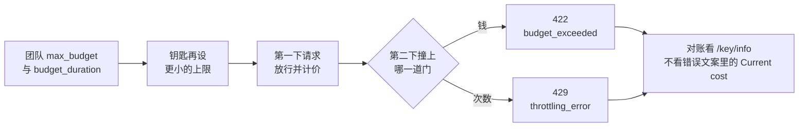

# 第 4 章 团队预算与限流

> OD-2049 的第三次催单如果变成一个重试循环，海岸优品的客服会在供应商还没告警时先把共享额度打空。预算和限流是网关上的两道不同的门：一道数钱，一道数次数。这一章用故意小得离谱的数字把两道门都撞开，并记下错误信息里的金额和数据库里的金额对不上的那一次。



*本章操作流程图*

## 团队先吃掉一截

`/team/new` 时海岸优品的 `max_budget` 是 1.0 美元，`budget_duration` 是 `1d`，`rpm_limit` 30，`tpm_limit` 20000。极光是 0.5 美元和 `rpm_limit` 20，没有设 `tpm_limit`。

Team Budgets 页列出的 `budget_duration` 包括 `1s`、`1m`、`1h`、`1d`、`30d`，含义分别是每秒、每分钟、每小时、每天、每月重置。页上的示例把 `max_budget` 设成极小的小数来触发拒绝。本机沿用这个办法，不把它当成星帆的定价。

`1d` 在这次实验里重置点是下一个 UTC 零点（`2026-11-12T00:00:00Z`），不是「从现在起满 24 小时」。只观察到一对创建时间与 `budget_reset_at`。不要写成所有版本都对齐自然日。换版本时对一下这两个字段。

钥匙还可以再设更小的 `max_budget` 和 `rpm_limit`。客服进程拿到的是钥匙。团队上限是这把钥匙和同队其他钥匙的总和。本机没有在同一团队上并发两把钥匙去证明「总和」这两个字，文档的团队花费接口返回了嵌套的 `team_info.spend`。海岸团队在若干次调用后，这个字段是 `6.2e-05`，与单次响应头 `x-litellm-response-cost: 6.2e-05` 对得上。极光那把超小预算的钥匙后来单独入账，也是 `6.2e-05`，记在钥匙上，不要和海岸的团队花费混读。

## 单价是实验值

`config.yaml` 里 `seashore-cs` 的单价是输入每个 token `0.000001` 美元、输出 `0.000002`。模拟上游固定返回 18 与 22。算式：

```text
18 * 0.000001 + 22 * 0.000002 = 0.000062
```

响应头 `x-litellm-response-cost: 6.2e-05` 与算式一致。`seashore-cs-fast` 的单价是输入 `0.0000004`、输出 `0.0000008`，同样的 token 数是 `0.0000248`。降级成功的那次响应头是 `2.48e-05`。自定义单价生效了。

启动日志说过：模型不在内置价格表时，缓存 token 单价默认 0，输入输出不受影响。我们没有缓存字段，对得上。不要把这组单价留到生产。生产要么用 LiteLLM 自带的模型价格表，要么按合同价写进 `model_info`，并在一笔已知 token 的调用后核对响应头。

## 1e-9 美元拦住第二下

极光的钥匙 `max_budget` 设为 `0.000000001`。第一下 `model=aurora-cs` 返回 200，正文仍是 primary 模拟器的那句 OD-2049。花费检查发生在调用前：当时 spend 是 0，请求被放行，打完才入账。所以「预算已经小于一次调用的价格」挡不住第一下。它挡住的是第二下。

第二下 HTTP 422：

```json
{
  "error": {
    "message": "Budget has been exceeded! Key=… Current cost: 0.032777001, Max budget: 1e-09",
    "type": "budget_exceeded",
    "param": null,
    "code": "422"
  }
}
```

消息里的钥匙标识是一长串十六进制，不是 `sk-` 原文。本书不抄那串字符。`Current cost` 写成 `0.032777001`。几秒之后 `/key/info` 的 `spend` 是 `6.2e-05`，`max_budget` 仍是 `1e-09`。

两数都大于上限，所以拒绝本身成立。两数彼此不相等，所以不能拿错误文案做对账。可能的来源包括：预估下一笔调用时走了另一套默认价格，或文案里的 current cost 不是已入账 spend。本机没有追到源码行，不选一个解释写死。对账只看 `/key/info` 的 `spend` 和响应头 `x-litellm-response-cost`。

`model_spend` 在 spend 已经非零时仍是空对象。不要用它做看板，除非你在自己的版本上看到它被填上。

Team Budgets 页写：可以把 `litellm_settings.budget_exceeded_status_code` 设为 429。默认不是 429。本机没改这项，观察到的就是 422。业务代码如果把 429 一律当成「等一秒再试」，会把预算耗尽重试成循环。预算耗尽应该停，并告诉人换额度或换模型，而不是再打。限流的 429 才适合短退避。两个状态码要分开接。

## 每分钟一次的那把钥匙

另签一把海岸团队的钥匙，`rpm_limit` 为 1，`max_budget` 为 1，模型只有 `seashore-cs`。连续三下：

| 次序 | HTTP | type | 响应头 |
| --- | --- | --- | --- |
| 1 | 200 | 正常补全，命中 `seashore-cs-primary` | `x-litellm-attempted-fallbacks: 0`，成本 `6.2e-05` |
| 2 | 429 | `throttling_error` | `x-litellm-response-cost: 0`，仍带 `x-litellm-model-id: seashore-cs-primary` |
| 3 | 429 | 同上 | 重置时刻与第二下相同 |

消息大意是：这个 api_key 的请求数限制已到，当前限制 1，剩余 0，并给出一个 UTC 重置时刻（这次是同一分钟窗口的末尾）。密钥在消息里同样是哈希，不是原文。

429 的响应头里模型 id 仍是 primary。请求在进上游之前就被限流了，id 不表示上游已经执行。成本 0 与此相符。客户端不要把「有 model id」理解成「已经产生对话」。

`tpm_limit` 本机没有单独打满。海岸钥匙设了 4000，一次调用只有 40 token，打不满。文档把 tpm 与 rpm 并列放在钥匙、用户和团队上。上生产前用一笔已知的大 `max_tokens` 把 tpm 打出 429，确认类型仍是 `throttling_error`，并且业务把它和 `budget_exceeded` 分开。

## 入账有延迟

海岸钥匙打完第一下立刻 `/key/info`，`spend` 是 0，`total_spend` 是 0。约两秒后再读，两者都是 `6.2e-05`。团队的 `team_info.spend` 也是这个数。

看板如果每秒刷新，会看到花费晚到。告警如果在「响应已返回」的同一毫秒里读库，会漏掉刚刚那一笔。预算拦截却又能在下一请求读到某个花费数字——极光的第二下没有等我们手动刷新就 422 了。所以「info 接口的可见性」和「下一请求的判定」不是同一个缓存。写运维手册时分成两句：对账等两秒再读 info；拦截是否生效用下一请求验证，不靠刷新页面。

## 多副本和 Redis

`config_settings` 里 `fail_closed_rate_limit_enforcement` 默认 false。设为 true 时，tpm、rpm 或 `max_parallel_requests` 在 Redis 上核对失败会 503，而不是退回进程内计数。默认退回进程内计数时，N 个副本最多放行 N 倍的限制。没有 Redis 时这项不生效。

本机一个进程，没有 Redis，rpm 的 429 是真实的。星帆若把 `llm.example.com` 后面扩成多个 Proxy 副本，却不配 Redis，每分钟 30 次会变成每分钟 30 乘副本数。这不是文档里的边角，是多副本的默认行为。在扩容设计里把 Redis 和限流写在一起。本书没有起第二个代理进程，没有验证 503 的失败关闭。

`max_parallel_requests` 可以放在部署或全局。本机都是 null，没有并发打满。客服的流式响应如果占着连接不放，并行上限比 rpm 更早成为问题。未测，不写操作步骤。

## 软限额和临时加预算

返回体里 `soft_budget` 是 null，`soft_budget_cooldown` 是 false。企业页把「达到硬限额前的邮件告警」列在许可证能力里。开源团队接口允许你传 `soft_budget` 字段——本机没传，不知道不设许可证时告警是否会发。不要在运行手册里写「到 80% 会发邮件」，除非你们已经收到过一封。

`/key/update` 可以改 `max_budget`。文档还提到临时提高预算需要管理员，并有 `self_serve_budget_policy` 让钥匙主人在一定幅度内自己改。主人的定义是 `user_id` 同时等于钥匙的 `user_id` 和 `created_by`。第 3 章的客服钥匙 `user_id` 是 null，谈不上主人自助。涨预算走管理作业，用主密钥或单独的管理钥匙，不把这个能力做进小帆。

## 和供应商限额的关系

网关预算用的是你写的单价，不是供应商账单。供应商自己的月度上限、免费层、欠费，仍会以他们的错误返回。AgentScope 验证记录里的 `AllocationQuota.FreeTierOnly` 就是这种错误。网关可以选择把它当成可降级的失败（第 7 章），但不能在单价表里把它「预算」掉。

两本账都要：

| 账 | 谁记 | 星帆用来做什么 |
| --- | --- | --- |
| 网关 spend | LiteLLM，按配置单价 | 拦住失控重试，拆开海岸和极光 |
| 供应商发票 | 供应商 | 财务对账。和网关 spend 有差是正常的，差得离谱再查单价表 |

差得离谱的一个来源，就是本节错误文案里的 `0.032777001` 与入账 `6.2e-05`。如果有人把错误日志当发票导入，海岸的日预算会被假数打满。日志采集时丢掉 `Current cost` 那半句，保留 `type` 和 HTTP 状态。

## 状态码对照

同一把「第二下请求」会因为数字的种类不同而走不同的门。把本机看到的和文档提到但没改配置的放在一起，避免业务用一个 `catch (Exception)` 全重试。

| 条件 | HTTP | type | 本机 |
| --- | --- | --- | --- |
| 钥匙 spend 已超过 `max_budget` | 422 | `budget_exceeded` | 看到。极光第二下 |
| 同上，但配置了 `budget_exceeded_status_code: 429` | 文档说变成 429 | 未改配置，未看到 |
| rpm 窗口用尽 | 429 | `throttling_error` | 看到。`rpm_limit: 1` 的第二下和第三下 |
| 模型名不在钥匙名单 | 403 | `key_model_access_denied` | 看到。属于隔离，不是预算 |
| 模型名不存在 | 400 | `invalid_request_error` | 看到 |
| 没有密钥 | 401 | `auth_error` | 看到 |
| 密钥不是库里的 | 401 | `token_not_found_in_db` | 看到 |
| Redis 上核对不了限流且失败关闭 | 503 | 文档描述 | 未配置 Redis |

422 的响应头仍可能带 `x-litellm-model-id`。429 的那次带了 `seashore-cs-primary`，成本 0。写解析器时：有 model id 且成本 0 且状态是 429，当作没调用上游。

## 窗口和重置

rpm 的消息给出了重置时刻，精度到秒，时区写的是 UTC。第三下的重置时刻与第二下相同，说明窗口没有因为又一次拒绝而往后推。客户端若在重置时刻之前忙等重试，只会继续 429。退避至少跨过那个时刻，并加抖动，免得整点同时醒来。

预算的 `budget_reset_at` 是另一只时钟。rpm 窗口是分钟级，预算重置在这次实验里是次日 UTC 零点。客服在 429 之后睡一分钟可以恢复；422 之后睡一分钟不会恢复。把两种「等一下」写成同一个重试装饰器，是第 4 章要消灭的 bug。

`tpm_limit: 4000` 配 40 token 的调用，理论上要连续很多笔才会撞上，而且中途 rpm 会先到。要单独验收 tpm，把 rpm 设得很高或留空，把单次 `max_tokens` 设大，或者把 tpm 设成 10。本机没做。验收记录里留空一行，不要抄 rpm 的 429 消息当成 tpm 的消息。rpm 那次写的是 `Limit type: requests`。tpm 应出现 token 字样。没看到之前不写死。

## 团队上限和钥匙上限谁先说话

文档的结构是两层都检查。本机没有构造「钥匙剩余很多、团队已经用尽」的样本，也没有相反的「团队很大、钥匙很小」以外的情况。钥匙很小的情况就是极光那把 `1e-9`：团队上限 0.5，钥匙先耗尽。所以只能说「钥匙上限会生效」，不能说「已经观察到团队上限单独生效」。

补这个样本的方法：团队 `max_budget` 设为 `0.000000001`，钥匙 `max_budget` 设为 10，打第二下，看错误文案点名的是团队还是钥匙。本机的 422 文案点了 `Key=`。若团队先耗尽，文案可能不同。没看到就不编。

`/team/info` 的形状是 `team_id`、`team_info`、`keys`、`team_memberships`。spend 在 `team_info` 里面，不在最外层。写采集器的人若读最外层的 `spend`，会得到空，然后误报「团队没有花费」。本机外层没有这个键，内层有 `6.2e-05`。

## 把一笔调用对成三份数字

2026-11-11 15:49 UTC 前后，海岸钥匙打了一笔 `seashore-cs`。三份数字要能对上，对不上就停在本章，不要进生产。

| 来源 | 数字 | 含义 |
| --- | --- | --- |
| 手算 | 18 × 0.000001 + 22 × 0.000002 = 0.000062 | 配置单价乘以模拟器固定 usage |
| 响应头 `x-litellm-response-cost` | `6.2e-05` | 这一笔的计价 |
| 约两秒后的 `/key/info` `spend` | `6.2e-05` | 已入账 |
| 同一时刻立刻读 info | `0` | 还没入账 |
| 极光第二下错误文案 `Current cost` | `0.032777001` | 不能当账 |
| 极光钥匙稍后的 `spend` | `6.2e-05` | 与 primary 单价一致 |

对账作业只比较前三行。第四行提醒采集器要等。第五行若被日志平台当成指标，海岸的 0.01 美元上限会在一笔调用后显示为已经超了三十倍。第六行说明极光那笔最终入账仍按配置单价，拒绝文案的大数没有写进 `spend`。

`model_spend` 仍是空对象。看板不要画它。团队花费读 `team_info.spend`。本机海岸团队在这几笔之后是 `6.2e-05`，里面包含海岸钥匙的那一笔，不包含极光钥匙。极光是另一个 `team_id`。采集器用 team_id 过滤，不要把所有钥匙的 spend 相加再和某一个团队比较，除非你确认没有遗漏和没有双计。

## 测试预算时怎么避免弄脏日上限

实验把极光钥匙设成 `1e-9`，把海岸团队设成 1 美元。生产的验收不要用商家的正式钥匙打到 422，否则当天的真实客服会一起被拒。做法是：

1. 另签 `key_alias` 为 `seashore-budget-probe` 的钥匙，`max_budget` 用 `1e-9`，`models` 只有 `seashore-cs`，`team_id` 用一个专门的探测团队，而不是 `seashore-main`。探测团队的预算耗尽不会挡住 alice 的客服。本机为了少建团队，把极小预算放在极光钥匙上，极光团队上限仍是 0.5。这在空库上可以，在有真实流量的库上不行。
2. 第一下必须是 200。若第一下就是 422，说明检查发生在调用前且历史 spend 已脏，换一把新钥匙。
3. 第二下必须是 422，`type` 为 `budget_exceeded`。
4. 作废探测钥匙。本机没调用删除接口，空库随实验机器丢弃。
5. 把探测的订单号仍写成 OD-2049，避免测试数据发明第二张订单。正文由模拟器固定返回，不会写进真实工单。

rpm 探测同样用单独的钥匙，`rpm_limit` 为 1。本机这把钥匙的 alias 是 `seashore-rpm-1`，团队却是 `seashore-main`。它的 429 不影响预算，但占用了团队的 rpm 30。空库无妨。生产把 rpm 探测也放进探测团队，并把探测团队的 `models` 指到测试别名，不要指到 `seashore-cs` 的生产部署，以免探测流量打进供应商。

## 单价表为 0 时预算不会成为安全网

第 1 章提到零价格模型在文档里会跳过预算，除非降级预检再拦一次。实验单价故意不是 0，所以 422 能出现。若有人把生产单价留空，内置价格表又没有这个模型，花费可能保持 0，预算永不触发。启动日志对「不在价格表里但写了自定义单价」会警告缓存价为 0。对「完全没写单价」会怎样，本机没试。上线清单加一条：一笔已知 token 的调用，响应头成本必须非 0，除非这份合同就是 0 元。

## 离开这一章之前

- 说清 422 `budget_exceeded` 和 429 `throttling_error` 在业务里的不同动作：前者停止并找人，后者短退避。
- 用一笔已知 token 核对 `x-litellm-response-cost` 和手算单价。对不上就先改单价，不要先改业务重试。
- 读 `/key/info` 时等入账，不在响应返回的同一毫秒下结论。
- 多副本之前决定 Redis。没决定就不要把 rpm 写成平台级承诺。
- `budget_duration` 的重置时刻以返回的 `budget_reset_at` 为准，对照你们财务的「一天」是不是 UTC 零点。

## 接着读

- 第 5 章把团队从「一个预算桶」收成「一家商家」。
- 第 7 章会遇到降级被预算预检跳过的情况。那次错误文案和本章的金额不一致是同一类现象：预检数字不能当账。
- Langfuse 书第 5 章讲的是追踪里的成本。两套数字的单价来源不同，不要合成一张图而不标注来源。
