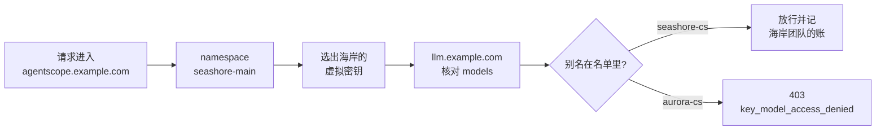

# 第 5 章 租户隔离停在网关的哪一层

> alice 看不见 `aurora-main`，这是 AgentScope 已经做完的事。bob 的客服如果拿着海岸的虚拟密钥，网关仍会放行，因为网关不认识 alice。这一章划清两层隔离各管什么，并把「在 metadata 里写上 namespace」从隔离手段里删掉。



*本章导览图*

## Teams 页上的两家商家

网关里的商家，12 日的界面上就是两行。


| 列 | aurora-main | seashore-main |
| --- | --- | --- |
| 这次库里的 id | `5d1e432d-fbb1-4496-8a51-bea176084366` | `fbc26c00-fd5e-4e75-af6b-43c91ed76712` |
| Organization | `-` | `-` |
| Members / Models / Keys | 1 / 1 / 1 | 1 / 2 / 1 |
| Team spend | 不到 $0.01，上限 $30.00 | 不到 $0.01，上限 $50.00 |
| My Spend | $0.00 / Unlimited | $0.00 / Unlimited |

Models 是 1 和 2，不是 `aurora-cs` 这三个字。海岸的 2 对应 `seashore-cs` 与 `seashore-cs-fast`，极光的 1 对应 `aurora-cs`，这个对应在配置和钥匙页上，不在这一列的文字里。Keys 各 1，就是 bob 和 alice。Members 各 1，是签发时带上的代理默认用户，不是店主 alice，也不是店主 bob。第 3 章说过：`members_with_roles` 里的 `default_user_id` 不要写进商家成员表。

Organization 为空。本书没有建组织。My Spend 的 Unlimited 是当前登录管理员自己的花费上限，和团队的 $30、$50 不是同一个桶。Team spend 用 `< $0.01` 表示两家都已经有花费、但还没到一美分。钥匙页上的 $0.0001 和日志上的 $0.000062 是更细的两位读数，团队列把它们收进了「不到一美分」。

Available Teams、Default Team Settings 这两个标签这次没有打开。Your Teams 上的两行就是种入的全部。

`xbd-seashore-cs-team` 仍然是 AgentScope 里处理 OD-2049 工单的人。它不出现在这张表上。表上的 `seashore-main` 是预算桶。

## 两套名字指的不是同一层

| 名字 | 属于 | 问的问题 |
| --- | --- | --- |
| `tenant=default` | AgentScope 部署 | 这是不是同一套平台部署 |
| `seashore-main` / `aurora-main` | AgentScope namespace | 这个人能不能看见这家商家的 Agent、会话、工单 |
| `team_alias` 同名的 LiteLLM 团队 | 网关 | 这把钥匙的花费和模型名单归哪一桶 |
| `metadata.namespace` | 一把钥匙上的注释 | 人读日志时能不能看懂 |

demo Step 02 已经证明 alice 看不见 `aurora-main`，bob 反过来也看不见。Step 05 用 404 避免资源枚举。那些断言继续有效。它们不检查 `Authorization: Bearer` 后面那把钥匙是不是这家商家的。

Dataplane 若全平台共用一个 `XBD_MODEL_API_KEY`，namespace 隔离仍然成立，模型账单却只有一桶。海岸的重试会吃掉极光的供应商额度。网关这层要补的就是这桶。

## 名单执行了，注释没有

海岸钥匙的 metadata 是：

```json
{"namespace": "seashore-main", "agent": "xbd-seashore-cs-agent", "order_anchor": "OD-2049"}
```

把 metadata 改成 `aurora-main` 而不改 `models` 和 `team_id`，网关不会因此开始拒绝 `seashore-cs`。本机没有做这个改写实验。不做的原因是：文档没有把 metadata 定义成访问控制，返回体也只是原样存取。用一次实验去「证明注释无效」意义有限，只要不在代码里读取 metadata 来做放行。

真正执行过的是 `models`：

- 海岸钥匙调用 `aurora-cs`，403，`key_model_access_denied`。
- 同一钥匙的 `/v1/models` 不包含 `aurora-cs`。
- 极光钥匙的 `models` 只有 `aurora-cs`。它的团队 `models` 同样只有这一个。

团队的 `models` 和钥匙的 `models` 要同时写。只写团队、钥匙留空时，继承规则依赖有没有 `team_id`、是不是服务账号、主人是谁。第 3 章的钥匙是管理员签发的、`user_id` 为空、带 `team_id`。文档说这种钥匙在模型面上不继承主人，团队钥匙的模型以钥匙和团队为准。我们显式写了两边，避免去赌空数组的含义。空数组在不同版本里可能是「全部」或「没有」。不要留空。

## 平台怎么选钥匙

小帆的托管形态按 namespace 选钥匙，而不是按用户句选模型。

| 调用方 | namespace | 注入的环境变量 | 请求的 model |
| --- | --- | --- | --- |
| `xbd-seashore-cs-agent` | `seashore-main` | `SEASHORE_LITELLM_KEY` | `seashore-cs` |
| `xbd-seashore-logistics-agent` | `seashore-main` | 可以是另一把同团队的钥匙 | `seashore-cs` |
| `xbd-seashore-product-scout` | `seashore-main` | 同上，预算分开 | `seashore-cs` |
| `xbd-aurora-cs-agent` | `aurora-main` | `AURORA_LITELLM_KEY` | `aurora-cs` |
| 平台公共助手 | `default` 公共区 | 不持有商家钥匙 | 不调用商家模型 |

物流和客服若共用一把钥匙，OD-2049 的工单拆成两次调用时，rpm 和预算也混在一起。第 4 章的限流是按钥匙计数的。拆钥匙才能拆限流。团队预算仍把两把钥匙加总，海岸这家商家的日上限还在。

公共助手的系统提示写明不涉及任何单一商家的私有数据。它不应该持有 `SEASHORE_LITELLM_KEY`。否则公共区的一次问答会记在海岸的账上，也会让公共助手具备调用 `seashore-cs` 的能力。能力比账单更要紧。

选品 Agent 如果以后要另一个模型别名，在网关上新加 `model_name`，并只放进选品那把钥匙的 `models`。不要加进客服钥匙「图方便」。

## 网关隔离不了的东西

403 只看模型名。下面这些它看不见，也不该假装看得见。

提示词正文。客户说「帮我查极光数码的订单」，海岸的客服仍用 `seashore-cs` 调用，网关返回 200。订单数据不在网关。小帆的工具层必须按 namespace 查订单。查不到就说查不到，这是 AgentScope 书里 OD-2049 那次回复已经体现过的态度：没有物流记录就不要编。

日志。网关默认会看到消息正文才能计价和转发。海岸的对话出现在网关日志里，等于运维人员能读到海岸的客户原话。这是另一条访问路径，模型名单不管它。生产上缩小谁能读 Proxy 日志，并决定要不要关掉消息正文日志。`litellm_settings` 有 `turn_off_message_logging`，文档说它让回调里不再带消息和响应，元数据仍在。本机没开。开之前确认 Langfuse 里你还要不要看正文（第 9 章）。

主密钥。持有主密钥的人可以给自己签一把 `models` 含全部别名的钥匙。网关隔离假定主密钥不在商家进程里。这个假定要靠部署，不靠 metadata。

降级目标。`seashore-cs` 失败后改走 `seashore-cs-fast`。文档默认 `enforce_fallback_model_access` 为 true：降级目标也要在钥匙、团队、项目的允许名单里，否则跳过。本机海岸钥匙的名单包含 `seashore-cs-fast`，降级才有机会发生。若客服钥匙只有 `seashore-cs`，主模型挂了不会悄悄改用极光的 `aurora-cs`，这是对的。名单漏写降级目标时，故障会表现为「主模型的原始错误」，响应里没有 `x-litellm-attempted-fallbacks`。第 7 章的另一次跳过是预算，不是名单。两种跳过都要在告警里能看出来。

## 组织和项目这次不用

返回的 `organization_id` 和钥匙上的 `project_id` 都是空。企业功能列表把多租户的组织、项目、标签预算放在许可证一节。开源的团队和钥匙已经够把海岸和极光拆开。

不要为了「文档里有 organization 这个词」就建一层和 namespace 同构的组织。两层主数据会漂移：商家在 AgentScope 里改名，网关组织没改，账单仍旧按旧 id 走，报表按新名字走。星帆以 namespace 为商家主键，网关 `team_alias` 抄同一字符串，`team_id` 存回平台数据库。组织留空。

`access_group_ids` 本机是空数组。模型访问组适合「一组别名被多个团队引用」。现在只有三个别名、两个团队，直接写在团队和钥匙上更短。访问组是第三张表，没有运维的人就不要加。

## 和 Step 05 的 404 并列，而不是替代

AgentScope 对越权读资源返回 404，避免枚举。网关对越权模型返回 403，消息里点出了模型名。这是网关的选择，不是平台的漏洞。攻击者已经知道自己请求的 `model` 字符串，403 没有多泄露一个存在的资源 id。不要为了风格统一去改网关的状态码，除非你准备维护一个分叉。

业务日志里则不要把 403 的完整 JSON 回给终端客户。客户应看到小帆的一句「暂时无法回答」，工单里留 `request id` 和 `type`。OD-2049 的客户不需要知道 `aurora-cs` 这个别名存在。

## 一次跨商家调用的时间线

海岸的进程拿错了环境变量，注入了极光的钥匙，请求却仍写 `model=seashore-cs`。预期是 403，因为极光钥匙的名单里没有 `seashore-cs`。本机测的是相反方向：海岸钥匙请求 `aurora-cs`，同样 403。两个方向是同一条规则。平台告警按 `key_model_access_denied` 聚合，不按「谁的进程」聚合。进程身份要靠部署系统的环境变量审计，网关只看钥匙。

若两边都错了：极光钥匙加上 `model=aurora-cs`，调用会 200，记在极光的账上，而客户会话仍属于海岸的 namespace。这是最坏的组合，网关认为完全合法。挡住它的办法在平台：密钥和模型名从同一行租户配置取出，禁止两个字段来自不同的配置文件。代码评审看的是「这两个字符串是不是同一个结构体的两个字段」。

## 公共区

`default` namespace 的公共助手给所有商家用。demo Step 03 写明它不接触商家私有数据。因此：

- 不挂商家虚拟密钥。
- 不把 OD-2049 的正文复制进公共助手的提示词当例子。例子用虚构的另一张单号会违反「全书一个单号」的纪律，所以公共助手的提示词里干脆不放订单号。
- 公共助手若必须调用模型，使用单独的别名和单独的团队，预算从平台运营的成本中心出，不从海岸的 `max_budget` 出。本机没有建这第三个团队。没建之前，公共助手不要调用 `llm.example.com`。

## 工单和会话仍归 AgentScope

网关的团队不是工单的参与者。`xbd-seashore-cs-team` 是 AgentScope 里的客服团队，处理「售后升级：订单 OD-2049 客户投诉物流延迟」。LiteLLM 的 `team_alias=seashore-main` 是商家级的预算桶。两个「团队」不要合并成一张表。客服组的人离职，不自动作废商家的虚拟密钥；商家解约，要作废钥匙，但不等于删除历史工单。

bob 不能调用 alice 的 Agent，这是 Step 05。bob 的进程也不能持有 alice 的虚拟密钥，这是本章。两句话都要出现在上线检查里，缺一句就会在另一次评审里被当成已经覆盖。

## 每个会说话的 Agent 各拿哪把钥匙

demo Step 03 的矩阵和网关钥匙的对应关系就这些，不新增角色。

| Agent | namespace | 网关团队 | 模型别名 | 钥匙 |
| --- | --- | --- | --- | --- |
| `xbd-seashore-product-scout` | `seashore-main` | `seashore-main` | `seashore-cs` | 单独一把，和客服分开 rpm |
| `xbd-seashore-cs-agent` | `seashore-main` | `seashore-main` | `seashore-cs` | `key_alias` `seashore-cs-agent` |
| `xbd-seashore-logistics-agent` | `seashore-main` | `seashore-main` | `seashore-cs` | 单独一把。OD-2049 的物流核实不要占用客服的 rpm |
| `xbd-aurora-cs-agent` | `aurora-main` | `aurora-main` | `aurora-cs` | `key_alias` `aurora-cs-agent` |
| 平台公共助手 | `default` 公共区 | 不建，直到有不含商家数据的模型 | 无 | 无 |
| 小帆本地示例 `xingfan-support` | 开发者笔记本 | 探测团队，不是商家团队 | `seashore-cs` 仅在连到实验网关时 | 短期钥匙，不进仓库 |

`xbd-seashore-cs-team` 是工单团队，不是上表的网关团队。物流专员认领「核实订单 OD-2049 物流实际状态」时，人在 AgentScope 的团队里，模型请求仍用物流 Agent 那把虚拟密钥。人的权限和钥匙的权限是两行配置。

选品专员若以后要更便宜的别名，新别名只放进选品钥匙的 `models`。客服钥匙不加。否则客服的降级名单和选品的便宜模型会缠在一起。

## 平台选钥匙的伪代码

这不是已编译的类，是为了把「同一个结构体」说清楚。复核时看真实代码是否分成两个来源。

```java
TenantRoute route = routes.get(namespace); // seashore-main 或 aurora-main
String apiKey = System.getenv(route.virtualKeyEnv); // SEASHORE_LITELLM_KEY
String model = route.gatewayModel; // seashore-cs 或 aurora-cs
OpenAIChatModel chat = OpenAIChatModel.builder()
        .apiKey(apiKey)
        .baseUrl("https://llm.example.com/v1")
        .modelName(model)
        .build();
```

`routes` 里没有 `default` 公共区的条目。公共助手走不到这个 builder。若有人给公共区加一条「先用海岸的」，代码评审拒绝。

环境变量缺失时进程应启动失败，而不是退回上游密钥或主密钥。退回是第 1 章要堵的路。

## metadata 可以怎么用才不出事

可以：日志检索、和订单号对齐、在 Langfuse 里过滤。`order_anchor: OD-2049` 是实验标记。生产用真实订单号时，确认 Langfuse 项目的访问范围不大于这个商家。

不可以：作为 `if` 条件决定是否转发；作为「信任客户端」的依据。客户端能改自己的请求体。metadata 若从请求体覆盖钥匙上的 metadata，客户端就能把 `namespace` 改成别人的。本机没有测试请求体 metadata 能否覆盖钥匙 metadata。在没看清之前，业务隔离不读取请求里的 namespace 字段。namespace 以平台鉴权结果为准，钥匙以部署注入为准。

## 离开这一章之前

- 画出两列：AgentScope 拒绝的是人，网关拒绝的是钥匙和模型名。各举一个已有断言：Step 05 的跨 namespace 404，本章的跨模型 403。
- 确认每个会调用模型的 Agent 有自己的虚拟密钥环境变量，公共助手没有商家钥匙。
- 在代码里搜 `metadata`，确保没有任何 `if metadata.namespace` 的放行逻辑。
- 降级别名出现在客服钥匙的 `models` 里。极光的钥匙不包含 `seashore-cs-fast`。
- 不创建 organization。有人建议建的时候，用「主键只留 namespace」回答，而不是用许可证猜测去回答。许可证边界在第 10 章。

## 接着读

- 第 6 章处理「业务写哪个模型名」。隔离依赖这个名字稳定。
- demo Step 02 与 Step 05 是 namespace 那一层的操作记录。
- MCP 书处理的是工具面。工具若能查询订单，隔离在工具实现里再做一次，网关的 403 替代不了。
