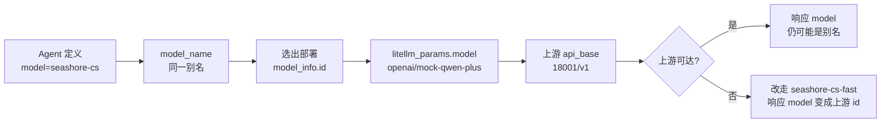

# 第 6 章 别名、部署和业务看见的模型名

> 小帆的配置里如果写 `qwen-plus`，网关会 400：这个名字不在 `/v1/models` 里。业务应该只认识 `seashore-cs`。上游今天是模拟器，明天可以换成别的兼容端点，Agent 定义不用跟着改。这一章把三个名字拆开，并记下降级之后响应里的 `model` 字段会变脸。



*本章导览图*

## 三层名字

| 层 | 配置位置 | 星帆的值 | 谁可以变 |
| --- | --- | --- | --- |
| 业务别名 | `model_name`，也是请求体 `model` | `seashore-cs`、`seashore-cs-fast`、`aurora-cs` | 很少变。变了就要改 Agent 定义和钥匙名单 |
| 部署 id | `model_info.id` | `seashore-cs-primary`、`seashore-cs-fast`、`aurora-cs-primary` | 加机器、换区域时新增，不改业务别名 |
| 上游模型 | `litellm_params.model` | `openai/mock-qwen-plus`、`openai/mock-qwen-turbo` | 换供应商时只改这里和 `api_base`、`api_key` |

`openai/` 前缀表示按 OpenAI 兼容协议调用，不是表示厂商。模拟器没有校验密钥，但配置仍走 `os.environ/MOCK_UPSTREAM_KEY`，免得有人把一把真钥匙写进 yaml。

Step 13 里的 `merchant-gateway` 是 Dataplane 的教学别名，表示「走公司网关」。它不是上游模型名，也不是本书的 `model_name`。两边都叫「别名」时，在句子里写全：平台别名 `merchant-gateway`，网关别名 `seashore-cs`。前者决定请求发到 `llm.example.com`，后者决定网关选哪个部署。

## 同一个别名下的两条部署，和两个别名，不是一回事

负载均衡文档说：多条 `model_name` 相同的部署由路由器按策略分发，默认 `simple-shuffle`。设了 `rpm` 或 `tpm` 时，简单洗牌会按这些权重抽。没设就均匀随机。

本书的 `config.yaml` 里每个 `model_name` 只有一条部署。`simple-shuffle` 没有第二候选，等于直接选中那一条。海岸的「主」和「备」是两个别名，靠 `router_settings.fallbacks` 连接，不靠同名多部署。

这样拆的原因是降级要换单价、换端口，并且要在钥匙名单里显式允许备用别名。同名多部署时，备用机会藏在负载策略里，`/v1/models` 仍只显示一个 id，钥匙名单无法单独拒绝备用。星帆希望极光的钥匙根本看不到海岸的备用，所以备用必须是另一个 `model_name`。

同名多部署留给以后：海岸的主模型有两台机器，都叫 `seashore-cs`，`model_info.id` 分别是 `seashore-cs-primary-a` 和 `seashore-cs-primary-b`。那是第 7 章的负载。本章不在实验配置里加第二条，避免和已经测过的降级混在一次请求里。

## 响应里的 model 不可当别名用

主上游活着时，请求 `seashore-cs`，响应 JSON 的 `model` 是 `seashore-cs`，响应头 `x-litellm-model-id` 是 `seashore-cs-primary`。

主上游进程停掉、降级成功时（第 7 章的那次）：

| 位置 | 值 |
| --- | --- |
| 请求 `model` | `seashore-cs` |
| 响应 `model` | `mock-qwen-turbo` |
| `x-litellm-model-id` | `seashore-cs-fast` |
| `x-litellm-attempted-fallbacks` | `1` |
| 正文前缀 | `[backup]` |

响应 `model` 从别名变成了上游 id。若小帆把响应里的 `model` 写回会话，下一轮再原样送出，网关会收到 `mock-qwen-turbo`。这个名字不在 `/v1/models`，结果是 400，和直接请求 `qwen-plus` 同一类：

```json
{
  "error": {
    "message": "/chat/completions: Invalid model name passed in model=qwen-plus. Call `/v1/models` to view available models for your key.",
    "type": "invalid_request_error",
    "code": "400"
  }
}
```

这次请求打在 `/v1/chat/completions`，错误文本仍写 `/chat/completions`。两个路径本机都能 200（主上游已停时，不带 `/v1` 的那次也落到了 backup）。错误文本里的路径不要拿来判断客户端用了哪一个 URL。

会话里持久化的模型名只用业务别名。部署 id 放在日志和 Langfuse 的元数据里，放响应头，不放回请求。

## `/v1/models` 的字段别过度解读

主密钥看到三个 id。海岸钥匙看到两个。每条记录的 `owned_by` 是 `openai`，`created` 是 `1677610602`，`mode` 是 `chat`。`owned_by` 和 `created` 不反映供应商，也不反映部署创建时间。`mode: chat` 来自我们写的 `model_info.mode`。嵌入模型如果以后要加，用另一个 `model_name`，并把 `mode` 设成嵌入。客服钥匙的名单不要包含它。

客户端用这个列表做下拉框是可以的。不要用 `owned_by` 做路由。

## 文档里还有一层别名，本机没开

负载均衡页的 `router_settings.model_group_alias` 可以把一个对外名字整组映到另一个 `model_name`，并且默认出现在 `/v1/models`。例如让旧名字 `merchant-gateway` 整组指向 `seashore-cs`。

本机没配。不配的原因和第 3 章不配钥匙级 `aliases` 相同：星帆还没有必须兼容的旧名字。Step 13 的 `merchant-gateway` 留在 Dataplane，由平台代码把租户翻译成 `seashore-cs` 或 `aurora-cs`。若把 `merchant-gateway` 在网关上映死到 `seashore-cs`，极光的请求也会进海岸的部署。那是隔离事故，不是兼容。

`model_group_alias` 适合「同一个商家换了展示名，部署不变」。不适合「一个名字服务所有商家」。

## 价格和 id 绑在部署上

单价写在每条部署的 `litellm_params` 里，不写在业务别名上。`seashore-cs` 和 `seashore-cs-fast` 单价不同，响应头已经分别对上 `6.2e-05` 和 `2.48e-05`。若将来两条同名部署单价不同，一次 `simple-shuffle` 会让同一别名的相邻两笔花费不同。财务如果按别名设单价，会对不上。账单维度用 `x-litellm-model-id`，对外报价用别名时要声明「这是上限或均价」，不要假装每笔相同。

`aurora-cs` 和 `seashore-cs` 在实验里指向同一个模拟端口、同一套单价，只是部署 id 不同。这是为了少起一个进程。生产上两家商家可以指向不同供应商。即便今天指向同一上游，钥匙和团队仍然分开。共享上游不等于共享账。

## 业务配置里只留别名

Agent 定义、Spring 配置、工单里的「用的哪个模型」都写 `seashore-cs` 或 `aurora-cs`。下面这些字符串禁止出现在业务仓：

| 字符串 | 为什么 |
| --- | --- |
| `openai/mock-qwen-plus` | 实验上游 id |
| `mock-qwen-turbo` | 降级后响应里会出现，抄回去就会 400 |
| `seashore-cs-primary` | 部署 id，只在日志和响应头 |
| `http://127.0.0.1:18001` | 模拟器 |
| 任何供应商的真实模型名 | 换供应商时会漏改 |

`seashore-cs-fast` 可以出现在网关配置和钥匙名单里。客服的默认请求不要写它。让降级在网关发生，业务继续请求 `seashore-cs`。业务自己改请求去打 fast，等于把降级策略复制进每一个 Java 服务，第 7 章的预检规则也会被绕开。

## 加一台同名机器时配置长什么样

下面这段没有在本机加载。它只说明「负载」和「降级」应该出现在哪一层。不要把它贴进现在的 `config.yaml` 再期望和第 7 章的实验数字一致。

```yaml
model_list:
  - model_name: seashore-cs
    litellm_params:
      model: openai/contract-model-a
      api_base: https://vendor-a.example/v1
      api_key: os.environ/VENDOR_A_KEY
      rpm: 60
    model_info:
      id: seashore-cs-primary-a
  - model_name: seashore-cs
    litellm_params:
      model: openai/contract-model-a
      api_base: https://vendor-a-standby.example/v1
      api_key: os.environ/VENDOR_A_KEY
      rpm: 60
    model_info:
      id: seashore-cs-primary-b
  - model_name: seashore-cs-fast
    litellm_params:
      model: openai/contract-model-b
      api_base: https://vendor-b.example/v1
      api_key: os.environ/VENDOR_B_KEY
    model_info:
      id: seashore-cs-fast
```

`vendor-a.example` 不是星帆的域名，只是这段未实测草稿里的占位，避免和 `llm.example.com` 混淆。真要启用时改成合同里的地址。两台 primary 共用别名 `seashore-cs`，`rpm: 60` 让 `simple-shuffle` 有权重可依。文档说没写 rpm/tpm/weight 时均匀随机。写了就要两台都写，否则权重规则会把没写的那台当成 0。策略页的原话是：某一来源只要有一台是正数，就用这个来源，没设的候选权重为 0。只给一台写 rpm，另一台会被饿死。这条本机没验证，写配置时按文档避免只写一半。

降级仍然指向另一个别名 `seashore-cs-fast`。两台 primary 都冷却之后才轮到它。文档还允许 fallback 直接写某个 `model_info.id`，从而跳过冷却检查。本机的 fallback 写的是别名，不是 id。成功那次的响应头是 `seashore-cs-fast`，与别名对应的部署 id 相同，因为这个别名只有一台。别名和 id 同字符串是实验的巧合，不要在代码里把两者当成一个字段。

## 客户端缓存模型列表

`/v1/models` 的 `created` 是常量 `1677610602`，不能当作「列表变更时间」。客户端若缓存列表一整天，网关中午新加的别名不会出现，中午删掉的别名仍会被请求，然后 400。客服的下拉框每次会话开始时拉一次即可。不要把这个 JSON 提交进仓库当静态文件。

海岸钥匙看不到 `aurora-cs`。缓存键必须包含钥匙，不能是一个全局的 `models.json`。全局缓存会把主密钥看到的三个别名发给所有商家的浏览器。那是隔离事故。下拉框如果做在平台后端，由后端用该商家的虚拟密钥去拉列表，不要把主密钥的列表结果嵌入前端。

## 实验单价和别名的对应

| 别名 | 部署 id | 单价（每 token，输入 / 输出） | 40 token 的手算 | 响应头 |
| --- | --- | --- | --- | --- |
| `seashore-cs` | `seashore-cs-primary` | 0.000001 / 0.000002 | 0.000062 | `6.2e-05` |
| `seashore-cs-fast` | `seashore-cs-fast` | 0.0000004 / 0.0000008 | 0.0000248 | `2.48e-05` |
| `aurora-cs` | `aurora-cs-primary` | 与 primary 相同 | 0.000062 | 极光那次没单独摘头，入账是 `6.2e-05` |

手算和响应头一致，才说明「别名选中的部署」和「计价用的部署」是同一条。降级后若仍按 primary 的单价入账，这张表会对不上。本机对上了，所以降级计价用的是 fast 的单价。

## 离开这一章之前

- 说清三层名字各举一个星帆的值。
- 用主密钥请求 `qwen-plus`，确认 400，而不是 403。
- 在一笔成功降级上同时看响应 `model` 和 `x-litellm-model-id`，确认它们可以不同。
- 全文搜索业务仓库，没有 `mock-qwen` 和 `127.0.0.1:18001`。
- `merchant-gateway` 若还在 Agent 定义里，列出改成租户别名的名单，不要在网关上把它映到单一商家。

## 接着读

- 第 7 章在这份别名上打开降级，并说明同名多部署何时才值得加。
- AgentScope Java 第 21 章的提供商表仍决定 Dataplane 用哪个 Java 扩展。网关别名不替代那个扩展。扩展走 OpenAI 兼容，`baseUrl` 指向 `llm.example.com`。
- 第 41 章的模型路由是 Agent 运行时里的选择。它选出的字符串应该已经是网关别名，而不是供应商模型名。
