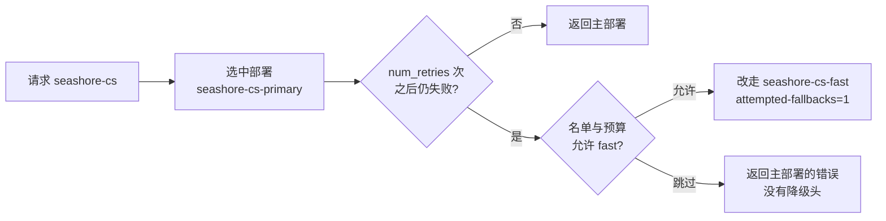
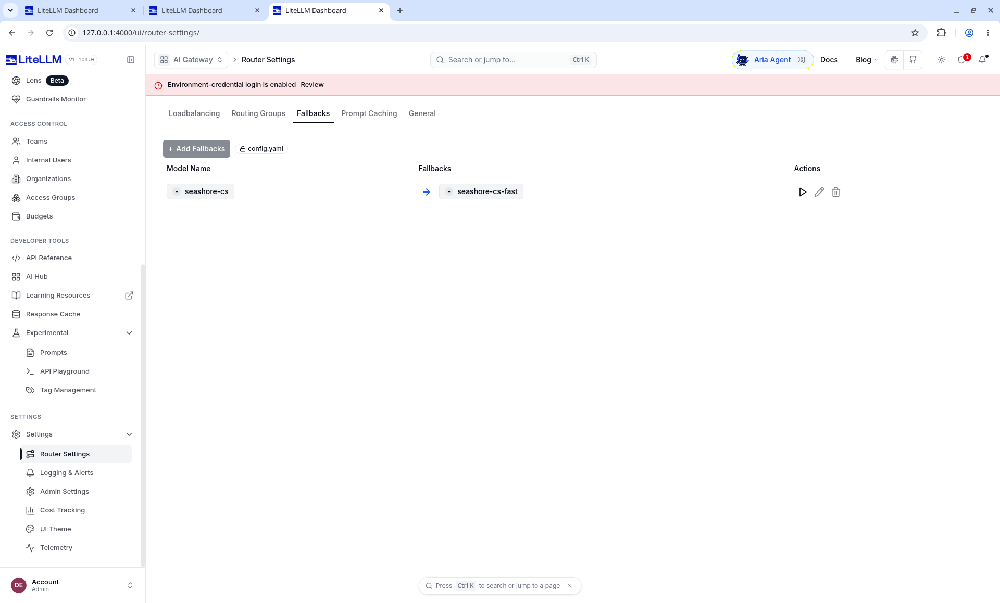

# 第 7 章 降级、重试和负载

> 主模拟进程一停，OD-2049 的问题还在。有一把预算充足的钥匙得到了备用模型的回答，另一把预算看起来还没用完的钥匙被预检拒绝，主模型的连接错误原样返回。降级不是配置里写一行 `fallbacks` 就结束。这一章先看 Router Settings 里已经载入的那一行，再按 11 日的两次真实响应写，并把重试、冷却和负载策略放在它们实际发生的层次上。12 日的界面没有再停一次主上游。



*本章操作流程图*

## 界面上的那一行来自 config.yaml

Settings → Router Settings → Fallbacks。左边是 `seashore-cs`，箭头指向 `seashore-cs-fast`，行上标着 config.yaml。



Add Fallbacks 这次没有点。规则是配置文件挂进去的，不是在这个按钮上新建的。Models 页的 Auto-Routers 和 Model Group Alias 是空的，到那里找这条箭头会找空。

同一组设置里的 Loadbalancing 页，这次运行能看见 routing strategy `simple-shuffle`、retries 0。那一页没有单独截图。retries 0 就是 `num_retries: 0`：主上游一失败就进入 fallback，不先在同一部署上空转。

这张图证明规则已经被载入。它不证明切换发生过。12 日的 Playground 上 Fallbacks 是 0，请求打在 `mock-primary`。真正换到 backup 的响应头在 11 日，见下一节。那天的配置里 fast 的上游模型名还是 `openai/mock-qwen-turbo`，`api_base` 是宿主机的 `127.0.0.1:18002`。现在的 compose 把 fast 也写成 `openai/mock-qwen-plus`，地址是 `http://mock-backup:18002/v1`。读 11 日的 `model` 字段时带着这个差别。

## 实验配置把重试关掉了

`router_settings.num_retries` 是 0，`timeout` 8 秒，`allowed_fails` 1，`cooldown_time` 15 秒。`fallbacks` 只有一条：`seashore-cs` 到 `seashore-cs-fast`。

可靠性文档把重试和降级分成两段：每个 `model_name` 上先按 `num_retries` 重试，仍失败再按 `fallbacks` 换另一个 `model_name`。重试次数放在 `litellm_settings` 或 `router_settings` 的示例里都能看到，以你加载的那份配置实际生效的键为准。本实验写在 `router_settings`，并且是 0。目的是让「连接被拒绝」立刻进入降级，而不是先空转几次。

生产上客服回答可以容忍一次短重试。物流核对若已经超时 8 秒，再重试两次会把工单的等待加成倍。星帆可以按别名设不同的重试，文档支持 `model_group_retry_policy` 这一类更细的键。本机没设，所有别名共享这一份 0。不要从「实验是 0」推出「生产必须是 0」。

`allowed_fails` 与 `cooldown_time` 决定一个部署失败多少次后被冷却、冷却多久。冷却之后的请求会避开这个部署。本机每个别名只有一个部署，冷却主部署的效果和「它已经连不上」重叠，没有单独制造「连续失败三次后才冷却」的样本。多部署时这项才值得单独测。

## 降级成功的那一次

下面是 2026-11-11 的 pip 进程，不是 12 日的界面。停掉 18001，18002 仍返回 `{"name":"backup"}`。新签一把海岸团队的钥匙，`models` 含两个 seashore 别名，`max_budget` 100，`rpm_limit` 60。请求 `model` 为 `seashore-cs`。当天 fast 的上游模型名是 `openai/mock-qwen-turbo`。

| 项 | 值 |
| --- | --- |
| HTTP | 200 |
| 正文 | `[backup] 订单 OD-2049 仍在途。请核对运单后再答复客户。` |
| 响应 `model` | `mock-qwen-turbo` |
| `x-litellm-model-id` | `seashore-cs-fast` |
| `x-litellm-attempted-fallbacks` | `1` |
| `x-litellm-response-cost` | `2.48e-05` |

`/health` 需要密钥。当时的响应把 `http://127.0.0.1:18002/v1` 放在 `healthy_endpoints`，把 `18001` 放在 `unhealthy_endpoints`，模型字符串分别是 `openai/mock-qwen-turbo` 与被截断在日志里的 primary 模型名。`/health/liveliness` 在主上游已死时仍然是 `"I'm alive!"`。存活探针只表示进程在，不表示主模型在。就绪探针看的是数据库：`{"status":"healthy","db":"connected"}`。模型健康要看 `/health` 的端点列表，或者看业务请求的 `x-litellm-model-id`。

Kubernetes 若只用 liveliness，主上游挂了也不会重启网关。这是对的：网关没坏，坏的是上游。告警应订阅不健康端点，而不是订阅进程重启。

## 降级被预算预检跳过的那一次

另一把钥匙 `max_budget` 是 `0.01`，此前已有一笔 `6.2e-05` 的入账，远小于 0.01。主上游仍然停着。请求 `seashore-cs` 得到 HTTP 500：

```json
{
  "error": {
    "message": "litellm.InternalServerError: InternalServerError: OpenAIException - Connection error. LiteLLM: model group 'seashore-cs' failed with the error above. Fallback to seashore-cs-fast was skipped because the caller is over budget for it.",
    "type": "internal_server_error",
    "code": "500"
  }
}
```

响应头里 `x-litellm-model-id` 仍是 `seashore-cs-primary`，没有 `x-litellm-attempted-fallbacks`（读头得到空），成本头是 0。

文档对这个行为有专门的一节，默认 `enforce_fallback_budget` 为 true。预算在鉴权时按客户端请求的模型检查一次；降级目标是之后才选定的，所以会再查一次钥匙和用户对目标模型的预算。超预算的目标被跳过。一个都没有时，返回主模型自己的错误。零价格的降级目标始终允许。主模型那一次尝试本身不会被这次复查挡住。设 `general_settings.enforce_fallback_budget: false` 可以关掉复查。

本机这次「看起来没超预算却被说成超预算」，和要求对上的是机制，对不上的是数字。`0.01` 的剩余额度足够支付 `2.48e-05` 的备用调用。错误仍说 over budget。第 4 章见过错误文案里的 `Current cost: 0.032777001` 与入账 `6.2e-05` 不一致。若预检用了接近三分钱的估价，就会超过 `0.01`，于是跳过降级。这是推测，用来提醒你不要只调高一点点预算就认为降级一定发生。验证方法是：用一把 `max_budget` 远大于任何合理估价的钥匙重放（我们用 100 重放成功了），以及在预检失败时同时记下 `/key/info` 的 spend。

`enforce_fallback_model_access` 默认也是 true。名单里没有的目标会被跳过，同样返回主错误，并且没有 `x-litellm-attempted-fallbacks`。本机成功的那次名单是齐的。没有另做「故意漏掉 fast」的对照。漏配名单和预检估价失败，从外面都可能是 500 加主模型的连接错误。要靠消息里的那句 `Fallback to seashore-cs-fast was skipped because ...` 区分。告警规则匹配这句，不要只匹配 `Connection error`。

## 三种降级，本机只打了一种

可靠性文档区分：

| 键 | 触发 | 本机 |
| --- | --- | --- |
| `fallbacks` | 其余错误，例如限流、连接失败、5xx | 打过。连接被拒绝进入了这条 |
| `context_window_fallbacks` | 上下文超长 | 没打。模拟器不返回这类错误 |
| `content_policy_fallbacks` | 内容策略拒绝 | 没打 |

文档还写：从  Proxy v1.85.0 起，请求里的 `mock_testing_fallbacks`、`mock_testing_context_fallbacks`、`mock_testing_content_policy_fallbacks` 会被剥掉，对代理无效，只对直接调用 `litellm.Router` 的测试还有效。验证代理降级要在非生产环境制造真实的上游错误。本书停进程，就是在按这句做，而不是往请求里塞 mock 标记。

加密的推理内容在降级到另一把密钥或另一家供应商时无法解密。文档说降级会丢掉解不了的部分，让目标重新推理，避免 `invalid_encrypted_content`。本机模拟器没有这类字段，这段只作为上生产后的核对项：若客服开启了供应商的加密思维链，降级的那一轮不要假定思维链还在。

`default_fallbacks` 用于某个别名本身就配错了的情况。本机没设。`aurora-cs` 没有 fallback。极光的主端口若是 18001，主进程一停，极光的请求会失败而不是借海岸的 fast。这是第 5 章的隔离，不是疏忽。极光要备用，就给它自己的 `aurora-cs-fast`，写进它自己的钥匙。

## 负载策略先读表，再决定要不要测

路由文档和负载均衡页列出的策略，2026-11-11 的名称如下。本机 `routing_strategy` 显式写成 `simple-shuffle`，与默认相同。没有第二台同名部署，策略没有可观察的分配比例。

| 策略 | 文档里的选择依据 | 星帆何时再看它 |
| --- | --- | --- |
| `simple-shuffle` | 默认。按权重、否则按 rpm、tpm，否则均匀。文档建议生产用它，开销小 | 同一别名有两台以上机器时 |
| `least-busy` | 在途请求最少 | 长连接、流式占坑明显时 |
| `usage-based-routing` | 按当前 rpm/tpm 用量。文档写明性能差，不建议生产 | 不作为星帆的默认 |
| `usage-based-routing-v2` | 策略页上的后继实现，仍看每分钟用量 | 同上，先读你那一版的性能说明 |
| `latency-based-routing` | 近期延迟低的部署 | 两区域延迟差得能测出来时 |
| `cost-based-routing` | 仍在限额内的更便宜部署 | 单价真的不同且要自动偏向便宜的那台时 |

同名多部署的权重还可以按团队覆盖。策略页说钥匙或团队上的 `router_settings` 能让一个团队把大部分流量打到组内某一部署，其他团队仍走全局比例。本机团队返回的 `router_settings` 是空对象。没有用它把海岸绑死在 primary 上。空着是对的：绑定写在 fallback 关系里已经够用。

多副本 Proxy 要共享冷却和用量时，文档要求 `redis_host` 等配置。和第 4 章的限流是同一件基础设施。不要只给限流配 Redis、让冷却留在单进程内存里。

## 客户端不要自己再做一套降级

Java 服务里若捕获 500 再改 `model` 为 `seashore-cs-fast` 重发，会绕过网关刚刚做过的预检，也可能把两次调用都记进 rpm。业务只请求 `seashore-cs`。看到 500 且消息里是 skipped，就按「备用不可用」处理：工单记一笔，小帆告诉客户稍后再试，而不是在进程里换模型。

AgentScope 第 4 章的 `fallbackModel` 是进程内的另一个 `Model` 实例。若两个实例都指向网关的不同别名，就和网关降级叠了两层。星帆只保留网关这一层。进程内的 fallback 留空，避免一次客户提问打出两次预算。

## 响应头怎么读

成功、限流、降级失败三次的头放在一起，解析器才不会只处理 200。

| 场景 | 状态 | model id 头 | attempted-fallbacks | 成本头 |
| --- | --- | --- | --- | --- |
| 主上游正常 | 200 | `seashore-cs-primary` | `0` | `6.2e-05` |
| rpm 用尽 | 429 | `seashore-cs-primary` | 这次没看到这个头 | `0` |
| 降级被预检跳过 | 500 | `seashore-cs-primary` | 头为空 | `0` |
| 降级成功 | 200 | `seashore-cs-fast` | `1` | `2.48e-05` |

`attempted-fallbacks` 为 0 和头不存在不是一回事。0 表示走了降级逻辑但没有换模型。头不存在表示这次错误发生在更早的地方，或这版对这类错误不写头。告警用「状态 500 且消息含 skipped」比用「头不存在」稳。

正文前缀 `[primary]` / `[backup]` 只存在于模拟器。生产上游不会加这个前缀。自动化测试可以依赖前缀；生产告警只能依赖响应头和消息。

## 冷却的时间尺度

`allowed_fails: 1` 且 `cooldown_time: 15` 时，一次失败就可能把部署冷却一刻钟。实验里主进程是停掉的，不是偶发一次 500，所以看不出「第几次才冷却」。偶发超时若也被算进 `allowed_fails`，客服会在一次抖动后的十五秒内全部走 fast，单价和回答质量都变了。生产把 `allowed_fails` 调高之前，先用一笔人工制造的单次 500 看是否立即冷却。本机没做单次 500，模拟器的 fail 模式也没在代理前面开过，只停过整个进程。进程拒绝连接和上游返回 500 在降级文档里都算 `fallbacks` 能接的错误，但是否同样增加失败计数，没有分开的样本。

`num_retries: 0` 意味着没有「同一部署再试一次」。生产若改成 2，一次故障的延迟大约是超时乘以尝试次数，然后再加上备用的一次。`timeout: 8` 且重试 2 次，客户可能等二十多秒才看到 fast 的回答。工单界面要有自己的超时，短于这条链，否则用户会先刷新，刷新再打一笔。

## 不要用请求参数假装上游坏了

1.85.0 起代理会剥掉 `mock_testing_fallbacks`。有人在集成测试里给 OD-2049 的请求加这个字段，代理当没看见，测试仍打到真部署。测试要像本章一样，让测试上游返回错误或拒绝连接。`demo/mock_upstream.py` 的 `MOCK_MODE=fail` 返回 HTTP 500。本机降级样本用的是停进程，不是这个 500。两种都合法，停进程更接近「机器没了」。500 更接近「进程还在但供应商报错」。补测时把 `MOCK_MODE=fail` 跑一次，看消息是否仍进入 `fallbacks`，以及 `attempted-fallbacks` 是否为 1。没跑之前，运行手册写「连接拒绝已测，HTTP 500 未测」。

## 停进程的操作顺序

这次样本的顺序固定如下，方便别人重放。端口和别名不要换。

1. `MOCK_NAME=primary` 监听 18001，`MOCK_NAME=backup` 监听 18002，两者 `MOCK_MODE=ok`。
2. 代理使用 `demo/config.yaml`，`num_retries` 为 0，`fallbacks` 把 `seashore-cs` 指到 `seashore-cs-fast`。
3. 用预算 100 的海岸钥匙请求 `seashore-cs`，确认正文是 `[primary]`，头是 `seashore-cs-primary`，`attempted-fallbacks` 为 0。本机在签发这把大预算钥匙之前，primary 已经被停掉了，所以「先看到 primary」的证据来自更早的海岸钥匙调用，不是同一把钥匙的前后对比。重放时补上这一笔，让同一把钥匙先成功再失败。
4. 停 18001。`curl http://127.0.0.1:18001/` 应连接失败。18002 仍返回 `backup`。
5. 同一大预算钥匙再请求 `seashore-cs`。期望 200、`[backup]`、`x-litellm-model-id: seashore-cs-fast`、`attempted-fallbacks: 1`、成本 `2.48e-05`。
6. 用 `max_budget` 为 0.01 且已经有花费的钥匙做对照。本机得到 500，消息含 `Fallback to seashore-cs-fast was skipped because the caller is over budget for it.`
7. 把 18001 拉起来，再请求一次，期望回到 primary。本机在写完样本后没有把 18001 拉起来复核「恢复」。重放时加上。不恢复的话，后续冒烟会一直打在 backup 上，单价和正文前缀都会变，容易误判成配置写错。

`/health` 在第 5 步之后应把 18001 放进 `unhealthy_endpoints`。liveliness 仍是 `"I'm alive!"`。

## 极光在主端口停掉时

`aurora-cs` 和 `seashore-cs` 在实验配置里共用 18001。停掉 18001 时，极光没有 fallback，请求应失败，而不是借 `seashore-cs-fast`。本机没有在停进程之后用极光钥匙再打一笔。这是隔离上的缺口，不是已经证明的行为。补一笔：期望失败，且响应头不是 `seashore-cs-fast`。若看到 fast，说明 fallback 配到了错误的别名上，要停下来改配置。

## 离开这一章之前

- 停掉主上游，用大预算钥匙确认 `x-litellm-attempted-fallbacks: 1` 和 `x-litellm-model-id` 指向 fast。
- 用接近上限的小预算再打一次，读消息里 skipped 的原因，不要只看 HTTP 500。
- 说清 liveliness、readiness、`/health` 三者各证明什么。
- 生产配置里的 `num_retries` 按客服和物流分开写进变更说明。实验值 0 不是推荐值。
- 不在 Java 里捕获后换模型重试。

## 接着读

- 第 8 章让 AgentScope 和 Spring AI 都请求 `seashore-cs`，不再各写一套备用模型。
- 可靠性文档里的客户端侧 fallback 是另一条路。星帆不走，避免策略分散。
- AgentScope 第 41 章的运行时降级若仍要保留，它选出的必须是网关别名，并且和本章的 `fallbacks` 不要对同一失败各反应一次。
