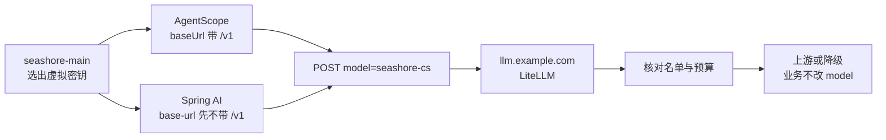

# 第 8 章 把 AgentScope 和 Spring AI 接到同一入口

> 海岸优品的客服跑在 AgentScope 上，订单域的一个同步接口跑在 Spring AI 上。两边都要回答和 OD-2049 同类的问题。它们应该看到同一个主机 `llm.example.com`、同一个别名 `seashore-cs`、同一类虚拟密钥。URL 怎么拼接却不是同一套规则。这一章把两套客户端写到网关门口，并标明哪些调用没有在本机的 JVM 里跑过。



*本章导览图*

## 同一入口指什么

同一入口不是同一个 Java 依赖。AgentScope 用它的 OpenAI 扩展，Spring AI 用它的 OpenAI starter。同一入口指：

| 项 | 值 |
| --- | --- |
| 主机 | `https://llm.example.com` |
| 业务模型名 | 海岸 `seashore-cs`，极光 `aurora-cs` |
| 密钥 | 该商家的虚拟密钥，不是上游密钥 |
| 降级 | 只发生在网关。客户端不改 model 重试 |
| 平台域名 | 仍是 `agentscope.example.com`，不要把网关端口写进平台的对外地址 |

本地实验的 `127.0.0.1:4000` 只在 demo 里出现。提交到 `open-api-platform` 的配置使用 `llm.example.com`。

## AgentScope 这一侧

书架第 6 章的显式构造是：

```java
OpenAIChatModel model = OpenAIChatModel.builder()
        .apiKey(System.getenv("SEASHORE_LITELLM_KEY"))
        .baseUrl("https://llm.example.com/v1")
        .modelName("seashore-cs")
        .build();
```

`baseUrl` 带 `/v1`，与第 6 章里指向兼容网关的示例一致（那里用的是占位主机 `your-gateway.example.com`）。这里把主机换成已经在用的 `llm.example.com`，模型名换成网关别名。不要写 `qwen-plus`，也不要写 `mock-qwen-turbo`。

Spring Boot 的 starter 属性在第 6 章是：

```yaml
agentscope:
  openai:
    api-key: ${SEASHORE_LITELLM_KEY}
    model-name: seashore-cs
```

第 6 章的片段没有 `base-url`。显式 builder 已经演示了 `baseUrl`。starter 是否有同名属性，以你锁定的 AgentScope 版本文档为准。本环境没有启动 AgentScope Service，没有对 starter 绑定做一次请求。复核时看 Dataplane 发出的 URL 是不是 `https://llm.example.com/v1/chat/completions`，并且 `model` 是 `seashore-cs`。

Step 13 的探针把根地址和路径拆开：`XBD_MODEL_BASE_URL=https://llm.example.com`，`XBD_MODEL_ENDPOINT_PATH=/v1/chat/completions`。教学探针不在根地址里再写一遍 `/v1`。这和 `OpenAIChatModel.baseUrl` 带 `/v1` 不矛盾：探针自己拼路径，builder 交给客户端拼。两套都要在日志里看最终 URL，禁止两处都带 `/v1` 造成 `/v1/v1`。

`merchant-gateway` 仍可以作为 Dataplane 里的平台别名，表示「使用公司网关这套 builder」。它解析出来的 `modelName` 必须按 namespace 变成 `seashore-cs` 或 `aurora-cs`。一个平台别名对应一个固定模型名，会把极光送进海岸的部署。第 6 章已经说过，这里落到 Java 上：在按 namespace 取密钥的同一个地方取模型名。不要一个地方按租户、另一个地方写死。

第 6 章还提到，自定义兼容端点默认不声明支持具名 `tool_choice`。小帆要工具时，如果网关后面的上游支持，需要 `.supportsToolChoiceSpecific(true)`。本机模拟器不解析 `tools`，没有验证这件事。工具调用的复核清单：一条带工具的请求到达模拟器或测试上游，确认网关没有把 `tools` 丢弃。`drop_params: true` 会丢掉上游不认识的参数。若把 `tools` 也丢掉，客服会退化成纯聊天。用一笔含 `tools` 的请求看上游日志。模拟器目前不打印请求体，要看网关的 debug 日志，或给模拟器加一行临时打印后再删掉。不要把打印留在生产。

会话级切换模型是 Step 13 已在 AgentScope 里测过的能力：下一轮 Turn 可以换模型 id，非法 id 会报模型不存在。换的目标如果是供应商模型名，网关返回的是第 6 章那种 400。切换列表只放该租户钥匙名单里的别名。海岸的客服可以在 `seashore-cs` 和 `seashore-cs-fast` 之间由人切换；自动故障切换仍交给网关，避免人和网关各切一次。

## Spring AI 这一侧

2026-11-11 读到的 Spring AI Reference 把 `spring.ai.openai.base-url` 的示例写成主机根，不带 `/v1`，例如 `http://localhost:8000`。同一天 GitHub `main` 上 `OpenAiApi.Builder` 的默认 `completionsPath` 仍是 `/v1/chat/completions`。2025-12 的一笔文档提交说明：base-url 再写 `/v1` 会拼成 `/v1/v1/chat/completions`。

另有一条 2026-05-24 的 issue 评论说，Spring AI 2.0.0 改用官方 OpenAI SDK 后去掉了 completions path。本书没有跑 Spring 进程，不能替你选定 1.x 还是 2.x。

在 1.x 这套默认路径下，海岸订单服务写成：

```yaml
spring:
  ai:
    openai:
      api-key: ${SEASHORE_LITELLM_KEY}
      base-url: https://llm.example.com
      chat:
        options:
          model: seashore-cs
```

最终 URL 预期是 `https://llm.example.com/v1/chat/completions`。若你的版本已经不再附加 `/v1`，把 `base-url` 改成 `https://llm.example.com/v1`，或者显式设置仍存在的 `spring.ai.openai.chat.completions-path`。判断标准只有一条：访问日志里的路径出现一次 `/v1`。出现两次就是 1.x 的那个坑。一次都没有，而网关只挂了带 `/v1` 的路由，请求会 404。

参考文档还写：`spring.ai.openai.chat.base-url` 可以覆盖公共的 `base-url`。嵌入模型和聊天模型要去不同网关时再用。星帆的嵌入若走别的系统，不要复用这把客服虚拟密钥。

`spring.ai.openai.max-retries` 的文档默认是 3，超时默认 60 秒。网关实验配置的 `num_retries` 是 0，只是实验。Spring 客户端若再重试 3 次，一次上游故障会变成 4 次请求，rpm 和预算按次数累加。接到 `llm.example.com` 之后，把客户端重试降到 0 或 1，把剩余的重试留在网关，并且只对幂等的补全使用。下单、退款类工具不靠模型客户端重试来保证。OD-2049 的查询是只读的，重试一次还可以接受；写操作不在模型重试里做。

## 两套进程不要共用一把钥匙的同时又共用一个 rpm

客服 Agent 和订单 Spring 服务如果都注入 `SEASHORE_LITELLM_KEY`，它们共享第 4 章的 rpm 和预算。活动日两边一起打，客服会被订单批处理挤出 429。给 Spring 服务另签一把钥匙，`key_alias` 例如 `seashore-order-api`，`team_id` 仍是海岸，`models` 仍是两个 seashore 别名，`rpm_limit` 按这个接口的配额单独设。团队的 `max_budget` 把两把钥匙加在一起，商家日上限还在。

极光的 Spring 服务使用 `AURORA_LITELLM_KEY` 和 `aurora-cs`。不要用 profile 切换模型名却忘了切换密钥。错误的组合是：模型写 `aurora-cs`，密钥却是海岸的。结果是 403，`key_model_access_denied`。这个 403 比「模型不存在」好诊断，前提是日志里同时有 `key_alias` 或至少有钥匙末四位。末四位来自 `/key/info` 的掩码，可以进内部日志，不要进给客户的页面。

## 头和用户字段

LiteLLM 允许请求体里的 `user` 字段。本机有一次请求带了 `"user": "seashore-main"`，没有单独断言它改变了路由。不要用 `user` 代替虚拟密钥做隔离。它最多作为日志里的关联 id。

文档允许 `general_settings.litellm_key_header_name` 改成自定义头，而不是 `Authorization`。星帆没有这个需要。AgentScope 和 Spring AI 都会设 `Authorization: Bearer`。改头会让两个标准客户端同时失效。保持默认。

流式输出本机没测。小帆的产品路径是流式的。复核时看网关是否把 SSE 转完，以及中途断开时会不会在降级文档所说的「流中途失败」路径上再打一笔备用。没看到样本之前，不承诺流式降级不双计费。

## 未在 JVM 里跑过的清单

| 项 | 状态 |
| --- | --- |
| `OpenAIChatModel` 对 `127.0.0.1:4000` 的一次 `call` | 未跑。配置形状来自书架第 6 章 |
| AgentScope starter 的 `base-url` 属性名 | 未在运行中的 Service 上核对 |
| Spring AI 1.x 与 2.x 的最终 URL | 未跑。以访问日志为准 |
| `tools` 是否被 `drop_params` 丢掉 | 未跑 |
| 流式与中途降级 | 未跑 |
| 虚拟密钥、别名、降级、403、422、429 | 已用 HTTP 客户端打过网关，见第 3、4、7 章 |

把「网关测过」写成「Java 应用测过」是错的。合并请求里如果只有 yaml，评审意见应写：还差一条从 Dataplane 或 Spring 进程发出的请求，以及网关日志里的 `x-litellm-model-id`。

## 两个配置片段放在一起审

海岸的客服（AgentScope）和海岸的订单接口（Spring AI）使用不同的密钥变量、相同的模型名、不同的 base URL 写法。审阅时把两份文件打开，而不是各审各的。

```yaml
# AgentScope 进程。baseUrl 带 /v1，与书架第 6 章的 builder 一致。
# 未在本环境的 JVM 中执行。
agentscope:
  openai:
    api-key: ${SEASHORE_LITELLM_KEY}
    model-name: seashore-cs
```

```java
OpenAIChatModel model = OpenAIChatModel.builder()
        .apiKey(System.getenv("SEASHORE_LITELLM_KEY"))
        .baseUrl("https://llm.example.com/v1")
        .modelName("seashore-cs")
        .build();
```

```yaml
# Spring AI 1.x 的写法：base-url 不带 /v1。
# 2.x 若不再附加 completions path，以访问日志为准。未在本环境执行。
spring:
  ai:
    openai:
      api-key: ${SEASHORE_ORDER_LITELLM_KEY}
      base-url: https://llm.example.com
      chat:
        options:
          model: seashore-cs
        completions-path: /v1/chat/completions
```

`completions-path` 若和默认值重复，以你那一版是否允许显式写出为准。写出来是为了让审阅者看见最终路径，而不是为了改变默认行为。极光把变量换成 `AURORA_LITELLM_KEY`，模型换成 `aurora-cs`，主机不变。

## 从平台代码到网关的字段

| 平台里已有的 | 送到网关的 |
| --- | --- |
| namespace `seashore-main` | 选择 `SEASHORE_LITELLM_KEY`，不把 namespace 放进 `Authorization` |
| Agent `xbd-seashore-cs-agent` | `model=seashore-cs` |
| 订单 `OD-2049` | 只出现在用户消息或你们约定的元数据里，不出现在密钥 |
| `merchant-gateway` | 留在 Dataplane 内部，解析后不再向外发送 |
| `agentscope.example.com` | 不发送。那是平台自己的主机 |

用户消息仍可以是「订单 OD-2049 为什么还没到？」。这句在第 2 章的 curl 里用过，模拟器的回答不读取后半句，永远返回固定文本。真实模型会读这句。固定文本不能用来验收小帆的话术，只能用来验收路由。

## 失败时 Java 侧的动作

| 网关结果 | Java 侧 |
| --- | --- |
| 200 且 model id 是 primary | 正常把正文给客户 |
| 200 且 model id 是 fast | 正常给客户，日志标记降级，不重试 |
| 401 | 配置错误。告警。不重试 |
| 403 | 钥匙和模型不配对。告警。不重试 |
| 400 | 模型名不在网关。告警。不重试 |
| 422 | 预算。停止。不重试 |
| 429 | 短退避，跨过重置时刻。不换模型 |
| 500 且消息含 skipped | 备用不可用。告诉客户稍后再试。不在客户端换模型 |
| 连接不上 4000 端口 | 网关进程或网络。与上游故障不同。不把请求改送到供应商 |

这张表是本章的客户端约定。它不新增网关行为。实现这些分支的 Java 代码本环境没编译。

## 离开这一章之前

- 两个代码库里的模型名只有 `seashore-cs` 或 `aurora-cs`。
- 两个代码库里的密钥变量指向虚拟密钥。搜不到上游供应商的变量名。
- 写出你锁定的 Spring AI 版本，以及一次真实请求的路径，确认 `/v1` 只出现一次。
- 客服和订单接口使用不同的钥匙、相同的团队。
- 客户端重试次数和网关 `num_retries` 放在同一张变更说明里，避免乘起来。

## 接着读

- AgentScope Java 第 6 章和第 21 章是客户端扩展的来源。本书不重复提供商表。
- demo Step 13 是「公司网关」在托管 Agent 上的接法。本章把那个网关指定为 LiteLLM，并拆开两家商家的钥匙。
- 第 9 章把这一跳的轨迹送到 Langfuse。Java 里可以不再各写一套埋点，前提是你接受轨迹以网关为视角。
