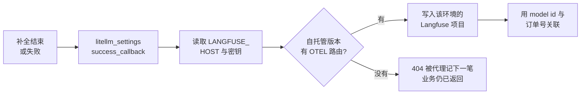

# 第 9 章 把调用轨迹接到 Langfuse

> OD-2049 的那次降级，网关日志里有 `x-litellm-model-id: seashore-cs-fast`。值班的人如果只能 ssh 到机器上翻日志，海岸和极光的调用会混在同一个文件里。Langfuse 书已经讲过 trace 怎么读。这一章只决定：由谁把这一跳送出去，送的时候哪些字段可以带，哪些不能带。本机没有投递成功或失败的样本。



*本章导览图*

## 埋在网关，而不是每个 Java 进程各埋一次

客服在 AgentScope，订单接口在 Spring AI。若两边各自接 Langfuse SDK，OD-2049 的一次客户提问会变成两套 trace 习惯：字段名不同，模型名一个写别名、一个写响应里的上游模型字符串。网关是两边的公共点。`success_callback` 和 `failure_callback` 在这里各记一笔，Java 进程只保留业务 span（查订单、写工单），模型 span 以网关为准。

代价是：网关没覆盖到的调用不会出现。有人绕过 `llm.example.com` 直连供应商，Langfuse 里就是安静的。第 1 章的密钥纪律是这个前提。上游密钥不在业务进程里，直连更难发生。仍要在网络策略上禁止 Dataplane 访问供应商网段，否则纪律只是配置审查。

Langfuse 书的组织名、项目名不要抄过来。那本书的示例组织不适用于星帆。星帆的轨迹按商家分：海岸一个项目，极光一个项目。项目怎么建、界面长什么样，读 Langfuse 书的部署和追踪章。本书没有 Langfuse 的截图。

2026-11-12 网关自己的账在第 4 章：Usage 和当时只有三行的 Request Logs。那不是 Langfuse 的 trace。第 2 章侧栏那张图上，Telemetry 的 Proxy requests 是 Off，没有向 LiteLLM 远端送用量。本章的回调也没开，所以 Langfuse 里不会出现 OD-2049。

## 文档里的接法

Proxy logging 页的步骤，2026-11-11：

1. 安装 `langfuse`，约束写成 `langfuse>=4.7,<5`。回调走 LiteLLM 自己的 OpenTelemetry 管道，打到 Langfuse 的 OTLP 端点。SDK 的 REST 客户端用于 Prompt 管理和凭据检查。
2. 配置：

```yaml
litellm_settings:
  success_callback: ["langfuse"]
  failure_callback: ["langfuse"]
```

3. 环境变量：`LANGFUSE_PUBLIC_KEY`、`LANGFUSE_SECRET_KEY`。`LANGFUSE_HOST` 可选，文档写默认 `https://cloud.langfuse.com`。自托管必须显式设成你的地址，例如 Langfuse 书那种本机 `http://localhost:3000`，生产则是星帆自己的主机。不要依赖默认值，默认会把轨迹送到云上。
4. 启动代理，打一笔请求，到 Langfuse 里看。

`config_settings` 还列出一批相关变量，本机都没设，只记下和星帆有关的几条，避免以后抄错：

| 变量 | 文档要点 |
| --- | --- |
| `LANGFUSE_HOST` | 优先于 `LANGFUSE_BASE_URL` |
| `LANGFUSE_BASE_URL` | `LANGFUSE_HOST` 没设时的后备 |
| 钥匙或团队上的 `langfuse_host` | 比上面两个都优先 |
| `LANGFUSE_FLUSH_INTERVAL` | OTLP 批量导出的间隔，默认 1 秒。非正整数会告警并回默认 |
| `LANGFUSE_MAX_RETRIES` | 导出失败的重试，默认 3，过大会被限制 |
| `UPSTREAM_LANGFUSE_*` | 文档写明已废弃。回调改到 SDK v4 后不再转发。设置 secret 会在启动时告警 |

自托管服务器要 3.63.0 或更新，才有 SDK v4 使用的 `/api/public/otel/v1/traces`。更老的 v2 服务器没有这条路由，轨迹会被 404 拒绝，代理记下拒绝。先升 Langfuse，再开回调。Langfuse 书的版本基线如果高于这个门槛，以那本书写明的版本为准，同时用一次真实导出确认路由存在。本书不替那本书改版本号。

入口或反代若限制请求体，大批次会 413。文档说回调会把批次对半再送，单条 span 本身超限才会丢并打错误日志。星帆的客服回复通常不大。批量回放实验时才容易撞上。没做回放，不写具体字节数。

## 本机为什么没有轨迹

实验用的 `config.yaml` 没有 `success_callback`。环境里没有 Langfuse 的公钥和私钥。`.env.example` 把三个变量留成注释。打开回调却不给密钥，只会在每次 OD-2049 的请求后多一条导出错误，业务响应未必失败——日志页把回调描述成调用完成后的动作。本机没有验证「回调失败是否影响 HTTP 响应」。上线前用一个写错的 host 打一笔，确认客户仍能收到补全，同时告警能看见导出失败。若回调失败会把 200 变成 500，就不能在生产默认开启，直到这个耦合被拆掉。

也没有设置 `LANGFUSE_MOCK`。文档说它为 true 时拦截 Langfuse 调用并返回模拟响应，不访问网络。那是 SDK 的测试开关，不是星帆的验收。验收要在 Langfuse 项目里看见一条生成记录，模型标识能对应到 `seashore-cs-primary` 或 `seashore-cs-fast`。

## 两个商家两个项目

集成文档允许单次请求带上 `langfuse_public_key`、`langfuse_secret_key` 和可选的 `langfuse_host`，从而打到不同项目。Proxy 上更适合把这组值放在团队或钥匙的元数据里，由网关代填，而不是让 Java 每个请求带 Langfuse 的私钥。私钥进了业务进程，就和第 1 章的上游密钥是同一类问题，只是换了一家厂商。

海岸团队的轨迹去海岸的项目，极光去极光的项目。平台公共助手不调用商家模型，也就没有这些轨迹。若公共助手将来调用一个不含商家数据的模型，给它第三个项目，不要写进海岸的项目「图省事」。

文档还提到企业能力里的「按团队把日志送到各自的 Langfuse」。开源路径用请求级或团队级的凭据覆盖，能不能在没有 `LITELLM_LICENSE` 时工作，以你启用后的第一笔为准。本书没启用，不把企业列表里的句子写成已验证的开源行为。

## 哪些字段要能对上 OD-2049

网关视角的一条生成记录，至少要能回答：

| 问题 | 用什么回答 |
| --- | --- |
| 哪个商家 | 团队 id 或 `key_alias`，不是客户昵称 |
| 哪个部署 | `x-litellm-model-id`，例如 `seashore-cs-fast` |
| 有没有降级 | `x-litellm-attempted-fallbacks` |
| 花了多少（网关单价） | `x-litellm-response-cost` |
| 和哪张工单有关 | 业务传入的元数据里只放工单 id 或订单号 `OD-2049` |

订单号可以进元数据。客户的地址、电话、完整对话是否进 Langfuse，是另一项决定。`turn_off_message_logging` 为 true 时，文档说消息和响应不会进回调，元数据仍在。客服质检需要正文时，就不要开这个开关，同时限制 Langfuse 项目的成员只有海岸的质检角色。极光的人不是这个项目的成员。这和 AgentScope 的 namespace 成员是两套名单，要各维护各的，不能假定同步。

不要把虚拟密钥、上游密钥、`DATABASE_URL` 放进元数据。回调的重试日志有时会带上请求片段。密钥一进片段，Langfuse 的权限就变成了模型密钥的权限。

## 和 Langfuse 书的分工

| 你要做的事 | 去哪 |
| --- | --- |
| 把网关的成功和失败送出去 | 本章的回调和变量 |
| 读 trace、看费用、做数据集和评分 | Langfuse 书 |
| 用 Prompt 管理客服口径 | Langfuse 书的 Prompt 章。网关不是 Prompt 的来源 |
| 评估 OD-2049 这类回答是否胡编物流 | Langfuse 书的评估章，数据仍以订单系统为准 |

网关送出的花费使用第 4 章的单价。Langfuse 里若再配一套模型价格，两张图会不一致。星帆选定网关单价为「拦截用的账」，Langfuse 为「给人看的轨迹」。财务发票仍以供应商为准。三套数字在报表上标注来源，不取平均。

## 一笔你希望在界面里看见的字段

下面不是导出的样本，是验收时要找的对应关系。没看见之前，回调不算接上。

| 网关侧已有 | 希望在生成记录里能指认 |
| --- | --- |
| 请求模型 `seashore-cs` | 不要只剩下降级后的 `mock-qwen-turbo` 而丢失别名 |
| `x-litellm-model-id: seashore-cs-fast` | 能看出这次走了备用 |
| `x-litellm-attempted-fallbacks: 1` | 能和 model id 互相印证 |
| 成本 `2.48e-05` | 与网关响应头一致，而不是另一套单价 |
| 订单号 `OD-2049` | 来自业务元数据，能筛出这张工单的全部模型调用 |
| `key_alias` `seashore-cs-agent` 或订单接口那把 | 能分清客服和 Spring 接口 |
| 虚拟密钥原文 | 必须没有 |

Langfuse 书里的界面字段名以那本书的实测为准。本章不发明「某个按钮叫什么」。若映射后别名丢失、只剩上游 id，就回到第 6 章的警告：不要把上游 id 写回下一轮请求。轨迹里可以保留上游 id 作为实际模型，但要另有一列业务别名。没有这一列，评估集会把同一次降级看成换了一个产品。

## 导出失败时长什么样

文档写了两种和部署有关的失败，本机都没打出日志：

- 自托管太旧，没有 `/api/public/otel/v1/traces`，对方 404，代理记下拒绝。
- 反代限制体大小，413，回调对半重试，单条过大才丢。

还有一种是密钥错误或 host 错误。期望是客户的 HTTP 仍成功。这是未验证的期望，写在复核里，不写在架构承诺里。验证方法：把 `LANGFUSE_HOST` 指到一个关闭的端口，打一笔 `seashore-cs`，同时看客户响应和代理日志。日志里应能搜到 langfuse 或 otel 的失败。搜不到，说明回调没加载，检查 `success_callback` 的缩进和进程是否重启。

## 和质检的边界

质检要看小帆有没有编造物流。网关轨迹能提供模型输入输出，不能提供订单系统里的真实状态。评估时把订单系统的查询结果和模型回答放在一起，这是 Langfuse 书的数据集工作。本章只保证：若你决定记录正文，正文来自网关这一跳，海岸和极光不在同一个项目。

`turn_off_message_logging` 打开之后，质检会失去正文，预算和降级仍可从元数据看。客服上线初期建议先记录正文、收紧项目成员；稳定后再评估是否关闭。这个建议没有用星帆的真实对话验证过，因为没有投递。

## 离开这一章之前

- 自托管 Langfuse 的版本满足 OTEL 路由要求，或明确还没升级、回调保持关闭。
- `LANGFUSE_HOST` 指向星帆自己的主机，不是默认云。
- 海岸和极光的公钥不同。私钥不在 Java 仓库。
- 用一笔测试补全在对应项目里看到生成记录，并能指出部署 id。这一条本书没做。
- 写错 host 时，客户请求的 HTTP 状态仍是成功。这一条本书没做。
- 元数据里有订单号的位置，没有密钥。

## 接着读

- Langfuse 书第 2 章是自托管，第 4 章是 trace 模型，第 5 章是成本。读的时候用星帆的项目名，不用那本书示例里的组织名。
- 第 10 章说明按团队拆日志若走企业功能，不在必做步骤里。
- 第 7 章的响应头是你在轨迹里要找的那几个字段。对不上时先查网关版本，再查回调是否把 header 映射丢了。映射细节以你那一版的一条真实 trace 为准。
