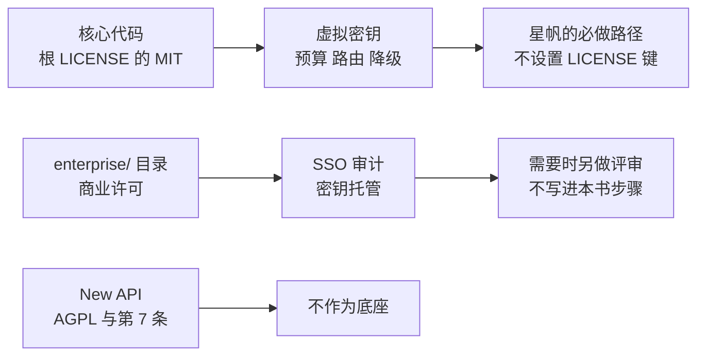

# 第 10 章 生产边界

> 本地实验已经能对 OD-2049 做补全、限流、拒绝跨模型，并在主上游断开时降级。2026-11-12 还登录了 Admin UI，看见模型、钥匙、团队、Playground、日志和降级那一行。把它放到 `llm.example.com` 上之前，还有三类边界不能靠多写配置糊过去：LiteLLM 自己的两套许可、New API 为什么仍然只是对照、以及日志和主密钥的爆炸半径。这一章不新增必做功能。

*本章导览图*

## 仓库根上的那句分界

2026-11-11 读取的根 `LICENSE` 先说明分段许可，再给出 MIT 正文。分段的意思是：`enterprise/` 目录若存在，适用该目录里定义的许可；目录之外是 MIT，版权 Berri AI，2023。MIT 允许使用、修改、分发，并要求保留版权声明和许可声明。本书不把整份 MIT 正文再贴一遍，链接就在仓库里。

同一天，`enterprise/LICENSE.md` 存在。它不是 MIT。要点是：生产使用需要有效的 BerriAI Enterprise 订阅和相应席位；可以修改并发布补丁，但权利仍归 BerriAI 或其许可方；开发和测试可以不购买订阅而复制修改；除此之外禁止复制、合并、发布、分发、再许可和销售该目录软件。`enterprise/README.md` 写明这个目录是商业许可，并指向企业功能文档。

星帆的必做路径不编译、不导入、不复制 `enterprise/` 下的代码，也不设置 `LITELLM_LICENSE`。2026-11-12 的 compose 没有这把许可证。虚拟密钥、团队预算、限流、别名、降级，在不设置许可证的代理上调用过。管理界面也登录过：模型、虚拟密钥、团队、Playground、Usage、Request Logs、Router Settings 的 Fallbacks。这些能力落在根许可的 MIT 一侧，只要实现代码不在 `enterprise/` 里。官方镜像里是否带有 `enterprise/` 目录，这次没有进容器检查。若你在依赖树里发现某个功能的实现只存在于那个目录，停用它，改走本书已经测过的接口。

## 企业页上的两套说法

Enterprise 文档用一张分层图把「虚拟密钥、预算和限流、花费、管理界面、负载均衡、防护、MCP 网关」画在开源 AI Gateway 上，把 SSO、SCIM、审计日志、委派管理员、密钥管理器、IP 允许列表、按团队的日志、多区域和支持协议画在企业层。

同一页的「完整功能列表」又说下面每一项由许可证密钥开启，其中包含组织与项目、标签预算、按钥匙的分模型预算、临时提高预算、软限额邮件、密钥轮换、审计日志、若干防护回调。分层图和完整列表不是同一套边界。

本书的处理：

| 能力 | 必做？ | 依据 |
| --- | --- | --- |
| 虚拟密钥、团队、`max_budget`、rpm/tpm | 是 | 开源文档有独立页面，本机未设置许可证也调用成功 |
| `fallbacks`、`simple-shuffle`、健康检查 | 是 | 同上 |
| 管理界面点选模型 | 否 | 只确认了 `/ui` 返回 HTML |
| SSO、SCIM、审计日志、IP 允许列表、密钥托管 | 否 | 企业页明确放在许可证层。SSO 另有一句：5 个用户以内免费，超过需要企业许可。星帆的客服不是去登录这个 UI 的五个人，不要靠这句把 SSO 当成已经免费可用 |
| 组织、项目、标签预算 | 否 | 列表把它们放在许可证开启项。本机 `organization_id` 为空也能用团队 |
| 自定义防护与 Presidio | 不在必做 | 文档说开源防护框架包含自定义防护和 Presidio。`llmguard_moderations`、`llamaguard_moderations`、`hide_secrets`、`openai_moderations`、`google_text_moderation`、`lakera_prompt_injection`、`aporia_prompt_injection` 需要企业许可 |
| `enforce_project_model_quota` | 否 | `config_settings` 标明是企业功能，并提到 v1.100.0 与 v1.109.0 的行为。不启用 |

软限额邮件、自动轮换虚拟密钥出现在企业列表，也出现在开源接口的字段里（`soft_budget`、`auto_rotate`）。字段存在不等于没有许可证也会发邮件或真的轮换。第 3、4 章把它们标成未测。生产手册里不要写「到 80% 会收到信」。

企业页还说同一镜像、同一版本号，许可证只是一把钥匙；SOC 2 Type II 的报告向对方索取，不在本书复述审计结论。价格页没有公开数字，本书不编造报价。支持窗口和四个最近稳定小版本的政策以那一页为准。实验没有锁定成单一版本号：2026-11-11 的 pip 安装是 1.109.0；2026-11-12 的界面侧栏是 v1.169.0，同一次成功响应头是 `x-litellm-version: 1.109.0`。发布说明两个都写。

## New API 仍只是对照

New API 的 README（2026-11-11）写明：

- 许可是 AGPL-3.0。
- 按第 7 条，修改版本必须在法律声明以及界面里显著的关于、法律、页脚或署名位置保留 `Frontend design and development by New API contributors.`，并保留指向原项目的可见链接。
- 它在 One API（MIT）之上开发。
- 若组织政策不允许 AGPL，或希望避免 AGPL 义务，邮件联系项目方。本书不代写这封邮件，也不评估商业许可条款。

AGPL 对通过网络提供修改版服务的源码义务，比 MIT 宽。星帆的网关如果只在内网给自己的 Java 进程用，义务的触发条件仍要由法务按你们的部署方式判断，工程团队不能用「没有卖给别人」一句话带过。第 7 条的界面署名则在「把管理台嵌进商家能打开的页面」时一定会碰到。LiteLLM 的开源核心没有这条界面署名。这是选它做底座的原因之一，另一原因是配置可以进 Git，实验已经按 yaml 跑通。

New API 的功能（多协议转换、渠道权重、令牌分组）本书没有逐项验证，不排成对比矩阵去证明「谁更强」。不需要更强。星帆需要的是密钥、配额、降级，并且许可边界清楚。这些在 LiteLLM 开源代理上已经有实测。功能不够时再开一页评审，而不是在运行手册里混入另一套安装步骤。

One API 是 MIT，New API 的 README 把它标为上游。星帆也不改用 One API 做底座：本书没有它的实验，也不打算维护第三套网关。提到它只是为了避免把 New API 的许可误当成 One API 的 MIT。

## 上到 llm.example.com 时仍要守住的几件事

实验里的主密钥、盐、数据库口令、模拟上游钥匙都在那台机器的环境里，没有进 Git。生产换成独立的随机值。Docker Quickstart 对两把钥匙的说明是：

- `LITELLM_MASTER_KEY` 是根凭证。它授权管理接口。2026-11-12 的登录框用的是另一对 `UI_USERNAME` / `UI_PASSWORD`，主密钥没有填进那个框。文档仍写：没设 UI 密码时，主密钥默认也是管理界面密码，用户名是 `admin`。泄露主密钥等于管理员权限。`sk-` 前缀在这一页被说成约定；Virtual Keys 页要求主密钥以 `sk-` 开头。生产按更严的那一页生成，两页冲突时用能通过 `/key/generate` 的那一种，并在变更记录里写明版本。登录后的粉色条幅说明环境变量登录还开着。生产要换成个人账号并关掉这条路径，本书的演示没关。
- `LITELLM_SALT_KEY` 加密经 UI 写入的供应商密钥。没有原地轮换。更换会使已存密钥无法解密，直到重新录入。即使用 yaml 和环境变量注入上游密钥，也从第一天设置盐，防止有人在 UI 里粘贴一把供应商密钥。

Postgres 只接受网关的网络。连接预算的那句日志要算进 `max_connections`。多副本之前配 Redis，否则限流和冷却按副本相乘。

日志里不要落虚拟密钥原文。限流和预算错误里出现过钥匙的哈希。哈希仍应限制在内部日志。客户页面只留「稍后再试」和工单号。OD-2049 的客户原文如果进了网关日志，读日志的权限按海岸的数据权限收，不要给全平台开发者只读。

`/health/liveliness` 给进程探针，`/health/readiness` 给数据库，`/health` 给模型端点。三个都配。只配 liveliness 会在主上游全死时仍显示健康。

业务仓的合并请求继续拒绝上游密钥和 `127.0.0.1:18001`。虚拟密钥走部署系统。`team_id` 可以进平台数据库，它不是密钥，但是内部标识，不必公开到前端。

## 本书没有证明的事

| 事项 | 原因 |
| --- | --- |
| 真实供应商的延迟、工具调用、流式降级 | 没有厂商密钥，不编造响应。Playground 开着 Stream response 的第一下会卡住，图是关掉之后的 |
| Login with SSO、在 UI 里新建模型或新建降级 | 登录走的是用户名密码。模型和 Fallbacks 那一行来自 `config.yaml`，Add 按钮没点 |
| 官方仓库的 `docker-compose.quickstart.yml` 原样跑通 | 用的是本书 `demo/docker-compose.yml`：官方镜像 `main-stable`、Postgres 16、两个模拟服务，配置用卷挂载 |
| Request Logs 与 Usage 逐条一致 | 12 日的日志列表当时只有 3 行，Usage 随后是 6 个请求。缺口留着 |
| 在 12 日的 compose 上再停一次主上游 | 降级成功和预检跳过的响应头来自 11 日。12 日只看到 Fallbacks 页上的配置行 |
| 无数据库时的预算警告原文 | 文档读过，进程没另起 |
| Langfuse 里出现一条 trace | 回调没开。Telemetry 页也是 Off |
| Spring 与 AgentScope 进程的最终 URL | 第 8 章列了复核 |
| 第二个代理副本加 Redis 后限流不再放大 | 只有一个进程 |
| `enterprise/` 里任何功能 | 故意不测，也没设置 `LITELLM_LICENSE` |
| New API 的界面和渠道 | 故意不装 |

这些缺口留在各章的复核里。补实验时改对应章节的「已看到」表，不要只改本章的概括。

## 发布说明里要附的证据

上生产不是把实验配置换个主机名。发布说明附上下面几条命令的退出码和摘录，密钥打码。

| 证据 | 期望 |
| --- | --- |
| 业务仓库搜索上游密钥变量 | 只剩 `${...}` 或没有赋值 |
| `GET /health/liveliness` | `"I'm alive!"` |
| `GET /health/readiness` | `db` 为 `connected` |
| `GET /health` | 主上游在健康列表里 |
| 海岸钥匙请求 `aurora-cs` | 403 `key_model_access_denied` |
| 海岸钥匙请求 `seashore-cs` | 200，成本头非 0（除非合同价就是 0） |
| `rpm_limit` 极小的测试钥匙连打两次 | 第二次 429 `throttling_error`，测完作废 |
| 测试预算极小的钥匙第二下 | 422 `budget_exceeded`，测完作废 |
| 停掉备用以外的测试上游 | 大预算钥匙的 `x-litellm-attempted-fallbacks` 为 1 |
| 环境里没有 `LITELLM_LICENSE` | 空 |
| 镜像侧栏与 `x-litellm-version` | 两个都写。12 日的侧栏是 v1.169.0，成功响应头是 1.109.0 |

测试钥匙的极小预算会碰到第 4 章的「第一下仍放行」。用第二下作为证据。第一下 200 不能证明预算生效。

## 和 ai-platform 候选池的分界

根 README 的候选池仍保留 ai-platform。本书拿走的只有其中「网关鉴权、配额、模型降级」这一片，并且鉴权指的是虚拟密钥，不是商家登录平台的 SSO。下面这些仍不在十章里：

| 仍留在候选池或别的书 | 原因 |
| --- | --- |
| 商家控制台的信息架构 | 没有产品设计章 |
| 订单、支付、物流的领域模型 | 在 AgentScope 的案例里已经有工单，不在网关里重建 |
| 按商家出财务发票 | 网关 spend 不是发票 |
| Prompt 评测和红队 | Langfuse 书 |
| 工具协议 | MCP 书 |
| Dataplane 的部署拓扑 | AgentScope Java 的服务章 |

有人若把这十章叫成「平台书已经写完」，用这张表纠正。

## 许可文本不要抄进业务仓库

MIT 要求分发软件时保留声明。星帆若把 LiteLLM 镜像当作上游产物运行，而不是把源码再分发进自己的安装包，义务和「把源码嵌进商家安装包」不同。本书不给法律结论。工程上做到：不修改 `enterprise/`，不把 New API 的前端嵌进 `agentscope.example.com`，镜像来源和版本写进发布说明。需要分发修改版 LiteLLM 时，把根 `LICENSE` 随修改版带上，并确认修改没有碰到 `enterprise/`。

New API 的第 7 条署名句子是：`Frontend design and development by New API contributors.` 本书引用这句是为了说明义务的内容，不是在界面上使用 New API。星帆的页面不需要加这句，因为不运行 New API。

## 离开这本书之前

- 上游密钥只在网关环境中。业务仓库的一次搜索可以作为证据，附在发布说明里。
- 海岸和极光各有团队、各有钥匙、各有模型名单。跨模型请求是 403。
- 主上游断开时，大预算钥匙能降级，响应头能指出 `seashore-cs-fast`。小预算被预检跳过的那种 500 有告警。
- 没有设置 `LITELLM_LICENSE`。没有复制 `enterprise/` 的源码。
- 没有把 New API 写进部署脚本。
- 单价是合同价或内置价格表，不是实验里的 `0.000001`。用一笔已知 token 核对响应头之后再打开真实流量。

OD-2049 仍然可能没有物流数据。网关不负责编造到货时间。它负责的是：这句「查不到」花的是海岸的额度，用的是可替换的别名，并且极光的钥匙不能替海岸把这句问出去。

## 接着读

- 第 1 章是密钥为什么离开业务仓。读完本章若发现仍有进程持有上游密钥，回到第 1 章的清单，而不是加企业 SSO。
- AgentScope Java 第 43 章是商家、工单和 OD-2049 的业务全貌。
- Langfuse 书负责轨迹打开之后的阅读和评估。
- 候选池里的 ai-platform 仍未成书。隔离策略、计费产品和商家控制台不在这十章里。
