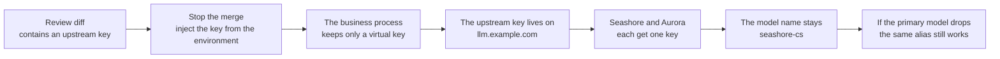
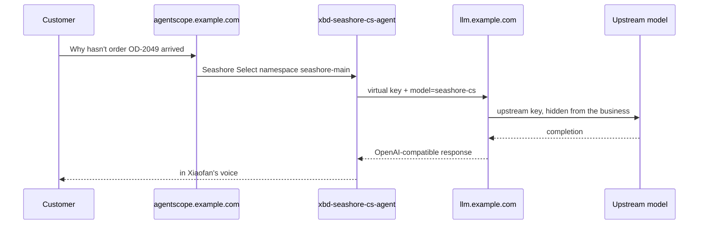

# Chapter 1 Business services should not hold model keys

> When Lin Zhou pushed a change for Seashore Select's support agent, the diff gained a line `DASHSCOPE_API_KEY`. That line can answer "why hasn't order OD-2049 arrived", and if the key leaks it can also punch through the model bill for both of Xingfan's merchants. This chapter takes the key out of the business repo first, then decides where the gateway stands.



*Overview for this chapter*

## How that line got into the diff

Xiaofan can answer OD-2049 locally because the dev machine's environment has an upstream key. Lin Zhou added `application-local.yml` to the commit in passing. A reviewer looking at the web page cannot tell whether the file holds a placeholder or a real key, but the history is already visible to every reader of the repo.

On Xingfan's path, more than one process actually calls a model:

| Process | Why it needs a model | If the key is written into its repo |
| --- | --- | --- |
| Xiaofan's local sample, `xingfan-support` | A direct `call` during development | Everyone who clones the repo has it |
| Hosted support agent `xbd-seashore-cs-agent` | Seashore Select's sessions | Seashore's quota becomes the repo's quota |
| Logistics specialist `xbd-seashore-logistics-agent` | The ticket "verify the real shipping state of order OD-2049" | The same key is copied into a second service |
| Aurora support `xbd-aurora-cs-agent` | The comparison tenant | Aurora's calls are billed to Seashore's vendor account |
| The platform's shared assistant | It does not touch a merchant's private data | It should not hold any merchant's upstream key either |

Demo Step 13 writes the gateway address as `https://llm.example.com`, puts the key in `XBD_MODEL_API_KEY`, and says "provided locally, not committed". That is the boundary of the teaching stack: the key still enters the Dataplane process. If the process is compromised, the config is printed, or a crash dump is uploaded, the upstream key leaves. The first job of the gateway is to make the key inside that process no longer the upstream key.

## The bill does not grow inside the conversation

OD-2049's customer is already chasing the order for the third time. Support needs a line of wording. Logistics needs to check the state. If both sides fail once, each will try again. Without a gateway, retries happen in business code, the counter lives in the vendor console, and Xingfan's own logs only have timeouts.

Use the order of magnitude from later experiments in this book as a piece of arithmetic, not as a vendor quote. One simulated completion is 18 prompt tokens plus 22 completion tokens. If one round of a support reply in production is a hundred times that, and support and logistics each take one round and each retry twice, that is 6 calls and about 24,000 tokens. On a campaign day, multiply by concurrent sessions, and the vendor's free quota or monthly cap can refuse the call before the business has an alert.

The AgentScope book's verification notes once showed `AllocationQuota.FreeTierOnly`: running out of quota is unrelated to namespace permission, and an old session keeps hitting a model that no longer has quota. A budget on the gateway does not fix a vendor that suddenly stops serving, but it can stop "one runaway retry loop fills the whole platform" on Xingfan's own ledger first. That is chapter 4. Here we only fix this: the ledger cannot be a separate copy inside each merchant's business repo.

## Upstream key, virtual key, master key

The duties of the three keys land on APIs in the next two chapters. Fix the names now so config files do not mix them.

| Key | Who holds it | What it can do | How Xingfan places it |
| --- | --- | --- | --- |
| Upstream key | Only the gateway process | Authenticate to the vendor or the mock upstream | Environment variable, not Git |
| Virtual key | One caller | Call the allowed model aliases, under budget and rate limits | One for Seashore support, another for Aurora support |
| Master key | A platform admin | Issue and revoke virtual keys, read spend | Only on Lin Zhou's admin path, not in the Dataplane |

LiteLLM's Virtual Keys page requires the master key to start with `sk-`. The Docker Quickstart says the prefix is a convention, not a hard requirement (both pages read on 2026-11-11). Examples in this book always use placeholders that start with `sk-`, so they do not trip the stricter page. A placeholder is not a key. `replace-me` in `.env.example` cannot be used for a request.

If a business service must hold a key, it can only be a virtual key. The blast radius of a leaked virtual key is this merchant, this set of models, and this slice of budget. The blast radius of a leaked upstream key is every deployment on the gateway that still uses that upstream key.

## Which layer the gateway sits on

A request already passes several stops between the customer and the model. Before inserting another layer, look at what each existing stop already owns, so the gateway does not take someone else's job.



*One chase-the-order request crossing the platform and the gateway. Both host names come from books that already exist. This chapter does not invent a new one.*

| Layer | Already responsible for | Do not also make it responsible for |
| --- | --- | --- |
| AgentScope namespace | alice cannot see `aurora-main` | The vendor bill |
| Tickets and teams | How OD-2049 is split between support and logistics | Model routing |
| The `merchant-gateway` alias | The Dataplane knows "use the company gateway" | The upstream key itself |
| LiteLLM Proxy | Upstream keys, virtual keys, aliases, budgets, fallback | Whether the order really exists |

Xiaofan answering "the system has no shipping record for this" is a missing business fact, not a gateway failure. The gateway only guarantees: this call spends Seashore Select's quota, uses the single name `seashore-cs`, and still has a chance to switch to `seashore-cs-fast` when the primary deployment is unreachable.

## What stays in the business repo

The following is a counterexample. Do not put it in any file that can be committed, even if the value is fake. Once review habits allow a "sample key", a real key will come in along the same path.

```yaml
# Counterexample. Do not commit.
dashscope:
  api-key: sk-live-do-not-commit
agentscope:
  openai:
    api-key: sk-live-do-not-commit
    base-url: https://dashscope.aliyuncs.com/compatible-mode/v1
    model-name: qwen-plus
```

After the call is pulled onto the gateway, the business repo may contain the alias and the address. The key remains only the name of an environment variable:

```yaml
# Seashore Select support process. The deploy system injects the key. The file only names the variable.
agentscope:
  openai:
    api-key: ${SEASHORE_LITELLM_KEY}
    base-url: https://llm.example.com/v1
    model-name: seashore-cs
```

Whether `base-url` includes `/v1` depends on the client. The `OpenAIChatModel.baseUrl` example in AgentScope book chapter 6 includes `/v1`. Spring AI joins the path differently. Chapter 8 writes that separately. For now, remember that the host is `llm.example.com`.

Also scan these places. They are not "config files", and they still carry a key out:

| Place | Typical leak |
| --- | --- |
| CI logs | `echo $DASHSCOPE_API_KEY`, or a debug print of the whole environment |
| Crash reports | An HTTP client attaches the request headers to the exception |
| Ticket comments | Someone pastes a curl into "After-sales escalation: order OD-2049 …" while debugging |
| Frontend bundles | Someone compiles the key into the browser to make a local demo easier |
| Image layers | `ENV DASHSCOPE_API_KEY=...` written into a Dockerfile |

The gateway does not remove that carelessness, but it lets the leaked key be revoked on its own. You do not have to rotate every business at the vendor console because of one ticket comment. The upstream key still has to be rotated. It is just no longer tied to every business release.

## When not to add the Proxy yet

One person runs Xiaofan's smallest sample on a laptop. Model calls happen a few times a day. There is no second merchant. Adding Postgres, a master key, and virtual keys then costs more to debug than the leak risk. Still do not commit the key. Use an environment variable. The sample repo keeps only `.env.example`.

If any of the following is true, the Proxy is part of the platform, not a personal tool:

- Seashore Select and Aurora Digital will call at the same time, and the bill must be separable.
- Support, logistics, and product-selection agents hit the same vendor, and you want a model change to be a gateway config change only.
- The primary model times out or returns 5xx, and the business code already has retries written separately in each place.
- A key has appeared once in a review diff, an image, or a ticket. Once it has happened, it will happen again, unless the path is closed.

Xingfan hits all four. From chapter 2 on, the gateway is required. It is not an optional component.

## Decisions this chapter does not make

How a model alias maps to an upstream, which deployment to switch to after a failure, whether a team budget resets daily or monthly, how a Java client joins the URL, and which Langfuse project receives the trace. None of those have answers yet. This chapter fixes one thing: the upstream key's home is the process environment of `llm.example.com`, not the repo of `xbd-seashore-cs-agent`.

New API can also relay traffic and issue tokens. Its license is not MIT. When Xingfan embeds the gateway into a console that merchants can open, the AGPL network-distribution duty and the attribution requirement in section 7 come before any feature comparison. Chapter 2 only gives a comparison table. Chapter 10 writes the license boundary. Commands, config, and failure cases in the body all come from the LiteLLM Proxy.

## The hours after a leak

Once a key is in Git, deleting it in the next commit does nothing. It is still in history. Lin Zhou handles it in this order, not in the order "write the postmortem first".

1. Revoke that upstream key in the vendor console and issue a new one, handed only to the gateway's deploy system. Until the old key is revoked, assume it can still create charges.
2. Replace the gateway's `MOCK_UPSTREAM_KEY`, or the matching environment variable in production, restart the gateway process, and send one test sentence that contains only the order id through `seashore-cs`. Confirm a marker such as `[primary]`, or a real upstream 200. This machine has no real vendor. In the experiment this step replaces the simulator's environment variable. It does not prove the vendor side has revoked the key.
3. Business processes do not have to restart, as long as they do not hold the old upstream key. If they do, remove it first, then talk about virtual keys. Reversing the order hangs support during the window when the upstream key is removed.
4. Scan CI logs, image history, and ticket comments. If a curl was pasted under the ticket title "After-sales escalation: order OD-2049, customer complaint about shipping delay", delete the comment too. Deleting Git is not enough.
5. Tell the owners of Seashore and Aurora: the model bill may have had abnormal calls before revocation. The note to alice and bob does not include a fragment of the key.
6. Add a commit check that rejects a long string after `sk-`, and a `DASHSCOPE_API_KEY=` whose value is not a variable reference. The check will false-positive on placeholders in docs. Placeholders use `replace-me`, not a random string that looks like a real key. This book's `.env.example` follows that.

Force-pushing to erase history only matters when the repo is still private and every clone can cooperate with the rewrite. History that has been public should be treated as already copied. Xingfan's tutorial repo is public, so an experiment key cannot be real from the start.

## The wrong kind of "central management"

Someone will put the upstream key in a cluster Secret named `llm-upstream` and mount it on every Dataplane. The key is no longer in Git. The blast radius is still there: any Pod that mounted this Secret and had its environment read exposes the upstream for both merchants. The gateway has to be the only workload that mounts the upstream Secret. Other workloads mount only their own virtual key.

| Workload | Mounts | Does not mount |
| --- | --- | --- |
| `litellm` | Upstream key, master key, salt, database URL | The merchant's business database password |
| `xbd-seashore-cs-agent` | `SEASHORE_LITELLM_KEY` | Upstream key, master key |
| `xbd-aurora-cs-agent` | `AURORA_LITELLM_KEY` | Seashore's virtual key |
| The platform's shared assistant | No model key, unless there is later a public model that contains no merchant data | Any merchant key |
| The laptop that runs the teaching probe | A short-lived virtual key | Do not write the upstream key into a shell config file for convenience |

The probe is the "terminal calls the gateway directly" step in Step 13. A virtual key is enough to prove the path. An upstream key would make the laptop a second gateway, and one without a budget.

## What a leak looks like in logs

All of the following count. The values are placeholders. Do not fill in a real key "just to compare".

```text
Authorization: Bearer sk-live-example
api-key=sk-live-example
DASHSCOPE_API_KEY=sk-live-example
```

The following are not the key itself, but they help someone match the last four characters to a system. Keep them in internal logs only:

```text
key_alias=seashore-cs-agent
x-litellm-model-id: seashore-cs-primary
```

The long hex in a budget error is a key hash. It is not the `sk-` plaintext. Still do not paste it into a public ticket comment. An internal incident ticket can keep the hash, so it can be compared with the `/key/info` timeline. This machine did not write the hash into the book.

## What one upstream key's bill looks like when both merchants are online

Assume the vendor console can total by key and cannot total by Xingfan's namespace. When Seashore and Aurora share an upstream key, one invoice cannot answer "whose retry is this 40 dollars". The gateway's `team_info.spend` can answer, but it uses the unit price you configured, not the invoice. Separate keys are for stopping the loss and for rate limits. Reconciliation still has to keep the vendor's monthly cap, so that after the price table is written as 0 the gateway budget never fires while the money still grows on the vendor side.

An experiment that wrote the unit price as 0 has shown up in the docs' discussion of "zero-price models": a zero-price call skips the budget check, and if there is no second check when falling back to a paid model, cost is created outside the budget. The 1.109.0 docs default that second check to on. The simulator's unit price in this book is not 0. If production marks some internal model as 0, reread the pre-check in chapter 7. Do not keep "the price is 0, so it is safe".

## Lines to look at in a review diff

| You see | Action |
| --- | --- |
| `api-key: sk-` and what follows is not `${` | Reject the merge and treat it as a leak |
| `base-url` points at a vendor host | Ask whether this is still bypassing `llm.example.com` |
| `model-name: qwen-plus`, or any name outside the three aliases | Reject. The gateway will 400 |
| `model-name: seashore-cs` but the key variable is named `DASHSCOPE_API_KEY` | The name and the key are not a pair. Reject |
| Only Aurora's model name changed, and the key is still Seashore's variable | That returns 403. The change is incomplete |
| `.env` is added to version control | Reject, even if the value is `replace-me`. The sample file can only be named `.env.example` |

## Numbers this chapter deliberately does not decide

Whether the daily budget is 1 dollar or 100 dollars, and whether rpm is 10 or 300, this chapter does not decide. Chapter 4 uses extreme small numbers only to see 422 and 429. The real numbers come from Seashore's support volume and the contract price. Lin Zhou and finance write them into `/team/new`. They are not written into this book as recommended values. A recommended value becomes a wrong document the next time the contract price changes.

## Before leaving this chapter

- Search the upstream-key variable names in `open-api-platform` and the Agent config. If a value you find is in Git history, treat it as already leaked and revoke it on the vendor side, instead of only deleting it in the next commit.
- List the processes that still hold an upstream key. On Xingfan, at least check: local Xiaofan, the Dataplane, and any probe that still uses `XBD_MODEL_API_KEY` to call a vendor directly.
- Name the future owners of two virtual keys: Seashore Select support corresponds to `seashore-main`, Aurora Digital support corresponds to `aurora-main`. Write that on paper. Chapter 3 issues the keys.
- Confirm the gateway host stays `llm.example.com` and the platform stays `agentscope.example.com`. Do not invent a domain so that it "looks like production".

## Read next

- Chapter 2 runs the Proxy on a machine with no vendor key, and says why New API is only a comparison.
- AgentScope Java chapter 6 writes `baseUrl` and the model extension. Reading the key from an environment variable is a discipline that chapter already has. This book changes the variable's value from an upstream key to a virtual key.
- AgentScope Java chapter 43 and demo Step 13 are the upstream of this business path. Step 13 notes that the real Dataplane-to-gateway request was not tested then. This book fills in the gateway itself. It does not go back and claim that Dataplane request was tested.
- The demo's `.env.example` leaves `XBD_MODEL_API_KEY` empty. Empty is correct. What gets filled in later should be a virtual key, not a vendor key.
