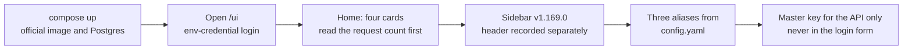

# Chapter 2 Run the LiteLLM Proxy

> Seashore Select's support is still waiting for one reply about OD-2049. The key has already been kept out of the repo. The next step is a process that can hear the request, and that Lin Zhou can log into and see. This chapter brings up the official image, Postgres 16, and two mock upstreams with Docker Compose, logs into the Admin UI, and reads the four cards that were on Home. There is no vendor key. The sidebar version and the response-header version are not the same number. Both are kept.



*Procedure for this chapter*

## Which run produced this UI

On 2026-11-12 the image was `ghcr.io/berriai/litellm:main-stable`, the database was Postgres 16, and the upstreams were two local OpenAI-compatible mock processes. There was no vendor key, and `LITELLM_LICENSE` was not set. The admin UI is at http://127.0.0.1:4000/ui/ .

Read the versions apart. Do not merge them into one:

| Where it was read | Value | Which run |
| --- | --- | --- |
| Admin UI sidebar, next to the logo | LiteLLM v1.169.0 | The 2026-11-12 UI |
| `x-litellm-version` on a successful Chat Completions response | 1.109.0 | The same run |
| PyPI and `importlib.metadata.version("litellm")` | 1.109.0 | The 2026-11-11 pip install, not this image |

The `main-stable` tag floats. This book did not pin a digest. Release notes record the sidebar string and the response header, both of them. The errors and status codes from the pip run on the 11th still come from 1.109.0. Do not extrapolate them onto the sidebar's 1.169.0.

The CLI Quick Start states that 1.84.0 and later require Python 3.10 or newer. On an older interpreter, `pip install 'litellm[proxy]'` does not error. It silently resolves to a version that still allows that interpreter. This affects only people who are not using the image. The reader's default path is the Compose setup in the next section.

The Quick Start also gives a load-test figure: "1.5k+ requests/second". This book did not reproduce that benchmark, and it is not a capacity promise for Xingfan (星帆, "Starsail" in the demo credentials).

## How the reader opens the UI

From `books/litellm/demo`:

```bash
docker compose up
```

Compose does four things: Postgres 16, two mock upstreams that use only the standard library, and the official image. `config.yaml` and `mock_upstream.py` are mounted on read-only volumes. Do not start by writing a Dockerfile that bakes those two files into the image. Baking files into the image is a workaround for when the host bind mount is broken. It is not this book's startup step.

The process inside the container listens on `0.0.0.0`. Otherwise the host's port mapping cannot reach it. The addresses published on the host are limited to `127.0.0.1` on 4000, 5432, 18001, and 18002. `api_base` in the config is `http://mock-primary:18001/v1` and `http://mock-backup:18002/v1`. Those are service names on the container network. Written as `127.0.0.1`, the gateway connects to itself, and the mock upstreams never see the request. The mock script must also bind `0.0.0.0`, for the same reason.

Open http://127.0.0.1:4000/ui/ in a browser.


Login uses environment variables, not the master key:

| What you are doing | Which value | This run |
| --- | --- | --- |
| Open the Admin UI | `UI_USERNAME` / `UI_PASSWORD` | `admin` / `StarsailDemo#2026` |
| Call `/key/generate`, `/v1/chat/completions`, and `smoke.sh` | `LITELLM_MASTER_KEY` | `sk-starsail-master` |
| The mock upstream's `api_key` | `MOCK_UPSTREAM_KEY` | `sk-mock-upstream`. The mock does not check it |

The password contains a `#`. Quote it in a shell. Type it literally in the browser. Do not type the master key into the login form. Do not use the password from the login form as `Authorization: Bearer`.

After login, the top of the page has a pink banner. The text is Environment-credential login is enabled, with Review beside it. This is "an admin who logged in with environment variables", not a person's account. The banner is at the top of every later screenshot. The Login with SSO button is on the login page. It was not clicked, and this run does not know where it would go.

The official docs call this login a shared bootstrap password: it is written in the environment, it cannot be rotated down to a person, and it cannot tell which admin clicked. Xingfan's demo stops on this bootstrap path. The later part of the docs says that, once personal accounts exist, you turn on `disable_env_credential_login` in the config and restart. This book did not do that step. Until it is done, the banner should stay.

## Look at Home first after login

Home is the first page after login. The four cards are counts from the database at that moment. The config file cannot tell you them.


Read the four cards by the words on them. Do not round a number the card has not already rounded:

| Card | Words on the screenshot | How it relates to later chapters |
| --- | --- | --- |
| Spend | $0.00, No budget set | There is no global budget. The $50 and $30 on the Teams page are another bucket. Chapters 4 and 5 come back to them |
| Total Requests | 4, of which 3 ok and 1 failed | The 75.0% success rate is 3/4. Later Usage became 6 requests. This card is not wrong |
| Total Tokens | 120, 0 cache read | The Leaderboard's 80 and 40 also add up to 120. aurora-cs was 66.7% at the time, seashore-cs 33.3% |
| Avg cost / request | $0.0000 | A single call is about $0.000062. The card rounds the small amount to 0. Reconcile from the Playground and from the successful log row |

Gemini 4 Carbon, Claude Fable 5.2, and GPT-6.1 Terra under What's new, and the Updates on the right, are the product's own news. Xingfan did not call those models. The experiment unit prices are not on these cards either.

The Leaderboard's caption is the change over the past 7 days, comparing the two halves. Neither row in the screenshot draws an up or down number. There is only the share and the token count. Read only the 66.7% / 80 and 33.3% / 40 that you can see.

## The lower half of the sidebar, and Telemetry left off

The features are not in Home's cards. They are on the left. Scrolled down to where Settings is expanded, the screen looks like this.


This shot was taken after scrolling. The v1.169.0 next to the logo is not in the frame. The version string follows the screenshots that still show the logo, such as Home and Models.

Inside the Settings group, the page that connects directly to chapter 7 is Router Settings. Telemetry stayed off this time: proxy requests were not sent to LiteLLM's remote endpoint, and `LITELLM_TELEMETRY_ENDPOINT` was not filled in. The text on the page says the default is not to record, and `LITELLM_TELEMETRY_DISABLED=true` turns all of it off. We did not even turn the first item on. Langfuse is not connected either. That is chapter 9.

Home, Virtual Keys, Playground, Models + Endpoints, Usage, Logs, and Teams, in the upper half of the sidebar, are opened in chapters 3 through 7. Auto-Routers and Model Group Alias on the Models page are empty. The fallback rule is not on those two tabs.

## What each block of the config file does

The full file is `books/litellm/demo/config.yaml`. The blocks below are so you do not copy an experiment unit price into a production quote.

One entry in `model_list` is one deployment, not one business name. Several entries with the same `model_name` become load balancing in chapters 6 and 7. In this book's config, each `model_name` has only one entry. Fallback uses another name.

| Field | Experiment value | Role |
| --- | --- | --- |
| `model_name` | `seashore-cs` and the others | The `model` in the client request body. The UI's Public Model Name uses it |
| `litellm_params.model` | `openai/mock-qwen-plus` | All three aliases use this one string. A protocol prefix plus the experiment upstream model id |
| `api_base` | `http://mock-primary:18001/v1` or `mock-backup` | In-container addresses. Seashore's fast deployment uses backup. The other two use primary |
| `api_key` | `os.environ/MOCK_UPSTREAM_KEY` | The literal `os.environ/...` is LiteLLM's way of reading an environment variable. It is not the shell |
| `input_cost_per_token` | `0.000001` for `seashore-cs` and `aurora-cs`, `0.0000004` for fast | Experiment unit prices. The UI shows them per million tokens as $1.00 / $0.40 |
| `model_info.id` | `seashore-cs-primary` and the others | The response header `x-litellm-model-id` uses it to tell deployments apart |

The 2026-11-11 pip config had `seashore-cs-fast` on `openai/mock-qwen-turbo`, and `api_base` was the host's `127.0.0.1`. That was a different file. Now the upstream model string is the same for all three aliases. Primary and backup are told apart by `api_base`, the deployment id, and the `[primary]` / `[backup]` prefix in the mock body.

In `router_settings`, `routing_strategy` is `simple-shuffle` and `num_retries` is `0`. Both were visible on the Loadbalancing page on 2026-11-12. `fallbacks` points `seashore-cs` at `seashore-cs-fast`. The UI is Settings → Router Settings → Fallbacks. Chapter 7 has that screen. `aurora-cs` has no fallback. Aurora Digital's support does not borrow Seashore's fallback in this experiment config.

`general_settings.master_key` and `database_url` are both read from the environment. The master key is the credential for the admin API and for model calls. It is not the UI password from the previous section. The UI login uses `UI_USERNAME` / `UI_PASSWORD`.

`litellm_settings.drop_params: true` drops parameters the upstream does not recognize, instead of returning 400 immediately. The mock upstream ignores extra fields, so this switch was not separately verified as "turn it off and the call fails". It stays because the Java clients will later send temperature, tool choice, and similar fields.

Compose also sets `STORE_MODEL_IN_DB=True`. The three rows on the Models page are still marked Defined in config. This environment variable did not turn them into models created in the UI.

## Database and salt

Virtual keys, teams, and spend need Postgres. Compose brings the database up with the gateway. The database name is `litellm`, the user is `llmproxy`, and the password is `dbpassword9090`. That password is written in the demo compose for this machine. It is not a production password.

In the Docker Quickstart, `LITELLM_SALT_KEY` encrypts vendor keys written into the database from the UI. Change it, and vendor keys already stored cannot be decrypted. This compose does not set the salt: the upstream key comes from an environment variable in the config, and nobody pasted a vendor key into the UI. If a real key is going to be saved from the UI, set the salt before pasting. This book did not run the comparison of "no salt first, then add the salt later".

## Health check and the first completion

`/health/liveliness` takes no key. HTTP 200, and the body is:

```text
"I'm alive!"
```

The path is spelled liveliness, not liveness. Copy the official path when you write a probe.

`/health/readiness` with the master key:

```json
{"status":"healthy","db":"connected"}
```

`/v1/models` returns three ids: `seashore-cs`, `seashore-cs-fast`, and `aurora-cs`. The `owned_by` field is `openai`. That is the response shape. The Usage page later also draws the Provider as openai. Both come from the `openai/` prefix in the config. They do not mean the request went to OpenAI.

Excerpt of a completion called with the master key on 2026-11-11:

```json
{
  "id": "chatcmpl-primary",
  "model": "seashore-cs",
  "choices": [
    {
      "finish_reason": "stop",
      "message": {
        "role": "assistant",
        "content": "[primary] 订单 OD-2049 仍在途。请核对运单后再答复客户。"
      }
    }
  ],
  "usage": {"completion_tokens": 22, "prompt_tokens": 18, "total_tokens": 40}
}
```

The assistant text means "[primary] Order OD-2049 is still in transit. Please check the waybill before replying to the customer."

On 2026-11-12, calling `seashore-cs` again with alice's virtual key returned HTTP 200. The body likewise starts with `[primary] 订单 OD-2049 仍在途。` The response headers were `x-litellm-model-id: seashore-cs-primary` and `x-litellm-attempted-fallbacks: 0`, and the cost was about $0.000062. A successful response carries `x-litellm-version: 1.109.0`. The conversation in the Playground was sent by the login session, not by alice's key. Chapter 6 spreads the Trace out.

Calling `/v1/models` with no key, the response on the 11th was:

```json
{"error":{"message":"Authentication Error, No api key passed in.","type":"auth_error","code":"401"}}
```

The master key can complete a call directly. That is convenient for debugging. It does not belong in `xbd-seashore-cs-agent`. The business process uses the virtual keys from chapter 3. `seed.sh` creates the alice, bob, and two teams in the screenshots on an empty database. A new database's `team_id` values and the last four characters of the keys will not match the screenshots.

## Do not expect budgets without a database

The Docker Quickstart has a section, "Running without a database". The points read on 2026-11-11 were:

- You can serve an OpenAI-compatible API from the config file alone.
- Virtual keys fail, with the message `No connected db.`
- `litellm_settings.max_budget` is not a spend cap on this path. With no database client, cumulative spend stays unknown, and the global budget check does not fire.
- The master key itself has no budget.

This machine did not start a separate database-less process to reread those sentences. Xingfan needs quotas, so Compose has included Postgres from the first day. If you use the database-less mode on a laptop just to see a completion go through, do not write that process's address as `llm.example.com`, and do not expect to log into the same Virtual Keys page as chapter 3.

## Teams and keys are not in the config file

The three model aliases appear with the config. The Seashore Select and Aurora Digital teams, and the alice and bob keys, are written into the database through the admin API. After readiness passes, `demo/seed.sh` calls `/team/new` and `/key/generate` with the master key:

| Object | Name | Budget | Models |
| --- | --- | --- | --- |
| Team | `seashore-main` | 50 dollars | `seashore-cs`, `seashore-cs-fast` |
| Team | `aurora-main` | 30 dollars | `aurora-cs` |
| Key | `alice`, rpm 30 | 10 dollars | both seashore aliases |
| Key | `bob`, rpm 20 | 8 dollars | `aurora-cs` |

The script does not pass `budget_duration`. The key table in the screenshot shows Budget Reset as Never. The key plaintext appears only in that one run of the script. The screenshots in chapters 3 and 5 are a database that was seeded and then called. Spend is no longer 0. `team_id` values and the last four characters will differ from the screenshots on a new database.

## New API stays in the comparison column

[QuantumNous/new-api](https://github.com/QuantumNous/new-api) is another gateway aimed at relays and tokens. Its README says it is a further development of One API (MIT). The project itself is AGPL-3.0, and under section 7 it adds a UI attribution and a link to the original project. When Xingfan's platform embeds it into a page opened to merchants, whether the modified network service must offer the corresponding source, and whether the UI must keep the specified attribution, is a legal question. A feature list cannot answer it.

| Question | LiteLLM Proxy (this book's main line) | New API (comparison only, not installed) |
| --- | --- | --- |
| License | Core MIT; `enterprise/` is a commercial license | AGPL-3.0 plus the section 7 attribution |
| How this run starts | The official image plus this directory's `config.yaml` | Not installed |
| Relation to Java clients | OpenAI-compatible `/v1/chat/completions` | Also leads with compatibility. The range is whatever its own docs say. This book did not test it |
| Why Xingfan does not use it as the base | See chapter 10 | The license duty comes before the feature list |

This chapter does not give install commands for New API. The comparison table exists so that, when someone asks in review "why not New API", the answer is the license and config in Git, rather than "we have not heard of it".

## Ports and processes

| Port | Process | What happens if it dies |
| --- | --- | --- |
| 18001 | Mock upstream primary | The `seashore-cs` and `aurora-cs` deployments fail. If Seashore allows fast, it can fall back to 18002. Aurora has no standby |
| 18002 | Mock upstream backup | Affects only `seashore-cs-fast`. The primary path stays on 18001 |
| 4000 | LiteLLM. The API and the admin UI share this port | Model calls for every merchant fail, and `/ui` does not open |
| 5432 | PostgreSQL | The proxy fails to start, or readiness is no longer `db: connected` |

The certificate, DNS, and proxy timeout of `llm.example.com` are not in this local experiment. If a reverse proxy's timeout is shorter than the gateway's `timeout: 8`, the client sees 504 first while the gateway is still waiting on the upstream. This machine has no reverse proxy, and it has no 504 sample.

## Paths that were actually called

The pip process on the 11th and the image on the 12th are not the same run. The table names the date.

| Method and path | Key | Result |
| --- | --- | --- |
| `GET /health/liveliness` | none | 200, body `"I'm alive!"` (the 11th) |
| `GET /health/readiness` | master key | 200, `db` is `connected` (the 11th) |
| `GET /health` | none | 401, `auth_error` (the 11th). Request Logs on the 12th has a separate unauthenticated `/health` failure |
| `GET /v1/models` | master key | The three aliases (the 11th). The Models page on the 12th is the same three rows |
| `POST /v1/chat/completions` `seashore-cs` | alice | 200, body starts with `[primary] 订单 OD-2049 仍在途。`, `x-litellm-model-id: seashore-cs-primary`, `x-litellm-attempted-fallbacks: 0`, cost about $0.000062, header version 1.109.0 (the 12th) |
| `POST /v1/chat/completions` `aurora-cs` | alice | 403, `key_model_access_denied` (the 12th) |
| `POST /v1/chat/completions` `aurora-cs` | bob | 200 (the 12th) |
| Playground, model `seashore-cs`, not streaming | the current UI session | 200. The first streaming attempt hung. Chapter 6's screenshot is after Stream response was turned off |
| `GET /ui` login page | none | The login form. Username and password lead to Home |

On the 11th's proxy, both `/chat/completions` and `/v1/chat/completions` entered the router. Business clients still use `/v1/...` uniformly.

## Two failures left over from the non-image path (2026-11-11, pip 1.109.0)

Readers on the default Compose path will not hit these. The official image initializes the database itself when `DATABASE_URL` is set. Starting with pip on 2026-11-11, the first message was:

```text
LiteLLM Proxy: a database URL is set but the prisma CLI is neither on PATH nor importable as a package, so the database cannot be set up. Install it with `pip install 'litellm[extra_proxy]'` or run a shipped LiteLLM image.
```

After `litellm[extra_proxy]` was installed, the process still stopped at `Please run 'prisma generate' first.`. The client has to be generated from `schema.prisma` under `litellm/proxy` in the install directory. That is why the reader's default path is the image. A runbook that only copies `uv tool install 'litellm[proxy]'` stops at the first error.

That generate printed Prisma Client Python and warned about `binaryTargets`. The warning did not block the later start. The schema has `provider = "postgresql"`, so SQLite is not an option on this path.

On a successful start, the log on the 11th listed the three aliases. Each model with a custom unit price then had a price warning: when it is not in the built-in price table, the cache-token unit price defaults to 0. The experiment did not send cache fields. The 0 cache read on Home agrees with that. It cannot, by itself, prove the warning went away.

The same log also warned that `trusted_proxy_ranges` was not set. This machine has no reverse proxy, and it did not run a failed-login experiment. If a reverse proxy sits in front of `llm.example.com`, set the range the warning names.

## What `smoke.sh` covers

The script requires `LITELLM_MASTER_KEY` and takes an optional `LITELLM_BASE`, default `http://127.0.0.1:4000`. In another terminal, after Compose is up: `export LITELLM_MASTER_KEY=sk-starsail-master` and `./smoke.sh`. It requests liveliness, readiness, and the model list, then sends one completion about OD-2049. It uses the master key. What it proves is "the gateway and the primary upstream are alive", not "alice's model list is correct". The latter uses the virtual key from chapter 3. The master key does not go into CI.

The reader's entry is `docker compose up`, then `seed.sh` once, to create the teams and keys in the screenshots. `smoke.sh` is not that entry.

## Review for this chapter

Seen on 2026-11-12, on the official image: the login page, environment-variable login, the pink banner, Home's four cards and the Leaderboard, the lower half of the sidebar, Telemetry off, the three Defined-in-config aliases on the Models page (chapter 6), alice's and bob's request results, Playground success after streaming was turned off (chapter 6), and the Fallbacks row (chapter 7). Sidebar v1.169.0 and header 1.109.0 both hold. This book ran `ghcr.io/berriai/litellm:main-stable`. The screenshots are the local files under `books/litellm/assets/images/`. Building the book does not require running this chapter.

Seen on 2026-11-11, pip 1.109.0: the two Prisma failures, the liveliness body, readiness `db: connected`, the three model ids, the completion with `[primary]`, and the no-key 401. There was no UI login that day.

Not done: clicking Login with SSO, turning off environment-variable login, database-less mode, `uv tool install`, any real vendor, running New API, pinning the image digest, and stopping the primary upstream again on the 12th's compose. Streaming Playground was only confirmed to hang while Stream response was on. It was not waited out until it finished by itself.

For production, pin a digest and, after any image change, rerun the 403, 422, 429, and fallback-header assertions from chapters 3, 4, and 7.

## Read next

- Chapter 3 looks at alice and bob on Virtual Keys, and explains why a key issued by an admin has no owner.
- Chapter 6 uses the Models page and the Playground Trace to see that `seashore-cs` actually hits `mock-primary:18001`.
- Chapter 7 looks at the fallback already loaded in Router Settings, and at the switch that really happened on the 11th.
- The probe in AgentScope Java demo Step 13 is "the terminal calls the gateway directly". The curl in this chapter is the same kind of evidence: it proves the gateway itself is alive. It does not prove the Dataplane has been redirected.
