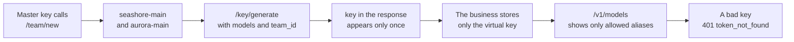

# Chapter 3 Virtual keys

> The master key lets curl ask, on behalf of OD-2049, for one sentence that says "still in transit". Writing it into `xbd-seashore-cs-agent` hands the right to issue keys to the support process. This chapter issues two virtual keys and separates which fields in the response body actually constrain anything, and which are only echoed back.



*Procedure for this chapter*

## A team first, then a key

The order on the Virtual Keys page is: create a team, then issue a key for the team. Xingfan's two merchants correspond to two `team_alias` values, using the namespace names, so there is not a second naming scheme.

```bash
curl -sS -X POST http://127.0.0.1:4000/team/new \
  -H "Authorization: Bearer $LITELLM_MASTER_KEY" \
  -H 'Content-Type: application/json' \
  -d '{
    "team_alias": "seashore-main",
    "max_budget": 1.0,
    "budget_duration": "1d",
    "models": ["seashore-cs", "seashore-cs-fast"],
    "rpm_limit": 30,
    "tpm_limit": 20000,
    "metadata": {"namespace": "seashore-main", "merchant": "海岸优品"}
  }'
```

The `team_id` returned on 2026-11-11 is a UUID. `budget_reset_at` is `2026-11-12T00:00:00Z`. The create time was about 15:48 UTC that day. `members_with_roles` contains `default_user_id`, role `admin`. `organization_id` is `null`. This book did not create an organization. The official enterprise page lists organizations near licensed capabilities. The open-source `/team/new` does not require an organization id, and the experiment did not fill one.

Aurora Digital gets a team the same way: `team_alias` is `aurora-main`, `models` is only `aurora-cs`, `max_budget` is 0.5, `rpm_limit` is 20. The two teams have different ids. Every key after this carries the matching `team_id`. If you drop the id and only write the merchant name in metadata, the gateway will not refuse a cross-merchant call because of that. The boundary of metadata is chapter 5. Store the id in the platform's tenant record here. Do not store it in Git.

## Issuing the key for Seashore Select support

```bash
curl -sS -X POST http://127.0.0.1:4000/key/generate \
  -H "Authorization: Bearer $LITELLM_MASTER_KEY" \
  -H 'Content-Type: application/json' \
  -d '{
    "key_alias": "seashore-cs-agent",
    "models": ["seashore-cs", "seashore-cs-fast"],
    "team_id": "<seashore-main 的 team_id>",
    "max_budget": 0.01,
    "budget_duration": "1d",
    "rpm_limit": 10,
    "tpm_limit": 4000,
    "duration": "30d",
    "metadata": {
      "namespace": "seashore-main",
      "agent": "xbd-seashore-cs-agent",
      "order_anchor": "OD-2049"
    }
  }'
```

`order_anchor` is only there so a person can follow the experiment. It is not a query condition of the gateway. Production must not put the customer's original text into metadata.

The parts of the response body that matter to Xingfan:

| Field | Value this time | How to use it |
| --- | --- | --- |
| `key` | Starts with `sk-`. This book does not paste it | The full value appears only this once. Put it into the deploy system immediately |
| `key_alias` | `seashore-cs-agent` | A name for people. It cannot authenticate |
| `team_id` | The Seashore team's UUID | Tied to the team budget |
| `user_id` | `null` | See the next section |
| `models` | The two seashore aliases | Access control is this array |
| `max_budget` | `0.01` | Dollars. An experiment number, not support's real monthly budget |
| `rpm_limit` / `tpm_limit` | 10 / 4000 | Chapter 4 used a smaller rpm and got a 429 |
| `duration` | `null` in the response | The request wrote `30d`. Do not trust this echo |
| `expires` | In `/key/info` it is `2026-12-11T15:49:12Z` | 30 days after the issue time. Trust info |
| `metadata` | Returned as sent | The gateway stores it. It does not execute it |
| `blocked` | `null` | Not disabled |
| `aliases` | `{}` | No key-level alias was set this time |

`/key/info` shows the key as `sk-...` plus the last four characters, and gives `key_name` the same mask. `created_by` and `updated_by` are `default_user_id`. `status` is `active`. `spend` may still be 0 just after the call. Chapter 4 recorded the posting about two seconds later.

The shape of `/key/list` is `keys`, `total_count`, `current_page`, `total_pages`. This time the `keys` array on this machine held hash strings, not `sk-` plaintext. If the admin console only gives hashes, you cannot recover a lost key from the list. A lost key is revoked and reissued.

## A key issued by an admin has no owner

The Virtual Keys page is explicit. The wording on 2026-11-11 is: the owner of a key is the user `user_id` points at, not necessarily the person who called `/key/generate`. When the caller is not a proxy admin, the API stamps the caller's `user_id` onto the key. A proxy admin must pass `user_id` themselves, or the new key has no owner and does not inherit the admin's quota and models. A service-account key's `user_id` is always `null`, under the same rule.

This machine issued with the master key, and the returned `user_id` is `null`. That is expected. It is not a dropped field. The consequences have to be remembered separately:

| Side | What the docs say is inherited | When there is no owner |
| --- | --- | --- |
| Models | With no `team_id`, the owner's `models` are added; with a team, the key does not inherit models from the owner | Only the key's own `models`, then the team constraint |
| Admin routes `/key/*`, `/user/*`, `/team/*` | Follow the owner's role. When the owner is `proxy_admin`, non-admin route limits are skipped | This support key should not be able to issue other keys |
| Budget and rate limits | With no team, inherit the owner's `max_budget`, `tpm_limit`, and `rpm_limit` | Use the numbers on the key and the team. They do not follow the admin's personal budget |

Xingfan's support key must carry `team_id`, and `models` must be written explicitly. Do not rely on "the admin can call every model, so a key he issues can too". The docs say that when an admin issues a key and does not write `user_id`, model inheritance does not happen. Our response body supports the half "`user_id` is empty". The half "an empty user definitely cannot call admin APIs" was not tested on this machine by calling `/key/generate` with this virtual key. On review, add that once: call an admin API with the support key and expect failure. Until it fails, do not assume the virtual key's permissions are already an automatic subset of the master key.

## The model list is access control

Seashore's key requests `model=seashore-cs`, HTTP 200, response headers:

```text
x-litellm-model-id: seashore-cs-primary
x-litellm-attempted-fallbacks: 0
x-litellm-response-cost: 6.2e-05
```

The same key requests `aurora-cs`, HTTP 403:

```json
{
  "error": {
    "message": "The requested model 'aurora-cs' is not available for this API key, or the model name is invalid. Check the models available to you and try again.",
    "type": "key_model_access_denied",
    "param": "model",
    "code": "403"
  }
}
```

Listing `/v1/models` with this key returns only `seashore-cs` and `seashore-cs-fast`, not `aurora-cs`. If the client builds a dropdown from the model list, Aurora's alias does not appear. That is more reliable than writing "you are Seashore Select's support agent, do not use someone else's model" in the prompt. A prompt cannot stop a wrong `model` field. The list can.

A bad key, HTTP 401:

```json
{
  "error": {
    "message": "Authentication Error, Invalid API key provided.",
    "type": "token_not_found_in_db",
    "param": "key",
    "code": "401"
  }
}
```

`token_not_found_in_db` makes "never issued" and "already revoked" look like the same failure from the outside. That is reasonable. Do not distinguish the two on a business error page, or you help someone probe which keys once existed.

The alias `qwen-plus`, which does not exist (called with the master key), is a different error: HTTP 400, `type` `invalid_request_error`. The message tells you to call `/v1/models`. If an Agent config still has a vendor model name, and the gateway only knows `seashore-cs`, you see 400 rather than 403. 400 means the name does not exist. 403 means the name exists and this key is not allowed to use it. Separate those two sentences when debugging.

## Lifetime is `expires`

The request body wrote `"duration": "30d"`. `duration` in the generate response is `null`. `expires` in `/key/info` is the issue time plus 30 days. If the platform stores the generate response as-is and then uses the `duration` field to decide "is it expired yet", it treats a key that is still valid as having no deadline. Trust `expires`.

The docs' `upperbound_key_generate_params.duration` can set a ceiling on every issue. Over the ceiling is a direct 400. It is not silently shortened. This machine did not set that. If Xingfan requires support keys to last at most 30 days, write it into the gateway config, not into a verbal review agreement. After the ceiling is set, omitting `budget_duration` also picks up the default inside the ceiling. The docs say you cannot pass `null` to opt out of `upperbound`'s `budget_duration` (`default_key_generate_params` treats `budget_duration: null` differently from upperbound). Neither was turned on on this machine. Before production, hit each once with a test key: over the ceiling should be 400, and an explicit `null` should be checked against the behavior of the doc version you read. Do not copy an inference from this book.

## Rotation has not been done

The docs describe two things. This machine called neither:

- `POST /key/<key>/regenerate` can replace the key with a new one and carry a `grace_period`. Whether the old key still works during the grace period depends on the response of your version. This book has no sample.
- `auto_rotate: true` plus `rotation_interval` at issue time. This is the key rotating itself. The enterprise page also lists "automatically rotate virtual keys" as a licensed capability. The open-source API docs and the license page do not line up. This machine's returned `auto_rotate` is `false`, and `rotation_count` is 0. Do not write this field up as an operations capability you already have before you have seen a rotation actually happen.

Rotating the upstream key is even less a property of this virtual key. The upstream key is in the gateway's environment. Rotating it means changing the environment, restarting or hot-reloading the config, and confirming the old upstream key is dead on the vendor side. The virtual key can stay the same. That is the separation chapter 1 wanted: a business release is no longer tied to the vendor console.

## Key-level model aliases were not used this time

Model Aliases on the Virtual Keys page let you write `"aliases": {"some old client name": "seashore-cs"}` at issue time. The client keeps requesting the old name, and the gateway rewrites it to the alias. Xingfan has no historical client name to stay compatible with. `aliases` stays an empty object. Do not pre-insert a layer "in case we rename later". The alias system already has `model_name`. Stacking a key alias on top means debugging has to guess which layer rewrote the name.

If the teaching alias `merchant-gateway` is already written into some Agent definitions, prefer changing the Agent definition so `model` becomes `seashore-cs` or `aurora-cs`. During the window when that is not finished, a key alias can map `merchant-gateway` to that tenant's alias. The window needs an end date. A permanent double write turns the three name layers of chapter 6 into four.

## A custom issue hook is not required

The docs have `custom_key_generate`, `custom_key_update`, and later `custom_key_policy`. The last one can see the merged key state on generate, update, and regenerate. A relative `duration` is folded into an absolute `expires` first. It fits a rule such as "every support key lasts at most seven days". At Xingfan's current stage, a config ceiling and issuing by hand are enough. A hook is Python running inside the gateway process. A bug blocks every issue. Do not enable it before there are tests.

## How the business side keeps it

| What to store | Where | Where not |
| --- | --- | --- |
| The virtual key plaintext | The deploy system's secret store, injected as `SEASHORE_LITELLM_KEY` | Git, images, tickets, comments on OD-2049 |
| `team_id` | The platform's tenant table | The prompt |
| `key_alias` | It can go into config. It is not a secret | Do not use it as a Bearer |
| The master key | Only an admin job can read it | Dataplane, Xiaofan, the frontend |

After injection into the process environment, the process still holds the virtual key in memory. That is as far as this goes. It is not undoing chapter 1's decision back into an upstream key. When a virtual key leaks, revoke that one. Seashore's upstream vendor key does not move. Aurora's key does not move.

## The other fields in the generate response

The generate response for the Seashore key is long. Besides the fields used above, these were empty or default in this 1.109.0 response. Empty means "not enabled". It does not mean "the feature does not exist".

| Field | This time | Does Xingfan depend on it |
| --- | --- | --- |
| `agent_id` | null | No. The Agent id is in AgentScope, not in the gateway |
| `max_parallel_requests` | null | No, until a streaming slot has been tested |
| `budget_limits` | null | Multi-window budgets are not enabled. The docs allow an array to write 7 days and 24 hours together |
| `allowed_cache_controls` | empty array | No prompt cache |
| `config` | `{}` | Empty |
| `permissions` | `{}` | Empty. Do not put admin permissions on a support key |
| `model_max_budget` | `{}` | No per-model split of the key budget |
| `budget_fallbacks` | `{}` | No second table of "budget used up, switch to another model". Fallback is the router's `fallbacks` |
| `model_rpm_limit` / `model_tpm_limit` | null | The limit is at key level, not split again per model |
| `guardrails` / `policies` / `prompts` | null | Not on the required path |
| `blocked` | null | Not disabled |
| `object_permission` | null | No object-level permission |
| `tpd_limit` | null | No daily token cap, only tpm |
| `budget_id` | null | Not attached to a shared budget row. The key's own `max_budget` is enough |
| `allowed_routes` | empty array | Whether empty equals "model routes only" has to be rechecked on upgrade. This machine's support key was not used to call an admin API |
| `router_settings` | most keys are null | Routing is not changed per key |
| `auto_rotate` | false in info | See the rotation section |

After upgrading the proxy, take one key and hit this table again. If a field you never configured comes back non-empty, treat it first as a change in default behavior, not as Xingfan having enabled a new capability.

## What is worth storing from the team response

Besides the id and the budget, the `/team/new` response has `members_with_roles`. On this machine that is `default_user_id` plus `admin`. This is the proxy's internal default user. It is not alice, and it is not bob. Do not write this `user_id` into the merchant member table, or someone will think alice is already an admin of the gateway team.

`blocked` is false. `spend` is 0. `access_group_ids` is an empty array. `policies` is an empty array. `allow_team_guardrail_config` is false. These defaults leave the team as "one budget bucket plus one model list". That is enough.

`budget_reset_at` has to be compared with the platform's "business day". UTC midnight is 08:00 Beijing time. If Seashore's support reads the bill by Beijing calendar day, the reset looks 8 hours off. Whether that is a display problem or a quota problem depends on whether the call peak is overnight or during the day. The experiment only observed the field value. The clock was not moved to 23:59 to see whether reset happens. Whether reset really clears spend should be checked before production with one short-period experiment at `budget_duration: 1m`, then changed back to `1d`. This machine did not run a 1-minute period.

## Revocation

The docs have delete and update APIs. This machine did not call delete. Experiment keys remain in the local database, and the database is not in the repo. Production revocation needs a record: who revoked `seashore-cs-agent` and when, what the new key's alias is, and when the old key's `last_active` stopped. The info response has `last_active`. This time it was null, because the query happened before use, or use had not yet shown up in this field. Do not infer "this key was never used" from null without looking at spend.

After revocation, request again with the old key. Expect 401, `token_not_found_in_db`. From the outside it matches "this key never existed". A business alert can say "authentication failed".

## The issue job itself

Issuing uses the master key, from an admin machine that does not run support. Output is redirected into the deploy system's input, not printed on a shared terminal. Shell history keeps the curl. Tighten the history file's permissions on the admin machine, or have curl read the key from a file and delete the file when done. This book's experiment kept the key in a temp file on this machine so status codes could be recorded. That machine is not production.

Do not put `/key/generate` on a platform API that a merchant can call, unless the caller is a platform admin and audit already has a place to record it. Audit logs on the open-source path are on the enterprise page. Until there is an audit, issuing stays a job Lin Zhou runs, at low frequency, with output going into a password store.

## Before leaving this chapter

- Issue a test key with the master key, and confirm the `key` in the response did not enter a shared record of shell history. The experiment key on this machine stayed in a temp file on that machine. It did not enter the repo.
- With Seashore's key, requesting `seashore-cs` returns 200, requesting `aurora-cs` returns 403, `type` `key_model_access_denied`.
- With Seashore's key, request `/v1/models` and confirm `aurora-cs` is absent.
- Read `expires` from `/key/info`. Do not read `duration` from the generate response.
- Call `/team/new` or `/key/generate` with the support virtual key and confirm it is rejected. This machine did not do this item. It is marked here so it is not treated as already verified.

## Read next

- Chapter 4 uses `max_budget: 1e-9` and `rpm_limit: 1` to turn the second request into 422 and 429.
- Chapter 5 explains why `namespace` in metadata is not isolation.
- `apiKey(...)` in AgentScope Java chapter 6 is the value issued here.
