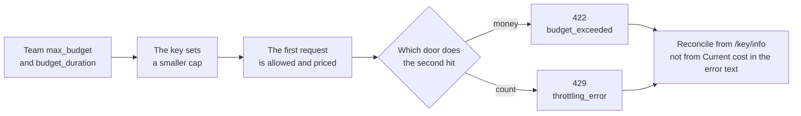

# Chapter 4 Team budgets and rate limits

> If OD-2049's third chase becomes a retry loop, Seashore Select's support will empty the shared quota before the vendor has an alert. Budget and rate limit are two different doors on the gateway: one counts money, one counts attempts. This chapter slams both doors with numbers that are deliberately absurdly small, and records the time the amount in the error text did not match the amount in the database.



*Procedure for this chapter*

## The team takes a slice first

At `/team/new`, Seashore Select's `max_budget` is 1.0 dollars, `budget_duration` is `1d`, `rpm_limit` is 30, and `tpm_limit` is 20000. Aurora is 0.5 dollars and `rpm_limit` 20, with no `tpm_limit`.

`budget_duration` values listed on the Team Budgets page include `1s`, `1m`, `1h`, `1d`, and `30d`, meaning reset every second, minute, hour, day, and month. The example on the page sets `max_budget` to a tiny decimal to trigger a refusal. This machine uses the same method. It is not Xingfan's pricing.

In this experiment, `1d` resets at the next UTC midnight (`2026-11-12T00:00:00Z`), not "24 hours from now". Only one pair of create time and `budget_reset_at` was observed. Do not write that every version aligns to a calendar day. When you change versions, compare these two fields.

A key can set a still smaller `max_budget` and `rpm_limit`. The support process receives the key. The team cap is the sum of this key and the other keys on the same team. This machine did not run two keys concurrently on the same team to prove the word "sum". The docs' team-spend API returned a nested `team_info.spend`. After several calls, that field on the Seashore team is `6.2e-05`, matching the single response header `x-litellm-response-cost: 6.2e-05`. Aurora's very small budget key later posted on its own, also `6.2e-05`, recorded on the key. Do not read it mixed with Seashore's team spend.

## The unit price is an experiment value

In `config.yaml`, the unit price of `seashore-cs` is `0.000001` dollars per input token and `0.000002` per output token. The mock upstream always returns 18 and 22. The formula:

```text
18 * 0.000001 + 22 * 0.000002 = 0.000062
```

The response header `x-litellm-response-cost: 6.2e-05` matches the formula. The unit price of `seashore-cs-fast` is input `0.0000004` and output `0.0000008`. The same token counts are `0.0000248`. The response header on the successful fallback was `2.48e-05`. The custom unit price took effect.

The startup log said: when a model is not in the built-in price table, the cached-token unit price defaults to 0, and input and output are unaffected. We had no cache field. That matches. Do not keep this set of unit prices into production. In production, either use LiteLLM's built-in model price table or write the contract price into `model_info`, and check the response header after one call with a known token count.

## 1e-9 dollars stops the second call

Aurora's key has `max_budget` set to `0.000000001`. The first `model=aurora-cs` returns 200. The body is still the primary simulator's OD-2049 sentence. The spend check happens before the call: spend was 0 then, the request was allowed, and the charge was posted after the call. So "the budget is already smaller than the price of one call" does not stop the first call. It stops the second.

The second is HTTP 422:

```json
{
  "error": {
    "message": "Budget has been exceeded! Key=… Current cost: 0.032777001, Max budget: 1e-09",
    "type": "budget_exceeded",
    "param": null,
    "code": "422"
  }
}
```

The key identifier in the message is a long hex string, not the `sk-` plaintext. This book does not copy that string. `Current cost` is written as `0.032777001`. A few seconds later, `spend` in `/key/info` is `6.2e-05`, and `max_budget` is still `1e-09`.

Both numbers are above the cap, so the refusal itself holds. The two numbers are not equal to each other, so the error text cannot be used for reconciliation. Possible sources include: estimating the next call used another default price, or current cost in the text is not the posted spend. This machine did not trace it to a source line and does not pick one explanation and freeze it. Reconciliation looks only at `spend` in `/key/info` and the response header `x-litellm-response-cost`.

`model_spend` is still an empty object when spend is already non-zero. Do not use it for a dashboard unless you see it filled in on your own version.

The Team Budgets page says you can set `litellm_settings.budget_exceeded_status_code` to 429. The default is not 429. This machine did not change that, and what it observed is 422. If business code treats every 429 as "wait one second and try again", it retries a spent budget into a loop. A spent budget should stop, and tell a person to change the quota or the model, not call again. The 429 from rate limiting is the one that fits a short backoff. The two status codes have to be handled apart.

## The key that allows one request per minute

Another key was issued on the Seashore team, `rpm_limit` 1, `max_budget` 1, model only `seashore-cs`. Three calls in a row:

| Order | HTTP | type | Response headers |
| --- | --- | --- | --- |
| 1 | 200 | A normal completion, hitting `seashore-cs-primary` | `x-litellm-attempted-fallbacks: 0`, cost `6.2e-05` |
| 2 | 429 | `throttling_error` | `x-litellm-response-cost: 0`, still with `x-litellm-model-id: seashore-cs-primary` |
| 3 | 429 | same as above | The reset time is the same as the second call |

The message says, in substance: this api_key's request limit is reached, current limit 1, remaining 0, and it gives a UTC reset time (this time, the end of the same one-minute window). The key in the message is again a hash, not the plaintext.

The model id in the 429 response headers is still primary. The request was rate-limited before it reached the upstream. The id does not mean the upstream already ran. Cost 0 agrees with that. A client must not read "there is a model id" as "a conversation was already produced".

`tpm_limit` was not filled on its own on this machine. The Seashore key was set to 4000, and one call is only 40 tokens, which cannot fill it. The docs place tpm next to rpm on the key, the user, and the team. Before production, use one known large `max_tokens` to push tpm into a 429, and confirm the type is still `throttling_error` and that the business separates it from `budget_exceeded`.

## Posting is delayed

Right after the Seashore key's first call, `/key/info` shows `spend` 0 and `total_spend` 0. About two seconds later both are `6.2e-05`. The team's `team_info.spend` is the same number.

If a dashboard refreshes every second, spend arrives late. If an alert reads the database in the same millisecond as "the response has returned", it misses the call that just happened. The budget block, though, can see some spend number on the next request: Aurora's second call returned 422 without us refreshing by hand. So "what the info API makes visible" and "what the next request decides" are not the same cache. The runbook should say it as two sentences: wait two seconds before reading info for reconciliation; whether blocking works is verified by the next request, not by refreshing the page.

## Multiple replicas and Redis

`fail_closed_rate_limit_enforcement` in `config_settings` defaults to false. When set to true, a failed Redis check of tpm, rpm, or `max_parallel_requests` returns 503 instead of falling back to the in-process counter. When it falls back to the in-process counter by default, N replicas can allow up to N times the limit. Without Redis, this setting does nothing.

This machine is one process, with no Redis, and the rpm 429 is real. If Xingfan scales what sits behind `llm.example.com` to several Proxy replicas and does not configure Redis, 30 per minute becomes 30 times the replica count per minute. This is not a corner of the docs. It is the default behavior of multiple replicas. Write Redis and rate limits together in the scale-out design. This book did not start a second proxy process and did not verify the 503 fail-closed path.

`max_parallel_requests` can sit on a deployment or globally. Both are null on this machine. Concurrency was not filled. If a support streaming response holds a connection, the parallel cap becomes a problem earlier than rpm. Not tested, so no procedure is written.

## Soft limits and a temporary budget increase

`soft_budget` in the response body is null, and `soft_budget_cooldown` is false. The enterprise page lists "email alert before the hard limit" as a licensed capability. The open-source team API lets you pass a `soft_budget` field. This machine did not pass it and does not know whether an alert is sent when no license is set. Do not write "at 80% an email is sent" in the runbook unless you have already received one.

`/key/update` can change `max_budget`. The docs also say a temporary budget increase needs an admin, and there is `self_serve_budget_policy` so the key's owner can change it within a range. The owner is defined as a `user_id` that equals both the key's `user_id` and `created_by`. The support key in chapter 3 has `user_id` null, so there is no owner self-serve. Raising the budget is an admin job, using the master key or a separate admin key. Do not build this capability into Xiaofan.

## Relation to the vendor's limit

The gateway budget uses the unit price you wrote, not the vendor invoice. The vendor's own monthly cap, free tier, and unpaid balance still come back as their errors. `AllocationQuota.FreeTierOnly` in the AgentScope verification notes is that kind of error. The gateway can choose to treat it as a failure that may fall back (chapter 7). It cannot "budget it away" inside the price table.

Both ledgers are required:

| Ledger | Who records it | What Xingfan uses it for |
| --- | --- | --- |
| Gateway spend | LiteLLM, at the configured unit price | Stop a runaway retry, and split Seashore from Aurora |
| Vendor invoice | The vendor | Finance reconciliation. A gap versus gateway spend is normal. If the gap is absurd, then check the price table |

One source of an absurd gap is `0.032777001` in this section's error text versus the posted `6.2e-05`. If someone imports the error log as an invoice, Seashore's daily budget is filled by a fake number. When collecting logs, drop the `Current cost` half of the sentence. Keep `type` and the HTTP status.

## Status-code comparison

The same "second request" goes through different doors depending on the kind of number. The rows this machine saw are placed next to the ones the docs mention but this machine did not reconfigure, so the business does not retry everything from one `catch (Exception)`.

| Condition | HTTP | type | On this machine |
| --- | --- | --- | --- |
| Key spend already over `max_budget` | 422 | `budget_exceeded` | Seen. Aurora's second call |
| Same, but `budget_exceeded_status_code: 429` is configured | The docs say it becomes 429 | Config not changed, not seen |
| rpm window used up | 429 | `throttling_error` | Seen. The second and third calls of `rpm_limit: 1` |
| Model name not on the key's list | 403 | `key_model_access_denied` | Seen. This is isolation, not budget |
| Model name does not exist | 400 | `invalid_request_error` | Seen |
| No key | 401 | `auth_error` | Seen |
| Key is not in the database | 401 | `token_not_found_in_db` | Seen |
| Rate limit cannot be checked on Redis and fail-closed is on | 503 | Described in the docs | Redis not configured |

A 422 response may still carry `x-litellm-model-id`. The 429 carried `seashore-cs-primary`, cost 0. When writing a parser: model id present, cost 0, and status 429 means the upstream was not called.

## Windows and reset

The rpm message gives a reset time, precision to the second, timezone written as UTC. The third call's reset time matches the second, so the window was not pushed later by another refusal. If the client busy-retries before the reset time, it only gets more 429s. Backoff has to cross that time, with jitter, so everything does not wake up together on the minute.

The budget's `budget_reset_at` is a different clock. The rpm window is on the order of a minute. The budget reset in this experiment is the next day's UTC midnight. Support can recover by sleeping one minute after a 429. Sleeping one minute after a 422 does not recover. Writing both kinds of "wait a bit" as the same retry decorator is the bug chapter 4 exists to remove.

With `tpm_limit: 4000` and a 40-token call, in theory many calls in a row are needed to hit it, and rpm arrives first in the middle. To accept tpm on its own, set rpm very high or leave it empty, set a single `max_tokens` large, or set tpm to 10. This machine did not. Leave a blank row in the acceptance record. Do not copy the rpm 429 message and treat it as the tpm message. That rpm message said `Limit type: requests`. tpm should show the word token. Do not freeze the wording before you have seen it.

## Which speaks first, the team cap or the key cap

The docs' structure is that both layers are checked. This machine did not build a sample of "the key has a lot left, the team is already used up", and it did not build the opposite of "the team is large, the key is small" beyond the case it has. The small-key case is Aurora's `1e-9`: the team cap is 0.5, and the key is exhausted first. So we can only say "the key cap takes effect". We cannot say "the team cap was observed taking effect on its own".

How to add that sample: set the team `max_budget` to `0.000000001`, the key `max_budget` to 10, send the second call, and see whether the error text names the team or the key. This machine's 422 text named `Key=`. If the team is exhausted first, the text may differ. It was not seen, so it is not invented.

The shape of `/team/info` is `team_id`, `team_info`, `keys`, `team_memberships`. spend is inside `team_info`, not on the outer object. If a collector reads the outer `spend`, it gets empty and then falsely reports "the team has no spend". This machine has no such key on the outside. The inside has `6.2e-05`.

## Matching one call to three numbers

Around 15:49 UTC on 2026-11-11, the Seashore key made one `seashore-cs` call. The three numbers have to match. If they do not, stop in this chapter. Do not go to production.

| Source | Number | Meaning |
| --- | --- | --- |
| By hand | 18 × 0.000001 + 22 × 0.000002 = 0.000062 | Configured unit price times the simulator's fixed usage |
| Response header `x-litellm-response-cost` | `6.2e-05` | The price of this call |
| `/key/info` `spend` about two seconds later | `6.2e-05` | Posted |
| info read immediately at the same moment | `0` | Not posted yet |
| Aurora's second-call error text `Current cost` | `0.032777001` | Cannot be the ledger |
| Aurora key's later `spend` | `6.2e-05` | Matches the primary unit price |

The reconciliation job compares only the first three rows. The fourth row reminds the collector to wait. If the fifth row is taken as a metric by a log platform, Seashore's 0.01 dollar cap looks more than thirty times over after one call. The sixth row says Aurora's call was finally posted at the configured unit price. The large number in the refusal text was not written into `spend`.

`model_spend` is still an empty object. Do not chart it. Team spend is read from `team_info.spend`. After these calls, Seashore's team on this machine is `6.2e-05`. That includes the Seashore key's call and does not include Aurora's key. Aurora is another `team_id`. The collector filters by team_id. Do not add every key's spend and then compare it with one team, unless you are sure nothing is missing and nothing is double-counted.

## How to test a budget without dirtying the daily cap

The experiment set Aurora's key to `1e-9` and Seashore's team to 1 dollar. Production acceptance must not drive a merchant's real key to 422, or that day's real support is refused together. The method:

1. Issue another key with `key_alias` `seashore-budget-probe`, `max_budget` `1e-9`, `models` only `seashore-cs`, and `team_id` of a dedicated probe team, not `seashore-main`. Exhausting the probe team's budget does not block alice's support. To create fewer teams, this machine put the tiny budget on Aurora's key. Aurora's team cap is still 0.5. That is acceptable on an empty database. It is not acceptable on a database with real traffic.
2. The first call must be 200. If the first call is already 422, the check happened before the call and historical spend is already dirty. Use a new key.
3. The second call must be 422, `type` `budget_exceeded`.
4. Revoke the probe key. This machine did not call the delete API. The empty database is discarded with the experiment machine.
5. Keep the probe's order id as OD-2049, so the test data does not invent a second order. The body is a fixed return from the simulator and is not written into a real ticket.

The rpm probe also uses a separate key, `rpm_limit` 1. This key's alias on this machine is `seashore-rpm-1`, but the team is `seashore-main`. Its 429 does not affect the budget, but it occupies the team's rpm of 30. An empty database does not mind. In production, put the rpm probe in the probe team too, and point the probe team's `models` at a test alias, not at the production deployment of `seashore-cs`, so probe traffic does not hit the vendor.

## When the price table is 0, the budget is not a safety net

Chapter 1 mentioned that a zero-price model skips the budget in the docs, unless the fallback pre-check stops it again. The experiment unit price is deliberately not 0, so 422 can appear. If someone leaves the production unit price empty, and the built-in price table also lacks this model, spend may stay 0 and the budget never fires. The startup log warns that the cache price is 0 for "not in the price table, but a custom unit price was written". What happens for "no unit price written at all" was not tried on this machine. Add one line to the go-live list: for one call with a known token count, the response-header cost must be non-zero, unless this contract really is 0.

## Before leaving this chapter

- State the different business actions for 422 `budget_exceeded` and 429 `throttling_error`: the first stops and finds a person, the second takes a short backoff.
- Check `x-litellm-response-cost` against the hand-calculated unit price on one call with a known token count. If they do not match, change the unit price first. Do not change the business retry first.
- When reading `/key/info`, wait for the posting. Do not conclude in the same millisecond the response returns.
- Decide on Redis before multiple replicas. Until that decision, do not write rpm as a platform-level promise.
- The reset time of `budget_duration` is the returned `budget_reset_at`. Compare it with whether your finance team's "one day" is UTC midnight.

## Read next

- Chapter 5 tightens a team from "one budget bucket" into "one merchant".
- Chapter 7 meets a fallback skipped by the budget pre-check. The amount in that error text disagreeing with this chapter is the same kind of thing: a pre-check number is not the ledger.
- Langfuse book chapter 5 is cost inside a trace. The two sets of numbers come from different unit prices. Do not merge them into one chart without labeling the source.
