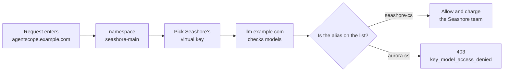

# Chapter 5 Where tenant isolation stops at the gateway

> alice cannot see `aurora-main`. AgentScope has already done that. If bob's support process holds Seashore's virtual key, the gateway still lets the call through, because the gateway does not know alice. This chapter draws what each of the two isolation layers owns, and removes "write the namespace into metadata" from the list of isolation methods.



*Overview for this chapter*

## The two sets of names are not the same layer

| Name | Belongs to | The question it asks |
| --- | --- | --- |
| `tenant=default` | An AgentScope deployment | Is this the same platform deployment |
| `seashore-main` / `aurora-main` | An AgentScope namespace | Can this person see this merchant's Agents, sessions, and tickets |
| The LiteLLM team whose `team_alias` is the same string | The gateway | Which bucket this key's spend and model list belong to |
| `metadata.namespace` | A comment on one key | Can a person reading the log tell what it is |

Demo Step 02 already showed that alice cannot see `aurora-main`, and bob cannot see the other way around. Step 05 uses 404 to avoid resource enumeration. Those assertions stay valid. They do not check whether the key after `Authorization: Bearer` belongs to this merchant.

If the Dataplane shares one `XBD_MODEL_API_KEY` for the whole platform, namespace isolation still holds, but the model bill has only one bucket. Seashore's retries eat Aurora's vendor quota. What this gateway layer has to add is that bucket.

## The list was enforced. The comment was not

Seashore's key metadata is:

```json
{"namespace": "seashore-main", "agent": "xbd-seashore-cs-agent", "order_anchor": "OD-2049"}
```

If you change metadata to `aurora-main` and do not change `models` and `team_id`, the gateway will not start refusing `seashore-cs` because of that. This machine did not run that rewrite experiment. The reason not to: the docs do not define metadata as access control, and the response body only stores and returns it as-is. One experiment to "prove a comment does nothing" is of limited use, as long as code does not read metadata to allow a call.

What was actually enforced is `models`:

- Seashore's key calling `aurora-cs` returns 403, `key_model_access_denied`.
- The same key's `/v1/models` does not contain `aurora-cs`.
- Aurora's key `models` is only `aurora-cs`. Its team's `models` is also only that one.

The team's `models` and the key's `models` both have to be written. When only the team is written and the key is left empty, the inheritance rule depends on whether there is a `team_id`, whether it is a service account, and who the owner is. The key in chapter 3 was issued by an admin, `user_id` is empty, and it has a `team_id`. The docs say this kind of key does not inherit models from the owner. A team key's models follow the key and the team. We wrote both sides explicitly, so we do not bet on what an empty array means. An empty array may mean "all" or "none" across versions. Do not leave it empty.

## How the platform picks a key

Xiaofan's hosted form picks the key by namespace, not the model by the user's sentence.

| Caller | namespace | Injected environment variable | Requested model |
| --- | --- | --- | --- |
| `xbd-seashore-cs-agent` | `seashore-main` | `SEASHORE_LITELLM_KEY` | `seashore-cs` |
| `xbd-seashore-logistics-agent` | `seashore-main` | Can be another key on the same team | `seashore-cs` |
| `xbd-seashore-product-scout` | `seashore-main` | Same, with the budget split | `seashore-cs` |
| `xbd-aurora-cs-agent` | `aurora-main` | `AURORA_LITELLM_KEY` | `aurora-cs` |
| The platform's shared assistant | the public area of `default` | Holds no merchant key | Does not call a merchant model |

If logistics and support share one key, when OD-2049's ticket is split into two calls, rpm and budget are mixed too. The rate limit in chapter 4 is counted per key. Splitting keys is what splits the rate limit. The team budget still adds the two keys. The merchant's daily cap is still there.

The shared assistant's system prompt says it does not touch any single merchant's private data. It should not hold `SEASHORE_LITELLM_KEY`. Otherwise one question from the public area is charged to Seashore, and the shared assistant gains the ability to call `seashore-cs`. The ability matters more than the bill.

If the product-selection Agent later needs another model alias, add a new `model_name` on the gateway and put it only on that product-selection key's `models`. Do not add it to the support key "for convenience".

## What the gateway cannot isolate

403 only looks at the model name. It cannot see the following, and it should not pretend to.

The prompt body. The customer says "look up Aurora Digital's order". Seashore's support still calls with `seashore-cs`, and the gateway returns 200. Order data is not in the gateway. Xiaofan's tool layer must look up the order by namespace. If it cannot find it, it says so. That is the attitude already shown by the OD-2049 reply in the AgentScope book: if there is no shipping record, do not invent one.

Logs. By default the gateway has to see the message body in order to price and forward. Seashore's conversation appearing in the gateway log means operations staff can read Seashore's customer's original words. That is another access path. The model list does not cover it. In production, shrink who can read Proxy logs, and decide whether to turn off message-body logging. `litellm_settings` has `turn_off_message_logging`. The docs say it stops messages and responses from being attached to callbacks. Metadata remains. This machine did not turn it on. Before turning it on, confirm whether you still want to see the body in Langfuse (chapter 9).

The master key. A person who holds the master key can issue themselves a key whose `models` contains every alias. Gateway isolation assumes the master key is not in a merchant process. That assumption is kept by deployment, not by metadata.

The fallback target. After `seashore-cs` fails, the call switches to `seashore-cs-fast`. The docs default `enforce_fallback_model_access` to true: the fallback target also has to be on the allow list of the key, the team, and the project, or it is skipped. This machine's Seashore key list includes `seashore-cs-fast`, so fallback has a chance to happen. If the support key has only `seashore-cs`, a dead primary model will not quietly switch to Aurora's `aurora-cs`. That is correct. When the list omits the fallback target, the failure shows up as "the primary model's original error", and the response has no `x-litellm-attempted-fallbacks`. The other skip in chapter 7 is the budget, not the list. Both skips have to be visible in alerts.

## Organization and project are not used this time

The returned `organization_id` and the `project_id` on the key are both empty. The enterprise feature list puts multi-tenant organizations, projects, and tag budgets in the license section. Open-source teams and keys are already enough to split Seashore and Aurora.

Do not create a layer of organization that mirrors the namespace just because "the docs contain the word organization". Two layers of master data drift: the merchant is renamed in AgentScope, the gateway organization is not, the bill still follows the old id, and the report follows the new name. Xingfan uses the namespace as the merchant primary key. The gateway `team_alias` copies the same string, and `team_id` is stored back in the platform database. Leave organization empty.

`access_group_ids` is an empty array on this machine. A model access group fits "one set of aliases referenced by several teams". There are only three aliases and two teams now. Writing them directly on the team and the key is shorter. An access group is a third table. Do not add it if nobody is operating it.

## Put it next to Step 05's 404. Do not replace it

AgentScope returns 404 for an unauthorized read, to avoid enumeration. The gateway returns 403 for an unauthorized model, and the message names the model. That is the gateway's choice, not a hole in the platform. The attacker already knows the `model` string they requested. 403 does not leak an extra existing resource id. Do not change the gateway's status code to make the style match, unless you are prepared to maintain a fork.

Business logs, on the other hand, must not return the full 403 JSON to the end customer. The customer should see one sentence from Xiaofan, "unable to answer for now", and the ticket keeps the `request id` and `type`. OD-2049's customer does not need to know the alias `aurora-cs` exists.

## Timeline of one cross-merchant call

Seashore's process has the wrong environment variable. Aurora's key is injected, but the request still writes `model=seashore-cs`. The expectation is 403, because Aurora's key list does not contain `seashore-cs`. What this machine tested is the opposite direction: Seashore's key requests `aurora-cs`, also 403. Both directions are the same rule. The platform alert aggregates on `key_model_access_denied`, not on "whose process". Process identity depends on the deploy system's environment-variable audit. The gateway only looks at the key.

If both sides are wrong: Aurora's key plus `model=aurora-cs` returns 200, charged to Aurora, while the customer session still belongs to Seashore's namespace. That is the worst combination. The gateway considers it completely legal. The way to stop it is on the platform: the key and the model name are taken from the same row of tenant config. The two fields are forbidden to come from different config files. What code review looks at is "are these two strings two fields of the same struct".

## The public area

The shared assistant in the `default` namespace is for every merchant. Demo Step 03 says it does not touch merchant private data. Therefore:

- Do not attach a merchant virtual key.
- Do not copy OD-2049's body into the shared assistant's prompt as an example. Using a fictional second order id would break the "one order id for the whole book" rule, so the shared assistant's prompt simply contains no order id.
- If the shared assistant must call a model, use a separate alias and a separate team. The budget comes from the platform operations cost center, not from Seashore's `max_budget`. This machine did not create that third team. Until it exists, the shared assistant does not call `llm.example.com`.

## Tickets and sessions still belong to AgentScope

The gateway's team is not a participant in the ticket. `xbd-seashore-cs-team` is the support team inside AgentScope. It handles "After-sales escalation: order OD-2049, customer complaint about shipping delay". LiteLLM's `team_alias=seashore-main` is the merchant-level budget bucket. The two "teams" must not be merged into one table. A person leaving the support group does not automatically revoke the merchant's virtual key. A merchant ending the contract means revoking the key. It does not mean deleting historical tickets.

bob cannot call alice's Agent. That is Step 05. bob's process also cannot hold alice's virtual key. That is this chapter. Both sentences have to appear in the go-live check. Missing one means the next review treats it as already covered.

## Which key each Agent that can speak holds

The mapping from the demo Step 03 matrix to gateway keys is only this. No new role is added.

| Agent | namespace | Gateway team | Model alias | Key |
| --- | --- | --- | --- | --- |
| `xbd-seashore-product-scout` | `seashore-main` | `seashore-main` | `seashore-cs` | A separate key, rpm split from support |
| `xbd-seashore-cs-agent` | `seashore-main` | `seashore-main` | `seashore-cs` | `key_alias` `seashore-cs-agent` |
| `xbd-seashore-logistics-agent` | `seashore-main` | `seashore-main` | `seashore-cs` | A separate key. Verifying OD-2049's shipping must not occupy support's rpm |
| `xbd-aurora-cs-agent` | `aurora-main` | `aurora-main` | `aurora-cs` | `key_alias` `aurora-cs-agent` |
| The platform's shared assistant | the public area of `default` | Not created, until there is a model with no merchant data | none | none |
| Xiaofan's local sample `xingfan-support` | the developer's laptop | A probe team, not a merchant team | `seashore-cs` only when connected to the experiment gateway | A short-lived key, not committed |

`xbd-seashore-cs-team` is the ticket team, not the gateway team in the table above. When the logistics specialist claims "verify the real shipping state of order OD-2049", the person is in the AgentScope team, and the model request still uses the logistics Agent's virtual key. A person's permission and a key's permission are two rows of config.

If the product-selection specialist later wants a cheaper alias, the new alias goes only into the product-selection key's `models`. The support key does not get it. Otherwise support's fallback list and the product-selection cheap model get tangled.

## Pseudocode for how the platform picks a key

This is not a compiled class. It is here so "the same struct" is clear. On review, look at whether the real code is split across two sources.

```java
TenantRoute route = routes.get(namespace); // seashore-main or aurora-main
String apiKey = System.getenv(route.virtualKeyEnv); // SEASHORE_LITELLM_KEY
String model = route.gatewayModel; // seashore-cs or aurora-cs
OpenAIChatModel chat = OpenAIChatModel.builder()
        .apiKey(apiKey)
        .baseUrl("https://llm.example.com/v1")
        .modelName(model)
        .build();
```

`routes` has no entry for the public area of `default`. The shared assistant never reaches this builder. If someone adds a row for the public area that says "use Seashore's for now", code review rejects it.

If the environment variable is missing, the process should fail to start, not fall back to an upstream key or the master key. Falling back is the path chapter 1 closes.

## How metadata can be used without causing trouble

Allowed: log search, lining up with an order id, filtering in Langfuse. `order_anchor: OD-2049` is an experiment marker. When production uses a real order id, confirm the Langfuse project's access scope is not wider than this merchant.

Not allowed: an `if` that decides whether to forward; a basis for "trust the client". The client can change its own request body. If metadata from the request body overwrites the metadata on the key, the client can change `namespace` to someone else's. This machine did not test whether request-body metadata can overwrite key metadata. Until that is clear, business isolation does not read a namespace field from the request. The namespace follows the platform's auth result. The key follows what deployment injects.

## Before leaving this chapter

- Draw two columns: AgentScope refuses a person, the gateway refuses a key and a model name. Give one existing assertion for each: Step 05's cross-namespace 404, and this chapter's cross-model 403.
- Confirm every Agent that calls a model has its own virtual-key environment variable, and the shared assistant has no merchant key.
- Search the code for `metadata`, and make sure there is no allow-path of `if metadata.namespace`.
- The fallback alias is on the support key's `models`. Aurora's key does not contain `seashore-cs-fast`.
- Do not create an organization. When someone suggests creating one, answer with "the primary key stays the namespace", not with a guess about the license. The license boundary is chapter 10.

## Read next

- Chapter 6 handles "which model name the business writes". Isolation depends on that name staying stable.
- Demo Step 02 and Step 05 are the operation notes for the namespace layer.
- The MCP book handles the tool side. If a tool can query orders, isolation is done again inside the tool implementation. The gateway's 403 does not replace it.
