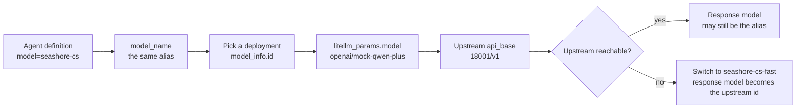

# Chapter 6 Aliases, deployments, and the model name the business sees

> If Xiaofan's config writes `qwen-plus`, the gateway returns 400: that name is not in `/v1/models`. The business should know only `seashore-cs`. The upstream is a simulator today and can be another compatible endpoint tomorrow, and the Agent definition does not have to change with it. This chapter splits the three names, and records that the `model` field in the response changes face after fallback.



*Overview for this chapter*

## Three layers of names

| Layer | Where it is configured | Xingfan's value | Who may change it |
| --- | --- | --- | --- |
| Business alias | `model_name`, also the request body `model` | `seashore-cs`, `seashore-cs-fast`, `aurora-cs` | Rarely. A change means changing the Agent definition and the key list |
| Deployment id | `model_info.id` | `seashore-cs-primary`, `seashore-cs-fast`, `aurora-cs-primary` | Added when machines or regions are added. The business alias does not change |
| Upstream model | `litellm_params.model` | `openai/mock-qwen-plus`, `openai/mock-qwen-turbo` | When the vendor changes, only this, `api_base`, and `api_key` change |

The `openai/` prefix means "call with the OpenAI-compatible protocol". It does not name the vendor. The simulator does not check the key, but the config still goes through `os.environ/MOCK_UPSTREAM_KEY`, so nobody writes a real key into the yaml.

`merchant-gateway` in Step 13 is the Dataplane's teaching alias. It means "use the company gateway". It is not an upstream model name, and it is not this book's `model_name`. When both are called "alias", write them in full in the sentence: platform alias `merchant-gateway`, gateway alias `seashore-cs`. The first decides that the request is sent to `llm.example.com`. The second decides which deployment the gateway picks.

## Two deployments under one alias, and two aliases, are not the same thing

The load-balancing docs say: several deployments with the same `model_name` are distributed by the router according to a strategy, default `simple-shuffle`. When `rpm` or `tpm` is set, simple shuffle draws by those weights. When they are not set, it is uniform random.

In this book's `config.yaml`, each `model_name` has only one deployment. `simple-shuffle` has no second candidate, so it simply selects that one. Seashore's "primary" and "standby" are two aliases, connected by `router_settings.fallbacks`, not by multiple deployments of the same name.

The reason to split them this way is that fallback has to change the unit price and the port, and the key list has to explicitly allow the standby alias. With multiple deployments of the same name, the standby is hidden inside the load strategy, `/v1/models` still shows one id, and the key list cannot refuse the standby alone. Xingfan wants Aurora's key to be unable to see Seashore's standby at all, so the standby has to be another `model_name`.

Multiple deployments of the same name are left for later: Seashore's primary model has two machines, both named `seashore-cs`, with `model_info.id` of `seashore-cs-primary-a` and `seashore-cs-primary-b`. That is the load in chapter 7. This chapter does not add a second entry to the experiment config, so it is not mixed into one request with the fallback that was already tested.

## `model` in the response cannot be used as the alias

While the primary upstream is alive, a request for `seashore-cs` has response JSON `model` of `seashore-cs`, and response header `x-litellm-model-id` of `seashore-cs-primary`.

When the primary upstream process is stopped and fallback succeeds (the run in chapter 7):

| Place | Value |
| --- | --- |
| Request `model` | `seashore-cs` |
| Response `model` | `mock-qwen-turbo` |
| `x-litellm-model-id` | `seashore-cs-fast` |
| `x-litellm-attempted-fallbacks` | `1` |
| Body prefix | `[backup]` |

Response `model` changed from the alias to the upstream id. If Xiaofan writes the `model` from the response back into the session, and the next turn sends it unchanged, the gateway receives `mock-qwen-turbo`. That name is not in `/v1/models`. The result is 400, the same class as requesting `qwen-plus` directly:

```json
{
  "error": {
    "message": "/chat/completions: Invalid model name passed in model=qwen-plus. Call `/v1/models` to view available models for your key.",
    "type": "invalid_request_error",
    "code": "400"
  }
}
```

This request was sent to `/v1/chat/completions`. The error text still says `/chat/completions`. Both paths can return 200 on this machine (when the primary upstream was already stopped, the call without `/v1` also landed on backup). Do not use the path inside the error text to decide which URL the client used.

The model name persisted in the session is only the business alias. The deployment id goes in logs and in Langfuse metadata, and in the response header. It does not go back into the request.

## Do not over-read the fields of `/v1/models`

The master key sees three ids. Seashore's key sees two. Each record's `owned_by` is `openai`, `created` is `1677610602`, and `mode` is `chat`. `owned_by` and `created` do not reflect the vendor, and they do not reflect when the deployment was created. `mode: chat` comes from the `model_info.mode` we wrote. If an embedding model is added later, use another `model_name` and set `mode` to embedding. The support key's list must not contain it.

A client may use this list as a dropdown. Do not route on `owned_by`.

## The docs have another alias layer. This machine did not turn it on

`router_settings.model_group_alias` on the load-balancing page can map one external name, as a whole group, to another `model_name`, and it appears in `/v1/models` by default. For example, map the old name `merchant-gateway` as a group onto `seashore-cs`.

This machine did not configure it. The reason is the same as not configuring key-level `aliases` in chapter 3: Xingfan does not yet have an old name that must stay compatible. Step 13's `merchant-gateway` stays in the Dataplane. Platform code translates the tenant into `seashore-cs` or `aurora-cs`. If `merchant-gateway` is mapped on the gateway, fixed, onto `seashore-cs`, Aurora's requests also enter Seashore's deployment. That is an isolation incident, not compatibility.

`model_group_alias` fits "the same merchant changed the display name, the deployment did not change". It does not fit "one name serves every merchant".

## Price and id are bound to the deployment

The unit price is written in each deployment's `litellm_params`, not on the business alias. `seashore-cs` and `seashore-cs-fast` have different unit prices, and the response headers already matched `6.2e-05` and `2.48e-05` separately. If two same-name deployments later have different unit prices, one `simple-shuffle` makes two neighboring calls of the same alias cost different amounts. If finance sets the unit price by alias, it will not match. The bill dimension uses `x-litellm-model-id`. When the external quote uses the alias, say "this is a ceiling or an average". Do not pretend every call is the same.

In the experiment, `aurora-cs` and `seashore-cs` point at the same simulator port and the same unit price. Only the deployment id differs. That is to start one fewer process. In production the two merchants can point at different vendors. Even if they point at the same upstream today, the key and the team stay separate. A shared upstream is not a shared ledger.

## The business config keeps only the alias

Agent definitions, Spring config, and "which model was used" in a ticket all write `seashore-cs` or `aurora-cs`. The following strings are forbidden in the business repo:

| String | Why |
| --- | --- |
| `openai/mock-qwen-plus` | Experiment upstream id |
| `mock-qwen-turbo` | It appears in the response after fallback. Copying it back causes 400 |
| `seashore-cs-primary` | Deployment id, only in logs and response headers |
| `http://127.0.0.1:18001` | The simulator |
| Any vendor's real model name | It will be missed when the vendor changes |

`seashore-cs-fast` may appear in the gateway config and on the key list. The support agent's default request must not write it. Let fallback happen on the gateway. The business keeps requesting `seashore-cs`. If the business changes its own request to hit fast, the fallback policy is copied into every Java service, and the pre-check rule in chapter 7 is also bypassed.

## What the config looks like when adding a machine of the same name

The block below was not loaded on this machine. It only shows which layer "load" and "fallback" should appear on. Do not paste it into the current `config.yaml` and then expect the experiment numbers of chapter 7 to stay the same.

```yaml
model_list:
  - model_name: seashore-cs
    litellm_params:
      model: openai/contract-model-a
      api_base: https://vendor-a.example/v1
      api_key: os.environ/VENDOR_A_KEY
      rpm: 60
    model_info:
      id: seashore-cs-primary-a
  - model_name: seashore-cs
    litellm_params:
      model: openai/contract-model-a
      api_base: https://vendor-a-standby.example/v1
      api_key: os.environ/VENDOR_A_KEY
      rpm: 60
    model_info:
      id: seashore-cs-primary-b
  - model_name: seashore-cs-fast
    litellm_params:
      model: openai/contract-model-b
      api_base: https://vendor-b.example/v1
      api_key: os.environ/VENDOR_B_KEY
    model_info:
      id: seashore-cs-fast
```

`vendor-a.example` is not Xingfan's domain. It is only a placeholder in this untested draft, so it is not confused with `llm.example.com`. When you actually enable it, change it to the address in the contract. The two primary machines share the alias `seashore-cs`. `rpm: 60` gives `simple-shuffle` a weight to follow. The docs say that when rpm/tpm/weight are not written, the draw is uniform random. If you write them, write them on both machines, or the weight rule treats the one you did not write as 0. The strategy page's own words are: as soon as one candidate from a source is a positive number, that source is used, and an unset candidate has weight 0. Writing rpm on only one machine starves the other. This machine did not verify that. When writing config, follow the docs and avoid writing only half.

Fallback still points at the other alias `seashore-cs-fast`. It is that alias's turn only after both primary machines have cooled down. The docs also allow a fallback to write a `model_info.id` directly, which skips the cooldown check. This machine's fallback writes the alias, not the id. The response header on the successful run is `seashore-cs-fast`, the same as the deployment id of that alias, because this alias has only one machine. The alias and the id being the same string is a coincidence of the experiment. Do not treat the two as one field in code.

## The client caches the model list

`created` in `/v1/models` is the constant `1677610602`. It cannot be used as "when the list changed". If a client caches the list for a whole day, an alias the gateway adds at noon does not appear, and an alias deleted at noon is still requested, then 400. Support's dropdown can pull the list once at the start of each session. Do not commit this JSON into the repo as a static file.

Seashore's key cannot see `aurora-cs`. The cache key must include the key. It cannot be one global `models.json`. A global cache would send the three aliases the master key sees to every merchant's browser. That is an isolation incident. If the dropdown is built in the platform backend, the backend pulls the list with that merchant's virtual key. Do not embed the master key's list result into the frontend.

## Experiment unit prices lined up with aliases

| Alias | Deployment id | Unit price (per token, input / output) | Hand calculation for 40 tokens | Response header |
| --- | --- | --- | --- | --- |
| `seashore-cs` | `seashore-cs-primary` | 0.000001 / 0.000002 | 0.000062 | `6.2e-05` |
| `seashore-cs-fast` | `seashore-cs-fast` | 0.0000004 / 0.0000008 | 0.0000248 | `2.48e-05` |
| `aurora-cs` | `aurora-cs-primary` | Same as primary | 0.000062 | Aurora's call did not have the header excerpted on its own. The posted amount is `6.2e-05` |

The hand calculation matches the response header, which is what shows that "the deployment the alias selected" and "the deployment used for pricing" are the same entry. If a fallback were still posted at the primary unit price, this table would not match. This machine matched, so fallback pricing used the fast unit price.

## Before leaving this chapter

- State the three name layers, with one Xingfan value for each.
- Request `qwen-plus` with the master key and confirm 400, not 403.
- On one successful fallback, look at response `model` and `x-litellm-model-id` together, and confirm they can differ.
- Search the business repo. There is no `mock-qwen` and no `127.0.0.1:18001`.
- If `merchant-gateway` is still in an Agent definition, list the names to change into tenant aliases. Do not map it to a single merchant on the gateway.

## Read next

- Chapter 7 turns fallback on for these aliases, and says when multiple deployments of the same name are worth adding.
- The provider table in AgentScope Java chapter 21 still decides which Java extension the Dataplane uses. A gateway alias does not replace that extension. The extension is OpenAI-compatible, and `baseUrl` points at `llm.example.com`.
- Model routing in chapter 41 is a choice inside the Agent runtime. The string it selects should already be a gateway alias, not a vendor model name.
