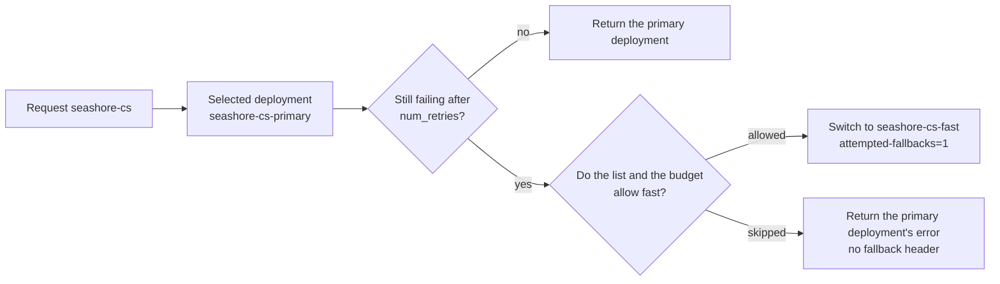

# Chapter 7 Fallback, retries, and load

> The primary simulator process stops, and the question about OD-2049 is still there. One key with enough budget got an answer from the standby model. Another key, whose budget looked unused, was refused by the pre-check, and the primary model's connection error was returned as-is. Fallback is not finished by writing one `fallbacks` line in the config. This chapter is written from those two real responses, and it places retries, cooldown, and the load strategy on the layer where they actually happen.



*Procedure for this chapter*

## The experiment config turned retries off

`router_settings.num_retries` is 0, `timeout` is 8 seconds, `allowed_fails` is 1, and `cooldown_time` is 15 seconds. `fallbacks` has one entry: `seashore-cs` to `seashore-cs-fast`.

The reliability docs split retry and fallback into two stages: on each `model_name`, retry by `num_retries` first, and if it still fails, switch to another `model_name` by `fallbacks`. Retry counts appear in examples under both `litellm_settings` and `router_settings`. The key that actually takes effect is the one in the config you loaded. This experiment writes it in `router_settings`, and it is 0. The purpose is to let "connection refused" enter fallback immediately, instead of spinning a few times first.

In production, a support answer can tolerate one short retry. If a logistics check has already timed out for 8 seconds, two more retries multiply the ticket's wait. Xingfan can set different retries per alias. The docs support a finer key of the `model_group_retry_policy` kind. This machine did not set it. Every alias shares this 0. Do not conclude "production must be 0" from "the experiment is 0".

`allowed_fails` and `cooldown_time` decide how many failures put a deployment into cooldown, and for how long. After cooldown, requests avoid that deployment. On this machine each alias has only one deployment, so cooling down the primary deployment overlaps with "it is already unreachable". There is no separate sample of "cooldown only after three failures in a row". That item is worth testing on its own when there are multiple deployments.

## The time fallback succeeded

18001 was stopped. 18002 still returned `{"name":"backup"}`. A new key was issued on the Seashore team. `models` contains both seashore aliases, `max_budget` is 100, and `rpm_limit` is 60. The request `model` is `seashore-cs`.

| Item | Value |
| --- | --- |
| HTTP | 200 |
| Body | `[backup] 订单 OD-2049 仍在途。请核对运单后再答复客户。` |
| Response `model` | `mock-qwen-turbo` |
| `x-litellm-model-id` | `seashore-cs-fast` |
| `x-litellm-attempted-fallbacks` | `1` |
| `x-litellm-response-cost` | `2.48e-05` |

`/health` requires a key. The response at the time put `http://127.0.0.1:18002/v1` in `healthy_endpoints` and `18001` in `unhealthy_endpoints`. The model strings were `openai/mock-qwen-turbo` and the primary model name, which was truncated in the log. `/health/liveliness` is still `"I'm alive!"` when the primary upstream is already dead. The liveness probe only means the process is up. It does not mean the primary model is up. The readiness probe looks at the database: `{"status":"healthy","db":"connected"}`. Model health is the endpoint list of `/health`, or the business request's `x-litellm-model-id`.

If Kubernetes uses only liveliness, a dead primary upstream will not restart the gateway. That is correct: the gateway is not broken. The upstream is. Alerts should subscribe to unhealthy endpoints, not to process restarts.

## The time fallback was skipped by the budget pre-check

Another key's `max_budget` is `0.01`. It already had one posted charge of `6.2e-05`, far below 0.01. The primary upstream was still stopped. Requesting `seashore-cs` returned HTTP 500:

```json
{
  "error": {
    "message": "litellm.InternalServerError: InternalServerError: OpenAIException - Connection error. LiteLLM: model group 'seashore-cs' failed with the error above. Fallback to seashore-cs-fast was skipped because the caller is over budget for it.",
    "type": "internal_server_error",
    "code": "500"
  }
}
```

In the response headers, `x-litellm-model-id` is still `seashore-cs-primary`. There is no `x-litellm-attempted-fallbacks` (reading the header returned empty). The cost header is 0.

The docs have a section for this behavior. `enforce_fallback_budget` defaults to true. The budget is checked once at auth time against the model the client requested. The fallback target is chosen later, so the key's and the user's budget for the target model are checked again. A target over budget is skipped. When none remain, the primary model's own error is returned. A zero-price fallback target is always allowed. The primary model's own attempt is not blocked by this second check. Setting `general_settings.enforce_fallback_budget: false` turns the second check off.

This time, "it did not look over budget but was said to be over budget" matches the mechanism and does not match the number. The remaining quota of `0.01` is enough to pay the standby call of `2.48e-05`. The error still says over budget. Chapter 4 saw `Current cost: 0.032777001` in an error text disagree with the posted `6.2e-05`. If the pre-check used an estimate near three cents, it would exceed `0.01` and skip fallback. This is a guess, to remind you not to raise the budget only a little and then assume fallback will happen. The way to verify: replay with a key whose `max_budget` is far above any reasonable estimate (we replayed with 100 and it succeeded), and when the pre-check fails, record `/key/info` spend at the same time.

`enforce_fallback_model_access` also defaults to true. A target that is not on the list is skipped. The primary error is returned the same way, and there is no `x-litellm-attempted-fallbacks`. The successful run on this machine had a complete list. There was no separate control of "deliberately omit fast". A missing list entry and a failed pre-check estimate can both look, from the outside, like 500 plus the primary model's connection error. Tell them apart by the sentence `Fallback to seashore-cs-fast was skipped because ...` in the message. Alert rules match that sentence. Do not match only `Connection error`.

## Three kinds of fallback. This machine hit only one

The reliability docs distinguish:

| Key | Trigger | On this machine |
| --- | --- | --- |
| `fallbacks` | Other errors, such as rate limiting, connection failure, 5xx | Hit. Connection refused entered this one |
| `context_window_fallbacks` | Context too long | Not hit. The simulator does not return this kind of error |
| `content_policy_fallbacks` | Content-policy refusal | Not hit |

The docs also say: from Proxy v1.85.0, `mock_testing_fallbacks`, `mock_testing_context_fallbacks`, and `mock_testing_content_policy_fallbacks` in the request are stripped. They do nothing to the proxy. They still work for tests that call `litellm.Router` directly. Verifying proxy fallback means causing a real upstream error in a non-production environment. This book stops the process. That follows this sentence, instead of stuffing a mock flag into the request.

Encrypted reasoning content cannot be decrypted when falling back to another key or another vendor. The docs say fallback drops the part that cannot be decrypted and lets the target reason again, to avoid `invalid_encrypted_content`. This machine's simulator has no such field. This paragraph is only a check item after going to production: if support has turned on a vendor's encrypted chain of thought, do not assume the chain of thought is still there on the fallback turn.

`default_fallbacks` is for the case where an alias itself is misconfigured. This machine did not set it. `aurora-cs` has no fallback. If Aurora's primary port is 18001, once the primary process stops, Aurora's request fails instead of borrowing Seashore's fast. That is the isolation of chapter 5, not an oversight. If Aurora wants a standby, give it its own `aurora-cs-fast` and write that into its own key.

## Read the load-strategy table first, then decide whether to test

The routing docs and the load-balancing page list the following strategy names as of 2026-11-11. This machine's `routing_strategy` is explicitly `simple-shuffle`, the same as the default. There is no second deployment of the same name, so the strategy has no observable split.

| Strategy | What the docs say it selects on | When Xingfan looks at it again |
| --- | --- | --- |
| `simple-shuffle` | The default. By weight, otherwise by rpm, tpm, otherwise uniform. The docs suggest it for production. The overhead is small | When one alias has two or more machines |
| `least-busy` | Fewest in-flight requests | When long connections and streaming occupancy are obvious |
| `usage-based-routing` | By current rpm/tpm usage. The docs say performance is poor and do not suggest it for production | Not Xingfan's default |
| `usage-based-routing-v2` | The later implementation on the strategy page, still looking at per-minute usage | Same as above. Read the performance note of your version first |
| `latency-based-routing` | The deployment with lower recent latency | When the latency gap between two regions is large enough to measure |
| `cost-based-routing` | The cheaper deployment that is still inside its limit | When unit prices really differ and traffic should lean toward the cheaper machine automatically |

Weights of same-name deployments can also be overridden per team. The strategy page says `router_settings` on a key or a team can send most of one team's traffic to one deployment in the group, while other teams still follow the global ratio. `router_settings` returned for the team on this machine is an empty object. It was not used to pin Seashore to primary. Empty is correct: the binding written in the fallback relation is already enough.

When several Proxy replicas need to share cooldown and usage, the docs require `redis_host` and related config. That is the same piece of infrastructure as the rate limit in chapter 4. Do not configure Redis only for the rate limit and leave cooldown in single-process memory.

## The client should not build a second fallback of its own

If a Java service catches 500 and resends with `model` changed to `seashore-cs-fast`, it bypasses the pre-check the gateway just did, and it may also count both calls into rpm. The business requests only `seashore-cs`. On a 500 whose message says skipped, treat it as "standby unavailable": record it on the ticket, and Xiaofan tells the customer to try again later, instead of changing the model inside the process.

`fallbackModel` in AgentScope chapter 4 is another `Model` instance inside the process. If both instances point at different aliases on the gateway, that stacks a second layer on the gateway fallback. Xingfan keeps only the gateway layer. The in-process fallback stays empty, so one customer question does not produce two budget charges.

## How to read the response headers

Put the headers of success, rate limiting, and failed fallback together, or the parser only handles 200.

| Case | Status | model id header | attempted-fallbacks | cost header |
| --- | --- | --- | --- | --- |
| Primary upstream normal | 200 | `seashore-cs-primary` | `0` | `6.2e-05` |
| rpm used up | 429 | `seashore-cs-primary` | This header was not seen this time | `0` |
| Fallback skipped by the pre-check | 500 | `seashore-cs-primary` | Header empty | `0` |
| Fallback succeeded | 200 | `seashore-cs-fast` | `1` | `2.48e-05` |

`attempted-fallbacks` of 0 and a missing header are not the same thing. 0 means the fallback logic ran and did not switch models. A missing header means this error happened earlier, or this version does not write the header for this kind of error. An alert on "status 500 and the message contains skipped" is steadier than one on "the header is missing".

The body prefixes `[primary]` / `[backup]` exist only on the simulator. A production upstream will not add this prefix. An automated test can depend on the prefix. A production alert can depend only on response headers and the message.

## The time scale of cooldown

With `allowed_fails: 1` and `cooldown_time: 15`, one failure may cool a deployment down for a quarter of an hour. In the experiment the primary process was stopped. It was not one occasional 500, so you cannot see "cooldown only on the Nth time". If an occasional timeout is also counted into `allowed_fails`, support will all go to fast for fifteen seconds after one jitter, and both the unit price and the answer quality change. Before raising `allowed_fails` in production, use one hand-made single 500 and see whether cooldown is immediate. This machine did not do a single 500. The simulator's fail mode was also not turned on in front of the proxy. Only the whole process was stopped. Connection refused and an upstream HTTP 500 are both errors `fallbacks` can take in the fallback docs, but whether they increment the failure count the same way has no separate sample.

`num_retries: 0` means there is no "try the same deployment once more". If production changes it to 2, the latency of one failure is about the timeout times the number of attempts, plus one more attempt on the standby. With `timeout: 8` and 2 retries, the customer may wait more than twenty seconds before seeing fast's answer. The ticket UI needs its own timeout, shorter than this chain, or the user refreshes first, and the refresh makes another call.

## Do not pretend the upstream is broken with a request parameter

From 1.85.0 the proxy strips `mock_testing_fallbacks`. If someone adds this field to OD-2049's request in an integration test, the proxy ignores it, and the test still hits the real deployment. A test has to be like this chapter: make the test upstream return an error or refuse the connection. `MOCK_MODE=fail` in `demo/mock_upstream.py` returns HTTP 500. The fallback sample on this machine used stopping the process, not this 500. Both are valid. Stopping the process is closer to "the machine is gone". 500 is closer to "the process is still there but the vendor reports an error". When you add the test, run `MOCK_MODE=fail` once and see whether the message still enters `fallbacks` and whether `attempted-fallbacks` is 1. Until that is run, the runbook says "connection refused was tested, HTTP 500 was not".

## The order of operations for stopping the process

The order of this sample is fixed, so someone else can replay it. Do not change the ports or the aliases.

1. `MOCK_NAME=primary` listens on 18001, `MOCK_NAME=backup` listens on 18002, both `MOCK_MODE=ok`.
2. The proxy uses `demo/config.yaml`, `num_retries` is 0, and `fallbacks` points `seashore-cs` at `seashore-cs-fast`.
3. Request `seashore-cs` with a Seashore key of budget 100. Confirm the body is `[primary]`, the header is `seashore-cs-primary`, and `attempted-fallbacks` is 0. On this machine, before this large-budget key was issued, primary had already been stopped, so the evidence of "seeing primary first" comes from an earlier Seashore key call, not from a before-and-after of the same key. On replay, add this call, so the same key succeeds first and then fails.
4. Stop 18001. `curl http://127.0.0.1:18001/` should fail to connect. 18002 still returns `backup`.
5. Request `seashore-cs` again with the same large-budget key. Expect 200, `[backup]`, `x-litellm-model-id: seashore-cs-fast`, `attempted-fallbacks: 1`, and cost `2.48e-05`.
6. Use a key whose `max_budget` is 0.01 and which already has spend, as the control. This machine got 500, and the message contains `Fallback to seashore-cs-fast was skipped because the caller is over budget for it.`
7. Bring 18001 back up and request once more. Expect a return to primary. After writing the sample, this machine did not bring 18001 back up to recheck "recovery". Add that on replay. If you do not recover, later smoke keeps hitting backup, the unit price and the body prefix both change, and it is easy to misread that as a wrong config.

After step 5, `/health` should put 18001 in `unhealthy_endpoints`. liveliness is still `"I'm alive!"`.

## Aurora when the primary port is stopped

In the experiment config, `aurora-cs` and `seashore-cs` share 18001. When 18001 is stopped, Aurora has no fallback. The request should fail, not borrow `seashore-cs-fast`. This machine did not send another call with Aurora's key after stopping the process. That is a gap in the isolation evidence, not a behavior that has already been proved. Add one call: expect failure, and the response header is not `seashore-cs-fast`. If you see fast, fallback is configured on the wrong alias. Stop and change the config.

## Before leaving this chapter

- Stop the primary upstream. With a large-budget key, confirm `x-litellm-attempted-fallbacks: 1` and that `x-litellm-model-id` points at fast.
- Call once more with a small budget near the cap. Read the skipped reason in the message. Do not look only at HTTP 500.
- State what liveliness, readiness, and `/health` each prove.
- Write `num_retries` for support and for logistics separately in the production change note. The experiment value 0 is not a recommended value.
- Do not catch in Java and then retry with a different model.

## Read next

- Chapter 8 makes both AgentScope and Spring AI request `seashore-cs`. They no longer each write a standby model.
- Client-side fallback in the reliability docs is another path. Xingfan does not take it, so the policy is not scattered.
- If runtime fallback in AgentScope chapter 41 is still kept, what it selects must be a gateway alias, and it must not react once more, together with this chapter's `fallbacks`, to the same failure.
