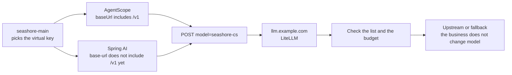

# Chapter 8 Point AgentScope and Spring AI at the same entry

> Seashore Select's support agent runs on AgentScope. One synchronous API in the order domain runs on Spring AI. Both have to answer questions of the same kind as OD-2049. They should see the same host `llm.example.com`, the same alias `seashore-cs`, and the same kind of virtual key. How the URL is joined is not the same set of rules. This chapter writes both clients up to the gateway's door, and marks which calls were not run in a JVM on this machine.



*Overview for this chapter*

## What "the same entry" means

The same entry is not the same Java dependency. AgentScope uses its OpenAI extension. Spring AI uses its OpenAI starter. The same entry means:

| Item | Value |
| --- | --- |
| Host | `https://llm.example.com` |
| Business model name | Seashore `seashore-cs`, Aurora `aurora-cs` |
| Key | That merchant's virtual key, not an upstream key |
| Fallback | Happens only on the gateway. The client does not change model and retry |
| Platform host | Still `agentscope.example.com`. Do not write the gateway port into the platform's public address |

The local experiment's `127.0.0.1:4000` appears only in the demo. Config committed to `open-api-platform` uses `llm.example.com`.

## The AgentScope side

The explicit construction in shelf chapter 6 is:

```java
OpenAIChatModel model = OpenAIChatModel.builder()
        .apiKey(System.getenv("SEASHORE_LITELLM_KEY"))
        .baseUrl("https://llm.example.com/v1")
        .modelName("seashore-cs")
        .build();
```

`baseUrl` includes `/v1`, consistent with the example in chapter 6 that points at a compatible gateway (that example uses the placeholder host `your-gateway.example.com`). Here the host is replaced with `llm.example.com`, which is already in use, and the model name is replaced with the gateway alias. Do not write `qwen-plus`, and do not write `mock-qwen-turbo`.

The Spring Boot starter properties in chapter 6 are:

```yaml
agentscope:
  openai:
    api-key: ${SEASHORE_LITELLM_KEY}
    model-name: seashore-cs
```

The fragment in chapter 6 has no `base-url`. The explicit builder already demonstrates `baseUrl`. Whether the starter has a property of the same name depends on the AgentScope version docs you pin. This environment did not start AgentScope Service and did not make one request against the starter binding. On review, look at whether the URL the Dataplane sends is `https://llm.example.com/v1/chat/completions`, and whether `model` is `seashore-cs`.

Step 13's probe splits the root address and the path: `XBD_MODEL_BASE_URL=https://llm.example.com`, `XBD_MODEL_ENDPOINT_PATH=/v1/chat/completions`. The teaching probe does not write `/v1` again into the root address. That does not contradict `OpenAIChatModel.baseUrl` including `/v1`: the probe joins the path itself, and the builder leaves the join to the client. Both have to show the final URL in the log. Do not let both places carry `/v1` and produce `/v1/v1`.

`merchant-gateway` can still be the platform alias inside the Dataplane, meaning "use the company-gateway builder". The `modelName` it resolves to must become `seashore-cs` or `aurora-cs` by namespace. One platform alias corresponding to one fixed model name sends Aurora into Seashore's deployment. Chapter 6 already said that. Here it lands on Java: take the model name in the same place you take the key by namespace. Do not do one by tenant and hardcode the other.

Chapter 6 also says a custom compatible endpoint does not declare support for a named `tool_choice` by default. When Xiaofan needs tools, if the upstream behind the gateway supports them, you need `.supportsToolChoiceSpecific(true)`. This machine's simulator does not parse `tools`, and this was not verified. The tool-call review list: one request that carries tools reaches the simulator or a test upstream, and you confirm the gateway did not drop `tools`. `drop_params: true` drops parameters the upstream does not know. If it also drops `tools`, support degrades to plain chat. Look at the upstream log for one request that contains `tools`. The simulator currently does not print the request body. Look at the gateway's debug log, or add one temporary print line to the simulator and delete it afterward. Do not leave the print in production.

Switching the model for a session is a capability Step 13 already tested inside AgentScope: the next Turn can change the model id, and an illegal id reports that the model does not exist. If the target of the switch is a vendor model name, the gateway returns the 400 from chapter 6. The switch list contains only aliases on that tenant's key list. Seashore's support can be switched by a person between `seashore-cs` and `seashore-cs-fast`. Automatic failover still belongs to the gateway, so a person and the gateway do not each switch once.

## The Spring AI side

The Spring AI Reference as read on 2026-11-11 writes the example of `spring.ai.openai.base-url` as the host root, without `/v1`, for example `http://localhost:8000`. The same day, the default `completionsPath` of `OpenAiApi.Builder` on GitHub `main` is still `/v1/chat/completions`. A docs commit in December 2025 says: writing `/v1` again on base-url joins it into `/v1/v1/chat/completions`.

A separate issue comment on 2026-05-24 says that after Spring AI 2.0.0 switched to the official OpenAI SDK, it removed the completions path. This book did not run a Spring process and cannot choose 1.x or 2.x for you.

Under the 1.x default path, Seashore's order service is written as:

```yaml
spring:
  ai:
    openai:
      api-key: ${SEASHORE_LITELLM_KEY}
      base-url: https://llm.example.com
      chat:
        options:
          model: seashore-cs
```

The expected final URL is `https://llm.example.com/v1/chat/completions`. If your version no longer appends `/v1`, change `base-url` to `https://llm.example.com/v1`, or explicitly set `spring.ai.openai.chat.completions-path` if it still exists. There is only one criterion: `/v1` appears once in the path in the access log. Twice is that 1.x pit. None at all, while the gateway only mounts the route that includes `/v1`, and the request 404s.

The reference docs also say `spring.ai.openai.chat.base-url` can override the shared `base-url`. Use that when the embedding model and the chat model go to different gateways. If Xingfan's embeddings go through another system, do not reuse this support virtual key.

The documented default of `spring.ai.openai.max-retries` is 3, and the timeout default is 60 seconds. The gateway experiment config's `num_retries` is 0, and that is only the experiment. If the Spring client retries 3 more times, one upstream failure becomes 4 requests, and rpm and budget accumulate by the count. After pointing at `llm.example.com`, lower the client retries to 0 or 1, leave the remaining retries on the gateway, and use them only for idempotent completions. Tools that place an order or issue a refund are not made safe by model-client retries. Looking up OD-2049 is read-only, so one retry is still acceptable. A write is not done inside a model retry.

## Two processes must not share one key and also share one rpm

If the support Agent and the order Spring service are both injected with `SEASHORE_LITELLM_KEY`, they share the rpm and the budget from chapter 4. On a campaign day both call together, and support is pushed into 429 by the order batch. Issue the Spring service another key, `key_alias` for example `seashore-order-api`, `team_id` still Seashore, `models` still the two seashore aliases, and `rpm_limit` set separately to this API's quota. The team's `max_budget` adds the two keys. The merchant's daily cap is still there.

Aurora's Spring service uses `AURORA_LITELLM_KEY` and `aurora-cs`. Do not switch the model name by profile and forget to switch the key. The wrong combination is: the model is written `aurora-cs`, but the key is Seashore's. The result is 403, `key_model_access_denied`. This 403 is easier to diagnose than "model does not exist", provided the log has `key_alias` or at least the last four characters of the key. The last four come from the mask in `/key/info`. They can enter an internal log. They do not enter the page shown to the customer.

## Headers and the user field

LiteLLM allows a `user` field in the request body. This machine once sent a request with `"user": "seashore-main"` and did not separately assert that it changed routing. Do not use `user` in place of a virtual key for isolation. At most it is a correlation id in the log.

The docs allow `general_settings.litellm_key_header_name` to be changed to a custom header, instead of `Authorization`. Xingfan does not need that. Both AgentScope and Spring AI set `Authorization: Bearer`. Changing the header breaks both standard clients at once. Keep the default.

Streaming was not tested on this machine. Xiaofan's product path is streaming. On review, see whether the gateway finishes forwarding the SSE, and whether a disconnect in the middle fires another standby call on the "failure mid-stream" path the fallback docs describe. Until a sample is seen, do not promise that streaming fallback is not double-billed.

## What was not run in a JVM

| Item | State |
| --- | --- |
| One `call` of `OpenAIChatModel` against `127.0.0.1:4000` | Not run. The config shape comes from shelf chapter 6 |
| The `base-url` property name of the AgentScope starter | Not checked on a running Service |
| The final URL of Spring AI 1.x and 2.x | Not run. The access log is the authority |
| Whether `tools` is dropped by `drop_params` | Not run |
| Streaming and mid-stream fallback | Not run |
| Virtual keys, aliases, fallback, 403, 422, 429 | Already sent at the gateway with an HTTP client. See chapters 3, 4, and 7 |

Writing "the gateway was tested" as "the Java application was tested" is wrong. If a merge request contains only yaml, the review comment should say: still missing one request sent from the Dataplane or the Spring process, and the `x-litellm-model-id` in the gateway log.

## Review the two config fragments together

Seashore's support (AgentScope) and Seashore's order API (Spring AI) use different key variables, the same model name, and different ways of writing the base URL. Open both files when reviewing. Do not review each on its own.

```yaml
# AgentScope process. baseUrl includes /v1, consistent with the builder in shelf chapter 6.
# Not executed in a JVM in this environment.
agentscope:
  openai:
    api-key: ${SEASHORE_LITELLM_KEY}
    model-name: seashore-cs
```

```java
OpenAIChatModel model = OpenAIChatModel.builder()
        .apiKey(System.getenv("SEASHORE_LITELLM_KEY"))
        .baseUrl("https://llm.example.com/v1")
        .modelName("seashore-cs")
        .build();
```

```yaml
# The Spring AI 1.x form: base-url does not include /v1.
# If 2.x no longer appends the completions path, the access log is the authority. Not executed in this environment.
spring:
  ai:
    openai:
      api-key: ${SEASHORE_ORDER_LITELLM_KEY}
      base-url: https://llm.example.com
      chat:
        options:
          model: seashore-cs
        completions-path: /v1/chat/completions
```

Whether `completions-path` may be written explicitly when it repeats the default depends on your version. It is written so the reviewer can see the final path, not to change the default behavior. Aurora changes the variable to `AURORA_LITELLM_KEY` and the model to `aurora-cs`. The host stays the same.

## Fields from platform code to the gateway

| Already on the platform | Sent to the gateway |
| --- | --- |
| namespace `seashore-main` | Selects `SEASHORE_LITELLM_KEY`. The namespace is not put into `Authorization` |
| Agent `xbd-seashore-cs-agent` | `model=seashore-cs` |
| Order `OD-2049` | Appears only in the user message or in metadata you agreed on. It does not appear in the key |
| `merchant-gateway` | Stays inside the Dataplane. After it is resolved, it is not sent outward |
| `agentscope.example.com` | Not sent. That is the platform's own host |

The user message can still be "订单 OD-2049 为什么还没到？". That sentence was used in the curl in chapter 2. The simulator's answer does not read the second half and always returns fixed text. A real model will read the sentence. The fixed text cannot be used to accept Xiaofan's wording. It can only be used to accept the route.

## What the Java side does on failure

| Gateway result | Java side |
| --- | --- |
| 200 and the model id is primary | Give the body to the customer as usual |
| 200 and the model id is fast | Give it to the customer as usual, mark fallback in the log, do not retry |
| 401 | Config error. Alert. Do not retry |
| 403 | The key and the model are not a pair. Alert. Do not retry |
| 400 | The model name is not on the gateway. Alert. Do not retry |
| 422 | Budget. Stop. Do not retry |
| 429 | Short backoff, past the reset time. Do not change the model |
| 500 and the message contains skipped | Standby unavailable. Tell the customer to try again later. Do not change the model on the client |
| Cannot connect to port 4000 | The gateway process or the network. Different from an upstream failure. Do not redirect the request to the vendor |

This table is this chapter's client contract. It does not add gateway behavior. The Java code that implements these branches was not compiled in this environment.

## Before leaving this chapter

- The model name in both codebases is only `seashore-cs` or `aurora-cs`.
- The key variables in both codebases point at virtual keys. A search does not find an upstream vendor's variable name.
- Write the Spring AI version you pin, and the path of one real request, and confirm `/v1` appears once.
- Support and the order API use different keys and the same team.
- Put the client retry count and the gateway `num_retries` in the same change note, so they are not multiplied.

## Read next

- AgentScope Java chapters 6 and 21 are the source of the client extension. This book does not repeat the provider table.
- Demo Step 13 is how "the company gateway" is attached to a hosted Agent. This chapter names that gateway as LiteLLM and splits the two merchants' keys.
- Chapter 9 sends the trace of this hop to Langfuse. Java does not have to each write its own instrumentation, provided you accept that the trace is from the gateway's point of view.
