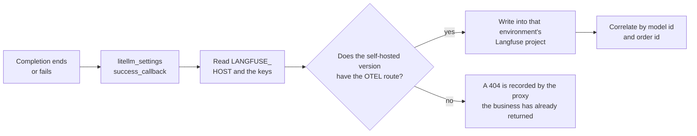

# Chapter 9 Send call traces to Langfuse

> For that OD-2049 fallback, the gateway log has `x-litellm-model-id: seashore-cs-fast`. If the person on call can only ssh to the machine and scroll a log, Seashore's calls and Aurora's calls are mixed in the same file. The Langfuse book already explains how to read a trace. This chapter only decides who sends this hop, and which fields may be carried when it is sent, and which must not. This machine has no sample of a successful or failed delivery.



*Overview for this chapter*

## Instrument on the gateway, not once in each Java process

Support is on AgentScope. The order API is on Spring AI. If each side connects the Langfuse SDK on its own, one customer question about OD-2049 becomes two trace habits: different field names, and one writes the alias as the model name while the other writes `mock-qwen-turbo` from the response. The gateway is the common point of both sides. `success_callback` and `failure_callback` each record one entry here. The Java process keeps only the business span (look up the order, write the ticket). The model span follows the gateway.

The cost is: a call the gateway does not cover does not appear. If someone bypasses `llm.example.com` and calls the vendor directly, Langfuse is simply quiet. The key discipline of chapter 1 is the premise of that. The upstream key is not in the business process, so a direct call is harder. You still have to forbid the Dataplane from reaching the vendor network in network policy, or the discipline is only a config review.

Do not copy the organization name or project name from the Langfuse book. That book's sample organization does not apply to Xingfan. Xingfan's traces are split by merchant: one project for Seashore, one project for Aurora. How to create a project, and what the UI looks like, is in the Langfuse book's deploy and tracing chapters. This book does not repeat those screenshots, and it has no new screenshots.

## The wiring in the docs

The steps on the Proxy logging page, 2026-11-11:

1. Install `langfuse`, with the constraint written as `langfuse>=4.7,<5`. The callback uses LiteLLM's own OpenTelemetry pipeline and hits Langfuse's OTLP endpoint. The SDK's REST client is for prompt management and credential checks.
2. Config:

```yaml
litellm_settings:
  success_callback: ["langfuse"]
  failure_callback: ["langfuse"]
```

3. Environment variables: `LANGFUSE_PUBLIC_KEY`, `LANGFUSE_SECRET_KEY`. `LANGFUSE_HOST` is optional. The docs say the default is `https://cloud.langfuse.com`. Self-hosting must set your own address explicitly, for example the local `http://localhost:3000` in the Langfuse book, and in production Xingfan's own host. Do not rely on the default. The default sends traces to the cloud.
4. Start the proxy, send one request, and look in Langfuse.

`config_settings` also lists a batch of related variables. This machine set none of them. Only the ones that matter to Xingfan are written down, so they are not copied wrong later:

| Variable | The point in the docs |
| --- | --- |
| `LANGFUSE_HOST` | Takes priority over `LANGFUSE_BASE_URL` |
| `LANGFUSE_BASE_URL` | The fallback when `LANGFUSE_HOST` is not set |
| `langfuse_host` on a key or a team | Takes priority over both of the above |
| `LANGFUSE_FLUSH_INTERVAL` | The interval of OTLP batch export, default 1 second. A non-positive integer warns and falls back to the default |
| `LANGFUSE_MAX_RETRIES` | Retries of a failed export, default 3, and a value that is too large is capped |
| `UPSTREAM_LANGFUSE_*` | The docs say this is deprecated. After the callback moved to SDK v4 it is no longer forwarded. Setting the secret warns at startup |

The self-hosted server needs 3.63.0 or newer to have `/api/public/otel/v1/traces`, which SDK v4 uses. An older v2 server does not have this route. The trace is rejected with 404, and the proxy records the rejection. Upgrade Langfuse first, then turn the callback on. If the Langfuse book's version baseline is above this threshold, use the version that book states, and confirm the route exists with one real export. This book does not change that book's version number for it.

If an ingress or a reverse proxy limits the request body, a large batch returns 413. The docs say the callback sends the batch again at half size. Only a single span that is itself over the limit is dropped, with an error log. Xingfan's support replies are usually not large. A batch replay experiment is when you are likely to hit this. No replay was done, so no concrete byte count is written.

## Why this machine has no trace

The experiment `config.yaml` has no `success_callback`. The environment has no Langfuse public key or secret key. `.env.example` leaves the three variables as comments. Turning the callback on without a key only adds one export error after every OD-2049 request. The business response may not fail. The logging page describes the callback as an action after the call completes. This machine did not verify "whether a callback failure affects the HTTP response". Before go-live, send one call at a host that is written wrong, and confirm the customer still receives the completion while an alert can see the export failure. If a callback failure turns 200 into 500, it cannot be on by default in production until that coupling is removed.

`LANGFUSE_MOCK` was also not set. The docs say that when it is true, Langfuse calls are intercepted and a mock response is returned, with no network access. That is a test switch of the SDK, not Xingfan's acceptance. Acceptance is seeing one generation record in the Langfuse project, with a model identifier that can be matched to `seashore-cs-primary` or `seashore-cs-fast`.

## Two merchants, two projects

The integration docs allow a single request to carry `langfuse_public_key`, `langfuse_secret_key`, and an optional `langfuse_host`, so it lands in a different project. On the Proxy it is more suitable to put this set of values in team or key metadata and let the gateway fill them in, instead of letting Java carry Langfuse's secret key on every request. A secret key inside the business process is the same class of problem as the upstream key in chapter 1. Only the vendor has changed.

Seashore's team traces go to Seashore's project. Aurora's go to Aurora's project. The platform's shared assistant does not call a merchant model, so it has none of these traces. If the shared assistant later calls a model that contains no merchant data, give it a third project. Do not write it into Seashore's project "to save trouble".

The docs also mention an enterprise capability, "send logs to each team's own Langfuse". The open-source path uses request-level or team-level credential overrides. Whether that works without `LITELLM_LICENSE` is decided by the first call after you enable it. This book did not enable it and does not write a sentence from the enterprise list as verified open-source behavior.

## Which fields have to line up with OD-2049

One generation record from the gateway's point of view has to be able to answer at least:

| Question | What answers it |
| --- | --- |
| Which merchant | The team id or `key_alias`, not the customer's nickname |
| Which deployment | `x-litellm-model-id`, for example `seashore-cs-fast` |
| Whether there was a fallback | `x-litellm-attempted-fallbacks` |
| How much it cost (gateway unit price) | `x-litellm-response-cost` |
| Which ticket it belongs to | Business metadata carries only the ticket id or the order id `OD-2049` |

The order id can enter metadata. Whether the customer's address, phone number, and the full conversation enter Langfuse is a separate decision. When `turn_off_message_logging` is true, the docs say messages and responses do not enter the callback. Metadata remains. When support quality review needs the body, do not turn this switch on, and at the same time limit Langfuse project members to Seashore's review role. Aurora's people are not members of this project. That list and AgentScope's namespace members are two lists. Each is maintained on its own. Do not assume they stay in sync.

Do not put a virtual key, an upstream key, or `DATABASE_URL` into metadata. Retry logs of the callback sometimes carry a fragment of the request. Once a key is in the fragment, Langfuse's permission becomes the model key's permission.

## Split of work with the Langfuse book

| What you want to do | Where |
| --- | --- |
| Send the gateway's successes and failures out | The callback and variables in this chapter |
| Read a trace, look at cost, build datasets and scores | The Langfuse book |
| Manage support wording with Prompt | The Prompt chapter of the Langfuse book. The gateway is not the source of the Prompt |
| Evaluate whether an answer like OD-2049 invents shipping | The evaluation chapter of the Langfuse book. The data still follows the order system |

The spend the gateway sends uses the unit price from chapter 4. If Langfuse is configured with another set of model prices, the two charts will disagree. Xingfan chooses the gateway unit price as "the ledger used for blocking", and Langfuse as "the trace a person looks at". The finance invoice still follows the vendor. Label the source of the three numbers on the report. Do not average them.

## Fields you want to be able to see in the UI

The following is not an exported sample. It is the correspondence to look for at acceptance. Until you see it, the callback is not connected.

| Already on the gateway side | What you want to be able to point at in the generation record |
| --- | --- |
| Request model `seashore-cs` | Do not be left with only the post-fallback `mock-qwen-turbo` and lose the alias |
| `x-litellm-model-id: seashore-cs-fast` | You can see that this call took the standby |
| `x-litellm-attempted-fallbacks: 1` | It can corroborate the model id |
| Cost `2.48e-05` | Matches the gateway response header, not another unit price |
| Order id `OD-2049` | Comes from business metadata, and can filter every model call of this ticket |
| `key_alias` `seashore-cs-agent`, or the order API's key | Support and the Spring API can be told apart |
| The virtual key plaintext | Must be absent |

UI field names in the Langfuse book follow what that book tested. This chapter does not invent "what a button is called". If the alias is lost after mapping and only the upstream id remains, go back to the warning in chapter 6: do not write the upstream id into the next request. The trace can keep the upstream id as the model that actually ran, but there has to be another column for the business alias. Without that column, an evaluation set treats the same fallback as a change of product.

## What an export failure looks like

The docs write two failures related to deployment. This machine produced neither log:

- Self-hosting is too old and has no `/api/public/otel/v1/traces`. The other side returns 404, and the proxy records the rejection.
- A reverse proxy limits body size, 413, the callback retries at half size, and only a single item that is too large is dropped.

Another kind is a wrong key or a wrong host. The expectation is that the customer's HTTP still succeeds. This is an unverified expectation. It is written in the review list, not in an architecture promise. How to verify: point `LANGFUSE_HOST` at a closed port, send one `seashore-cs`, and look at the customer response and the proxy log together. The log should be searchable for a langfuse or otel failure. If you cannot find it, the callback did not load. Check the indentation of `success_callback` and whether the process was restarted.

## The boundary with quality review

Quality review wants to see whether Xiaofan invented shipping. A gateway trace can provide the model input and output. It cannot provide the real state inside the order system. Evaluation puts the order system's query result next to the model's answer. That is dataset work in the Langfuse book. This chapter only guarantees: if you decide to record the body, the body comes from this gateway hop, and Seashore and Aurora are not in the same project.

After `turn_off_message_logging` is turned on, quality review loses the body. Budget and fallback can still be seen from metadata. Early after support goes live, the suggestion is to record the body first and tighten project members, then evaluate whether to turn it off once things are stable. This suggestion was not verified with Xingfan's real conversations, because nothing was delivered.

## Before leaving this chapter

- The self-hosted Langfuse version meets the OTEL route requirement, or it is explicit that it has not been upgraded and the callback stays off.
- `LANGFUSE_HOST` points at Xingfan's own host, not the default cloud.
- Seashore and Aurora have different public keys. The secret key is not in the Java repo.
- One test completion shows a generation record in the matching project, and you can point at the deployment id. This book did not do this item.
- When the host is written wrong, the HTTP status of the customer request is still success. This book did not do this item.
- Metadata has a place for the order id, and no key.

## Read next

- Langfuse book chapter 2 is self-hosting, chapter 4 is the trace model, and chapter 5 is cost. When you read them, use Xingfan's project names, not the organization name in that book's example.
- Chapter 10 says that splitting logs by team, if it goes through an enterprise feature, is not in the required steps.
- The response headers in chapter 7 are the fields you look for in the trace. When they do not match, check the gateway version first, then whether the callback dropped the header mapping. The mapping detail follows one real trace of your version.
