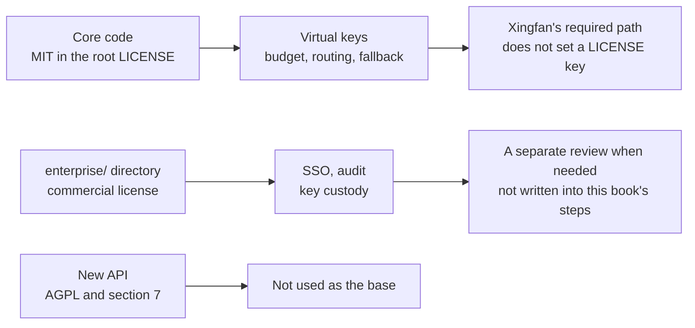

# Chapter 10 Production boundaries

> The local experiment can already complete a call for OD-2049, rate-limit it, refuse a cross-model call, and fall back when the primary upstream disconnects. Before putting it on `llm.example.com`, three kinds of boundary cannot be papered over by writing more config: LiteLLM's own two licenses, why New API is still only a comparison, and the blast radius of logs and the master key. This chapter adds no required feature.

*Overview for this chapter*

## The split on the repository root

The root `LICENSE` read on 2026-11-11 explains the split license first, then gives the MIT text. The split means: if the `enterprise/` directory exists, the license defined in that directory applies; outside the directory it is MIT, copyright Berri AI, 2023. MIT allows use, modification, and distribution, and requires the copyright notice and the license notice to be kept. This book does not paste the whole MIT text again. The link is in the repository.

The same day, `enterprise/LICENSE.md` exists. It is not MIT. The points are: production use needs a valid BerriAI Enterprise subscription and the corresponding seats; you may modify and publish patches, but the rights stay with BerriAI or its licensors; development and testing may copy and modify without buying a subscription; beyond that, copying, merging, publishing, distributing, sublicensing, and selling the software in that directory are prohibited. `enterprise/README.md` says this directory is commercially licensed and points at the enterprise feature docs.

Xingfan's required path does not compile, import, or copy code under `enterprise/`, and it does not set `LITELLM_LICENSE`. Virtual keys, team budgets, rate limits, aliases, fallback, and the existence of the admin UI were all seen in the open-source proxy docs and on local 1.109.0 (the UI was seen only as HTML, with no login). These capabilities sit on the MIT side of the root license, as long as the implementation code is not in `enterprise/`. If you find in the dependency tree that some feature's implementation exists only in that directory, stop using it and use an API this book has already tested.

## Two ways of speaking on the enterprise page

The Enterprise docs use a layered diagram that draws "virtual keys, budgets and rate limits, spend, the admin UI, load balancing, guardrails, and the MCP gateway" on the open-source AI Gateway, and draws SSO, SCIM, audit logs, delegated admins, the key manager, the IP allow list, per-team logs, multi-region, and the support agreement on the enterprise layer.

The "full feature list" on the same page says each item below is turned on by a license key, and that list includes organizations and projects, tag budgets, per-key per-model budgets, a temporary budget increase, soft-limit email, key rotation, audit logs, and several guardrail callbacks. The layered diagram and the full list are not the same boundary.

How this book treats them:

| Capability | Required? | Basis |
| --- | --- | --- |
| Virtual keys, teams, `max_budget`, rpm/tpm | Yes | The open-source docs have their own pages, and this machine called them successfully without setting a license |
| `fallbacks`, `simple-shuffle`, health checks | Yes | Same as above |
| Clicking models in the admin UI | No | Only confirmed that `/ui` returns HTML |
| SSO, SCIM, audit logs, the IP allow list, key custody | No | The enterprise page puts them on the license layer. SSO has another sentence: free for up to 5 users, and above that an enterprise license is required. Xingfan's support agents are not five people logging into this UI. Do not use that sentence to treat SSO as already free to use |
| Organizations, projects, tag budgets | No | The list puts them in the license-enabled items. This machine can use teams with `organization_id` empty |
| Custom guardrails and Presidio | Not required | The docs say the open-source guardrail framework includes custom guardrails and Presidio. `llmguard_moderations`, `llamaguard_moderations`, `hide_secrets`, `openai_moderations`, `google_text_moderation`, `lakera_prompt_injection`, and `aporia_prompt_injection` need an enterprise license |
| `enforce_project_model_quota` | No | `config_settings` marks it as an enterprise feature and mentions behavior in v1.100.0 and v1.109.0. Do not enable it |

Soft-limit email and automatic virtual-key rotation appear on the enterprise list, and they also appear as fields on the open-source API (`soft_budget`, `auto_rotate`). A field existing does not mean email is sent or rotation really happens without a license. Chapters 3 and 4 mark them as not tested. Do not write "at 80% a letter arrives" in the production runbook.

The enterprise page also says the same image and the same version number, and the license is only a key. The SOC 2 Type II report is requested from the other party. This book does not repeat an audit conclusion. The pricing page has no public numbers. This book does not invent a quote. The support window and the policy of the four most recent stable patch versions follow that page. The experiment pins only 1.109.0.

## New API is still only a comparison

The New API README (2026-11-11) says:

- The license is AGPL-3.0.
- Under section 7, a modified version must keep `Frontend design and development by New API contributors.` in the legal notice and in a prominent About, Legal, footer, or attribution position in the UI, and must keep a visible link to the original project.
- It is developed on top of One API (MIT).
- If organization policy does not allow AGPL, or you want to avoid the AGPL duties, email the project. This book does not write that email for you, and it does not evaluate commercial license terms.

AGPL's source-offer duty for a modified service provided over the network is wider than MIT. If Xingfan's gateway is used only on the internal network by its own Java processes, whether the duty is triggered still has to be judged by legal counsel against your deployment. The engineering team cannot pass over it with the sentence "we did not sell it to anyone". The UI attribution in section 7 is definitely hit when "the admin console is embedded into a page a merchant can open". LiteLLM's open-source core does not have this UI attribution. That is one reason it was chosen as the base. The other is that config can go into Git, and the experiment already ran through on yaml.

New API's features (multi-protocol conversion, channel weights, token groups) were not verified item by item in this book, and they are not lined up as a comparison matrix to prove "who is stronger". Stronger is not required. What Xingfan needs is keys, quotas, and fallback, with a clear license boundary. Those already have tests on the LiteLLM open-source proxy. When a feature is not enough, open a separate review. Do not mix another install procedure into the runbook.

One API is MIT. The New API README marks it as the upstream. Xingfan also does not switch the base to One API: this book has no experiment for it, and it does not intend to maintain a third gateway. It is mentioned only so New API's license is not mistaken for One API's MIT.

## Things still to hold when moving onto llm.example.com

In the experiment, the master key, the salt, the database password, and the mock upstream key are all in that machine's environment. They did not enter Git. Production replaces them with independent random values. The Docker Quickstart's note on the two keys is:

- `LITELLM_MASTER_KEY` is the root credential. It authorizes the admin API, and by default it is also the admin UI password, username `admin`. A leak equals admin permission. The `sk-` prefix is described as a convention on this page. The Virtual Keys page requires the master key to start with `sk-`. Production generates it by the stricter page. When the two pages conflict, use the form that can pass `/key/generate`, and write the version into the change record.
- `LITELLM_SALT_KEY` encrypts vendor keys written through the UI. There is no in-place rotation. Changing it makes stored keys impossible to decrypt until they are entered again. Even if the upstream key is injected by yaml and environment variables, set the salt from day one, so that someone pasting a vendor key into the UI does not leave it unprotected.

Postgres accepts only the gateway's network. The connection-budget sentence in the log has to be counted into `max_connections`. Configure Redis before multiple replicas, or rate limits and cooldown multiply by the replica count.

Do not drop virtual-key plaintext into logs. Rate-limit and budget errors have shown a hash of the key. The hash should still be limited to internal logs. The customer page keeps only "try again later" and the ticket id. If OD-2049's customer's original text entered the gateway log, the permission to read the log follows Seashore's data permission. Do not give every platform developer read-only access.

`/health/liveliness` is for the process probe, `/health/readiness` is for the database, and `/health` is for model endpoints. Configure all three. Configuring only liveliness still shows healthy when every primary upstream is dead.

Merge requests in the business repo continue to reject upstream keys and `127.0.0.1:18001`. Virtual keys go through the deploy system. `team_id` can enter the platform database. It is not a key, but it is an internal identifier, and it does not have to be public on the frontend.

## What this book has not proved

| Item | Reason |
| --- | --- |
| A real vendor's latency, tool calls, and streaming fallback | No vendor key, so no response is invented |
| Click paths in the Admin UI | Only HTML 200 |
| The official Docker Quickstart compose | The environment has no Docker |
| The original text of the no-database budget warning | The docs were read. A separate process was not started |
| One trace appearing in Langfuse | The callback was not turned on |
| The final URL of the Spring and AgentScope processes | Chapter 8 lists the review |
| Rate limits no longer amplified after a second proxy replica plus Redis | Only one process |
| Any feature inside `enterprise/` | Deliberately not tested |
| New API's UI and channels | Deliberately not installed |

These gaps stay in each chapter's review list. When an experiment is added, change that chapter's "already seen" table. Do not change only this chapter's summary.

## Evidence to attach to the release note

Going to production is not changing the experiment config's host name. The release note attaches the exit codes and excerpts of the commands below, with keys masked.

| Evidence | Expectation |
| --- | --- |
| Search the business repo for upstream-key variables | Only `${...}` remains, or there is no assignment |
| `GET /health/liveliness` | `"I'm alive!"` |
| `GET /health/readiness` | `db` is `connected` |
| `GET /health` | The primary upstream is on the healthy list |
| Seashore's key requests `aurora-cs` | 403 `key_model_access_denied` |
| Seashore's key requests `seashore-cs` | 200, and the cost header is non-zero (unless the contract price really is 0) |
| A test key with a tiny `rpm_limit`, called twice in a row | The second is 429 `throttling_error`, then revoked |
| The second call of a test key with a tiny budget | 422 `budget_exceeded`, then revoked |
| Stop the test upstream other than the standby | The large-budget key's `x-litellm-attempted-fallbacks` is 1 |
| The environment has no `LITELLM_LICENSE` | Empty |
| The `litellm` version in the image or the venv | Matches the release note. This book's baseline is 1.109.0 |

A test key's tiny budget hits chapter 4's "the first call is still allowed". Use the second call as the evidence. A first-call 200 does not prove the budget works.

## The boundary with the ai-platform candidate

The root README's candidate pool still keeps ai-platform. What this book took from it is only the slice "gateway auth, quotas, and model fallback", and auth here means virtual keys, not the SSO a merchant uses to log into the platform. The following are still not in the ten chapters:

| Still in the candidate pool or in another book | Reason |
| --- | --- |
| The information architecture of the merchant console | There is no product-design chapter |
| Domain models for orders, payments, and shipping | The AgentScope case already has tickets. They are not rebuilt inside the gateway |
| A finance invoice per merchant | Gateway spend is not an invoice |
| Prompt evaluation and red teaming | The Langfuse book |
| The tool protocol | The MCP book |
| The Dataplane's deploy topology | The service chapters of AgentScope Java |

If someone calls these ten chapters "the platform book is already written", correct them with this table.

## Do not copy license text into the business repo

MIT requires the notice to be kept when the software is distributed. If Xingfan runs the LiteLLM image as an upstream artifact, rather than redistributing the source into its own installer, the duty differs from "embedding the source into a merchant installer". This book does not give a legal conclusion. On the engineering side: do not modify `enterprise/`, do not embed New API's frontend into `agentscope.example.com`, and write the image source and version into the release note. When a modified LiteLLM has to be distributed, carry the root `LICENSE` with the modified version, and confirm the modification did not touch `enterprise/`.

The attribution sentence in New API section 7 is: `Frontend design and development by New API contributors.` This book quotes the sentence to state what the duty contains. It is not using New API in a UI. Xingfan's pages do not need to add the sentence, because they do not run New API.

## Before leaving this book

- The upstream key is only in the gateway environment. One search of the business repo can be the evidence, attached to the release note.
- Seashore and Aurora each have a team, a key, and a model list. A cross-model request is 403.
- When the primary upstream disconnects, a large-budget key can fall back, and the response header can point at `seashore-cs-fast`. The kind of 500 where a small budget is skipped by the pre-check has an alert.
- `LITELLM_LICENSE` is not set. Source from `enterprise/` is not copied.
- New API is not written into the deploy script.
- The unit price is the contract price or the built-in price table, not the experiment's `0.000001`. Open real traffic only after checking the response header with one call of a known token count.

OD-2049 may still have no shipping data. The gateway is not responsible for inventing an arrival time. What it is responsible for is: the sentence "not found" spends Seashore's quota, uses an alias that can be replaced, and Aurora's key cannot ask that sentence on Seashore's behalf.

## Read next

- Chapter 1 is why the key left the business repo. If after this chapter you find a process that still holds an upstream key, go back to chapter 1's list, instead of adding enterprise SSO.
- AgentScope Java chapter 43 is the business picture of the merchants, the tickets, and OD-2049.
- The Langfuse book is how to read and evaluate after a trace is open.
- ai-platform in the candidate pool is still not a book. Isolation policy, the billing product, and the merchant console are not in these ten chapters.
