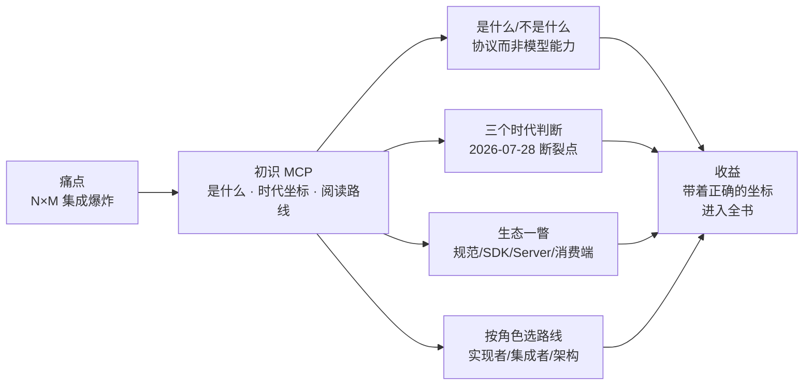

# 第 1 章 初识 MCP

> 本章导读：中台团队都见过这个场景：客服 Agent 项目要接售后接口，封装一遍；前端 CopilotKit 要展示售后进度，再封装一遍；新起的数据脚本，又一遍。三个项目、三套鉴权、三份参数文档，服务的都是同一个「查售后单」。本章从这个问题出发，讲清 MCP 是什么、不是什么，给出阅读全书前必须建立的三个时代坐标，并按你的角色画出读这本书的路线。读完本章，你能：用一句话向团队解释 MCP 解决什么问题；判断手头的材料是不是过时协议形态的教程；找到适合自己的章节路线。

*本章导览图*

## 1.1 MCP 是什么、不是什么

先看问题本身。每套 Agent 框架 × 每个内部系统 = 一次重复封装，这就是 N×M 集成爆炸——封装的代码往往不难写，难承受的是三份参数文档的漂移、三套鉴权的维护，以及「同一个能力在三处 behave 得不一样」的长期税。

Model Context Protocol（MCP）的答案是把 M 收敛到 1：中台把能力按协议暴露**一次**，所有 Agent 框架作为标准消费者接入。N×M 变成 N+M。

**是什么**：一个开放协议，规范「AI 应用（Host）如何发现并调用外部能力（Server）」——JSON-RPC 承载，把工具（tools）、资源（resources）、提示（prompts）标准化描述，让「模型看到什么、怎么调、结果什么形态」全部有协议约定。

**不是什么**，三个边界值得划清：

- **不是模型能力**：MCP 不改变模型，它改变模型**能看见什么**——工具最终被不被选中，依然是模型与描述质量的博弈（第 6 章）
- **不是 RPC 框架**：JSON-RPC 只是载体；价值在能力描述、发现与调用的**语义约定**
- **不是免写代码**：它消灭的是「每个框架重复封装」的那份代码；协议本身的工程（建模、描述、治理）是新的、更值钱的工作（第 6、7 章）

与近亲的边界也要一句话说清：**function calling** 是模型厂商 API 的单点能力；**OpenAPI** 描述系统接口（资源语义、面向人）；MCP 站在它们之上，给 Agent 世界一个**任务语义的工具层**。

## 1.2 协议的三个时代判断

读任何 MCP 材料之前，先建立三个时代坐标（第 3 章展开）。这一节是全书最重要的「防坑」 investment——市面上大量 MCP 教程停留在旧协议形态，坐标系不对，照抄就是坑。

1. **2026-07-28 是断裂点**：协议级会话与 initialize 握手被整体移除，每请求自含协议元数据；Roots/Sampling/Logging 三大 v1 特性进入弃用清单。**2025 年中的教程形态照抄即踩坑**
2. **SDK 看大版本**：TypeScript v2.x、Java mcp-core 2.0.x 起才支持 2026-07-28；v1 时代 SDK 不会获得支持
3. **协议开始为基础设施设计**：标准 HTTP 头（`Mcp-Method`/`Mcp-Name`）、缓存语义（`ttlMs`/`cacheScope`）、header 路由——网关与治理是协议原生话题，不是外围工程

## 1.3 生态一瞥

- **规范**：modelcontextprotocol.github.io（源码仓库 modelcontextprotocol/modelcontextprotocol），五版本并存，latest = 2026-07-28；官方扩展生态：Tasks、Apps、Auth、Skills
- **SDK**：TypeScript / Java / Python / C# 等，按 2026-07-28 支持度分层（第 4 章选型表）
- **Server 侧**：GitHub 等大型服务原生提供 2026-07-28 端点；企业内部以自建域 Server 为主（第 7 章）
- **消费端**：agentscope-java、ragflow、CopilotKit、主流 AI CLI 均以 Host 身份接入——支持矩阵见第 8 章

## 1.4 本书怎么读

全书围绕一个贯穿案例：**中台售后域，20 个 REST 接口 → 6 个任务级工具 → Gateway → 多框架消费**。案例在第 4 章初始化，随章节推进而成长。

| 你是 | 路线 |
| --- | --- |
| Server 实现者（后端，主线） | 第 2 章概念 → 第 4 章上手（30 分钟双端实测）→ 第 5 章完整 Server → 第 6 章工具手艺 → 第 7 章规模化 → 第 9 章调试 → 第 10 章上生产 |
| Client 集成者 | 第 2 章 + 第 4 章 + **第 8 章**（支持矩阵与双端实测）；细节回各自框架书 |
| 平台/架构决策 | 第 1 章 → 第 7 章（规模化拓扑）→ 第 3 章（版本与兼容）→ 第 10 章（安全基线）→ **第 12 章**（路线图与立项） |
| 测试/运营 | 第 2.1 节（能力建模）+ 第 6 章（工具质量）+ 第 7.6 节（目录治理）+ 第 9 章（调试工具箱） |

写作约定：代码在指定 SDK 版本下**实测**或明确标注未实测（每章附实测/复核清单）；事实表述对照规范原文并标注依据；与书架其他书的分工——框架 API 细节一律交叉引用，本书只拥有协议与规模化方法论。

## 1.5 一个忠告

如果你只从网上教程学过 MCP，先读**第 3 章**再动代码。协议还在演进——本书以 2026-07-28 为基线，并约定：新的 latest 发布后，主线版本要重新拍板。这本书刻意保持「规范原文 + 实测证据 + 团队方法论」三层分离，就是为了每次协议升级时，哪层要换、哪层不用换，一眼可辨。

下一章，从协议的角色与消息讲起。

## 本章小结

1. **MCP 解决 N×M 集成爆炸**：中台暴露一次，所有框架作为标准消费者接入；它改变模型能看见什么，不改变模型本身。
2. **三个时代坐标**：2026-07-28 是断裂点；SDK 看大版本；协议已为基础设施设计。
3. **本书两层主线**：协议本身（第 2、3 章）与规模化落地（第 6、7、10、12 章），贯穿案例是中台售后域。
4. **按角色选路线**：实现者、集成者、架构、测试各有最短路径，不必通读。

→ 下一章进入协议核心概念：角色、消息、无状态与能力发现。

## 验收清单

读到这里，你应该能：

- ☐ 用「N×M 变 N+M」向团队解释 MCP 的价值，并说出它不解决什么；
- ☐ 判断一份网络教程基于哪个协议形态，是否需要对照第 3 章后再用；
- ☐ 按自己的角色从 1.4 的路线表中选出前三章；
- ☐ 说出 function calling、OpenAPI、MCP 三者的边界。

## 延伸阅读

- **第 2 章（协议核心概念）**——全书的地基章，后续每章都引用它的编号。
- **第 3 章（版本演进）**——三个时代判断的完整展开，「先读它再动代码」的那一章。
- **第 12 章（企业落地路线图）**——如果你是带着立项任务来的，可以直接跳那里再看技术章。

## 复核清单（发布前）

- [ ] 生态描述按发布时点全量刷新（SDK 版本、扩展生态、框架支持）
- [ ] 「latest 版本」声明复核；如有新版本，主线重新拍板
- [ ] 读者路线表与各章实际内容逐一对齐
