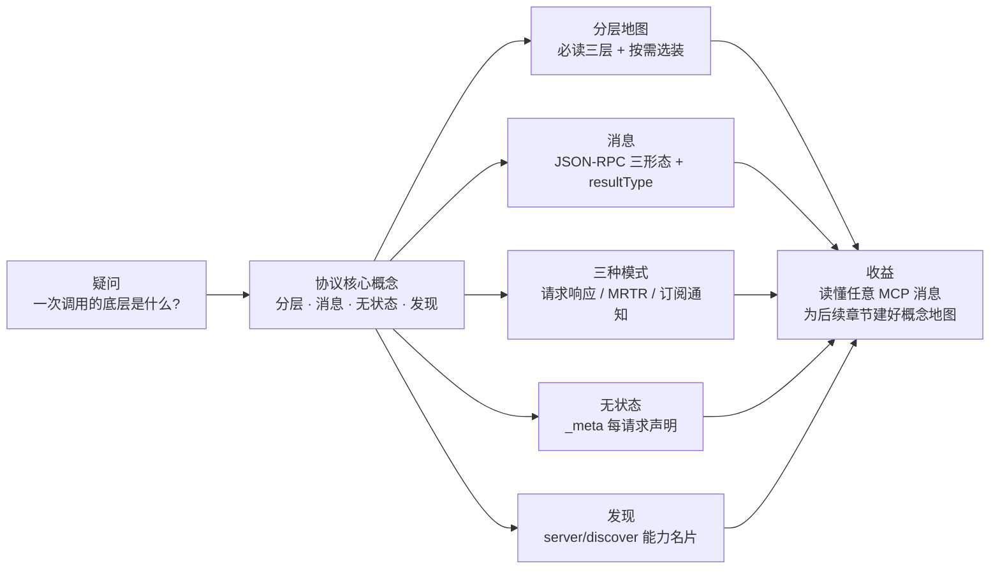

# 第 2 章 协议核心概念

> 本章导读：一次售后查询，Agent 底层发生了什么？「模型选了工具」之前的目录从哪来？「无状态」的 Server 怎么知道该按哪个协议版本处理请求？本章对照 2026-07-28 官方规范原文（basic/index、versioning、server/discover），把协议核心拆开讲透：七个组件的分层地图、JSON-RPC 三种消息形态与 resultType 多态、三种消息模式、无状态的精确语义（每请求 `_meta` 元数据）、能力发现（server/discover）。消息示例均取自规范或经 TypeScript SDK v2.4.0 实测。读完本章，你能：画出一次调用的分层地图；读懂任意一条 MCP 消息的每个字段；说出三类能力的建模边界；用协议语言解释「为什么这版没有握手」。



*本章导览图*

## 你什么时候需要它

**要读懂或手写一条 MCP 消息**——2.3（消息）与 2.5（`_meta`）是字典：每个字段的含义、哪些必填、缺了会怎样（-32602/400）。

**在「工具、资源、提示」之间拿不定建模方式**——2.1 的决策表 + 三条经验法则，一分钟出结论。

**要向团队解释「为什么 2026-07-28 没有 initialize 了」**——2.5 的无状态四规则与实测印证，就是答案。

前置：无。本章是全书概念地基，后续每章都引用这里的编号。

先看一次真实的调用。用户对 agentscope-java 客服 Agent 说：「我的售后单 T-2026-1031 到哪一步了？」Agent 决定调用售后工具，底层发生了什么？

```
1. Host(agentscope Agent)向 Client 说：帮我调 after_sales_query_ticket
2. Client 构造一个 JSON-RPC 请求，带上「我是谁、我说哪个版本的协议、我有什么能力」
3. 请求到达 Server（可能穿过 Gateway、可能被任意一个副本接住）
4. Server 读参数、调中台接口、组装结果——不记得也不需要记得「上次和这个 client 聊过什么」
5. 结果原路返回，Agent 拿到结构化数据，组织成自然语言答复
```

第 3 步的「可能被任意一个副本接住」和第 4 步的「不需要记得」，就是 2026-07-28 规范的全部灵魂。本章把这个过程拆开讲透：协议分几层、消息长什么样、无状态到底指什么、能力怎么发现。

## 2.1 协议的分层地图

规范把 MCP 拆成七个组件，要求不同：

| 组件 | 内容 | 实现要求 |
| --- | --- | --- |
| 基础协议 | JSON-RPC 消息类型 | **必须** |
| 版本与兼容 | 版本协商、扩展协商、旧版互操作 | **必须** |
| 消息模式 | 请求/响应、MRTR、订阅/通知 | **必须** |
| 授权 | HTTP 传输的认证授权框架 | HTTP 传输应遵循 |
| Server 能力 | resources、prompts、tools | 按需 |
| Client 能力 | elicitation、sampling、roots | 按需 |
| 实用件 | logging、参数补全等横切关注点 | 按需 |

模块化的用意：实现方**只做必须的三层，其余按需选装**。一个只暴露工具的最小 Server，不必实现 sampling；一个纯资源型 Server 可以没有任何 tool。这个分层也是全书各章的地图——第 3 章讲第二层，第 6 章讲 tools，第 10 章讲授权。

### 三类 Server 能力怎么选：tool、resource、prompt

七组件里最常拿不定的是 Server 能力层的三个选项。规范的区分标准不是「功能强弱」，而是**谁控制它**：tool 由模型控制（model-controlled），resource 由应用控制（application-controlled），prompt 由用户控制（user-controlled）。控制方不同，适用场景就不同：

| 维度 | tool（工具） | resource（资源） | prompt（提示） |
|------|-------------|-----------------|---------------|
| 控制方 | 模型自主决定何时调用 | 应用决定何时取用、注入上下文 | 用户主动选择发起 |
| 语义 | 执行动作，可有副作用 | 提供只读数据 | 可复用的交互模板 |
| 例子 | 创建售后单、查进度 | 售后政策文档、物流配置 | 「退货申请」引导流程 |
| 本书展开 | 第 6 章 | 第 2.6 节 / 第 7 章 | 各框架书 |

三条经验法则，覆盖绝大多数判断：

1. **要模型「做」→ tool；要模型「知道」→ resource；要人「发起」→ prompt**——控制方归属是第一判据
2. **有副作用、需要参数校验的动作，一律 tool**——即使它看起来像「查询」（查询也是动作，参数是模型的任务）
3. **大体积、只读、变更不频繁的数据 → resource**——可订阅变更、可分页读取，不必挤进工具结果

企业 Server 的主力形态是 tool（第 5 章），但三类会组合出现：政策文档做成 resource 供注入，操作流程做成 prompt 供用户触发，具体动作用 tool 承载。

## 2.2 角色：Host、Client、Server

三个角色各管一件事，边界清楚：

- **Host**：用户面对的应用——agentscope-java 的 Agent、CopilotKit 前端、AI CLI。它决定**挂哪些 Server、把哪些工具放进模型上下文**。
- **Client**：Host 进程内的连接维护者。负责传输、按请求携带协议元数据、把 Server 能力转交 Host。
- **Server**：能力的提供方。售后域 Server、物流域 Server，各自暴露工具与资源。

一句话记牢：**Server 管「能力是什么」，Host 管「模型能看到什么」**。第 7 章的规模化治理，治理的就是 Host 侧的可见性。

## 2.3 消息：一切皆 JSON-RPC

所有消息必须符合 JSON-RPC 2.0，共三种形态。

**请求**：client 发起操作，必须带 string 或 number 的 `id`（与 JSON-RPC 的一处差异：**id 不得为 null**），且不得与「已发出未应答」的其他请求重号：

```json
{
  "jsonrpc": "2.0",
  "id": 1,
  "method": "tools/call",
  "params": { "name": "after_sales_query_ticket", "arguments": { "ticket_id": "T-2026-1031" } }
}
```

**响应**：成功时 `result` 必须携带 **`resultType` 字段**——这是 2026-07-28 的新设计，初见容易忽略：

```json
{
  "jsonrpc": "2.0",
  "id": 1,
  "result": {
    "resultType": "complete",
    "content": [{ "type": "text", "text": "售后单 T-2026-1031 当前处于维修阶段" }]
  }
}
```

`resultType` 让结果**多态**：取值 `"complete"` 表示完成（携带最终内容）；`"input_required"` 表示请求未完成、需要 client 补充信息（携带 `InputRequiredResult` 对象，详见 2.6 MRTR）；扩展可以定义更多取值。client 遇到不认识的 `resultType` 必须视为非法；而**缺失 `resultType` 视为 `"complete"`**——这条兼容规则让旧版 Server 的响应在新协议下依然可解析。

**通知**：单向消息，无 `id`，接收方不得回应。Server 用它推送事件（如工具目录变化），不需要「答复」这个动作。

### 错误码：一个被规范严格管理的区间

JSON-RPC 保留区（-32700、-32600~-32603）照旧用于协议层故障。MCP 对实现自定义区（-32000~-32099）做了分区：

- **-32000 ~ -32019：legacy 区**。历史实现占用的遗留区，新代码不得分配、不应使用
- **-32020 ~ -32099：规范保留区**。只有 spec 定义的三个码：
  - `-32020` HeaderMismatch（HTTP 头不匹配）
  - `-32021` MissingRequiredClientCapability（client 缺少请求所需能力声明，2.5 节登场）
  - `-32022` UnsupportedProtocolVersion（版本不支持，2.5 与第 3 章主角）
- 旧版的 `-32002`（资源未找到）已被 `-32602` 取代，client 应兼容旧 Server 仍发 `-32002` 的情形

应用自定义错误**应**落在保留区之外（-32768~-32000 之外）。把错误码分区当成 API 对待：你的 Server 不该发明一个 `-32050` 还指望所有 client 理解它。

## 2.4 三种消息模式

规范定义三种交互模式，复杂度递增：

**① 请求/响应**：上面演示的一问一答，覆盖绝大多数场景。

**② 多轮请求（MRTR）**：Server 处理到一半需要 client 补充信息（向用户要个表单、借 Host 的模型推理一下），返回 `resultType: "input_required"` 的结果，内嵌它需要的请求；client 完成后**发起新的自含请求**继续。无状态世界的交互性方案，2.6 节展开。

**③ 订阅/通知**：client 订阅一个事件流（如 `subscriptions/listen`），Server 持续推送通知。注意它的无状态语义：长连接式的 listen 仍是「一个请求」——响应是一个打开的通知流，状态属于**请求**而非底层连接。

## 2.5 无状态：规范原文怎么说

basic/index 里这段话值得整段读（本书译述，语义以原文为准）：

> **MCP 是无状态协议**：处理请求所需的全部信息都包含在请求自身之中。Server 独立处理每个请求；不得从先前的请求推断任何状态——哪怕它们来自同一条连接。

具体拆成四条规则：

1. **Server 不得**依赖同一连接上的先前请求建立上下文（能力、协议版本、client 身份）——这些元数据**每个请求自带**
2. Server 应准备好同时处理来自多个任务/线程/会话的请求
3. Server 不应要求 client 用同一条连接执行相关操作
4. 需要跨请求延续的状态（长任务、应用级句柄）**必须用显式标识符引用**，client 每次请求都带上

配套的核心机制是 **`_meta` 每请求协议元数据**——client 的每个请求都要在 `params._meta` 里声明：

```json
{
  "jsonrpc": "2.0",
  "id": 1,
  "method": "tools/list",
  "params": {
    "_meta": {
      "io.modelcontextprotocol/protocolVersion": "2026-07-28",
      "io.modelcontextprotocol/clientCapabilities": {}
    }
  }
}
```

| 键 | 必填 | 说明 |
| --- | --- | --- |
| `io.modelcontextprotocol/protocolVersion` | **是** | 本请求使用的协议版本 |
| `io.modelcontextprotocol/clientCapabilities` | **是** | 本次请求相关的 client 能力声明 |
| `io.modelcontextprotocol/clientInfo` | 否（建议带） | client 名字与版本 |
| `io.modelcontextprotocol/logLevel` | 否 | 期望的日志级别下限 |

**缺必填字段就是畸形请求**：Server 必须以 `-32602`（Invalid params）拒绝，HTTP 上返回 400。如果请求需要 client 没声明的能力，Server 返回 `-32021` 并在 `data.requiredCapabilities` 里列出缺什么。

两个推论值得咀嚼：

- **「无状态」不是「什么都不带」，而是「每请求都带全」**——状态从连接搬进了每个请求的 `_meta`。这正是任意副本可接、水平扩缩容自由的原因：没有哪个请求「属于」哪个连接。
- **一条 stdio 连接不是一个会话**。规范特意注明：client 可以在同一条传输上交错多个不相关任务的请求，Server 不得把「连接身份」当「会话连续性」用。stdio 进程的生命周期也不该绑定到某个对话。

### 实测印证

第 4 章我们对 TS SDK v2.4.0 的实测（无握手直发 `tools/list` 立即得到结果）印证了「无握手」；SDK 的便捷方法内部正是自动拼装了上述 `_meta` 必填字段——手写裸 JSON-RPC 时别漏。

## 2.6 能力发现：`server/discover`

无状态带来一个直白的问题：握手没了，client 怎么知道对面是谁、支持什么版本、有什么能力？规范给了一个 Server **必须**实现的方法：

```json
{ "jsonrpc": "2.0", "id": "d1", "method": "server/discover", "params": { "_meta": { /* 同 2.5 */ } } }
```

```json
{
  "jsonrpc": "2.0", "id": "d1",
  "result": {
    "resultType": "complete",
    "supportedVersions": ["2026-07-28"],
    "capabilities": { "tools": {}, "resources": {} },
    "_meta": { "io.modelcontextprotocol/serverInfo": { "name": "after-sales", "version": "1.0.0" } },
    "instructions": "本 Server 提供售后单查询/创建/试算能力。查询物流请用物流域。",
    "ttlMs": 3600000,
    "cacheScope": "public"
  }
}
```

一次请求拿到：**支持的协议版本**（`supportedVersions`）、**能力清单**（`capabilities`）、**身份**（`serverInfo`）、**给模型的使用说明**（`instructions`），并声明可缓存时长（`ttlMs`）。

调用它是 client 的自由，不是义务——client 也可以直接发业务请求，版本不支持就吃 `-32022` 错误（错误体里同样会列出 server 支持的版本，第 3 章）。两个场景值得主动调用：一是接入前一次性呈现 Server 概况（替代 tools/prompts/resources 三个 list 探测）；二是 stdio 上的旧版兼容探测（第 3 章 Dual-era 机制）。

注意 `instructions`：这是写给**模型**的自然语言——「这个 Server 是干什么的、该和谁配合」。它是描述质量工程在 Server 级的延伸，第 6 章的工具描述是它的兄弟。

## 2.7 MRTR：无状态世界的交互性

场景：模型调 `after_sales_create_ticket`，但缺「退款方式」这个用户必须选的字段。有状态协议会开个会话等用户；无状态的答案分三步：

```
① client: tools/call(create_ticket, {已知参数})
② server: result { resultType: "input_required", ... 内嵌 elicit 请求（选退款方式） }
③ client 完成收集后，发起全新请求携带应答继续
```

关键在 ③：**续接不靠 Server 记忆，靠请求自带上下文**。每一跳都是独立、完整、可被任意副本处理的请求。两个协议细节在第 6 章实战中会反复出现：重试请求的 JSON-RPC `id` 必须是一个新 id（不得复用原请求的）；`requestState` 字段由 Server 放置续接上下文，client 原样带回、不解析。SDK 层面（TS v2.4.0），工具处理器返回 `inputRequired` 对象即可，内嵌请求的构造器覆盖 elicit（表单）、createMessage（借模型推理）、listRoots 三类 client 能力。

## 2.8 同一调用的三层视角

官方架构教程（learn/architecture）用一个贯穿示例把「一次工具调用」在三个抽象层级上各走一遍——这个视角切换是理解 MCP 的捷径：

**① 数据层（协议视角）**：一切是 JSON-RPC 消息。discover、tools/list、tools/call 每一步都带 `_meta` 必填字段（协议版本、clientCapabilities、建议带 clientInfo）；响应带 `resultType` 与缓存字段（`ttlMs`/`cacheScope`）。教程逐步展开的四步——发现 → 工具发现 → 工具执行 → 通知——每步的请求/响应 JSON 都值得手抄一遍，第 4 章的实测命令就是这一层的可运行版。

**② SDK 层（开发者视角）**：`_meta` 拼装、schema 校验、通知分发被 SDK 吸收。教程的伪代码展示了 AI 应用的典型集成形态：

```python
async with Client(stdio_client(server_config)) as client:
    if client.server_capabilities.tools:          # discover 的结果挂在 client 对象上
        app.register_mcp_server(client, supports_tools=True)
    app.set_server_ready(client)
```

**③ AI 应用层（产品视角）**：应用聚合所有已连 Server 的工具为「统一工具注册表」交给模型；模型在对话中产生工具调用，应用执行后回填——第 8.3 节的 Agent 循环正是这一层的最小实现。

三个视角的分工：排查协议问题回到 ①，写业务代码停在 ②，理解产品行为看 ③。本书章节也按此组织——第 3/6/10 章深入 ①（协议与规范语义），第 4/5 章居 ②（SDK 实操），第 7/12 章在 ③（平台与产品）。

另外，规范特性自身有生命周期三态（Active / Deprecated / Removed，弃用窗最少 12 个月，learn/versioning 与第 3 章）——读规范时先看特性处于哪一态，Deprecated 的能力不要进新代码。

## 2.9 小结

| 概念 | 一句话 |
| --- | --- |
| 分层 | 必须三层（基础协议/版本兼容/消息模式），其余选装 |
| 能力建模 | tool 模型控制、resource 应用控制、prompt 用户控制——按控制方选 |
| 消息 | JSON-RPC 三形态；`resultType` 让结果多态；错误码分区管理 |
| 模式 | 请求/响应、MRTR、订阅/通知 |
| 无状态 | 状态从连接搬进每请求的 `_meta`；stdio 连接 ≠ 会话 |
| 发现 | `server/discover` 一次拿版本+能力+身份+给模型的说明 |
| 交互 | `input_required` + 自含续接 |

→ 有了这层概念地图，下一站可以选：**第 4 章**动手（推荐，30 分钟跑通双端），或**第 3 章**先弄清「我们怎么走到无状态」。

## 验收清单

读到这里，你应该能：

- ☐ 画出七组件分层地图，并指出哪些「必须实现」；
- ☐ 手写一条带完整 `_meta` 的 `tools/list` 请求，说出每个必填字段缺失时的服务端行为；
- ☐ 解释 `resultType` 的多态设计，以及「缺失视为 complete」为谁而设；
- ☐ 用 2.1 的决策表把一个新能力正确建模为 tool、resource 或 prompt；
- ☐ 说出 MRTR 三步流转，并指出重试时哪两个字段有特殊要求；
- ☐ 调用 `server/discover` 并解读 `supportedVersions`/`capabilities`/`instructions`。

## 参考速查

| 项 | 值 |
|----|----|
| 必填 `_meta` | `io.modelcontextprotocol/protocolVersion` + `/clientCapabilities`；建议带 `/clientInfo` |
| resultType | `complete`（完成）/ `input_required`（待补输入）；缺省视为 complete |
| 规范保留错误码 | -32020 HeaderMismatch / -32021 MissingRequiredClientCapability / -32022 UnsupportedProtocolVersion |
| 三种模式 | 请求响应 / MRTR / 订阅通知（subscriptions/listen） |
| 无状态四规则 | 不依赖连接上下文；多任务并发；不要求同连接；跨请求状态用显式标识符 |
| 能力建模 | tool=模型控制 / resource=应用控制 / prompt=用户控制 |
| 发现 | `server/discover`（Server 必须实现）：supportedVersions + capabilities + serverInfo + instructions |
| JSON Schema | 默认 2020-12；`$ref` 不自动解引用网络 URI |

## 延伸阅读

- **第 4 章（快速上手）**——本章概念的 30 分钟可运行版：四行为实测 + 双端调用。
- **第 3 章（版本演进）**——Modern 模型的来龙去脉与 Legacy 兼容。
- **第 6 章（工具接入实战）**——2.1 的 tool 建模 + 本章 schema 语义的完整手艺。
- **官方 learn/architecture 教程**——2.8 三层视角的原文 walkthrough（568 行）。

## 复核清单（发布前）

- [ ] `resultType` 与 `InputRequiredResult` 的字段细节对照 spec schema.ts
- [ ] `_meta` 必填字段表与 basic/index 原文逐项核对
- [ ] 订阅/通知（`subscriptions/listen`）机制补足（本章点到，可独立成节）
- [ ] architecture/index 的角色定义原文对照
- [ ] `icons` 元数据规范（basic/index 尾部）决定是否入本章或附录
