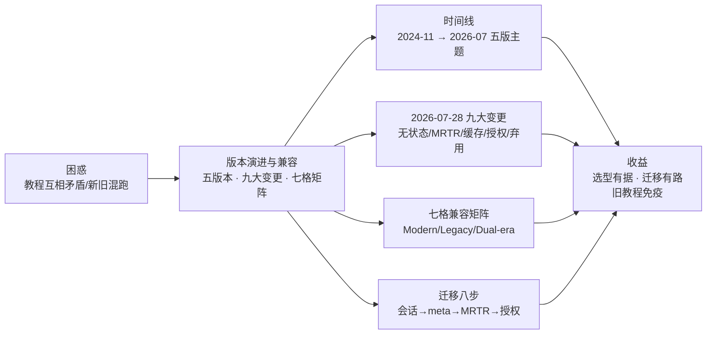
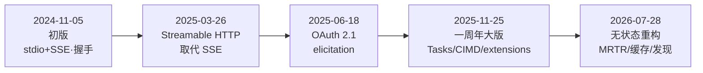

# 第 3 章 协议版本演进与兼容

> 本章导读：网上大量 MCP 教程停留在 2025 年中的协议形态——2026-07-28 之后就过时了，照抄会踩坑。这一章把五个版本串成一条线：每个版本解决了什么问题、留下了什么债，以及最重要的——**存量 Server 怎么迁到 latest**。理解了演进，第 2 章的无状态模型就不再是「凭空的设计」，而是三次还债的结果。读完本章，你能：说出五个版本的发布时间线与各自主题；解释 2026-07-28 九大变更为什么发生；用七格兼容矩阵判断任意新旧组合的行为；按八步清单规划存量 Server 的迁移。



*本章导览图*

## 你什么时候需要它

**接手了一个「不知道什么年代」的 MCP Server**——先看 3.5 的七格矩阵与 3.4 的版本协商：跑一次 `server/discover` 或发一个带版本的请求，它属于哪一格、该怎么处理，立刻清楚。

**要规划存量 Server 升级到 2026-07-28**——直接看 3.6 的八步清单，每步对应官方 changelog 条目。

**评估网上教程/文章是否可用**——看 3.1 的五版时间线：任何未标注 spec 版本日期的 MCP 材料，默认按 2025 年中形态理解，对照后再用。

前置：第 2 章的 Modern 模型（`_meta`、discover、resultType）——本章讲它们「怎么来的」。

## 3.1 概述：五版时间线与官方术语



官方术语（后文全程沿用）：

- **Modern**：2026-07-28 及以后——版本、身份、能力全部按请求携带（per-request `_meta`）
- **Legacy**：2025-11-25 及以前——靠 `initialize` 握手建立会话
- **Dual-era**：两者都支持的实现

## 3.2 五个版本，一条主线

五个版本连起来看，是一条「从 Demo 到生产」的还债之路：每一版都在解决上一版留下的最大障碍。

**2024-11-05（初版）**：stdio + HTTP+SSE 双传输；initialize 握手建立会话；tools/resources/prompts 三类能力成型。它确立了「模型上下文」的协议骨架，也欠下了贯穿后续所有版本的债——**有状态**。会话由 Server 保管，意味着每个 Server 都要管握手、管粘性、管恢复，服务化困难。

**2025-03-26**：Streamable HTTP 取代 HTTP+SSE。SSE 的单向流 + 会话粘性难以服务化，传输层先向「普通 HTTP 服务」靠拢。信号明确：Server 要进生产。

**2025-06-18**：安全规范化。Server 正式定位为 **OAuth 2.1 Resource Server**；elicitation（Server 向用户收集输入）进入核心。规范化是起点，离「企业敢用」还有距离——下一版补课。

**2025-11-25（协议一周年）**：企业化补课——

- **Tasks（实验）**：「call-now, fetch-later」，长任务返回句柄供轮询
- **授权大改**：CIMD（URL 元数据文档自述 client 身份）引入；**DCR（动态客户端注册）从 SHOULD 降级为 MAY**——实现层安全缺陷泛滥后的降级；强制 RFC 8707 Resource Indicators（token 绑定资源）
- **Extensions 框架**：核心之外的扩展协商机制成型
- 元数据：icons、audio content、resource links、websiteUrl

**2026-07-28（无状态重构，破坏性）**：下一节专述。

## 3.3 2026-07-28 九大变更逐条读

官方 changelog 的 Major changes 九条，按主题归组（每条标注 SEP 编号可溯源）：

### 组一：状态之死（SEP-2567、SEP-2575）

- 移除协议级会话与 Streamable HTTP 的 `Mcp-Session-Id` 头；所有 list 端点不再随连接变化
- 移除 `initialize`/`notifications/initialized` 握手；每请求 `_meta` 自带协议版本与 client 能力，client/Server 各自报身份
- 版本不匹配返回 `UnsupportedProtocolVersionError`（-32022）
- **新增 `server/discover`（Server 必须实现）**：一次请求拿到版本、能力、身份与给模型的说明——握手消失后的「能力名片」

### 组二：交互与订阅重构（SEP-2322、SEP-2575）

- **MRTR**：取代 server-initiated 请求（`roots/list`、`sampling/createMessage`、`elicitation/create`）。Server 返回 `resultType: "input_required"`，`inputRequests` 携带所需；client **重试原请求**、以 `inputResponses` 应答
- 所有 result 必带 `resultType`（`complete` / `input_required`；旧版缺省视为 complete）
- **`subscriptions/listen` 取代** HTTP GET 端点与 resources/subscribe：单一长 POST 响应流，通知带 `subscriptionId` 关联
- 移除 `ping`、`logging/setLevel`、`notifications/roots/list_changed`；日志级别走 `_meta` 按请求声明

### 组三：缓存一等公民（SEP-2549）

`tools/list`、`prompts/list`、`resources/list`、`resources/read`、`resources/templates/list` 的结果**必须**带 `ttlMs`（新鲜度）与 `cacheScope`（public/private）；`tools/list` 返回**确定性顺序**——为 client 缓存与 **LLM prompt cache 命中率**。无状态协议没有会话可「记住」目录，缓存成为目录分发的正统机制。

### 组四：断流语义简化（SEP-2575）

移除 SSE 断流恢复与消息重投（`Last-Event-ID`）：响应流断了，进行中的请求即丢失，client **必须以新 ID 重发**。用复杂度换简单性——Server 不再需要事件重放缓冲。

### 组五：长任务转正为扩展（SEP-2663）

实验性 Tasks 移出核心，成为扩展 `io.modelcontextprotocol/tasks`，并重新设计：`tasks/result` 阻塞方法改为 `tasks/get` **轮询**；新增 `tasks/update` 供 client 中途输入；移除 `tasks/list`；Server 可不经请求主动返回任务句柄。

### 弃用清单（Deprecated，12 个月窗口后移除）

| 弃用项 | 迁移建议 |
|--------|----------|
| **Roots**（client 告知可访问目录） | 目录/文件经工具参数、资源 URI 或 Server 配置传入 |
| **Sampling**（借 Host 模型推理） | 直接对接 LLM provider API |
| **Logging**（协议内建日志） | stderr（stdio）或 OpenTelemetry |
| HTTP+SSE 传输（2025-03-26 起废） | Streamable HTTP |
| OAuth DCR（RFC 7591）注册机制 | CIMD（保留对旧 AS 的兼容） |
| `includeContext` 的 thisServer/allServers | 省略或 none |

这是全书最重要的迁移事实：**Roots/Sampling/Logging 三个 v1 核心特性整体进入弃用**——新实现不应再添加对它们的支持。

### 授权收紧（SEP-2468、SEP-837、SEP-2352）

- 授权服务器应返回 RFC 9207 的 `iss` 参数；**client 必须在兑换授权码前校验 issuer**（防 mix-up）
- DCR 使用时必须声明 `application_type`（防 OIDC redirect URI 冲突）
- client 凭据绑定签发者：按 issuer 键控存储，不得跨授权服务器复用，服务器变更必须重新注册

### 其他值得知道的

- `inputSchema`/`outputSchema` 放宽为任意 JSON Schema 2020-12 关键词；`structuredContent` 允许任意 JSON（第 6 章建模自由度的来源）；`$ref` 不得自动解引用网络 URI、组合关键字需资源上限（防 DoS）
- Streamable HTTP 必带标准头 `Mcp-Method`、`Mcp-Name`；`x-mcp-header` 支持工具参数映射自定义头（第 6 章）
- 资源未找到错误码从 `-32002` 改为 `-32602`（对齐 JSON-RPC）；错误码分区政策定型（legacy 区 -32000~-32019；规范保留区 -32020~-32099；本轮 -32001→-32020、-32003→-32021、-32004→-32022）
- 弃用 `notifications/elicitation/complete` 与 `elicitationId`：MRTR 下 client 靠重试得知结果，跨重试关联用 `requestState`
- 治理：确立**特性生命周期政策**（Active/Deprecated/Removed，弃用窗最少 12 个月）与弃用注册表

## 3.4 版本协商：每请求声明 + 探针

无握手之后，「你说哪个版本」变成每请求的事：

1. **每个请求**在 `_meta` 声明 `protocolVersion`（HTTP 上另有 `MCP-Protocol-Version` 头，两者必须一致，第 10 章）
2. Server 不支持时返回 `-32022`，`data.supported` 列出支持的版本：
   ```json
   { "error": { "code": -32022, "message": "Unsupported protocol version",
     "data": { "supported": ["2026-07-28", "2025-11-25"], "requested": "2025-06-18" } } }
   ```
3. client 从 `supported` 里选双方都支持的版本**重试**，或报错给人
4. 想提前知道？先调 `server/discover`（可选，但接入前值得）

## 3.5 七格兼容矩阵：官方版

versioning 规范给出的完整矩阵（client × server 的 era 组合），比「新旧兼容」的笼统说法精确得多：

| Client \ Server | Modern | Legacy | Dual-era |
| --- | --- | --- | --- |
| **Modern** | ✅ discover 可选；版本不匹配吃 -32022 后换版本重试 | ❌ 失败——server 可能报实现自定义错误、沉默、甚至按 legacy 语义错误处理；stdio 上 client **应**先 `server/discover` 确定性失败 | ✅ client 保持 modern |
| **Dual-era** | ✅ 探针返回 DiscoverResult 或 -32022 → 保持 modern | ✅ 探针失败/超时 → 回退 initialize（HTTP 上可能再退到已废 HTTP+SSE） | ✅ |
| **Legacy** | ❌ 失败——`initialize` 对 modern server 是未知方法且缺 `_meta` 必填；**legacy client 没有前向机制** | ✅ 按旧版语义 | ✅ server 应答 initialize 并按协商的旧版本服务 |

三条工程结论：

1. **Dual-era Server 是迁移期的答案**：按 client 的开场分流——带现代 `_meta` 的请求按新规范无状态服务；`initialize` 请求按协商的旧版本走 legacy 语义；同一端点可同时服务两代。TS SDK v2.4.0 实测（第 4 章）：`serveStdio` 的 `legacy: 'serve'`（默认）应答旧握手，`'reject'` 拒绝并报支持的现代版本
2. **Modern client 连 Legacy Server 是最危险的格子**：可能静默错误处理。规范因此规定 stdio 上 client 应先发 `server/discover` 探针——错误形态可识别（modern）则保持 modern，否则确定性回退
3. **Legacy client 无法前向**：纯 modern Server 对 `initialize` 的报错里应列出支持的版本——那可能是 legacy 用户唯一能看到的诊断

Era 判定缓存于 Server 进程（stdio）/源（HTTP）生命周期，可跨重启保留、失效再重探。

## 3.6 存量迁移：八步清单

按序执行（每步对应 changelog 条目）：

1. **删握手与会话**：移除 initialize/会话管理/`Mcp-Session-Id`；跨调用状态改用 Server 签发的显式句柄作为普通工具参数（SEP-2567，第 6 章句柄模式）
2. **`_meta` 每请求声明**：协议版本必填、能力必填、身份建议带
3. **交互改 MRTR**：原 server→client 请求改写为 `inputRequests`；注意 Sampling/Roots 本身已弃用，优先直接迁到替代方案
4. **长任务**：Tasks 用法迁到扩展（轮询制），或自建异步+轮询工具对（第 7 章贯穿案例选后者，协议面更薄）
5. **订阅改 listen**：resources/subscribe 等迁到 `subscriptions/listen`；删 ping/setLevel 调用；日志级别走 `_meta`
6. **缓存**：list/read 结果补 `ttlMs`/`cacheScope`；`tools/list` 排序确定化
7. **授权**：client 加 `iss` 校验；消费端身份迁 CIMD；凭据按 issuer 键控
8. **双代过渡**：legacy 入口开启灰度，新旧 client 并行后收紧

## 3.7 选型建议

- **新项目：直接 2026-07-28 + v2 大版本 SDK**（TS v2.x / Java mcp-core 2.0.x）——不为旧教程兼容性买单
- **存量：按八步清单评估**。改造量与「用了多少 server→client 交互与自定义头/会话」成正比；纯 tools 型 Server（中台的主力形态）迁移最轻——这正是无状态重构偏爱的形态
- **教学中**：任何未标注 spec 版本日期的 MCP 教程（包括本书以外的），默认按 2025 年中形态理解，对照本章后再用

## 3.8 本章小结

1. **主线**：初版有状态 → 传输规范化 → 安全规范化 → 企业化补课 → 无状态重构——一路还「有状态」的债。
2. **九大变更四组**：状态之死（会话/握手/discover）、交互重构（MRTR/listen/resultType）、缓存一等公民、授权收紧；另有 Roots/Sampling/Logging 整体弃用。
3. **七格矩阵**：Dual-era 是迁移期的桥；legacy client 无前向机制。
4. **迁移八步**：会话、meta、交互、长任务、订阅、缓存、授权、双代过渡。
5. **选型**：新项目 latest；存量按清单；外源教程先对版本。

→ 协议的「为什么」到此讲完。**第 4 章**动手验证这些行为；**第 12 章**谈组织与路线。

## 验收清单

读到这里，你应该能：

- ☐ 按时间线说出五个版本各自的发布主题；
- ☐ 把 2026-07-28 九大变更归组为四类，并解释每组解决什么债；
- ☐ 判断任意（client era × server era）组合的行为，并给出 stdio 上的确定性探测方法；
- ☐ 指出 Roots/Sampling/Logging 三项弃用的替代方案；
- ☐ 为一个 2025-06-18 形态的存量 Server 列出八步迁移计划；
- ☐ 识别一条网络材料是否基于过时协议形态。

## 参考速查

| 项 | 值 |
|----|----|
| 版本时间线 | 2024-11-05 → 2025-03-26 → 2025-06-18 → 2025-11-25 → 2026-07-28（latest） |
| 版本声明 | `_meta.io.modelcontextprotocol/protocolVersion`（每请求）；HTTP 头 `MCP-Protocol-Version` |
| 版本不匹配 | -32022 + `data.supported` 清单 → client 换版本重试 |
| 探针 | `server/discover`（Server 必须实现；client 可选） |
| 时代术语 | Modern（2026-07-28+）/ Legacy（≤2025-11-25）/ Dual-era |
| 弃用三特性 | Roots / Sampling / Logging（12 个月窗口） |
| 生命周期 | Active / Deprecated / Removed；弃用窗最少 12 个月 |
| 错误码分区 | -32000~-32019 legacy 区；-32020~-32099 规范保留区（HeaderMismatch/ MissingRequiredClientCapability/UnsupportedProtocolVersion） |

## 延伸阅读

- **第 2 章（协议核心概念）**——Modern 模型的完整语义；本章讲它的来龙去脉。
- **第 8 章（构建 Client）**——七格矩阵中 client 侧的实践（era 探测与回退）。
- **第 11 章（扩展生态）**——Tasks 与 extensions 框架的现状。
- **官方 changelog 原文**（2025-11-25 / 2026-07-28）——本章的逐条依据，争议时回原文。

## 复核清单（发布前）

- [x] 九大变更逐条对照官方 changelog.mdx（2026-10-24）
- [ ] 2024-11-05 ~ 2025-11-25 各版 changelog 原文通读（本章据二手综述 + 一周年发布文，逐版原文待核）
- [ ] deprecated.mdx 弃用注册表逐项核对
- [ ] extensions 总览（apps/auth/skills/tasks）通读，确认与本章表述一致
- [ ] stdio.mdx 的 backward-compatibility 探针细节并入
