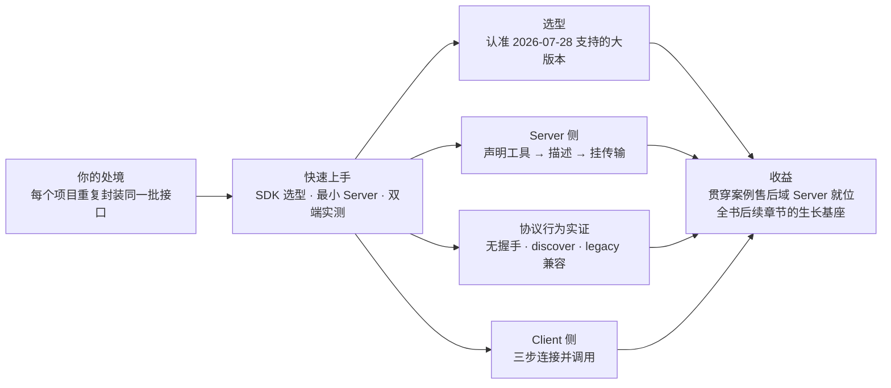
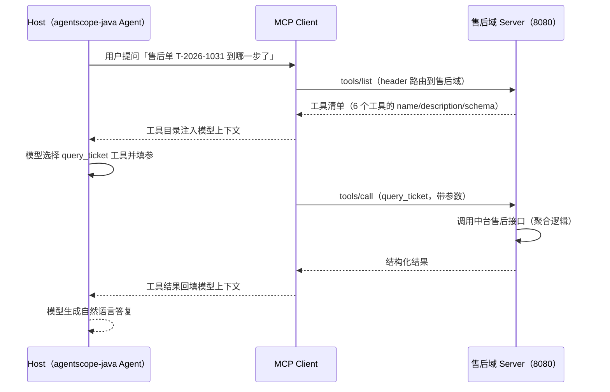

# 第 4 章 快速上手

> 本章导读：中台团队的真实处境是这样的——客服 Agent 项目要接售后接口，封装一遍；前端 CopilotKit 要展示售后进度，再封装一遍；新起的数据脚本，又一遍。本章要做的，就是把「封装一次、处处调用」从口号变成你机器上跑得起来的事实：30 分钟内，搭起第一个 MCP Server，并用一个真实的 Client 调用它。本章同时初始化贯穿全书的案例——**中台售后域 Server**，后续每一章都在它身上生长。读完本章，你能：选对 SDK 大版本并说明理由；写出最小 Server 并逐行解释每个部分；用裸 JSON-RPC 验证无状态协议的三个关键行为；说清一次工具调用在网络上的完整旅程。



*本章导览图*

## 你什么时候需要它

三种典型处境，对应本章三种读法。

**第一次接触 MCP，想先跑起来再理解**——按顺序通读。4.2 的最小 Server 十行以内，4.3 的四个实测每个都是一条命令，跑完你对「无状态」的理解会从名词变成体感。

**要为团队选定 SDK**——直接看 4.1 的选型表与论证。关键结论提前剧透：2026-07-28 是一次断裂式升级，**v1 时代的 SDK 不会获得支持**，选型第一原则是认准大版本。

**要给团队搭一个可复用的 Server 底座**——重点看 4.2 与 4.5。4.5 的售后域骨架（目录结构、工具文件的组织方式）就是底座的形状，后面的章节都在它上面生长。

前置条件：Node.js ≥ 20（实测环境）、npm 可用。Java 侧示例需要 JDK 17+ 与 Gradle，本章给出对照结构，实测补充见章末复核清单。

**环境与可复现性**：本章所有实测在以下环境完成——macOS（darwin）、Node 20+、`@modelcontextprotocol/server@2.4.0`、`@modelcontextprotocol/client@2.x`、zod 4.x，日期 2026-10-24。全部命令原样可复现；若你读到这里时 SDK 已有更新的小版本，行为以官方 changelog 为准（协议行为不受小版本影响，仅 API 细节可能调整）。

## 4.1 概述

本章围绕三个动作展开，它们也是所有 MCP Server 的共同骨架：

| 动作 | 做什么 | 对应小节 |
|------|--------|----------|
| **声明工具** | 把业务能力注册为带名字的工具 | 4.2 |
| **描述** | 用 JSON Schema 与 description 告诉模型「这是什么、怎么用」 | 4.2（深入在第 6 章） |
| **挂传输** | 选 stdio 或 Streamable HTTP，让请求进得来、结果出得去 | 4.2、4.3 |

SDK 怎么选？规范自身不断演进（第 3 章），SDK 按对规范版本的支持度分层。本书写作时的实况（2026-10 查证）：

| SDK | 2026-07-28 支持 | 关键事实 | 适用读者 |
|-----|-----------------|----------|----------|
| TypeScript `@modelcontextprotocol/*` | **v2.x 起**（实测 2.4.0） | v1.x 明确不会支持 2026-07-28；v2 拆分为独立包（client / server），新增 stateless transport | 生态最大，前端同构场景 |
| Java `io.modelcontextprotocol.sdk:mcp-core` | **2.0.x 起**（查证 2.0.1，2026-10-17 发布） | 新 Server 在 `io.modelcontextprotocol.modern` 包，与 legacy `McpSchema` 并存；通过全部 37 项 2026-07-28 一致性场景 | **agentscope-java 读者主线** |
| Python `modelcontextprotocol` | ⚠️ 待核对 | 动笔实测时以官方 SDK 列表页为准 | 数据侧脚本 |

各 SDK 的官方分层口径见 [SDK 列表页](https://modelcontextprotocol.io/docs/2026-07-28/sdk)——它按完整性、协议支持、维护承诺给每个 SDK 分级，选型前先看这一页。

本书的写法约定：**以 TypeScript 作实测载体**——所有协议行为均在 TS SDK v2.4.0 上跑通并留有命令级证据；Java 侧给出对照结构，供 agentscope-java 读者逐项映射（方法签名以 javadoc 实测为准，见章末复核清单）；Python 仅在第 5、8 章转述官方教程时出现。先看 TypeScript 侧，因为它能在五分钟内从安装跑到调用。

## 4.2 先跑通：十行最小 Server

在任意目录初始化并安装两个包：

```bash
npm init -y
npm i @modelcontextprotocol/server zod
```

新建 `server.mjs`（ESM 格式，零构建配置）：

```typescript
import { McpServer } from "@modelcontextprotocol/server";
import { serveStdio } from "@modelcontextprotocol/server/stdio";
import { z } from "zod";

const server = new McpServer({ name: "after-sales", version: "0.1.0" });

server.registerTool("echo", {
  title: "回声",
  description: "原样返回输入文本，用于验证链路",
  inputSchema: z.object({ text: z.string().describe("要回显的文本") }),
}, async ({ text }) => ({
  content: [{ type: "text", text }],
}));

await serveStdio(() => server);
```

逐行拆开看，每一行都对应一个协议概念（第 2 章的概念在这里全部落地）：

| 代码 | 协议语义 |
|------|----------|
| `new McpServer({ name, version })` | Server 身份。回应答的 `_meta.serverInfo` 自报家门（第 2.5 节） |
| `registerTool("echo", ...)` | 注册一个 model-controlled 的工具（第 6 章），名字是调用凭据 |
| `title` / `description` | title 给人（目录、审批界面），description 给模型（选择依据）——受众不同，都写 |
| `inputSchema: z.object(...)` | 参数 schema；`.describe()` 原样进入 JSON Schema 的 `description` 字段（实测印证） |
| `async ({ text }) => ...` | 工具处理器：入参是 schema 校验后的参数对象，返回 `content` 数组 |
| `serveStdio(() => server)` | 挂 stdio 传输；工厂形态是为 Dual-era 兼容留的口子（第 3 章） |

启动后它就是一个标准 MCP Server 了。接下来不做任何「连接」动作，直接用裸 JSON-RPC 和它说话——这正是 2026-07-28 与旧版协议最直观的差别。

## 4.3 不发握手，直接调用：三个行为的实证

2026-07-28 移除了协议级会话与 `initialize` 握手（第 3 章）。「无握手」不是文档上的一句话，它是可以被一行命令验证的行为。以下四个实测都在 v2.4.0 下完成（2026-10-24），命令即证据。

### 实测一：无握手直发 `tools/list`

Server 跑起来后，向 stdin 喂一行 JSON-RPC——注意，**没有发过任何 initialize**：

```bash
echo '{"jsonrpc":"2.0","id":1,"method":"tools/list"}' | node server.mjs
```

```json
{"result":{"tools":[{"name":"echo","title":"回声","description":"原样返回输入文本，用于验证链路",
"inputSchema":{"type":"object","$schema":"https://json-schema.org/draft/2020-12/schema",
"properties":{"text":{"type":"string","description":"要回显的文本"}},"required":["text"]}}]},
"jsonrpc":"2.0","id":1}
```

工具清单直接返回。v1 时代的教程会先教你握手——在这里那一步不存在了。zod 的 `.describe()` 出现在了输出的 `description` 字段里：**描述质量的工程抓手，从第一行代码就生效**（第 6 章的主线）。

逐字段读懂这个响应，四个细节各有含义：

| 响应片段 | 含义 | 关联章节 |
|----------|------|----------|
| `"name": "echo"` + `required` | 名字与必填参数——模型填参的硬约束 | 6.1 |
| `"$schema": ".../draft/2020-12/schema"` | JSON Schema 方言默认 2020-12，可显式声明其他方言 | 6.2 |
| `"description"`（工具级与字段级） | 模型选工具、填参数的双层依据——两层都是「描述质量」 | 6.3 |
| `"title": "回声"` | 人类可读名，给目录与审批界面，不给模型 | 6.1 |

注意响应里**没有** `ttlMs`/`cacheScope`——`tools/list` 规范要求带缓存提示（第 3 章），SDK 会补齐；裸手写实验时看到不一致，先怀疑是实验脚本没走 SDK 的完整路径。

### 实测二：`tools/call` 拿到结构化结果

```bash
echo '{"jsonrpc":"2.0","id":2,"method":"tools/call","params":{"name":"echo","arguments":{"text":"你好 MCP"}}}' | node server.mjs
```

```json
{"result":{"content":[{"type":"text","text":"你好 MCP"}]},"jsonrpc":"2.0","id":2}
```

参数经 schema 校验后进入处理器，结果按 `content` 数组返回。如果处理器抛出业务异常，返回形态会变成 `isError: true` 的正常 result（第 6 章的两类错误模型，此处先埋个种子）。

### 实测三：`server/discover`，一次请求认识对方

规范要求每个 Server 实现 `server/discover`（第 2.6 节）——接入一个陌生 Server 时，先问它「你是谁、支持什么版本、有什么能力」：

```bash
echo '{"jsonrpc":"2.0","id":9,"method":"server/discover","params":{"_meta":{"io.modelcontextprotocol/protocolVersion":"2026-07-28","io.modelcontextprotocol/clientCapabilities":{}}}}' | node server.mjs
```

```json
{"result":{"supportedVersions":["2026-07-28"],
"capabilities":{"tools":{"listChanged":true}},
"resultType":"complete","ttlMs":0,"cacheScope":"private",
"_meta":{"io.modelcontextprotocol/serverInfo":{"name":"after-sales","version":"0.1.0"}}},
"jsonrpc":"2.0","id":9}
```

版本清单、能力、身份、缓存提示一次拿全。接入新 Server 时先 discover 再干活，联调出错信息会少一半。注意 `tools.listChanged: true`——这个能力声明意味着 Server 会在工具目录变化时发通知（第 7 章的「活目录」机制，源头在这里）。

### 实测四：legacy 兼容是活的

最有趣的一个：向同一个 Server 发一个 2025-06-18 时代的 `initialize` 握手：

```bash
echo '{"jsonrpc":"2.0","id":3,"method":"initialize","params":{"protocolVersion":"2025-06-18","capabilities":{},"clientInfo":{"name":"old-client","version":"1.0"}}}' | node server.mjs
```

```json
{"result":{"protocolVersion":"2025-06-18","capabilities":{"tools":{"listChanged":true}},
"serverInfo":{"name":"after-sales","version":"0.1.0"}},"jsonrpc":"2.0","id":3}
```

它**被正常应答了**——Server 返回了 `protocolVersion: "2025-06-18"` 的标准握手结果。这就是规范说的 **Dual-era Server**（第 3 章）：按 client 的开场自动分流，现代 client 走无状态路径，legacy client 走旧握手语义，一份代码同时服务两代。`serveStdio` 的 `legacy: 'reject'` 选项可以反过来硬切旧版（拒绝并报出支持的现代版本），灰度迁移时有用。

读懂这个应答，注意它说明的三件事：

1. **Server 侧保留了完整的 legacy 执行路径**——不是「勉强兼容一个错误应答」，而是按旧协议语义正常工作（能力声明、serverInfo 一应俱全）
2. **分流依据是 client 的开场形态**——现代 client 直发业务请求（带 `_meta`），legacy client 发 `initialize`；Server 按消息形态判定走哪条路径，client 无需声明自己是谁
3. **这是灰度迁移的机制基础**——升级 Server 不要求所有消费端同步升级；第 3 章的七格兼容矩阵就是这张分流表的全景

四个实测拼出的图景：**无状态协议把「连接」从协议语义中抽走了**——每个请求自含，Server 无状态可任意扩缩，新旧 client 的差异被入口分流吸收。这就是第 2 章概念的体感版本。

## 4.4 首次调用的全链路时序

把实测拼回真实场景。用户对 agentscope-java 客服 Agent 说「我的售后单到哪一步了」，底层旅程如下：



三个观察点：

1. **`tools/list` 与 `tools/call` 是两次独立请求**——无状态语义下没有「先建立再复用」的隐含关系，目录本身可缓存（Server 响应里的 `ttlMs` 就是给这个用的）
2. **「模型选择工具」发生在 Host 侧**——Server 只提供目录与执行，把哪些工具放进模型上下文是 Host 的治理动作（第 7 章规模化治理的落点）
3. **HTTP 场景下每次请求都带标准头**——本图省略了，真实请求长这样（细节第 10 章展开）：

```http
POST /mcp HTTP/1.1
Content-Type: application/json
MCP-Protocol-Version: 2026-07-28
Mcp-Method: tools/call
Mcp-Name: after_sales_query_ticket

{ "jsonrpc": "2.0", "id": 1, "method": "tools/call", "params": { ... } }
```

`Mcp-Name` 让网关不解析 body 就能按工具名限流与审计；`MCP-Protocol-Version` 必须与 body 里 `_meta` 的版本一致，不一致返回 `400 + HeaderMismatch`。stdio 实测时看不到这些头——它们是 Streamable HTTP 传输的合规要求，本地 stdio 不涉及。

## 4.5 贯穿案例：售后域 Server 骨架

从本章起，全书围绕这个案例生长：第 6 章充实工具、第 7 章规模化、第 8 章多框架消费。骨架先行：

```
after-sales-mcp/
├── src/main/java/.../AfterSalesServer.java   # Server 入口与工具注册
├── tools/                                     # 工具定义（一个任务级工具一个文件）
│   ├── query-ticket.json                      # 查询售后单进度
│   ├── create-ticket.json                     # 创建售后单（第 6 章实现）
│   └── ...
├── openapi/after-sales.yaml                   # 中台售后域 OpenAPI 原始资产（20 接口）
└── README.md                                  # 域归属、负责人、工具目录
```

Java 侧的对照结构（mcp-core 2.0.x，`io.modelcontextprotocol.modern` 包）。⚠️ 以下为结构示意——方法签名以 javadoc 实测为准（章末复核清单第一项），但四个组成部分与 TS 严格对应：

```java
// build.gradle: implementation("io.modelcontextprotocol.sdk:mcp-core:2.0.1")
var server = McpServer.toolServer()                    // ① Server 构建入口（modern 包）
    .tool("echo",                                      // ② 声明工具：名字即调用凭据
        "原样返回输入文本，用于验证链路",                 // ③ description：给模型的选择依据
        Map.of("text", stringParam("要回显的文本")),     // ④ 参数 schema（JSON Schema 同款语义）
        (args) -> Map.of("text", args.get("text")))    // ⑤ 处理器：入参→出参
    .build();

server.startStreamableHttp(8080);                      // ⑥ 挂 Streamable HTTP（生产形态）
```

| TS 侧 | Java 侧 | 协议语义（两侧一致） |
|--------|---------|----------------------|
| `new McpServer({ name, version })` | `McpServer.toolServer()...build()` | Server 身份，自报于 `_meta.serverInfo` |
| `registerTool(name, config, cb)` | `.tool(name, desc, schema, handler)` | 工具注册；名字唯一性 scope 为单 Server |
| `serveStdio(...)` | `startStreamableHttp(8080)` | 传输挂载；stdio 本地、HTTP 生产（第 10 章） |

两张表对照着看，你会看到一个事实：**「声明工具 → 描述 → 挂传输」的三动作与语言无关**——这正是第 8 章「跨框架通用」的微观基础。选择主语言的判断依据也在这里：Java 读者群（agentscope-java 生态）直接用 mcp-core，与业务代码同构部署；原型验证与前端同构场景用 TS；两者都过时的教程不要参考（第 3 章）。

三个设计决定值得说明：

- **工具定义外置为文件**（`tools/*.json`）：工具是「目录条目 + 执行逻辑」的组合，定义外置让目录治理（第 7 章）不必碰代码
- **OpenAPI 原样入库**（`openapi/`）：它是第 7 章生成管线的输入，也是接口变更 diff 的基准
- **echo 级占位先行**：`query_ticket` 的完整实现（schema 设计、错误消息、幂等）是第 6 章的内容——本章只求链路通，不求工具好

骨架里的两个关键文件，现在就能填出雏形。工具定义文件（`tools/query-ticket.json`）——它同时是「给模型看的目录条目」与「给开发者的实现契约」：

```json
{
  "name": "after_sales_query_ticket",
  "title": "查询售后单",
  "description": "按售后单号查询售后单当前进度（审核/维修/退款/完结）。单号格式 T-YYYY-NNNN。查物流轨迹用 logistics 域工具，不要用本工具。",
  "domain": "after-sales",
  "aggregates": ["GET /api/v1/tickets/{id}", "GET /api/v1/tickets/{id}/timeline"],
  "status": "draft",
  "owner": "售后域团队"
}
```

四个字段就是第 7 章目录治理的雏形：`name` 带域前缀（聚合消歧）、`description` 含任务语义与边界声明（第 6 章）、`aggregates` 记录聚合了哪些中台接口（变更影响面的依据）、`owner` 明确描述质量的责任人。域 README（`README.md`）则是 Server 级的目录：

```markdown
# after-sales 域 Server
- 域归属：售后（中台售后中心）
- 工具目录：6 个任务级工具（查询/创建/试算/撤销/催办/评价），聚合 20 个中台接口
- 对应 OpenAPI：openapi/after-sales.yaml（v2026.1）
- 负责人：售后域团队 · 升级路径：#after-sales-mcp
```

## 4.6 从 echo 到真实工具：还差什么

echo 验证了链路，但它离「模型爱用、生产可靠」还有明确的差距清单——每一条对应后续一章：

| 差距 | 现状 | 去哪补 |
|------|------|--------|
| 描述只是占位 | "原样返回输入文本"没有任务语义 | 第 6 章：任务语义重写、边界声明、格式示例 |
| 参数无约束 | `text` 是裸 string | 第 6 章：正则、枚举、范围写进 schema（校验层执行） |
| 没有错误处理 | 处理器不会失败 | 第 6 章：两类错误两条路，消息写给模型看 |
| 无真实业务 | echo 不接中台 | 第 7 章：从 OpenAPI 聚合出任务级工具 |
| 单一消费端 | 只有手写 JSON-RPC 验证 | 第 8 章：agentscope-java 与前端双端接入 |
| 裸奔上线 | 无鉴权、无限流 | 第 10 章：授权框架与部署清单 |

这份清单也是本书的结构图——每一章填一行。下一步先补上「完整的 Server」这块工程底座（第 5 章：真实外部依赖、降级路径、日志纪律），再进入最有杠杆的一环——描述质量与错误处理（第 6 章）。

## 4.7 常见第一坑

| 坑 | 现象 | 解法 |
|----|------|------|
| SDK 装错大版本 | TS 装成 v1 的 `@modelcontextprotocol/sdk`，无 2026-07-28 行为 | 认准 v2 分包：`@modelcontextprotocol/server` / `client`（第 3 章） |
| 传输不通 | Client 连不上 stdio 进程 | 检查 command/args 指向的启动方式；stdio 的 stdin/stdout 被日志污染也会坏——日志走 stderr |
| schema 校验失败 | 调用返回 Invalid Params | 参数与 inputSchema 逐字段对照；必填缺失、类型不符是两大主因 |
| 模型不选工具 | 工具能调通，但 Agent 从不选它 | description 缺失或太弱——第 6 章的描述质量工程就是为此准备的 |
| 手写裸请求缺 `_meta` | 服务端返回 -32602 Invalid Params | 每个请求必须带 `protocolVersion` 与 `clientCapabilities`（第 2.5 节）；SDK 便捷方法已自动拼装 |
| 结果里找不到 structuredContent | echo 只返回 content | 只有定义了 `outputSchema` 且处理器返回 `structuredContent` 才有——第 6 章实测演示 |
| 版本不支持报错 | `-32022` + supported 清单 | 按清单选双方都支持的版本重试；不要盲改配置（第 3 章矩阵） |

## 4.8 本章小结

1. **选型看大版本**：2026-07-28 是断裂式升级——TS v2.x 分包（实测 2.4.0）、Java mcp-core 2.0.x（modern 包，37 项一致性通过）；v1 时代 SDK 与教程不再适用。
2. **Server 骨架三动作**：声明工具、描述（schema + description）、挂传输——十行以内可以起步。
3. **无握手是可验证的行为**：直发 `tools/list`、`tools/call` 立即生效（实测）；`server/discover` 一次拿到版本、能力、身份。
4. **legacy 兼容是活的**：同一 Server 应答 2025-06-18 的握手（Dual-era，实测），灰度期一份代码服务两代 client。
5. **贯穿案例骨架就位**：售后域目录结构（工具定义外置 + OpenAPI 入库）是后续所有章节的生长基座。

下一步把「能调通」升级为「生产可靠」：第 5 章补齐完整 Server 的工程底座，第 6 章讲 schema 设计、描述质量与错误处理——工具建模的手艺决定 Agent 成功率。

## 验收清单

读到这里，你应该能：

- ☐ 说明 2026-07-28 下 TS 与 Java SDK 的版本要求，并为团队选定主线；
- ☐ 从零写出 echo 级最小 Server 并启动；
- ☐ 用裸 JSON-RPC 完成无握手的 `tools/list` 与 `tools/call`；
- ☐ 调用 `server/discover` 并解释返回的四个部分；
- ☐ 向 Server 发 2025-06-18 握手并解释应答结果说明了什么；
- ☐ 画出一次工具调用的全链路时序，指出「模型选择」发生在哪一侧；
- ☐ 说出售后域骨架三个设计决定的理由。

## 参考速查

本节收拢本章实测命令与版本事实，供操作时对照。

| 操作 | 命令 / 值 |
|------|-----------|
| 初始化 | `npm init -y && npm i @modelcontextprotocol/server zod` |
| 启动 Server | `node server.mjs` |
| 无握手列目录 | `echo '{"jsonrpc":"2.0","id":1,"method":"tools/list"}' \| node server.mjs` |
| 调用工具 | `echo '{"jsonrpc":"2.0","id":2,"method":"tools/call","params":{"name":"echo","arguments":{"text":"hi"}}}' \| node server.mjs` |
| 能力发现 | `method: "server/discover"`（`_meta` 带协议版本与 clientCapabilities） |
| legacy 握手 | `method: "initialize"`，`protocolVersion: "2025-06-18"` |
| 实测版本 | `@modelcontextprotocol/server@2.4.0`、`@modelcontextprotocol/client@2.x`（2026-10-24） |

## 延伸阅读

- **第 3 章（版本演进）**——四个实测行为背后的协议变更史：为什么握手被移除、Dual-era 从哪来。
- **第 6 章（工具接入实战）**——echo 占位的下一步：schema 设计与描述质量决定 Agent 成功率。
- **第 2 章（协议核心概念）**——`_meta` 每请求元数据与 `resultType` 的完整语义。
- **agentscope-java 书第 26 章**——Host 侧（agentscope-java）如何接入 MCP Server。

## 复核清单（发布前）

- [x] TypeScript 示例：v2.4.0 实测通过（分包名、McpServer/registerTool 签名、serveStdio、无握手 tools/list、tools/call、legacy initialize 兼容、server/discover）——2026-10-24
- [ ] Java 示例：mcp-core 2.0.1 实测（坐标、modern 包 API 签名、Streamable HTTP 启动），并替换 4.5 的对照描述
- [ ] Python SDK 行：补查 2026-07-28 支持现状并填表
- [ ] Inspector 对 v2 / 2026-07-28 的支持状态核实
- [ ] 4.4 时序图的 Host→Client 环节待 agentscope 侧联调时复核
- [ ] SDK 列表页的分层支持口径复核（标注核实日期）
