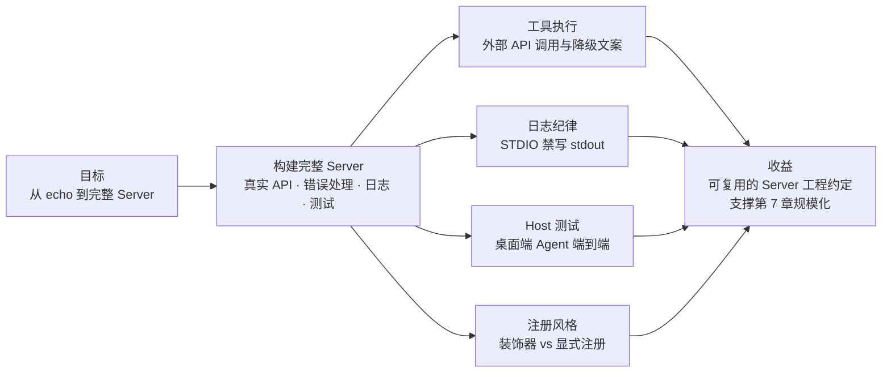

# 第 5 章 构建完整的 Server

> 本章导读：第 4 章的 echo 验证了链路，但「一个完整的 Server」要回答更多问题——真实的工具要调外部 API，出错怎么办？日志打到哪？写完怎么在真实 Host（桌面端 Agent）里测试？本章跟随官方教程的完整路径，从零构建一个有真实外部依赖的天气 Server（`get_alerts` + `get_forecast` 两个工具），并把每一步沉淀为可复用的工程约定。读完本章，你能：独立构建一个带外部 API 依赖的完整 Server；掌握 STDIO 服务器的日志纪律（一条会毁掉整个服务器的红线）；用真实 Host 完成端到端测试；说清装饰器注册与显式注册两种风格各自的适用场景。



*本章导览图*

## 你什么时候需要它

三种处境，对应本章三种用法。

**要写第一个有真实业务依赖的 Server**——按顺序通读：官方教程的天气 Server 走了一条最短路径（外部 API + 错误降级 + 两工具协作），每一步都是你业务 Server 的预演。

**团队要定 Server 工程规范**——直接看 5.2（日志纪律）与 5.3 的注册风格选型。这两块是「写出来大家一样」的基础，尤其是日志红线：一条 `print` 能毁掉整个 STDIO 服务器。

**要向领导演示 MCP 的价值**——看 5.4：把你的 Server 接进桌面端 Agent，自然语言问出结构化数据的那一刻，比任何架构图都有说服力。

前置知识：第 4 章的三个动作（声明工具、描述、挂传输）与四个实测。本章的 Python 主线来自官方教程，TS/Java 对照沿用第 4 章的实测环境。

## 5.1 概述

先交代本章案例的来源与定位：主线素材是**官方 build-server 教程**，它选择的案例是天气 Server——两个工具：`get_alerts`（按美国州代码查 active 预警）与 `get_forecast`（按经纬度查预报）。官方选它不是随便挑的：

- **有真实外部依赖**（National Weather Service API）——工具执行的完整链路：请求、失败降级、格式化
- **两个工具有协作关系**——forecast 内部先查 grid 端点再查预报，「一个工具两次 API 调用」正是中台聚合的微缩模型（第 7 章的伏笔）
- **公开 API 无鉴权**——排除干扰，聚焦协议与工程本身

我们的贯穿案例（售后域）与它结构完全同构：外部依赖换成中台接口，`get_alerts` 换成 `after_sales_query_ticket`，逐节都能映射。所以本章的产出不是「一个天气 Server」，而是一套**与案例无关的工程约定**——外部依赖怎么处理、日志打到哪、写完怎么测，你搬到任何业务 Server 上都成立。

Server 的三类能力（resources / tools / prompts）中，教程聚焦 tools——这也是企业 Server 的主力形态（第 2.1 节的能力建模表）。本章的四段旅程：**环境与红线 → 工具执行 → 注册风格 → Host 测试**。

## 5.2 环境准备与第一条红线

官方教程用 Python（uv 管理，要求 Python ≥ 3.10、**Python MCP SDK ≥ 2.0.0**——又是大版本门槛，与第 4 章的 SDK 断代逻辑一致）：

```bash
uv init weather && cd weather
uv venv && source .venv/bin/activate
uv add "mcp[cli]"
```

环境就绪后，先立一条**红线**——它排在教程所有代码之前，足见其分量：

> **STDIO 服务器的日志纪律：永远不要写 stdout。** `print()` 默认写 stdout，而 stdout 是 JSON-RPC 的传输通道——一条日志混进去，协议消息流即被污染，整个 Server 失联。

```python
import logging

logger = logging.getLogger(__name__)   # 每模块一个 logger

# ❌ Bad（STDIO 服务器内）
print("Processing request")            # 写 stdout → 污染 JSON-RPC 流

# ✅ Good
logger.info("Processing request")      # logging 默认写 stderr —— 安全
```

为什么这条红线值得排在所有代码之前？因为它违反时的症状最迷惑人：Server 明明在跑，Host 却时通时断，报错指向协议解析而不是你的业务代码。stdio 通道是协议的一部分，而日志是纯工程事务——两者共享一个出口时，工程事务随时可能杀死协议。

三条衍生纪律：用标准库 `logging`（天然走 stderr）；HTTP 服务器的 stdout 日志无害（不占传输通道）；**stdout 只留给协议**。TS 侧同理：`console.log` 写 stdout，`console.error` 才是安全出口——第 4 章 `server.mjs` 若加过一行 `console.log` 调试，与本章的裸 JSON-RPC 实测同跑时协议流就会错乱。

v1 时代的 `logging/setLevel` 已在 2026-07-28 移除（第 3 章）：日志级别现在由 client 在每个请求的 `_meta.io.modelcontextprotocol/logLevel` 里按请求声明——Server 按请求调级，不再有全局级别状态。

## 5.3 工具执行：从 API 到工具结果的完整链路

教程的工具执行分三层，这个分层值得原样搬进任何业务 Server：

**① 常量与实例**：

```python
from mcp.server import MCPServer

mcp = MCPServer("weather")

NWS_API_BASE = "https://api.weather.gov"
USER_AGENT = "weather-app/1.0"
```

**② Helper：外部请求 + 降级**。注意 `make_nws_request` 的返回约定——任何异常都返回 `None` 而非抛出：

```python
async def make_nws_request(url: str) -> dict[str, Any] | None:
    headers = {"User-Agent": USER_AGENT, "Accept": "application/geo+json"}
    async with httpx2.AsyncClient() as client:
        try:
            response = await client.get(url, headers=headers, timeout=30.0)
            response.raise_for_status()
            return response.json()
        except Exception:
            return None
```

**③ 工具处理器：None 检查 → 分支降级文案 → 格式化输出**：

```python
@mcp.tool()
async def get_alerts(state: str) -> str:
    """Get weather alerts for a US state.

    Args:
        state: Two-letter US state code (e.g. CA, NY)
    """
    url = f"{NWS_API_BASE}/alerts/active/area/{state}"
    data = await make_nws_request(url)

    if not data or "features" not in data:
        return "Unable to fetch alerts or no alerts found."   # 降级文案 ①
    if not data["features"]:
        return "No active alerts for this state."             # 降级文案 ②：空也是结果
    alerts = [format_alert(feature) for feature in data["features"]]
    return "\n---\n".join(alerts)
```

三层各有可复用的判断：

- **Helper 层吞异常返回 None**——把「网络失败」从异常流降为数据流，处理器不必到处 try/catch。错误从此分成两条路：网络降级在这里被建模为**普通文本结果**（「查不到」对模型是可理解、可转述的状态），而真正的协议错误走 JSON-RPC error——两类错误的完整模型在第 6 章
- **分支降级文案写给模型看**——「Unable to fetch…」「No active alerts…」是两个不同的事实（失败 vs 空集），模型需要区分才能对用户说对话
- **格式化面向可读性**——`format_alert` 把字段拼成带标签的文本块，多个结果用分隔线连接：模型消费文本的体验，就是用户得到的回答质量

`get_forecast` 则演示了**工具内的二次调用**：先查 `points/{lat},{lon}` 拿 grid 预报端点，再请求真正的预报——一个工具、两次上游调用、逐层判空。这就是「纵向聚合」的原型（第 7.2 节）：模型只看见一个任务，Server 内部编排多步。

### Python SDK 的注册风格：装饰器 + docstring

注意 `@mcp.tool()` 与函数 docstring——Python SDK 用类型注解与 docstring **自动生成**工具定义（name 取函数名、description 取 docstring、参数 schema 取类型注解），与第 4 章 TS 的显式 `registerTool` 是同一件事的两种风格：

| | 装饰器 + docstring（Python 风格） | 显式注册（TS/Java 风格） |
|----|----|----|
| 描述来源 | docstring（含 Args 段） | 显式 description / `.describe()` |
| 适用 | 工具即函数，原型快 | 目录外置、描述与代码分离（第 7 章管线友好） |
| 风险 | docstring 改了描述就变——评审易漏 | 定义集中，评审显式 |

本书贯穿案例用**定义外置**风格（`tools/*.json`），理由在第 4 章贯穿案例一节：目录治理不应依赖读代码。两种风格都合规，团队二选一并写进规范。

### 运行与收尾

```python
if __name__ == "__main__":
    mcp.run(transport="stdio")
```

`uv run weather.py` 启动后，Server 挂在 stdio 上等待 Host。到这里，「完整」的三个要件——真实依赖、降级路径、日志纪律——都齐了。

## 5.4 Host 测试：接进真实的桌面端 Agent

教程的测试环节不是写单测，而是把 Server 接进 **Claude for Desktop**：配置 Host 的 MCP Server 清单（指向本 Server 的启动命令），重启 Host，然后用自然语言问：「What's the weather in New York?」——观察模型选中 `get_forecast`、填对经纬度、把结果转述成人话。

为什么这一步不能省？因为前几章验证的都是协议维度（请求进、结果出），而「模型会不会选这个工具、参数填得对不对、结果转述得好不好」是三个全新的维度——它们只有真实模型在真实上下文里才测得出来。

### 配置文件与启动命令

配置文件位置因平台而异（不存在则创建）：

| 平台 | 路径 |
|------|------|
| macOS | `~/Library/Application Support/Claude/claude_desktop_config.json` |
| Linux | `~/.config/Claude/claude_desktop_config.json` |
| Windows | `%AppData%\Claude\claude_desktop_config.json` |

在 `mcpServers` 键下登记 Server——本质是告诉 Host 两件事：「有个叫 weather 的 Server」「用这条命令启动它」：

```json
{
  "mcpServers": {
    "weather": {
      "command": "uv",
      "args": ["--directory", "/ABSOLUTE/PATH/TO/weather", "run", "weather.py"]
    }
  }
}
```

三个官方点名的排错点：`command` 可能需要**可执行文件全路径**（`which uv` 获取）；路径必须**绝对路径**；Windows 的 JSON 路径用双反斜杠或正斜杠。保存后**重启 Host** 生效——Host 只在启动时读取 Server 清单。

### 端到端验证什么

| 验证层 | 第 4 章 | 本章 |
|--------|---------|------|
| 协议行为 | ✅ 裸请求直调 | — |
| 工具选择 | ❌ 无模型 | ✅ 真实模型在真实上下文里选工具 |
| 填参质量 | ❌ 无模型 | ✅ 「New York」→ 经纬度的转换由模型完成 |
| 结果转述 | ❌ 无模型 | ✅ 结构化数据 → 自然语言 |

这也是第 8 章「双端实测」的前奏：桌面端 Host 之后，我们还会用自己的 Client 与 agentscope-java 接入同一个 Server。每一次接入，验证的都是同一份工具定义的不同消费侧面。

调试环节的完整工具箱（Inspector 的 web 界面 / TUI / CLI、协议时代检查、安全审计面）内容量大，独立成章——见第 9 章「调试与 Inspector」。

## 5.5 常见工程坑

| 坑 | 现象 | 解法 |
|----|------|------|
| print 污染协议流 | STDIO Server 偶发失联、JSON-RPC 解析错误 | 排查一切 stdout 输出；日志统一走 logging/stderr（5.2 红线） |
| 外部 API 异常打断服务 | 一次网络抖动，整个工具调用报协议错误 | Helper 层吞异常返回降级值；分支文案区分「失败」与「空集」 |
| 装饰器风格描述漏评审 | docstring 顺手改了，模型行为变化无人知晓 | 描述变更走目录评审（第 7 章）；或改用定义外置风格 |
| 忘记 `_meta` 必填 | 手写请求返回 -32602 | SDK 便捷方法自动拼装；裸写时对照第 2.5 节键表 |

## 5.6 本章小结

1. **完整 Server 的三要件**：真实外部依赖、降级路径（失败与空集分开说）、日志纪律（STDIO 禁 stdout）。
2. **工具执行三层**：常量实例 → Helper（吞异常）→ 处理器（分支降级文案）——分层可原样搬进业务 Server。
3. **注册风格二选一**：装饰器/docstring 原型快，定义外置评审友好——团队定一个，写进规范。
4. **Host 测试补齐模型维度**：工具选择、填参、转述——只有真实模型能验证。
5. **v1 的 logging/setLevel 已去**：日志级别按请求走 `_meta`。

下一步有两条路：关心「工具的手艺」（描述质量、schema、错误分类）进**第 6 章**；关心「从一到千」的中台规模化进**第 7 章**。建议先 6 后 7。

## 验收清单

读到这里，你应该能：

- ☐ 复述 STDIO 日志红线，并指出 TS 侧对应的安全出口；
- ☐ 用「Helper 吞异常 + 分支降级文案」的模式改写一个直抛异常的工具；
- ☐ 解释 `get_forecast` 的两次上游调用与第 7 章「纵向聚合」的关系；
- ☐ 对比装饰器与显式注册两种风格，为团队做出选择并说明理由；
- ☐ 把一个本地 Server 接入真实桌面端 Host，并完成一次自然语言到结构化数据的端到端验证。

## 参考速查

| 项 | 值 |
|----|----|
| 官方教程 | docs/2026-07-28/develop/build-server（Python ≥ 3.10，SDK ≥ 2.0.0） |
| 环境 | `uv init && uv venv && uv add "mcp[cli]"` |
| 启动 | `uv run weather.py`（transport="stdio"） |
| 日志红线 | stdout 仅协议；`logging` 走 stderr；TS 用 `console.error` |
| 日志级别 | client 按请求经 `_meta.io.modelcontextprotocol/logLevel` 声明 |
| 案例代码 | modelcontextprotocol/quickstart-resources（weather-server-python） |

## 延伸阅读

- **第 6 章（工具接入实战）**——本章工具的「描述质量」下一层：schema 设计与错误分类的完整手艺。
- **第 9 章（调试与 Inspector）**——本章「接桌面端试」之外的系统化调试工具箱。
- **第 7 章的生成管线**——本章手工建模的自动化版本：OpenAPI → 候选工具。
- **官方 build-server 教程原文**——本章的主线素材，含 TypeScript 并行版本。

## 复核清单（发布前）

- [ ] build-server.mdx 剩余部分（TS 并行教程、Claude Desktop 配置细节、262 行后的测试章节）深读并校对本章转述
- [ ] Python 示例按官方仓库 quickstart-resources 实测
- [ ] TS/Java 侧「完整 Server」平行示例（外部 API 依赖版）实测补充
- [ ] 桌面端 Host 配置文件的准确格式与截图核对
