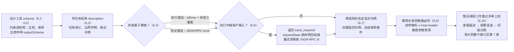

# 第 6 章 工具接入实战

> 本章导读：中台售后团队的 Agent 上线了——模型从不调用售后工具，或者调了但参数填错，又或者遇到「单号不存在」时直接把报错甩给了用户。这不是模型的问题，是工具建模的问题。本章把第 4 章「能调通」的工具，升级为「模型爱用、出错能自纠、生产可靠」的工具：schema 怎么设计才让模型填得对、description 怎么写才让模型选得准、错误怎么分两类各走各的路、缺用户输入时怎么用 MRTR 优雅地问、跨调用的状态怎么用显式句柄管理。读完本章，你能：为任意业务接口设计出模型可准确选中的任务级工具；用「两类错误」模型处理失败；用句柄模式管理跨调用状态；建立团队的工具描述评审标准。



*本章操作流程图*

## 你什么时候需要它

三种典型处境，对应本章三种用法。

**模型不选我的工具，或者选了填错**——直接看 6.3（描述质量）与 6.2（schema 设计）。九成的情况是 description 写成了系统视角（「调用 /api/v1/xxx 接口」），模型无从把它和用户意图对上。

**工具一失败，Agent 就把异常甩给用户**——看 6.4（两类错误）。规范把错误分成「协议错误」与「工具执行错误」两条路，后者是为模型自纠设计的，你的错误消息可能一直在走错的路。

**工具需要跨多次调用保持状态（购物车、多步流程）**——看 6.7（显式句柄）。无状态协议下这不是障碍，是明确的模式；规范甚至给了句柄设计的四条要点。

前置：第 4 章的最小 Server 与双端实测；第 2 章的 resultType 与 MRTR 概念。

## 6.1 概述

先立一个规范原文的立场：工具是 **model-controlled** 的——模型根据上下文自主发现并调用。这句话反过来读更有分量：你无法强迫模型调用某个工具，也无法在它选错时「纠正」它——你能做的全部事情，是把工具**设计**得让模型愿意选、选了填得对。

同时规范强调另一面：**任何时刻都应有人类在环（human in the loop）并有权拒绝调用**——Host 应展示暴露了哪些工具、调用时有视觉指示、敏感操作弹确认。这两句话放在一起，就是本章的世界观：**给模型自由，给人类缰绳**。

本章的工具定义解剖（对照规范 server/tools）：

| 字段 | 作用 | 给谁看 |
|------|------|--------|
| `name` | 唯一标识，调用凭据 | 协议（模型引用） |
| `title` | 人类可读名 | 人（目录/审批界面） |
| `description` | 功能描述 | **模型**（选择依据） |
| `inputSchema` / `outputSchema` | 参数与输出的 JSON Schema | 协议校验 + 模型填参 |
| `icons` | 界面图标 | 人 |
| `annotations` | 行为注解（如 readOnlyHint） | Host（⚠️ 来自不可信 Server 时视为不可信） |

**工具名规范**（SHOULD）：1-128 字符；大小写敏感；仅 `A-Za-z0-9_.-`；Server 内唯一。关键细节：**唯一性作用域是单个 Server**——聚合多 Server 的 Host/网关会遇到撞名（两个 Server 都叫 `search`），应当加前缀消歧，且不能依赖 `serverInfo.name`（不保证全局唯一）。这是第 7 章命名规范（`domain_action`）的协议依据。

无参数工具的规范写法（推荐显式拒绝多余属性）：

```json
{ "type": "object", "additionalProperties": false }
```

## 6.2 Schema：约束写进结构，别靠劝说

模型填参数时依据什么？只有两样：schema 的结构约束，和 description 的文字说明。两者的地位完全不同——**约束写进 schema 的部分会被校验层强制执行**，填错了直接被拒，模型会换一种填法重试；**写在 description 里的要求只是「劝说」**，模型可能听，也可能不听，而且没人能在协议层拦住它不听。所以设计规则只有一条主线：能交给结构的，绝不交给文字。

模型看到的工具，就是 `tools/list` 返回的那段 JSON Schema（2020-12 方言，可 `$schema` 显式指定其他方言）。四条设计规则：

1. **类型最小化**：能用 `string` + 枚举描述的不造嵌套对象。模型对深层嵌套的填参错误率显著高于扁平结构。
2. **必填慎用**：每个 `required` 字段都是模型「编一个值」的诱惑。无法从上下文推断的参数，宁可做成可选 + 缺省语义，或用 MRTR 向用户要（6.6）。
3. **约束写进 schema**：格式（正则）、枚举、范围放 schema 约束里——它们会被校验层执行；description 只是「劝说」。
4. **每个字段都有 `description`**：zod 的 `.describe()` 会原样进入 JSON Schema（第 4 章实测），这是成本最低、收益最大的投入。

```typescript
// 实测于 v2.4.0：约束与描述都进 schema
inputSchema: z.object({
  ticket_id: z.string()
    .regex(/^T-\d{4}-\d+$/, "格式 T-YYYY-NNNN")
    .describe("售后单号，如 T-2026-1031"),
  channel: z.enum(["app", "web", "miniprogram"])
    .describe("用户反馈来源渠道，未知时留空"),
}).partial({ channel: true }),  // channel 可选
```

**`$ref` 安全**：2020-12 允许 `$ref` 指向网络 URI，但实现**不得**自动解引用网络引用（可提供默认关闭的 opt-in，且需 host 白名单、超时、日志）；因未解析的 `$ref` 而校验失败的 schema 应拒绝而非当宽松处理。组合关键字（`anyOf`/`oneOf`/`if-then-else`）要有深度/数量/时间预算上限——恶意 schema 是校验器的 DoS 向量。

## 6.3 描述质量：模型靠 description 选工具

工具选择的本质是**模型拿用户意图与工具描述做匹配**。用户意图是自然语言（「这单退货的钱什么时候到」），描述也是自然语言——匹配能否成功，取决于你的描述说的是模型的任务语言，还是系统的实现语言。同一能力，两种写法的成败差异：

```text
❌ 差：系统视角——"调用售后中台工单查询接口 /api/v1/tickets/query"

✅ 好：任务视角——"按售后单号查询售后单当前进度（审核/维修/退款/完结）。
   单号格式 T-YYYY-NNNN。查物流轨迹用 logistics 域工具，不要用本工具。"
```

差 vs 好的三条来源：

- **任务语义而非系统语义**——说「做什么」，不说「调哪个接口」。模型的世界里没有「/api/v1/tickets/query」，只有「用户想知道售后进度」
- **边界声明**——什么情况**不该**用我（防误选，例句里的「查物流用物流域」）。没有边界声明的工具会在相近场景被误选，误选的代价是错误的调用与浪费的轮次
- **格式示例**——给模型一个可模仿的填参样例

`title` 也不可省——它是给**人**看的（工具目录、审批界面），description 是给**模型**看的，受众不同，都写。Server 级还有 `server/discover` 的 `instructions` 字段——写给模型的 Server 使用说明（第 2.6 节），与工具描述是同一门手艺的两级。

## 6.4 两类错误：让模型能自纠

**关键实测（v2.4.0）**：工具处理器 throw 的异常，协议层返回的是**正常 result + `isError: true`**，错误消息进 content——不是 JSON-RPC error：

```json
{"result":{"content":[{"type":"text",
  "text":"单号 bad-123 不符合格式 T-YYYY-NNNN，请向用户确认后重试"}],
  "isError":true},"jsonrpc":"2.0","id":2}
```

第一次见到这个行为的人多半会意外：抛异常居然不是「报错」？这个区分是规范的有意设计。想想两个场景：模型填错了单号格式——它能自己改对；MCP 请求本身是畸形的——模型无从修起。前者值得再给一次机会，后者重试一万次也没用。所以规范把错误分成两条路：

| | 协议错误（Protocol Error） | 工具执行错误（Tool Execution Error） |
| --- | --- | --- |
| 例子 | 未知工具、请求畸形、Server 内部错误 | API 失败、输入校验失败（日期格式/值越界）、业务规则不允许 |
| 形态 | JSON-RPC `error` 对象 | 正常 result + `isError: true`，消息进 content |
| 模型能否自纠 | 较难（client 可以给模型，但恢复率低） | **应给模型**——规范的用词是 self-correct |

既然执行错误是给模型看的，错误消息就该按「读者是模型」来写。规范原文的示例错误消息值得抄进团队规范：`"Invalid departure date: must be in the future. Current date is 08/08/2025."`——三要素齐活：**错了什么、规则是什么、模型下一步该怎么改**。

重试语义配套：**可重试错误**（超时、限流）在消息里说明可重试；**不可重试错误**（参数错）明确说「不要原样重试，先修正」。限流类错误附上重试间隔。

## 6.5 结构化输出与五种内容类型

工具结果分**非结构化**（`content` 数组）与**结构化**（`structuredContent`）两种载体。

content 支持五种类型，都可带 annotations（audience/priority）：

- `text` / `image`（base64）/ `audio`（base64）
- `resource_link`：指向资源的 URI（可被订阅或拉取；注意：工具返回的资源链接**不保证**出现在 `resources/list` 里）
- `resource`：直接内嵌资源内容

**结构化输出**：定义了 `outputSchema` 时，Server **必须**返回符合它的 `structuredContent`（任意 JSON 值）；client **应该**据此校验。向后兼容：返回结构化内容的工具**应**同时在 text content 里给序列化 JSON。实测印证（第 4 章）：处理器返回 `structuredContent` 时与 `content` 并存。

```json
{ "result": { "resultType": "complete",
    "content": [{ "type": "text", "text": "{\"status\": \"审核中\"...}" }],
    "structuredContent": { "status": "审核中", "eta": "2026-10-30" } } }
```

`outputSchema` 的价值：严格的响应校验、类型信息、引导 client 与模型正确解析、更好的文档。大结果处理三条：服务端分页（默认小页）、字段裁剪（返回模型需要的，不是接口返回的全部）、超大内容转 resource 引用。

## 6.6 MRTR：工具缺输入时怎么优雅地问

工具执行到一半缺用户输入（确认、必选字段），有状态协议的做法是开个会话挂着等；无状态协议的答案是把「要什么」原路带回，让 client 收集齐了再以一个**全新的请求**续上。具体形态：返回 `resultType: "input_required"` 的 `InputRequiredResult`。完整协议流转（规范原文示例译述）：

```json
// ① Server 返回：inputRequests 以键命名每个所需输入，requestState 原样带回
{ "resultType": "input_required",
  "inputRequests": { "github_login": { "method": "elicitation/create",
      "params": { "mode": "form", "message": "Please provide your GitHub username",
        "requestedSchema": { "type": "object",
          "properties": { "name": { "type": "string" } }, "required": ["name"] } } } },
  "requestState": "eyJsb2NhdGlvbiI6Ik5ldyBZb3JrIn0..." }

// ② client 收集后，重试原始请求：inputResponses 对应同键，requestState 原样带回
{ "method": "tools/call", "params": { "name": "...", "arguments": {...},
    "inputResponses": { "github_login": { "action": "accept", "content": { "name": "octocat" } } },
    "requestState": "eyJsb2NhdGlvbiI6Ik5ldyBZb3JrIn0..." } }
```

三个协议细节，实现时全要踩对：**重试的 JSON-RPC `id` 必须与原请求不同**；`requestState` 是 Server 放置续接上下文的不透明载体（client 原样带回，不解析）；elicit 结果带 `action`（accept/decline/cancel），Server 要处理拒绝分支。SDK 层（TS v2.4.0）的工具处理器返回 `inputRequired` 对象即对应 ①，内嵌请求构造器覆盖 elicit（表单）、createMessage（借模型推理）、listRoots 三类。

## 6.7 显式句柄：跨调用状态的正确姿势

无状态协议下「购物车」「打开的浏览器会话」「数据库事务」怎么办？这是被问得最多的问题，而规范的答案朴素得让人意外：状态可以存在 Server 里，但**跨调用的引用必须走请求参数**，不走会话。规范给了专门的非规范指导（Stateful Tools），模式一句话：**创建工具返回显式句柄，后续工具把句柄当普通参数传入**——线路上看，句柄就是结果里的一个字符串、下次调用的一个参数：

```jsonc
// tools/call: { "name": "create_basket" }
{ "structuredContent": { "basket_id": "bsk_a1b2c3" } }

// tools/call: { "name": "add_item", "arguments": { "basket_id": "bsk_a1b2c3", "sku": "..." } }
```

模型负责把 `basket_id` 带到下一次调用；Server 按 key 存取内容。句柄设计四要点（规范原文归纳）：

1. **授权**：句柄是名字，不是能力凭证——已认证 Server 每次调用都要校验调用者对句柄的归属；未认证 Server 的句柄实质是 bearer token，要够熵（UUIDv4）且限时
2. **不透明**：编码内部结构的句柄会诱发解析与猜测；不透明 ID 不会
3. **生命周期**：句柄活得比任何连接久，保留策略写进**创建工具的 description**（如「24 小时不活跃即过期」）——模型要在决定创建状态时看到它
4. **过期可自纠**：对过期/未知句柄的调用返回工具执行错误（isError），消息说明「创建一个新的即可」——模型能恢复

贯穿案例的售后单撤销流程（先查后撤，单号即句柄）就是这个模式的应用。

## 6.8 x-mcp-header：参数镜像为 HTTP 头

Streamable HTTP 下，Server 可以在 inputSchema 的属性上标注 `x-mcp-header: "Region"`，调用时 client 把参数值镜像为 `Mcp-Param-Region: us-west1` HTTP 头——**让 LB/代理/WAF 不解析 body 就能按参数路由**。这在多租户与多区域部署里是刚需：路由依据从「解析 body 才知道」变成「看一眼头就知道」。

约束：值符合 HTTP token 语法、大小写不敏感唯一、仅限原始类型参数（string/integer/boolean，number 不行且整数须在 IEEE754 安全范围）、必须从 schema 根静态可达；**敏感参数（密码/key/token/PII）不得标注**——头对网络中间件可见。client 在 Streamable HTTP 下必须剔除违规工具的定义（并记警告），不牵连其他工具；stdio 下可整体忽略。

这是第 7 章 Gateway 路由的协议级机关：域路由、租户头都可以由此从参数层浮到网络层。

## 6.9 安全清单：规范分给两边的责任

**Server 必须**：校验所有工具输入；实现访问控制；对调用限流；消毒工具输出。

**Client 应该**：敏感操作请求用户确认；调用前向用户展示工具输入（防恶意或意外的数据外泄）；工具结果交给 LLM 前先校验；实现调用超时；记录工具使用审计日志。

加上 annotations 不可信与 `$ref` 规则，工具层的攻击面防线就齐了（网络与授权层的防线在第 10 章，两层一起过评审）。**工具的评估起步**：上线即埋点——每次 `tools/call` 记录（工具名、参数、是否 isError、重试次数），聚合出参数命中率、失败率、重试率三个基础指标（trace 细节 → langfuse 书）；有了指标，第 7 章的目录治理才有淘汰依据。

## 6.10 贯穿案例：售后域前三件套

| 工具 | 聚合的中台接口 | 本章知识点落地 |
|------|---------------|----------------|
| `after_sales_query_ticket` | 单查询 + 进度轨迹（2 接口） | 正则约束单号；outputSchema + structuredContent；错误消息三要素 |
| `after_sales_create_ticket` | 校验 + 风控 + 创建（3 接口） | 幂等键参数；缺退款方式 → input_required（elicit 表单，requestState 续接） |
| `after_sales_estimate_refund` | 退款试算（1 接口） | 只读无副作用；description 声明「仅试算不产生退款」 |

每一步走「差版描述 → 观察误选 → 好版对照」的评审流程——这就是团队评审工具定义的标准动作。

## 6.11 本章小结

1. **模型控制 + 人在环**：给模型自由，给人类缰绳——两句话都是规范原文。
2. **schema 是约束层（执行），description 是劝说层（选择）**——两层都写满；名字消歧在聚合层。
3. **两类错误两条路**：协议错误难自纠；执行错误 isError 进 content，消息含三要素（错了什么/为什么/下一步）。
4. **缺输入走 input_required**：重试原请求、id 要新、requestState 原样带、拒绝分支要处理。
5. **有状态 = 显式句柄**：名字不是能力，每次校验归属，过期要可自纠。
6. **x-mcp-header** 把参数浮上网络层——Gateway 的路由机关。

→ 单工具的手艺到此完整；**第 7 章**放大到数千接口的中台。

## 验收清单

读到这里，你应该能：

- ☐ 把一个「系统视角」描述改写成「任务语义 + 边界声明 + 格式示例」的好描述；
- ☐ 为含格式约束的参数设计 schema，并说明约束放 schema 而非 description 的理由；
- ☐ 区分协议错误与工具执行错误，并为后者写出含三要素的错误消息；
- ☐ 实现一个缺输入时返回 `input_required` 的工具，正确处理 requestState 与拒绝分支；
- ☐ 为购物车类需求设计句柄模式，并落实四条句柄设计要点；
- ☐ 说出 x-mcp-header 的用途与三类禁用情形。

## 参考速查

| 项 | 值 |
|----|----|
| 工具名 | 1-128 字符；`A-Za-z0-9_.-`；Server 内唯一；聚合层前缀消歧 |
| 无参工具 | `{"type":"object","additionalProperties":false}` |
| 业务错误 | `result` + `isError: true`；消息三要素 |
| 协议错误 | JSON-RPC `error`（未知工具/畸形请求/内部错误） |
| MRTR | `inputRequests` → 重试原请求 + `inputResponses` + `requestState`；重试 id 必须不同 |
| 句柄 | 不透明、限时、按调用者校验、过期可自纠 |
| 结构化输出 | `outputSchema` 定义 → `structuredContent` 必须符合；同时给 text 版 |
| x-mcp-header | 参数 → `Mcp-Param-{name}` 头；仅原始类型；敏感参数禁用 |

## 延伸阅读

- **第 7 章（规模化）**——本章单工具手艺的放大：数千接口的聚合与治理。
- **第 5 章（构建完整的 Server）**——工具执行的三层结构与降级文案。
- **第 8 章（构建 Client）**——`is_error` 在消费端如何被传回模型（Agent 循环）。
- **规范 server/tools 原文**——本章的逐节依据；elicitation 两种模式的细节在 client/elicitation（深读待续）。

## 复核清单（发布前）

- [x] 全章对照 server/tools.mdx 原文（2026-10-24，含 x-mcp-header 约束与 Stateful Tools 指导）
- [ ] Java 侧平行示例（mcp-core 2.0.x）实测补充
- [ ] annotations 全集（readOnlyHint/openWorldHint 等）对照 schema.ts 补表
- [ ] elicitation 的 form/URL 两种模式细节（client/elicitation.mdx，671 行）深读后补节
