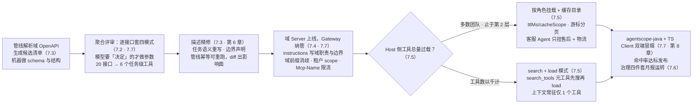
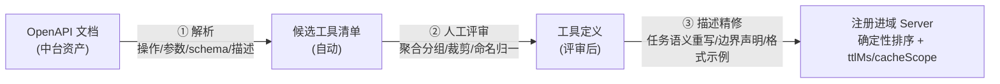
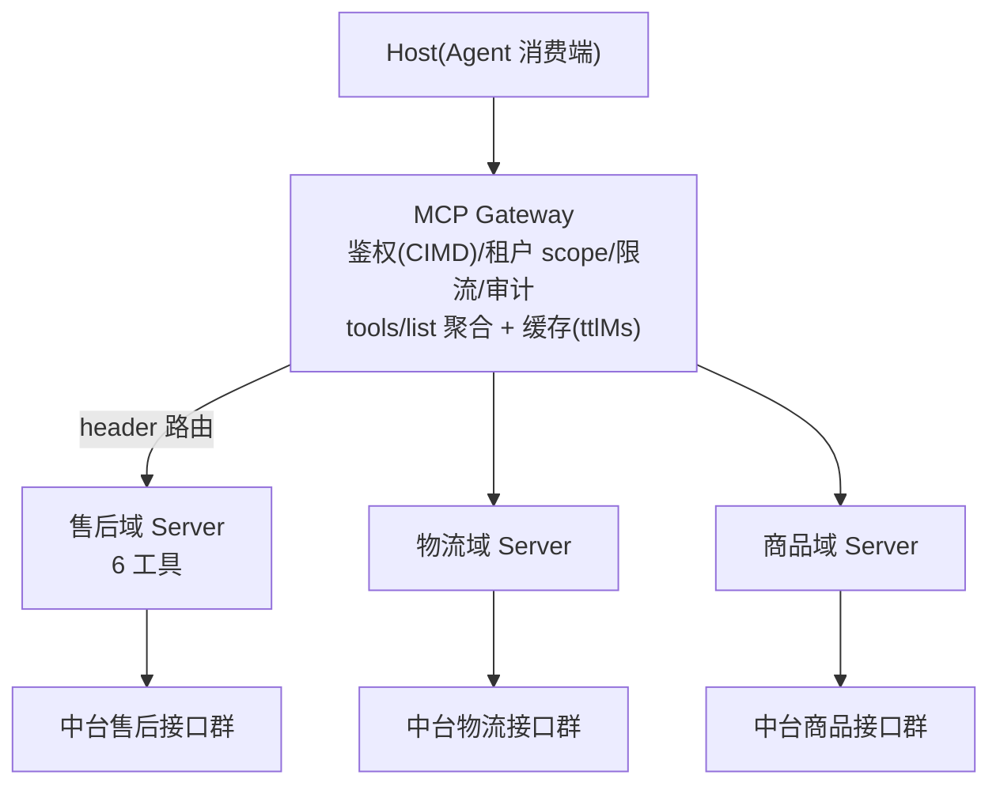

# 第 7 章 规模化：业务中台的 MCP 化

> 本章导读：售后域 Server 上线后，物流团队来了：「我们也要」。接着是商品、结算、营销——当中台的几十个业务域都想暴露能力时，问题已经从「怎么写一个工具」变成「怎么治理一千个工具」。本章回答那个最常被问错的问题：数千个接口，怎么通过 MCP 暴露？错误答案是把接口逐一包成工具；正确答案是一条工程化路径——聚合、生成、拆分、检索、治理，五个环节各解决一个规模化障碍。读完本章，你能：为业务域设计任务级工具的聚合方案；搭建从 OpenAPI 到工具定义的生成管线；画出多域 Gateway 拓扑并说明每层职责；为团队建立目录治理的四件套。

*本章操作流程图*

## 你什么时候需要它

**第一个域 Server 上线了，第二个域团队来问「我们怎么做」**——把本章当方法论手册：7.2 的聚合四模式给他们的接口分类，7.3 的生成管线让他们不必从零开始，7.7 的走查表可以直接照着复刻一遍。

**有人提议「把中台接口全部自动暴露成工具」**——把 7.2 开头搬给他：工具数由任务词汇表决定，不由接口数决定。自动暴露的结局可以预言：模型选择准确率崩塌、上下文爆炸、没有团队愿意维护一份和代码一样长的工具目录。

**要设计多域的 Gateway 架构**——看 7.1 与 7.4：协议为规模化准备的地基（授权化目录、缓存、header 路由）决定了网关可以有多薄，先把地基认全，再做拓扑决策。

前置：第 5 章的完整 Server 手艺；第 6 章的工具建模标准（本章生成管线的「精修」环节以它为验收）。

## 7.1 概述：协议为规模化准备的地基

前几章的手艺都是「单个工具」级别的：一个域、一个团队、几个到十几个工具。现在把镜头拉远——当中台有几十个域、总接口数以千计，很多在单 Server 时代不成问题的事情会同时爆发：目录怎么分发？网关怎么路由？多个域的工具撞名怎么办？租户之间怎么互相看不见？

幸运的是，这些问题的解并不需要我们发明。2026-07-28 规范在重构时就把规模化的地基埋进了协议。动手设计拓扑之前，先把这份「协议自带的规模化能力」盘出来：

| 协议能力（规范原文） | 规模化用途 | 详见 |
|------|-----------|------|
| 工具集**随请求授权变化**（per-request 凭据） | 多租户可见性：租户 A 的 token 只看到租户 A 的工具，协议原生语义 | 第 10 章 |
| `tools/list` 的 `ttlMs` + `cacheScope` + 确定性排序 | 目录分发靠缓存；网关可共享缓存（public） | 第 3 章 |
| `server/discover` 一次拿到版本+能力+身份+`instructions` | 网关与消费端的接入握手点；`instructions` 是域的「自我介绍」 | 第 2 章 |
| `subscriptions/listen`（toolsListChanged） | 目录是活的：域上线新工具，消费端收到通知刷新 | 第 2 章 |
| `x-mcp-header`（参数 → `Mcp-Param-*` 头） | Gateway 不解析 body 即可按参数路由/限流/审计 | 第 6 章 |
| 显式句柄模式 | 跨调用状态不靠会话，靠参数传递的句柄 | 第 6 章 |
| 工具名唯一性 scope = 单 Server | 聚合层消歧是必需品，`serverInfo.name` 不可依赖 | 第 6 章 |

这张表值得读慢一点，因为它的每一行都在为一个共同的转向服务：**2026-07-28 的无状态重构，本质上是把 MCP 从「两端的会话协议」改造成「可被基础设施承载的分布式协议」**。会话没了，状态进了每个请求；目录可缓存、可授权过滤；路由信息浮到了 HTTP 头。没有这一版协议，本章的拓扑会重得多——网关要维护会话亲和，目录要自建同步，租户过滤要在每个 Server 里各写一遍。

## 7.2 接口不是工具：任务粒度聚合

走进任何一个中台，你看到的接口清单都是按**系统资源**切的：一个 REST 资源一组 CRUD，路径形如 `/tickets/{id}`、`/refunds/{id}/cancel`。这是给系统集成用的词汇表，清晰、稳定，几十年运转良好。

问题在于，Agent 的世界不是这样组织任务的。当用户说「我要退这单货」，模型面对的不是一个接口，而是一串业务动作：校验订单状态、过风控、创建退款单、更新售后进度。让模型拿着 20 个 REST 接口自己编排这条链路，等于把中台工程师的流程知识外包给了一个看不见中台的模型——它不知道校验和风控的先后不能颠倒，也不知道风控被拒后该走哪条人工通道。

所以规模化的第一条定律是：**接口不是工具**。两者之间需要一次有意识的翻译，而翻译有四种模式：

| 模式 | 何时用 | 例子（贯穿案例） |
|------|--------|----------------|
| N 接口 → 1 工具（纵向聚合） | 一个用户任务背后固定的一串调用 | `after_sales_create_ticket` = 校验 + 风控 + 创建。原子任务不拆给模型，Server 侧编排 |
| 1 接口 → 1 工具（直通） | 接口本身就是完整任务语义 | `after_sales_query_ticket` |
| 1 接口 → 不暴露（裁剪） | 纯系统内部接口、无 Agent 任务语义 | 批量对账导入、缓存刷新 |
| M 接口 → 1 工具 + 参数（归并） | 同一任务的多个变体接口 | 按 region/渠道拆的 4 个查询接口 → 1 个带 `region` 参数的工具 |

四种模式怎么选？判定口诀只有一句：**模型需要「决定」的才做成参数，模型不需要知道的都收进 Server**。顺着这句口诀推下去，会得到一个和直觉相反的结论：工具数量由任务词汇表决定，不由接口数量决定。一个业务域里，用户真正要 Agent「做决定」的任务通常只有 5-15 个；所以数千接口的售后域、物流域、商品域，各自落下来都应该是**个位数的工具**。

一个反例值得所有团队记住。某团队把「创建售后单」忠实地拆成了三个工具：「校验参数」「风控检查」「创建记录」，理由是每个工具职责单一。实际效果是模型要在对话里自己编排三次调用：风控被拒了怎么办？重试几次？要不要跳过校验直接创建？每一步分叉都需要理解中台内部流程才能决策，而模型恰恰没有这些知识。用户看到的是 Agent 在三个工具之间打转，最后抛出一个无法恢复的中间态错误。这三个工具各自都没写错，错的是切分粒度——编排本来就该在 Server 里。

## 7.3 生成管线：OpenAPI 是起跑线

聚合模式定了方向，接下来的问题是工作量。一个域 20 个接口尚可手工建模，几十个域、上千接口手工写工具定义不现实，质量也无法一致。好在中台几乎都有 OpenAPI/Swagger 资产——管线的思路就是让它成为起点而非终点：机器做结构和 schema，人做语义和描述。

管线上有三个工程要点，每一个都对应一种常见的失败方式。

第一，**管线生成的是「候选」，不是「成品」**。自动生成能解决 schema 与结构，但 description 的任务语义重写无法自动化——把「GET /api/v1/tickets/{id}/timeline」翻译成「按单号查询售后进度轨迹」，需要的不是解析能力，而是域知识。所以描述精修永远是人工环节，也是整条管线的质量所在。省略这一步的团队会得到一批「数量达标、模型不爱用」的工具：模型要么不选，要么选了填错。

第二，**管线要幂等可重跑**。OpenAPI 变更是常态。管线重新生成候选后，与现有工具定义做 diff，得到的正是「本次接口变更影响了哪些工具」的清单——这份清单同时就是变更管理的输入。管线不可重跑的团队，接口一变就只能人工排查影响面。

第三，**绑定消费端做验证**。生成与精修完成后，立即用真实 Agent 冒烟（第 8 章），统计工具命中率与参数填对率；不达标的工具打回精修。验证的锚点是真实模型的选择行为，不是人对着 schema 自查——自查永远觉得描述写得挺清楚。

## 7.4 域拆分 + Gateway：拓扑设计

管线解决了「一个域怎么量产工具」，下一个问题是几十个域怎么组织。先看拓扑：

这个拓扑里有两个设计决定。

**按业务域拆 Server，不做「一个巨无霸 Server」**。域是天然的迭代与责任边界：它和中台团队的组织结构对齐（售后团队拥有售后域 Server），故障隔离（一个域的缺陷不至于拖垮全部工具），工具目录也保持清爽。巨无霸 Server 的合并成本看似更低，但它把上面三条好处全部放弃，换来的是所有域团队往同一个代码库提 PR。

**Gateway 是治理点，不是业务点**。它的职责清单是：统一鉴权与租户识别（CIMD 消费端身份，第 8 章）、工具目录聚合与缓存、限流与审计（`Mcp-Name` 头免解析 body）、版本路由（第 3 章 Dual-era 兼容收敛一处）。注意清单里没有一项涉及具体业务——一旦网关开始理解「售后单」，架构就开始腐化。

值得专门说一句的是 Gateway 的「薄」。2026-07-28 之前，这一层需要会话亲和与重放缓冲，网关天然厚重。无状态加 header 路由之后，Gateway 第一次薄得起来：不需要会话表，不需要粘性路由，目录缓存语义也是协议现成给的。市场上已出现托管 MCP 网关产品（写作时 AWS AgentCore Gateway 已提供此类能力；选型时以当时市场为准，本章关注的是拓扑职责而非具体产品）。

最后一个看似琐碎、实则必答的问题是命名：多域聚合之后必然撞名——两个域都有 `search`。协议明确说工具名的唯一性作用域是单个 Server，聚合层要自行消歧，且不能依赖 `serverInfo.name`（它不保证全局唯一）。所以域前缀（`after_sales_`）从第一天起就是强制的，等撞名发生再加就晚了。

## 7.5 工具检索与动态发现：过载的最终解

域内工具数控制住了，不等于 Host 侧的工具体量控制住了。一个成熟的 Agent 平台会挂多个域：客服 Agent 挂售后和物流，运营 Agent 挂商品和结算，再加上 GitHub、内部文档这样的公共 Server——工具总数仍然会涨，而每多一个工具，模型上下文就多一份固定开销，选择准确率就多一分稀释。

对过载问题，解法是分层的，按成本从低到高依次启用：

1. **按角色挂载**：客服 Agent 只挂售后+物流域，运营 Agent 挂商品+结算域。「角色 → 域」的映射来自目录治理（7.6），这是成本最低、收益立现的一层，优先做。
2. **缓存式目录**：`ttlMs` 内直接用缓存目录，`cacheScope: public` 让网关层共享缓存——目录分发的正统机制，协议已备好，不必自建。
3. **分页发现**：`tools/list` 游标分页，按「目录页」拉取，避免一次性吞下全部目录。
4. **search + load 模式**：工具规模真正巨大时的终极手段。暴露一个 `search_tools` 元工具（按任务描述检索），模型先搜、对选中的工具再 `load` 详情、然后调用——上下文里常驻的只有 1 个工具，背后是全部目录。这不是本书的发明：Anthropic 的 tool search、各家 SDK 的程序化工具调用都属此类实践（具体 API 以各官方文档为准）。
5. **动态目录**：域上线新工具，`subscriptions/listen` 通知到达，消费端刷新缓存。目录运营由此成为日常动作，而不是一次发版事件。

大多数团队走到第 2 层就够了。第 4 层是给「工具数以千计」的平台预备的——先用低层解法把问题推远，不要一上来就上重机制。

## 7.6 目录治理：让规模化可持续

工具多了以后，治理问题会反过来吞噬技术问题。半年之后，「这个工具能不能改」「这个工具谁负责」「这个工具还有人在用吗」会成为每周被问的问题——如果那时候才想起来要记录，就已经晚了。治理是四件套：

- **命名规范全域强制**：`domain_action`（`after_sales_create_ticket`）。域前缀即路由与归属，撞名消歧（7.4）靠它，审计报表分组也靠它。
- **工具目录（Directory）**：每个工具一行——域、负责人、聚合了哪些接口、版本、状态（live/deprecated）。目录条目长什么样，第 4 章贯穿案例中的 `query-ticket.json` 就是雏形。没有目录的团队，半年后没人说得清「这个工具动不得还是能改」。
- **变更管理**：描述与 schema 的修改走评审，因为它们直接改变模型行为，哪怕一行代码没动。**破坏性变更新增工具名而非原地改**——工具名即 API，client 按名调用。OpenAPI diff（7.3 管线）驱动影响面清单。
- **质量例行化**：命中率/失败率/重试率三指标（第 6 章）按月出报表，连续垫底的工具走「精修或下线」。淘汰要有真实执行的先例——机制只有被用过一次，才会被当真。协议侧的弃用节奏与之对齐（Active/Deprecated/Removed，12 个月窗口，第 3 章）。

四件套的共同点是**便宜**：命名是约定，目录是一张表，变更是既有评审流程加一道清单，质量是三个指标的月报。规模化的可持续靠的不是重流程，是这几样轻东西被真正执行。

## 7.7 贯穿案例完整复盘

把本章五个环节在贯穿案例上走完一遍，就是一次完整的「域接入」：

| 步骤 | 动作 | 产出 |
|------|------|------|
| ① 输入 | 售后域 OpenAPI（20 接口） | 候选清单 |
| ② 聚合评审 | 任务词汇表讨论：售后单生命周期中模型真正要「决定」的事 | **6 个任务级工具**；3 接口裁剪；8 接口纵向聚合 |
| ③ 生成+精修 | 管线生成 schema 初稿；描述逐个任务语义重写 | 工具定义 + 目录条目 |
| ④ 域 Server | mcp-core / TS v2 实现，`instructions` 写清域职责与边界 | `after-sales` 域上线，缓存就绪 |
| ⑤ Gateway 纳管 | 域前缀消歧；租户 scope 过滤；`Mcp-Name` 限流 | 多域拓扑一员 |
| ⑥ 消费验证 | agentscope-java + TS Client 双端冒烟（第 8 章） | 命中率达标，发布 |

数字摆在一起：20 接口 → 6 工具，压缩比 3:1 起步，且每个工具都是模型能准确选中的粒度。这个走查表就是规模化的全部操作秘密——把它套到物流域、商品域，重复执行，数千接口的中台就一片一片地 MCP 化了。没有更玄的步骤。

## 7.8 本章小结

1. **协议已备好地基**：授权化目录、缓存、discover、订阅通知、header 路由、句柄、消歧——先用协议自带的，再考虑自建。
2. **工具数由任务词汇表决定**；聚合、裁剪、归并是常态；「创建售后单」不该被拆成三个工具让模型编排。
3. **OpenAPI 管线生成候选，描述精修是人工质量关**——管线幂等可重跑，验证锚点是真实 Agent 的冒烟。
4. **域 Server + 薄 Gateway**；工具过载的解法分层上：角色挂载 → 缓存 → 分页 → search+load。
5. **目录治理四件套**（命名/目录/变更/质量）让规模化可持续，并与协议特性生命周期对齐。

→ **第 8 章**把多域拓扑接上真实的异构消费端，验证「一次封装，处处调用」。

## 验收清单

读到这里，你应该能：

- ☐ 用四种聚合模式把一个业务域的接口清单分类，并说明每类的判定理由；
- ☐ 画出多域 Gateway 拓扑，标出每层职责（鉴权/缓存/消歧/租户过滤）；
- ☐ 解释「工具数量由任务词汇表决定」的经济学含义（token 一次项）；
- ☐ 为团队起草 OpenAPI 生成管线的三个环节与验收标准；
- ☐ 说出目录治理四件套，并解释每件防止什么问题；
- ☐ 按层级列出工具过载的五种解法与启用顺序。

## 参考速查

| 项 | 值 |
|----|----|
| 聚合四模式 | 纵向聚合 / 直通 / 裁剪 / 归并 |
| 管线三环节 | 解析生成 → 人工评审 → 描述精修 |
| 目录缓存 | `ttlMs`（新鲜度）+ `cacheScope`（public 可共享） |
| 标准头 | `Mcp-Method` / `Mcp-Name` / `MCP-Protocol-Version` |
| 消歧 | 域前缀 `domain_action`；`serverInfo.name` 不可依赖 |
| 检索分层 | 角色挂载 → 缓存 → 分页 → search+load |

## 延伸阅读

- **第 6 章（工具接入实战）**——管线「精修」环节的验收标准出自它的描述质量手艺。
- **第 8 章（构建 Client）**——多域拓扑的消费端视角与双端验证。
- **第 10 章（部署与安全）**——Gateway 的鉴权与租户隔离细节。
- **第 12 章（企业落地路线图）**——本章方法论如何分阶段落地与立项。

## 复核清单（发布前）

- [ ] 外部网关产品核实（标注核实日期）；search+load 与 SDK 支持现状核对
- [ ] 团队中台真实数据（接口数、压缩比）替换贯穿案例的示例数字
- [ ] `subscriptions/listen` 的 toolsListChanged 订阅流程实测（v2.4.0）
- [ ] Gateway 场景的 `cacheScope: public` 共享缓存行为实测
