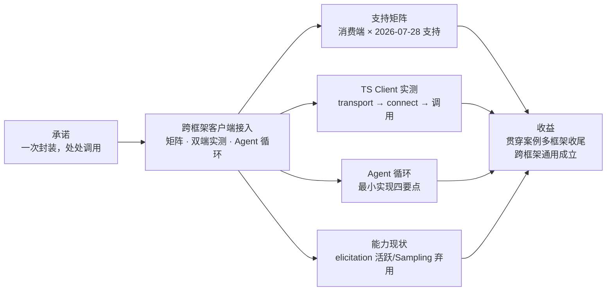

# 第 8 章 跨框架客户端接入

> 本章导读：第 6 章结束时，售后域 Server 已经能被「一个」消费端调用。这一章兑现 MCP 的核心承诺——**同一个 Server，不同框架通用**：先给一张跨框架支持矩阵，再用两个 SDK 实测双端调用，然后走进 Agent 循环的最小实现，最后收拢贯穿案例。矩阵中未实测的格子明确标注——矩阵会过期，每格都带核实日期，引用前重查。读完本章，你能：用支持矩阵判断任意消费端 × Server 组合的可行性；用 TS SDK 三步完成连接与调用；读懂 Agent 循环的最小实现并指出 Host 治理的落点；说清 client 能力弃用对集成决策的影响。



*本章导览图*

## 你什么时候需要它

**要把一个现成 Server 接进自己的应用**——先查 8.1 的矩阵两格（协议版本支持、传输交集），再照 8.2 的三步走；联调出问题回 8.7 的常见坑。

**不用现成框架、想理解「Agent 到底怎么用工具」**——直接看 8.3：Agent 循环的最小实现，四个要点每个都是集成时的真实决策点。

**评估一个 Host 框架值不值得接入**——看 8.5：2026-07-28 弃用了 Sampling/Roots 之后，「支持哪些 client 能力」的评分标准变了，elicitation/MRTR 支持度才是关键项。

前置：第 4 章的售后域 Server 与双端概念；第 6 章的结果语义（content/structuredContent/isError）。

## 8.1 框架 × MCP 支持矩阵

| 消费端 | 2026-07-28 支持 | 传输 | 核实状态 |
| --- | --- | --- | --- |
| TS SDK `@modelcontextprotocol/client` | ✅ v2.x（2.3.1+，实测 2.4.x） | stdio / Streamable HTTP | **本书实测**（2026-10-24） |
| Java SDK `io.modelcontextprotocol.sdk:mcp-core` | ✅ 2.0.x（`modern` 包，37 项一致性通过） | stdio / Streamable HTTP | 查证未实测 |
| agentscope-java | 见其第 26 章（Agent 协议） | — | → agentscope-java 书 |
| ragflow | ⚠️ 待核实 | — | → ragflow 书 |
| CopilotKit（前端 Host） | ⚠️ 待核实 | — | → copilotkit 书 |
| AI CLI（Claude Code 等） | ✅（GitHub MCP Server 已宣布支持 2026-07-28，可旁证生态就绪） | 各 CLI 自定 | 待按版本核实 |
| GitHub 官方 MCP Server（Server 侧生态参照） | ✅ 2026-07-23 宣布 | HTTP | 查证 |

矩阵的使用方式：接入前查两格——**目标框架对 2026-07-28 的支持版本**与**传输交集**（双端都支持的传输才是可用传输）。查完这两格，接入方案的基本面就定了，剩下的都是工程细节。`⚠️ 待核实` 的格子在本框架书成稿时回填并注明核实日期。

## 8.2 双端实测：Client 连接我们的售后域 Server

Host 侧只需三步：构造 transport（指向 Server 进程/端点）→ 连接 → 调用。以下代码 **v2.4.0 实测通过**（2026-10-24）：

```typescript
// npm i @modelcontextprotocol/client zod
import { Client } from "@modelcontextprotocol/client";
import { StdioClientTransport } from "@modelcontextprotocol/client/stdio";

// ① transport：拉起 Server 子进程（stdio）；HTTP 场景换 StreamableHTTPClientTransport
const transport = new StdioClientTransport({
  command: "node",
  args: ["server.mjs"],   // 第 4 章的售后域 Server
});

// ② client：Host 身份声明
const client = new Client({ name: "book-host", version: "0.1.0" });
await client.connect(transport);

// ③ 发现与调用
const tools = await client.listTools();
// → tools.tools.map(t => t.name) === ["echo"]

const res = await client.callTool({
  name: "echo",
  arguments: { text: "双端实证成功" },
});
// → res.content === [{ type: "text", text: "双端实证成功" }]

await client.close();
```

值得注意的细节：

- **Host 侧工具目录来自 `listTools()`**——第 2 章「Host 管可见性」在此落地：Host 决定把哪些工具注入模型上下文，这个过滤动作在 Host 代码里，不在协议里。
- `callTool` 的返回即第 6 章的 `content` / `structuredContent` / `isError` 结构——**双端共享同一套结果语义**，这是「跨框架通用」的微观基础。
- client 同样是无状态语义的使用者：`connect` 之后直接业务调用，无握手依赖（与第 4 章 Server 侧实测互为印证）。

## 8.3 构建 Client：Agent 循环的最小实现

官方 build-client 教程（Python 主线）演示了一件每个集成者迟早要做的事：**不依赖现成 Agent 框架，自己把「模型 + MCP 工具」的循环搭出来**。它的 `process_query` 是 Agentic 循环的最小完整实现，值得逐段读懂：

```python
async def process_query(client: Client, query: str) -> str:
    # ① 拉目录：模型能看见什么工具，由这一步决定
    tool_list = await client.list_tools()
    available_tools = [{"name": t.name, "description": t.description,
                        "input_schema": t.input_schema} for t in tool_list.tools]

    # ② 首次模型调用：工具目录随请求注入
    response = anthropic.messages.create(model=MODEL, messages=messages,
                                         tools=available_tools, ...)

    # ③ 遍历响应：文本直接收集；tool_use 则执行之
    for content in response.content:
        if content.type == "tool_use":
            result = await client.call_tool(content.name, content.input)
            tool_results.append({"type": "tool_result", "tool_use_id": content.id,
                                 "content": ..., "is_error": result.is_error})

    # ④ 结果回填 → 二次模型调用 → 生成最终答复
    if tool_results:
        messages.append({"role": "assistant", "content": response.content})
        messages.append({"role": "user", "content": tool_results})
        response = anthropic.messages.create(model=MODEL, messages=messages,
                                             tools=available_tools, ...)
```

四个要点，每一个都是集成时的真实决策点：

1. **目录注入是显式动作**——`list_tools()` 的结果转成模型 API 的 `tools` 参数。Host 管可见性（第 2 章）的代码位置就在这里：要过滤工具，过滤的是这个列表
2. **`is_error` 原样传给模型**——教程特意注明：「工具抛错不会在这里 raise，而是以 `is_error` 应答；把这个标志传过去，模型就能读消息并换个试法」——与第 6 章的两类错误模型闭环
3. **二次调用是循环的本质**——工具结果以 `tool_result` 角色回填消息历史，再请求一次模型。真实 Agent 框架（agentscope 的 ReAct 循环）就是把这一段做成了通用引擎
4. **连接生命周期一个 `async with`**——进入时拉起 Server 子进程、完成版本声明（⚠️ 教程此句为 v1 表述遗留；2026-07-28 下为每请求声明版本，SDK 内部处理），退出时断连并回收子进程——「无需手工关闭任何东西」

连接建立的三件套：`StdioServerParameters`（**配置**，描述要拉起哪个子进程）→ `stdio_client()`（把配置变成传输）→ `Client`（在传输上工作）。教程按脚本扩展名决定启动命令——生产场景里这一层就是第 7 章 Gateway 的 Client 侧形态。连接本地与远程 Server 的进一步实操（本地配置、HTTP 连接、鉴权）见官方 connect-local-servers / connect-remote-servers 指南（深读待续）。

## 8.4 agentscope-java 侧：主线消费端

agentscope-java 是本书读者群的日常框架，它的 MCP 接入方式与最佳实践在 **agentscope-java 书第 26 章（Agent 协议）** 有完整覆盖——本章不重复其 API 细节，只给集成视角的三条：

1. **版本对齐**：agentscope-java 侧的 MCP 版本与域 Server 的 spec 版本对齐（第 3 章兼容矩阵），升级节奏由第 7 章目录治理统一管。
2. **工具可见性**：Agent 按角色挂工具子集（客服 Agent 只挂售后+物流）——Host 侧过滤，呼应第 7 章的角色挂载。
3. **联调验证**：Server 每次发版，用真实 Agent 冒烟（模型选中率、参数填对率），这比单测更接近真实质量。

（本节在 agentscope-java 书第 26 章成稿/本书出版前，以该章内容为准回补具体配置示例。）

## 8.5 client 能力现状：elicitation 活跃，Sampling/Roots 弃用

规范把「Server 反向使用 client 能力」定义为三件：elicitation（向用户收集输入）、sampling（借 Host 的模型推理）、roots（告知可访问目录）。**2026-07-28 的弃用清单改变了集成决策**（第 3 章）：

| client 能力 | 状态 | Host 集成建议 |
| --- | --- | --- |
| **elicitation** | ✅ 活跃，且经 MRTR 成为交互主通道（`inputRequests` 内嵌） | 实现：表单/确认 UI 是生产 Host 的标配 |
| **Sampling** | ⚠️ 已弃用 | 不再为 MCP 实现 sampling；需要模型推理时直连 LLM provider API |
| **Roots** | ⚠️ 已弃用 | 目录/文件经工具参数或资源 URI 传入 |

给集成者的判断：评估一个 Host 框架，先看它的 **elicitation/MRTR 支持**（决定交互能力），不必再为 sampling/roots 支持加分。Logging 同理（已弃用，stderr 或 OTel）。

## 8.6 多框架消费：贯穿案例收尾

贯穿案例的终局验证——**同一个售后域 Server，两个异构消费端**：

```
                    ┌─────────────────────────┐
                    │  after-sales MCP Server  │
                    │  (第 4 章建,第 6 章充实) │
                    └────────┬────────────────┘
              ┌──────────────┴──────────────┐
     TS Client(本章实测)          agentscope-java Agent
     CopilotKit 前端原型            (第 26 章接入,待联调)
```

同一份工具定义（`inputSchema` + `description`），TS Host 与 Java Host 拿到的目录一致、调用协议一致、结果语义一致——**第 6 章打磨的描述质量只投入一次，所有框架受益**。这就是书架里 mcp 书存在的理由。

## 8.7 客户端侧的常见坑

- **传输交集**：Server 只支持 stdio、前端 Host 只能 HTTP——接入前先对传输清单，别到联调才发现。
- **版本协商失败**：legacy client 连现代 Server（或反之）的报错形态，两端 SDK 都有明确错误（如 `UnsupportedProtocolVersionError`）——按第 3 章兼容矩阵定位，而不是盲改配置。
- **目录刷新**：Server 的 `tools/list_changed` 通知到达后，Host 需重新 `listTools`——长驻 Host（如 CLI 会话）忽略此通知会拿着过期目录选工具。
- **描述截断**：个别 Host 对工具描述做长度截断，再好的描述被截也就失效了——接入新框架时检查它的截断策略。

## 8.8 小结

- 双端调用三步：transport → connect → listTools/callTool（TS v2.4.0 实测）
- Host 侧可见性过滤是治理的落点
- 跨框架通用 = 目录一致 + 协议一致 + 结果语义一致
- 矩阵是活的文档，每格带核实日期

→ **第 10 章**把这套东西放进生产：传输选型、鉴权、多租户与安全。

## 验收清单

读到这里，你应该能：

- ☐ 用支持矩阵判断一个「消费端 × Server」组合可不可行，说出要查哪两格；
- ☐ 用 TS SDK 三步连接售后域 Server 并完成一次调用；
- ☐ 逐点解释 Agent 循环四个要点，并指出「工具可见性过滤」的代码位置；
- ☐ 说出 2026-07-28 下三个 client 能力的现状与对应的集成建议；
- ☐ 列出客户端侧四个常见坑各自的排查动作。

## 参考速查

| 项 | 值 |
|----|----|
| 连接三步 | StdioClientTransport → `new Client().connect()` → listTools/callTool |
| 结果语义 | content / structuredContent / isError（第 6 章定义，双端一致） |
| Agent 循环 | 拉目录 → 首调 → 执行 tool_use → 回填再调 |
| client 能力 | elicitation 活跃；Sampling/Roots/Logging 已弃用 |
| 矩阵核实 | 每格带核实日期；`⚠️ 待核实` 格子在对应书成稿时回填 |

## 延伸阅读

- **第 3 章（版本演进）**——七格兼容矩阵：client 侧 era 探测与回退的完整语义。
- **第 6 章（工具接入实战）**——`is_error` 与结果语义的定义方；描述质量的投入端。
- **第 7 章（规模化）**——Gateway 拓扑的 Server 侧全景，本章是它的消费端视角。
- **agentscope-java 书第 26 章**——主线消费端框架的完整接入实践。

## 复核清单（发布前）

- [ ] 矩阵 `⚠️ 待核实` 格子在对应书成稿时回填（标注核实日期）
- [ ] Java SDK 双端示例实测补齐（mcp-core 2.0.1 client 侧）
- [ ] agentscope-java 第 26 章成稿后回补 8.4 配置示例
- [ ] `UnsupportedProtocolVersionError` 等错误类型名与 v2.4.0 导出核对
