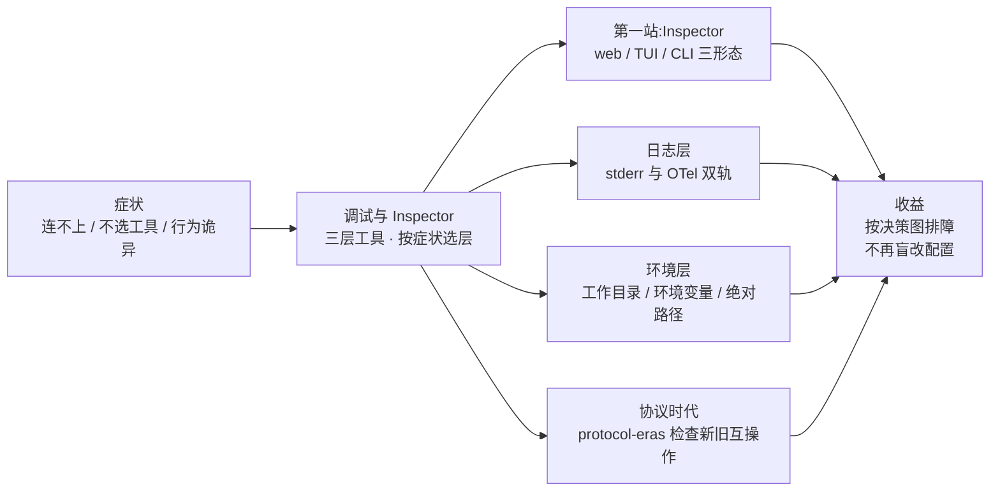

# 第 9 章 调试与 Inspector

> 本章导读：Server 写完一跑，「模型不选工具」「连不上」「行为诡异」——这三类问题的排查路径完全不同，需要的工具也不同。本章把官方调试体系讲成一张决策图：什么症状、用哪层工具、看哪里。核心是 **MCP Inspector**——官方交互式调试器，它对 2026-07-28 的协议时代（protocol era）有专门支持，是排「版本不匹配」类问题的第一入口。读完本章，你能：按症状选择正确的调试层；用 Inspector 的 web/TUI/CLI 三种形态完成日常调试；用协议时代检查定位新旧版本互操作问题；避开 stdio 服务器最经典的四类环境坑。



*本章导览图*

## 你什么时候需要它

**工具调不通、怀疑协议问题**——先 Inspector：它替你当 Host，绕开模型与业务代码，直接验证「Server 本身好不好」。Inspector 通了而 Agent 里不通，问题在你的集成层；Inspector 也不通，问题在 Server。

**「昨天还好好的」**——先查环境层（9.4）：工作目录、环境变量、路径，这四类坑占 STDIO 服务器故障的大多数。

**新旧版本混跑**——直接去 9.2 的协议时代检查（protocol-eras）：它就是为 2026-07-28 与 legacy 混跑的场景准备的。

## 9.1 概述：调试工具的三层体系

官方把调试工具按「离问题多远」分三层：

| 层 | 工具 | 适用 | 一句话 |
|----|------|------|--------|
| 交互调试 | **MCP Inspector** | 连 stdio / Streamable HTTP，调用 tools/prompts/resources、看通知流 | **第一站**——替代「在 Agent 里反复试」 |
| Server 日志 | stderr（stdio）或 OpenTelemetry（全传输） | 记录 Server 在做什么 | 结构化日志是事后排查的依据 |
| Client 开发者工具 | Host 的日志与连接状态（如 Claude Desktop 的日志面板、Chrome DevTools） | 问题出在集成层时 | 看 Host 怎么看你的 Server |

一个重要的事实变化：**协议内建日志（`notifications/message`）在 2026-07-28 已弃用**（第 3 章）——弃用窗口内仍可用，但新实现应直接走 stderr 或 OTel。协议不再承载日志，日志回归基础设施。

## 9.2 Inspector：三种形态

Inspector 是官方交互式调试器，`npx` 一行启动，三种形态各管一段。

### web 界面（日常主力）

```bash
# 启动 web UI 并连接本地 stdio Server
npx @modelcontextprotocol/inspector node server.mjs
# 或不带目标启动，在界面里添加 Server
npx @modelcontextprotocol/inspector
```

界面按协议能力分页：**Servers**（连接管理、每 Server 设置）、**Tools / Resources / Prompts**（列出并手动调用——等价于替你手写第 4 章的裸 JSON-RPC）、**Apps**、以及三个排障关键页：**Protocol**（协议消息流，逐条看 JSON-RPC）、**Network**（HTTP 层）、**Console**。会话由 token 保护，本地启动时注意终端里打印的 session 地址。

日常调试的标准动作：连上 Server → Tools 页选中工具 → 填参数手动调用 → 切 Protocol 页看这一次调用的完整消息往返。**这一步通了，Server 就没有嫌疑了**——问题在 Host 或集成层。

### TUI（终端形态）

终端里的等价物：选 Server、Tab 切换能力面板、键盘导航、支持对 HTTP Server 做授权后调试。适合 SSH 远程环境与不想开浏览器的场景。

### CLI（脚本化与流水线）

```bash
# 列出工具并退出（适合 CI）
npx @modelcontextprotocol/inspector --cli node server.mjs --method tools/list

# 调用工具，结果直接进 jq
npx @modelcontextprotocol/inspector --cli node server.mjs \
  --method tools/call --tool-name echo --arg text=hi | jq
```

CLI 形态让「Server 冒烟测试」可以进 CI：每次发版跑一遍 `tools/list` + 关键 `tools/call`，目录变化与调用失败在流水线里就拦住。`--cli` 与 web 形态的启动参数语义不同（launcher flags vs client flags），用前看一眼 `--help`。

### 协议时代检查（protocol-eras）

这是 2026-07-28 时代 Inspector 最有价值的页面：**检查一个 Server 是 Modern、Legacy 还是 Dual-era**（第 3 章的术语），以及双方版本协商的实际行为。混跑期的「连不上、行为诡异」，大半能在这里定位——它把第 3 章七格兼容矩阵从纸面变成了可观测的事实。另注意 Inspector 自身对两种协议时代的服务器都提供调试支持，用前按文档配置对应模式。

## 9.3 日志层：stderr 与 OTel 双轨

| 传输 | 日志去向 | 注意 |
|------|----------|------|
| stdio | stderr——**会被 Host 自动捕获** | stdout 红线（第 5 章）：print 毁协议流 |
| Streamable HTTP | stderr **不会**被 Host 捕获 | 用自有日志聚合或 OTel；请求排查看 curl / 浏览器 DevTools Network 面板 |

按请求的日志级别由 client 在 `_meta.io.modelcontextprotocol/logLevel` 声明（第 3 章的按请求化改造）——Server 端实现时读这个值调级别，而不是维护全局级别状态。

## 9.4 环境层：STDIO 服务器的四类经典坑

官方 Common Issues 清单的前四类，全部与「Host 怎么拉起你的进程」有关：

1. **工作目录不可假设**——Host 从任意目录启动，Server 进程的工作目录可能是 `/`。配置与 `.env` 里的路径**一律绝对路径**
2. **环境变量不继承你的 shell**——Host 拉起的子进程拿不到你终端里的变量；需要变量就在 Host 配置的 `env` 字段里显式给
3. **Server 启动失败**——依赖没装（Host 的环境 ≠ 你的开发环境）、Python/Node 版本不符；先在命令行用同样的命令手工拉起验证
4. **连接问题**——启动命令拼错、可执行文件不在 PATH、端口冲突；Claude Desktop 场景可看它的 server status 与日志面板，浏览器型 Host 直接 Chrome DevTools

一条排查公理：**Host 拉起环境 ≠ 你的终端环境**。在终端能跑、在 Host 里不能跑，九成是环境差异，一成是工作目录。

## 9.5 调试工作流与最佳实践

官方给的开发循环，值得原样采纳：

```text
改代码 → Inspector 手动验证 → 单测 → 真实 Host 冒烟 → 记录日志留痕
```

两条最佳实践：**日志策略**——按模块 logger、结构化字段、请求级级别（`_meta.logLevel`）、stderr/OTel 分轨；**安全考量**——日志里不落敏感参数与 token（第 6 章的工具输入审计同样遵循）、Inspector 的 session token 不外泄、调试 HTTP Server 时注意 DevTools 里可见的头与凭据。

## 9.6 常见问题速查

| 症状 | 首选工具 | 高频原因 |
|------|----------|----------|
| Host 里连不上，命令行能跑 | Host 日志 + 环境层检查 | 工作目录/环境变量/绝对路径（9.4） |
| 工具列表为空 | Inspector Tools 页 | capabilities 未声明 tools；工具注册失败被吞 |
| 调用报 -32602 | Inspector Protocol 页 | 参数与 inputSchema 不符；裸请求缺 `_meta` |
| 调用报 -32022 | Inspector protocol-eras 页 | 版本不匹配——按 supported 清单换版本（第 3 章） |
| 模型不选工具 | 模型上下文检查 | 描述缺失/弱（第 6 章）——不是调试问题，是描述问题 |
| 昨天好用今天坏 | 环境层 + `git diff` | 依赖漂移、路径变化、目录缓存过期（list_changed 未刷新） |

## 9.7 本章小结

1. **三层工具按症状选**：交互怀疑 → Inspector；事后追溯 → stderr/OTel 日志；集成层 → Host 开发者工具。
2. **Inspector 三形态**：web 日常、TUI 远程、CLI 进 CI；protocol-eras 页是版本混跑的定位器。
3. **日志双轨**：stdio 靠 stderr 被 Host 捕获，HTTP 靠自有聚合/OTel；协议内建日志已弃用。
4. **环境公理**：Host 拉起环境 ≠ 终端环境——绝对路径、显式 env、手工复现启动命令。
5. **症状到工具的映射**要形成团队习惯（速查表可直接进团队 wiki）。

→ **第 10 章**回到生产主线：传输头体系、OAuth 授权与多租户。

## 验收清单

读到这里，你应该能：

- ☐ 按症状从速查表选出正确的调试工具层；
- ☐ 用 Inspector web 形态连接本地 Server 并手动调用一个工具，在 Protocol 页指出完整消息往返；
- ☐ 写出一条可在 CI 中使用的 Inspector CLI 冒烟命令；
- ☐ 用 protocol-eras 判定一个 Server 的时代（Modern/Legacy/Dual-era）；
- ☐ 解释「终端能跑、Host 里不能跑」的高频原因并给出排查顺序。

## 参考速查

| 项 | 值 |
|----|----|
| web 启动 | `npx @modelcontextprotocol/inspector node server.mjs` |
| CLI 冒烟 | `npx @modelcontextprotocol/inspector --cli <cmd> --method tools/list` |
| 日志轨 | stdio→stderr（Host 捕获）；HTTP→聚合/OTel |
| 日志级别 | client 按请求经 `_meta.io.modelcontextprotocol/logLevel` |
| 协议日志 | `notifications/message` 已弃用（2026-07-28） |
| 文档 | tools/debugging 与 tools/inspector/*（web/tui/cli/configuration/authorization/protocol-eras/security/recipes） |

## 延伸阅读

- **第 5 章（构建完整的 Server）**——本章排查的「Server 侧」另一半：日志纪律与降级路径的正确实现。
- **第 3 章（版本演进）**——protocol-eras 背后的七格兼容矩阵。
- **第 8 章（构建 Client）**——当 Inspector 证明 Server 无辜后，问题在 Client 侧的排查面。
- **官方 debugging 与 inspector 系列原文**——本章素材源；configuration、recipes 两篇（配置与配方）未深读，见复核清单。

## 复核清单（发布前）

- [ ] inspector/configuration.mdx、recipes.mdx、mcpdo.mdx、authorization.mdx、security.mdx 五篇深读并补充
- [ ] Inspector 各形态命令行实测（版本与参数以当时发布为准）
- [ ] Claude Desktop 日志面板与 Chrome DevTools 排查段实操核对
- [ ] protocol-eras 页功能与第 3 章矩阵的映射核对
