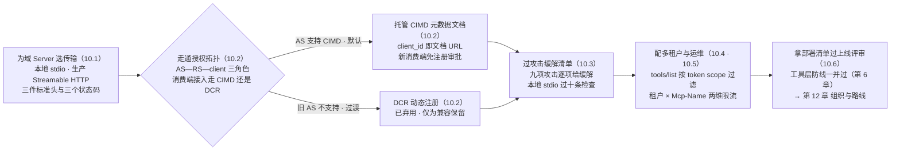

# 第 10 章 部署与安全

> 本章导读：域 Server 在你机器上跑通了，离「敢上生产」还差四层：传输怎么选、每个请求的头怎么管、调用者的身份怎么信、攻击面堵在哪里。本章对照规范 basic/transports/streamable-http 与 basic/authorization 系列原文，把第 7 章的 Gateway 拓扑落成可上线的配置：三件标准头与三个状态码、OAuth 2.1 三角色栈与 CIMD、多租户可见性、九项攻击的缓解清单、本地 Server 十条检查、一页部署清单。读完本章，你能：为域 Server 选对传输并配齐标准头；走通「AS—RS—client」的授权拓扑；按租户配置工具可见性；拿着部署清单过上线评审。



*本章操作流程图*

## 你什么时候需要它

**Server 要对真实用户开放**——通读。10.1 的头体系与 10.2 的授权架构是合规底线，10.6 的部署清单就是上线评审表。

**多租户要隔离工具与数据**——直接看 10.4：「工具集随请求授权变化」是协议原生语义，配合目录过滤与租户上下文三层落地。

**评审时有人问「MCP 的安全风险」**——把 10.3 的九项攻击清单摊开，每项都有形态与缓解；加上第 6 章的工具层防线，两层一起过。

前置：第 6 章（工具层安全清单）、第 7 章（Gateway 拓扑）、第 3 章（版本协商——头一致性校验的前提）。

## 10.1 传输：stdio 与 Streamable HTTP 的分工

| | stdio | Streamable HTTP |
| --- | --- | --- |
| 场景 | 本机工具、CLI 内嵌、个人开发 | 服务化域 Server、多消费端、生产 |
| 生命周期 | 随 Host 进程起停 | 常驻独立服务 |
| 授权规范 | **不适用**——凭据从环境取 | 应遵循本章 10.2 框架 |
| 与无状态的关系 | 连接不是会话（第 2 章），legacy 兼容靠 discover 探针（第 3 章） | 无状态 + header 路由的完全体 |

规则一句话：**本地与个人工具 stdio，进生产 Streamable HTTP**。

### Streamable HTTP 的头体系（合规必备）

2026-07-28 对 HTTP 请求头做了强规定，每个 POST 必须三件齐：

```http
POST /mcp HTTP/1.1
Content-Type: application/json
MCP-Protocol-Version: 2026-07-28
Mcp-Method: tools/call
Mcp-Name: get_weather
```

| 头 | 来源 | 要求 |
| --- | --- | --- |
| `MCP-Protocol-Version` | 与 body `_meta.protocolVersion` **必须一致** | 不一致 → `400` + `HeaderMismatch`（-32020） |
| `Mcp-Method` | JSON-RPC `method` | 所有请求必带 |
| `Mcp-Name` | `params.name` 或 `params.uri` | `tools/call`、`resources/read`、`prompts/get` 必带；非 ASCII 值用 Base64 sentinel 编码 |

这三个头让网络中间件**不解析 body** 就能路由与审计——`Mcp-Name` 让网关按工具名限流，版本头让负载均衡按协议版本分流。加上 6.8 的 `x-mcp-header`（参数 → `Mcp-Param-*` 头），Streamable HTTP 的网络层语义就完整了：**协议为基础设施设计，不只是为两端设计**。

### 服务端校验的三个状态码

| 情形 | 响应 |
| --- | --- |
| 头与 body 版本不一致 | `400` + `HeaderMismatch`（-32020） |
| 版本不支持 | `400` + `UnsupportedProtocolVersionError`（-32022，附 supported 清单） |
| 方法不存在 | `404` + `-32601`（与 legacy HTTP+SSE 服务器「没有现代端点」的 404 从 body 区分——backward compatibility 依据） |

另外：`tools/list` 等结果必须带 `ttlMs`/`cacheScope`（第 3 章），网关据此决定目录缓存策略。

## 10.2 授权架构：三角色与标准栈

规范的授权模型是标准 OAuth 拓扑：

- **MCP Server = OAuth 2.1 Resource Server（RS）**：凭 access token 接受受保护请求
- **MCP Client = OAuth 2.1 Client**：代表资源所有者发起请求
- **Authorization Server（AS）**：与用户交互、签发 token——实现不在规范范围内，可独立部署（中台场景：接现有 SSO/IAM 即是 AS）

标准栈（全部对齐 IETF 规范，不是自造）：OAuth 2.1、Bearer Token（RFC 6750）、AS Metadata（RFC 8414）、DCR（RFC 7591，已弃用）、Resource Indicators（RFC 8707）、Protected Resource Metadata（RFC 9728）、Issuer Identification（RFC 9207）、**CIMD**（Client ID Metadata Documents）、OIDC Discovery。

规范层面的四个硬要求：

1. AS **必须**实现 OAuth 2.1（含 confidential/public client 的安全措施）
2. AS 与 client **应该**支持 CIMD；DCR 仍可用但已弃用（仅为不支持 CIMD 的旧 AS 保留）
3. **MCP Server 必须实现 RFC 9728**（Protected Resource Metadata）；**client 必须用它做 AS 发现**——Server 告诉 client「去哪里拿 token」
4. HTTP 传输**应**遵循本框架；stdio **不应**（凭据走环境变量）；其他传输必须遵循对应协议的安全最佳实践

**CIMD 是什么**：client 不再「预注册」或「动态注册」拿 client_id，而是托管一份 URL 可访问的元数据文档，client_id 就是这个 URL。对中台的意义：每个新消费端（新 Agent 项目、新前端）上线，不需要在 AS 上走注册审批流——托管文档即接入。DCR 降级弃用的原因是实现层安全缺陷泛滥（CIMD 的信任模型更收敛，见 10.3）。

## 10.3 安全威胁清单：规范点名的每一项

规范 security-considerations 逐项列了威胁，中台评审逐条过：

| 威胁 | 要点 | 防线 |
| --- | --- | --- |
| **Token audience 绑定** | RFC 8707：token 只对声明资源有效 | AS 签发时绑定；RS 校验 audience——跨服务重放被拒 |
| **Token 被盗** | token 泄露即冒用 | 短时效、传输安全（10.2）、最小 scope |
| **授权码保护** | code 截获风险 | PKCE（OAuth 2.1 强制）、`iss` 校验（RFC 9207，防 mix-up） |
| **开放重定向** | redirect_uri 操纵 | 严格注册与精确匹配 |
| **CIMD 特有风险** | AS 滥用（client 让 AS 向任意 URL 发请求）、localhost redirect 抢注、信任策略 | CIMD 文档域与 client 的归属校验；trust policy 明确「信任哪些 client 域」 |
| **Confused Deputy** | 恶意 client 借合法 client 的凭据/身份做事 | 每消费端独立身份；audience 绑定 |
| **Access token 特权** | token 超范围 | 最小 scope；RS 按 scope 收窄工具可见性（→ 10.4） |

工具层（第 6 章）的攻击面并行存在：annotations 不可信、`$ref` 不解引用、结果视为数据非指令、敏感参数禁用 `x-mcp-header`。**两层防线一起过评审，缺一不可。**

### 攻击与缓解：官方最佳实践的完整清单

规范 security-considerations 之外，官方安全最佳实践教程（tutorials/security/security_best_practices，984 行）给出了更完整的攻击目录。逐项过评审：

| 攻击 | 形态 | 缓解 |
| --- | --- | --- |
| **Confused Deputy** | 恶意 client 借合法 client（如共享的 MCP 代理）的凭据与授权，访问本不该访问的资源——代理对「为谁办事」是迷糊的 | 每消费端独立身份与注册；动态注册时校验 client 与 redirect 绑定；audience 绑定 token |
| **Token Passthrough（令牌透传）** | MCP Server 把 client 的上游 token 原样转发给下游 API——绕过 scope 校验、审计断裂、权限放大 | Server 对下游用**自己**的凭据；不透传 client token；每跳重新授权 |
| **SSRF** | 工具参数（URL 类）被诱导请求内网地址 | URL 白名单/出口管控；禁内网地址段；schema 约束（第 6 章） |
| **State Handle Hijacking** | 第 6 章句柄模式的反面：句柄被猜中/窃取后冒用 | 句柄是名字不是能力——每次调用校验调用者归属；不透明 ID + 足熵 + 限时（6.7） |
| **授权 URL 操纵/开放重定向** | redirect_uri 操纵截获授权码 | 精确匹配；`iss` 校验（RFC 9207） |
| **Mix-Up 攻击** | 伪造 AS 让 client 把授权码发给攻击者 | `iss` 参数强制校验 |
| **Localhost redirect 模仿** | 本机端口抢占公开 client 的 localhost 回调 | CIMD 信任策略；端口绑定校验 |
| **CIMD 信任策略缺口** | 恶意元数据文档冒充合法 client | AS 侧按信任策略审核 client 元数据域 |
| **Scope 过宽** | token scope 大于实际需要 | 最小 scope；RS 按 scope 收窄工具可见性（10.4） |

教程原文对每项攻击有完整场景推演，评审争议时回原文对照。

### 授权实操：Keycloak 端到端

官方授权教程（tutorials/security/authorization，1201 行）给出完整可复现实操：**Keycloak 作为 AS 的搭建**（realm/client/凭据）→ **MCP Server 侧接入**（RS 配置：auth server 位置、OAuth client 凭据、全局配置）→ **测试验证** → 常见坑。中台落地时照教程演练一遍并留档，比读十遍规范扎实——本节不复制其千行配置。

### 本地 Server 安全：十条检查清单

域 Server 服务化之前，团队还会大量使用**本地 stdio Server**（个人工具、开发辅助）。官方本地安全指南（tutorials/security/local-server-security）的信任模型一句话：**运行一个本地 Server ≈ 在你机器上运行任意程序**——它能碰你的文件、凭据、网络。十条检查清单：

1. **先问是否必须本地跑**——能服务化（HTTP）就不本地
2. **安装前验来源**——provenance（谁发布、仓库信誉、供应链）
3. **工具定义视为不可信输入**——描述里可能藏指令（tool poisoning，第 6 章）
4. **隔离环境运行**——容器/最小权限用户，不裸跑在开发机上
5. **凭据隔离**——不共享主凭据；Server 专用低权凭据
6. **文件系统限权**——只授权声明的目录，不开放全盘
7. **网络出口管控**——能连哪里，白名单化
8. **组织级管理**——团队统一批准清单，不各装各的
9. **定期复审**——版本更新与权限漂移
10. **下线即清理**——配置与凭据一并回收

（第 10.4 的企业审计与这份个人清单是两套尺度：前者管平台，后者管个人开发机。）

## 10.4 多租户：可见性即权限

多租户平台里，「哪些工具对哪些租户可见」本身是权限。规范给了准确的抓手——**`tools/list` 的返回集可以随请求的授权变化**：

> Server 上的工具集不得随连接变化、不得作为其他请求的副作用变化，但**可以随请求呈现的授权变化**——例如只返回调用者 granted scopes 允许的工具，因为凭据是每请求输入，不是连接状态。

翻译成中台架构：租户 A 的 Agent 拿着租户 A 的 token 调 `tools/list`，售后域 Server 只返回租户 A 已开通的工具——**这是协议原生语义，不是黑科技**。配合：

- 目录层过滤（7.6）决定「开通了什么」；scope 校验（10.3）决定「这个 token 能看什么」
- 调用层：租户上下文经 `x-mcp-header` 租户头（6.8）或 token claims 传入，Server 侧所有中台查询带租户条件
- 审计：每 `tools/call` 记录（租户、工具、参数摘要、状态），`Mcp-Name` 头让网关审计无需解析 body

## 10.5 生产运维

- **健康与容量**：无状态 Server = 普通 HTTP 服务探针；`tools/list` 强缓存（ttlMs + 确定性排序 → prompt cache 命中率，第 3 章）
- **限流**：网关按（租户 × `Mcp-Name`）两维限流；工具超时 < 下游中台接口熔断窗口——否则模型拿着必然失败的调用反复重试
- **可观测**：`_meta` 的 `traceparent`/`tracestate`/`baggage` 是规范保留键（W3C Trace Context）——trace 从 Host 贯穿到中台接口是协议内建能力；OTel MCP 语义约定已有官方文档
- **日志**：Logging 特性已弃用——stderr（stdio）或 OTel；按请求级别走 `_meta.logLevel`

## 10.6 部署清单（上线评审直接用）

- [ ] 传输：生产走 Streamable HTTP；三件头齐（`MCP-Protocol-Version`/`Mcp-Method`/`Mcp-Name`）
- [ ] 授权：RS 实现 RFC 9728；AS 为 OAuth 2.1；消费端走 CIMD；client 实现 `iss` 校验
- [ ] token：audience 绑定；最小 scope；短时效
- [ ] 租户：`tools/list` 按 token scope 过滤；调用层租户上下文；审计流
- [ ] 工具层（第 6 章）：输入校验/输出消毒/annotations 不可信/敏感参数无 `x-mcp-header`
- [ ] 限流：租户 × 工具两维；超时 < 下游熔断
- [ ] 可观测：traceparent 贯穿；三指标（命中率/失败率/重试率）埋点
- [ ] 描述评审：第 6 章标准的「差 vs 好」评审留档

## 10.7 小结

- 头体系让网络中间件成为协议参与者——MCP 为基础设施设计
- 授权 = 标准 OAuth 拓扑：Server 是 RS，消费端走 CIMD 自述身份，发现靠 RFC 9728
- 多租户可见性是协议原生语义：工具集随请求授权变化
- 安全清单两层：传输/授权层（10.3 表）+ 工具层（第 6 章）

→ **第 12 章**跳出技术：组织与路线。

## 验收清单

读到这里，你应该能：

- ☐ 说出 Streamable HTTP 的三件标准头与各自来源，解释头与 body 版本不一致时的响应；
- ☐ 画出 AS—RS—client 三角色拓扑，并指出 MCP Server 与 MCP Client 各自的 OAuth 角色；
- ☐ 说明 CIMD 与 DCR 的关系，以及为什么 DCR 被弃用；
- ☐ 为多租户场景配置「目录过滤 + 调用上下文 + 审计」三层隔离；
- ☐ 对照九项攻击清单逐项给出当前架构的缓解措施；
- ☐ 拿着 10.6 部署清单完成一次上线评审。

## 参考速查

| 项 | 值 |
|----|----|
| 传输选择 | 本地 stdio；生产 Streamable HTTP |
| 必带头 | `MCP-Protocol-Version`（与 _meta 一致）/`Mcp-Method`/`Mcp-Name` |
| 状态码 | 头不一致 400+（-32020）；版本不支持 400+（-32022）；未知方法 404+（-32601） |
| 授权标准栈 | OAuth 2.1 + RFC 6750/8414/7591（弃）/8707/9728/9207 + CIMD + OIDC Discovery |
| 发现 | MCP Server 必须实现 RFC 9728；client 必须用它做 AS 发现 |
| 租户 | 目录层 scope 过滤 + 调用层租户上下文 + 审计 |
| 本地 Server | 十条检查清单（10.3 末） |

## 延伸阅读

- **第 7 章（规模化）**——Gateway 拓扑：本章安全机制在架构中的位置。
- **第 6 章（工具接入实战）**——工具层安全清单（Server MUST / Client SHOULD）。
- **第 3 章（版本演进）**——授权相关变更（RFC 9207/CIMD/DCR 降级）的来龙去脉。
- **官方 tutorials/security 三篇**——本章的教程层素材源（授权实操 1201 行/最佳实践 984 行/本地安全 453 行）。

## 复核清单（发布前）

- [x] 头体系、三状态码、授权角色对照规范原文（2026-10-24）
- [ ] authorization 全系列四文件通读（security-considerations 各节展开成小节）
- [ ] stdio.mdx 的 backward-compatibility 探针细节并入第 3 章
- [ ] HTTP 适配器（express/hono）示例实测
- [ ] Base64 sentinel 编码规则（value-encoding 节）补附录
