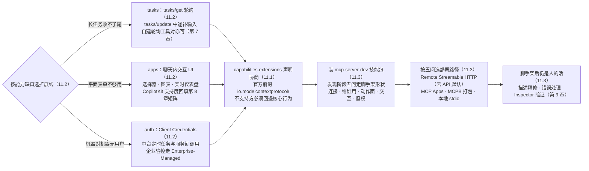

# 第 11 章 Agent Skills 与扩展生态

> 本章导读：核心协议（第 2 章）刻意保持精简——「必须实现」的只有基础协议、版本兼容与消息模式三层。那 Tasks、聊天内 UI、企业级授权这些能力放哪？答案是一套正式的**扩展机制**：能力之外的可选功能以扩展（extension）形式协商接入。本章讲清两件事：扩展生态的四条官方线（auth / apps / tasks / skills）各自解决什么、什么时候用；以及一个反直觉的新趋势——**用 Agent Skills（给 AI 编程助手的领域知识包）来加速 MCP Server 本身的开发**。读完本章，你能：为核心协议选对扩展并正确协商；知道长任务、聊天内 UI、机器对机器鉴权分别该用哪个扩展；用官方 mcp-server-dev 技能包加速团队 Server 开发。



*本章操作流程图*

## 你什么时候需要它

**长任务收不了尾**——工具要跑几分钟（批量对账、大文件处理），同步调用会超时。这就是 Tasks 扩展的领地（2026-07-28 把实验性 Tasks 移出核心，重新设计为扩展，第 3 章）。

**觉得「纯文本结果」不够用**——想让 Agent 界面里出现图表、选择器、仪表盘，elicitation 的平面表单满足不了。MCP Apps 扩展让 Server 输出聊天内交互 UI。

**机器对机器调用没有「用户」可授权**——OAuth 授权码流程假定有人在场点同意；定时任务、服务间调用需要 client credentials 或企业集中管控。auth 扩展系覆盖。

**想让 AI 编程助手帮你写 Server**——Agent Skills 把 MCP 开发的设计决策（部署模型、工具模式、鉴权选择）编码成助手可读的知识包，先审问你的用例再生成脚手架。

## 11.1 概述：扩展机制怎么工作

把可选能力放进展（extension）而不是塞进核心，是协议保持演进速度的常见手法：核心层小而稳定，所有实现都能跟上；创新功能以扩展形式先行，成熟条件具备再考虑收编。MCP 的扩展在**能力协商**阶段接入（扩展框架于 2025-11-25 版本进入协议，第 3 章）：双方在 `capabilities.extensions` 字段里互相声明，扩展标识符格式 `{vendor-prefix}/{extension-name}`，规则与 `_meta` 键一致。官方扩展用 `io.modelcontextprotocol/` 前缀；第三方**必须**用自己拥有的反向域名（如 `com.example/my-extension`），防碰撞——类似 Java 包命名。

```json
{ "capabilities": {
    "tools": {},
    "extensions": { "io.modelcontextprotocol/tasks": {} } } }
```

一条协商规则要记住：一方支持扩展而另一方不支持时，支持方**必须**回退到核心协议行为或以明确错误拒绝——扩展文档应写明自己的回退行为。扩展的「可选性」是协议级契约，不是口头约定。

## 11.2 四条官方扩展线

### Tasks（`io.modelcontextprotocol/tasks`，ext-tasks）

异步长任务：「call-now, fetch-later」。设想一个批量对账工具：请求发出后要跑五分钟，同步等待必然超时，模型的轮次也耗不起。Tasks 的形态是 Server 立即返回任务句柄，client 用 `tasks/get` 轮询进度，中途还能经 `tasks/update` 补充输入。2026-07-28 的重新设计（SEP-2663）要点：`tasks/result` 阻塞方法改为 `tasks/get` **轮询**；新增 `tasks/update` 支持 client 在任务执行中途补输入；移除 `tasks/list`；Server 可不经请求主动返回任务句柄。适用：批量操作、长耗时报表、任何「发起后要等」的动作。轻量替代：自建「提交任务 → 轮询状态」的工具对（第 7 章贯穿案例的选择——协议面更薄，代价是没有标准化的中途输入）。

### Apps（`io.modelcontextprotocol/apps`，ext-apps）

MCP Apps 让 Server 在**聊天界面内**渲染交互式 UI：可搜索选择器、图表、实时仪表盘、视频播放器。定位：当 elicitation 的平面表单不够时（build-with-agent-skills 教程的原话），Apps 接管。典型场景：让用户在一个可搜索的列表里选商品，而不是在平面表单里手输 SKU；在对话里直接渲染退款进度仪表盘。集成视角：CopilotKit 一类前端 Host 对它的支持度，是评估前端接入面的新维度（第 8 章矩阵的 ⚠️ 格子回填时一并核）。

### Auth（`io.modelcontextprotocol/auth` 系，ext-auth）

核心规范（第 10 章）覆盖「有人在场」的 OAuth 授权码流程；auth 扩展补两块企业场景：**OAuth Client Credentials**（机器对机器，无用户参与的 token 获取）与 **Enterprise-Managed Authorization**（企业集中管控授权的框架）。中台的定时任务与服务间调用走前者；「所有工具调用要过企业权限中枢」的场景看后者。

### Skills（`io.modelcontextprotocol/skills`，ext-skills，SEP-2640 已 Final）

把 **Agent Skills**（见下节）搬上 MCP：Server 通过协议**发现并读取** Agent Skills。它连接了两个世界——技能作为便携指令集，可以由 Server 分发、由任意实现该标准的 Agent 消费。

## 11.3 Agent Skills：用知识包加速 Server 开发

另一个方向的「Skills」：**给 AI 编程助手**的便携指令集（agentskills.io 开放格式，`SKILL.md` + `references/` 支撑材料），教会助手某个领域的决策知识。它的价值在于把「老手脑子里的设计决策」显式化：一个没写过 MCP Server 的工程师，配上技能包也能先被问对问题、再拿到结构合理的脚手架。官方提供了 MCP 开发的参考技能包 **`mcp-server-dev`**，三个技能相互组合：

| 技能 | 职责 |
|------|------|
| `build-mcp-server` | 入口：审问用例 → 选部署模型与工具设计模式 → 路由到专项技能 |
| `build-mcp-app` | 增加聊天内交互 UI（表单、选择器、仪表盘）——接 Apps 扩展 |
| `build-mcpb` | 把本地 stdio Server 连同运行时打包为 `.mcpb`，用户免装 Node/Python |

安装（Claude Code 示例）：`/plugin marketplace add anthropics/claude-plugins-official` → `/plugin install mcp-server-dev`；其他 Agent 克隆技能目录到自己的 skills 位置即可——开放格式，不锁定。

技能触发后会先跑一个**发现阶段**，五个问题决定脚手架形状：连接什么（云 API/本地进程/文件系统/硬件）、给谁用（自己/团队/公众）、动作面大小（几个操作还是包一个大 API）、交互需求（纯文本 / elicitation / 富 UI）、上游鉴权（API key / OAuth / 无）。然后推荐四条部署路径之一：**Remote Streamable HTTP**（包云 API 的默认——零安装摩擦、一份部署服务所有用户、OAuth 重定向可用）、**MCP Apps**（需要聊天内 UI 时）、**MCPB 打包**（必须碰用户本机：本地文件、桌面应用、localhost 服务）、**本地 stdio**（原型，注明升级到 MCPB 的路径）。

对团队的意义：这套技能包把第 4-5 章的手工流程（选型 → 脚手架 → 描述精修 → 测试）的前半段自动化了。脚手架生成后的迭代——工具描述、错误处理、Inspector 验证（第 9 章）——仍然是人的工作，也是质量所在。

## 11.4 发布与发现

Server 做完的最后一公里：发布到 **MCP Registry** 使其可被发现（registry/quickstart）。中台场景（自建域 Server、内网消费）通常不需要公共 Registry，但「域 Server 上线要在目录登记」的治理动作（7.6）与之同构——登记的条目、负责人、状态，内外逻辑一致。

## 11.5 本章小结

1. **扩展机制**：capabilities.extensions 协商；ID 带强制前缀；不支持方回退核心行为是协议级契约。
2. **官方四系**：tasks（异步长任务，轮询+中途输入）、apps（聊天内 UI）、auth（M2M 与企业管控）、skills（经 MCP 发现 Agent Skills）。
3. **Tasks 已非核心**：2026-07-28 移出为扩展并重设计——用扩展，或自建轻量轮询工具对，按协议面取舍。
4. **Agent Skills 双向价值**：作为 MCP 扩展被分发（ext-skills）；作为开发知识包加速 Server 构建（mcp-server-dev 三技能，发现阶段五问 → 四条部署路径）。
5. **脚手架之后仍是人的活**：描述精修、错误处理、Inspector 验证。

→ **第 12 章**跳出技术：组织与路线。

## 验收清单

读到这里，你应该能：

- ☐ 说明扩展的协商机制与标识符命名规则，为你的团队选定第三方前缀；
- ☐ 为「三分钟以上的批量任务」在 Tasks 扩展与自建轮询工具之间做取舍并说明理由；
- ☐ 判断一个需求该走 Apps（聊天内 UI）还是 elicitation（平面表单）；
- ☐ 为无用户参与的服务间调用选择 auth 扩展的对应机制；
- ☐ 安装 mcp-server-dev 技能包并用它生成一个 Server 脚手架；
- ☐ 说出四条部署路径各自的适用条件。

## 参考速查

| 项 | 值 |
|----|----|
| 扩展协商 | `capabilities.extensions`，ID = `{vendor-prefix}/{name}` |
| 官方前缀 | `io.modelcontextprotocol/` |
| Tasks 扩展 | `io.modelcontextprotocol/tasks`（SEP-2663；tasks/get 轮询 + tasks/update） |
| Apps | `io.modelcontextprotocol/apps`（ext-apps；聊天内 UI） |
| Auth 扩展 | ext-auth（Client Credentials / Enterprise-Managed） |
| Skills 扩展 | `io.modelcontextprotocol/skills`（SEP-2640 Final，ext-skills） |
| 开发技能包 | `mcp-server-dev`（build-mcp-server / build-mcp-app / build-mcpb） |
| 打包格式 | MCPB（`.mcpb` 存档，含运行时） |

## 延伸阅读

- **第 3 章（版本演进）**——Tasks 从核心实验到扩展的全过程；extensions 协商字段的引入。
- **第 8 章（构建 Client）**——消费端对扩展的支持度是矩阵回填的新维度。
- **第 9 章（调试与 Inspector）**——Inspector 的 Apps 页面即扩展能力的调试入口。
- **官方 extensions 概览与各系文档**——本章素材源；apps 快速上手与 skills 规范（SEP-2640）见复核清单。

## 复核清单（发布前）

- [ ] extensions/apps 快速上手通读，聊天内 UI 示例补一个实测
- [ ] extensions/skills 规范（SEP-2640）通读，发现与读取流程补节
- [ ] ext-auth 两个扩展的细节（client credentials 流程、企业管控框架）对照原文补全
- [ ] mcp-server-dev 技能包实际安装并用贯穿案例跑一遍发现阶段
