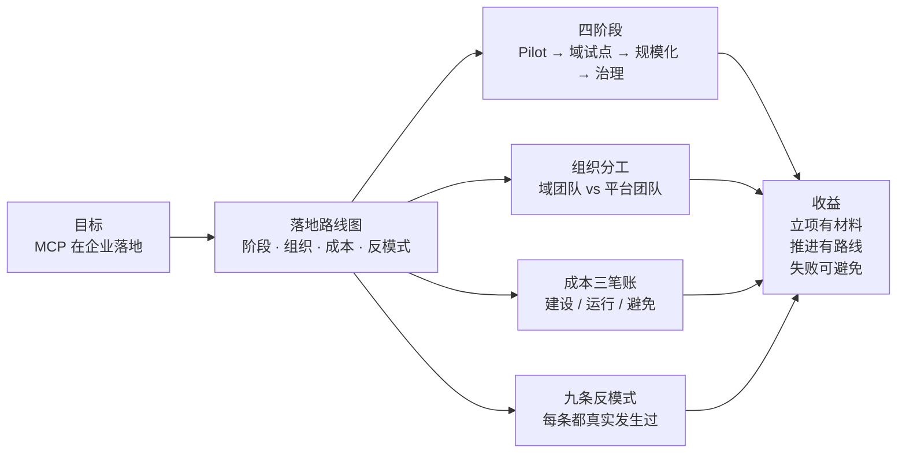

# 第 12 章 企业落地路线图

> 本章导读：技术章（第 2-10 章）回答「怎么做」；本章回答「怎么走」——组织、节奏、成本与失败方式。写给要向管理层立项的你：四阶段路线每段有退出标准，组织分工一张表定死，成本三笔账给结构不给空数，九条反模式每条都真实发生过。读完本章，你能：为团队写出 MCP 落地的立项材料；设计中台团队与业务团队的责任边界；用决策树判断当前该走哪一步。



*本章导览图*

## 你什么时候需要它

**要立项**——看 12.1（四阶段，Pilot 的产出是证据）与 12.3（成本三笔账，立项材料结构）。

**要划团队边界**——12.2 的一张表：描述质量归域团队，标准与指标归平台团队。

**评审别人的 MCP 方案**——12.5 的九条反模式逐条对照，命中即红旗。

本章说明：路线框架是本书立场（综合前十章技术结论与中台工程常识）；引用的外部案例标注出处，数字类内容给估算框架不给绝对值。

## 12.1 四阶段路线

```
Pilot ──▶ 域试点 ──▶ 网关规模化 ──▶ 常态治理
(4-6 周)   (1-2 季度)   (按域推进)     (例行化)
```

| 阶段 | 目标 | 范围 | 退出标准 |
| --- | --- | --- | --- |
| **Pilot** | 验证「封装一次、处处调用」的价值 | 3-5 个高频场景工具，单一消费端（如 agentscope-java） | 真实场景跑通；命中率/失败率达标（第 6 章指标）；有可展示的业务收益 |
| **域试点** | 验证方法论可复制 | 一个完整业务域（贯穿案例的售后域：20 接口→6 工具） | 第 7 章走查全流程留档；≥2 个异构消费端（第 8 章）；第二个团队照文档独立复刻成功 |
| **网关规模化** | 多域接入 | Gateway 上线，按域推进（每域走一遍域试点） | 域接入时长稳定下降；租户隔离与审计通过安全评审（第 10 章） |
| **常态治理** | 不劣化 | 目录四件套（第 7 章）例行化 | 工具指标月报；变更评审走通；淘汰机制真实执行过 |

为什么 Pilot 不可跳过？因为组织相信的不是架构图，是证据。最常见的失败是**跳过 Pilot 直接铺开**：没有可信的收益证据，规模化变成「更大规模的证明失败」——投入翻倍，怀疑也翻倍。

## 12.2 组织分工：谁拥有什么

中台场景的责任边界，建议一张表定死：

| 资产 | 拥有方 | 责任 |
| --- | --- | --- |
| 域 Server（代码） | 业务域团队 | 工具实现、描述质量（第 6 章标准）、域名下的接口聚合 |
| 工具目录条目 | 业务域团队 | 目录信息准确、变更走评审 |
| Gateway 与租户策略 | 平台团队 | 鉴权、路由、限流、审计、legacy 兼容收敛 |
| 消费端（Host） | 各 Agent 项目团队 | 工具可见性过滤、联调验证、（前端框架侧）→ copilotkit 书 |
| MCP 版本升级节奏 | 平台团队牵头 | 第 3 章兼容矩阵维护，SDK 大版本升级窗口 |

关键设计：**描述质量的责任在域团队，不在平台团队**——平台团队管不了「售后单号格式是什么」，这是域知识。平台团队的抓手是标准（第 6 章评审标准）与指标（第 6 章三指标）：域团队照标准做，平台团队用指标验，边界就立住了。

## 12.3 成本模型：立项时的三笔账

给绝对值没有意义（随规模与模型价格浮动），给结构：

1. **建设成本**（一次性）：管线搭建（7.3）+ 单域走查（聚合评审 + 描述精修）。描述精修是主要人力项——按「每工具 0.5-1 人日」估，20 接口 → 6 工具的域 ≈ 3-6 人日 + Server 骨架。
2. **运行成本**（持续）：token（工具目录进上下文的固定开销 + 调用往返）、Server 资源（无状态后很平）、Gateway 资源。**工具数量是 token 成本的一次项**——这是第 7 章压工具数的经济学理由。
3. **避免成本**（收益侧）：每个新 Agent 项目省掉的重复封装（中台口径：N 个项目 × M 个接口的适配工作量）；描述 bug 引发的线上事故成本。

立项材料里，Pilot 阶段就把「避免成本」用真实项目记账——这是四阶段路线存在的意义。

## 12.4 与现有治理体系融合

MCP 不是新大陆，是中台接口的新消费者。逐项对齐：

- **API 网关**：MCP Gateway 与 API 网关的关系是「上游/下游」还是「二合一」——按团队现有网关能力（多租户、审计）决定，不重复造
- **限流与配额**：租户 × `Mcp-Name`（协议标准头，第 10 章）接入现有配额体系
- **发布流程**：工具变更（描述/schema）并入现有变更评审；OpenAPI diff（7.3）作为变更单附件
- **协议生命周期对齐**：MCP 规范有正式的特性生命周期政策（Active/Deprecated/Removed，弃用窗最少 12 个月，第 3 章）——工具目录的弃用状态与其对齐，SDK 大版本升级窗口由平台团队统一规划
- **安全合规**：域 Server 视作普通内部服务过安全评审；第三方 MCP Server 引入走供应链评审（第 10 章）
- **可观测**：trace（`_meta` 的 W3C Trace Context 保留键，协议内建）与审计进现有体系；LLM 侧评估 → langfuse 书

## 12.5 反模式清单（每一条都真实发生过）

1. **全量暴露**：接口数 = 工具数。结局：选择准确率崩、上下文爆、没人维护（第 7 章开篇）
2. **一接口一工具**：把 REST 资源语义直接当任务语义，模型在「校验接口」和「创建接口」之间做出中台工程师才该做的编排
3. **描述自动生成后不精修**：schema 正确、模型不用——生成是起点不是终点
4. **无版本策略**：描述随手改，所有消费端的模型行为跟着抖；破坏性变更原地改工具名
5. **跳过 Pilot**（12.1）
6. **鉴权后置**：「先跑通再加鉴权」——工具是真实世界的动作，演示数据一接生产就是事故
7. **平台团队包揽一切**：域知识不在平台手里，描述质量必然平庸（12.2）
8. **基于已弃用特性新建集成**：2026-07-28 起 Sampling/Roots/Logging/DCR 都在弃用清单（第 3 章）——新代码碰它们，等于签下 12 个月内的返工单
9. **自建协议已有能力**：目录缓存（协议有 ttlMs/cacheScope）、订阅通知（subscriptions/listen）、参数路由（x-mcp-header）——先查规范再造轮子（第 7 章协议地基）

九条的共同点：每一条都是当时看起来的捷径。评审别人的方案时逐条对照，命中即红旗；规划自己的方案时逐条自查，命中即返工预告。

## 12.6 一页纸决策树

```
有稳定的 Agent 消费场景吗?
├─ 否 → 先立 Pilot(3-5 工具,单消费端),4-6 周后重评
└─ 是 → 中台接口有 OpenAPI 资产吗?
        ├─ 否 → 先补接口文档(管线的前提)
        └─ 是 → 单域走查(第 7 章方法)
                ├─ 指标达标?──否──▶ 回到描述精修/聚合评审
                └─ 是 ─▶ 双消费端验证(第 8 章)
                        ├─ 通过?──否──▶ 查矩阵/传输/版本
                        └─ 是 ─▶ Gateway 纳管 → 按域复制 → 常态治理
```

## 12.7 小结

- 四阶段：每个阶段有退出标准，Pilot 的产出是**证据**不是代码
- 描述质量归域团队，标准与指标归平台团队
- 成本三笔账：建设、运行、避免；工具数量是 token 的一次项
- MCP 融入现有治理，不另起炉灶
- 九条反模式，每条都是捷径的陷阱

→ 技术与路线至此完整。回到第 1 章开场的那笔账：三个项目、三套鉴权、三份参数文档——读完本书的你，应该已经能给出自己的收敛方案了。

## 验收清单

读到这里，你应该能：

- ☐ 说出四阶段路线各自的退出标准，并解释为什么 Pilot 不可跳过；
- ☐ 用一张表划清域团队与平台团队的资产与责任；
- ☐ 为立项材料搭出成本三笔账的结构（不给绝对值给框架）；
- ☐ 说出至少五条反模式及其对应的正解；
- ☐ 用一页纸决策树判断团队当前所处阶段与下一步。

## 参考速查

| 项 | 值 |
|----|----|
| 四阶段 | Pilot（3-5 工具，4-6 周）→ 域试点（1-2 季度）→ 网关规模化 → 常态治理 |
| 组织 | 描述质量=域团队；标准与指标=平台团队；Gateway=平台团队 |
| 成本三笔账 | 建设（管线+精修）/运行（token+资源）/避免（省掉的重复封装） |
| 治理对齐 | 协议生命周期（12 个月弃用窗）/变更评审/OpenAPI diff |
| 决策树 | 有场景？→有 OpenAPI？→单域走查→双端验证→Gateway→复制 |

## 延伸阅读

- **第 7 章（规模化）**——本章「域试点」阶段的完整方法论。
- **第 10 章（部署与安全）**——「鉴权后置」反模式的完整防线。
- **第 3 章（版本演进）**——生命周期政策对治理节奏的约束。
- **官方 tutorials 与案例**——外部案例引用的原文出处（见各节标注）。

## 复核清单（发布前）

- [ ] 外部案例（GitHub MCP Server、托管网关产品）引用与数据核实（标注出处与日期）
- [ ] 成本估算框架用团队真实项目校准一轮
- [ ] 反模式清单向团队征集补充（真实踩坑优先）
