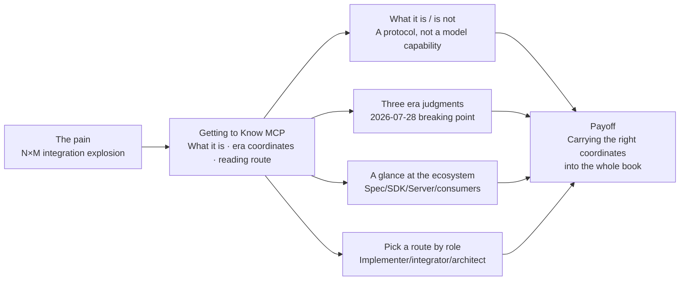

# Chapter 1 Getting to Know MCP

> Chapter guide: Middle-platform teams have all seen this scenario. The support Agent project has to connect to the after-sales API, and wraps it once. The frontend CopilotKit has to show after-sales progress, and wraps it again. A newly started data script wraps it a third time. Three projects, three auth setups, three parameter documents, all serving the same "查售后单" ("look up an after-sales ticket"). This chapter starts from that problem. It explains what MCP is and what it is not, gives the three era coordinates you must establish before reading the whole book, and draws a reading route by your role. By the end of this chapter, you can: explain to the team in one sentence what problem MCP solves; judge whether the material in hand is a tutorial of an outdated protocol shape; and find the chapter route that fits you.

*Figure: map of this chapter*

## 1.1 What MCP Is, and What It Is Not

Start with the problem itself. Every Agent framework × every internal system = one repeated wrapper. That is the N×M integration explosion. The wrapper code is often not hard to write. What is hard to bear is the drift of three parameter documents, the maintenance of three auth setups, and the long-term tax of "the same capability behaves differently in three places".

The answer from the Model Context Protocol (MCP) is to collapse M to 1: the middle platform exposes a capability **once**, according to the protocol, and every Agent framework connects as a standard consumer. N×M becomes N+M.

**What it is**: an open protocol that specifies "how an AI application (Host) discovers and calls external capabilities (Server)". JSON-RPC is the carrier. It standardizes the description of tools, resources, and prompts, so that "what the model sees, how it calls, and what shape the result takes" are all agreed in the protocol.

**What it is not**. Three boundaries are worth drawing clearly:

- **Not a model capability**: MCP does not change the model. It changes **what the model can see**. Whether a tool is selected in the end is still a contest between the model and the quality of the description (Chapter 6)
- **Not an RPC framework**: JSON-RPC is only the carrier. The value is the **semantic agreement** on describing capabilities, discovering them, and calling them
- **Not a way to skip writing code**: what it eliminates is the code of "every framework wrapping the same thing again". The engineering of the protocol itself (modeling, description, governance) is new work, and it is the more valuable work (Chapter 6 and Chapter 7)

The boundary with its close relatives also needs one sentence. **function calling** is a single-point capability of a model vendor's API. **OpenAPI** describes system interfaces (resource semantics, aimed at people). MCP stands above them and gives the Agent world a **tool layer of task semantics**.

## 1.2 Three Era Judgments for the Protocol

Before you read any MCP material, first establish three era coordinates (developed in Chapter 3). This section is the most important "pitfall-avoidance" investment in the whole book. A large share of the MCP tutorials on the market stay on the old protocol shape. If the coordinate system is wrong, copying them is a pitfall.

1. **2026-07-28 is the breaking point**: protocol-level sessions and the initialize handshake are removed as a whole, and each request carries its own protocol metadata. The three major v1 features, Roots, Sampling, and Logging, enter the deprecation list. **Copying the shape of mid-2025 tutorials is stepping into a pitfall**
2. **For SDKs, look at the major version**: support for 2026-07-28 starts with TypeScript v2.x and with Java mcp-core 2.0.x. SDKs from the v1 era will not gain support
3. **The protocol begins to be designed for infrastructure**: standard HTTP headers (`Mcp-Method`/`Mcp-Name`), cache semantics (`ttlMs`/`cacheScope`), and header routing. Gateways and governance are native topics of the protocol, not peripheral engineering

## 1.3 A Glance at the Ecosystem

- **Spec**: modelcontextprotocol.github.io (source repository modelcontextprotocol/modelcontextprotocol). Five versions coexist, and latest = 2026-07-28. Official extension ecosystem: Tasks, Apps, Auth, Skills
- **SDKs**: TypeScript / Java / Python / C#, and others, layered by support for 2026-07-28 (the selection table in Chapter 4)
- **Server side**: large services such as GitHub natively provide 2026-07-28 endpoints. Inside an enterprise, self-built domain Servers are the main form (Chapter 7)
- **Consumers**: agentscope-java, ragflow, CopilotKit, and mainstream AI CLIs all connect in the role of a Host. The support matrix is in Chapter 8

## 1.4 How to Read This Book

The whole book is organized around our running example: **the middle-platform after-sales domain, 20 REST interfaces → 6 task-level tools → Gateway → consumption by multiple frameworks**. The example is initialized in Chapter 4 and grows as the chapters advance.

| Who you are | Route |
| --- | --- |
| Server implementer (backend, the main line) | Chapter 2, concepts → Chapter 4, hands-on (a 30-minute verified hands-on on both ends) → Chapter 5, a complete Server → Chapter 6, the craft of tools → Chapter 7, scaling → Chapter 9, debugging → Chapter 10, going to production |
| Client integrator | Chapter 2 + Chapter 4 + **Chapter 8** (the support matrix and a verified hands-on on both ends). For details, go back to each framework's own book |
| Platform / architecture decision | Chapter 1 → Chapter 7 (scaling topology) → Chapter 3 (versions and compatibility) → Chapter 10 (security baseline) → **Chapter 12** (roadmap and the project proposal) |
| Testing / operations | Section 2.1 (capability modeling) + Chapter 6 (tool quality) + Section 7.6 (catalog governance) + Chapter 9 (the debugging toolbox) |

Writing conventions: under the specified SDK version, code is **verified hands-on**, or it is explicitly marked as not verified hands-on (each chapter attaches a verified-hands-on / review checklist). Statements of fact are checked against the spec original, and the basis is marked. Division of labor with the other books on the shelf: details of framework APIs are always cross-referenced, and this book owns only the protocol and the methodology of scaling.

## 1.5 One Piece of Advice

If you have learned MCP only from tutorials on the web, read **Chapter 3** before you touch any code. The protocol is still evolving. This book takes 2026-07-28 as the baseline, and it makes this agreement: after a new latest is published, the main-line version has to be decided again. This book deliberately keeps the three layers "spec original + verified-hands-on evidence + team methodology" separate, so that on every protocol upgrade it is visible at a glance which layer has to be replaced and which layer does not.

The next chapter starts from the roles and the messages of the protocol.

## Chapter summary

1. **MCP solves the N×M integration explosion**: the middle platform exposes a capability once, and every framework connects as a standard consumer. It changes what the model can see. It does not change the model itself.
2. **Three era coordinates**: 2026-07-28 is the breaking point. For SDKs, look at the major version. The protocol is already designed for infrastructure.
3. **This book has two main lines**: the protocol itself (Chapter 2 and Chapter 3) and landing it at scale (Chapter 6, Chapter 7, Chapter 10, and Chapter 12). Our running example is the middle-platform after-sales domain.
4. **Pick a route by role**: implementers, integrators, architects, and testers each have a shortest path. You do not have to read straight through.

→ The next chapter enters the core concepts of the protocol: roles, messages, statelessness, and capability discovery.

## Acceptance checklist

By the time you have read this far, you should be able to:

- ☐ Explain the value of MCP to the team with "N×M becomes N+M", and say what it does not solve;
- ☐ Judge which protocol shape a tutorial on the web is based on, and whether you need to check it against Chapter 3 before using it;
- ☐ From the route table in Section 1.4, pick the first three chapters for your own role;
- ☐ State the boundary among function calling, OpenAPI, and MCP.

## Further reading

- **Chapter 2 (Core Protocol Concepts)**. The foundation chapter of the whole book. Every later chapter cites its numbering.
- **Chapter 3 (Version Evolution)**. The full development of the three era judgments, the chapter of "read it before you touch code".
- **Chapter 12 (Enterprise Adoption Roadmap)**. If you came in with a project-proposal task, you can jump there first and then read the technical chapters.

## Review checklist (before publication)

- [ ] Refresh the ecosystem description in full as of publication time (SDK versions, the extension ecosystem, framework support)
- [ ] Re-check the "latest version" statement. If there is a new version, decide the main line again
- [ ] Align the reader route table with the actual content of each chapter, one by one
