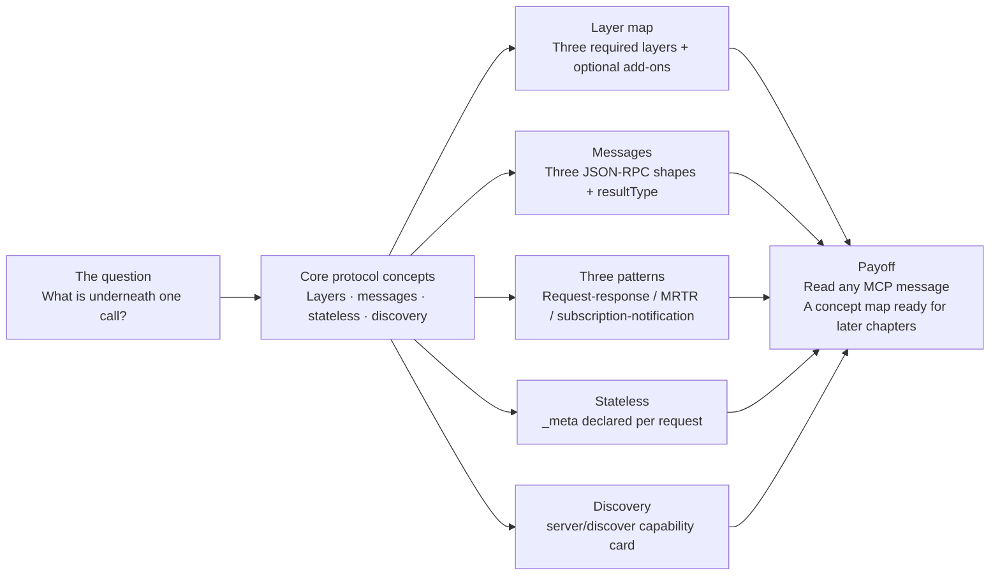

# Chapter 2 Core Protocol Concepts

> Chapter guide: One after-sales query. What happens underneath the Agent? Where does the catalog come from, before "the model picked a tool"? How does a "stateless" Server know which protocol version it should use to handle the request? This chapter checks the original text of the official 2026-07-28 spec (basic/index, versioning, server/discover) and takes the core of the protocol apart: the layer map of the seven components, the three JSON-RPC message shapes and resultType polymorphism, the three message patterns, the precise meaning of statelessness (per-request `_meta` metadata), and capability discovery (server/discover). The message examples are taken from the spec, or confirmed in testing with TypeScript SDK v2.4.0. By the end of this chapter, you can: draw the layer map of one call; read every field of any MCP message; state the modeling boundary of the three kinds of capabilities; and explain, in the language of the protocol, "why this version has no handshake".



*Figure: map of this chapter*

## When you need it

**To read or hand-write an MCP message.** Section 2.3 (messages) and Section 2.5 (`_meta`) are the dictionary: what each field means, which ones are required, and what happens if one is missing (-32602/400).

**When you cannot decide how to model something among "tools, resources, and prompts".** The decision table in Section 2.1, plus three rules of thumb, and you have a conclusion in one minute.

**To explain to the team "why 2026-07-28 no longer has initialize".** The four stateless rules in Section 2.5, and the confirmation in testing, are the answer.

Prerequisite: none. This chapter is the conceptual foundation of the whole book. Every later chapter cites the numbering here.

Look first at one real call. The user says to the agentscope-java support Agent: "我的售后单 T-2026-1031 到哪一步了？" ("Which step has my after-sales ticket T-2026-1031 reached?"). The Agent decides to call an after-sales tool. What happens underneath?

```
1. Host(agentscope Agent) tells the Client: call after_sales_query_ticket for me
2. The Client builds a JSON-RPC request, carrying "who I am, which protocol version I speak, and what capabilities I have"
3. The request reaches the Server (it may pass through a Gateway, and any replica may take it)
4. The Server reads the arguments, calls the middle-platform API, and assembles the result -- it does not remember, and does not need to remember, "what it talked about with this client last time"
5. The result returns along the same path. The Agent gets structured data and organizes it into a natural-language reply
```

The "any replica may take it" of step 3, and the "does not need to remember" of step 4, are the whole spirit of the 2026-07-28 spec. This chapter takes that process apart: how many layers the protocol has, what a message looks like, what stateless actually refers to, and how capabilities are discovered.

## 2.1 The Protocol's Layer Map

The spec splits MCP into seven components, and the requirements differ:

| Component | Contents | Implementation requirement |
| --- | --- | --- |
| Base protocol | JSON-RPC message types | **Required** |
| Versioning and compatibility | Version negotiation, extension negotiation, interoperation with old versions | **Required** |
| Message patterns | Request/response, MRTR, subscription/notification | **Required** |
| Authorization | The authentication and authorization framework for HTTP transport | HTTP transport should follow it |
| Server capabilities | resources, prompts, tools | As needed |
| Client capabilities | elicitation, sampling, roots | As needed |
| Utilities | Cross-cutting concerns such as logging and argument completion | As needed |

The point of the modularity: an implementer **does only the three required layers, and the rest are optional add-ons chosen as needed**. A minimal Server that exposes only tools does not have to implement sampling. A pure resource Server can have no tool at all. This layering is also the map of the chapters in the book. Chapter 3 covers the second layer, Chapter 6 covers tools, and Chapter 10 covers authorization.

### How to choose among the three Server capabilities: tool, resource, and prompt

Of the seven components, the choice people most often cannot settle is the three options in the Server capability layer. The spec's criterion is not "how strong the feature is". It is **who controls it**: a tool is controlled by the model (model-controlled), a resource is controlled by the application (application-controlled), and a prompt is controlled by the user (user-controlled). A different controller means a different scenario:

| Dimension | tool | resource | prompt |
| --- | --- | --- | --- |
| Who controls it | The model decides on its own when to call | The application decides when to fetch it and inject it into context | The user actively chooses to start it |
| Semantics | Execute an action; side effects are allowed | Provide read-only data | A reusable interaction template |
| Example | Create an after-sales ticket, check progress | After-sales policy documents, logistics configuration | The "退货申请" ("return request") guided flow |
| Where this book develops it | Chapter 6 | Section 2.6 / Chapter 7 | Each framework's own book |

Three rules of thumb cover the great majority of judgments:

1. **Want the model to "do" → tool; want the model to "know" → resource; want a person to "initiate" → prompt.** Which side the controller belongs to is the first criterion
2. **An action that has side effects, or that needs argument validation, is always a tool.** Even when it looks like a "query" (a query is also an action, and the arguments are the model's job)
3. **Data that is large, read-only, and changes infrequently → resource.** Changes can be subscribed to, and reads can be paginated. It does not have to be squeezed into a tool result

The main form of an enterprise Server is the tool (Chapter 5), but the three kinds show up in combination: policy documents become resources for injection, operating procedures become prompts for the user to trigger, and the concrete actions are carried by tools.

## 2.2 Roles: Host, Client, and Server

The three roles each own one thing, and the boundaries are clear:

- **Host**: the application the user faces. The Agent in agentscope-java, the CopilotKit frontend, an AI CLI. It decides **which Servers to attach, and which tools to put into the model context**.
- **Client**: the connection keeper inside the Host process. It is responsible for transport, for carrying protocol metadata per request, and for handing Server capabilities over to the Host.
- **Server**: the provider of capabilities. The after-sales-domain Server and the logistics-domain Server each expose tools and resources.

One sentence to hold onto: **the Server owns "what the capability is", and the Host owns "what the model can see"**. The governance at scale in Chapter 7 governs visibility on the Host side.

## 2.3 Messages: Everything Is JSON-RPC

Every message must conform to JSON-RPC 2.0. There are three shapes in all.

**Request**: the client initiates an operation. It must carry an `id` that is a string or a number (one difference from JSON-RPC: **id must not be null**), and it must not reuse the id of another request that has been sent and not yet answered:

```json
{
  "jsonrpc": "2.0",
  "id": 1,
  "method": "tools/call",
  "params": { "name": "after_sales_query_ticket", "arguments": { "ticket_id": "T-2026-1031" } }
}
```

**Response**: on success, `result` must carry a **`resultType` field**. This is a new design in 2026-07-28, and it is easy to miss on a first look:

```json
{
  "jsonrpc": "2.0",
  "id": 1,
  "result": {
    "resultType": "complete",
    "content": [{ "type": "text", "text": "售后单 T-2026-1031 当前处于维修阶段" }]
  }
}
```

The `text` in that result is "售后单 T-2026-1031 当前处于维修阶段" ("After-sales ticket T-2026-1031 is currently in the repair stage").

`resultType` makes the result **polymorphic**. The value `"complete"` means finished (it carries the final content). `"input_required"` means the request is not finished and the client needs to supply information (it carries an `InputRequiredResult` object; see Section 2.6, MRTR). Extensions may define further values. A client that meets a `resultType` it does not recognize must treat it as illegal. **A missing `resultType` is treated as `"complete"`**. That compatibility rule lets a response from an old Server stay parseable under the new protocol.

**Notification**: a one-way message, with no `id`, and the receiver must not respond. The Server uses it to push events (for example a change in the tool catalog). The action of "replying" is not required.

### Error codes: a range the spec manages strictly

The JSON-RPC reserved range (-32700, and -32600 through -32603) is still used for failures at the protocol layer. MCP partitions the implementation-defined range (-32000 through -32099):

- **-32000 through -32019: the legacy range.** A leftover range occupied by historical implementations. New code must not allocate it, and should not use it
- **-32020 through -32099: the spec-reserved range.** Only three codes are defined by the spec:
  - `-32020` HeaderMismatch (the HTTP headers do not match)
  - `-32021` MissingRequiredClientCapability (the client lacks a capability declaration the request needs; it appears in Section 2.5)
  - `-32022` UnsupportedProtocolVersion (the version is not supported; the main subject of Section 2.5 and of Chapter 3)
- The old `-32002` (resource not found) has been replaced by `-32602`. A client should stay compatible with an old Server that still sends `-32002`

Application-defined errors **should** fall outside the reserved range (outside -32768 through -32000). Treat the error-code partition as an API: your Server should not invent a `-32050` and still expect every client to understand it.

## 2.4 Three Message Patterns

The spec defines three interaction patterns, in increasing complexity:

**① Request/response**: the question and answer demonstrated above. It covers the great majority of scenarios.

**② Multi-round request (MRTR)**: halfway through handling, the Server needs the client to supply information (ask the user for a form, or borrow the Host's model for a bit of reasoning). It returns a result with `resultType: "input_required"`, and embeds the request it needs. After the client finishes, it **starts a new self-contained request** and continues. This is the interactivity scheme for a stateless world, developed in Section 2.6.

**③ Subscription/notification**: the client subscribes to an event stream (such as `subscriptions/listen`), and the Server keeps pushing notifications. Note its stateless semantics: a long-connection-style listen is still "one request". The response is an open stream of notifications, and the state belongs to the **request**, not to the underlying connection.

## 2.5 Stateless: What the Spec Original Says

This passage in basic/index is worth reading in full (rendered in this book; the original text governs the meaning):

> **MCP is a stateless protocol**: all the information needed to handle a request is contained in the request itself. The Server handles each request independently. It must not infer any state from earlier requests, even when they come from the same connection.

In concrete terms, that is four rules:

1. The **Server must not** depend on earlier requests on the same connection to establish context (capabilities, protocol version, client identity). That metadata **comes with every request**
2. The Server should be ready to handle, at the same time, requests from multiple tasks, threads, or sessions
3. The Server should not require the client to carry out related operations on the same connection
4. State that needs to continue across requests (long tasks, application-level handles) **must be referenced by an explicit identifier**, and the client carries it on every request

The core mechanism that goes with this is **per-request protocol metadata in `_meta`**. Every request from the client must declare, in `params._meta`:

```json
{
  "jsonrpc": "2.0",
  "id": 1,
  "method": "tools/list",
  "params": {
    "_meta": {
      "io.modelcontextprotocol/protocolVersion": "2026-07-28",
      "io.modelcontextprotocol/clientCapabilities": {}
    }
  }
}
```

| Key | Required | Meaning |
| --- | --- | --- |
| `io.modelcontextprotocol/protocolVersion` | **Yes** | The protocol version this request uses |
| `io.modelcontextprotocol/clientCapabilities` | **Yes** | The client capability declaration relevant to this request |
| `io.modelcontextprotocol/clientInfo` | No (recommended to include) | Client name and version |
| `io.modelcontextprotocol/logLevel` | No | The lower bound of the log level desired |

**A missing required field means a malformed request**: the Server must reject it with `-32602` (Invalid params), and on HTTP it returns 400. If the request needs a capability the client did not declare, the Server returns `-32021` and lists what is missing in `data.requiredCapabilities`.

Two consequences are worth thinking through:

- **"Stateless" does not mean "carry nothing". It means "every request carries the whole of it".** State has moved out of the connection and into the `_meta` of each request. That is exactly why any replica can take a request, and why horizontal scaling is unconstrained: no request "belongs" to a connection.
- **One stdio connection is not one session.** The spec notes this on purpose: a client may interleave, on the same transport, requests from several unrelated tasks, and the Server must not treat "connection identity" as "session continuity". The lifetime of a stdio process should not be bound to one conversation either.

### Confirmed in testing

Our verified hands-on with the TS SDK v2.4.0 in Chapter 4 (send `tools/list` straight through, with no handshake, and get a result immediately) confirms "no handshake". Inside the SDK, the convenience methods are what automatically assemble the required `_meta` fields above. When you hand-write raw JSON-RPC, do not leave them out.

## 2.6 Capability Discovery: `server/discover`

Statelessness raises a blunt question: the handshake is gone, so how does the client know who is on the other side, which versions are supported, and which capabilities exist? The spec gives one method a Server **must** implement. The comment inside the JSON below is "同 2.5" ("same as Section 2.5"):

```json
{ "jsonrpc": "2.0", "id": "d1", "method": "server/discover", "params": { "_meta": { /* 同 2.5 */ } } }
```

```json
{
  "jsonrpc": "2.0", "id": "d1",
  "result": {
    "resultType": "complete",
    "supportedVersions": ["2026-07-28"],
    "capabilities": { "tools": {}, "resources": {} },
    "_meta": { "io.modelcontextprotocol/serverInfo": { "name": "after-sales", "version": "1.0.0" } },
    "instructions": "本 Server 提供售后单查询/创建/试算能力。查询物流请用物流域。",
    "ttlMs": 3600000,
    "cacheScope": "public"
  }
}
```

The `instructions` value is "本 Server 提供售后单查询/创建/试算能力。查询物流请用物流域。" ("This Server provides query, creation, and trial-calculation for after-sales tickets. For logistics queries, use the logistics domain.").

One request gets back: **the protocol versions supported** (`supportedVersions`), **the capability list** (`capabilities`), **the identity** (`serverInfo`), and **usage instructions for the model** (`instructions`), and it declares how long the result may be cached (`ttlMs`).

Calling it is the client's freedom, not an obligation. The client may also send a business request directly, and if the version is not supported it takes a `-32022` error (the error body likewise lists the versions the server supports; Chapter 3). Two scenarios are worth an intentional call. One is to present a Server overview in a single shot before connecting, in place of probing with the three lists tools, prompts, and resources. The other is the old-version compatibility probe on stdio (the Dual-era mechanism in Chapter 3).

Note `instructions`: this is natural language written for the **model**, "what this Server is for, and whom it should work with". It is description-quality engineering extended to the Server level. The tool descriptions in Chapter 6 are its sibling.

## 2.7 MRTR: Interactivity in a Stateless World

Scenario: the model calls `after_sales_create_ticket`, but the field "refund method", which the user must choose, is missing. A stateful protocol would open a session and wait for the user. The stateless answer has three steps:

```
① client: tools/call(create_ticket, {known parameters})
② server: result { resultType: "input_required", ... embedded elicit request (choose a refund method) }
③ After the client finishes collecting, it starts a brand-new request that carries the response and continues
```

The key is step ③: **continuation does not rely on the Server remembering. It relies on the request carrying its own context.** Every hop is an independent, complete request that any replica can handle. Two protocol details come up again and again in the hands-on work of Chapter 6. The JSON-RPC `id` of a retry request must be a new id (it must not reuse the original request's id). The `requestState` field is where the Server places continuation context; the client brings it back unchanged and does not parse it. At the SDK level (TS v2.4.0), the tool handler only has to return an `inputRequired` object. The constructors for the embedded request cover three client capabilities: elicit (a form), createMessage (borrow the model for reasoning), and listRoots.

## 2.8 Three Views of the Same Call

The official architecture tutorial (learn/architecture) uses a running example to walk "one tool call" once through each of three levels of abstraction. Switching viewpoint this way is a shortcut to understanding MCP:

**① Data layer (the protocol view)**: everything is a JSON-RPC message. Each step, discover, tools/list, and tools/call, carries the required `_meta` fields (protocol version, clientCapabilities, and clientInfo is recommended). The response carries `resultType` and the cache fields (`ttlMs`/`cacheScope`). The four steps the tutorial unfolds, discovery → tool discovery → tool execution → notification, are worth copying out by hand, the request and response JSON of each step. The verified hands-on commands in Chapter 4 are the runnable version of this layer.

**② SDK layer (the developer view)**: assembling `_meta`, validating schemas, and dispatching notifications are absorbed by the SDK. The tutorial's pseudocode shows the typical shape of an AI application's integration:

```python
async with Client(stdio_client(server_config)) as client:
    if client.server_capabilities.tools:          # the discover result is attached to the client object
        app.register_mcp_server(client, supports_tools=True)
    app.set_server_ready(client)
```

**③ AI application layer (the product view)**: the application gathers the tools of every connected Server into a "unified tool registry" and hands that registry to the model. During the conversation the model produces tool calls, and the application executes them and fills the results back in. The Agent loop in Section 8.3 is the minimal implementation of this layer.

How the three views divide the work: to track down a protocol problem, go back to ①; to write business code, stay at ②; to understand product behavior, look at ③. The chapters of this book are organized the same way. Chapter 3, Chapter 6, and Chapter 10 go deep on ① (protocol and spec semantics). Chapter 4 and Chapter 5 sit at ② (SDK practice). Chapter 7 and Chapter 12 are at ③ (platform and product).

Spec features also have a three-state lifecycle of their own (Active / Deprecated / Removed, with a deprecation window of at least 12 months; learn/versioning and Chapter 3). When you read the spec, first see which state a feature is in. A Deprecated capability should not enter new code.

## 2.9 Summary

| Concept | In one sentence |
| --- | --- |
| Layers | Three layers are required (base protocol / version compatibility / message patterns); the rest are optional add-ons |
| Capability modeling | tool is model-controlled, resource is application-controlled, prompt is user-controlled. Choose by who controls it |
| Messages | Three JSON-RPC shapes; `resultType` makes the result polymorphic; error codes are managed in ranges |
| Patterns | Request/response, MRTR, subscription/notification |
| Stateless | State moves from the connection into the `_meta` of each request; a stdio connection ≠ a session |
| Discovery | One `server/discover` call gets version + capabilities + identity + instructions for the model |
| Interaction | `input_required` + a self-contained continuation |

→ With this concept map in place, the next stop can go either way: **Chapter 4** for hands-on work (recommended; get both ends running in 30 minutes), or **Chapter 3** to get clear first on "how we arrived at stateless".

## Acceptance checklist

By the time you have read this far, you should be able to:

- ☐ Draw the layer map of the seven components, and point out which ones "must be implemented";
- ☐ Hand-write a `tools/list` request with a complete `_meta`, and say what the server does when each required field is missing;
- ☐ Explain the polymorphic design of `resultType`, and whom "a missing value is treated as complete" is there for;
- ☐ Use the decision table in Section 2.1 to model a new capability correctly as a tool, a resource, or a prompt;
- ☐ State the three-step flow of MRTR, and point out which two fields have special requirements on retry;
- ☐ Call `server/discover` and read `supportedVersions`, `capabilities`, and `instructions`.

## Quick reference

| Item | Value |
| --- | --- |
| Required `_meta` | `io.modelcontextprotocol/protocolVersion` + `/clientCapabilities`; `/clientInfo` is recommended |
| resultType | `complete` (finished) / `input_required` (input still needed); a missing value is treated as complete |
| Spec-reserved error codes | -32020 HeaderMismatch / -32021 MissingRequiredClientCapability / -32022 UnsupportedProtocolVersion |
| Three patterns | Request-response / MRTR / subscription-notification (subscriptions/listen) |
| Four stateless rules | Do not depend on connection context; concurrent handling of multiple tasks; do not require the same connection; cross-request state uses explicit identifiers |
| Capability modeling | tool = model-controlled / resource = application-controlled / prompt = user-controlled |
| Discovery | `server/discover` (a Server must implement it): supportedVersions + capabilities + serverInfo + instructions |
| JSON Schema | Default 2020-12; `$ref` does not automatically dereference network URIs |

## Further reading

- **Chapter 4 (Quick Start)**. A 30-minute runnable version of this chapter's concepts: four behaviors verified hands-on, plus calls from both ends.
- **Chapter 3 (Version Evolution)**. Where the Modern model came from, and Legacy compatibility.
- **Chapter 6 (Tool Integration in Practice)**. The tool modeling in Section 2.1, plus the full craft of the schema semantics in this chapter.
- **The official learn/architecture tutorial**. The original walkthrough of the three views in Section 2.8 (568 lines).

## Review checklist (before publication)

- [ ] Check the field details of `resultType` and `InputRequiredResult` against spec schema.ts
- [ ] Check the required-field table for `_meta` item by item against the original text of basic/index
- [ ] Fill in the subscription/notification mechanism (`subscriptions/listen`) (this chapter only touches it; it can stand as its own section)
- [ ] Check the role definitions against the original text of architecture/index
- [ ] Decide whether the `icons` metadata spec (the tail of basic/index) belongs in this chapter or in an appendix
