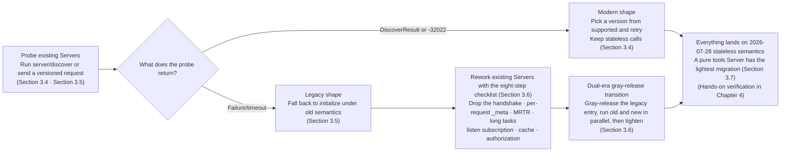
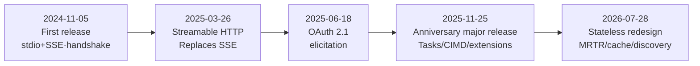

# Chapter 3 Spec Versions and Compatibility

> Chapter guide: A large number of MCP tutorials on the web stay on the protocol shape of mid-2025. After 2026-07-28 they are outdated, and copying them hits a pitfall. This chapter strings the five versions onto one line: what problem each version solved, what debt it left behind, and, most important of all, **how an existing Server migrates to latest**. Once the evolution is understood, the stateless model in Chapter 2 is no longer "a design out of nowhere". It is the result of paying the debt three times. By the end of this chapter, you can: state the release timeline of the five versions and the theme of each; explain why the nine changes of 2026-07-28 happened; use the seven-cell compatibility matrix to judge the behavior of any combination of old and new; and plan the migration of an existing Server from the eight-step checklist.



*Figure: operational flowchart of this chapter*

## When you need it

**You have taken over an MCP Server "from an unknown era".** First look at the seven-cell matrix in Section 3.5 and the version negotiation in Section 3.4: run `server/discover` once, or send one request that carries a version. Which cell it falls in, and how to handle it, is clear at once.

**You need to plan an upgrade of an existing Server to 2026-07-28.** Go straight to the eight-step checklist in Section 3.6. Each step corresponds to an entry in the official changelog.

**You are judging whether a tutorial or an article on the web is usable.** Look at the five-version timeline in Section 3.1: any MCP material that does not mark a spec version date is understood, by default, as the mid-2025 shape. Check it against the timeline, then use it.

Prerequisite: the Modern model in Chapter 2 (`_meta`, discover, resultType). This chapter tells "how they came to be".

## 3.1 Overview: The Five-Version Timeline and the Official Terms



Official terms (used throughout what follows):

- **Modern**: 2026-07-28 and later. Version, identity, and capabilities are all carried per request (per-request `_meta`)
- **Legacy**: 2025-11-25 and earlier. A session is established by the `initialize` handshake
- **Dual-era**: an implementation that supports both

## 3.2 Five Versions, One Main Line

Read as one line, the five versions are a debt-paying road "from demo to production": each version solves the biggest obstacle the previous version left behind.

**2024-11-05 (first release)**: two transports, stdio and HTTP+SSE; the initialize handshake establishes a session; the three capabilities, tools, resources, and prompts, take shape. It set the protocol skeleton of "model context", and it also took on the debt that runs through every version after it: **statefulness**. The session is kept by the Server, which means every Server has to manage the handshake, manage stickiness, and manage recovery. Turning that into a service is hard.

**2025-03-26**: Streamable HTTP replaces HTTP+SSE. SSE's one-way stream, plus session stickiness, is hard to turn into a service, so the transport layer moves first toward "an ordinary HTTP service". The signal is clear: Servers are heading into production.

**2025-06-18**: security is normalized. The Server is formally positioned as an **OAuth 2.1 Resource Server**. Elicitation (the Server collects input from the user) enters the core. Normalization is the starting point. There is still a distance from "an enterprise dares to use it". The next version is the make-up lesson.

**2025-11-25 (the protocol's first anniversary)**: the enterprise make-up lesson.

- **Tasks (experimental)**: "call-now, fetch-later". A long task returns a handle to poll
- **A major change to authorization**: CIMD (a URL metadata document in which the client states its own identity) is introduced. **DCR (Dynamic Client Registration) is downgraded from SHOULD to MAY**, a downgrade after security flaws spread through the implementation layer. RFC 8707 Resource Indicators are mandatory (the token is bound to a resource)
- **The Extensions framework**: the mechanism for negotiating extensions outside the core takes shape
- Metadata: icons, audio content, resource links, websiteUrl

**2026-07-28 (stateless redesign, breaking)**: the next section is devoted to it.

## 3.3 The Nine Changes of 2026-07-28, Read One by One

The nine items under Major changes in the official changelog, grouped by theme (each item is marked with a SEP number, so it can be traced):

### Group 1: The death of state (SEP-2567, SEP-2575)

- Remove protocol-level sessions and the `Mcp-Session-Id` header of Streamable HTTP. All list endpoints no longer change with the connection
- Remove the `initialize` / `notifications/initialized` handshake. Each request's `_meta` carries the protocol version and the client capabilities with it, and the client and the Server each report their own identity
- A version mismatch returns `UnsupportedProtocolVersionError` (-32022)
- **Add `server/discover` (a Server must implement it)**: one request gets the version, the capabilities, the identity, and the instructions for the model. It is the "capability card" after the handshake is gone

### Group 2: Redesign of interaction and subscription (SEP-2322, SEP-2575)

- **MRTR**: replaces server-initiated requests (`roots/list`, `sampling/createMessage`, `elicitation/create`). The Server returns `resultType: "input_required"`, and `inputRequests` carries what is needed. The client **retries the original request** and answers with `inputResponses`
- Every result must carry `resultType` (`complete` / `input_required`; on an old version, a missing value is treated as complete)
- **`subscriptions/listen` replaces** the HTTP GET endpoint and resources/subscribe: one long POST response stream, and notifications carry a `subscriptionId` for correlation
- Remove `ping`, `logging/setLevel`, and `notifications/roots/list_changed`. The log level is declared per request through `_meta`

### Group 3: Caching as a first-class citizen (SEP-2549)

The results of `tools/list`, `prompts/list`, `resources/list`, `resources/read`, and `resources/templates/list` **must** carry `ttlMs` (freshness) and `cacheScope` (public/private). `tools/list` returns a **determinate order**, for the client cache and for the **hit rate of the LLM prompt cache**. A stateless protocol has no session that can "remember" the catalog, so the cache becomes the orthodox mechanism for distributing the catalog.

### Group 4: Disconnect semantics, simplified (SEP-2575)

Remove SSE recovery after a disconnect, and message replay (`Last-Event-ID`): when the response stream breaks, the request in progress is lost, and the client **must resend with a new ID**. Complexity is traded for simplicity. The Server no longer needs an event-replay buffer.

### Group 5: Long tasks graduate to an extension (SEP-2663)

Experimental Tasks move out of the core and become the extension `io.modelcontextprotocol/tasks`, and they are redesigned. The blocking method `tasks/result` becomes `tasks/get` **polling**. `tasks/update` is added so the client can supply input midway. `tasks/list` is removed. The Server may return a task handle on its own initiative, without a request.

### Deprecation list (Deprecated, removed after a 12-month window)

| Deprecated item | Migration advice |
| --- | --- |
| **Roots** (the client tells which directories it can reach) | Directories and files are passed in through tool arguments, resource URIs, or Server configuration |
| **Sampling** (borrow the Host's model for reasoning) | Call the LLM provider API directly |
| **Logging** (logging built into the protocol) | stderr (stdio) or OpenTelemetry |
| The HTTP+SSE transport (obsolete since 2025-03-26) | Streamable HTTP |
| The OAuth DCR (RFC 7591) registration mechanism | CIMD (keep compatibility with an old authorization server) |
| `includeContext` values thisServer / allServers | Omit them, or none |

This is the most important migration fact in the book: **the three v1 core features Roots, Sampling, and Logging enter deprecation as a whole**. A new implementation should not add support for them anymore.

### Authorization tightened (SEP-2468, SEP-837, SEP-2352)

- The authorization server should return the `iss` parameter from RFC 9207. **The client must validate the issuer before it redeems the authorization code** (to prevent mix-up)
- When DCR is used, `application_type` must be declared (to prevent an OIDC redirect URI conflict)
- Client credentials are bound to the issuer: store them keyed by issuer, do not reuse them across authorization servers, and a change of server requires registering again

### Other things worth knowing

- `inputSchema` / `outputSchema` are relaxed to any keyword of JSON Schema 2020-12. `structuredContent` allows arbitrary JSON (the source of the modeling freedom in Chapter 6). `$ref` must not automatically dereference a network URI, and combinator keywords need a resource ceiling (to prevent DoS)
- Streamable HTTP must carry the standard headers `Mcp-Method` and `Mcp-Name`. `x-mcp-header` supports mapping a tool argument to a custom header (Chapter 6)
- The resource-not-found error code changes from `-32002` to `-32602` (aligned with JSON-RPC). The error-code partition policy is settled (legacy range -32000 through -32019; spec-reserved range -32020 through -32099; this round, -32001 → -32020, -32003 → -32021, -32004 → -32022)
- Deprecate `notifications/elicitation/complete` and `elicitationId`: under MRTR the client learns the result by retrying, and correlation across retries uses `requestState`
- Governance: establish a **feature lifecycle policy** (Active / Deprecated / Removed, with a deprecation window of at least 12 months) and a deprecation registry

## 3.4 Version Negotiation: A Declaration on Every Request, Plus a Probe

After the handshake is gone, "which version you speak" becomes a per-request matter:

1. **Every request** declares `protocolVersion` in `_meta` (on HTTP there is also an `MCP-Protocol-Version` header; the two must agree; Chapter 10)
2. When the Server does not support it, the Server returns `-32022`, and `data.supported` lists the supported versions:
   ```json
   { "error": { "code": -32022, "message": "Unsupported protocol version",
     "data": { "supported": ["2026-07-28", "2025-11-25"], "requested": "2025-06-18" } } }
   ```
3. The client picks, from `supported`, a version both sides support and **retries**, or reports the error to a person
4. Want to know ahead of time? Call `server/discover` first (optional, but worth it before you connect)

## 3.5 The Seven-Cell Compatibility Matrix: The Official One

The versioning spec gives the full matrix (the era combinations of client × server). It is much more precise than the loose phrase "old and new are compatible":

| Client \ Server | Modern | Legacy | Dual-era |
| --- | --- | --- | --- |
| **Modern** | ✅ discover is optional; on a version mismatch, take -32022 and then retry with another version | ❌ Failure. The server may report an implementation-defined error, stay silent, or even handle the request wrongly under legacy semantics. On stdio the client **should** call `server/discover` first, for a determinate failure | ✅ the client stays modern |
| **Dual-era** | ✅ the probe returns DiscoverResult or -32022 → stay modern | ✅ the probe fails or times out → fall back to initialize (on HTTP it may fall back further, to the obsolete HTTP+SSE) | ✅ |
| **Legacy** | ❌ Failure. `initialize` is an unknown method on a modern server, and the required `_meta` is missing. **A legacy client has no forward mechanism** | ✅ follow the semantics of the old version | ✅ the server answers initialize and serves the negotiated old version |

Three engineering conclusions:

1. **A Dual-era Server is the answer for the migration period**: branch on how the client opens. A request that carries modern `_meta` is served statelessly under the new spec. An `initialize` request follows legacy semantics for the negotiated old version. The same endpoint can serve both generations at once. Confirmed in testing with TS SDK v2.4.0 (Chapter 4): on `serveStdio`, `legacy: 'serve'` (the default) answers the old handshake, and `'reject'` refuses it and reports the modern versions that are supported
2. **A Modern client connected to a Legacy Server is the most dangerous cell**: it may handle the request wrongly, and do so in silence. The spec therefore requires that on stdio the client should send a `server/discover` probe first. If the error shape is recognizable (modern), stay modern; otherwise fall back determinately
3. **A Legacy client cannot move forward**: the error a pure modern Server reports for `initialize` should list the versions that are supported. That may be the only diagnostic a legacy user can see

The era judgment is cached for the lifetime of the Server process (stdio) or of the origin (HTTP). It may be kept across restarts, and when it is invalidated the probe runs again.

## 3.6 Migrating an Existing Server: An Eight-Step Checklist

Carry them out in order (each step corresponds to a changelog entry):

1. **Delete the handshake and the session**: remove initialize, session management, and `Mcp-Session-Id`. For state that crosses calls, switch to an explicit handle issued by the Server and passed as an ordinary tool argument (SEP-2567, the handle pattern in Chapter 6)
2. **Declare `_meta` on every request**: the protocol version is required, capabilities are required, and identity is recommended
3. **Change interaction over to MRTR**: rewrite former server-to-client requests as `inputRequests`. Note that Sampling and Roots are themselves already deprecated, so prefer migrating straight to the replacement
4. **Long tasks**: move Tasks usage onto the extension (the polling style), or build your own pair of async-plus-polling tools (our running example in Chapter 7 chooses the latter; the protocol surface is thinner)
5. **Change subscription over to listen**: move resources/subscribe and the like to `subscriptions/listen`. Delete calls to ping and setLevel. The log level goes through `_meta`
6. **Caching**: add `ttlMs` and `cacheScope` to list and read results. Make the ordering of `tools/list` determinate
7. **Authorization**: the client adds an `iss` check. Consumer identity moves to CIMD. Credentials are keyed by issuer
8. **A two-generation transition**: open the legacy entry to a gray release, run old and new clients in parallel, then tighten

## 3.7 What to Choose

- **A new project: go straight to 2026-07-28 plus a v2 major-version SDK** (TS v2.x / Java mcp-core 2.0.x). Do not pay for compatibility with old tutorials
- **An existing Server: evaluate it against the eight-step checklist.** The amount of rework is proportional to "how much server-to-client interaction you used, and how many custom headers or sessions". A pure tools Server (the main form on the middle platform) has the lightest migration. That is exactly the shape the stateless redesign prefers
- **In teaching**: any MCP tutorial that does not mark a spec version date (including tutorials other than this book) is understood, by default, as the mid-2025 shape. Check it against this chapter, then use it

## 3.8 Chapter summary

1. **The main line**: a stateful first release → normalization of transport → normalization of security → the enterprise make-up lesson → the stateless redesign. All along the way, paying back the debt of "statefulness".
2. **Nine changes in four groups**: the death of state (session / handshake / discover), the redesign of interaction (MRTR / listen / resultType), caching as a first-class citizen, and authorization tightened. Separately, Roots, Sampling, and Logging are deprecated as a whole.
3. **The seven-cell matrix**: Dual-era is the bridge during migration. A legacy client has no forward mechanism.
4. **Eight steps of migration**: session, meta, interaction, long tasks, subscription, cache, authorization, and the two-generation transition.
5. **What to choose**: new projects use latest. Existing Servers follow the checklist. A tutorial from outside is checked against the version first.

→ The "why" of the protocol ends here. **Chapter 4** verifies these behaviors hands-on. **Chapter 12** talks about the organization and the route.

## Acceptance checklist

By the time you have read this far, you should be able to:

- ☐ Along the timeline, state the release theme of each of the five versions;
- ☐ Group the nine changes of 2026-07-28 into four categories, and explain what debt each group pays;
- ☐ Judge the behavior of any combination (client era × server era), and give the determinate probing method on stdio;
- ☐ Point out the replacement for each of the three deprecations, Roots, Sampling, and Logging;
- ☐ For an existing Server in the 2025-06-18 shape, list an eight-step migration plan;
- ☐ Recognize whether a piece of material on the web is based on an outdated protocol shape.

## Quick reference

| Item | Value |
| --- | --- |
| Version timeline | 2024-11-05 → 2025-03-26 → 2025-06-18 → 2025-11-25 → 2026-07-28 (latest) |
| Version declaration | `_meta.io.modelcontextprotocol/protocolVersion` (every request); HTTP header `MCP-Protocol-Version` |
| Version mismatch | -32022 + a `data.supported` list → the client retries with another version |
| Probe | `server/discover` (a Server must implement it; for the client it is optional) |
| Era terms | Modern (2026-07-28+) / Legacy (≤2025-11-25) / Dual-era |
| Three deprecated features | Roots / Sampling / Logging (a 12-month window) |
| Lifecycle | Active / Deprecated / Removed; the deprecation window is at least 12 months |
| Error-code ranges | -32000 through -32019, the legacy range; -32020 through -32099, the spec-reserved range (HeaderMismatch/ MissingRequiredClientCapability/UnsupportedProtocolVersion) |

## Further reading

- **Chapter 2 (Core Protocol Concepts)**. The full semantics of the Modern model. This chapter tells where it came from.
- **Chapter 8 (Building a Client)**. The client-side practice in the seven-cell matrix (era probing and fallback).
- **Chapter 11 (The Extension Ecosystem)**. Where Tasks and the extensions framework stand now.
- **The original text of the official changelog** (2025-11-25 / 2026-07-28). The item-by-item basis of this chapter. When there is a dispute, go back to the original.

## Review checklist (before publication)

- [x] Check the nine changes, item by item, against the official changelog.mdx (2026-10-24)
- [ ] Read through the original changelog of each version from 2024-11-05 through 2025-11-25 (this chapter draws on a second-hand survey plus the anniversary announcement; the original of each version is still to be checked)
- [ ] Check the deprecation registry in deprecated.mdx, item by item
- [ ] Read through the extensions overview (apps/auth/skills/tasks), and confirm that it agrees with what this chapter says
- [ ] Fold in the backward-compatibility probe details from stdio.mdx
