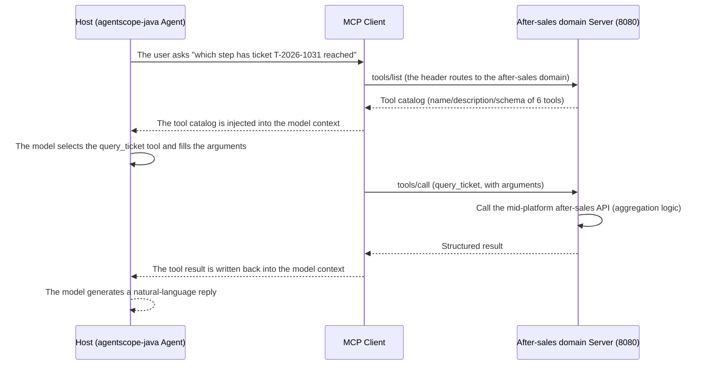

# Chapter 4 Quick Start

> Chapter guide: a mid-platform team's real situation is this. The support Agent project has to connect to the after-sales API, and the team wraps it once. The frontend CopilotKit has to show after-sales progress, and the team wraps it again. A newly started data script wraps it once more. What this chapter does is turn "wrap once, call from everywhere" from a slogan into a fact that runs on your machine: within 30 minutes, stand up the first MCP Server, and call it with a real Client. This chapter also initializes our running example for the whole book, the **mid-platform after-sales domain Server**, and every later chapter grows on it. By the end of this chapter, you can: pick the right SDK major version and give the reason; write a minimum Server and explain every part line by line; use bare JSON-RPC to verify three key behaviors of the stateless protocol; and state the full journey of one tool call on the network.

```mermaid
flowchart LR
    A["Pick the SDK major version (Section 4.1)<br/>TS v2.x · Java mcp-core 2.0.x<br/>v1 will not gain 2026-07-28 support"] --> B["Initialize and install two packages (Section 4.2)<br/>@modelcontextprotocol/server<br/>and zod"]
    B --> C["Write a ten-line server.mjs (Section 4.2)<br/>registerTool declares the echo tool<br/>serveStdio attaches the stdio transport"]
    C --> D["Bare JSON-RPC with no handshake, verified hands-on (Section 4.3)<br/>tools/list sent directly returns the catalog<br/>tools/call returns a structured result"]
    D --> E["server/discover gets everything at once (Section 4.3)<br/>version · capabilities · identity · cache hints"]
    E --> F["Legacy handshake demonstrated (Section 4.3)<br/>Send a 2025-06-18 initialize<br/>It answers normally: Dual-era routing"]
    F --> G["Build the after-sales domain Server skeleton (Section 4.5)<br/>Definitions externalized as tools/*.json<br/>OpenAPI checked in as-is"]
    G --> H["After-sales skeleton in place · the echo path works<br/>Chapter 5 adds the engineering base<br/>Chapter 6 fills in the tools"]
```



*Figure: flow for this chapter*

## When you need it

Three typical situations, and three ways to read this chapter.

**First contact with MCP, and you want to run it before you understand it.** Read straight through, in order. The minimum Server in Section 4.2 is within ten lines, and each of the four hands-on checks in Section 4.3 is a single command. After you run them, your grasp of "stateless" moves from a noun to something you have felt.

**You need to pick an SDK for the team.** Go straight to the selection table and the argument in Section 4.1. The key conclusion, given away in advance: 2026-07-28 is a breaking upgrade, **SDKs from the v1 era will not gain support**, and the first rule of selection is to lock the major version.

**You need to build a reusable Server base for the team.** Focus on Section 4.2 and Section 4.5. The after-sales domain skeleton in Section 4.5 (the directory layout, and how the tool files are organized) is the shape of that base. Later chapters grow on top of it.

Prerequisites: Node.js ≥ 20 (the environment for the verified hands-on), and npm available. The Java-side examples need JDK 17+ and Gradle. This chapter gives the parallel structure. The hands-on supplement is on the review checklist at the end of this chapter.

**Environment and reproducibility.** Every hands-on run in this chapter was done in the following environment: macOS (darwin), Node 20+, `@modelcontextprotocol/server@2.4.0`, `@modelcontextprotocol/client@2.x`, zod 4.x, dated 2026-10-24. Every command is reproducible as written. If the SDK has a newer minor version by the time you read this, behavior follows the official changelog (protocol behavior is unaffected by minor versions; only API details may change).

## 4.1 Overview

This chapter is built around three actions. They are also the shared skeleton of every MCP Server:

| Action | What it does | Section |
|------|--------|----------|
| **Declare a tool** | Register a business capability as a named tool | Section 4.2 |
| **Describe** | Use JSON Schema and description to tell the model "what this is, and how to use it" | Section 4.2 (developed in Chapter 6) |
| **Attach a transport** | Choose stdio or Streamable HTTP, so requests can get in and results can get out | Section 4.2, Section 4.3 |

How do you pick an SDK? The specification itself keeps evolving (Chapter 3), and SDKs are layered by how far they support a specification version. The facts at the time this book was written (checked 2026-10):

| SDK | 2026-07-28 support | Key facts | Who it is for |
|-----|-----------------|----------|----------|
| TypeScript `@modelcontextprotocol/*` | **From v2.x** (verified hands-on at 2.4.0) | v1.x explicitly will not support 2026-07-28; v2 is split into independent packages (client / server), and adds a stateless transport | The largest ecosystem, and frontend-isomorphic scenarios |
| Java `io.modelcontextprotocol.sdk:mcp-core` | **From 2.0.x** (checked at 2.0.1, released 2026-10-17) | New Servers live in the `io.modelcontextprotocol.modern` package, alongside the legacy `McpSchema`; passes all 37 of the 2026-07-28 conformance scenarios | **The main line for agentscope-java readers** |
| Python `modelcontextprotocol` | ⚠️ Still to be checked | When you sit down to the hands-on run, take the official SDK list page as the authority | Data-side scripts |

The official layering for each SDK is on the [SDK list page](https://modelcontextprotocol.io/docs/2026-07-28/sdk). It grades every SDK by completeness, protocol support, and maintenance commitment. Look at that page before you choose.

The writing convention of this book: **TypeScript is the carrier for the verified hands-on**. Every protocol behavior was run through on TS SDK v2.4.0, and command-level evidence was kept. The Java side gives a parallel structure, so agentscope-java readers can map item by item (method signatures follow the javadoc confirmed in testing; see the review checklist at the end of this chapter). Python appears only when Chapter 5 and Chapter 8 retell the official tutorial. Look at the TypeScript side first, because it can go from install to a call within five minutes.

## 4.2 Get it running first: a ten-line minimum Server

Initialize in any directory and install two packages:

```bash
npm init -y
npm i @modelcontextprotocol/server zod
```

Create `server.mjs` (ESM format, zero build configuration):

```typescript
import { McpServer } from "@modelcontextprotocol/server";
import { serveStdio } from "@modelcontextprotocol/server/stdio";
import { z } from "zod";

const server = new McpServer({ name: "after-sales", version: "0.1.0" });

server.registerTool("echo", {
  title: "回声",
  description: "原样返回输入文本，用于验证链路",
  inputSchema: z.object({ text: z.string().describe("要回显的文本") }),
}, async ({ text }) => ({
  content: [{ type: "text", text }],
}));

await serveStdio(() => server);
```

The strings in that example stay in Chinese inside the code. The title is "回声" ("Echo"), the description is "原样返回输入文本，用于验证链路" ("Return the input text unchanged, to verify the path"), and the argument description is "要回显的文本" ("the text to echo").

Take it apart line by line. Each line maps to one protocol concept (every concept from Chapter 2 lands here):

| Code | Protocol meaning |
|------|----------|
| `new McpServer({ name, version })` | Server identity. It announces itself in the response `_meta.serverInfo` (Section 2.5) |
| `registerTool("echo", ...)` | Register one model-controlled tool (Chapter 6). The name is the credential for the call |
| `title` / `description` | title is for people (the catalog, the approval UI), and description is for the model (the basis for selection). The audiences differ, and you write both |
| `inputSchema: z.object(...)` | The argument schema. `.describe()` lands unchanged in the `description` field of the JSON Schema (confirmed in testing) |
| `async ({ text }) => ...` | The tool handler: the input is the argument object after schema validation, and it returns a `content` array |
| `serveStdio(() => server)` | Attach the stdio transport. The factory shape is the opening left for Dual-era compatibility (Chapter 3) |

Once it is started, it is already a standard MCP Server. Next, do not perform any "connect" step. Talk to it directly with bare JSON-RPC. That is the most visible difference between 2026-07-28 and the old protocol.

## 4.3 Call directly, with no handshake: three behaviors demonstrated

2026-07-28 removed protocol-level sessions and the `initialize` handshake (Chapter 3). "No handshake" is a behavior one command can verify. It is a claim you can run, beyond a sentence in a document. The four hands-on checks below were all done on v2.4.0 (2026-10-24). The commands are the evidence.

### Hands-on check 1: send `tools/list` with no handshake

After the Server is running, feed stdin one line of JSON-RPC. Note that **no initialize has been sent**:

```bash
echo '{"jsonrpc":"2.0","id":1,"method":"tools/list"}' | node server.mjs
```

```json
{"result":{"tools":[{"name":"echo","title":"回声","description":"原样返回输入文本，用于验证链路",
"inputSchema":{"type":"object","$schema":"https://json-schema.org/draft/2020-12/schema",
"properties":{"text":{"type":"string","description":"要回显的文本"}},"required":["text"]}}]},
"jsonrpc":"2.0","id":1}
```

The tool list comes straight back. Tutorials from the v1 era would teach the handshake first. That step does not exist here. zod's `.describe()` shows up in the output `description` field: **the engineering handle on description quality takes effect from the first line of code** (the main thread of Chapter 6). The title, description, and field description in that payload are the same Chinese strings glossed above: "回声" ("Echo"), "原样返回输入文本，用于验证链路" ("Return the input text unchanged, to verify the path"), and "要回显的文本" ("the text to echo").

Read the response field by field. Each of the four details means something:

| Response fragment | Meaning | Related section |
|----------|------|----------|
| `"name": "echo"` + `required` | The name and the required arguments, a hard constraint on how the model fills arguments | Section 6.1 |
| `"$schema": ".../draft/2020-12/schema"` | The JSON Schema dialect defaults to 2020-12. Another dialect can be declared explicitly | Section 6.2 |
| `"description"` (tool level and field level) | The two-layer basis the model uses to pick a tool and fill arguments. Both layers are "description quality" | Section 6.3 |
| `"title": "回声"` | A human-readable name, for the catalog and the approval UI, and not for the model. "回声" ("Echo") | Section 6.1 |

Note that the response has **no** `ttlMs` / `cacheScope`. The `tools/list` specification requires cache hints (Chapter 3), and the SDK fills them in. When a hand-written experiment shows a mismatch, first suspect that the experiment script did not go through the SDK's full path.

### Hands-on check 2: `tools/call` returns a structured result

```bash
echo '{"jsonrpc":"2.0","id":2,"method":"tools/call","params":{"name":"echo","arguments":{"text":"你好 MCP"}}}' | node server.mjs
```

```json
{"result":{"content":[{"type":"text","text":"你好 MCP"}]},"jsonrpc":"2.0","id":2}
```

After schema validation, the arguments enter the handler, and the result comes back as a `content` array. The echoed text is "你好 MCP" ("Hello MCP"). If the handler throws a business exception, the return shape becomes a normal result with `isError: true` (the two-kind error model in Chapter 6; a seed planted here for later).

### Hands-on check 3: `server/discover`, one request to learn who you are talking to

The specification requires every Server to implement `server/discover` (Section 2.6). When you connect an unfamiliar Server, first ask it "who are you, which versions do you support, and what can you do":

```bash
echo '{"jsonrpc":"2.0","id":9,"method":"server/discover","params":{"_meta":{"io.modelcontextprotocol/protocolVersion":"2026-07-28","io.modelcontextprotocol/clientCapabilities":{}}}}' | node server.mjs
```

```json
{"result":{"supportedVersions":["2026-07-28"],
"capabilities":{"tools":{"listChanged":true}},
"resultType":"complete","ttlMs":0,"cacheScope":"private",
"_meta":{"io.modelcontextprotocol/serverInfo":{"name":"after-sales","version":"0.1.0"}}},
"jsonrpc":"2.0","id":9}
```

The version list, the capabilities, the identity, and the cache hints all come back in one shot. Discover a new Server before you put it to work, and the error messages during integration drop by half. Note `tools.listChanged: true`. This capability declaration means the Server sends a notification when the tool catalog changes (the "live catalog" mechanism in Chapter 7; the source of it is here).

### Hands-on check 4: legacy compatibility is alive

The most interesting one: send the same Server an `initialize` handshake from the 2025-06-18 era:

```bash
echo '{"jsonrpc":"2.0","id":3,"method":"initialize","params":{"protocolVersion":"2025-06-18","capabilities":{},"clientInfo":{"name":"old-client","version":"1.0"}}}' | node server.mjs
```

```json
{"result":{"protocolVersion":"2025-06-18","capabilities":{"tools":{"listChanged":true}},
"serverInfo":{"name":"after-sales","version":"0.1.0"}},"jsonrpc":"2.0","id":3}
```

It **was answered normally**. The Server returned the standard handshake result for `protocolVersion: "2025-06-18"`. This is the **Dual-era Server** the specification describes (Chapter 3): it splits the path automatically from the client's opening. A modern client takes the stateless path, a legacy client takes the old handshake semantics, and one body of code serves both generations at once. The `legacy: 'reject'` option of `serveStdio` can cut the old version off the other way (reject it, and report the modern versions that are supported). That is useful during a phased migration.

Read this response, and notice the three things it shows:

1. **The Server side keeps a complete legacy execution path.** It works normally under the old protocol semantics (the capability declaration and serverInfo are all present). That goes beyond barely staying compatible by returning an error.
2. **The split is based on the shape of the client's opening.** A modern client sends a business request directly (carrying `_meta`). A legacy client sends `initialize`. The Server decides which path to take from the shape of the message. The client does not have to declare which one it is.
3. **This is the mechanism underneath a phased migration.** Upgrading the Server does not require every consumer to upgrade in lockstep. The seven-cell compatibility matrix in Chapter 3 is the full view of this routing table.

The picture the four hands-on checks put together: **the stateless protocol takes "connection" out of the protocol semantics**. Each request is self-contained, a stateless Server can scale out or in freely, and the difference between old and new clients is absorbed by the split at the entrance. This is the felt version of the concepts in Chapter 2.

## 4.4 End-to-end sequence of the first call

Put the hands-on runs back into a real scenario. The user says to the agentscope-java support Agent, "which step has my after-sales ticket reached". The journey underneath is:



Three observation points:

1. **`tools/list` and `tools/call` are two independent requests.** Under stateless semantics there is no implied "establish first, then reuse" relationship. The catalog itself can be cached (the `ttlMs` in the Server response is there for this).
2. **"The model selects the tool" happens on the Host side.** The Server only supplies the catalog and the execution. Which tools go into the model context is a governance action of the Host (where the at-scale governance of Chapter 7 lands).
3. **Under HTTP, every request carries the standard headers.** This diagram omits them. A real request looks like this (Chapter 10 develops the details):

```http
POST /mcp HTTP/1.1
Content-Type: application/json
MCP-Protocol-Version: 2026-07-28
Mcp-Method: tools/call
Mcp-Name: after_sales_query_ticket

{ "jsonrpc": "2.0", "id": 1, "method": "tools/call", "params": { ... } }
```

`Mcp-Name` lets a gateway rate-limit and audit by tool name without parsing the body. `MCP-Protocol-Version` must agree with the version inside `_meta` in the body. A mismatch returns `400 + HeaderMismatch`. You do not see these headers in the stdio hands-on run. They are a compliance requirement of the Streamable HTTP transport. Local stdio does not involve them.

## 4.5 Our running example: the after-sales domain Server skeleton

From this chapter on, the whole book grows around this case: Chapter 6 fills in the tools, Chapter 7 takes it to scale, and Chapter 8 consumes it from multiple frameworks. The skeleton comes first:

```
after-sales-mcp/
├── src/main/java/.../AfterSalesServer.java   # Server entry and tool registration
├── tools/                                     # Tool definitions (one file per task-level tool)
│   ├── query-ticket.json                      # Query after-sales ticket progress
│   ├── create-ticket.json                     # Create an after-sales ticket (implemented in Chapter 6)
│   └── ...
├── openapi/after-sales.yaml                   # Original OpenAPI asset of the mid-platform after-sales domain (20 APIs)
└── README.md                                  # Domain ownership, owner, and tool catalog
```

The parallel structure on the Java side (mcp-core 2.0.x, the `io.modelcontextprotocol.modern` package). ⚠️ What follows is a structural sketch. Method signatures follow the javadoc confirmed in testing (the first item on the review checklist at the end of this chapter), but the four components correspond strictly to the TypeScript side:

```java
// build.gradle: implementation("io.modelcontextprotocol.sdk:mcp-core:2.0.1")
var server = McpServer.toolServer()                    // ① Server construction entry (modern package)
    .tool("echo",                                      // ② Declare the tool: the name is the call credential
        "原样返回输入文本，用于验证链路",                 // ③ description: the basis the model uses to choose
        Map.of("text", stringParam("要回显的文本")),     // ④ Argument schema (the same semantics as JSON Schema)
        (args) -> Map.of("text", args.get("text")))    // ⑤ Handler: arguments in, result out
    .build();

server.startStreamableHttp(8080);                      // ⑥ Attach Streamable HTTP (the production form)
```

The Chinese strings in that sketch match the echo tool: "原样返回输入文本，用于验证链路" ("Return the input text unchanged, to verify the path") and "要回显的文本" ("the text to echo").

| TS side | Java side | Protocol meaning (the same on both sides) |
|--------|---------|----------------------|
| `new McpServer({ name, version })` | `McpServer.toolServer()...build()` | Server identity, self-reported in `_meta.serverInfo` |
| `registerTool(name, config, cb)` | `.tool(name, desc, schema, handler)` | Tool registration. The uniqueness scope of a name is a single Server |
| `serveStdio(...)` | `startStreamableHttp(8080)` | Attaching the transport. stdio is local, HTTP is production (Chapter 10) |

Read the two tables against each other and one fact shows up: **the three actions "declare a tool, then describe, then attach a transport" do not depend on the language**. That is the micro-foundation of "works across frameworks" in Chapter 8. The basis for choosing a primary language is here too. The Java readership (the agentscope-java ecosystem) uses mcp-core directly and deploys it in the same shape as the business code. Prototyping and frontend-isomorphic scenarios use TS. Tutorials that are out of date on both sides should not be used as a reference (Chapter 3).

Three design decisions are worth stating:

- **Tool definitions are externalized as files** (`tools/*.json`). A tool is the combination of "a catalog entry plus execution logic". Externalizing the definition lets catalog governance (Chapter 7) stay out of the code.
- **OpenAPI is checked in as-is** (`openapi/`). It is the input of the generation pipeline in Chapter 7, and the baseline for diffing API changes.
- **An echo-level placeholder comes first.** The full implementation of `query_ticket` (schema design, error messages, idempotency) is the content of Chapter 6. This chapter only asks that the path works. It does not ask that the tool be good.

The two key files in the skeleton can be filled in, in outline, right now. The tool definition file (`tools/query-ticket.json`) is at once "the catalog entry the model sees" and "the implementation contract for the developer":

```json
{
  "name": "after_sales_query_ticket",
  "title": "查询售后单",
  "description": "按售后单号查询售后单当前进度（审核/维修/退款/完结）。单号格式 T-YYYY-NNNN。查物流轨迹用 logistics 域工具，不要用本工具。",
  "domain": "after-sales",
  "aggregates": ["GET /api/v1/tickets/{id}", "GET /api/v1/tickets/{id}/timeline"],
  "status": "draft",
  "owner": "售后域团队"
}
```

Four fields are the first draft of the catalog governance in Chapter 7. `name` carries a domain prefix (disambiguation under aggregation). `description` carries task semantics and a boundary statement (Chapter 6). `aggregates` records which mid-platform APIs were aggregated (the basis for the change-impact surface). `owner` names who is responsible for description quality. In the file, the title is "查询售后单" ("Query an after-sales ticket"), the description is "按售后单号查询售后单当前进度（审核/维修/退款/完结）。单号格式 T-YYYY-NNNN。查物流轨迹用 logistics 域工具，不要用本工具。" ("Look up the current progress of an after-sales ticket by ticket id (review / repair / refund / closed). The ticket id format is T-YYYY-NNNN. To look up a logistics trace, use a logistics-domain tool. Do not use this tool."), and `owner` is "售后域团队" ("after-sales domain team"). The domain README (`README.md`) is the catalog at Server level:

```markdown
# after-sales 域 Server
- 域归属：售后（中台售后中心）
- 工具目录：6 个任务级工具（查询/创建/试算/撤销/催办/评价），聚合 20 个中台接口
- 对应 OpenAPI：openapi/after-sales.yaml（v2026.1）
- 负责人：售后域团队 · 升级路径：#after-sales-mcp
```

English gloss of the sample README: "# after-sales domain Server. Domain ownership: after-sales (mid-platform after-sales center). Tool catalog: 6 task-level tools (query / create / estimate / cancel / expedite / rate), aggregating 20 mid-platform APIs. Corresponding OpenAPI: openapi/after-sales.yaml (v2026.1). Owner: the after-sales domain team. Escalation path: #after-sales-mcp."

## 4.6 From echo to a real tool: what is still missing

Echo verified the path. The distance from there to "the model likes to use it, and it is reliable in production" is an explicit gap list, and each row corresponds to a later chapter:

| Gap | Current state | Where it gets filled |
|------|------|--------|
| The description is only a placeholder | "原样返回输入文本" ("return the input text unchanged") has no task semantics | Chapter 6: rewrite it in task semantics, add a boundary statement, and add a format example |
| Arguments have no constraints | `text` is a bare string | Chapter 6: write the regex, the enum, and the range into the schema (enforced by the validation layer) |
| There is no error handling | The handler does not fail | Chapter 6: two kinds of errors, two paths, and messages written for the model to read |
| There is no real business | echo does not call the mid-platform | Chapter 7: aggregate task-level tools out of OpenAPI |
| A single consumer | Only hand-written JSON-RPC verification | Chapter 8: agentscope-java and the frontend, both connected |
| Shipping it with nothing around it | No authentication, and no rate limit | Chapter 10: the authorization framework and the deployment checklist |

This list is also the structure diagram of the book. Each chapter fills one row. The next step fills in the engineering base of "a complete Server" (Chapter 5: a real external dependency, a degradation path, and logging discipline), and then comes the step with the most leverage, description quality and error handling (Chapter 6).

## 4.7 Common first pitfalls

| Pitfall | Symptom | Fix |
|----|------|------|
| The SDK major version is wrong | TS was installed as the v1 `@modelcontextprotocol/sdk`, and there is no 2026-07-28 behavior | Lock the v2 package split: `@modelcontextprotocol/server` / `client` (Chapter 3) |
| The transport does not connect | The Client cannot connect to the stdio process | Check that command/args point at the way it is started. stdio also breaks when stdin/stdout is polluted by logs. Logs go to stderr |
| Schema validation fails | The call returns Invalid Params | Compare the arguments against inputSchema field by field. A missing required field, and a type mismatch, are the two main causes |
| The model does not select the tool | The tool can be called through, but the Agent never selects it | The description is missing or too weak. The description-quality engineering in Chapter 6 is prepared for this |
| A hand-written bare request is missing `_meta` | The server returns -32602 Invalid Params | Every request must carry `protocolVersion` and `clientCapabilities` (Section 2.5). SDK convenience methods already assemble them |
| structuredContent is not in the result | echo only returns content | It is present only when `outputSchema` is defined and the handler returns `structuredContent`. The hands-on run in Chapter 6 demonstrates it |
| An unsupported-version error | `-32022` plus the supported list | Pick a version both sides support, from the list, and retry. Do not change the configuration blindly (the matrix in Chapter 3) |

## 4.8 Chapter summary

1. **Selection looks at the major version.** 2026-07-28 is a breaking upgrade. TS v2.x is split into packages (verified hands-on at 2.4.0). Java mcp-core is 2.0.x (the modern package, with 37 conformance items passed). SDKs and tutorials from the v1 era no longer apply.
2. **The Server skeleton is three actions:** declare a tool, describe it (schema plus description), and attach a transport. You can start within ten lines.
3. **No handshake is a behavior you can verify.** Sending `tools/list` and `tools/call` directly takes effect at once (verified hands-on). `server/discover` gets the version, the capabilities, and the identity in one call.
4. **Legacy compatibility is alive.** The same Server answers a 2025-06-18 handshake (Dual-era, confirmed in testing). During the phased migration, one body of code serves clients of both generations.
5. **The skeleton of our running example is in place.** The after-sales domain directory layout (tool definitions externalized, plus OpenAPI checked in) is the base every later chapter grows on.

The next step upgrades "it can be called through" into "it is reliable in production". Chapter 5 fills in the engineering base of a complete Server. Chapter 6 covers schema design, description quality, and error handling. The craft of tool modeling decides the Agent's success rate.

## Acceptance checklist

By the time you have read this far, you should be able to:

- ☐ State the version requirements for the TS and Java SDKs under 2026-07-28, and pick a main line for the team;
- ☐ Write an echo-level minimum Server from scratch and start it;
- ☐ Finish a no-handshake `tools/list` and `tools/call` with bare JSON-RPC;
- ☐ Call `server/discover` and explain the four parts of the returned value;
- ☐ Send the Server a 2025-06-18 handshake and explain what the answer shows;
- ☐ Draw the end-to-end sequence of one tool call, and point out which side "model selection" happens on;
- ☐ Give the reasons for the three design decisions of the after-sales domain skeleton.

## Quick reference

This section gathers the hands-on commands and the version facts from this chapter, so you can check them while you work.

| Operation | Command / value |
|------|-----------|
| Initialize | `npm init -y && npm i @modelcontextprotocol/server zod` |
| Start the Server | `node server.mjs` |
| List the catalog with no handshake | `echo '{"jsonrpc":"2.0","id":1,"method":"tools/list"}' \| node server.mjs` |
| Call a tool | `echo '{"jsonrpc":"2.0","id":2,"method":"tools/call","params":{"name":"echo","arguments":{"text":"hi"}}}' \| node server.mjs` |
| Capability discovery | `method: "server/discover"` (`_meta` carries the protocol version and clientCapabilities) |
| Legacy handshake | `method: "initialize"`, `protocolVersion: "2025-06-18"` |
| Versions in the hands-on run | `@modelcontextprotocol/server@2.4.0`, `@modelcontextprotocol/client@2.x` (2026-10-24) |

## Further reading

- **Chapter 3 (version evolution).** The history of protocol change behind the four hands-on behaviors: why the handshake was removed, and where Dual-era comes from.
- **Chapter 6 (Tool Authoring in Practice).** The next step after the echo placeholder: schema design and description quality decide the Agent's success rate.
- **Chapter 2 (core protocol concepts).** The full semantics of per-request `_meta` and of `resultType`.
- **Chapter 26 of the agentscope-java book.** How the Host side (agentscope-java) connects an MCP Server.

## Review checklist (before publication)

- [x] TypeScript examples: the v2.4.0 verified hands-on passed (the split package names, the McpServer / registerTool signatures, serveStdio, no-handshake tools/list, tools/call, legacy initialize compatibility, and server/discover), on 2026-10-24
- [ ] Java examples: verify mcp-core 2.0.1 hands-on (coordinates, modern-package API signatures, and Streamable HTTP startup), and replace the parallel description in Section 4.5
- [ ] Python SDK row: look up the current state of 2026-07-28 support and fill in the table
- [ ] Check Inspector's support status for v2 / 2026-07-28
- [ ] The Host-to-Client step of the Section 4.4 sequence diagram is to be rechecked when the agentscope side is integrated
- [ ] Recheck the layered-support wording on the SDK list page (mark the date it was checked)
