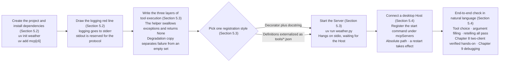

# Chapter 5 Building a Complete Server

> Chapter guide: the echo in Chapter 4 verified the path, but "a complete Server" has more questions to answer. A real tool calls an external API. What happens when that fails? Where do logs go? Once it is written, how do you test it inside a real Host (a desktop Agent)? This chapter follows the full path of the official tutorial. It builds, from scratch, a weather Server with a real external dependency (two tools, `get_alerts` and `get_forecast`), and it settles each step into an engineering convention you can reuse. By the end of this chapter, you can: build, on your own, a complete Server with an external API dependency; hold the logging discipline of an STDIO server (one red line that can destroy the whole server); finish an end-to-end test with a real Host; and say which scenarios the two styles, decorator registration and explicit registration, each fit.



*Figure: flow for this chapter*

## When you need it

Three situations, and three ways to use this chapter.

**You are about to write the first Server that has a real business dependency.** Read straight through, in order. The official tutorial's weather Server takes a shortest path (an external API, plus error degradation, plus two tools working together), and each step is a rehearsal for your business Server.

**The team needs to set an engineering standard for Servers.** Go straight to Section 5.2 (logging discipline) and the registration-style choice in Section 5.3. Those two pieces are the base of "what we write comes out the same", and the logging red line in particular: one `print` can destroy an entire STDIO server.

**You need to show a lead why MCP is worth it.** Look at Section 5.4. The moment you connect your Server to a desktop Agent and a question in natural language comes back as structured data, it persuades more than any architecture diagram.

Prerequisite knowledge: the three actions from Chapter 4 (declare a tool, describe it, attach a transport) and the four hands-on checks. The Python main line of this chapter comes from the official tutorial. The TS and Java parallels reuse the verified hands-on environment from Chapter 4.

## 5.1 Overview

First, where this chapter's case comes from, and what it is for. The main-line material is the **official build-server tutorial**. The case it chose is a weather Server, with two tools: `get_alerts` (look up active alerts by US state code) and `get_forecast` (look up the forecast by latitude and longitude). The official tutorial did not pick it at random:

- **It has a real external dependency** (the National Weather Service API). The full path of tool execution: request, degrade on failure, and format
- **The two tools have a working relationship.** Inside forecast, it looks up the grid endpoint first and the forecast second. "One tool, two API calls" is a miniature of mid-platform aggregation (the setup for Chapter 7)
- **The public API needs no authentication.** That removes the distractions and keeps the focus on the protocol and the engineering

Our running example (the after-sales domain) is isomorphic with it, structure for structure. Swap the external dependency for a mid-platform API, and swap `get_alerts` for `after_sales_query_ticket`, and every section maps. So the output of this chapter is a set of **engineering conventions that do not depend on the case**, and it is more than "a weather Server". How to handle an external dependency, where logs go, and how to test it once it is written: these hold for any business Server you carry them to.

Of the three kinds of Server capability (resources / tools / prompts), the tutorial focuses on tools. That is also the main form of an enterprise Server (the capability-modeling table in Section 2.1). The four-stage journey of this chapter: **environment and the red line, then tool execution, then registration style, then Host testing**.

## 5.2 Environment setup and the first red line

The official tutorial uses Python (managed with uv, requiring Python ≥ 3.10 and **Python MCP SDK ≥ 2.0.0**, another major-version threshold, the same generation break as the SDK logic in Chapter 4):

```bash
uv init weather && cd weather
uv venv && source .venv/bin/activate
uv add "mcp[cli]"
```

Once the environment is ready, draw one **red line** first. It is placed before every line of code in the tutorial, which says how much it weighs:

> **Logging discipline for an STDIO server: never write stdout.** `print()` writes stdout by default, and stdout is the transport channel for JSON-RPC. Mix one log line in, and the protocol message stream is polluted, and the whole Server loses contact.

```python
import logging

logger = logging.getLogger(__name__)   # one logger per module

# ❌ Bad (inside an STDIO server)
print("Processing request")            # writes stdout and pollutes the JSON-RPC stream

# ✅ Good
logger.info("Processing request")      # logging writes stderr by default -- safe
```

Why does this red line deserve to come before all the code? Because the symptom when you break it is the most confusing one: the Server is clearly running, but the Host connects only intermittently, and the reported error points at protocol parsing. It does not point at your business code. The stdio channel is part of the protocol, and logging is a pure engineering matter. When the two share one exit, the engineering matter can kill the protocol at any time.

Three disciplines that follow from it. Use the standard-library `logging` (it goes to stderr naturally). Stdout logs on an HTTP server are harmless (they do not occupy the transport channel). **Stdout is reserved for the protocol.** The same holds on the TS side: `console.log` writes stdout, and `console.error` is the safe exit. If the `server.mjs` from Chapter 4 ever gained one `console.log` for debugging, the protocol stream goes wrong when it runs together with the bare JSON-RPC hands-on run in this chapter.

The v1-era `logging/setLevel` was removed in 2026-07-28 (Chapter 3). The log level is now declared by the client, per request, in `_meta.io.modelcontextprotocol/logLevel`. The Server adjusts the level per request. There is no longer a global level state.

## 5.3 Tool execution: the full path from API to tool result

The tutorial splits tool execution into three layers. This layering is worth carrying, as it stands, into any business Server:

**① Constants and the instance:**

```python
from mcp.server import MCPServer

mcp = MCPServer("weather")

NWS_API_BASE = "https://api.weather.gov"
USER_AGENT = "weather-app/1.0"
```

**② The helper: the external request, plus degradation.** Note the return contract of `make_nws_request`. Any exception returns `None`, and it does not throw:

```python
async def make_nws_request(url: str) -> dict[str, Any] | None:
    headers = {"User-Agent": USER_AGENT, "Accept": "application/geo+json"}
    async with httpx2.AsyncClient() as client:
        try:
            response = await client.get(url, headers=headers, timeout=30.0)
            response.raise_for_status()
            return response.json()
        except Exception:
            return None
```

**③ The tool handler: check for None, then branch into degradation copy, then format the output:**

```python
@mcp.tool()
async def get_alerts(state: str) -> str:
    """Get weather alerts for a US state.

    Args:
        state: Two-letter US state code (e.g. CA, NY)
    """
    url = f"{NWS_API_BASE}/alerts/active/area/{state}"
    data = await make_nws_request(url)

    if not data or "features" not in data:
        return "Unable to fetch alerts or no alerts found."   # fallback copy ①
    if not data["features"]:
        return "No active alerts for this state."             # fallback copy ②: an empty set is still a result
    alerts = [format_alert(feature) for feature in data["features"]]
    return "\n---\n".join(alerts)
```

Each of the three layers has a judgment you can reuse:

- **The helper layer swallows the exception and returns None.** It lowers "a network failure" from the exception flow to the data flow, so the handler does not have to try/catch everywhere. Errors split into two paths from here. A network degradation is modeled, here, as an **ordinary text result** ("cannot look it up" is a state the model can understand and can retell), while a real protocol error goes out as a JSON-RPC error. The full model of the two kinds of errors is in Chapter 6
- **The branched degradation copy is written for the model to read.** "Unable to fetch..." and "No active alerts..." are two different facts (a failure, and an empty set). The model needs to tell them apart before it can say the right thing to the user
- **Formatting faces readability.** `format_alert` joins the fields into a labeled text block, and several results are joined with a separator line. The experience of the model consuming that text is the quality of the answer the user gets

`get_forecast` then demonstrates **a second call inside the tool**. It first queries `points/{lat},{lon}` to get the grid forecast endpoint, then requests the real forecast: one tool, two upstream calls, and a null check at each layer. This is the prototype of "vertical aggregation" (Section 7.2). The model sees only one task. The Server orchestrates several steps inside.

### Python SDK registration style: decorator plus docstring

Note `@mcp.tool()` and the function docstring. The Python SDK uses type annotations and the docstring to **generate the tool definition automatically** (the name is taken from the function name, the description from the docstring, and the argument schema from the type annotations). That and the explicit `registerTool` of the TypeScript in Chapter 4 are two styles of the same thing:

| | Decorator plus docstring (the Python style) | Explicit registration (the TS / Java style) |
|----|----|----|
| Where the description comes from | The docstring (including the Args section) | An explicit description / `.describe()` |
| Where it fits | The tool is the function, and a prototype is fast | The catalog is externalized, and the description is separated from the code (friendly to the Chapter 7 pipeline) |
| The risk | Change the docstring and the description changes with it, so a review easily misses it | The definitions are gathered in one place, and the review is explicit |

Our running example in this book uses the **externalized definition** style (`tools/*.json`). The reason is in the running-example section of Chapter 4: catalog governance should not depend on reading code. Both styles are compliant. The team picks one and writes it into the standard.

### Run and wrap-up

```python
if __name__ == "__main__":
    mcp.run(transport="stdio")
```

After `uv run weather.py` starts it, the Server hangs on stdio and waits for the Host. At this point the three requirements of "complete" are all present: a real dependency, a degradation path, and logging discipline.

## 5.4 Host testing: connect a real desktop Agent

The testing step in the tutorial connects the Server into **Claude for Desktop**. That is a different job from writing unit tests. Configure the Host's MCP Server list (pointing at this Server's start command), restart the Host, and then ask in natural language: "What's the weather in New York?" Watch the model select `get_forecast`, fill in the right latitude and longitude, and retell the result in ordinary language.

Why does this step have to stay? Because what the earlier chapters verified is the protocol dimension (the request goes in, the result comes out). "Will the model select this tool, are the arguments filled in correctly, and is the result retold well" are three new dimensions. Only a real model, in a real context, can test them.

### Config file and start command

The config-file location differs by platform (create it if it does not exist):

| Platform | Path |
|------|------|
| macOS | `~/Library/Application Support/Claude/claude_desktop_config.json` |
| Linux | `~/.config/Claude/claude_desktop_config.json` |
| Windows | `%AppData%\Claude\claude_desktop_config.json` |

Register the Server under the `mcpServers` key. In substance, this tells the Host two things: "there is a Server named weather", and "start it with this command":

```json
{
  "mcpServers": {
    "weather": {
      "command": "uv",
      "args": ["--directory", "/ABSOLUTE/PATH/TO/weather", "run", "weather.py"]
    }
  }
}
```

Three troubleshooting points the official tutorial names explicitly. `command` may need the **full path of the executable** (get it with `which uv`). The path must be an **absolute path**. A JSON path on Windows uses double backslashes or forward slashes. After you save, **restart the Host** for it to take effect. The Host reads the Server list only at startup.

### What the end-to-end check verifies

| Verification layer | Chapter 4 | This chapter |
|--------|---------|------|
| Protocol behavior | ✅ A bare request calls it directly | — |
| Tool selection | ❌ No model | ✅ A real model selects the tool in a real context |
| Argument-filling quality | ❌ No model | ✅ The conversion from "New York" to latitude and longitude is done by the model |
| Result retelling | ❌ No model | ✅ Structured data to natural language |

This is also the prelude to the "two-client verified hands-on" in Chapter 8. After the desktop Host, we also connect our own Client and agentscope-java to the same Server. Each connection verifies a different consumption side of the same tool definition.

The full toolbox of the debugging step (Inspector's web UI / TUI / CLI, the protocol-era check, and the security-audit surface) is large enough to be its own chapter. See Chapter 9, "Debugging and Inspector".

## 5.5 Common engineering pitfalls

| Pitfall | Symptom | Fix |
|----|------|------|
| print pollutes the protocol stream | The STDIO Server loses contact now and then, and JSON-RPC parsing errors | Hunt down every stdout write. Logs go uniformly through logging / stderr (the Section 5.2 red line) |
| An external-API exception interrupts the service | One network blip, and the whole tool call reports a protocol error | The helper layer swallows the exception and returns a degradation value. Branched copy separates "failure" from "an empty set" |
| A decorator-style description misses review | The docstring was changed in passing, and the model's behavior changed with nobody knowing | Description changes go through catalog review (Chapter 7). Or switch to the externalized-definition style |
| Forgetting that `_meta` is required | A hand-written request returns -32602 | SDK convenience methods assemble it automatically. When you write it bare, check it against the key table in Section 2.5 |

## 5.6 Chapter summary

1. **The three requirements of a complete Server:** a real external dependency, a degradation path (say failure and an empty set separately), and logging discipline (STDIO forbids stdout).
2. **Three layers of tool execution:** the constant instance, then the helper (swallows exceptions), then the handler (branched degradation copy). The layering can be carried into a business Server as it stands.
3. **Pick one registration style.** A decorator / docstring is fast for a prototype, and an externalized definition is friendly to review. The team settles on one and writes it into the standard.
4. **Host testing fills in the model dimensions:** tool selection, argument filling, and retelling. Only a real model can verify them.
5. **v1's logging/setLevel is gone.** The log level travels per request, through `_meta`.

The next step has two roads. If you care about "the craft of the tool" (description quality, schema, error classification), go to **Chapter 6**. If you care about mid-platform scale, "from one to a thousand", go to **Chapter 7**. Chapter 6 first, then Chapter 7, is the suggestion.

## Acceptance checklist

By the time you have read this far, you should be able to:

- ☐ Restate the STDIO logging red line, and point out the corresponding safe exit on the TS side;
- ☐ Rewrite a tool that throws straight through, using the pattern "the helper swallows the exception, plus branched degradation copy";
- ☐ Explain the relationship between the two upstream calls of `get_forecast` and the "vertical aggregation" of Chapter 7;
- ☐ Compare the decorator style and the explicit-registration style, make a choice for the team, and give the reason;
- ☐ Connect a local Server to a real desktop Host, and finish one end-to-end check from natural language to structured data.

## Quick reference

| Item | Value |
|----|----|
| Official tutorial | docs/2026-07-28/develop/build-server (Python ≥ 3.10, SDK ≥ 2.0.0) |
| Environment | `uv init && uv venv && uv add "mcp[cli]"` |
| Start | `uv run weather.py` (transport="stdio") |
| Logging red line | stdout is for the protocol only; `logging` goes to stderr; TS uses `console.error` |
| Log level | The client declares it per request, through `_meta.io.modelcontextprotocol/logLevel` |
| Case code | modelcontextprotocol/quickstart-resources (weather-server-python) |

## Further reading

- **Chapter 6 (Tool Authoring in Practice).** The next layer of "description quality" for this chapter's tools: the full craft of schema design and error classification.
- **Chapter 9 (Debugging and Inspector).** The systematic debugging toolbox beyond this chapter's "connect a desktop and try it".
- **The generation pipeline of Chapter 7.** The automated version of the hand modeling in this chapter: OpenAPI to candidate tools.
- **The original text of the official build-server tutorial.** The main-line material of this chapter, including a TypeScript version in parallel.

## Review checklist (before publication)

- [ ] Read the rest of build-server.mdx closely (the parallel TS tutorial, the Claude Desktop configuration details, and the testing sections after line 262) and check this chapter's retelling against it
- [ ] Run the Python examples hands-on against the official quickstart-resources repository
- [ ] Add a parallel "complete Server" example on the TS / Java side (the version with an external API dependency), verified hands-on
- [ ] Check the exact format of the desktop Host config file, and check it against screenshots
