# Chapter 6 Tool Authoring in Practice

> Chapter guide: the mid-platform after-sales team's Agent is live. The model never calls the after-sales tools, or it calls one and fills the arguments wrong, or when it meets "the ticket id does not exist" it throws the error straight at the user. The cause is how the tool is modeled. This chapter upgrades the tools that Chapter 4 got as far as "they can be called through" into tools the model likes to use, that can correct themselves when they fail, and that are reliable in production: how to design a schema so the model fills it in correctly, how to write a description so the model selects accurately, how to split errors into two kinds and send each down its own path, how to use MRTR to ask gracefully when user input is missing, and how to manage state across calls with an explicit handle. By the end of this chapter, you can: design, for any business API, a task-level tool the model can select accurately; handle failure with the "two kinds of errors" model; manage cross-call state with the handle pattern; and set the team's review standard for tool descriptions.

```mermaid
flowchart LR
    A["Design the tool schema (Section 6.2 · Section 6.5)<br/>Constraints go into the structure: regex, enum<br/>Declare outputSchema for the output"] --> B["Write a task-perspective description (Section 6.3)<br/>Task semantics, a boundary statement, a format example"]
    B --> C{"Which kind of failure is it? (Section 6.4)"}
    C -->|"Execution error: isError plus the three parts of the message"| D{"Missing user input during execution? (Section 6.6)"}
    C -->|"Protocol error: JSON-RPC error"| D
    D -->|"Yes"| E["Return input_required<br/>requestState comes back unchanged to resume<br/>A retry must use a new JSON-RPC id"]
    D -->|"No"| F["Cross-call state uses an explicit handle (Section 6.7)<br/>Create returns a handle; later calls pass it as an argument"]
    E --> F
    F --> G["When a gateway must route on an argument (Section 6.8)<br/>Mark the argument with x-mcp-header<br/>Sensitive arguments are forbidden"]
    G --> H["The after-sales first three tools pass review and go live (Section 6.10)<br/>Weak description → watch mis-selection → compare with the good version<br/>Scaling to several thousand APIs is Chapter 7"]
```



*Figure: flow for this chapter*

## When you need it

Three typical situations, and three ways to use this chapter.

**The model does not select my tool, or it selects it and fills it in wrong.** Go straight to Section 6.3 (description quality) and Section 6.2 (schema design). Nine times out of ten, the description was written from the system's point of view ("call the /api/v1/xxx API"), and the model has no way to line it up with the user's intent.

**The moment a tool fails, the Agent throws the exception at the user.** See Section 6.4 (two kinds of errors). The specification splits errors into two paths, "protocol errors" and "tool execution errors". The second is designed for the model to correct itself. Your error messages may have been traveling the wrong path the whole time.

**The tool needs to keep state across many calls (a shopping cart, a multi-step flow).** See Section 6.7 (explicit handles). Under a stateless protocol this is a defined pattern, and it is not an obstacle. The specification even gives four points for handle design.

Prerequisites: the minimum Server from Chapter 4 and the two-client verified hands-on; the resultType and MRTR concepts from Chapter 2.

## 6.1 Overview

Start from a position stated in the specification text. A tool is **model-controlled**: the model discovers it and calls it on its own, from the context. Read that sentence the other way and it weighs more. You cannot force the model to call a given tool, and you cannot "correct" it when it picks the wrong one. Everything you can do is to **design** the tool so the model is willing to select it, and fills it in correctly once it has.

At the same time the specification stresses the other side: **there should be a human in the loop at any moment, with the right to refuse a call**. The Host should show which tools are exposed, give a visual indication when one is called, and pop a confirmation for a sensitive operation. Put the two sentences together and you have the worldview of this chapter: **give the model freedom, and give humans the reins**.

The anatomy of a tool definition in this chapter (checked against the specification's server/tools):

| Field | Role | Who it is for |
|------|------|--------|
| `name` | The unique identifier, the credential for the call | The protocol (the model refers to it) |
| `title` | A human-readable name | People (the catalog / the approval UI) |
| `description` | The functional description | **The model** (the basis for selection) |
| `inputSchema` / `outputSchema` | JSON Schema for the arguments and the output | Protocol validation, plus the model filling arguments |
| `icons` | UI icons | People |
| `annotations` | Behavior annotations (such as readOnlyHint) | The Host (⚠️ treat them as untrusted when they come from an untrusted Server) |

**Tool-name rules** (SHOULD): 1-128 characters; case-sensitive; only `A-Za-z0-9_.-`; unique within the Server. The key detail: **the uniqueness scope is a single Server**. A Host or gateway that aggregates several Servers will hit colliding names (two Servers both called `search`). You should add a prefix to disambiguate, and you cannot rely on `serverInfo.name` (it is not guaranteed to be globally unique). This is the protocol basis for the naming rule in Chapter 7 (`domain_action`).

The specification's way to write a tool with no arguments (explicitly refusing extra properties is recommended):

```json
{ "type": "object", "additionalProperties": false }
```

## 6.2 Schema: write the constraints into the structure, and do not rely on persuasion

What does the model rely on when it fills in arguments? Only two things: the structural constraints of the schema, and the words of the description. The two do not have the same standing. **The part written into the schema as a constraint is enforced by the validation layer.** Fill it in wrong and it is rejected outright, and the model retries with a different filling. **A requirement written in the description is only "persuasion".** The model may listen, or it may ignore the words, and the protocol layer has no way to stop that. So the design rule has one main line: whatever can be handed to the structure is never handed to the words.

The tool the model sees is the JSON Schema returned by `tools/list` (the 2020-12 dialect; another dialect can be named explicitly with `$schema`). Four design rules:

1. **Minimize the types.** Do not invent a nested object for something a `string` plus an enum can describe. The model's argument-filling error rate on deep nesting is markedly higher than on a flat structure.
2. **Be careful with required.** Every `required` field is a temptation for the model to "make up a value". For an argument that cannot be inferred from the context, prefer optional plus a default meaning, or ask the user with MRTR (Section 6.6).
3. **Write constraints into the schema.** Format (a regex), enums, and ranges go in the schema constraints. They are enforced by the validation layer. The description is only "persuasion".
4. **Every field has a `description`.** zod's `.describe()` enters the JSON Schema unchanged (verified hands-on in Chapter 4). This is the lowest-cost, highest-return investment.

```typescript
// Confirmed in testing on v2.4.0: constraints and descriptions both enter the schema
inputSchema: z.object({
  ticket_id: z.string()
    .regex(/^T-\d{4}-\d+$/, "格式 T-YYYY-NNNN")
    .describe("售后单号，如 T-2026-1031"),
  channel: z.enum(["app", "web", "miniprogram"])
    .describe("用户反馈来源渠道，未知时留空"),
}).partial({ channel: true }),  // channel is optional
```

The Chinese strings in that schema stay in the code. The regex message is "格式 T-YYYY-NNNN" ("format T-YYYY-NNNN"), the ticket_id description is "售后单号，如 T-2026-1031" ("after-sales ticket id, for example T-2026-1031"), and the channel description is "用户反馈来源渠道，未知时留空" ("the channel the user's feedback came from; leave it empty when it is unknown").

**`$ref` safety.** 2020-12 allows `$ref` to point at a network URI, but an implementation **must not** dereference a network reference automatically (it may offer an opt-in that defaults to off, and that opt-in needs a host allowlist, a timeout, and logs). A schema that fails validation because of an unresolved `$ref` should be rejected, and it should not be treated leniently. Composition keywords (`anyOf` / `oneOf` / `if-then-else`) need a budget cap on depth, on count, and on time. A malicious schema is a DoS vector against the validator.

## 6.3 Description quality: the model selects tools by description

The essence of tool selection is **the model matching the user's intent against the tool description**. The user's intent is natural language ("when does the money for this return arrive"), and the description is natural language too. Whether the match succeeds depends on whether your description speaks the model's task language, or the system's implementation language. The same capability, and the difference in outcome between two ways of writing it:

```text
❌ Weak: a system perspective -- "Call the after-sales mid-platform ticket-query API /api/v1/tickets/query"

✅ Good: a task perspective -- "Look up the current progress of an after-sales ticket by ticket id (review / repair / refund / closed).
   Ticket id format T-YYYY-NNNN. To look up a logistics trace, use a logistics-domain tool. Do not use this tool."
```

Three sources of the difference between the weak version and the good version:

- **Task semantics, in place of system semantics.** Say "what it does", and leave out "which API it calls". In the model's world there is no "/api/v1/tickets/query". There is only "the user wants to know the after-sales progress"
- **A boundary statement.** The situations in which you **should not** use me (this prevents mis-selection; the example's "look up logistics in the logistics domain"). A tool with no boundary statement gets mis-selected in similar scenarios. The cost of a mis-selection is a wrong call and a wasted turn
- **A format example.** Give the model one argument-filling example it can imitate

`title` cannot be skipped either. It is for **people** (the tool catalog, the approval UI). description is for **the model**. The audiences differ, and you write both. At Server level there is also the `instructions` field of `server/discover`, usage notes for the Server written for the model (Section 2.6). It and the tool description are two levels of the same craft.

## 6.4 Two kinds of errors: let the model correct itself

**A key hands-on result (v2.4.0):** an exception thrown by the tool handler comes back from the protocol layer as a **normal result plus `isError: true`**, with the error message in content. It is not a JSON-RPC error:

```json
{"result":{"content":[{"type":"text",
  "text":"单号 bad-123 不符合格式 T-YYYY-NNNN，请向用户确认后重试"}],
  "isError":true},"jsonrpc":"2.0","id":2}
```

The message text in that result is "单号 bad-123 不符合格式 T-YYYY-NNNN，请向用户确认后重试" ("Ticket id bad-123 does not match the format T-YYYY-NNNN. Please confirm with the user and then retry").

Most people are surprised the first time they see this behavior: throwing an exception turns out not to be "reporting an error"? This distinction is an intentional design of the specification. Think about two scenarios. The model filled in the ticket-id format wrong, and it can correct that itself. The MCP request itself is malformed, and the model has no way to start fixing it. The first deserves another chance. Retrying the second ten thousand times still does nothing. So the specification splits errors into two paths:

| | Protocol error | Tool execution error |
| --- | --- | --- |
| Example | An unknown tool, a malformed request, a Server internal error | An API failure, an input-validation failure (date format / a value out of range), a business rule does not allow it |
| Shape | A JSON-RPC `error` object | A normal result plus `isError: true`, with the message in content |
| Can the model correct itself | Harder (the client can hand it to the model, but the recovery rate is low) | **It should be given to the model**. The specification's word for this is self-correct |

Since an execution error is for the model to read, the error message should be written for "the reader is the model". The example error message in the specification text is worth copying into the team standard: `"Invalid departure date: must be in the future. Current date is 08/08/2025."` The three parts are all there: **what went wrong, what the rule is, and how the model should change it on the next step**.

Retry semantics come with it. A **retryable error** (a timeout, rate limiting) says in the message that it can be retried. A **non-retryable error** (a bad argument) says explicitly "do not retry it unchanged; correct it first". A rate-limit error attaches the retry interval.

## 6.5 Structured output and five content types

A tool result has two carriers: **unstructured** (a `content` array) and **structured** (`structuredContent`).

content supports five types, and each may carry annotations (audience / priority):

- `text` / `image` (base64) / `audio` (base64)
- `resource_link`: a URI pointing at a resource (it can be subscribed to or fetched; note that a resource link returned by a tool is **not guaranteed** to appear in `resources/list`)
- `resource`: resource content embedded directly

**Structured output.** When `outputSchema` is defined, the Server **must** return a `structuredContent` that conforms to it (any JSON value). The client **should** validate against it. Backward compatibility: a tool that returns structured content **should** also put the serialized JSON in a text content item. Confirmed in testing (Chapter 4): when the handler returns `structuredContent`, it coexists with `content`.

```json
{ "result": { "resultType": "complete",
    "content": [{ "type": "text", "text": "{\"status\": \"审核中\"...}" }],
    "structuredContent": { "status": "审核中", "eta": "2026-10-30" } } }
```

The status string in that example is "审核中" ("under review"). The text content is the serialized JSON of the same payload, and `structuredContent.status` repeats "审核中" ("under review"), with `eta` of `2026-10-30`.

The value of `outputSchema`: strict response validation, type information, guiding the client and the model to parse it correctly, and better documentation. Three ways to handle a large result: server-side pagination (a small page by default), field trimming (return what the model needs, which is less than everything the API returns), and turning oversized content into a resource reference.

## 6.6 MRTR: how a tool asks gracefully when input is missing

The tool gets halfway through execution and is missing user input (a confirmation, a required field). The stateful-protocol approach is to open a session and hang there waiting. The stateless-protocol answer is to bring "what is needed" back along the same path, and let the client collect it all and then continue with a **brand-new request**. The concrete shape: return an `InputRequiredResult` with `resultType: "input_required"`. The full protocol flow (a retelling of the example in the specification text):

```json
// ① Server 返回：inputRequests 以键命名每个所需输入，requestState 原样带回
{ "resultType": "input_required",
  "inputRequests": { "github_login": { "method": "elicitation/create",
      "params": { "mode": "form", "message": "Please provide your GitHub username",
        "requestedSchema": { "type": "object",
          "properties": { "name": { "type": "string" } }, "required": ["name"] } } } },
  "requestState": "eyJsb2NhdGlvbiI6Ik5ldyBZb3JrIn0..." }

// ② client 收集后，重试原始请求：inputResponses 对应同键，requestState 原样带回
{ "method": "tools/call", "params": { "name": "...", "arguments": {...},
    "inputResponses": { "github_login": { "action": "accept", "content": { "name": "octocat" } } },
    "requestState": "eyJsb2NhdGlvbiI6Ik5ldyBZb3JrIn0..." } }
```

The two comments inside that example stay in Chinese. The first marks the Server response: inputRequests names each required input by key, and requestState is brought back unchanged so the call can resume. The second marks the client, after it has collected the input, retrying the original request: inputResponses lines up with the same keys, and requestState is brought back unchanged.

Three protocol details, and an implementation has to land all of them. **The JSON-RPC `id` of the retry must differ from the original request.** `requestState` is the opaque carrier where the Server puts the context for resuming (the client brings it back unchanged, and does not parse it). An elicit result carries an `action` (accept / decline / cancel), and the Server has to handle the refusal branch. At the SDK layer (TS v2.4.0), a tool handler that returns an `inputRequired` object corresponds to step ①. The embedded request builders cover three kinds of client capability: elicit (a form), createMessage (borrowing the model's reasoning), and listRoots.

## 6.7 Explicit handles: the right way to hold state across calls

Under a stateless protocol, what do you do about "a shopping cart", "an open browser session", "a database transaction"? This is the question asked most often, and the specification's answer is plain enough to be surprising. State may live on the Server, but **a reference that crosses calls must travel as a request argument**, and it does not travel as a session. The specification gives dedicated non-normative guidance (Stateful Tools). The pattern in one sentence: **the create tool returns an explicit handle, and later tools pass the handle in as an ordinary argument**. On the wire, the handle is a string in the result, and an argument of the next call:

```jsonc
// tools/call: { "name": "create_basket" }
{ "structuredContent": { "basket_id": "bsk_a1b2c3" } }

// tools/call: { "name": "add_item", "arguments": { "basket_id": "bsk_a1b2c3", "sku": "..." } }
```

The model is responsible for carrying `basket_id` to the next call. The Server stores and fetches the contents by key. Four points of handle design (summed up from the specification text):

1. **Authorization.** A handle is a name, and it is not a capability credential. An authenticated Server must, on every call, check that the caller owns the handle. A handle on an unauthenticated Server is in substance a bearer token. It needs enough entropy (UUIDv4) and a time limit
2. **Opaque.** A handle that encodes internal structure invites parsing and guessing. An opaque id does not
3. **Lifecycle.** A handle lives longer than any connection. Write the retention policy into **the description of the create tool** (for example, "it expires after 24 hours of inactivity"). The model has to see that policy at the moment it decides to create the state
4. **Expiry can be self-corrected.** A call on an expired or unknown handle returns a tool execution error (isError), and the message says "creating a new one is enough". The model can recover

The after-sales ticket cancellation flow in our running example (look it up first, then cancel it; the ticket id is the handle) is this pattern put to use.

## 6.8 x-mcp-header: mirror an argument as an HTTP header

Under Streamable HTTP, a Server may annotate a property of inputSchema with `x-mcp-header: "Region"`. On the call, the client mirrors the argument value as an HTTP header `Mcp-Param-Region: us-west1`. **That lets an LB, a proxy, or a WAF route by the argument without parsing the body.** In a multi-tenant and multi-region deployment this is a hard requirement. The routing basis changes from "you only know after parsing the body" to "you know at a glance at the header".

Constraints: the value conforms to HTTP token syntax, it is unique case-insensitively, it is limited to primitive-type arguments (string / integer / boolean; number is not allowed, and an integer must be inside the IEEE754 safe range), and it must be statically reachable from the schema root. **Sensitive arguments (a password / a key / a token / PII) must not be annotated.** Headers are visible to network middleware. Under Streamable HTTP the client must drop the definition of an offending tool (and log a warning), without implicating the other tools. Under stdio the whole thing may be ignored.

This is the protocol-level mechanism of the Gateway routing in Chapter 7. Domain routing and a tenant header can both be lifted from the argument layer to the network layer by this.

## 6.9 Security checklist: the responsibilities the specification assigns to each side

**The Server must:** validate every tool input; implement access control; rate-limit calls; sanitize tool output.

**The Client should:** ask the user to confirm a sensitive operation; show the user the tool inputs before the call (to prevent a malicious or accidental data leak); validate a tool result before handing it to the LLM; implement a call timeout; record an audit log of tool use.

Add untrusted annotations and the `$ref` rules, and the defensive line of the tool layer's attack surface is complete (the defensive line of the network and authorization layer is in Chapter 10, and the two layers go through review together). **Where tool evaluation starts:** instrument it at launch. Every `tools/call` records (the tool name, the arguments, whether it is isError, and the retry count), and those aggregate into three basic metrics: argument hit rate, failure rate, and retry rate (trace detail goes to the langfuse book). With the metrics, the catalog governance in Chapter 7 has a basis for retiring tools.

## 6.10 Our running example: the first three after-sales tools

| Tool | Mid-platform APIs it aggregates | Where this chapter's points land |
|------|---------------|----------------|
| `after_sales_query_ticket` | A single-ticket query plus the progress timeline (2 APIs) | A regex constrains the ticket id; outputSchema plus structuredContent; the three parts of the error message |
| `after_sales_create_ticket` | Validation plus risk control plus creation (3 APIs) | An idempotency-key argument; a missing refund method becomes input_required (an elicit form, resumed through requestState) |
| `after_sales_estimate_refund` | A refund estimate (1 API) | Read-only, with no side effect; the description states "estimate only, and it does not create a refund" |

Each step goes through the review flow "weak description, then watch the mis-selection, then compare with the good version". That is the standard move when the team reviews a tool definition.

## 6.11 Chapter summary

1. **Model control, plus a human in the loop.** Give the model freedom, and give humans the reins. Both sentences are from the specification text.
2. **The schema is the constraint layer (enforced), and the description is the persuasion layer (selection).** Write both layers out in full. Name disambiguation happens at the aggregation layer.
3. **Two kinds of errors, two paths.** A protocol error is hard to self-correct. An execution error goes into content as isError, and the message carries the three parts (what went wrong / why / the next step).
4. **Missing input goes through input_required.** Retry the original request, the id must be new, requestState is carried back unchanged, and the refusal branch has to be handled.
5. **Stateful means an explicit handle.** A name is not a capability. Check ownership on every call. Expiry has to be self-correctable.
6. **x-mcp-header** lifts an argument up to the network layer. It is the routing mechanism of the Gateway.

The craft of a single tool is complete here. **Chapter 7** scales it up to a mid-platform of several thousand APIs.

## Acceptance checklist

By the time you have read this far, you should be able to:

- ☐ Rewrite a "system perspective" description into a good description of "task semantics plus a boundary statement plus a format example";
- ☐ Design a schema for an argument that has a format constraint, and state the reason the constraint goes in the schema and stays out of the description;
- ☐ Distinguish a protocol error from a tool execution error, and write an error message for the latter that contains the three parts;
- ☐ Implement a tool that returns `input_required` when input is missing, and handle requestState and the refusal branch correctly;
- ☐ Design the handle pattern for a shopping-cart kind of requirement, and carry out the four points of handle design;
- ☐ State what x-mcp-header is for, and the three forbidden cases.

## Quick reference

| Item | Value |
|----|----|
| Tool name | 1-128 characters; `A-Za-z0-9_.-`; unique within the Server; a prefix disambiguates at the aggregation layer |
| A tool with no arguments | `{"type":"object","additionalProperties":false}` |
| A business error | `result` plus `isError: true`; the three parts of the message |
| A protocol error | A JSON-RPC `error` (unknown tool / malformed request / internal error) |
| MRTR | `inputRequests`, then retry the original request plus `inputResponses` plus `requestState`; the retry id must differ |
| A handle | Opaque, time-limited, checked against the caller, and self-correctable on expiry |
| Structured output | `outputSchema` defined means `structuredContent` must conform; also give a text version |
| x-mcp-header | An argument becomes an `Mcp-Param-{name}` header; primitive types only; sensitive arguments are forbidden |

## Further reading

- **Chapter 7 (at scale).** The scaling-up of this chapter's single-tool craft: aggregation and governance of several thousand APIs.
- **Chapter 5 (Building a Complete Server).** The three-layer structure of tool execution, and the degradation copy.
- **Chapter 8 (Building a Client).** How `is_error` is passed back to the model on the consuming side (the Agent loop).
- **The original text of the specification's server/tools.** The section-by-section basis of this chapter. The details of the two elicitation modes are in client/elicitation (a close reading still to come).

## Review checklist (before publication)

- [x] The whole chapter was checked against the original server/tools.mdx (2026-10-24, including the x-mcp-header constraints and the Stateful Tools guidance)
- [ ] Add a parallel example on the Java side (mcp-core 2.0.x), verified hands-on
- [ ] Check the full set of annotations (readOnlyHint / openWorldHint and the rest) against schema.ts and fill in a table
- [ ] Read the form / URL modes of elicitation closely (client/elicitation.mdx, 671 lines) and then add a section
