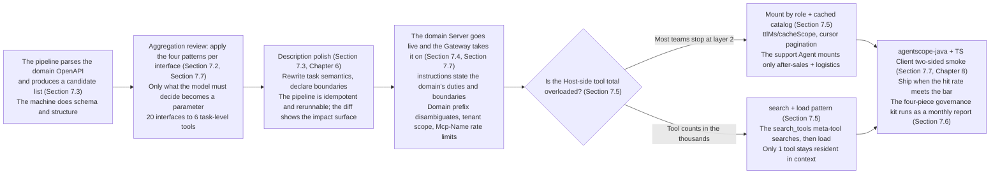
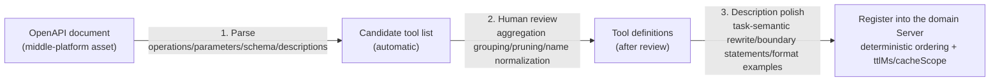
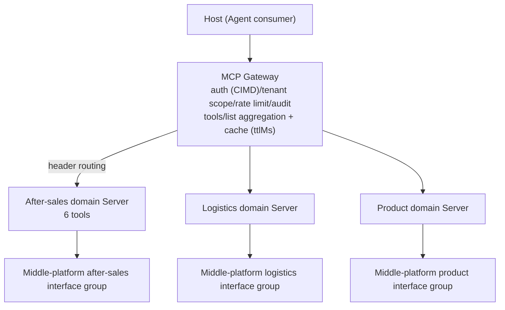

# Chapter 7 At Scale: MCP for a Business Platform

> Chapter guide: After the after-sales domain Server went live, the logistics team showed up: "我们也要" ("We want one too"). Then came product, settlement, and marketing. Once dozens of business domains on the middle platform all want to expose capabilities, the problem has already moved from "how do I write one tool" to "how do I govern a thousand tools". This chapter answers the question that is most often asked the wrong way: with thousands of interfaces, how do you expose them through MCP? The wrong answer is to wrap the interfaces into tools one by one. The right answer is an engineering path: aggregate, generate, split, retrieve, and govern. Each of the five stages removes one obstacle to scale. By the end of this chapter, you can: design an aggregation plan for task-level tools in a business domain; stand up a generation pipeline from OpenAPI to tool definitions; draw a multi-domain Gateway topology and state the duty of each layer; and set up the four-piece kit of catalog governance for a team.

*Flowchart for this chapter*

## When you need it

**The first domain Server is live, and a second domain team comes to ask "我们怎么做" ("How do we do it").** Treat this chapter as the methodology handbook. The four aggregation patterns in Section 7.2 classify their interfaces. The generation pipeline in Section 7.3 means they do not start from zero. The walkthrough table in Section 7.7 can be copied and run through once.

**Someone proposes "把中台接口全部自动暴露成工具" ("Expose every middle-platform interface as a tool, automatically").** Hand them the opening of Section 7.2: tool count is decided by the task vocabulary, and it is not decided by the interface count. The ending of automatic exposure can be predicted. The model's selection accuracy collapses, the context explodes, and no team is willing to maintain a tool catalog as long as the code.

**You are designing a multi-domain Gateway architecture.** See Section 7.1 and Section 7.4. The foundation the protocol prepared for scale (an authorization-shaped catalog, caching, header routing) decides how thin the gateway can be. Recognize the whole foundation first, then decide the topology.

Prerequisites: the complete Server craft from Chapter 5; the tool-modeling standard from Chapter 6 (the "polish" stage of this chapter's generation pipeline takes that standard as its acceptance bar).

## 7.1 Overview: the foundation the protocol prepared for scale

The craft of the previous chapters is at the level of "a single tool": one domain, one team, a handful up to a dozen tools. Pull the camera back. When the middle platform has dozens of domains and the total interface count is in the thousands, many things that were not problems in the single-Server era break out together. How is the catalog distributed? How does the gateway route? What happens when tools from several domains collide on a name? How do tenants stay invisible to each other?

Fortunately, the answers do not have to be invented. The 2026-07-28 specification buried the foundation for scale into the protocol when it was redesigned. Before you design a topology, take stock of this "scale capability the protocol already brings":

| Protocol capability (original spec wording) | Use at scale | See |
|------|-----------|------|
| The tool set **changes with the authorization on the request** (per-request credentials) | Multi-tenant visibility: tenant A's token sees only tenant A's tools, native protocol semantics | Chapter 10 |
| `ttlMs` + `cacheScope` + deterministic ordering on `tools/list` | Catalog distribution relies on the cache; the gateway can share the cache (public) | Chapter 3 |
| `server/discover` gets version + capabilities + identity + `instructions` in one call | The handshake point where the gateway and the consumer connect; `instructions` is the domain's "self-introduction" | Chapter 2 |
| `subscriptions/listen` (toolsListChanged) | The catalog is live: when a domain ships a new tool, the consumer receives a notification and refreshes | Chapter 2 |
| `x-mcp-header` (parameter to an `Mcp-Param-*` header) | The Gateway can route, rate-limit, and audit by parameter without parsing the body | Chapter 6 |
| Explicit handle pattern | Cross-call state does not rely on a session. It relies on a handle passed as a parameter | Chapter 6 |
| Tool-name uniqueness scope = a single Server | Disambiguation at the aggregation layer is required. `serverInfo.name` cannot be relied on | Chapter 6 |

This table is worth reading slowly, because every row serves one shared turn: **the stateless redesign of 2026-07-28, in essence, remakes MCP from "a session protocol between two ends" into "a distributed protocol that infrastructure can carry"**. The session is gone, and state moves into each request. The catalog can be cached and filtered by authorization. Routing information floats up into HTTP headers. Without this version of the protocol, the topology in this chapter would be much heavier. The gateway would have to maintain session affinity, the catalog would need a synchronization system of its own, and tenant filtering would be written once inside every Server.

## 7.2 An interface is not a tool: aggregate at task granularity

Walk into any middle platform and the interface list you see is cut by **system resource**: one REST resource, one set of CRUD, paths shaped like `/tickets/{id}` and `/refunds/{id}/cancel`. That is a vocabulary for system integration. It is clear, stable, and has run well for decades.

The problem is that an Agent's world does not organize tasks this way. When the user says "我要退这单货" ("I want to return this order's goods"), the model is not facing one interface. It is facing a string of business actions: check the order state, pass risk control, create a refund order, and update the after-sales progress. Letting the model take 20 REST interfaces and orchestrate this chain itself is the same as outsourcing the middle-platform engineer's process knowledge to a model that cannot see the middle platform. It does not know that the check and the risk-control step cannot swap order, and it does not know which manual channel to take after risk control rejects the request.

So the first law of scale is: **an interface is not a tool**. Between the two there has to be a deliberate translation, and the translation has four patterns:

| Pattern | When to use it | Example (our running example) |
|------|--------|----------------|
| N interfaces to 1 tool (vertical aggregation) | A fixed string of calls behind one user task | `after_sales_create_ticket` = check + risk control + create. An atomic task is not split out to the model. The Server side orchestrates |
| 1 interface to 1 tool (pass-through) | The interface itself already has complete task semantics | `after_sales_query_ticket` |
| 1 interface to not exposed (prune) | A purely internal interface, with no Agent task semantics | Bulk reconciliation import, cache refresh |
| M interfaces to 1 tool + parameters (merge) | Several variant interfaces of the same task | 4 query interfaces split by region/channel become 1 tool with a `region` parameter |

How do you choose among the four patterns? The decision rule is one sentence: **only what the model needs to "decide" becomes a parameter, and everything the model does not need to know is pulled back into the Server**. Follow that rule and you reach a conclusion that runs against intuition: tool count is decided by the task vocabulary, and it is not decided by the interface count. Inside one business domain, the tasks on which a user really wants the Agent to "make a decision" are usually only 5-15. So an after-sales domain, a logistics domain, and a product domain of thousands of interfaces should each land as **a single-digit count of tools**.

One counterexample is worth every team remembering. A team faithfully split "create an after-sales ticket" into three tools, "validate parameters", "risk-control check", and "create the record", on the grounds that each tool had a single duty. The actual effect was that the model had to orchestrate three calls inside the conversation. What happens when risk control rejects it? How many retries? Should validation be skipped and the record created directly? Every fork needs an understanding of the middle platform's internal process before it can be decided, and that is exactly the knowledge the model does not have. What the user sees is the Agent spinning among the three tools, and finally throwing an unrecoverable intermediate-state error. None of the three tools was written wrong. The wrong thing was the granularity of the cut. Orchestration belonged in the Server all along.

## 7.3 The generation pipeline: OpenAPI is the starting line

The aggregation patterns set the direction. The next problem is the amount of work. Modeling 20 interfaces in one domain by hand is still possible. Writing tool definitions by hand for dozens of domains and over a thousand interfaces is not realistic, and the quality cannot be consistent either. The good news is that a middle platform almost always has OpenAPI/Swagger assets. The idea of the pipeline is to make those assets the starting point rather than the finish line: the machine does structure and schema, and people do semantics and descriptions.

The pipeline has three engineering points, and each one corresponds to a common way of failing.

First, **what the pipeline generates is a "candidate", and it is not a "finished product"**. Automatic generation can solve schema and structure, but the task-semantic rewrite of a description cannot be automated. Turning "GET /api/v1/tickets/{id}/timeline" into "按单号查询售后进度轨迹" ("query the after-sales progress trail by ticket number") needs domain knowledge. Parsing ability does not supply it. So description polish is always a human stage, and it is where the quality of the whole pipeline sits. A team that skips this step gets a batch of tools of the kind "the count meets the bar, and the model does not like to use them": the model either does not select them, or selects them and fills them in wrong.

Second, **the pipeline has to be idempotent and safe to rerun**. OpenAPI changes are normal. After the pipeline regenerates the candidates, it diffs them against the existing tool definitions, and what comes out is exactly the list of "which tools this interface change affected". That list is also the input to change management. A team whose pipeline cannot be rerun can only hunt for the impact surface by hand the moment an interface changes.

Third, **bind a consumer and verify**. As soon as generation and polish are done, smoke-test with a real Agent (Chapter 8), and count the tool hit rate and the rate of correctly filled parameters. Tools that miss the bar go back to polish. The anchor of verification is the selection behavior of a real model. A person checking the schema by eye is not that anchor. A self-check always feels that the description was written clearly enough.

## 7.4 Domain split + Gateway: topology design

The pipeline solves "how one domain mass-produces tools". The next question is how dozens of domains are organized. Look at the topology first:

This topology contains two design decisions.

**Split Servers by business domain. Do not build "one giant Server".** A domain is a natural boundary of iteration and responsibility. It lines up with how the middle-platform teams are organized (the after-sales team owns the after-sales domain Server), it isolates faults (a defect in one domain does not have to drag down every tool), and the tool catalog stays clean. The cost of merging into a giant Server looks lower, but it gives up all three of those benefits, and what it buys is every domain team opening pull requests against the same repository.

**The Gateway is a governance point, and it is not a business point.** Its duty list is: unified authentication and tenant identification (CIMD consumer identity, Chapter 8), tool-catalog aggregation and caching, rate limiting and audit (the `Mcp-Name` header, so the body does not have to be parsed), and version routing (Dual-era compatibility gathered into one place, Chapter 3). Notice that not one item on the list touches a concrete business. The moment the gateway starts to understand an "after-sales ticket", the architecture starts to rot.

The "thinness" of the Gateway deserves a sentence of its own. Before 2026-07-28, this layer needed session affinity and a replay buffer, and the gateway was naturally heavy. After statelessness plus header routing, a Gateway can be thin for the first time: no session table, no sticky routing, and the catalog-cache semantics are already given by the protocol. Hosted MCP gateway products have already appeared on the market (at the time of writing, AWS AgentCore Gateway already provides this kind of capability; when you choose, go by the market at that time. This chapter cares about the duties of the topology, and it does not care about a specific product).

The last question looks trivial and still has to be answered: naming. After multi-domain aggregation, name collisions are inevitable. Two domains both have `search`. The protocol says plainly that the uniqueness scope of a tool name is a single Server. The aggregation layer has to disambiguate on its own, and it cannot rely on `serverInfo.name` (that name is not guaranteed to be globally unique). So a domain prefix (`after_sales_`) is mandatory from day one. Adding it after a collision has already happened is too late.

## 7.5 Tool retrieval and dynamic discovery: the last remedy for overload

Keeping the tool count inside a domain under control does not mean the tool volume on the Host side is under control. A mature Agent platform mounts several domains. A support Agent mounts after-sales and logistics, an operations Agent mounts product and settlement, and shared Servers such as GitHub and internal docs are added on top. The tool total still grows. Every extra tool adds one more fixed overhead to the model context, and selection accuracy is diluted a little further.

The remedies for overload are layered. Turn them on in order, from low cost to high cost:

1. **Mount by role.** The support Agent mounts only the after-sales and logistics domains, and the operations Agent mounts the product and settlement domains. The "role to domain" mapping comes from catalog governance (Section 7.6). This is the cheapest layer, and the benefit shows up immediately. Do it first.
2. **A cached catalog.** Inside `ttlMs`, use the cached catalog directly. `cacheScope: public` lets the gateway layer share the cache. This is the orthodox mechanism for catalog distribution. The protocol has already prepared it, and there is no need to build one yourself.
3. **Paginated discovery.** `tools/list` uses cursor pagination and is pulled by "catalog page", so the whole catalog is not swallowed in one gulp.
4. **The search + load pattern.** The last resort when the tool scale is truly huge. Expose a `search_tools` meta-tool (retrieve by task description). The model searches first, then `load`s the detail of the tool it selected, and then calls it. Only 1 tool stays resident in the context, and the whole catalog sits behind it. This is not an invention of this book: Anthropic's tool search, and the programmatic tool calling in the various SDKs, all belong to this kind of practice (for the concrete API, follow each official document).
5. **A dynamic catalog.** When a domain ships a new tool, a `subscriptions/listen` notification arrives, and the consumer refreshes the cache. Catalog operations become a daily action, and they stop being a release event.

Most teams have enough once they reach layer 2. Layer 4 is prepared for a platform whose "tool count is in the thousands". Push the problem farther away with the lower-layer remedies first. Do not start with the heavy mechanism.

## 7.6 Catalog governance: make scale sustainable

Once there are many tools, governance problems turn around and swallow the technical problems. Half a year later, "can this tool be changed", "who owns this tool", and "is anyone still using this tool" become questions asked every week. If that is when someone remembers to write it down, it is already late. Governance is a four-piece kit:

- **Naming rules, enforced across every domain:** `domain_action` (`after_sales_create_ticket`). The domain prefix is both routing and ownership. Name-collision disambiguation (Section 7.4) depends on it, and grouping the audit reports depends on it too.
- **A tool catalog (Directory):** one row per tool, covering domain, owner, which interfaces it aggregated, version, and status (live/deprecated). For what a catalog entry looks like, `query-ticket.json` in our running example in Chapter 4 is the seed. A team with no catalog, half a year later, has nobody who can say whether "this tool must not be touched, or it can be changed".
- **Change management:** changes to descriptions and schemas go through review, because they change model behavior directly, even when not a single line of code moved. **A breaking change adds a new tool name, and it does not edit in place.** The tool name is the API, and the client calls by name. The OpenAPI diff (the pipeline in Section 7.3) drives the impact-surface list.
- **Quality made routine:** three metrics, hit rate / failure rate / retry rate (Chapter 6), reported monthly. A tool that sits at the bottom for a stretch goes through "polish or retire". Retirement has to have a real precedent that was actually carried out. A mechanism is taken seriously only after it has been used once. The deprecation rhythm on the protocol side lines up with it (Active/Deprecated/Removed, a 12-month window, Chapter 3).

What the four pieces share is that they are **cheap**: naming is a convention, the catalog is one table, change is the existing review flow plus one extra checklist, and quality is a monthly report of three metrics. Sustainable scale does not depend on a heavy process. It depends on these few light things actually being carried out.

## 7.7 A full review of our running example

Walking the five stages of this chapter through our running example once is one complete "domain onboarding":

| Step | Action | Output |
|------|------|------|
| 1. Input | After-sales domain OpenAPI (20 interfaces) | Candidate list |
| 2. Aggregation review | A discussion of the task vocabulary: the things the model really has to "decide" in the life of an after-sales ticket | **6 task-level tools**; 3 interfaces pruned; 8 interfaces vertically aggregated |
| 3. Generate + polish | The pipeline generates a first draft of the schema; descriptions are rewritten, one by one, into task semantics | Tool definitions + catalog entries |
| 4. Domain Server | Implemented with mcp-core / TS v2. `instructions` states the domain's duties and boundaries clearly | The `after-sales` domain is live, and the cache is ready |
| 5. Gateway takes it on | Domain-prefix disambiguation; tenant-scope filtering; `Mcp-Name` rate limiting | One member of the multi-domain topology |
| 6. Consumer verification | Two-sided smoke with agentscope-java + the TS Client (Chapter 8) | The hit rate meets the bar, and it ships |

Put the numbers side by side: 20 interfaces to 6 tools, a compression ratio starting at 3:1, and every tool is at a granularity the model can select accurately. This walkthrough table is the whole operational secret of scale. Apply it to the logistics domain and the product domain, and repeat it. A middle platform of thousands of interfaces gets turned into MCP one piece at a time. There is no more mysterious step.

## 7.8 Chapter summary

1. **The protocol has already laid the foundation:** an authorization-shaped catalog, caching, discover, subscription notifications, header routing, handles, and disambiguation. Use what the protocol already brings before you consider building your own.
2. **Tool count is decided by the task vocabulary.** Aggregation, pruning, and merging are the normal case. "Create an after-sales ticket" should not be split into three tools for the model to orchestrate.
3. **The OpenAPI pipeline generates candidates, and description polish is the human quality gate.** The pipeline is idempotent and safe to rerun, and the anchor of verification is a smoke test with a real Agent.
4. **Domain Servers + a thin Gateway.** The remedies for tool overload go on in layers: mount by role, then cache, then pagination, then search+load.
5. **The four-piece catalog-governance kit** (naming / catalog / change / quality) makes scale sustainable, and it lines up with the protocol feature lifecycle.

→ **Chapter 8** connects this multi-domain topology to real, heterogeneous consumers, and verifies "wrap once, call everywhere".

## Acceptance checklist

By the time you have read this far, you should be able to:

- ☐ Classify one business domain's interface list with the four aggregation patterns, and state the reason for each class;
- ☐ Draw a multi-domain Gateway topology and mark the duty of each layer (authentication / cache / disambiguation / tenant filtering);
- ☐ Explain the economic meaning of "tool count is decided by the task vocabulary" (a linear token term);
- ☐ Draft, for a team, the three stages of an OpenAPI generation pipeline and the acceptance bar;
- ☐ Name the four-piece catalog-governance kit, and explain which problem each piece prevents;
- ☐ List the five remedies for tool overload by layer, and the order in which to turn them on.

## Quick reference

| Item | Value |
|----|----|
| The four aggregation patterns | vertical aggregation / pass-through / prune / merge |
| The pipeline's three stages | parse and generate → human review → description polish |
| Catalog cache | `ttlMs` (freshness) + `cacheScope` (public can be shared) |
| Standard headers | `Mcp-Method` / `Mcp-Name` / `MCP-Protocol-Version` |
| Disambiguation | domain prefix `domain_action`; `serverInfo.name` cannot be relied on |
| Retrieval layers | mount by role → cache → pagination → search+load |

## Further reading

- **Chapter 6 (Tool integration in practice).** The acceptance bar for the pipeline's "polish" stage comes from its craft of description quality.
- **Chapter 8 (Building a Client).** The consumer-side view of the multi-domain topology, and two-sided verification.
- **Chapter 10 (Deployment and security).** The details of Gateway authentication and tenant isolation.
- **Chapter 12 (Enterprise adoption roadmap).** How this chapter's methodology lands in stages, and how the project gets proposed.

## Review checklist (before publication)

- [ ] Verify external gateway products (note the verification date); check the current state of search+load and of SDK support
- [ ] Replace the example numbers of our running example with the team's real middle-platform data (interface counts, compression ratio)
- [ ] Verify hands-on the toolsListChanged subscription flow of `subscriptions/listen` (v2.4.0)
- [ ] Verify hands-on the shared-cache behavior of `cacheScope: public` in a Gateway scenario
