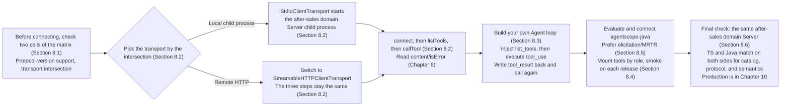

# Chapter 8 Cross-Framework Client Integration

> Chapter guide: At the end of Chapter 6, the after-sales domain Server could already be called by "one" consumer. This chapter delivers MCP's core promise, **the same Server, common across frameworks**. It starts with a cross-framework support matrix, then verifies a two-sided call hands-on with two SDKs, then walks into the minimal implementation of the Agent loop, and finally closes our running example. Cells in the matrix that were not verified hands-on are marked as such. The matrix will go stale. Every cell carries a verification date. Check it again before you cite it. By the end of this chapter, you can: use the support matrix to judge whether any consumer × Server combination is feasible; finish connecting and calling in three steps with the TS SDK; read the minimal Agent loop and point out where Host governance lands; and state how deprecation of client capabilities affects integration decisions.



*Flowchart for this chapter*

## When you need it

**You want to connect an existing Server into your own application.** First check the two cells of the matrix in Section 8.1 (protocol-version support, and the transport intersection), then follow the three steps in Section 8.2. If joint debugging goes wrong, go back to the common pitfalls in Section 8.7.

**You are not using an off-the-shelf framework, and you want to understand "how an Agent actually uses tools".** Go straight to Section 8.3: the minimal implementation of the Agent loop. Each of the four points is a real decision point at integration time.

**You are judging whether a Host framework is worth connecting.** See Section 8.5. After 2026-07-28 deprecated Sampling and Roots, the scoring standard for "which client capabilities are supported" changed. Support for elicitation and MRTR is the item that matters.

Prerequisites: the after-sales domain Server and the two-sided concept from Chapter 4; the result semantics from Chapter 6 (content/structuredContent/isError).

## 8.1 The framework × MCP support matrix

| Consumer | 2026-07-28 support | Transport | Verification status |
| --- | --- | --- | --- |
| TS SDK `@modelcontextprotocol/client` | ✅ v2.x (2.3.1+, verified hands-on on 2.4.x) | stdio / Streamable HTTP | **Verified hands-on for this book** (2026-10-24) |
| Java SDK `io.modelcontextprotocol.sdk:mcp-core` | ✅ 2.0.x (the `modern` package, 37 consistency items passed) | stdio / Streamable HTTP | Checked against sources, not yet verified hands-on |
| agentscope-java | See Chapter 26 of that book (Agent protocol) | — | → the agentscope-java book |
| ragflow | ⚠️ to be verified | — | → the ragflow book |
| CopilotKit (frontend Host) | ⚠️ to be verified | — | → the copilotkit book |
| AI CLI (Claude Code and others) | ✅ (the GitHub MCP Server has announced support for 2026-07-28, usable as side evidence that the ecosystem is ready) | Each CLI defines its own | To be verified per version |
| GitHub official MCP Server (ecosystem reference on the Server side) | ✅ Announced 2026-07-23 | HTTP | Checked against sources |

How to use the matrix: before you connect, check two cells, **the version on which the target framework supports 2026-07-28** and **the transport intersection** (only a transport both sides support is a usable transport). Once those two cells are checked, the basics of the connection plan are set, and the rest is engineering detail. Cells marked `⚠️ to be verified` are filled back in, with the verification date noted, when the book for that framework is drafted.

## 8.2 Verified hands-on on both sides: the Client connects to our after-sales domain Server

The Host side needs only three steps: construct a transport (pointing at the Server process or endpoint), then connect, then call. The code below **passed verification hands-on on v2.4.0** (2026-10-24):

```typescript
// npm i @modelcontextprotocol/client zod
import { Client } from "@modelcontextprotocol/client";
import { StdioClientTransport } from "@modelcontextprotocol/client/stdio";

// ① transport: start the Server child process (stdio); for an HTTP scenario, switch to StreamableHTTPClientTransport
const transport = new StdioClientTransport({
  command: "node",
  args: ["server.mjs"],   // the after-sales domain Server from Chapter 4
});

// ② client: declare the Host identity
const client = new Client({ name: "book-host", version: "0.1.0" });
await client.connect(transport);

// ③ discover and call
const tools = await client.listTools();
// → tools.tools.map(t => t.name) === ["echo"]

const res = await client.callTool({
  name: "echo",
  arguments: { text: "双端实证成功" },
});
// → res.content === [{ type: "text", text: "双端实证成功" }]

await client.close();
```

The argument string stays in Chinese. "双端实证成功" ("two-sided verification succeeded") is sent as `text`, and the comment shows the same string coming back in `res.content`.

Details worth noticing:

- **The Host-side tool catalog comes from `listTools()`.** "The Host controls visibility" from Chapter 2 lands here: the Host decides which tools are injected into the model context. That filtering action lives in Host code, and it does not live in the protocol.
- The return value of `callTool` is the `content` / `structuredContent` / `isError` structure from Chapter 6. **Both sides share one set of result semantics.** That is the small-scale basis of "common across frameworks".
- The client is also a user of the stateless semantics: after `connect`, it makes business calls directly, with no handshake dependency (this and the Server-side verification hands-on in Chapter 4 confirm each other).

## 8.3 Building a Client: the minimal Agent loop

The official build-client tutorial (Python as the main line) demonstrates something every integrator has to do sooner or later: **without depending on an off-the-shelf Agent framework, build the loop of "model + MCP tools" yourself**. Its `process_query` is the smallest complete Agentic loop, and it is worth reading piece by piece:

```python
async def process_query(client: Client, query: str) -> str:
    # ① Pull the catalog: this step decides which tools the model can see
    tool_list = await client.list_tools()
    available_tools = [{"name": t.name, "description": t.description,
                        "input_schema": t.input_schema} for t in tool_list.tools]

    # ② First model call: the tool catalog is injected with the request
    response = anthropic.messages.create(model=MODEL, messages=messages,
                                         tools=available_tools, ...)

    # ③ Walk the response: collect text directly; on tool_use, execute it
    for content in response.content:
        if content.type == "tool_use":
            result = await client.call_tool(content.name, content.input)
            tool_results.append({"type": "tool_result", "tool_use_id": content.id,
                                 "content": ..., "is_error": result.is_error})

    # ④ Write the result back, call the model a second time, and produce the final reply
    if tool_results:
        messages.append({"role": "assistant", "content": response.content})
        messages.append({"role": "user", "content": tool_results})
        response = anthropic.messages.create(model=MODEL, messages=messages,
                                             tools=available_tools, ...)
```

Four points, and each one is a real decision point at integration time:

1. **Injecting the catalog is an explicit action.** The result of `list_tools()` is turned into the `tools` parameter of the model API. The code location of "the Host controls visibility" (Chapter 2) is right here: to filter tools, filter this list
2. **`is_error` is passed to the model as it is.** The tutorial specifically notes: "a tool error is not raised here; it comes back as an `is_error` answer. Pass this flag along, and the model can read the message and try another way." That closes the loop with the two-class error model in Chapter 6
3. **The second call is the essence of the loop.** The tool result is written back into the message history in the `tool_result` role, and the model is requested once more. A real Agent framework (the ReAct loop in agentscope) is this stretch turned into a general engine
4. **The connection lifetime is one `async with`.** On entry it starts the Server child process and completes the version declaration (⚠️ this sentence in the tutorial is leftover v1 wording; under 2026-07-28 the version is declared per request, and the SDK handles it internally). On exit it disconnects and reaps the child process. "Nothing has to be closed by hand."

The three-piece set for establishing a connection: `StdioServerParameters` (**configuration**, describing which child process to start), then `stdio_client()` (turns the configuration into a transport), then `Client` (works on the transport). The tutorial picks the launch command from the script extension. In a production scenario, this layer is the Client-side shape of the Gateway from Chapter 7. Further hands-on work for connecting local and remote Servers (local configuration, an HTTP connection, authentication) is in the official connect-local-servers / connect-remote-servers guides (a close reading is still to come).

## 8.4 The agentscope-java side: the main-line consumer

agentscope-java is the everyday framework of this book's readers. How it connects to MCP, and the best practice, is covered in full in **Chapter 26 of the agentscope-java book (Agent protocol)**. This chapter does not repeat its API details. It gives only three points from the integration point of view:

1. **Version alignment.** The MCP version on the agentscope-java side lines up with the spec version of the domain Server (the compatibility matrix in Chapter 3). The upgrade rhythm is managed in one place by the catalog governance in Chapter 7.
2. **Tool visibility.** An Agent mounts a subset of tools by role (the support Agent mounts only after-sales + logistics). Filtering is on the Host side, and it echoes the mount-by-role layer in Chapter 7.
3. **Joint-debug verification.** Every time the Server releases, smoke-test with a real Agent (the rate at which the model selects the right tool, and the rate of correctly filled parameters). That is closer to real quality than a unit test is.

(Once Chapter 26 of the agentscope-java book is drafted, and before this book is published, backfill the concrete configuration example here from that chapter.)

## 8.5 The state of client capabilities: elicitation is active, Sampling and Roots are deprecated

The spec defines "a Server using client capabilities in the reverse direction" as three things: elicitation (collect input from the user), sampling (borrow the Host's model for inference), and roots (tell which directories are accessible). **The deprecation list of 2026-07-28 changes integration decisions** (Chapter 3):

| Client capability | Status | Host integration advice |
| --- | --- | --- |
| **elicitation** | ✅ Active, and through MRTR it has become the main channel for interaction (`inputRequests` embedded) | Implement it: a form / confirmation UI is standard equipment for a production Host |
| **Sampling** | ⚠️ Deprecated | Do not implement sampling for MCP anymore. When you need model inference, call the LLM provider API directly |
| **Roots** | ⚠️ Deprecated | Directories and files come in through tool parameters or a resource URI |

The judgment for an integrator: when you evaluate a Host framework, look first at its **elicitation/MRTR support** (that decides interaction capability). There is no need to award extra points for sampling/roots support anymore. Logging is the same case (deprecated; use stderr or OTel).

## 8.6 Multi-framework consumption: closing our running example

The final check of our running example: **the same after-sales domain Server, two heterogeneous consumers**.

```
                        ┌───────────────────────────────────────────────┐
                        │  after-sales MCP Server                       │
                        │  (built in Chapter 4, filled out in Chapter 6)│
                        └───────────────────────┬───────────────────────┘
  ┌─────────────────────────────────────────────┴────────────────────────────────────────────┐
TS Client (verified hands-on in this chapter)     agentscope-java Agent
CopilotKit frontend prototype                     (connected in Chapter 26, joint debug pending)
```

One tool definition (`inputSchema` + `description`). The TS Host and the Java Host get the same catalog, the same call protocol, and the same result semantics. **The description quality polished in Chapter 6 is invested once, and every framework benefits.** That is why the mcp book exists on the shelf.

## 8.7 Common pitfalls on the client side

- **Transport intersection.** The Server supports only stdio, and the frontend Host can only do HTTP. Compare the transport lists before you connect. Do not wait until joint debugging to find out.
- **Version negotiation fails.** The shape of the error when a legacy client connects to a modern Server (or the other way around): both SDKs have an explicit error (such as `UnsupportedProtocolVersionError`). Locate it with the compatibility matrix in Chapter 3, and do not change configuration blindly.
- **Catalog refresh.** After the Server's `tools/list_changed` notification arrives, the Host has to `listTools` again. A long-lived Host (such as a CLI session) that ignores this notification keeps selecting tools from a stale catalog.
- **Description truncation.** Some Hosts truncate tool descriptions to a length limit. However good a description is, once it is truncated it stops working. When you connect a new framework, check its truncation policy.

## 8.8 Summary

- Calling from both sides is three steps: transport, then connect, then listTools/callTool (verified hands-on on TS v2.4.0)
- Visibility filtering on the Host side is where governance lands
- Common across frameworks = a consistent catalog + a consistent protocol + consistent result semantics
- The matrix is a living document, and every cell carries a verification date

→ **Chapter 10** puts this into production: transport selection, authentication, multi-tenancy, and security.

## Acceptance checklist

By the time you have read this far, you should be able to:

- ☐ Use the support matrix to judge whether a "consumer × Server" combination is feasible, and say which two cells to check;
- ☐ Use the TS SDK to connect to the after-sales domain Server in three steps and complete one call;
- ☐ Explain the four points of the Agent loop one by one, and point out the code location of "tool-visibility filtering";
- ☐ State the current status of the three client capabilities under 2026-07-28, and the integration advice that goes with each;
- ☐ List the four common pitfalls on the client side, and the troubleshooting action for each.

## Quick reference

| Item | Value |
|----|----|
| The three connection steps | StdioClientTransport, then `new Client().connect()`, then listTools/callTool |
| Result semantics | content / structuredContent / isError (defined in Chapter 6, consistent on both sides) |
| The Agent loop | Pull the catalog, then the first call, then execute tool_use, then write back and call again |
| Client capabilities | elicitation is active; Sampling/Roots/Logging are deprecated |
| Matrix verification | Every cell carries a verification date; cells marked `⚠️ to be verified` are filled back in when the corresponding book is drafted |

## Further reading

- **Chapter 3 (Version evolution).** The seven-cell compatibility matrix: the full semantics of era detection and fallback on the client side.
- **Chapter 6 (Tool integration in practice).** The side that defines `is_error` and the result semantics; the side where the investment in description quality happens.
- **Chapter 7 (At scale).** The Server-side panorama of the Gateway topology. This chapter is its consumer-side view.
- **Chapter 26 of the agentscope-java book.** The full connection practice for the main-line consumer framework.

## Review checklist (before publication)

- [ ] Fill the `⚠️ to be verified` cells of the matrix back in when the corresponding book is drafted (note the verification date)
- [ ] Fill in the two-sided Java SDK example after verifying it hands-on (mcp-core 2.0.1, client side)
- [ ] After Chapter 26 of agentscope-java is drafted, backfill the configuration example in Section 8.4
- [ ] Check error type names such as `UnsupportedProtocolVersionError` against the v2.4.0 exports
