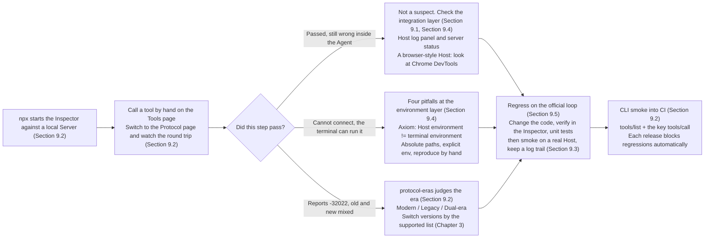

# Chapter 9 Debugging and the Inspector

> Chapter guide: The Server is written and you run it once. "The model does not select the tool", "it cannot connect", "the behavior is bizarre". The troubleshooting paths for these three kinds of problems are completely different, and the tools they need are different too. This chapter turns the official debugging system into one decision diagram: which symptom, which layer of tool, and where to look. The core is **MCP Inspector**, the official interactive debugger. It has dedicated support for the protocol era of 2026-07-28, and it is the first entrance for problems of the "version mismatch" kind. By the end of this chapter, you can: choose the right debugging layer by symptom; finish everyday debugging with the Inspector's three forms, web, TUI, and CLI; locate old-and-new interoperability problems with the protocol-era check; and stay clear of the four classic classes of environment pitfalls on a stdio server.



*Flowchart for this chapter*

## When you need it

**A tool call does not go through, and you suspect a protocol problem.** Start with the Inspector: it plays Host for you, bypasses the model and the business code, and directly checks "whether the Server itself is fine". If the Inspector passes and it still does not work inside the Agent, the problem is in your integration layer. If the Inspector does not pass either, the problem is in the Server.

**"昨天还好好的" ("It was fine yesterday").** Check the environment layer first (Section 9.4): working directory, environment variables, and paths. These four classes of pitfalls account for most STDIO server failures.

**Old and new versions are running mixed.** Go straight to the protocol-era check (protocol-eras) in Section 9.2. It is prepared for the scenario of 2026-07-28 running mixed with legacy.

## 9.1 Overview: the three-layer system of debugging tools

The official docs split debugging tools into three layers by "how far they sit from the problem":

| Layer | Tool | Fits | In one sentence |
|----|------|------|--------|
| Interactive debugging | **MCP Inspector** | Connect stdio / Streamable HTTP, call tools/prompts/resources, watch the notification stream | **The first stop.** It replaces "trying over and over inside the Agent" |
| Server logs | stderr (stdio) or OpenTelemetry (every transport) | Record what the Server is doing | Structured logs are the basis for investigating after the fact |
| Client developer tools | The Host's logs and connection state (such as the log panel in Claude Desktop, and Chrome DevTools) | When the problem is in the integration layer | See how the Host sees your Server |

One important change of fact: **in-protocol logging (`notifications/message`) was deprecated in 2026-07-28** (Chapter 3). It can still be used inside the deprecation window, but a new implementation should go straight to stderr or OTel. The protocol no longer carries logs. Logs go back to the infrastructure.

## 9.2 The Inspector: three forms

The Inspector is the official interactive debugger. One `npx` line starts it, and the three forms each cover one stretch.

### The web UI (the everyday main form)

```bash
# Start the web UI and connect a local stdio Server
npx @modelcontextprotocol/inspector node server.mjs
# Or start with no target, and add the Server in the UI
npx @modelcontextprotocol/inspector
```

The UI is paged by protocol capability: **Servers** (connection management, and settings per Server), **Tools / Resources / Prompts** (list them and call them by hand, equivalent to hand-writing the raw JSON-RPC from Chapter 4 for you), **Apps**, and three pages that matter for troubleshooting: **Protocol** (the protocol message stream, JSON-RPC one message at a time), **Network** (the HTTP layer), and **Console**. The session is protected by a token. When you start it locally, watch the session address printed in the terminal.

The standard move for everyday debugging: connect to the Server, select a tool on the Tools page, fill in the parameters and call it by hand, then switch to the Protocol page and look at the complete message round trip of this one call. **Once this step passes, the Server is no longer a suspect.** The problem is in the Host or the integration layer.

### TUI (the terminal form)

The equivalent in the terminal: pick a Server, switch capability panels with Tab, navigate by keyboard, and debug an HTTP Server after authorization. It fits an SSH remote environment and the scenario where you do not want to open a browser.

### CLI (scripted use and pipelines)

```bash
# List tools and exit (suited to CI)
npx @modelcontextprotocol/inspector --cli node server.mjs --method tools/list

# Call a tool, and send the result straight into jq
npx @modelcontextprotocol/inspector --cli node server.mjs \
  --method tools/call --tool-name echo --arg text=hi | jq
```

The CLI form lets a "Server smoke test" enter CI: every release runs `tools/list` plus the key `tools/call` once, and a catalog change or a failed call is stopped in the pipeline. The launch-parameter semantics of `--cli` and of the web form differ (launcher flags vs client flags). Glance at `--help` before you use them.

### Protocol-era check (protocol-eras)

This is the most valuable Inspector page in the 2026-07-28 era: **check whether a Server is Modern, Legacy, or Dual-era** (the terms from Chapter 3), and the actual behavior of version negotiation between the two sides. During the mixed-running period, "cannot connect, behavior is bizarre" can mostly be located here. It turns the seven-cell compatibility matrix of Chapter 3 from paper into an observable fact. Also note that the Inspector itself offers debugging support for servers of both protocol eras. Before you use it, configure the matching mode from the docs.

## 9.3 The logging layer: stderr and OTel on two tracks

| Transport | Where logs go | Watch out |
|------|----------|------|
| stdio | stderr, **captured automatically by the Host** | The stdout red line (Chapter 5): a print destroys the protocol stream |
| Streamable HTTP | stderr is **not** captured by the Host | Use your own log aggregation or OTel; for request troubleshooting, look at curl or the browser DevTools Network panel |

The per-request log level is declared by the client in `_meta.io.modelcontextprotocol/logLevel` (the per-request redesign in Chapter 3). When the Server side implements this, it reads that value to set the level, and it does not maintain a global level state.

## 9.4 The environment layer: four classic pitfalls of STDIO servers

The first four classes on the official Common Issues list all have to do with "how the Host starts your process":

1. **The working directory cannot be assumed.** The Host starts from an arbitrary directory, and the Server process's working directory may be `/`. Paths in configuration and in `.env` are **absolute paths in every case**
2. **Environment variables are not inherited from your shell.** A child process the Host starts does not get the variables from your terminal. If a variable is needed, give it explicitly in the `env` field of the Host configuration
3. **The Server fails to start.** Dependencies are not installed (the Host's environment is not your development environment), or the Python/Node version does not match. First start it by hand on the command line with the same command, and verify that it comes up
4. **Connection problems.** The start command is assembled wrong, the executable is not on PATH, or a port conflicts. In a Claude Desktop scenario you can look at its server status and log panel. A browser-style Host goes straight to Chrome DevTools

One troubleshooting axiom: **the environment the Host starts is not your terminal environment**. If it runs in the terminal and does not run inside the Host, nine out of ten times it is an environment difference, and one out of ten times it is the working directory.

## 9.5 Debugging workflow and best practice

The development loop the official docs give is worth adopting as it stands:

```text
Change the code → verify by hand in the Inspector → unit tests → smoke on a real Host → record logs and keep the trail
```

Two best practices. **Logging policy:** a logger per module, structured fields, a request-level level (`_meta.logLevel`), and stderr/OTel on separate tracks. **Security considerations:** do not write sensitive parameters or tokens into the logs (the tool-input audit in Chapter 6 follows the same rule), do not leak the Inspector's session token, and when you debug an HTTP Server watch the headers and credentials visible in DevTools.

## 9.6 Quick lookup for common problems

| Symptom | First tool | Frequent cause |
|------|----------|----------|
| Cannot connect inside the Host, and the command line can run it | Host logs + an environment-layer check | Working directory / environment variables / absolute paths (Section 9.4) |
| The tool list is empty | The Inspector Tools page | tools was not declared in capabilities; tool registration failed and the failure was swallowed |
| A call reports -32602 | The Inspector Protocol page | The parameters do not match inputSchema; a raw request is missing `_meta` |
| A call reports -32022 | The Inspector protocol-eras page | Version mismatch. Switch versions by the supported list (Chapter 3) |
| The model does not select the tool | A check of the model context | The description is missing or weak (Chapter 6). This is a description problem. It is not a debugging problem |
| It worked yesterday and it is broken today | The environment layer + `git diff` | Dependency drift, a path change, a stale catalog cache (list_changed was not refreshed) |

## 9.7 Chapter summary

1. **Pick among the three layers of tools by symptom:** if you suspect it during interaction, use the Inspector; if you are tracing it after the fact, use stderr/OTel logs; for the integration layer, use the Host's developer tools.
2. **The Inspector's three forms:** web for everyday use, TUI for remote use, CLI into CI. The protocol-eras page is the locator for mixed versions.
3. **Logs on two tracks:** stdio relies on stderr being captured by the Host, and HTTP relies on your own aggregation or OTel. In-protocol logging is deprecated.
4. **The environment axiom:** the environment the Host starts is not the terminal environment. Absolute paths, an explicit env, and reproducing the start command by hand.
5. **The mapping from symptom to tool** should become a team habit (the lookup table can go straight into the team wiki).

→ **Chapter 10** returns to the production main line: the transport header system, OAuth authorization, and multi-tenancy.

## Acceptance checklist

By the time you have read this far, you should be able to:

- ☐ Pick the right debugging-tool layer from the lookup table, by symptom;
- ☐ Use the Inspector web form to connect a local Server and call one tool by hand, and point out the complete message round trip on the Protocol page;
- ☐ Write one Inspector CLI smoke command that can be used in CI;
- ☐ Use protocol-eras to judge a Server's era (Modern/Legacy/Dual-era);
- ☐ Explain the frequent cause of "it runs in the terminal and does not run inside the Host", and give the troubleshooting order.

## Quick reference

| Item | Value |
|----|----|
| Web launch | `npx @modelcontextprotocol/inspector node server.mjs` |
| CLI smoke | `npx @modelcontextprotocol/inspector --cli <cmd> --method tools/list` |
| Log tracks | stdio to stderr (the Host captures it); HTTP to aggregation/OTel |
| Log level | The client declares it per request through `_meta.io.modelcontextprotocol/logLevel` |
| Protocol logs | `notifications/message` is deprecated (2026-07-28) |
| Docs | tools/debugging and tools/inspector/* (web/tui/cli/configuration/authorization/protocol-eras/security/recipes) |

## Further reading

- **Chapter 5 (Building a complete Server).** The other half of the "Server side" that this chapter troubleshoots: the correct implementation of log discipline and of the degradation path.
- **Chapter 3 (Version evolution).** The seven-cell compatibility matrix behind protocol-eras.
- **Chapter 8 (Building a Client).** Once the Inspector has shown the Server is innocent, the troubleshooting surface is on the Client side.
- **The original official debugging and inspector series.** The source material of this chapter. The two pieces configuration and recipes were not read closely. See the review checklist.

## Review checklist (before publication)

- [ ] Read these five pieces closely and supplement from them: inspector/configuration.mdx, recipes.mdx, mcpdo.mdx, authorization.mdx, and security.mdx
- [ ] Verify the command lines of each Inspector form hands-on (version and parameters follow the release at the time)
- [ ] Check the Claude Desktop log panel and the Chrome DevTools troubleshooting section by doing it
- [ ] Check that the protocol-eras page maps onto the matrix in Chapter 3
