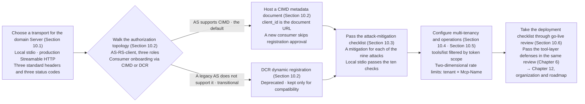

# Chapter 10 Deployment and Security

> Chapter guide: the domain Server already runs on your machine, and four layers still stand between that and "daring to put it in production": which transport to choose, how to manage the headers on every request, how to trust the caller's identity, and where to close the attack surface. This chapter checks the original text of basic/transports/streamable-http and of the basic/authorization series, and turns the Gateway topology from Chapter 7 into configuration that can go live: three standard headers and three status codes, the OAuth 2.1 three-role stack and CIMD, multi-tenant visibility, a mitigation list for nine attacks, ten checks for a local Server, and a one-page deployment checklist. After this chapter, you can: choose the right transport for a domain Server and set every standard header; walk the "AS-RS-client" authorization topology; configure tool visibility by tenant; and take the deployment checklist through a go-live review.



*Flowchart for this chapter*

## When you need this chapter

**The Server has to be open to real users.** Read it straight through. The header system in Section 10.1 and the authorization architecture in Section 10.2 are the compliance baseline, and the deployment checklist in Section 10.6 is the go-live review sheet.

**Multiple tenants must have their tools and data isolated.** Go straight to Section 10.4: "the tool set changes with the authorization presented on the request" is native protocol semantics, and it lands in three layers together with directory filtering and tenant context.

**Someone in a review asks about "the security risks of MCP".** Lay out the nine-attack list in Section 10.3. Each item has a shape and a mitigation. Add the tool-layer defenses from Chapter 6, and take both layers through the review together.

Prerequisites: Chapter 6 (the tool-layer security checklist), Chapter 7 (the Gateway topology), and Chapter 3 (version negotiation, the premise of the header-consistency check).

## 10.1 Transport: how stdio and Streamable HTTP divide the work

| | stdio | Streamable HTTP |
| --- | --- | --- |
| Scenario | Local tools, embedded in a CLI, personal development | A domain Server run as a service, multiple consumers, production |
| Lifecycle | Starts and stops with the Host process | A long-running independent service |
| Authorization spec | **Does not apply**. Credentials are taken from the environment | Should follow the framework in Section 10.2 of this chapter |
| Relation to statelessness | A connection is not a session (Chapter 2). Legacy compatibility relies on the discover probe (Chapter 3) | The complete form of statelessness plus header routing |

The rule, in one sentence: **stdio for local and personal tools, Streamable HTTP once it goes to production**.

### The header system of Streamable HTTP (required for compliance)

2026-07-28 puts hard rules on HTTP request headers. Every POST must carry all three:

```http
POST /mcp HTTP/1.1
Content-Type: application/json
MCP-Protocol-Version: 2026-07-28
Mcp-Method: tools/call
Mcp-Name: get_weather
```

| Header | Source | Requirement |
| --- | --- | --- |
| `MCP-Protocol-Version` | **Must match** `_meta.protocolVersion` in the body | A mismatch → `400` + `HeaderMismatch` (-32020) |
| `Mcp-Method` | The JSON-RPC `method` | Required on every request |
| `Mcp-Name` | `params.name` or `params.uri` | Required on `tools/call`, `resources/read`, and `prompts/get`. A non-ASCII value uses Base64 sentinel encoding |

These three headers let network middleware route and audit **without parsing the body**. `Mcp-Name` lets the gateway rate-limit by tool name, and the version header lets the load balancer split traffic by protocol version. Add the `x-mcp-header` from Section 6.8 (a parameter → an `Mcp-Param-*` header), and the network-layer semantics of Streamable HTTP are complete: **the protocol is designed for infrastructure, not only for the two ends**.

### Three status codes for the server-side check

| Case | Response |
| --- | --- |
| The header version and the body version disagree | `400` + `HeaderMismatch` (-32020) |
| The version is not supported | `400` + `UnsupportedProtocolVersionError` (-32022, with a supported list attached) |
| The method does not exist | `404` + `-32601` (distinguished, by the body, from the 404 a legacy HTTP+SSE server returns for "no modern endpoint". This is the basis of backward compatibility) |

Also: results such as `tools/list` must carry `ttlMs`/`cacheScope` (Chapter 3), and the gateway decides the directory cache policy from them.

## 10.2 Authorization architecture: three roles and the standard stack

The authorization model in the spec is the standard OAuth topology:

- **MCP Server = OAuth 2.1 Resource Server (RS)**: accepts a protected request on the strength of an access token
- **MCP Client = OAuth 2.1 Client**: makes the request on behalf of the resource owner
- **Authorization Server (AS)**: interacts with the user and issues the token. The implementation is outside the scope of the spec and can be deployed on its own (mid-platform scenario: connecting the existing SSO/IAM is the AS)

The standard stack (every piece aligned with an IETF specification, none of it homegrown): OAuth 2.1, Bearer Token (RFC 6750), AS Metadata (RFC 8414), DCR (RFC 7591, deprecated), Resource Indicators (RFC 8707), Protected Resource Metadata (RFC 9728), Issuer Identification (RFC 9207), **CIMD** (Client ID Metadata Documents), and OIDC Discovery.

Four hard requirements at the spec level:

1. The AS **must** implement OAuth 2.1 (including the security measures for confidential and public clients)
2. The AS and the client **should** support CIMD. DCR is still usable, but it is deprecated (kept only for a legacy AS that does not support CIMD)
3. **The MCP Server must implement RFC 9728** (Protected Resource Metadata). **The client must use it to discover the AS**. The Server tells the client "where to get a token"
4. An HTTP transport **should** follow this framework. stdio **should not** (credentials travel in environment variables). Any other transport must follow the security best practices of the corresponding protocol

**What CIMD is**: a client no longer obtains a client_id by "pre-registration" or by "dynamic registration". It hosts a metadata document that a URL can reach, and the client_id is that URL. What this means for a mid-platform: when each new consumer (a new Agent project, a new frontend) goes live, it does not need a registration-approval flow on the AS. Hosting the document is the onboarding. DCR was downgraded to deprecated because security defects ran wild at the implementation layer (CIMD's trust model is tighter; see Section 10.3).

## 10.3 The security-threat list: every item the spec names

security-considerations in the spec lists the threats item by item. A mid-platform review walks them one by one:

| Threat | Key point | Defense |
| --- | --- | --- |
| **Token audience binding** | RFC 8707: a token is valid only for the resource it declares | The AS binds it at issuance. The RS checks the audience. Cross-service replay is rejected |
| **A stolen token** | A leaked token is an impersonation | A short lifetime, transport security (Section 10.2), least scope |
| **Authorization-code protection** | The risk that the code is intercepted | PKCE (mandatory in OAuth 2.1), an `iss` check (RFC 9207, against mix-up) |
| **Open redirect** | redirect_uri manipulation | Strict registration and an exact match |
| **Risks specific to CIMD** | AS abuse (the client induces the AS to send a request to an arbitrary URL), localhost-redirect squatting, trust policy | An ownership check between the CIMD document domain and the client. The trust policy states "which client domains are trusted" |
| **Confused Deputy** | A malicious client uses a legitimate client's credentials or identity to get something done | An independent identity per consumer. Audience binding |
| **Access-token privilege** | The token goes beyond its range | Least scope. The RS narrows tool visibility by scope (→ Section 10.4) |

The tool layer (Chapter 6) has an attack surface alongside this one: annotations are not trusted, `$ref` is not dereferenced, a result is treated as data and not as an instruction, and a sensitive parameter must not use `x-mcp-header`. **Take both layers of defense through the review together. Leave neither one out.**

### Attacks and mitigations: the full list from the official best practices

Beyond security-considerations in the spec, the official security best-practices tutorial (tutorials/security/security_best_practices, 984 lines) gives a more complete attack catalog. Walk it item by item in the review:

| Attack | Shape | Mitigation |
| --- | --- | --- |
| **Confused Deputy** | A malicious client uses the credentials and the authorization of a legitimate client (such as a shared MCP proxy) to reach a resource it should not reach. The proxy is confused about "whom it is acting for" | An independent identity and registration per consumer. On dynamic registration, check the binding between the client and the redirect. Bind the audience on the token |
| **Token Passthrough** | The MCP Server forwards the client's upstream token, unchanged, to a downstream API. That bypasses the scope check, breaks the audit trail, and amplifies privilege | The Server uses **its own** credentials toward the downstream. It does not pass the client token through. Each hop authorizes again |
| **SSRF** | A tool parameter (of URL type) is induced into requesting an internal-network address | A URL allowlist / egress control. Forbid internal address ranges. Schema constraints (Chapter 6) |
| **State Handle Hijacking** | The other face of the handle pattern in Chapter 6: a handle is guessed or stolen, and then used to impersonate | A handle is a name, not a capability. Every call checks that the caller owns it. An opaque ID + enough entropy + a time limit (Section 6.7) |
| **Authorization-URL manipulation / open redirect** | redirect_uri manipulation intercepts the authorization code | An exact match. An `iss` check (RFC 9207) |
| **Mix-up attack** | A forged AS makes the client send the authorization code to the attacker | A mandatory check of the `iss` parameter |
| **Localhost-redirect impersonation** | A local port seizes the localhost callback of a public client | A CIMD trust policy. A port-binding check |
| **A gap in the CIMD trust policy** | A malicious metadata document impersonates a legitimate client | On the AS side, review the client metadata domain against the trust policy |
| **A scope that is too wide** | The token scope is larger than what is actually needed | Least scope. The RS narrows tool visibility by scope (Section 10.4) |

The original tutorial text walks a full scenario for each attack. When a review is in dispute, go back to the original and compare.

### Authorization in practice: Keycloak end to end

The official authorization tutorial (tutorials/security/authorization, 1201 lines) gives a complete, reproducible hands-on path: **standing up Keycloak as the AS** (realm/client/credentials) → **wiring it on the MCP Server side** (RS configuration: the auth server location, the OAuth client credentials, the global configuration) → **test verification** → common pitfalls. When a mid-platform puts this in place, rehearse the tutorial once and keep the record. That is more solid than reading the spec ten times. This section does not copy its thousand lines of configuration.

### Local Server security: a ten-item checklist

Before a domain Server is turned into a service, a team still uses **local stdio Servers** heavily (personal tools, development aids). The trust model in the official local-security guide (tutorials/security/local-server-security), in one sentence: **running a local Server ≈ running an arbitrary program on your machine**. It can touch your files, your credentials, and the network. The ten-item checklist:

1. **Ask first whether it must run locally**. If it can be a service (HTTP), do not run it locally
2. **Verify the source before you install**. Provenance (who published it, the repository's reputation, the supply chain)
3. **Treat the tool definition as untrusted input**. The description may hide instructions (tool poisoning, Chapter 6)
4. **Run it in an isolated environment**. A container or a least-privilege user. Do not run it bare on a development machine
5. **Isolate the credentials**. Do not share the primary credentials. Use low-privilege credentials dedicated to the Server
6. **Restrict the filesystem**. Authorize only the directories that were declared. Do not open the whole disk
7. **Control network egress**. Where it is allowed to connect, turned into an allowlist
8. **Manage it at organization level**. One approved list for the whole team. Do not let each person install their own
9. **Review it on a schedule**. Version updates and permission drift
10. **Clean up the moment it is retired**. Take the configuration and the credentials back together

(The enterprise audit in Section 10.4 and this personal checklist are two scales: the former governs the platform, the latter governs a personal development machine.)

## 10.4 Multi-tenancy: visibility is permission

On a multi-tenant platform, "which tools are visible to which tenants" is itself a permission. The spec gives a precise handle: **the result set of `tools/list` may change with the authorization presented on the request**:

> The tool set on the Server must not change with the connection, and must not change as a side effect of another request, but **it may change with the authorization the request presents**. For example, return only the tools the caller's granted scopes allow, because the credentials are per-request input, not connection state.

Mapped onto a mid-platform architecture: tenant A's Agent calls `tools/list` while holding tenant A's token, and the after-sales domain Server returns only the tools tenant A has enabled. **This is native protocol semantics, not a clever hack.** Together with that:

- Directory-layer filtering (Section 7.6) decides "what has been enabled". The scope check (Section 10.3) decides "what this token can see"
- The call layer: tenant context comes in through the tenant header of `x-mcp-header` (Section 6.8) or through token claims, and every mid-platform query on the Server side carries the tenant condition
- Audit: every `tools/call` is recorded (tenant, tool, parameter summary, status). The `Mcp-Name` header lets the gateway audit without parsing the body

## 10.5 Production operations

- **Health and capacity**: a stateless Server means an ordinary HTTP service probe. Cache `tools/list` hard (ttlMs + deterministic ordering → prompt-cache hit rate, Chapter 3)
- **Rate limiting**: the gateway rate-limits on two dimensions (tenant × `Mcp-Name`). The tool timeout stays under the circuit-breaker window of the downstream mid-platform interface. Otherwise the model keeps retrying a call that is bound to fail
- **Observability**: `traceparent`/`tracestate`/`baggage` on `_meta` are reserved keys in the spec (W3C Trace Context). A trace that runs from the Host through to the mid-platform interface is a capability built into the protocol. The OTel MCP semantic conventions already have official documentation
- **Logs**: the Logging feature is deprecated. Use stderr (stdio) or OTel. The per-request level goes through `_meta.logLevel`

## 10.6 Deployment checklist (use it directly in a go-live review)

- [ ] Transport: production uses Streamable HTTP. All three headers are present (`MCP-Protocol-Version`/`Mcp-Method`/`Mcp-Name`)
- [ ] Authorization: the RS implements RFC 9728. The AS is OAuth 2.1. Consumers use CIMD. The client implements the `iss` check
- [ ] Tokens: audience binding. Least scope. A short lifetime
- [ ] Tenants: `tools/list` is filtered by token scope. Tenant context at the call layer. An audit stream
- [ ] Tool layer (Chapter 6): input validation / output sanitization / annotations are not trusted / sensitive parameters have no `x-mcp-header`
- [ ] Rate limiting: two dimensions, tenant × tool. Timeout < the downstream circuit breaker
- [ ] Observability: traceparent runs the whole way through. The three metrics (hit rate / failure rate / retry rate) are instrumented
- [ ] Description review: the "poor vs good" review under the Chapter 6 standard is kept on file

## 10.7 Summary

- The header system makes network middleware a participant in the protocol. MCP is designed for infrastructure
- Authorization = the standard OAuth topology: the Server is the RS, the consumer states its own identity through CIMD, and discovery relies on RFC 9728
- Multi-tenant visibility is native protocol semantics: the tool set changes with the authorization on the request
- The security checklist has two layers: the transport and authorization layer (the table in Section 10.3) + the tool layer (Chapter 6)

→ **Chapter 12** steps outside the technology: organization and roadmap.

## Acceptance checklist

By the time you have read this far, you should be able to:

- ☐ Name the three standard headers of Streamable HTTP and the source of each, and explain the response when the header version and the body version disagree.
- ☐ Draw the AS-RS-client three-role topology, and point out the OAuth role of the MCP Server and of the MCP Client.
- ☐ Explain how CIMD and DCR relate, and why DCR was deprecated.
- ☐ For a multi-tenant scenario, configure three-layer isolation: "directory filtering + call context + audit".
- ☐ Against the nine-attack list, give the mitigation in the current architecture for each item.
- ☐ Complete one go-live review with the Section 10.6 deployment checklist in hand.

## Quick reference

| Item | Value |
|----|----|
| Transport choice | Local stdio; production Streamable HTTP |
| Required headers | `MCP-Protocol-Version` (consistent with _meta) / `Mcp-Method` / `Mcp-Name` |
| Status codes | Header mismatch 400+ (-32020); unsupported version 400+ (-32022); unknown method 404+ (-32601) |
| Authorization standard stack | OAuth 2.1 + RFC 6750/8414/7591 (deprecated)/8707/9728/9207 + CIMD + OIDC Discovery |
| Discovery | The MCP Server must implement RFC 9728. The client must use it to discover the AS |
| Tenants | Directory-layer scope filtering + call-layer tenant context + audit |
| Local Server | The ten-item checklist (the end of Section 10.3) |

## Further reading

- **Chapter 7 (at scale)**. The Gateway topology: where the security mechanisms of this chapter sit in the architecture.
- **Chapter 6 (tool integration in practice)**. The tool-layer security checklist (Server MUST / Client SHOULD).
- **Chapter 3 (version evolution)**. The full story of the authorization-related changes (the RFC 9207 / CIMD / DCR downgrade).
- **The three official tutorials/security articles**. The tutorial-layer source material for this chapter (authorization hands-on, 1201 lines / best practices, 984 lines / local security, 453 lines).

## Review checklist (before publication)

- [x] The header system, the three status codes, and the authorization roles checked against the original spec text (2026-10-24)
- [ ] Read all four files of the authorization series straight through (expand each section of security-considerations into a subsection)
- [ ] Fold the backward-compatibility probe details from stdio.mdx into Chapter 3
- [ ] A verified hands-on for the HTTP adapter examples (express/hono)
- [ ] Add the Base64 sentinel encoding rules (the value-encoding section) to the appendix
