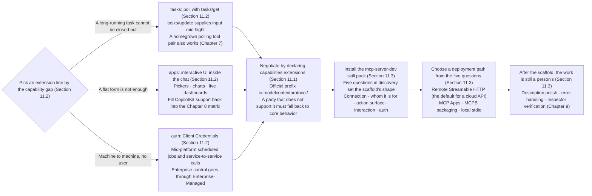

# Chapter 11 Agent Skills and the Extension Ecosystem

> Chapter guide: the core protocol (Chapter 2) is kept lean on purpose. What "must be implemented" is only three layers: the base protocol, version compatibility, and message patterns. Where do capabilities such as Tasks, in-chat UI, and enterprise authorization go? The answer is a formal **extension mechanism**: an optional feature beyond the capabilities is negotiated in as an extension. This chapter makes two things clear. What each of the four official lines of the extension ecosystem (auth / apps / tasks / skills) solves, and when to use it. And a counterintuitive new trend: **use Agent Skills (domain-knowledge packs for an AI coding assistant) to speed up development of the MCP Server itself**. After this chapter, you can: choose the right extension for the core protocol and negotiate it correctly; know which extension a long-running task, in-chat UI, and machine-to-machine authentication should each use; and use the official mcp-server-dev skill pack to speed up the team's Server development.



*Flowchart for this chapter*

## When you need this chapter

**A long-running task cannot be closed out.** The tool has to run for several minutes (batch reconciliation, large-file processing), and a synchronous call will time out. That is the territory of the Tasks extension (on 2026-07-28 the experimental Tasks left the core and were redesigned as an extension, Chapter 3).

**"A plain-text result" does not feel like enough.** You want a chart, a picker, and a dashboard to appear inside the Agent UI, and the flat form of elicitation cannot satisfy that. The MCP Apps extension lets the Server emit interactive UI inside the chat.

**A machine-to-machine call has no "user" who can grant authorization.** The OAuth authorization-code flow assumes a person is present to click consent. A scheduled job and a service-to-service call need client credentials, or centralized control by the enterprise. The auth extension family covers that.

**You want an AI coding assistant to help you write the Server.** Agent Skills encode the design decisions of MCP development (the deployment model, the tool pattern, the authentication choice) into a knowledge pack the assistant can read. It interrogates your use case first, and then it generates the scaffold.

## 11.1 Overview: how the extension mechanism works

Putting an optional capability into an extension, rather than stuffing it into the core, is a common way for a protocol to keep the pace of its evolution: the core layer stays small and stable, and every implementation can keep up; an innovative feature goes out first as an extension, and is considered for adoption into the core once the conditions for maturity are in place. An MCP extension joins at the **capability negotiation** stage (the extension framework entered the protocol in the 2025-11-25 version, Chapter 3): the two sides declare extensions to each other in the `capabilities.extensions` field. The extension identifier has the form `{vendor-prefix}/{extension-name}`, and the rules are the same as for an `_meta` key. An official extension uses the `io.modelcontextprotocol/` prefix. A third party **must** use a reverse domain name it owns (such as `com.example/my-extension`), to prevent a collision. This is similar to Java package naming.

```json
{ "capabilities": {
    "tools": {},
    "extensions": { "io.modelcontextprotocol/tasks": {} } } }
```

One negotiation rule to remember: when one side supports an extension and the other does not, the side that supports it **must** fall back to core-protocol behavior, or reject the request with an explicit error. The extension's document should state its own fallback behavior. The "optionality" of an extension is a contract at the protocol level, not a verbal agreement.

## 11.2 The four official extension lines

### Tasks (`io.modelcontextprotocol/tasks`, ext-tasks)

An asynchronous long-running task: "call-now, fetch-later". Picture a batch-reconciliation tool. After the request goes out it has to run for five minutes. Waiting synchronously is bound to time out, and the model's turns cannot afford that either. The shape of Tasks is this: the Server returns a task handle at once, the client polls progress with `tasks/get`, and along the way it can supply more input through `tasks/update`. The main points of the 2026-07-28 redesign (SEP-2663): the blocking method `tasks/result` became **polling** with `tasks/get`; `tasks/update` was added so the client can supply input while the task is executing; `tasks/list` was removed; the Server may return a task handle on its own, without a request. It fits batch operations, a long-running report, and any action that is "start it, then wait". A lightweight alternative: a tool pair you build yourself, "submit a task → poll the status" (the choice of our running example in Chapter 7. The protocol surface is thinner, and the cost is that there is no standardized mid-flight input).

### Apps (`io.modelcontextprotocol/apps`, ext-apps)

MCP Apps lets the Server render interactive UI **inside the chat surface**: a searchable picker, a chart, a live dashboard, a video player. Its place: when the flat form of elicitation is not enough (the original wording of the build-with-agent-skills tutorial), Apps takes over. Typical scenarios: let the user pick a product from a searchable list, instead of typing an SKU by hand into a flat form; render a refund-progress dashboard directly in the conversation. From the integration point of view, how far a frontend Host such as CopilotKit supports it is a new dimension for judging the frontend integration surface (check it together when the ⚠️ cells of the Chapter 8 matrix are filled back in).

### Auth (the `io.modelcontextprotocol/auth` family, ext-auth)

The core specification (Chapter 10) covers the OAuth authorization-code flow "with a person present". The auth extensions fill two enterprise scenarios: **OAuth Client Credentials** (machine to machine, obtaining a token with no user taking part) and **Enterprise-Managed Authorization** (a framework in which the enterprise controls authorization centrally). A mid-platform's scheduled jobs and service-to-service calls take the former. The scenario "every tool call has to pass the enterprise permission hub" looks to the latter.

### Skills (`io.modelcontextprotocol/skills`, ext-skills, SEP-2640 already Final)

It carries **Agent Skills** (see the next section) onto MCP: a Server **discovers and reads** Agent Skills through the protocol. It joins two worlds. A skill, as a portable instruction set, can be distributed by a Server and consumed by any Agent that implements the standard.

## 11.3 Agent Skills: use a knowledge pack to speed up Server development

"Skills" in the other direction: a portable instruction set **for an AI coding assistant** (the open format at agentskills.io, `SKILL.md` plus supporting material under `references/`), which teaches the assistant the decision knowledge of a domain. Its value is making "the design decisions in a veteran's head" explicit. An engineer who has never written an MCP Server, once equipped with the skill pack, is asked the right questions first and then receives a scaffold whose structure is sound. The official side provides a reference skill pack for MCP development, **`mcp-server-dev`**. The three skills combine with one another:

| Skill | Responsibility |
|------|------|
| `build-mcp-server` | The entry: interrogate the use case → choose a deployment model and a tool-design pattern → route to a specialized skill |
| `build-mcp-app` | Add interactive in-chat UI (forms, pickers, dashboards). It connects to the Apps extension |
| `build-mcpb` | Package a local stdio Server together with its runtime as `.mcpb`, so the user does not have to install Node or Python |

Installation (Claude Code Example): `/plugin marketplace add anthropics/claude-plugins-official` → `/plugin install mcp-server-dev`. Any other Agent only has to clone the skill directory into its own skills location. The format is open, and it does not lock you in.

Once a skill fires, it first runs a **discovery phase**. Five questions decide the shape of the scaffold: what it connects to (a cloud API / a local process / the filesystem / hardware), whom it is for (yourself / a team / the public), how large the action surface is (a few operations, or wrapping one large API), what interaction it needs (plain text / elicitation / rich UI), and how upstream authentication works (an API key / OAuth / none). It then recommends one of four deployment paths: **Remote Streamable HTTP** (the default for wrapping a cloud API: zero install friction, one deployment serves every user, and an OAuth redirect is available), **MCP Apps** (when in-chat UI is needed), **MCPB packaging** (when it must touch the user's own machine: a local file, a desktop application, a localhost service), and **local stdio** (a prototype, with the path for upgrading to MCPB written down).

What this means for a team: this skill pack automates the first half of the manual flow in Chapters 4-5 (choose → scaffold → polish the description → test). The iteration after the scaffold is generated, the tool description, the error handling, and Inspector verification (Chapter 9), is still a person's work, and that is where the quality sits.

## 11.4 Publishing and discovery

The last mile after a Server is finished: publish it to the **MCP Registry** so it can be discovered (registry/quickstart). A mid-platform scenario (a domain Server you build yourself, consumed on the internal network) usually does not need the public Registry, but the governance act "a domain Server must be entered in the directory when it goes live" (Section 7.6) has the same shape. The entry that is registered, the owner, and the status follow the same logic inside and outside.

## 11.5 Chapter summary

1. **The extension mechanism**: negotiate through capabilities.extensions. An ID carries a mandatory prefix. Falling back to core behavior when a party does not support the extension is a contract at the protocol level.
2. **The four official families**: tasks (an asynchronous long-running task, polling plus mid-flight input), apps (in-chat UI), auth (M2M and enterprise control), skills (discovering Agent Skills through MCP).
3. **Tasks is no longer core**: on 2026-07-28 it moved out as an extension and was redesigned. Use the extension, or build a lightweight polling tool pair yourself, and choose by the protocol surface.
4. **Agent Skills have value in both directions**: distributed as an MCP extension (ext-skills); and, as a development knowledge pack, speeding up the building of a Server (the three skills of mcp-server-dev: five questions in the discovery phase → four deployment paths).
5. **After the scaffold, the work is still a person's**: description polish, error handling, Inspector verification.

→ **Chapter 12** steps outside the technology: organization and roadmap.

## Acceptance checklist

By the time you have read this far, you should be able to:

- ☐ Explain the negotiation mechanism for an extension and the identifier naming rules, and pick a third-party prefix for your team.
- ☐ For "a batch task of more than three minutes", choose between the Tasks extension and a homegrown polling tool, and give the reason.
- ☐ Judge whether a requirement should go through Apps (in-chat UI) or elicitation (a flat form).
- ☐ For a service-to-service call with no user taking part, choose the matching mechanism in the auth extensions.
- ☐ Install the mcp-server-dev skill pack and use it to generate a Server scaffold.
- ☐ State the conditions each of the four deployment paths fits.

## Quick reference

| Item | Value |
|----|----|
| Extension negotiation | `capabilities.extensions`, ID = `{vendor-prefix}/{name}` |
| Official prefix | `io.modelcontextprotocol/` |
| Tasks extension | `io.modelcontextprotocol/tasks` (SEP-2663; tasks/get polling + tasks/update) |
| Apps | `io.modelcontextprotocol/apps` (ext-apps; in-chat UI) |
| Auth extensions | ext-auth (Client Credentials / Enterprise-Managed) |
| Skills extension | `io.modelcontextprotocol/skills` (SEP-2640 Final, ext-skills) |
| Development skill pack | `mcp-server-dev` (build-mcp-server / build-mcp-app / build-mcpb) |
| Packaging format | MCPB (a `.mcpb` archive, including the runtime) |

## Further reading

- **Chapter 3 (version evolution)**. The whole course of Tasks from a core experiment to an extension, and the introduction of the extensions negotiation field.
- **Chapter 8 (building a Client)**. How far a consumer supports an extension is a new dimension when the matrix is filled back in.
- **Chapter 9 (debugging and the Inspector)**. The Inspector's Apps page is the debugging entrance for an extension capability.
- **The official extensions overview and the documents for each family**. The source material for this chapter. The apps quick start and the skills specification (SEP-2640) are on the review checklist.

## Review checklist (before publication)

- [ ] Read the extensions/apps quick start straight through, and add one verified hands-on example of in-chat UI
- [ ] Read the extensions/skills specification (SEP-2640) straight through, and add a section for the discover-and-read flow
- [ ] Fill in the details of the two ext-auth extensions (the client credentials flow, the enterprise-control framework) against the original text
- [ ] Actually install the mcp-server-dev skill pack, and run the discovery phase once on our running example
