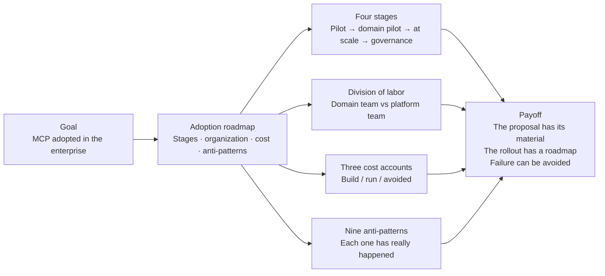

# Chapter 12 An Enterprise Adoption Roadmap

> Chapter guide: the technical chapters (Chapters 2-10) answer "how to build it". This chapter answers "how to walk it": organization, pace, cost, and the ways it fails. It is written for you, when you have to propose the project to management. Each stage of the four-stage roadmap has an exit criterion, one table fixes the division of labor, the three cost accounts give a structure and not hollow numbers, and each of the nine anti-patterns has really happened. After this chapter, you can: write, for the team, the project-proposal material for adopting MCP; design the responsibility boundary between the mid-platform team and the business teams; and use the decision tree to judge which step to take now.



*Overview diagram for this chapter*

## When you need this chapter

**You have to propose a project.** Read Section 12.1 (four stages; the output of the Pilot is evidence) and Section 12.3 (the three cost accounts; the structure of the proposal material).

**You have to draw the team boundary.** The one table in Section 12.2: description quality belongs to the domain team, and the standards and the metrics belong to the platform team.

**You are reviewing someone else's MCP proposal.** Check it item by item against the nine anti-patterns in Section 12.5. A hit is a red flag.

A note on this chapter: the roadmap framework is our recommendation (it combines the technical conclusions of the first ten chapters with mid-platform engineering common sense). An external case that is cited is marked with its source. Numerical content gives an estimation framework and does not give an absolute value.

## 12.1 The four-stage roadmap

```
Pilot ──▶ Domain pilot ──▶ Gateway at scale ──▶ Steady-state governance
(4-6 weeks)   (1-2 quarters)   (domain by domain)     (made routine)
```

| Stage | Goal | Scope | Exit criteria |
| --- | --- | --- | --- |
| **Pilot** | Verify the value of "wrap once, call everywhere" | 3-5 high-frequency scenario tools, a single consumer (such as agentscope-java) | A real scenario runs end to end. The hit rate / failure rate meet the bar (the metrics in Chapter 6). There is a business payoff that can be shown |
| **Domain pilot** | Verify that the method can be replicated | One complete business domain (the after-sales domain of our running example: 20 interfaces → 6 tools) | The full walkthrough of Chapter 7 is kept on file. ≥2 heterogeneous consumers (Chapter 8). A second team replicates it independently from the documentation and succeeds |
| **Gateway at scale** | Multiple domains come on | The Gateway goes live, advanced domain by domain (each domain walks the domain pilot once) | The time to bring a domain on falls steadily. Tenant isolation and audit pass the security review (Chapter 10) |
| **Steady-state governance** | It does not degrade | The four-piece directory set (Chapter 7) is made routine | A monthly report of the tool metrics. Change review has been walked through. The retirement mechanism has actually been carried out |

Why can the Pilot not be skipped? Because what an organization believes is the evidence, and an architecture diagram does not carry that belief. The most common failure is **skipping the Pilot and rolling out directly**: with no credible evidence of payoff, scaling becomes "proving the failure at a larger scale". The spend doubles, and the doubt doubles with it.

## 12.2 Organizational division of labor: who owns what

For a mid-platform scenario, fix the responsibility boundary in one table:

| Asset | Owner | Responsibility |
| --- | --- | --- |
| The domain Server (code) | The business-domain team | Tool implementation, description quality (the standard in Chapter 6), and aggregating the interfaces that belong to the domain |
| A tool-directory entry | The business-domain team | The directory information is accurate, and a change goes through review |
| The Gateway and tenant policy | The platform team | Authentication, routing, rate limiting, audit, and converging legacy compatibility |
| The consumer (Host) | Each Agent project team | Tool-visibility filtering, joint-debugging verification, and (on the frontend-framework side) → the copilotkit book |
| The cadence of MCP version upgrades | Led by the platform team | Maintaining the compatibility matrix in Chapter 3, and the window for a major SDK upgrade |

The key design: **responsibility for description quality sits with the domain team, and it does not sit with the platform team**. The platform team cannot govern "what the format of an after-sales ticket number is". That is domain knowledge. The platform team's levers are the standard (the review standard in Chapter 6) and the metrics (the three metrics in Chapter 6): the domain team builds to the standard, the platform team checks with the metrics, and the boundary holds.

## 12.3 The cost model: three accounts when you propose the project

An absolute value is meaningless (it floats with scale and with the model price). Give the structure:

1. **Build cost** (one-time): standing up the pipeline (Section 7.3) + a single-domain walkthrough (an aggregation review + description polish). Description polish is the main labor item. Estimate it as "0.5-1 person-day per tool". A domain of 20 interfaces → 6 tools is ≈ 3-6 person-days + the Server skeleton.
2. **Run cost** (ongoing): tokens (the fixed overhead of the tool directory entering the context + the round trip of a call), Server resources (very flat once it is stateless), and Gateway resources. **Tool count is a first-order term of token cost**. That is the economic reason Chapter 7 pushes the tool count down.
3. **Avoided cost** (the benefit side): the repeated wrapping that each new Agent project is spared (in mid-platform terms: the adaptation workload of N projects × M interfaces); the cost of a production incident caused by a description bug.

In the proposal material, book "avoided cost" against a real project already during the Pilot stage. That is why the four-stage roadmap exists.

## 12.4 Fitting into the existing governance system

MCP is not new territory. It is a new consumer of mid-platform interfaces. Line it up item by item:

- **API gateway**: whether the MCP Gateway and the API gateway relate as "upstream/downstream" or as "two combined into one" is decided by the gateway capabilities the team already has (multi-tenancy, audit). Do not build a second one
- **Rate limits and quotas**: tenant × `Mcp-Name` (a standard protocol header, Chapter 10) plugs into the existing quota system
- **The release process**: a tool change (description/schema) joins the existing change review. The OpenAPI diff (Section 7.3) is attached to the change ticket
- **Protocol lifecycle alignment**: the MCP specification has a formal feature lifecycle policy (Active/Deprecated/Removed, a deprecation window of at least 12 months, Chapter 3). The deprecation status of the tool directory lines up with it, and the window for a major SDK upgrade is planned in one place by the platform team
- **Security compliance**: treat a domain Server as an ordinary internal service and pass it through security review. Introducing a third-party MCP Server goes through supply-chain review (Chapter 10)
- **Observability**: a trace (the W3C Trace Context reserved keys on `_meta`, built into the protocol) and the audit enter the existing system. LLM-side evaluation → the langfuse book

## 12.5 The anti-pattern list (every one of them has really happened)

1. **Expose the full set**: the interface count = the tool count. The outcome: selection accuracy collapses, the context explodes, and nobody maintains them (the opening of Chapter 7)
2. **One interface, one tool**: REST resource semantics are taken directly as task semantics, and the model, between "the validate interface" and "the create interface", does the orchestration that only a mid-platform engineer should do
3. **No polish after the description is auto-generated**: the schema is correct, and the model does not use the tool. Generation is the starting point, and it is not the finish
4. **No version strategy**: a description is edited offhand, and the model behavior of every consumer jitters along with it. A breaking change rewrites the tool name in place
5. **Skipping the Pilot** (Section 12.1)
6. **Authorization left until later**: "get it running first, then add authorization". A tool is an action in the real world. The moment demo data is connected to production, it is an incident
7. **The platform team takes everything on**: domain knowledge is not in the platform's hands, so description quality is bound to be mediocre (Section 12.2)
8. **Building a new integration on a feature that is already deprecated**: from 2026-07-28 on, Sampling/Roots/Logging/DCR are all on the deprecation list (Chapter 3). New code that touches them signs a rework order due inside 12 months
9. **Building yourself a capability the protocol already has**: directory caching (the protocol has ttlMs/cacheScope), subscription notifications (subscriptions/listen), parameter routing (x-mcp-header). Check the spec before you build the wheel again (the protocol foundation in Chapter 7)

What the nine have in common: each one looked like a shortcut at the time. When you review someone else's proposal, compare them item by item, and a hit is a red flag. When you plan your own proposal, check them item by item against yourself, and a hit is advance notice of rework.

## 12.6 A one-page decision tree

```
Is there a stable Agent consumption scenario?
├─ No → Stand up a Pilot first (3-5 tools, a single consumer), and re-evaluate after 4-6 weeks
└─ Yes → Do the mid-platform interfaces have OpenAPI assets?
        ├─ No → Fill in the interface docs first (the premise of the pipeline)
        └─ Yes → A single-domain walkthrough (the method in Chapter 7)
                ├─ Do the metrics meet the bar?──No──▶ Back to description polish / aggregation review
                └─ Yes ─▶ Two-consumer verification (Chapter 8)
                        ├─ Does it pass?──No──▶ Check the matrix / transport / version
                        └─ Yes ─▶ Gateway takes it under management → copy domain by domain → steady-state governance
```

## 12.7 Summary

- Four stages: every stage has an exit criterion, and the output of the Pilot is **evidence**, not code
- Description quality belongs to the domain team, and the standards and the metrics belong to the platform team
- Three cost accounts: build, run, and avoided. Tool count is a first-order term of token cost
- MCP joins the existing governance, and it does not set up a separate operation
- Nine anti-patterns, and each one is the trap at the end of a shortcut

→ The technology and the roadmap are complete here. Return to the account that opens Chapter 1: three projects, three sets of authentication, three copies of the parameter documentation. Having read this book, you should already be able to give your own plan for converging them.

## Acceptance checklist

By the time you have read this far, you should be able to:

- ☐ State the exit criterion of each of the four stages, and explain why the Pilot cannot be skipped.
- ☐ Use one table to draw the line between the assets and the responsibilities of the domain team and the platform team.
- ☐ Build, for the proposal material, the structure of the three cost accounts (give the framework, and give no absolute value).
- ☐ Name at least five anti-patterns and the correct practice that matches each.
- ☐ Use the one-page decision tree to judge the stage the team is in now, and the next step.

## Quick reference

| Item | Value |
|----|----|
| Four stages | Pilot (3-5 tools, 4-6 weeks) → domain pilot (1-2 quarters) → gateway at scale → steady-state governance |
| Organization | Description quality = the domain team; standards and metrics = the platform team; Gateway = the platform team |
| Three cost accounts | Build (pipeline + polish) / run (tokens + resources) / avoided (the repeated wrapping that is spared) |
| Governance alignment | The protocol lifecycle (a 12-month deprecation window) / change review / OpenAPI diff |
| Decision tree | A scenario? → OpenAPI? → a single-domain walkthrough → two-consumer verification → Gateway → copy |

## Further reading

- **Chapter 7 (at scale)**. The full method for the "domain pilot" stage of this chapter.
- **Chapter 10 (deployment and security)**. The full line of defense for the "authorization left until later" anti-pattern.
- **Chapter 3 (version evolution)**. The constraint the lifecycle policy places on the governance cadence.
- **Official tutorials and cases**. The original source of an external case that is cited (see the note in each section).

## Review checklist (before publication)

- [ ] Verify the citations and the data for the external cases (the GitHub MCP Server, hosted gateway products), and mark the source and the date
- [ ] Calibrate the cost-estimation framework once against a real project of the team
- [ ] Collect additions to the anti-pattern list from the team (real pitfalls first)
