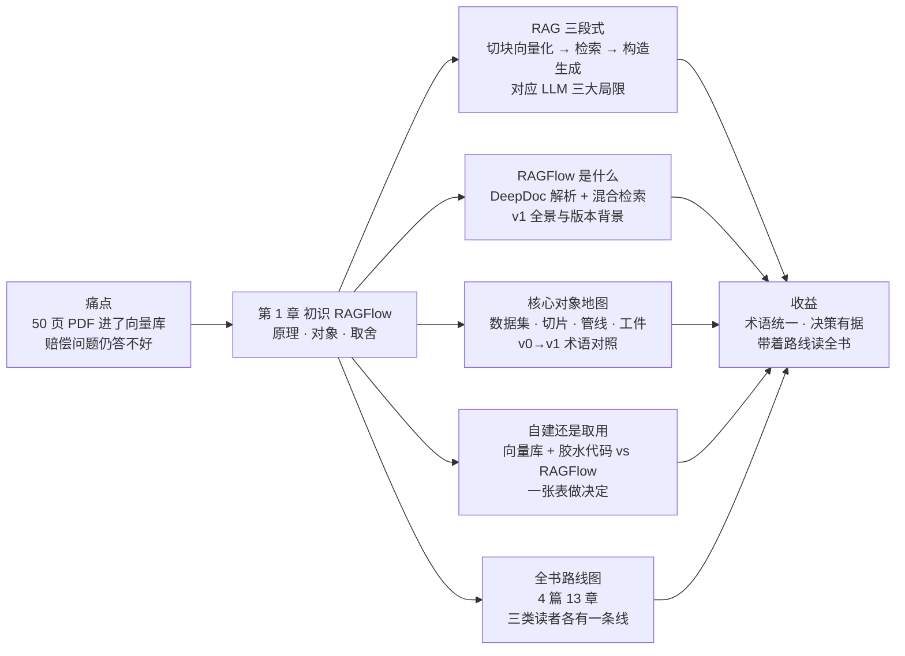
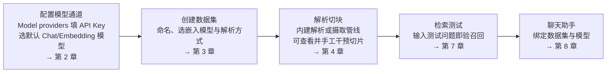

# 第 1 章 初识 RAGFlow

> 本章导读：跨境电商客服团队把 50 页的《售后政策手册》（after-sales-policy.pdf）整本灌进了向量数据库。客服问「运输破损的赔偿标准是多少」，返回的是三段毫不相干的物流文字；换成商品编码查「哪个仓发哪些型号」，精确匹配也时灵时不灵。问题不在向量库——在于整条链路跳过了 RAG 最难的两步：解析与切片。本章建立全书的认知地基：检索增强生成（RAG）的三段式如何工作，LLM 的三大局限分别被哪一段缓解；RAGFlow 作为开源 RAG 引擎，用什么补齐「向量库 + 胶水代码」做不到的事；全书的术语与核心对象地图；以及自建与取用之间怎么选。读完本章，你能：用三段式向同事讲清 RAG；带着统一的术语读懂后续十二章；为自己的场景做出取舍，并圈出属于自己的阅读路线。



*本章导览图*

## 你什么时候需要它

三种典型处境，对应本章三种用法。

**手里一堆混合格式的文档，要变成能问答的知识库，不知从何下手**——读 1.1 与 1.2。先明白 RAG 难在哪一段，再看 RAGFlow 把哪些段做成了产品，后面的技术章才有靶子。

**团队在「自建 RAG 还是用现成引擎」之间摇摆**——直接看 1.4 的对比表与两份判断清单。这是决策章，不是布道章：有些场景自建仍然是对的。

**已经决定用 RAGFlow，却被 v0/v1 文档的术语差异绕晕**（上一份教程叫知识库，这一份叫数据集）——看 1.3 的术语对照表，再按 1.5 圈出自己的阅读路线。

## 1.1 概述：从凭记忆到有据可查

大语言模型（Large Language Model，LLM）处理通用知识的能力令人惊叹，但问题一旦落到企业内部文档、私有知识库或实时数据上，三大局限就暴露出来：

| 局限 | 表现 | RAG 的对策 |
|------|------|-----------|
| 静态知识（Static Knowledge） | 知识停留在训练时的数据快照，无法自动更新 | 检索段实时从外部知识库取最新内容 |
| 私有数据盲区 | 访问不了企业私有文档、实时信息流与领域内容 | 私有数据进入知识库，成为可检索的资产 |
| 幻觉（Hallucination） | 缺乏依据时，仍会编造听似合理的错误答案以维持流畅 | 检索结果作为事实依据进入上下文，答案可溯源 |

检索增强生成（Retrieval-Augmented Generation，RAG）为的正是这件事：**在 LLM 生成答案之前，先从外部知识库检索最相关的上下文作为「参考资料」，再引导模型据此作答**——把 LLM 从「凭记忆说话」升级为「有据可查」。官方文档对 RAG 本质的另一句概括值得记住：RAG 的核心是 Retrieval 而非 Generation——生成端人人都有，检索质量才是分水岭。

RAG 的工作流分三段：

1. **数据处理与向量化**：知识来自各种格式的非结构化数据（文档、数据库记录、API 返回），先切块（Chunk），再经嵌入（Embedding）模型转成向量，存入向量数据库；
2. **检索**：用户查询同样转成向量，在向量库中做语义相似检索，召回最相关的文本片段；
3. **上下文构造与生成**：召回内容作为事实依据拼进 LLM 上下文，由模型组织出最终答案。

### 为什么 50 页 PDF 直接进向量库不行

回看贯穿案例：50 页《售后政策手册》整本向量化，效果差不是玄学，官方文档给了三条机制解释——

- **语义「平均化」**：长文档压成一个向量，细节被抹平。「运输破损赔 30%」和「清关延误不赔」融成一团模糊的「售后政策」；
- **上下文窗口有限**：LLM 的输入有长度上限，本来就必须只喂最相关的片段；
- **成本与效率**：长文本的嵌入计算与检索开销都更高。

所以必须切片，而切片立刻撞上一个内在矛盾：**语义匹配要求切片小而聚焦，上下文理解又要求切片大而完整**——系统被迫在「精确但破碎」与「完整但模糊」之间权衡。再叠一层：企业知识多是含表格、图表、公式的多模态文档，简单 OCR 会丢掉大量语义信息（赔偿标准表被展平成乱码文字）；而商品编码、法规编号这类精确匹配，纯向量检索天然不擅长。官方文档的结论，就是本章标题的反面论证：

```text
❌ 省事路线：整本 PDF → 向量库 → 检索
   长文档语义平均化 · 表格结构丢失 · 精确编号召回不稳定

✅ 正路：DeepDoc 解析（表格保留行列结构）→ 按标题层级切片
   → 向量 + 全文混合检索 → 重排 → 上下文构造 → 生成
```

**解析与切片才是 RAG 的主战场**——这句话是全书的出发点，第 4 章与第 5 章都在回答它。

### RAG 与 Agent：同源不同流

补一组容易混淆的概念。在 Agent 框架下，RAG 与记忆（Memory）的技术底座高度一致——都是「按当前需要从存储中检索相关信息」——差别在数据来源：**RAG 面向事先准备好的既有知识**（文档、数据库），**Memory 面向交互中实时产生的动态数据**（会话历史、工具执行结果）。一个完整的 Agent 系统往往两者兼备。这个区分在第 10 章会再次出现：RAGFlow 的画布 Agent 同时接入两者。

官方文档还指出了 RAG 的演进方向，三个信号与本书后半程直接相关：

| 演进方向 | 含义 | 对应本书 |
|----------|------|---------|
| RAG 是 Agent 的数据基础 | Agent 要自主可靠地决策，必须依赖标准化接入私域知识的能力 | 第 10 章、第 11 章 |
| 用 LLM 优化检索本身 | 查询改写、结果融合、智能路由——让检索的每个环节被推理增强 | 第 8 章（Agentic 模式）、第 7 章 |
| 走向上下文工程 2.0 | 当下的 RAG 可视为上下文工程（Context Engineering）1.0；下一步是为 Agent 动态组装文档、记忆、工具、环境信息的综合上下文 | 第 6 章（知识工件）、第 10 章 |

也就是说，RAG 正在从「提升问答质量的技术」演化为「可信智能应用的基础设施」——这也是本书把 Agent 与集成单独成篇的原因。

## 1.2 RAGFlow 是什么

官方定义一句话：RAGFlow 是一个**基于深度文档理解的开源 RAG 引擎**，与 LLM 配合，对各种复杂格式的数据提供有据可依、带引用的问答能力（quickstart 原文，v1.0.0-rc2）。这个定义里有两个词值得圈出来：

- **深度文档理解**——指 DeepDoc：把 OCR、表格结构识别（TSR）与版面分析（DLR）组合起来，把 PDF、扫描件这类复杂文档「翻译」成保留结构与语义的文本，供后续切块与检索使用。1.1 里「赔偿标准表格被展平」的问题，交给的就是它；
- **引擎而非玩具**——检索层是复合系统：向量检索管语义广度，全文检索（BM25）管关键词精度，两者经 RRF 融合，再加重排（Rerank）与元数据过滤。纯向量库做不到的事，这里是一等公民。

v1 的产品形态全景，一句话带过：**数据集（Dataset）承载知识，摄取管线（Ingestion Pipeline）编排解析流程，知识编译产出 Wiki、图谱等知识工件（Artifact），聊天助手与搜索应用直接面向问答，画布 Agent 编排复杂任务流，HTTP API 与 MCP Server 把知识能力暴露给外部系统**——知识经 MCP 被平台侧 Agent 消费（见第 11 章）（→ mcp 书）。每个对象在 1.3 都有一行注解。

**版本背景 v0→v1**（版本事实出自官方 release_notes，核实日期 2026-10-27）：v1.0.0-rc1（2026-09-29 发布）以 Go 全面重写，从重量级部署转为轻量架构——消息队列由 Redis 迁至 NATS，缓存与检查点统一到 Kvrocks；v1.0.0-rc2（2026-10-16 发布，本书版本基线）为聊天引入 Agentic 模式，取代原 Low/Medium/High/Ultra 思考档位，并将内建文档解析器与 Pipeline 解析器统一，另支持 Team/Me 共享与 arm64 镜像。两代之间数据升级自 v0.27.2 起、不可逆——升级与迁移的完整清单见第 12 章，本书所有叙述均以 v1.0.0-rc2 文档为准。

全景太抽象的话，看 quickstart 给出的最小主线——五个动作走完，就有了一个能答题的知识应用：



*RAGFlow 最小主线：从模型配置到问答应用（据 quickstart，v1.0.0-rc2）*

这条线上埋着全书第一个容易踩的坑：**嵌入模型要在解析前选定**——数据集已有切片后再换模型，要通过对现有向量抽样的兼容性检查（维度一致且平均余弦相似度不低于 0.9）才允许保存，且不会自动重嵌入旧切片。细节在第 3 章展开。

## 1.3 核心对象地图

v1 改名最多的一处：**v0 文档里的知识库（Knowledge Base），在 v1 叫数据集（Dataset）**——本书统一用后者，叙述性场景偶尔用「知识库」泛指。下面两张表是全书的词汇表与地图：第一张解决「同一个东西两个名字」，第二张解决「每个对象在哪一章展开」。

**表一：术语与 v0→v1 对照**

| 本书用语 | 英文 | 旧称 / 变迁 | 一句话定义 |
|----------|------|------------|-----------|
| 数据集 | Dataset | v0 称知识库（Knowledge Base） | 组织与管理知识的基本单位，可含多个文档 |
| 切片 | Chunk | — | 文档解析切分后的基本知识单元，索引、检索与引用的主对象 |
| 摄取管线 | Ingestion Pipeline | — | 定义文档进入数据集后的处理流程（解析、加工、切块） |
| 知识编译 | Knowledge Compilation | v0.27.0 起重构，取代独立的 GraphRAG 与 RAPTOR 入口 | 对单个文档或整个数据集再加工，产出知识工件 |
| 知识工件 | Knowledge Artifact | — | 知识编译的产物：Wiki、Graph、Tree、PageIndex、Mind Map、Timeline、Skills |
| 检索测试 | Retrieval Testing | — | 输入测试查询，检查召回切片，据此调整检索配置 |
| 聊天助手 | Chat Assistant（界面原文 Chat） | — | 基于一个或多个数据集的问答应用 |
| Agentic 模式 | Agentic | v1.0.0-rc2 取代 Low/Medium/High/Ultra 思考档位 | 由检索 Agent 深度查证后再作答；朴素（Naive）模式则做一次式检索 |

**表二：对象—职责—所在章节**

| 对象 | 一句话职责 | 所在章节 |
|------|-----------|---------|
| 数据集（Dataset） | 承载文档与切片，是一切检索与问答的知识载体 | 第 3 章 |
| 切片（Chunk） | 最小检索单元；解析质量最终都落到切片质量上 | 第 4 章 |
| 摄取管线（Ingestion Pipeline） | 以画布方式编排解析、加工、切块、索引 | 第 4 章、第 10 章 |
| 知识工件（Artifact） | 把既有知识重组为 Wiki、图谱、导航等加工产物 | 第 6 章 |
| 检索测试（Retrieval Testing） | 调优与巡检的日常工具：即问即验召回效果 | 第 7 章 |
| 聊天助手（Chat Assistant） | 面向终端用户的问答入口，配置 Prompt 与检索参数 | 第 8 章 |
| 搜索应用（Search） | 偏检索与结果展示的知识应用，与 Chat 互补 | 第 9 章 |
| 画布 Agent（Agent） | 可视化编排检索、模型、逻辑、工具的任务处理流 | 第 10 章 |
| HTTP API 与 MCP Server | 把知识能力暴露给外部应用与平台侧 Agent | 第 11 章 |

读后续章节时遇到术语疑义，回到这两张表；表内定义均出自官方 Glossary（核实日期 2026-10-27）。

## 1.4 与自建 RAG 的取舍

先立一个官方文档的立场：**向量数据库不等于 RAG 系统**。向量库擅长语义相似检索，但 RAG 要的是「精确且可靠的答案」，检索层需要的是复合能力——混合检索保证语义广度与关键词精度兼得，元数据过滤（按日期、部门、类型筛选）是业务刚需，重排让最相关的内容排到前面。自建路线里，这些都要靠胶水代码逐个拼装。

| 维度 | 自建：向量库 + 胶水代码 | RAGFlow |
|------|----------------------|---------|
| 文档解析 | 自拼 OCR、表格识别、格式转换，每种格式一条分支 | DeepDoc 内建（OCR/TSR/DLR），PDF、DOCX、XLSX、图片、幻灯片开箱支持 |
| 检索层 | 向量检索起步，BM25、RRF、重排、元数据过滤逐个自搭 | 向量 + 全文混合检索、RRF 融合、重排、元数据过滤内建 |
| 切片治理 | 无界面，靠脚本与日志，切片质量是黑盒 | 切片可见、可改、可加关键词，解析日志可查 |
| 检索验证 | 自建评测脚本 | 检索测试界面即问即验 |
| 应用层 | 问答 UI、会话、渠道接入全部自研 | 聊天助手、搜索、画布 Agent、API/MCP 开箱即用 |
| 定制自由度 | 完全可控，检索链路每一环可替换 | 管线内可编排，是框架边界内的自由 |
| 起步面 | 一个向量库即可起步 | 一整套服务；官方建议配置 4 核 CPU、16 GB 内存、50 GB 磁盘起 |

上表容易读漏的是自建路线的**隐形成本**：格式分支的长期维护、切片质量的观测手段、检索效果的评测脚本，每一项都是持续投入而非一次性开发——「向量库开源免费」不等于「RAG 便宜」。

### 何时自建仍然合理

本书立场，三条占其一就该认真考虑自建：**深度定制检索链路**（自研排序模型、特殊索引结构、检索与业务逻辑深度耦合）；**已有平台基建**（pgvector/Milvus 已在生产环境，团队具备 RAG 研发与运维人力）；**合规要求**每个环节完全自持。自建路线的工程细节——向量库选型、检索链路组装、Agent 侧消费——不在本书展开（→ agentscope-java 书）。

### 何时 RAGFlow 更快

本书立场，同样三条：主要矛盾是「一堆混合格式文档 → 可问答的知识库」，而**解析是难点**（表格、扫描件、Excel 混着来）；需要**运营界面**——切片要能看能改，检索效果要能验证，文档更新要有流程，而不是每次都改代码；想要**开箱即用的应用层与集成面**——聊天助手、画布 Agent、HTTP API/MCP 直接可用（见第 11 章）。贯穿案例属于后一类：客服知识底座的核心诉求是文档到问答的转化效率，不是检索算法本身。

两条路不互斥：即使选择自建，本章的认知（切块权衡、混合检索、解析质量）同样通用——RAGFlow 只是把这些环节产品化了。

## 1.5 全书路线图

全书 13 章，按本书的划分归入 4 篇：

| 篇 | 章 | 内容一句话 |
|----|-----|-----------|
| 入门篇 | 1 初识 RAGFlow | 本章：RAG 为什么、RAGFlow 是什么、取舍 |
| | 2 部署与模型通道 | Docker 部署、配置体系、模型接入、首条链路验证 |
| 建库篇 | 3 数据集：知识库的载体 | 创建与权限、文件管理、数据源接入与同步、元数据 |
| | 4 解析与切片：从文档到 Chunk | 内建解析方法选型、Chunker 参数、表格列角色 |
| | 5 检索增强与索引 | Extractor 四件套、索引策略、子切片 |
| | 6 知识编译与知识工件 | Wiki/导航/图谱生成、模板与专属配置 |
| 应用篇 | 7 检索测试与调优 | Retrieval Testing、混合检索权重、检索质量定位法 |
| | 8 聊天助手与会话 | 配置、Agentic 模式、Prompt 与参数、会话管理 |
| | 9 搜索应用与接入渠道 | Search 应用、Chat Channel、网页嵌入 |
| 进阶与运营篇 | 10 Agent 与工作流 | 画布与组件族、Memory 接入、客服 Agent 实例 |
| | 11 对外集成：API 与 MCP | HTTP/Python API 全景、API Key、RAGFlow 作为 MCP Server |
| | 12 生产运维 | 监控与 tracing（→ langfuse 书）、备份恢复、v0→v1 升级 |
| | 13 团队协作与知识库运营 | 权限体系、Team/Me 共享、更新流程与质量巡检 SOP |

三类读者的建议路线（按需取用，不必顺序通读）：

| 读者 | 建议路线 | 理由 |
|------|---------|------|
| 平台工程师 | 1→2→12→13 | 部署、生产运维与团队协作是主线，建库与应用各章按需查阅 |
| 知识库运营 | 3→4→5→7→13 | 从数据集到切片治理再到检索调优，第 4、7 章是日常工具 |
| Agent 开发者 | 3→8→10→11 | 数据集 → 聊天助手 → 画布 Agent → API/MCP 接入 |

贯穿案例「售后知识底座」将沿这条路线逐章成长：第 2 章部署好环境，第 3 章把《售后政策手册》（after-sales-policy.pdf）、《商品 FAQ》（product-faq.xlsx）、《物流时效公告》（shipping-notice.html 与邮件归档 shipping-notice.eml）建成数据集 after-sales-kb，第 4 章调解析与切片，第 8 章配置聊天助手「售后助手」，第 10 章组装画布 Agent「售后客服 Agent」，第 11 章经 MCP 暴露给平台侧 Agent 消费（→ mcp 书）。

## 本章小结

1. **RAG 的核心是 Retrieval 而非 Generation**：三段式（切块向量化 → 检索 → 上下文构造生成）把 LLM 从「凭记忆」升级为「有据可查」，三大局限各有一段对应缓解。
2. **主战场在解析与切片**：长文档语义平均化、多模态文档信息丢失、切块的粒度矛盾、精确匹配不擅长——全发生在检索端的地基层，第 4、5 章展开。
3. **RAGFlow = DeepDoc 解析 + 混合检索 + 运营界面 + 应用层**，v1 的关键改名是知识库 → 数据集，Agentic 模式取代了四档思考档位。
4. **向量数据库不等于 RAG 系统**：深度定制、已有基建、强合规时自建仍合理；难点在解析、需要运营界面、要开箱应用层时 RAGFlow 更快。
5. **下一步**：第 2 章部署 RAGFlow 并打通模型通道，为第 3 章建 after-sales-kb 做好准备。

## 验收清单

读到这里，你应该能：

- ☐ 用三段式向同事讲清 RAG 的工作流，并说出 LLM 三大局限分别被哪一段缓解；
- ☐ 用「解析与切片才是主战场」解释 50 页 PDF 直接进向量库效果差的三条机制；
- ☐ 说出数据集、切片、摄取管线、知识工件、聊天助手五个对象的职责，并指出各自在哪一章展开；
- ☐ 举出两个售后域里纯向量检索会漏、需要全文检索补位的查询例子（如商品编码、法规编号）；
- ☐ 为自己的场景做出「自建 or RAGFlow」的选择，并给出至少两条属于本书立场清单的理由；
- ☐ 按自己的角色在路线表中圈出要读的章节，写出前三章的阅读顺序。

## 延伸阅读

- **第 2 章（部署与模型通道）**——把引擎跑起来是一切后续的前提，含首条链路验证。
- **第 4 章（解析与切片）**——本章「主战场」论断的技术展开；赔偿标准表格怎么保住行列结构，答案在那里。
- **第 7 章（检索测试与调优）**——「效果差」如何变成可定位、可修复的工程问题。
- **（→ mcp 书）**——同一售后域在两本书会合：本书把知识建成，mcp 书把知识经 MCP 交付给平台侧 Agent（见第 11 章）。
- **官方文档 What is RAG 与 Glossary**——本章素材原文（docs/basics/rag.md、docs/references/glossary.mdx），术语争议时以官方原文为准。

## 复核清单（发布前）

- [ ] 本章为认知章，无代码与界面操作可实测；1.2 的 v1 形态全景（数据集/摄取管线/知识工件/聊天助手/画布 Agent/MCP Server）待 v1.0.0-rc2 环境就绪后对照 Web UI 逐项核验
- [ ] v0→v1 版本事实（rc1 Go 重写与 NATS/Kvrocks、rc2 Agentic 模式与解析器统一、升级不可逆）已对照 release_notes.md 核实（2026-10-27），发布前重对一遍
- [ ] 4 篇划分（入门/建库/应用/进阶与运营）为本书立场的组织方式，定稿时与 README 章节规划核对一致性
