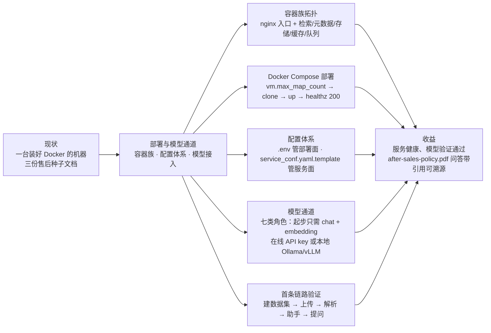
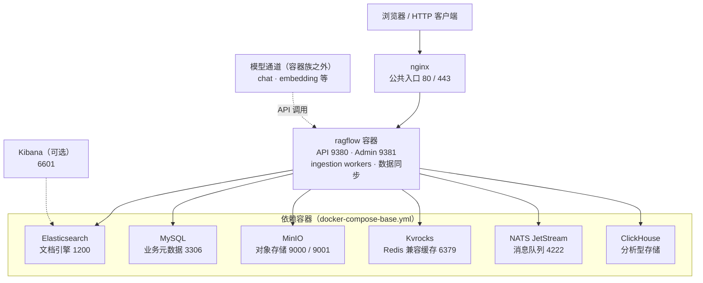

# 第 2 章 部署与模型通道

> 本章导读：第 1 章说清了「为什么是 RAGFlow」，本章回答「怎么让它跑起来」。你有一台装好 Docker 的机器，手上有售后知识底座的三份种子文档——《售后政策手册》《商品 FAQ》《物流时效公告》，目标是把 RAGFlow 部署起来、把模型接进去，为第 3 章的数据集（Dataset）建设铺好路。本章沿三条线展开：部署——容器族拓扑与 Docker Compose 五步；配置——`docker/.env` 与 `service_conf.yaml.template` 的分工；模型通道——七类模型角色中，客服场景的「检索 + 生成」起步只需要 chat 与 embedding 两类，rerank 留给第 7 章调优时再加。读完本章，你能：完成一次健康检查通过的部署；说清改配置的生效方式；接入在线或本地模型并设好默认；用《售后政策手册》走通第一条带引用的问答链路。



*本章导览图*

## 你什么时候需要它

三种典型处境，对应本章三种用法。

**第一次在本机装 RAGFlow**——按 2.2 的五步走，卡在启动或健康检查时回 2.1 看容器族地图定位是哪个组件没起来，最后用 2.5 收尾验证。

**装好了，但模型没接上或想换 Provider**——直接看 2.4。验证按钮报错九成出在 Base URL 与网络可达性：RAGFlow 跑在容器里，`localhost` 不是你的宿主机。

**要改端口、换文档引擎，或开始为上线做准备**——看 2.3 理解两份配置文件的分工与生效方式；生产化的密码治理、备份与升级管理在（见第 12 章）展开。

前置：一台满足 2.2 前置资源的机器与 Docker；第 1 章的 RAG 基本概念。本章不要求任何编程背景，全部操作都在命令行与网页界面完成。

## 2.1 概述：部署单位是容器族

先立一个认知立场：**把 RAGFlow 当作「一族协作的容器」来理解，而不是一个单体应用**。之后排障、改端口、做容量规划，靠的都是这张地图。`docker compose up` 之后你得到的不是「一个 RAGFlow」，而是一个入口、一个业务容器和六类依赖：



*RAGFlow 容器族拓扑（端口为宿主机对外端口，默认值见下表）*

组件与职责一览：

| 组件 | 职责 | 默认端口（宿主机） | `.env` 关键变量 |
|------|------|------------------|----------------|
| nginx | 公共入口，浏览器与 API 流量都从这里进 | 80 / 443 | `SVR_WEB_HTTP_PORT` / `SVR_WEB_HTTPS_PORT` |
| ragflow | API、Admin、ingestion workers、数据同步；启动脚本先跑数据库迁移 | 9380 / 9381 | `SVR_HTTP_PORT` / `ADMIN_SVR_HTTP_PORT` / `RAGFLOW_IMAGE` |
| Elasticsearch | 文档引擎（默认选择），承载切片索引 | 1200 | `STACK_VERSION` / `ES_PORT` / `ELASTIC_PASSWORD` |
| MySQL | 业务元数据库（默认库名 `rag_flow`） | 3306 | `DB_TYPE` / `MYSQL_PASSWORD` / `EXPOSE_MYSQL_PORT` |
| MinIO | 对象存储，存放所有上传文件 | 9000（API）/ 9001（控制台） | `MINIO_USER` / `MINIO_PASSWORD` |
| Kvrocks | Redis 兼容缓存（与 NATS 队列相互独立） | 6379 | `KVROCKS_PORT` / `REDIS_PASSWORD` |
| NATS JetStream | 消息队列 | 4222 | `EXPOSE_NATS_PORT` |
| ClickHouse | 分析型存储 | —（源码部署为 9900） | — |
| Kibana（可选） | Elasticsearch 可视化 | 6601 | `KIBANA_PORT` |

三条数据流帮你把表读活：上传的**原文件**落 MinIO，解析产出的**切片索引**进 Elasticsearch，**业务元数据**（数据集、文档记录、账户）进 MySQL。ragflow 容器则是唯一干业务活的：quickstart 原文的说法是它运行 API server、ingestion workers 与数据同步，对应源码视角的四个 Go 服务——API、Admin、Ingestor、Syncer（2.6 会再见到它们）。

还有一类依赖不在图上的实线里：**模型**。quickstart 在前置要求里写明，运行时需要能访问一个 LLM 和一个 embedding 模型——它们要么是在线 Provider 的 API，要么是你自己部署的本地服务。这就是 2.4 的「模型通道」：容器族之外的第二条供给线。

## 2.2 Docker Compose 部署

官方标准路径是 Docker Compose 拉起预构建镜像。自 v1.0.0-rc2 起提供 Linux x86-64 与 ARM64 两种架构的镜像，使用 release tag 启动时 Docker 会自动选择与主机匹配的架构。

### 前置资源

| 项 | 要求（v1.0.0-rc2 文档） |
|----|------------------------|
| CPU | 4 核起步（x86-64 或 ARM64） |
| 内存 | 16 GB 起步 |
| 磁盘 | 50 GB 可用空间 |
| Docker | ≥ 24.0.0，Docker Compose ≥ v2.26.1，且启用 BuildKit |
| 构建期网络 | 能拉取依赖镜像 `infiniflow/ragflow_deps:latest` |
| 运行期依赖 | 可访问一个 LLM 与一个 embedding 模型（2.4） |

文档同时提醒：实际资源取决于文档引擎、数据量、解析负载与并发；**本地模型与 OceanBase 需要额外资源**——售后底座如果在同机跑 Ollama，请把内存预算往上加（本书立场：16 GB 是「能跑」，加了本地模型后 32 GB 才「舒服」）。

### 五步启动

**第 1 步：调整 `vm.max_map_count`（默认 Elasticsearch 引擎需要）。** 检查并在低于 262144 时调高：

```bash
sysctl vm.max_map_count
sudo sysctl -w vm.max_map_count=262144
```

`sysctl -w` 的修改是临时的，重启后失效；要持久化，把 `vm.max_map_count=262144` 写入 `/etc/sysctl.conf`。Docker Desktop 用户需要把这个设置应用到它的 Linux 虚拟机里——这是新手最常漏的一步，症状是 ES 容器反复重启。

**第 2 步：克隆仓库。**

```bash
git clone https://github.com/infiniflow/ragflow.git
```

**第 3 步：检出 release tag，用 Docker Compose 启动。**

```bash
cd ragflow/docker
git checkout v1.0.0-rc2
docker compose -f docker-compose.yml up -d
```

注意版本对应关系：换成其他版本时，`git checkout` 的 tag 与 `docker/.env` 里 `RAGFLOW_IMAGE` 的镜像标签必须一致。若镜像拉取困难，文档提供了华为云与阿里云两个镜像源（改 `RAGFLOW_IMAGE` 即可，见 2.3）。另外两点提前打招呼：其一，开源 1.0 版的 DeepDoc 版面分析、OCR 与表格识别使用 CPU 推理，不需要 GPU；其二，部署到任何网络可达的主机之前，先改掉 `docker/.env` 里的默认密码。

**第 4 步：验证服务状态。**

```bash
docker ps
docker logs -f ragflow-cpu
```

初始化完成后，从另一台终端通过 web 端口检查 API 与依赖健康：

```bash
curl -f http://localhost/api/v1/system/healthz
```

成功响应为 HTTP 200。若你改过 `SVR_WEB_HTTP_PORT`，URL 里要带上该端口。**等这条检查通过了再打开网页界面**——ragflow 容器的启动脚本会先执行数据库迁移再启动服务，抢跑只会看到半初始化的状态。

**第 5 步：登录。** 浏览器打开 `http://IP_OF_YOUR_MACHINE`（改过 web 端口的同样要带端口），注册或登录进入控制台。

### 一个开发场景的坑

如果 checkout 的是开发分支而非 release tag，可能遇到服务拒绝启动并报 `Refusing to start: database was migrated by a newer version`——代码版本比数据库迁移版本旧。文档给的解法是在 `.env` 里设 `RAGFLOW_DEV_MODE=true` 后重新执行 Compose 命令（它会跳过数据库降级检查）；**生产环境必须保持 `RAGFLOW_DEV_MODE=false`**。本书各章统一使用 release tag，不会触发此问题。

## 2.3 配置体系

改端口、换文档引擎、接外部数据库，都发生在配置层。RAGFlow 的 Docker 部署有四个配置文件，分工如下：

| 文件 | 管什么 |
|------|--------|
| `docker/.env` | 部署面：Docker 镜像、服务 profiles、对外端口、依赖凭据等环境变量 |
| `docker/service_conf.yaml.template` | 服务面：Go 服务消费的系统级配置；容器启动时由模板生成 `service_conf.yaml` 并替换其中的环境变量 |
| `docker/docker-compose.yml` | 启动 RAGFlow 服务，并按 profiles 选择依赖 |
| `docker/docker-compose-base.yml` | 定义共享依赖：文档引擎、元数据库、MinIO、Kvrocks、NATS、ClickHouse |

**日常改动九成落在 `.env`**。关键项速查：

| 变量 | 默认值 | 说明 |
|------|--------|------|
| `SVR_WEB_HTTP_PORT` / `SVR_WEB_HTTPS_PORT` | 80 / 443 | 公共 nginx 端口；改了之后所有访问 URL 都要带端口 |
| `SVR_HTTP_PORT` / `ADMIN_SVR_HTTP_PORT` | 9380 / 9381 | Go API / Admin 端口，一般不需要直接暴露给浏览器 |
| `DOC_ENGINE` | —（默认 Elasticsearch） | 文档引擎选择；quickstart 原文：`.env` 控制 `DOC_ENGINE`、服务端口与依赖凭据 |
| `DB_TYPE` | `mysql` | 元数据库类型；连 OceanBase 时经其 MySQL 兼容协议接入 |
| `STACK_VERSION` / `ES_PORT` | 8.11.3 / 1200 | Elasticsearch 版本与对外端口 |
| `MYSQL_PORT` / `EXPOSE_MYSQL_PORT` | 3306 / 3306 | 容器内连接端口 / 对宿主机暴露端口 |
| `MEM_LIMIT` | 8073741824（约 7.52 GiB） | **单容器**内存上限，不是最小内存、不是总预留、也不是实际用量保证 |
| `TZ` | `Asia/Shanghai` | 时区 |
| `HF_ENDPOINT` | 默认禁用 | huggingface.co 镜像站，网络受限时取消注释启用 |
| `ENABLE_REGISTER` | 1 | 是否开放用户注册；对内部署建议设 0 |
| `RAGFLOW_IMAGE` | — | 镜像与 tag，须与 checkout 的 release tag 匹配 |

`service_conf.yaml.template` 这一层本章只需记住两点：它是模板而非最终文件（启动时生成，不要直接改生成物）；涉及代理与真实 IP 时关注 `api.trusted_proxies`（默认只信任镜像内 nginx 的回环地址，显式列表是**替换**而非追加）。`MEM_LIMIT` 的值也定义在这一层的 MySQL 连接池等参数（如 `max_connections` 默认 900）——服务面调优在第 12 章展开。

**生效方式**：对以上任何配置的修改，都需要重启全部容器才能生效：

```bash
docker compose --env-file docker/.env -f docker/docker-compose.yml up -d
```

本书立场：把「改 `.env` → 全栈重启 → healthz 复查」固化成肌肉记忆，并且**一次只改一组相关配置**——全栈重启会中断进行中的解析任务，改配置的时机请避开解析窗口（生产环境的变更管理与升级迁移见第 12 章）。

## 2.4 模型通道

RAGFlow 是 RAG 引擎，本身不带任何生成或向量化能力；它对模型的全部需求都通过「模型通道」满足——在界面上把 Provider、模型与凭据配置好，容器族在运行时按角色调用。通道在容器族之外，这是理解部署拓扑的最后一块拼图。

### 2.4.1 模型角色分类

RAGFlow 按角色使用模型，官方文档列出七类：

| 模型角色 | 全称 | 做什么 | 典型场景 |
|----------|------|--------|----------|
| LLM（chat） | Large Language Model | 理解、推理并生成文本 | 问答、内容生成、摘要、信息抽取 |
| Embedding | 嵌入模型 | 把文本转为向量 | 语义检索、相似度计算、知识库索引 |
| Rerank | 重排模型 | 按相关性对初检候选重打分排序 | 优化检索结果、提高问答准确率 |
| VLM | 视觉语言模型 | 理解图像及其中的文字、物体、场景 | 图像问答、图表理解 |
| ASR | 自动语音识别 | 语音转文本 | 转写、会议记录、实时字幕 |
| TTS | 语音合成 | 文本转语音 | 语音播报、语音交互 |
| OCR | 光学字符识别 | 识别图片或扫描件中的文字 | 扫描件、票据识别 |

检索问答的主链由前三类串成：**embedding 模型把查询与切片向量化、按相似度召回候选，rerank 模型对候选重排，LLM 基于选中的知识生成答案**。贯穿到售后场景：客服问「退货时限是几天」，问题被 embedding 模型向量化后在 `after-sales-kb` 的切片里召回政策条目，chat 模型据此作答。起步清单由此得出：**跑通「检索 + 生成」至少需要 chat 与 embedding 两类模型**；rerank 是第 7 章调优时的增强项；VLM/ASR/TTS/OCR 本书的售后场景用不到（《售后政策手册》的表格与版面由 DeepDoc 的 CPU 推理承担，不依赖你另配视觉模型）。RAGFlow 也支持 HTTP API 把这些能力暴露给外部应用，接入方式在（见第 11 章）。

### 2.4.2 在线 Provider 接入

以在线大模型为例，quickstart 给出四步：

1. 从头像进入 **User settings**，选择 **Model providers**；
2. 在 **Available models** 里选择 Provider，创建 Provider 实例；
3. 填写实例名与连接信息（如 **API Key** 与 **Base URL**），从列表选择或添加所需模型，逐一验证后保存实例；
4. 在 **Set default models** 里选定 Chat 模型与 Embedding 模型，其余类型按需配置。

几个文档强调的细节值得抄进操作习惯：

- **实例是连接配置的集合**：可为测试、生产、本地模型或代理网关分别建实例，避免用途混装；
- **Base URL**：官方 Provider 一般保持默认；走兼容 API / 代理 / 网关时填实际地址，并确认路径是否需要包含 `/v1`；
- **验证**：逐个验证或 **Verify all models**；失败时依次排查认证信息、Base URL、网络、配额、模型名与可用性；
- **默认模型至少设两个**：Default LLM 与 Default embedding（配了 rerank 后再补默认 rerank）——业务页面在未指定模型时自动取默认，先设默认可避免选到不可用模型；
- **自定义模型**：列表里没有但 Provider 实际支持时手动添加，模型名必须与 Provider API 暴露的 model ID 完全一致，并正确选择模型类型；支持工具调用的模型可开启 **Tool calling**（这关系到第 10 章的 Agent 能力）；
- **API Key 纪律**：不要泄露；个别 Provider 有角色限制（如 Bedrock 的 API key 认证不支持 rerank 模型），生产环境优先短期凭证。

### 2.4.3 本地模型

数据不出内网或想省 API 费用时，可以本地部署模型再接入。文档给出两条主线，外加一个 Docker 内置的可选项：

**Ollama——轻量起手。** 一条命令起服务，再拉一个 chat 模型和一个 embedding 模型（文档示例）：

```bash
sudo docker run -d --name ollama --restart unless-stopped \
  -p 11434:11434 -v ollama:/root/.ollama ollama/ollama
sudo docker exec ollama ollama pull openbmb/minicpm5-2b
sudo docker exec ollama ollama pull qwen3-embedding:0.6b
```

接入 RAGFlow：**Model providers** 里选 **Ollama** 建实例，Base URL 填下表中的地址，**API Key 留空**，把 `openbmb/minicpm5-2b` 添加为 Chat、`qwen3-embedding:0.6b` 添加为 Embedding（模型名必须与 Ollama 返回的名字完全一致），验证后保存。

**vLLM——GPU 高吞吐。** 提供 OpenAI 兼容服务：

```bash
vllm serve openbmb/MiniCPM5-2B --served-model-name MiniCPM5-2B \
  --host 0.0.0.0 --port 8000 --dtype auto --max-model-len 8192
```

接入时 Provider 选 **VLLM**，Base URL 以 `/v1` 结尾；未配置 `--api-key` 时 API Key 留空，配置了则填同一个值。

**TEI——`.env` 内置的本地 embedding 服务**：启用 `tei-cpu` 或 `tei-gpu` profile，用 `TEI_MODEL` 指定模型、`TEI_PORT`（默认 6380）对外暴露，适合不想为 embedding 单独装一套工具栈的场景。

两种来源可以混搭：vLLM 的 chat 模型配 Ollama 的 embedding 模型是文档认可的组合。模型在哪台机器，决定 Base URL 怎么填——这张表是本章最高频的查阅点：

| 部署形态 | Base URL（以 Ollama 11434 / vLLM 8000 为例） |
|----------|----------------------------------------------|
| RAGFlow 在 Docker，模型在同宿主机 | `http://host.docker.internal:11434` / `http://host.docker.internal:8000/v1` |
| RAGFlow 与模型都直跑在宿主机 | `http://localhost:11434` / `http://localhost:8000/v1` |
| 模型在另一台机器 | `http://<模型机 IP>:11434` / `http://<模型机 IP>:8000/v1` |

**连通性铁律：RAGFlow 跑在容器里，容器内的 `localhost` 不是宿主机。** 同宿主机场景一律用 `host.docker.internal`；拿不准就钻进容器实测——先找到 ragflow 容器名，再从容器内 curl 一次：

```bash
sudo docker ps --filter "label=com.docker.compose.service=ragflow-cpu" --format '{{.Names}}'
sudo docker exec -it <RAGFLOW_CONTAINER> curl http://host.docker.internal:11434/api/tags
```

容器内能列出模型，界面上验证才有意义。安全上，11434 与 8000 这类模型端口都不要直接暴露公网，用防火墙或内网约束访问来源。

### 2.4.4 选型立场：embedding 模型近似不可逆

七类角色里，chat 模型是随时可换的——它无状态，每次调用独立，今天用 A 明天换 B 不留痕迹。embedding 模型完全不同，quickstart 用一整段 caution 给出警告，值得原文级转述：

> 建数据集时就要选好 embedding 模型。数据集还没有切片（Chunk）之前可以直接换；一旦有了切片，再换模型会触发兼容性检查——向量维度必须匹配，且对既有向量抽样的平均余弦相似度不低于 0.9，检查不通过则恢复原选择。保存模型变更**不会**自动重新嵌入既有切片。

把这段翻译成决策语言：**embedding 模型的选定是单向门——换模型 ≈ 重建数据集的隐性成本**。向量来自模型，换了模型，旧向量与新查询不在同一个语义空间里，检索结果不可信。所以本书的立场是：在第 3 章建 `after-sales-kb` 数据集之前，把 embedding 选型当作一个正式决定来做——中文售后语料优先选中文表现好、维度适中的模型，本地化诉求用 Ollama 的 `qwen3-embedding:0.6b` 起步即可，并接受「先小规模验证再全量解析」的节奏。数据集创建页面的选型细节（见第 3 章）。

## 2.5 首条链路验证

部署健康（healthz 200）、模型验证通过之后，用一次真实问答把链路串起来。quickstart 的五步走读如下，每一步都标注「验证什么」——**验证意识比操作本身重要**，每步都是下一站的地基：

| 步骤 | 操作（依 quickstart） | 验证什么 |
|------|----------------------|----------|
| ① 建数据集 | **Datasets** → **Create dataset**：填 **Name**，选 **Embedding model** 与 **Parse type**（首次选 **Built-in** 并挑适配的解析方法） | 数据集创建成功，且 embedding 模型已锁定——此刻是 2.4.4 那扇单向门关闭前的最后窗口 |
| ② 上传文档 | 数据集 **Files** 页 **Add file > Upload file**；可勾选 **Parse on creation** 自动解析，否则选中文档点 **Run** | 解析状态推进到完成；卡住时看文档 **Logs** 与 `ragflow-cpu` 服务日志 |
| ③ 解析干预 | 点开已完成解析的文件进入 **Chunk** 页：悬停快照预览，双击文本手动修改或加关键词；再到 **Retrieval Testing** 的 **Test text** 里试问 | 切片不是黑盒：看得见、改得动、测得了；《售后政策手册》的表格有没有被切成可用的块，在这一步眼见为实 |
| ④ 建聊天助手 | **Chat** → **Create chat**；在 **Chat setting** 里选中刚解析的数据集、选定 chat 模型，检查 **System prompt**，设好 **Empty response** | 聊天助手（Chat Assistant）与数据集、模型的绑定生效；Empty response 是「知识库里没有答案」时的兜底话术 |
| ⑤ 提问 | 打开聊天窗口就文档内容提问；直选问题选 **Naive**，需要深入调查的选 **Agentic** | **答案附真实引用、来源可溯**——这是 RAGFlow 的立身之本，也是链路打通的唯一权威判据 |

落到贯穿案例：① 建数据集（名取 `after-sales-kb`），② 只上传 `after-sales-policy.pdf`（50 页、含表格，首次解析正好感受 CPU 推理的耗时量级），③ 在 **Retrieval Testing** 里问「退货时限是几天」看召回的政策切片，④ 建助手「售后助手」，⑤ 问「跨境订单的退货时限和运费承担」——拿到一条带引用的回答，本章的验收就完成了。两个补充：其一，解析方法的选择（50 页 PDF 用哪种、XLSX 用哪种）是第 4 章的主题，本章先用 Built-in 的默认推荐；其二，**售后政策问答必须设置 Empty response**——政策类问题答错比不答更糟，留空意味着允许模型在无据可依时自由发挥（本书立场：知识库问答上线前这一项不允许留空）。解析与切片的深入干预（见第 4 章），聊天助手的完整配置（见第 8 章）。

> 本章所有命令与界面操作**均未实测**，依 v1.0.0-rc2 官方文档撰写，实测项挂账于章末复核清单。

## 2.6 源码启动：什么场景才需要

一句话结论：**纯使用 RAGFlow（部署、建库、调优、集成）不需要源码启动**，Docker Compose 就是官方推荐路径。需要源码启动的场景只有三类：要改 Go 后端或前端源码、要深入调试 DeepDoc 内部行为、或目标平台没有预构建镜像。届时再读官方 `launch_ragflow_from_source` 指南即可，这里只给一个预期管理：它比 Docker 部署重得多——仅支持 Linux x86_64（macOS 暂不支持 Go 后端），依赖 Go ≥ 1.27、Clang 20 / LLD 20、CMake ≥ 4.0、Node.js ≥ 18.20.4、Python ≥ 3.10；构建顺序是「依赖下载脚本 → `build.sh --all` → Docker 拉起支撑服务 → `--migrate` → 分别启动 Admin、API、Ingestor、Syncer 四个进程 → 前端 `npm run dev`（9222 端口）」。好消息是 2.1 的容器族地图在源码形态下依然成立——支撑服务还是那一族容器，只是 ragflow 容器换成了宿主机上的四个进程。源码形态下的开发模式开关与版本管理（见第 12 章）。

## 本章小结

1. **部署单位是容器族**：nginx 一个入口（80/443），ragflow 容器干业务（API 9380 / Admin 9381），六类依赖各司其职——检索（ES）、元数据（MySQL）、对象存储（MinIO）、缓存（Kvrocks）、队列（NATS）、分析（ClickHouse）；模型通道是容器族之外的第二条供给线。
2. **部署五步里真正的坑只有两个**：`vm.max_map_count ≥ 262144`（Docker Desktop 要改进 Linux VM）与「等 healthz 200 再开界面」；tag 与 `RAGFLOW_IMAGE` 必须对应。
3. **配置两层分工**：`.env` 管部署面（端口、凭据、`DOC_ENGINE`），`service_conf.yaml.template` 管服务面；任何修改都要全栈重启生效，避开解析窗口。
4. **模型按七类角色管理**：检索问答主链是 embedding → rerank → LLM；客服场景起步只需 chat + embedding，rerank 留给第 7 章。
5. **embedding 选定是单向门**：chat 模型随时可换，embedding 有切片后受维度与相似度双重约束——第 3 章建数据集前的第一决定。
6. **首条链路五步各有验证点**：从数据集创建到带引用的回答，`after-sales-policy.pdf` 的问答可溯源，是本章交付的验收状态。

下一步：带着已锁定的 embedding 模型进入第 3 章，把三份种子文档正式建成数据集 `after-sales-kb`。

## 验收清单

读到这里，你应该能：

- ☐ 完成一次 Docker Compose 部署：healthz 返回 200，并说出改 `.env` 之后的生效方式与时机选择；
- ☐ 说出容器族各组件的职责与默认端口，以及三条数据流（原文件 / 切片索引 / 业务元数据）各落在哪个组件；
- ☐ 接入一个在线 Provider：建实例、验证模型、设好 Default LLM 与 Default embedding；
- ☐ 解释为什么 embedding 模型要在解析前选定，并说出有切片后换模型的两个兼容条件（向量维度匹配、平均余弦相似度 ≥ 0.9）；
- ☐ 用 Ollama 或 vLLM 接入一个本地模型，并说出 RAGFlow 容器访问同宿主机模型的 Base URL 写法；
- ☐ 用 `after-sales-policy.pdf` 走通五步首条链路，拿到一条带引用的回答。

## 延伸阅读

- **第 3 章（数据集：知识库的载体）**——embedding 单向门在数据集创建页落地的位置；`after-sales-kb` 的正式建立与三份种子文档的接入。
- **第 7 章（检索测试与调优）**——2.5 第 ③ 步 Retrieval Testing 的完全体：混合检索权重与 rerank 的加入时机。
- **第 8 章（聊天助手与会话）**——2.5 第 ④ 步的展开：System Prompt、参数与 Agentic 模式。
- **第 12 章（生产运维）**——2.3 配置体系的生产化：密码治理、监控 tracing（→ langfuse 书）、备份与升级迁移；2.6 源码形态的版本管理。
- **Ollama 与 vLLM 官方文档**——本章只讲了「接入 RAGFlow 所需的最小集」，本地模型的完整部署（GPU 加速、量化、并发）以两家的官方文档为准。

## 复核清单（发布前）

- [ ] **本章全部命令未实测**：2.2 五步（sysctl / clone / checkout / compose up / healthz）、2.3 重启命令、2.4 Ollama 与 vLLM 部署接入、容器内 curl 连通性验证——待 Docker 环境就绪后逐条实测并回填
- [ ] 界面操作路径（User settings > Model providers、Create dataset、Chunk 页、Create chat）未实测，以 v1.0.0-rc2 文档与实际界面对照
- [ ] 2.1 组件-职责表与 2.1 拓扑图对照 `docker-compose-base.yml` 实际渲染结果核对（当前依 configuration.md 文字描述归纳）
- [ ] `MEM_LIMIT` 默认值 8073741824 字节（约 7.52 GiB）与 `docker stats` 实测值对照复核
- [ ] Ollama / vLLM 示例模型（`openbmb/minicpm5-2b`、`qwen3-embedding:0.6b`）的可用性与命名以实测时两家仓库为准
- [ ] `shipping-notice.eml`（邮件原件）是否在支持格式列表内未验证——quickstart 格式列表未含 eml，第 3 章数据源接入时实证
